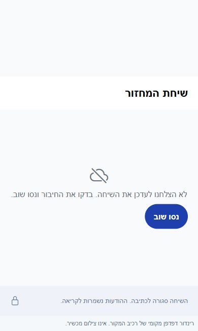

# מסירת בדיקת הלילה, 27.10.2026

הבהרה מההתייעצות המאוחרת: ללא התקנה אינו מחייב ללא חשבון, ואורח קיים כן מופיע בסטטיסטיקת המחזור, גם בלי צבירה אישית. [הדוח של עשרת הסוכנים](2026-10-27-club-web-registration-consultation.md) מחדד את החלופות ואת משמעות ההבטחה לפני מימוש.

הושלם סבב המחקר והבדיקה המקומית לפי הסדר שנקבע. תוקנו שישה מקרים, כל 550 חבילות הבדיקה וכל 6192 הבדיקות עברו, ובדיקת טיפוסי הלקוח נקייה. בדיקת טיפוסי השרת עברה לאחר תיקון העונות ולא נערך מאז שינוי שרת. כל ששת התיקונים נרשמו ביומן השחרור ונקראו חזרה. לא בוצעו פריסה, בנייה לחנות, שינוי הרשאות, שמירת קוד בהיסטוריה או דחיפה למאגר.

## הרשמה בלי התקנה

המסלול המוצע הוא בקשת השתתפות דרך דף המחזור הקיים, עם שם ומזהה בקשה פרטי, אישור מנהל והתראה למנהל. לאחר אישור נוסף אורח למחזור ללא חשבון שחקן וללא סטטיסטיקה אישית מצטברת. האורח עדיין נכלל בנתוני המחזור עצמו. לפני אישורו הוא נשאר בקשה פרטית ולא מקום מאושר ברשימה. מגבלת המקומות, המתנה, ביטול, בקשה כפולה ואישור מקביל דורשים הכרעה באותה עסקה בשרת. שליחה חוזרת של התראה צריכה להשתמש במזהה קבוע ובתור התאוששות.

שם לבדו אינו מזהה מספיק לביטול או לאישור בקשה. גם אורח בלי סטטיסטיקה אישית משפיע על מקום בסגל ועל משחקי המחזור; צריך להגדיר את גבולות השימוש בשם ולא לפרסם רשימה פרטית בדף הציבורי. זהו מחקר ואפיון מוצע, לא פיצר שהופעל. [חלופות, מסלול נתונים ומקרי קצה](../changes/2026-10-27-overnight-audit.md).

## ששת התיקונים

| תחום | מה השתנה | ראיה |
|---|---|---|
| מדידה מהטלפון | תשובת מדידה או שגיאה מחשבון קודם נעצרת אחרי יציאה או החלפת חשבון | שלוש בדיקות שחזור נכשלו לפני התיקון; בדיקות השירות עברו |
| עונות | פעולה ישנה שאיבדה בעלות אינה יכולה לכתוב הגדרות או הפעלה מעל פעולה חדשה | שלושה שחזורים נכשלו לפני התיקון; בדיקות עסקאות ושחזור עברו |
| השוואת שחקנים | כשל בפרטי העונה אינו מערבב שערי עונה עם הופעות מכל הקריירה; שינוי עונה באמצע הקריאה מבטל את התוצאה | חמש בדיקות שחזור נכשלו לפני התיקון |
| מועדון ציבורי | כשל בטעינת מחזורים קרובים מגיע לניסיון חוזר במקום להסתיר את המחזורים כאילו אינם קיימים | שחזור כשל, התאוששות, ריקנות אמיתית ותשובה ישנה |
| שיחות | כשל במנוי אינו הופך לשיחה ריקה; הודעות קודמות נשמרות, מנוי שנסגר נחסם והצלחה מבטלת ניסיון מיותר | שבע בדיקות מנוי וצילומי רינדור מקומיים לפני ואחרי |
| חזרה מפרטי מחזור | בהיעדר היסטוריה נבחר יעד שרשום במחסנית המארחת | שש בדיקות מול רישומי ארבע המחסניות; שלוש נכשלו לפני התיקון |

כל התיקונים מקומיים וטרם הופצו. אין להציג בדיקת קוד או עסקה מדומה כשחזור במכשיר או בנתוני הייצור. הראיות, שמות הבדיקות, קבלות היומן וחותמות המקור מופיעים ב[דוח העבודה המלא](../changes/2026-10-27-overnight-audit.md) ובתיקייה `artifacts/overnight-audit-2026-10-27`.

## ספורט, לייב, עונות וסטטיסטיקה

בסנכרון נבדקו מסלולי מאגר הבריאות היומי, התור מהשעון, הפעילות האישית בחלונות משחק והמדידה מהטלפון. נבדקו בנפרד מכנים, זמן דגימה וכיסוי חסר. מנוע התנועה הטהור עבר בדיקת קוד מקורי מקומית. עדיין נדרשים חיישן אמיתי, דיוק בחוץ, מסך כבוי, שלילת הרשאה והעברת נתונים משעון מנותק.

בלייב נבדקו מסלולי ההתחלה הפעילים, הטיימר, שמירת תוצאות, שערים, פנדלים, חילופים, השאלות, סדר קבוצות ופקודות השעון. בעונות נבדקו בעלות פעולה, שחזור, סגירה, ארכיון ושימור נתוני קריירה. אין כאן הפעלת סגירת עונה בייצור או הוכחת תיאום בשני מכשירים. מרוץ נוסף שוחזר ב-`startEvening`, אך לא נמצאו לו קוראים פעילים והוא נשאר ממצא קוד מנותק בעדיפות נמוכה.

בסטטיסטיקה הושוו טווחי עונה וקריירה, מחזורים לעומת משחקים, שיעורים ומכנים, שערים עצמיים, פנדלים וכיסוי ארכיון. זו ביקורת ליבה ממוקדת ולא הוכחה שכל רשומה היסטורית וכל מספר בייצור חושבו מחדש. חסר יומן השתתפות מלא לחילופים. במשימה המקורית תועדה ב-15.10 הכרעה זמנית לפי ההרכב בסיום; ההעדפה הישנה לקבוצה הראשונה אינה הוראה עדכנית. לא שונתה המדיניות ולא שוחזר מידע שלא נשמר.

## פולס

תצלום הלוח כלל 761 מסמכים בחמישה מקורות. במחקר נמצא שקריאת ההיסטוריה הסגורה קודמת לסינון המקומי; חלוקה לפתוחים ולהיסטוריה מוגבלת היתה מחזירה בתצלום הזה עד 169 מסמכים במקום 761, כ-78 אחוזים פחות. זהו חישוב מחקרי, לא מדידת חיוב ולא שינוי שאילתה שהופעל. ההמלצות שומרות את מסירות הביקורת של הבעלים ומתייחסות למטמון תמונות, איחוד קריאות ומסמכים ישנים בלי סטטוס.

נבדקו 30 פריטים לטיפול במלואם. משימת עריכת הקבוצות שכבר מומשה ב-25.10 הועברה לביקורת הבעלים עם צילום הוכחה נפרד וקריאה חוזרת מאומתת. יתר 29 הפריטים נשארו פתוחים: 13 דורשים אפיון או הכרעת מוצר, ו-16 שגיאות שאין להן תיקון נוסף מוכח מהראיות הקיימות. אף אחד משלושים המסמכים לא כולל צילום מקור מצורף. נקראו עשר שיחות תמיכה ונצפו שלושה צילומי מקור; לא נשלחו הודעות. [תוצאה פרטנית לכל פריט](2026-10-27-pulse-board-review.md).

## מסכים ואחידות

[המלאי המלא](2026-10-27-screen-and-consistency-inventory.md) כולל את כל 62 קובצי התצוגה באפליקציה, לרבות טפסים, כינויים וקבצים שאינם מסכי מוצר פעילים. ההפניות והמשתמשים החסומים הם שני המועמדים הראשונים להשלמת בדיקת עיצוב; מעטפות ההיסטוריה והזמינות דורשות השוואת אחידות. נמצאו חלונות מערכת באזור הפעילות ו-11 סגנונות כיווניות חשודים בארבעה מקורות. אלה ממצאי קוד והצלבה עם צילומים קיימים, ללא פתיחה חדשה של כל המסכים במכשיר וללא הכרזה שכל המועמדים מעולם לא עוצבו.

צילום תיקון השיחה הוא רינדור דפדפן מקומי של רכיב המקור במצב כשל מוזרק, עם מתאמים לרכיבים מקוריים. הוא אינו צילום אנדרואיד. האימולטור לא היה זמין, ולכן בדיקת כיווניות מקורית, מקלדת, לחיצה וחיבור חי עדיין פתוחות.

## מה נשאר

1. אימות במכשיר של חיבורי הספורט, סנכרון שעון, התאוששות רשת ותיאום לייב; אין הבטחת תקינות מקצה לקצה בלי הבדיקות האלה.
2. אישור אפיון הרשמת האורחים והכרעות המוצר המתועדות בפריטי הפולס.
3. צילום ובחינת פערי העיצוב והכיווניות במכשיר זמין, כולל רשימות מלאות ומצבי כשל.
4. שחזור ממוקד של 16 השגיאות שנותרו בגרסה ובמכשיר המתאימים; אין לסגור אותן רק משום שהן ישנות.
5. פערי התיעוד הקודמים: 132 כשלים ו-24 סימוני שינוי במפתח המצב נשארו גלויים. לא נוספו כשלים מתיקוני הלילה ולא רועננו חותמות של קוד לא קשור כדי להסתירם.

התזמון החוזר של בדיקת הלילה נעצר לאחר המסירה כדי לא להריץ מחדש את אותן בדיקות. המשך העבודה דורש את הראיות או ההכרעות המפורטות כאן.
