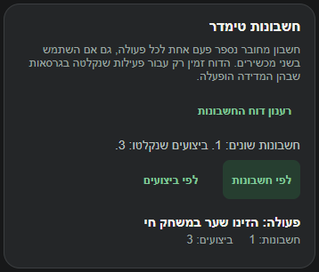
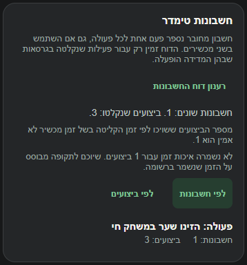
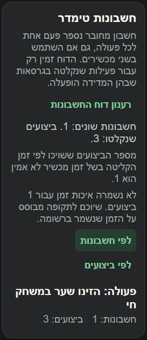

# איכות הזמן בדוח חשבונות טימדר

ב-5.11.2026 נמצא שקורא דוח החשבונות הקרין את זמן המיון של האירוע, אבל לא את שדה איכות הזמן. השרת מחליף זמן מכשיר עתידי ביותר מחמש דקות, או ישן ביותר משלושים יום, בזמן הקליטה. בלי החיווי אפשר היה לקרוא את השיוך לתקופה כאילו כל הרשומות נשענות על זמן מכשיר מהימן.

## התיקון

`pulse/src/services/accountActionReport.ts` מבקש כעת גם `timeQuality`. כל אירוע שהתקבל נזקף לאחד משלושה מונים.

| מצב הרשומה | המונה בדוח | משמעות |
|---|---|---|
| `device` | `device` | זמן המכשיר נשאר זמן המיון בשרת. |
| `unreliable` | `received` | השרת השתמש בזמן הקליטה לשיוך לתקופה. |
| שדה חסר או ערך אחר | `unknown` | לא ידועה איכות הזמן. |

הסכום של שלושת המונים שווה למספר הביצועים שהתקבלו בדוח. שדות חסרים ברשומות קודמות אינם מוחקים אירועים או חשבונות. דוח שלם אינו מסומן כחלקי רק משום שחלק מהזמנים הוחלפו. גבול הקריאה, אי זיהוי אירוע וחלקיות נשארים מנגנונים נפרדים.

`pulse/src/components/AccountActionCard.tsx` מציג כמה ביצועים שויכו לתקופה לפי זמן הקליטה וכמה ביצועים חסרי איכות זמן. אם מתקבל דוח מהצורה הישנה ללא המונים, כל הביצועים שלו מוצגים עם איכות חסרה.

## בדיקות

נוסף תרחיש עם שלושה אירועים של אותו חשבון. אחד נשא זמן מכשיר תקין, אחד סומן בשרת כזמן בלתי אמין, והשלישי היה רשומה ישנה בלי השדה. תוצאת הדוח נשארה חשבון אחד ושלושה ביצועים, עם מונה אחד לכל סוג איכות.

נוספה גם בדיקת שילוב שמפעילה את מטפל הקליטה של השרת ואת קורא הפולס. אירוע בזמן רגיל נשמר כ-`device`. אירוע שזמנו יום בעתיד נשמר כ-`unreliable`, וזמן המיון שלו שווה לזמן הקליטה. הדוח החזיר חשבון אחד, שני ביצועים, אירוע אחד לפי זמן מכשיר ואירוע אחד לפי זמן קליטה.

הקוד נבדק ב-`tests/logic/accountActionReport.test.ts` וב-`tests/logic/usageActivityServer.test.ts`. הרצת שלוש החבילות כוללת גם את `tests/logic/pulseActionReports.test.ts`, ובה עברו 33 מתוך 33 בדיקות. בדיקת הטיפוסים של פולס נקייה. [פלט ההרצה](../../../artifacts/system-night/account-quality-tests.log), [בדיקת הטיפוסים](../../../artifacts/system-night/account-quality-types.log).

## ראיות התצוגה

רכיב המקור רונדר במתאם דפדפן מול אותם נתוני הדגמה של חשבון אחד ושלושה ביצועים. לצילום שלפני השינוי שוחזר גוף הרכיב הקודם בהסרת שורות החיווי שנוספו בלבד. אחרי השינוי נבדקו רוחב 390 ורוחב 320 עם גופן מוגדל פי אחת וחצי. בשני הרוחבים נמצאו אפס רכיבים שגלשו אופקית. שני חיוויי איכות הזמן הופיעו לצד אותם מספרי חשבונות וביצועים.

הבדיקה מקומית, ללא קריאת משתמשים אמיתיים, שינוי הרשאות או פריסה. הצילומים אינם אימות של תצוגה במכשיר פיזי. [כלי התצוגה](pulse-actions-proof.cjs).
