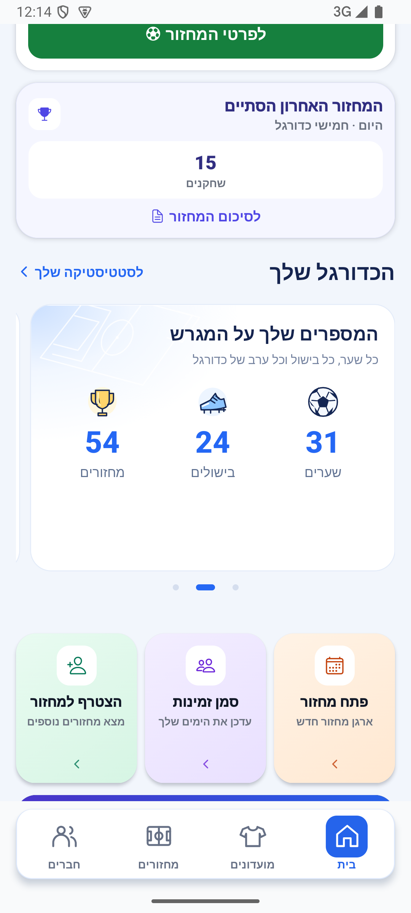
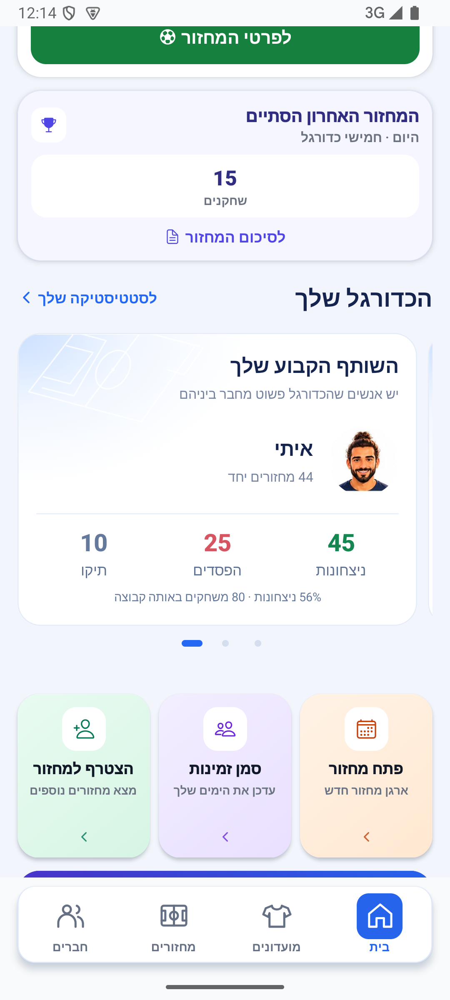

# גובה אחיד לקרוסלת הסטטיסטיקה בבית

דיווח פולס `GuXWymMOuagePs3zWlkg`, גרסה 1.1.48: מעבר לכרטיס המספרים הנמוך הקטין את הקרוסלה והקפיץ את התוכן שמתחתיה.

`HomePersonalStats.tsx` מודד כעת את תוכן כל הכרטיסים, בתוספת 34 יחידות לריפוד ולמסגרת, ומשתמש במקסימום משותף לקרוסלה ולכל כרטיס. המינימום נשאר 204. הגובה אינו תלוי בכרטיס הנבחר. כל ארבעת הכרטיסים האפשריים נכללים ברינדור הראשוני ואינם מוסרים בעת יציאה מהמסך האופקי. מדידות מופרדות לפי משתמש, רוחב וגודל גופן; אין גובה מקסימלי החותך טקסט מוגדל. אין שינוי בנתונים או בניווט.

נבדק באימולטור אנדרואיד עם נתוני הדגמה מנותקים: ציונים, מספרים ושותף. בכל שלושת המצבים גבולות הכרטיס האנכיים היו 799–1502 פיקסלים, גובה 703, וכרטיס הפעולה שמתחת נשאר בגבולות 1665–2059. מקור המדידות: `artifacts/home-carousel-height/measurements.json` והיררכיות המכשיר. הצילומים נבדקו חזותית, כולל כיווניות. אייפון, מכשיר פיזי וגופן מוגדל לא הורצו.

בדיקת טיפוסים וכל 3575 הבדיקות ב־277 חבילות עברו. התיקון מקומי וטרם נכלל בגרסת חנות. מקור: `b8a8ccf4` בתוספת השינוי המקומי.

