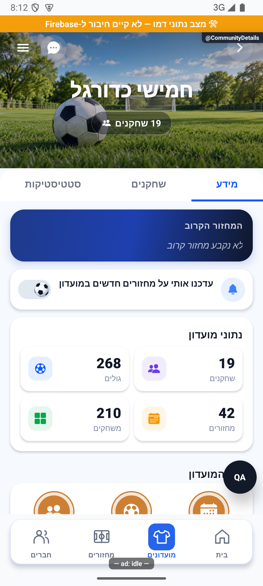
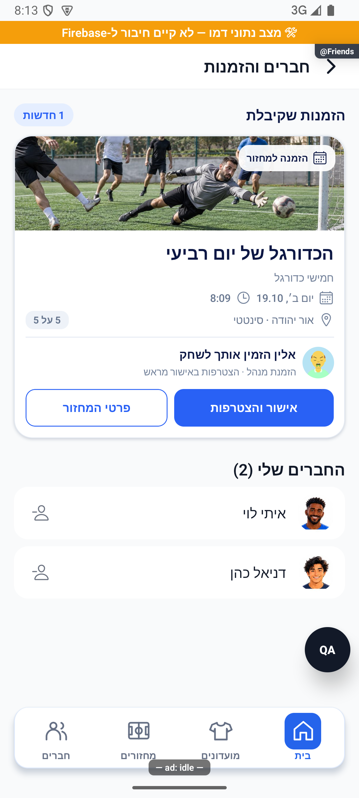
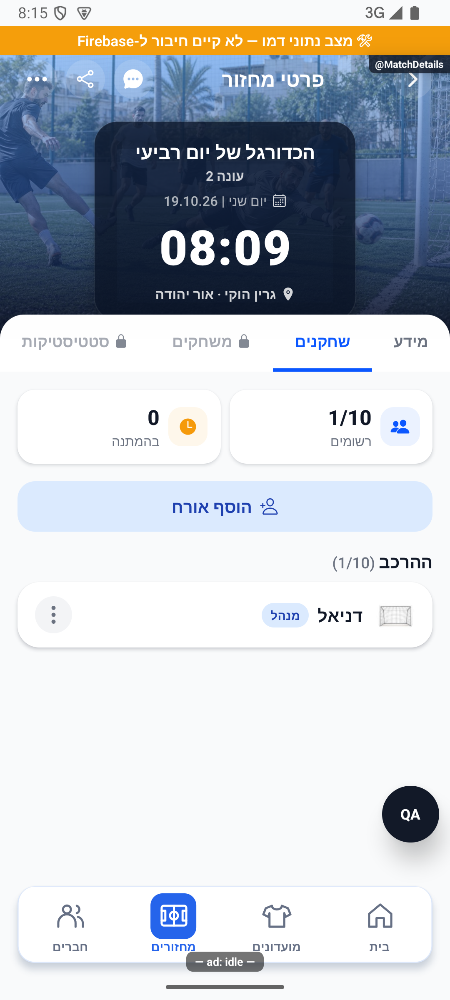
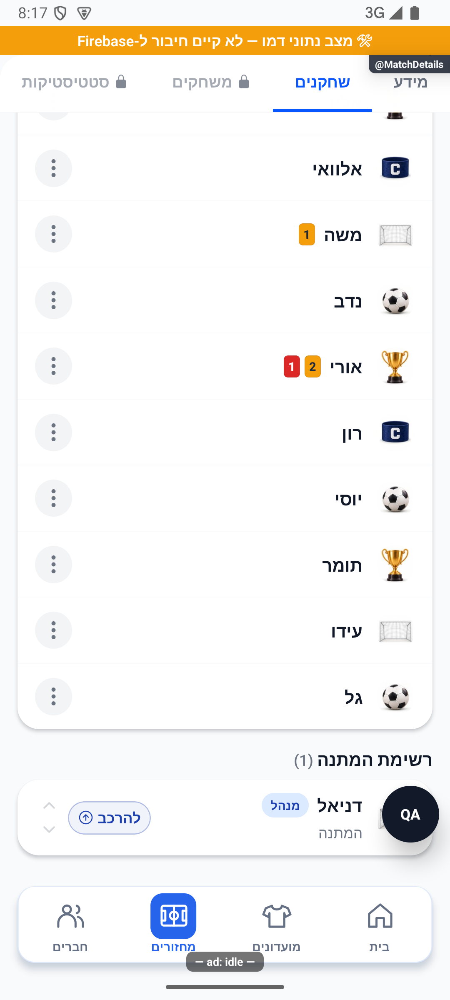

# כרטיסי הזמנות ואישור ישיר — 12.10.2026

## כרטיסי הזמנה ואישור מתוך הרשימה — 12.10.2026

מקור: 'ec536c6f1e2302ff40cfa3b16b230257cae8df53' עם שינויים מקומיים אחרי 1.1.47/280; טרם הופץ. אין מסך חדש: 'ReceivedInvitations' ממשיך להתארח ב־'FriendsScreen' בכל מחסניות הכניסה הקיימות.

- תצוגה: 'src/components/social/InvitationCard.tsx' כולל תמונת כיסוי בגובה 108, תג סוג ההזמנה, כותרת, פרטים, מזמין עם תמונה ציבורית, כפתור אישור ראשי וכפתור פרטים. כל השורות מסודרות לפי כללי הכיווניות. תמונות בגודל מפורש ממלאות את הכיסוי בלי להשתמש במידות הטבעיות של הנכס. 'resolveRoundCover' משותף לכרטיס המחזור ולמסך הפרטים, כולל סוג מגרש, שעת המחזור, מזהה, תמונה שהעלה המועדון ומחזור חד־פעמי. כשל בתמונה שהועלתה חוזר למאגר המקומי.
- נתונים: 'receivedInvitationsService.list' שומר את שאילתת הנמען והגנת הסשן; 'withPreviews' קורא מועדונים דרך 'groupService.getPublic', מחזורים דרך 'gameService.getGameById' ומזמינים דרך 'hydratePublicUsers'. אין קריאת מסמך פרטי של המזמין. קריאות מועדון חוזרות באותה טעינה מאוחדות. שדות 'preview' נבנים מהשירותים, אינם שדות חדשים במסד ולכן אינם דורשים שינוי ממירי הקריאה. כשל במידע משלים אינו מוחק הזמנה ואינו נטען כאילו מחזור חסר. חזרה למסך ורענון מרעננים את המצב; אין מנוי חי חדש לרשימת ההזמנות.
- קיבולת: תפוסה = מספר המשתמשים בהרכב + 'activeGuestCount' + מקום שמור להצעת קידום פעילה. ממתינים ואורחים ממתינים אינם תופסים מקום. 'isFull' מתקיים כשיש מכסה חיובית והתפוסה גדולה או שווה לה. דוגמה: 9 רשומים ואורח פעיל אחד במכסה 10 מוצגים כמלא; 9 רשומים ואורח בהמתנה אינם מלאים. זהו מידע לתצוגה בלבד. המרוץ על המקום האחרון מוכרע במסלול ההרשמה הקיים לפי זמן הלחיצה, לא לפי הכרטיס שנצפה קודם.
- פעולה: 'acceptReceivedInvitation' מאמת את המשתמש לפני ואחרי הפעולה. מועדון עובר דרך 'useGroupStore.requestJoinById' והפונקציה הקיימת 'joinSocialClub'; מחזור עובר דרך 'gameService.requestJoinGame(...,'notification')' וממתין לתוצאה המוסמכת של בקשת ההרשמה. אין כתיבה ישירה להרכב, אין יצירת אישור מהטקסט שבהתראה ואין שינוי בהרשאות.
- ניווט: אחרי 'joined/already_member' למועדון, 'navigateInvite' פותח 'CommunitiesTab → CommunityDetails' כאשר החברות כבר נטענה לחנות. מחזור פותח 'GameTab → MatchDetails' רק אחרי תשובת 'players/waitlist/pending'. המתנה מוצגת כהמתנה, ואישור ממתין אינו מוצג כהרשמה. אי אפשר להבטיח הצטרפות ישירה להזמנה רגילה או להזמנה של מנהל שאיבד את הרשאתו; השרת הקיים הוא הקובע. הזמנת מנהל תקפה מחליפה אישור כפי שאופיין.
- רציפות: הפניה סינכרונית חוסמת לחיצות מקבילות גם בין כרטיסים; מחוון טעינה מוצג בכרטיס הפעיל והכפתורים חסומים. 'finally' משחרר את החסימה. אחרי הצלחה מוסרות גם כפילויות של אותו יעד וסוג. סימון ההתראה כנקראה אינו תנאי להצלחת ההצטרפות. אחרי עזיבת המסך או החלפת חשבון, תשובה ישנה אינה מפעילה ניווט. בכשל מוצגת הודעה והרשימה נבדקת מחדש. בהיעדר יכולת ניווט ההצטרפות נשארת שמורה ואפשר להיכנס דרך הרשימות.
- רשימות: התצוגה מסתירה גם הזמנת מחזור ישנה כשהמחזור שקראנו כבר כולל את השחקן בהרכב או בהמתנה, ולכן צירוף ישיר של מנהל אינו משאיר הזמנה מיותרת. חברות קיימת במועדון מוסתרת לפי תוצאת השרת או החברות המאומתת בחנות. בדמו המנותק עודכן 'mockSubmitJoin' לכבד הזמנת מנהל נוכחי ותקפה; אין שינוי למסלול הרשאות הייצור.
- בדיקות: 'acceptReceivedInvitation.test.ts', 'invitationCardAcceptance.test.ts', 'receivedInvitationPreviews.test.ts', 'invitationClubAcceptance.test.ts' מפעילים קוד אמיתי עם תלויות מבודדות. 'invitationReconciler.test.ts' מאמת את מסלול השרת לשחקן חיצוני: הזמנת מנהל מובילה להרכב או להמתנה גם כשנדרש אישור, ואינה עוקפת דחייה, זהות לא מתאימה או מחזור סגור. בדיקת המועדון מפעילה את 'joinSocialClub' עצמו ומוודאת כניסה למועדון סגור עם הזמנת מנהל, מכסה, חסימה וחברות קיימת. אין בדיקות ניצול או כתיבה לייצור.
- ראיה: באמולטור נצפו אישור מועדון סגור ו־19 חברים לעומת 18 קודם, חזרה לרשימה ללא הזמנתו, אישור מחזור ו־1/10 בהרכב, ואישור מחזור מלא עם 10/10 בהרכב ו־1 בהמתנה, כולל המשתמש עצמו ברשימת ההמתנה. המשתמש מנהל במחזור הדמו; אישור מנהל לשחקן חיצוני נבדק במבחן השרת המבודד. אין הוכחה לבינארי החנות, למסירה מול שרת ייצור או לאייפון.

## צילומי תוצאה

תוצאת הבדיקות הסופית: 3,561 בדיקות ב־273 חבילות עברו, בדיקת טיפוסים נקייה ובדיקת מסמכי הפיצ׳רים ללא כשלים. הוכנו 7 צילומי דמו מתועדים; אין פריסה או העלאת גרסה במשימה זו.
