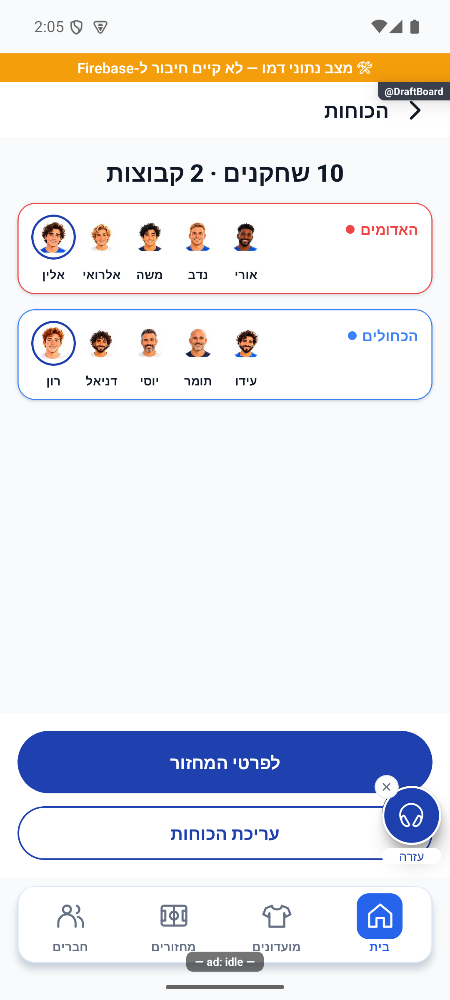

# חלוקת כוחות שמורה אחת — 15.10.2026

## מה נמצא ותוקן

כל השיטות כבר שמרו ל־draftTeams.teams, אך בזמן לייב השמירה יכלה לקבל originalTeams ישנים מהעורך. בנוסף rotation.baseTeams נשאר עם החלוקה הקודמת, ולכן איפוס או החזרת משלימים יכלו להחזיר שיוכים ישנים. נפתרה הסתירה במתודת השמירה המשותפת, ללא מסלול כתיבה חדש לכל שיטה.

שמירה מפורשת מחליפה את תמונת החלוקה, את סגל העבודה ואת בסיס הרוטציה באותה עסקה. השאלות מהחלוקה הקודמת מתנקות. התוצאה, השעון, זהות המשחקון, הניצחונות ואירוע שמירת התוצאה הקודם אינם משתנים. תור ההמתנה שומר את סדר הקבוצות הקיימות ומוסיף קבוצות חדשות. הסרת קבוצה שמשחקת כעת נחסמת כדי לא להשאיר צד ללא קבוצה. אין כתיבה להיסטוריית משחקונים או לנתוני משתמשים.

פתיחת שיטה בלבד אינה שומרת כוחות. טיוטה ידנית חלקית נשארת מקומית; רק שמירה מלאה מחליפה את החלוקה. בדיקת גרסת הבסיס הקיימת מונעת חידוש טיוטה מקומית ישנה לאחר החלפת החלוקה.

## בדיקות ומגבלות

בדיקות savedAllocationReplacement מריצות את מתודת saveDraftTeams האמיתית באמצעות עסקה מדומה ובנתוני דמו. הרצף כולל ארבע חלוקות שונות, קלט עם תמונת מקור ישנה בזמן לייב, שימור תוצאה ושעון, שימור זהות המשחקון, סגל שהשתנה, 3/4/7 קבוצות וסדר המתנה. אלגוריתמי הדירוג עצמם לא שונו; השמות אוטומטי/ידני/אקראי/קפטנים ברצף מייצגים את ארבע השמירות המגיעות לאותו שירות, ולא ארבע אינטראקציות שבוצעו במכשיר.

נצפתה תצוגת עשרה שחקנים בשתי קבוצות באנדרואיד דמו. ניסיון ניווט נוסף הוחזר למסך הבית; לא נטען שרצף החלפת ארבע שיטות הושלם במכשיר. אין בדיקה חדשה באייפון או כתיבה למסד אמיתי. לא בוצעו פריסה, שינוי הרשאות, בנייה לחנות או דחיפה לגיט.

בדיקת טיפוסים נקייה; 327 חבילות ו־3,876 בדיקות עברו. בדיקת תיעוד הפיצ׳רים עברה ללא כשלים. יומני הבדיקות: artifacts/allocation-tests.log ו־artifacts/allocation-tsc.log. רישום התיקון ביומן ההפצה אומת בקריאה חוזרת בגרסת next ואינו מעיד על הפצה; הקבלה נמצאת ב־artifacts/allocation-release-receipt.json.
