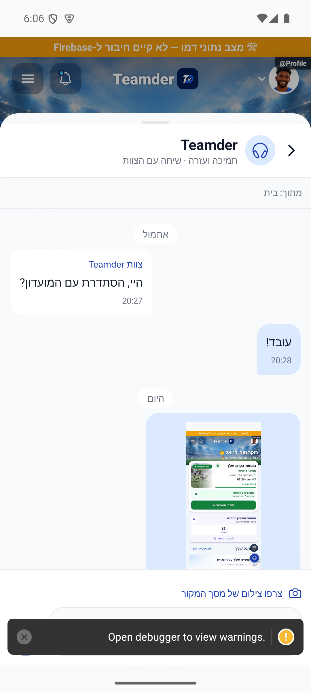
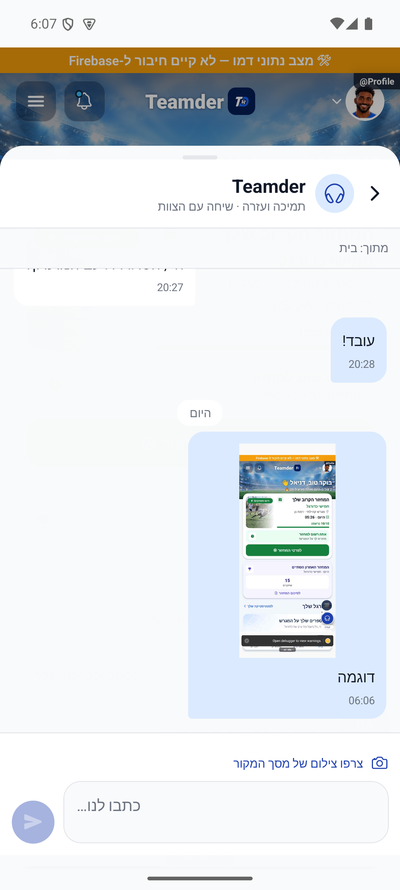
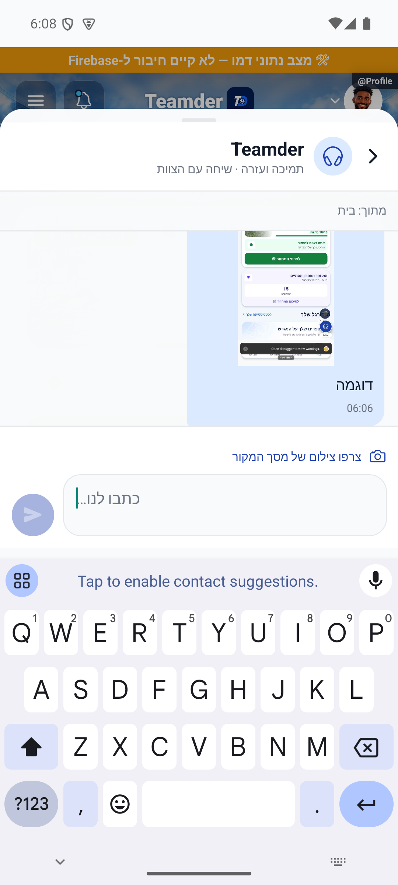

# צילום וסדר הודעות התמיכה — 15.10.2026

דיווח מגרסה פנימית `1.1.50/283`: צילום בהודעת 08:58 אינו מופיע, וההודעה נכנסה בין הודעות ישנות ללא חלוקה לימים. קריאה בלבד מהשיחה המדויקת בשרת אישרה שהצילום שמור, באורך 55,640 תווים. אין צורך לשלוח אותו מחדש. לא שונו הודעות ייצור.

`chatMessageConverter.fromFirestore` בנה הודעה מחדש ללא `supportImage` ו־`supportContext`. התצוגה תמכה בצילום, אך השדה לא הגיע אליה. הממיר שומר כעת את השדות האלה. הטענה הישנה בתיעוד שהקורא משמר אותם הייתה שגויה; בדיקות השילוב הקודמות עקפו את הממיר ולכן לא זיהו זאת.

במאגר קיימות הודעות עם `createdAt` מספרי והודעות עם חותמת זמן. סדר המסד משווה תחילה סוגי שדות, ולכן היפוך התוצאה אינו נותן סדר כרונולוגי מעורב. בשיחה הרשמית בלבד נפתחות שתי שאילתות מוגבלות למאה הודעות כל אחת, לפי סוג הזמן. הן ממוזגות לפי מזהה וממוינות לפי מילישניות, עם מזהה כשובר שוויון, ונשמרות מאה ההודעות האחרונות. הצגה ראשונה ממתינה לשתי הקריאות; סגירה או שגיאה סוגרות את שתיהן. בשיחות אחרות נשאר מסלול הקריאה הקיים. אין שליפה בלתי מוגבלת או הסבת נתונים.

`supportDayLabel` משווה ימי לוח שנה מקומיים: כותרת אחת לפני ההודעה הראשונה בכל יום, ״היום״, ״אתמול״ או תאריך כולל שנה. אין חישוב קבוע של 24 שעות. צילום מוצג מעל הטקסט באותה בועה ונפתח להגדלה בלחיצה.

עברו 3,830 בדיקות ב־319 חבילות ובדיקת טיפוסים. כל 11 בדיקות השילוב עברו מול מלוא הכללים המקומיים וגם מול עותק מלא של הכללים הפעילים. בדיקה חדשה מריצה את הממיר האמיתי מול מסד מקומי עם מעל מאה הודעות בשני סוגי הזמן, דרך משתמש מאומת. נבדקים צילום, הקשר, מאה ההודעות האחרונות וסדר כרונולוגי. בדיקות נוספות מכסות המתנה לשתי הקריאות, סגירה ושגיאה, חצות ומעבר שנה.

התצוגה נבדקה באנדרואיד בקוד פיתוח עדכני ובנתוני דמו מנותקים: עברית, כותרות ימים, צילום בבועה, הגדלה ושורת כתיבה מעל המקלדת. התמונה בבועה היא צילום אמיתי של מסך הדמו, כולל אזהרת פיתוח; האזהרה אינה חלק ממסך ייצור. אין בדיקת שיחה חיה דרך הלקוח המתוקן, בדיקת אייפון או הוכחת מסירת דחיפה.

זהו תיקון לקוח מקומי. לא נבנתה או הופצה גרסת חנות במשימה זו; הוא אינו קיים בבינארי `1.1.50/283`. אין שינוי שרת או כללי הרשאות. התיקון הקודם לשליחת טקסט ללא צילום נשאר פעיל בשרת.

