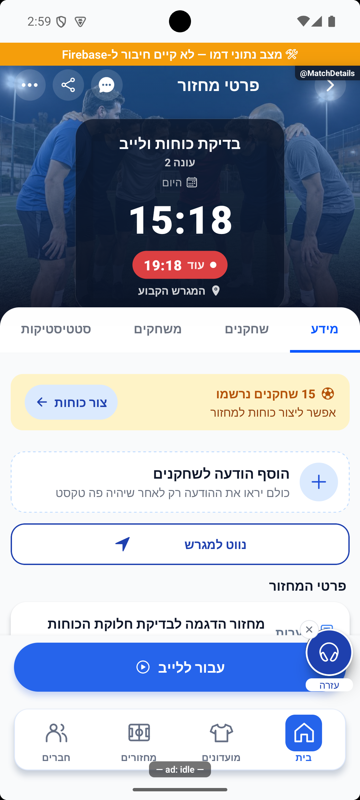

# בסיס מחזור הדגמה ושיפור כרטיסי ההכנה — 16.10.2026

מקור `4a3cb346` עם שינויים מקומיים; לא בוצעה הפצה. הבעלים ביקש שמחזור הבדיקה יישאר זמין אחרי טעינה מחדש, וחידד שאין לשמור את הכוחות שעשה: כל טעינה צריכה לאפשר חלוקה חדשה.

## התנהגות סופית

בסיס המחזור נשמר באחסון המקומי באימולטור: 15 נרשמים, חמש על חמש, שלוש קבוצות, לייב מתקדם, השלמות זמניות, משחקים של 15 דקות והפעלת דירוג פנימי עם ציוני הדגמה. בכל אתחול מלא של סביבת ההדגמה נבנה מחזור פתוח חדש מאותו בסיס, לתחילה בעוד עשרים דקות. כוחות, צבעים שנבחרו, טיוטות חלוקה והכנה, רוטציה, שעון, שערים ותוצאות אינם משוחזרים. ניווט בין מסכים באותה הרצה אינו מאפס דבר.

היישום מוגבל לפיתוח עם מצב דמו מפורש וכלי הבדיקה. אין כתיבה לחשבון אישי, למסמכי מחזורים או למועדונים בשרת. אין שינוי כללים, פריסה, בנייה לחנות או שינוי התחברות.

במסך ההכנה הוסר ״משחקים״ מתחת לקבוצות שנבחרו. שם הקבוצה נמצא מימין, שינוי הצבע משמאל לו ועיגול הבחירה בקצה השמאלי. קבוצות בחוץ ממשיכות להציג את מצב ההמתנה והתור.

## קוד ותיעוד

- `src/utils/localDemoPersistence.ts`: אימות הבסיס ובניית מחזור נקי מרשימת שדות הגדרות מפורשת.
- `src/dev/localDemoPersistence.ts`: שחזור מקומי חד־פעמי לפני חשיפת החשבון; ניקוי שני מפתחות טיוטה של מחזור הדמו בלבד.
- `src/store/userStore.ts`: שער האתחול המוגבל לפיתוח ולדמו.
- `src/components/match/OpeningTeamsPanel.tsx`: סדר הפקדים והסרת שורת המצב בקבוצות שנבחרו.
- זוגות התיעוד: [כלי פיתוח](../features/entry/legacy-and-hidden.md) ו־[לייב מתקדם](../features/rounds/live-advanced.md). לא נוסף מסך או מסלול.

## אימות שבוצע

בדיקת הטיפוסים נקייה. כל 337 חבילות הבדיקות ו־3,962 הבדיקות עברו, כולל שמונה בדיקות חדשות של השמירה המקומית. הלוגים: `tmp/demo-persistence-typecheck.log`, `tmp/demo-persistence-jest.log` ו־`tmp/demo-persistence-targeted.log`.

באימולטור אנדרואיד בוצעו שתי סגירות מלאות ללא מחיקת נתוני האפליקציה. אחרי הראשונה נבדק שהכוחות הקודמים הוסרו. לאחר מכן נוצרה חלוקה באמצעות `gameService.saveDraftTeams`, ונבדק שיש כוחות בזיכרון ואין כוחות בבסיס שבדיסק. אחרי הפתיחה השנייה נבדקו שוב: 15 שחקנים, שלוש קבוצות, חמש על חמש, לייב מתקדם ו־15 שחקנים מדורגים, ללא כוחות, מצב חי או טיוטת הכנה. תוצאת האימות המקומית נמצאת ב־`tmp/demo-persistence-verified.json`.

שינוי פקדי ההכנה נבדק בתרחיש דמו נפרד, כדי להשאיר את מחזור הבדיקה ללא כוחות: הגרלת זוג, פתיחת צבעים וביטול הבחירה מהעיגול השמאלי. התמונה נבדקה בפועל לכיווניות.

## מגבלות

הראיות הן מדמו מקומי באנדרואיד. לא נבדקו אייפון, אחסון מסד מרוחק, קורא מסך או גודל גופן מוגדל. מחיקת נתוני האפליקציה או התקנה נקייה מסירה את הבסיס המקומי. הפעלה במצב הרגיל אינה משחזרת את מחזור הדמו. השינוי עדיין מקומי, ושרת הפיתוח נשאר פועל כדי לאפשר המשך בדיקה באימולטור.
