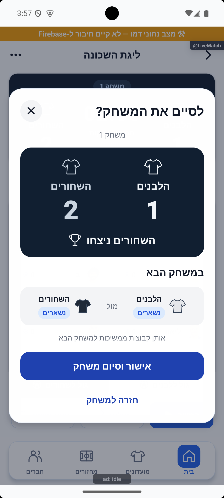
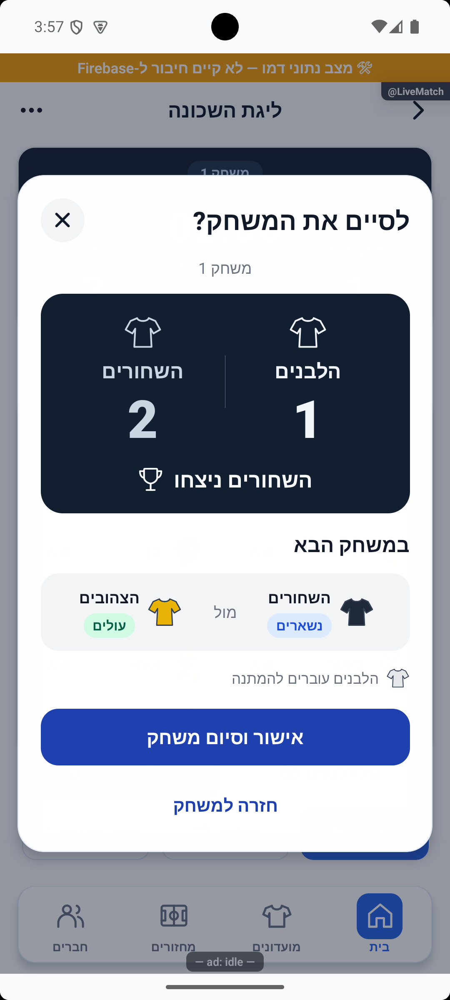
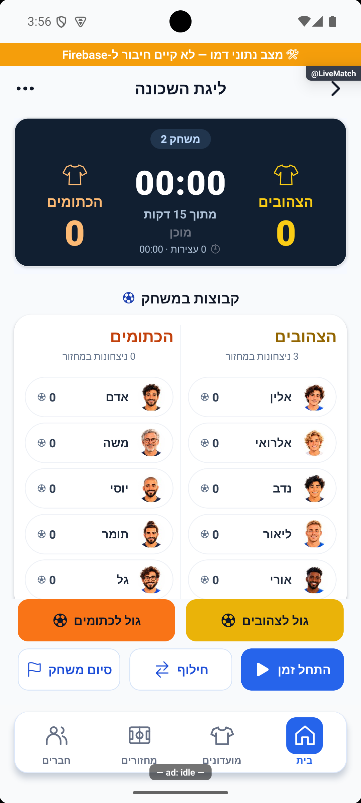
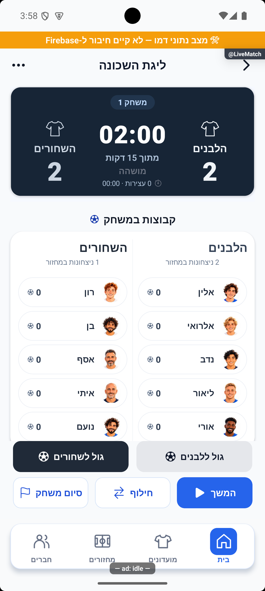

# חלון סיום המשחק וחולצות בלוח הלייב — 16.10.2026

מקור `4a3cb346` עם שינויים מקומיים. הסקיצה שאושרה מומשה כחלון אישור ייעודי לסיום משחק עם מנצחים. באותו שינוי נוספו ללוח הלייב אותן חולצות מתאר שמופיעות מעל התוצאה בחלון.

## מה השתנה

במקום כותרת וטקסט כללי רואים לוח תוצאה כהה עם שני הצדדים, חולצות ושמות, ציון המנצחים ותצוגת המשחק הבא. עם קבוצות ממתינות רואים מי נשארים, מי עולים ומי עוברים להמתנה. בלי ממתינים שתי הקבוצות ממשיכות, ללא טענת יציאה שגויה. האישור נקרא ״אישור וסיום משחק״; הפעולה השנייה ״חזרה למשחק״. בתיקו נשמר מסלול ההכרעה הקיים.

`TeamShirt` מצייר את אותה צורה מקומית בשני המקומות. על הלוח הכהה משתמשים במתאר ובצבע קריא של הקבוצה; פרטי המעבר משתמשים בחולצה מלאה בצבע הקבוצה. אין טעינת תמונה או שינוי צבעי הקבוצות השמורים.

פתיחת החלון וסגירתו אינן שומרות דבר. הבקשה קשורה למחזור, לזהות המשחק ולזוג שמשחק. אישור ישן נדחה אם אלה השתנו, המשחק כבר נשמר או החלו פנדלים. עדכון לתיקו סוגר את החלון. האישור משתמש במסלול השמירה הקיים ובנעילות הכניסה החוזרת שלו; הוא אינו מתחיל את זמן המשחק הבא.

## אימות

נבדקו בדמו המקומי באנדרואיד שלוש קבוצות, שתי קבוצות ללא ממתינים, וחמש קבוצות עם שלוש ממתינות. נבדקו ניצחון מכל אחד מהצדדים, לרבות צבעים צהוב, כתום, שחור ולבן. נבדקו הכיווניות והטקסטים בצילומים בפועל.

סגירה בפקד החזרה הותירה את אובייקט המשחק ללא שינוי. אישור בתרחיש הדמו הנפרד קידם למשחק שני: צהובים מול כתומים, שחורים ממתינים, אפס מול אפס ושעון שאינו רץ. עדכון תוצאה בזמן אמת לתיקו סגר חלון שהיה פתוח. מחזור הבדיקה הראשי הושווה לפני ואחרי תרחישי הבדיקה ונשמר ללא שינוי.

בדיקת הטיפוסים נקייה וכל 337 חבילות / 3,975 הבדיקות עברו. נוספו בדיקות התנהגות לפעולות הפתיחה והאישור ב־`savedRoundTransition.test.ts`: אין שמירה בפתיחה, אישור מפעיל את המסלול הקיים, מצבים מיושנים אינם שומרים, ותיקו מופנה למסלול הקיים. לוגים ב־`tmp/end-match-typecheck.log` ו־`tmp/end-match-jest.log`.

## גבולות

ההרצה והכתיבות של תוצאות הבדיקה היו בזיכרון דמו בלבד. אין הוכחה חדשה למסד אמיתי, מקביליות מול שרת, אייפון, גופן מוגדל או קורא מסך. מסלולי סגירה ברקע ובחזרה מערכתית נקראו בקוד, ולא הורצו בנפרד. לא שונו שרת, הרשאות, ממירי מסד, חישובי סטטיסטיקה או ניווט, ולא בוצעה הפצה או בניית חנות. שרת הפיתוח נשאר פועל לשימוש באימולטור.

זוג התיעוד: [לייב מתקדם](../features/rounds/live-advanced.md), [הסבר פשוט](../features/rounds/live-advanced.simple.md).

התיקון וצילום ההוכחה נקראו מחדש ואומתו ביומן הפרויקט תחת `end-match-20261016-e460314e1b`, כעדכון הממתין להפצה.
