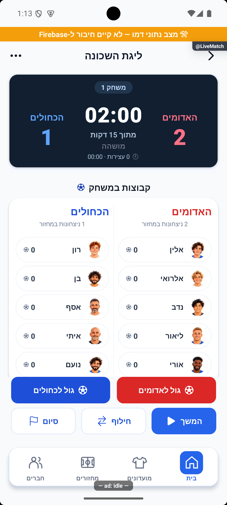
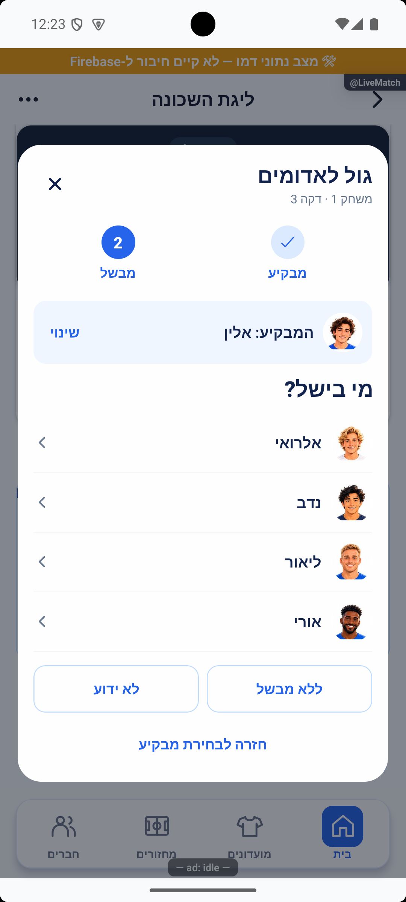
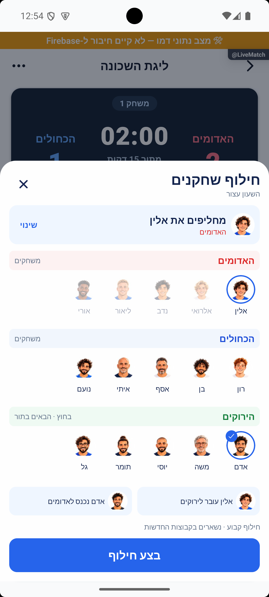
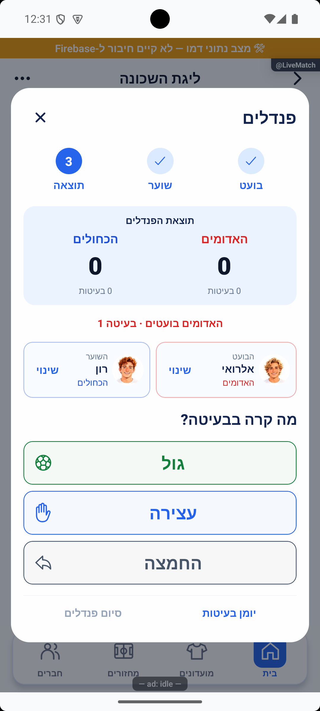
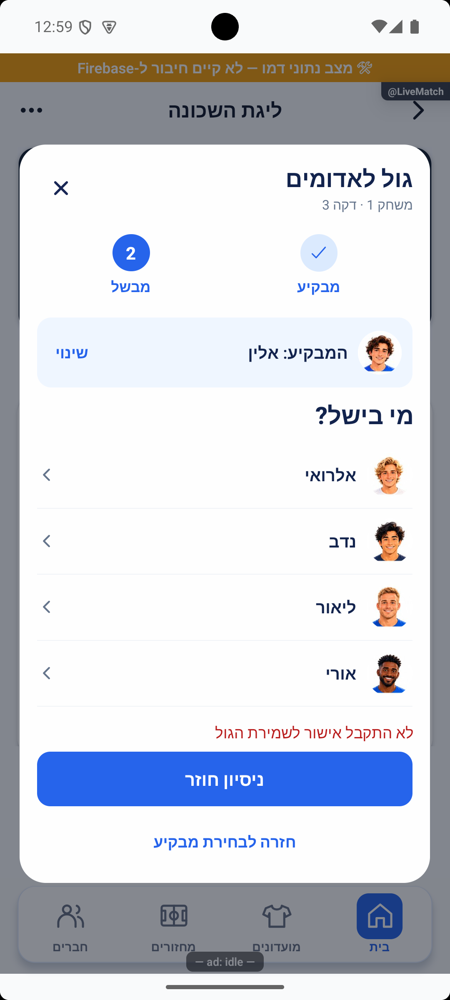
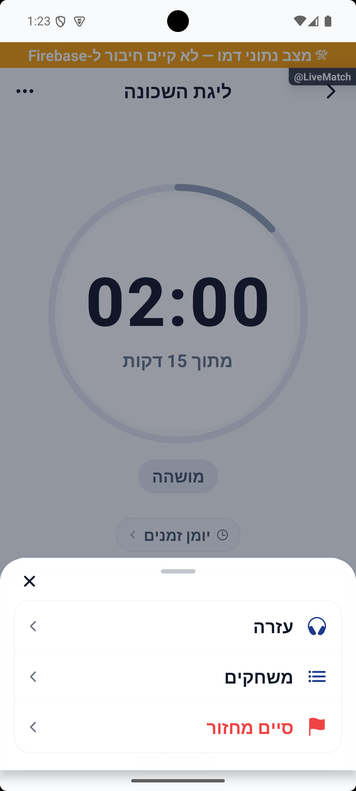

# מימוש מסכי המשחק המאושרים — 16.10.2026

מקור: `4a3cb346` עם שינויים מקומיים. המימוש כולל הכנת המשחק הראשון, צבעים, לוח לייב, שערים ובישולים, חילופים, חיבור לחלון ההשלמות ושלבי הפנדלים. הוא אינו מופץ בסבב זה.

## מה נבנה

- הכנה: בחירה מפורשת של זוג משחקים, כל הרכב עם אווטרים, הגרלת זוג ותור, שינוי סדר המתנה, ושמירת הבחירה המקומית רק עבור חלוקת המקור.
- צבעים: שמונה צבעים, בחירת פנוי או אישור החלפה בין שתי קבוצות עם הרכביהן, שמירה אטומית יחד עם הכנת הרוטציה, וניגודיות קריאה מותאמת לרקע.
- לייב: לוח כהה קבוע בזמן גלילה, שני הצדדים שמשחקים תמיד מזוהים, כל הממתינים והרכביהם נגישים בגלילה, ופקדי משחק קבועים בתחתית. אין ספירת שחקנים ליד שמות המשחקים.
- גולים: מבקיע ואז מבשל עם הקשר גלוי, ללא מבשל בנפרד מלא ידוע, ושער עצמי שמציג במפורש את שתי הקבוצות. שמירה ממתינה וניסיון חוזר עם מזהה אחד.
- חילופים: שורת אווטרים לכל קבוצה, גלילה אופקית לגדולים, מקור ויעד ברורים וסיכום לאישור. זמני או קבוע לפי הגדרת המחזור; החלפת משלים נעשית לפי מיקומו האפקטיבי. שמירה בעסקה ומפתח משחקון נגד פעולה ישנה. העברה למקום פנוי שומרת את מגבלות הגודל.
- השלמות: אותו חלון מאושר, עם שני ההרכבים, חוסרים, קבוצות מקור, בחירה יחידה ואישור קבוע. מסך ההכנה החדש עובר אליו בלי להפעיל שעון.
- פנדלים: ראשונים → בועט → שוער → תוצאה, שלוש תוצאות נפרדות, שוערים נשמרים, תורות לסירוגין, יומן, תיקון וביטול האחרונה, סיום ידני, שוויון ואזהרה על מספר בעיטות שונה. סגירה מאפשרת חזרה בלי מחיקה.
- עזרה: כניסה בכותרת או בתפריט בלייב, כדי שהבועה לא תכסה פקדים. פתיחה אינה שולחת הודעה.

## החלטות הנתונים

בהתאם לתשובת הבעלים, אחוז עצירות השוער משתמש בכל הבעיטות מולו, כולל החמצות. החמצה מפורשת אינה עצירה. מידע ישן ללא סיווג ממשיך לפי החישוב ההיסטורי, ללא הסבת נתונים.

סדרת לייב מאומתת אינה נחתכת אחרי 16 בעיטות בחישוב או אחרי 100 בהיסטוריה. מגבלות קלט של קריאות ישנות נשמרו. מספר ניסיונות גדול מתקפל לאותם מוני שחקנים באצוות השרת. שערי פנדלים אינם שערי שדה.

בחילוף זמני נשמרות קבוצות המקור, לרבות חילוף שבו משתתף משלים. מזהה `RotationLoan.swapId` מקשר חילופים כדי ששני צדדיהם יחזרו יחד לפי כללי הרוטציה. בשתי קבוצות ללא תור חוזרים במשחק הבא. קבוע מעביר את השחקנים לקבוצות היעד המוצגות. בהתאם להחלטה הקודמת על סטטיסטיקה, השתתפות ותוצאה עדיין נזקפות לפי הרכב הסיום; אין מערכת דקות או היסטוריית חילופים מלאה.

## אימות אוטומטי

- `npx tsc --noEmit --pretty false` — עבר ללא שגיאות.
- `npx jest --runInBand --silent` — 336 חבילות, 3,954 בדיקות עברו.
- `npm --prefix functions run build` — עבר.
- בדיקות חדשות/מורחבות: הכנה ותור וצבעים, אידמפוטנטיות שער ובעיטה, תור ומפתח ישנים, תיקון האחרונה, סיווג מול השרת, קריאת ממירים אמיתיים, 24 בעיטות עם גולים/עצירות/החמצות, חילוף לפי הגדרת המחזור, משלים בקבוצה אחרת, חילופים חוזרים, חזרת חילוף מקושר, העברה למקום פנוי ובדיקות רוטציה קיימות.
- בדיקות ביקורת קודמות הותאמו למיקום הרכיב החדש ולבחירת ההכנה, תוך שמירת החוזה שהן בודקות.

לוגים: `tmp/live-implementation/typecheck-final.log`, `jest-final.log`, `functions-build-final.log`. בדיקות מסד כאן משתמשות בקלט/פלט מבודד של העסקאות והממירים; לא הופעלו כתיבות משחקים אמיתיות.

## אימות מרונדר

סביבה: אמולטור אנדרואיד, 1080×2400, מצב דמו מקומי, אווטרים ושחקנים סינתטיים בזיכרון, ללא חשבון או מועדון חדש. המקור כולל שינויים נוספים שהיו בתיקיית העבודה לפני המשימה. פס הדמו וסימוני כלי הפיתוח נראים בצילומים; הם אינם מסכי מוצר.

בוצעו הכנה ובחירה בשלוש וחמש קבוצות, הגרלה ותור, החלפת צבעים תפוסים, אישור הרכבים עם שעון עצור, השלמה משותפת לשני צדדים, גול עם מבקיע ומבשל, שער עצמי, כשל גול וניסיון חוזר, חילוף מול המתנה, חילוף קבוע, פתיחת חילופים עם שעון רץ, שלוש וחמש שורות קבוצה ואחד עשר שחקנים בגלילה לרוחב. הרכבי ארבעה ואחד עשר הוצגו. לוח התוצאה נשאר גלוי בגלילת ההרכבים.

בפנדלים בוצעו בחירת הקבוצה הראשונה, בועט ושוער לכל צד, גול/עצירה/החמצה, מעבר תור, יומן, תיקון, ביטול, סגירה וחידוש, סיום ידני במספר בעיטות לא שווה, וכשל חד־פעמי עם ניסיון חוזר שהוסיף בעיטה אחת בלבד. נבדק גם מסך הסיום בשוויון עם בחירת מנצחת ידנית או המשך בעיטות, ללא הכרעה אוטומטית.

הצילומים קושרו למפת המוצר עם חותמות ומגבלות. לקראת סוף הבדיקות האמולטור קפא; הוא הופעל מחדש ללא מחיקת נתונים לצורך ניקוי חיבור הבדיקה. אין להסיק מצילום מצב אחד על כל הצירופים האפשריים.

## מה עדיין דורש הפצה ובדיקת יעד

נדרשת פריסת שינויי השרת בסיווג הפנדלים, שמירת ההיסטוריה ואימות מטען הסיום לפני הפצת הלקוח החדש. לא בוצעה פריסה, בנייה לחנות, העלאה, שינוי הרשאות או הסבת נתונים.

אין בסבב הוכחת מכשיר פיזי, אייפון, קורא מסך, הגדלת גופן מלאה, משחק ייצור או עבודה של שני מנהלים מול רשת אמיתית. תאימות עם מנהל בגרסת לקוח ישנה דורשת בדיקת יעד לפני הפצה, במיוחד סביב שדה קישור חילופים חדש. אין כאן שינוי בחוקי חלוקת כוחות, ארגון מחזור או זקיפת דקות.

## צילומים נבחרים

[לייב](../features/rounds/live-advanced.md) · [פנדלים](../features/rounds/penalties.md) · [השלמות](../features/rounds/fillers.md).

## יומן וניקוי הסביבה

התיקון נרשם ביומן השחרור כגרסה הבאה, עם צילום הוכחה ממשי במזהה `live-redesign-20261016-b816a3dc21`. הכתיבה והצילום נקראו מחדש ואומתו; אין בכך הפצה. הסביבה המקומית נוקתה: שרת הדמו הופסק, הפניית הפורט הזמנית הוסרה, שלוש ההפניות המקוריות הוחזרו, והגופן הוחזר לערך 1.0. כתובת הפיתוח הזמנית הוסרה ונבחרה ברירת המחדל של הבינארי המקומי. השדה שהוצג בתחילת הבדיקה היה טקסט הנחיה, ולכן לא נשמרה ראיה לערך עקיפה קודם.

