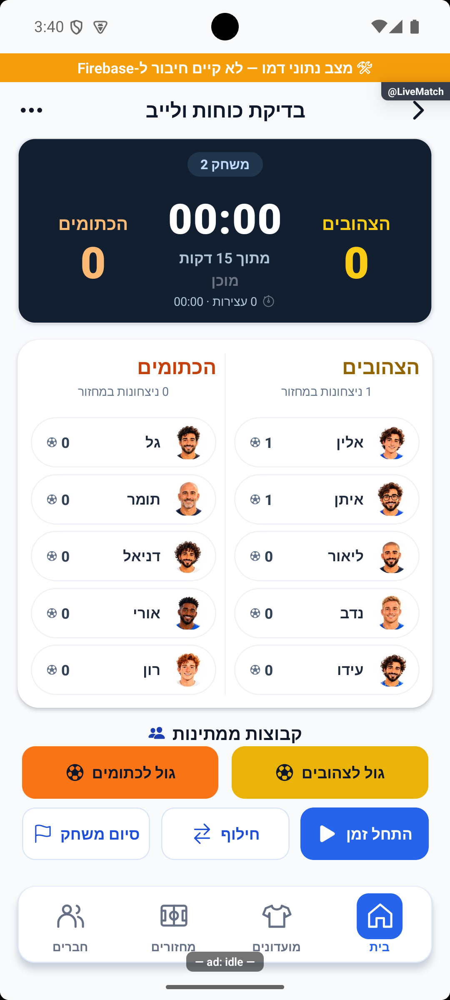

# כיווניות שורת המבקיע וצבעי כפתורי הגול — 16.10.2026

מקור `4a3cb346` עם שינויים מקומיים. הבעלים הצביע על שורת מבקיע שמתחילה משמאל, על כפתורי גול בגוון אחר מצבע הקבוצה ועל כדור בצד הלא רצוי של הטקסט.

## התיקון

שורת המבקיע מציגה מימין את נקודת הצבע, שם המבקיע ופרטי הבישול. הדקה וכפתור ביטול השער נמצאים משמאל. השם משתמש בשטח הפנוי, ושמות ארוכים מוגבלים לשורה אחת. אין היפוך נוסף של כיווניות המערכת.

כפתורי הגול משתמשים כעת בצבע הקבוצה בפועל, במקום בגוון שמותאם לכיתוב על רקע לבן. בצהובים זה `#EAB308` ובכתומים `#F97316`. צבע הטקסט והכדור נבחר לפי ניגודיות מול הרקע; הכדור נמצא משמאל לטקסט. אין שינוי בתוצאה, בהרכבים או במסלול שמירת השער.

לחלון אישור סיום המשחק הוכנה סקיצה בהשראת האפליקציה: לוח תוצאה כהה, זהות המנצחים, זוג הקבוצות במשחק הבא ומעבר המפסידים להמתנה, עם אישור סיום וחזרה למשחק. זו הצעת עיצוב שנמסרה לבעלים בלבד; החלון לא מומש ולא שונתה פעולת סיום המשחק.

## הוכחה ובדיקות

צולמו ונבדקו באימולטור אנדרואיד דמו: צהובים מול כתומים במחזור המשתמש, ובתרחיש נפרד שלוש שורות עם מבקיע ומבשל, שער רגיל ושער עצמי. לא נלחץ ביטול שער. מחזור המשתמש הושווה לפני ואחרי בדיקת התרחיש הזמני ונשמר ללא שינוי, והאימולטור הוחזר אליו. שרת הפיתוח נשאר פועל.

`npx tsc --noEmit` הסתיים ללא שגיאות; כל 337 חבילות / 3,963 הבדיקות עברו בהרצה מלאה. לוגים: `tmp/live-controls-typecheck.log`, `tmp/live-controls-jest.log`. הראיות הן תצוגת דמו מקומית בלבד, ללא מסד מרוחק, אייפון, קורא מסך או גופן מוגדל. לא בוצעה הפצה, בניית חנות או שינוי נתוני משחקים בייצור.

זוג התיעוד: [לייב מתקדם](../features/rounds/live-advanced.md), [הסבר פשוט](../features/rounds/live-advanced.simple.md). לא נוספו מסכים או מסלולי ניווט.

התיקון וצילום ההוכחה אומתו ביומן הפרויקט תחת `live-controls-20261016-84a6ee1a53`, כעדכון הממתין להפצה.
