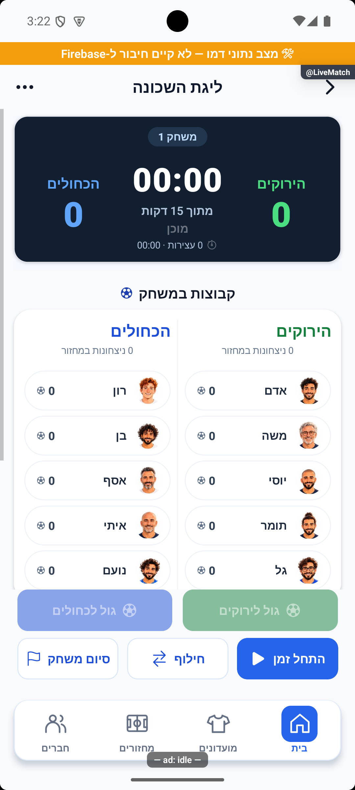
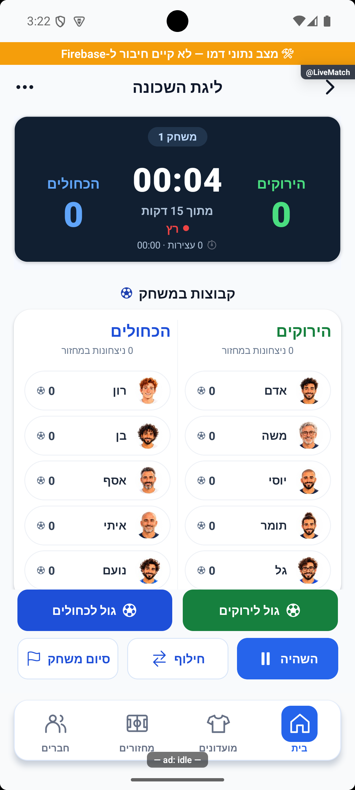

# לוח משחק אחיד, שורת ממתינים וכפתור סיום — 16.10.2026

מקור `4a3cb346` עם שינויים מקומיים. הבעלים הצביע על שחקן חמישי שנשבר לשורה שנייה בקבוצה הממתינה, על שינוי במראה הלוח אחרי הפעלת הזמן ועל הכיתוב הלא ברור ״סיום״.

## השינוי

תאי קבוצות ההמתנה נפרסים כעת בחמישה מקומות שווים בכל שורה, ללא אחוזי רוחב. כל השחקנים מוצגים; בקבוצה של אחד עשר מתקבלות שלוש שורות: חמש, חמש ואחד. מקומות פנויים במצב העברה משתמשים באותה פריסה.

לוח התוצאה הכהה הוא אותו רכיב בבחירת הקבוצות, לאחר אישור ההרכבים, בזמן ריצה ובהשהיה. לפני בחירה מוצגים שמות ניטרליים; לפני הפעלת השעון מופיעים אפס מול אפס ו־`00:00`. מודל התצוגה אינו מפעיל שעון או כותב תוצאה. כאשר תוצאה כבר נשמרה, כשל בטעינתה אינו מוחלף בתוצאת אפס. לפני קיום מצב חי שמור, פעולות השערים כבויות.

כפתור סיום המשחק מציג ״סיום משחק״. פעולתו ממשיכה לסיים את המשחק הנוכחי; סיום המחזור כולו נשאר בתפריט.

## אימות

באימולטור אנדרואיד במצב הדגמה צולמו הכנה ללא זוג, הכנה עם זוג, אישור הרכבים ללא מצב שעון, הפעלת הזמן, השהיה וגלילה. נבדקו קבוצות ממתינות עם ארבעה, חמישה ואחד עשר שחקנים, לרבות מחזור עם שלוש קבוצות בחוץ. כל הצילומים נבדקו בפועל לכיווניות ולתצוגת הסגל. בסיום הוחזר האימולטור למחזור הבדיקה של המשתמש, בלי לאפס את הכוחות והמשחק שלו.

נוספה בדיקת רגרסיה משמעותית לשמירת התוצאה: תצוגת אפס מותרת להרכבים מוכנים ללא שעון, אך אסורה כתחליף לתוצאה שמורה שעדיין נטענת. בדיקת הטיפוסים נקייה וכל 337 חבילות הבדיקות / 3,963 הבדיקות עברו מול השינוי הסופי. הלוגים נשמרו ב־`tmp/live-layout-typecheck-final.log` וב־`tmp/live-layout-jest-final.log`. התיקון וצילום ההוכחה נקראו מחדש ביומן הפרויקט תחת `live-layout-20261016-2e1bdb3c5d`.

## מקורות ומגבלות

הקוד השתנה ב־`RotationPanel`, `OpeningTeamsPanel`, `LiveScoreboardCard` וב־`AdvancedLiveMatchScreen`; הבדיקה נוספה ל־`savedRoundTransition.test.ts`. זוג התיעוד המעודכן: [לייב מתקדם](../features/rounds/live-advanced.md).

אלה צילומי דמו מקומיים, ללא בדיקת מסד מרוחק. לא הורצו אייפון, קורא מסך או גופן מוגדל. לא נוספו מסכים או מסלולי ניווט, ולא שונו שרת, כללים או הרשאות. אין פריסה, בניית חנות או שינוי נתוני משחקים בייצור. שרת הפיתוח נשאר פועל לשימוש באימולטור.
