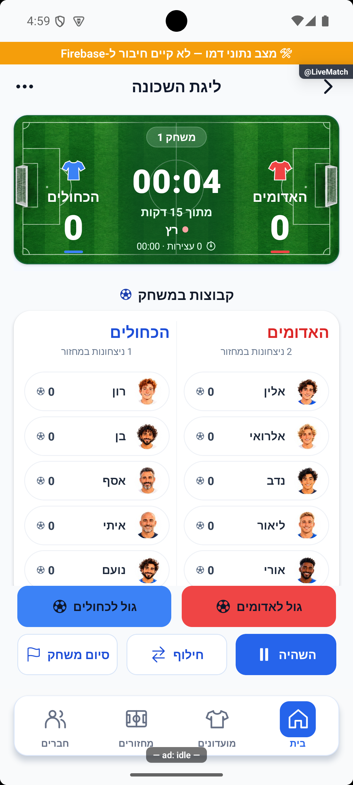

# מגרש ירוק בלוח המשחק החי — 16.10.2026

הסקיצה שאושרה מומשה בלוח המשחק: דשא ירוק, שני שערים בצדי הכרטיס, חולצות מלאות עם מסגרת לבנה, זמן ותוצאות בלבן ופס צבע לכל קבוצה. מקור `4a3cb346` עם שינויים מקומיים. העדכון מקומי וטרם הופץ.

## המימוש

`LiveScoreboardCard` מציג תמונת רקע מקומית, ועליה הנתונים החיים. המגרש מוצג בשלמותו באמצעות מידות מפורשות ומותאם לגבולות הכרטיס. שכבת ירוק שקופה ומעבר באזור השעון משפרים קריאות. רקע התמונה אינו מקבל לחיצות או פריט נגיש נפרד. יומן השערים נמצא מתחת למגרש בלי לשנות את יחסו. `TeamShirt` מקבל צבע מתאר אופציונלי, ו־`OpeningTeamsPanel` מעביר את גוון הקבוצה המקורי לאחר בחירה. חלונות סיום המשחק והתיקו נשארו בעיצובם הקודם.

אין שינוי בתנאי התחלת הזמן, הזנת שער, רוטציה, שמירת משחק, מכני נתונים, הרשאות או מסד. החולצות, השמות, הזמן והתוצאה אינם חלק מהתמונה. פירוט המצבים ומסלול הנתונים ב־[מסמך הטכני](../features/rounds/live-advanced.md).

## מקור תמונת הרקע

הרקע נוצר במנגנון יצירת התמונות המובנה לפי הסקיצה שאושרה, ללא כלי יצירה חיצוני. הקובץ המקורי הועתק ללא עריכה: 1881 על 836 נקודות, 3,054,303 בתים. [תמונת הרקע](../../src/assets/images/live-scoreboard-pitch.png) ו־[הנחיית היצירה המלאה, המצב ומקורות ההפניה](../../src/assets/images/live-scoreboard-pitch.prompt.json) נשמרו בפרויקט. אין צורך בחיבור לרשת לטעינת המגרש בזמן המשחק.

## אימות מרונדר

נבדקו לפני הפעלה, הפעלה והשהיה דרך פקדי הממשק, תוצאה שהתעדכנה לשער אחד מול אפס ויומן מבקיע ובישול שנפתח. השער נרשם דרך `recordGoal` המקורי במצב דמו. נבדקו זהות וצבע בחולצות שחורות ולבנות ובבחירת צהובים וכתומים במסך ההכנה. בשני מצבי ההכנה השערים והשעון נשארים באותה פריסה, והבחירה משנה רק זהות וצבע. הכיווניות נבדקה בצילומים בפועל. תיקון התאמת התמונה נעשה לאחר שהצילום הראשון חשף חיתוך של השערים.

| מצב | צילום |
|---|---|
| מוכן | [לפני הפעלת השעון](../features/screenshots/live-pitch-ready-2026-10-16.png) |
| מושהה | [אחרי לחיצה על השהיה](../features/screenshots/live-pitch-paused-2026-10-16.png) |
| שער, בישול ויומן פתוח | [תוצאה ושורת מבקיע מימין לשמאל](../features/screenshots/live-pitch-scorers-2026-10-16.png) |
| שחורים ולבנים | [צבעי הקבוצות וקריאות](../features/screenshots/live-pitch-black-white-2026-10-16.png) |
| הכנה ללא בחירה | [מצב ניטרלי](../features/screenshots/live-pitch-opening-empty-2026-10-16.png) |
| הכנה עם זוג נבחר | [צהובים וכתומים](../features/screenshots/live-pitch-opening-selected-2026-10-16.png) |

כל שינוי משחק במהלך הבדיקות הוגבל למחזורי בדיקה בזיכרון הדמו עם מזהים ייעודיים. מחזור המשתמש הראשי הושווה לפני ואחרי ונשאר ללא שינוי במהלך הבדיקות. האימולטור הוחזר למחזור חמש על חמש עם שלוש קבוצות ו־15 שחקנים, ללא כוחות שמורים, כדי לאפשר בדיקה של חלוקה חדשה. שרת הפיתוח נשאר פועל. כרזות אזהרה צפות הושתקו זמנית לצילומים, והוחזרו לאחר הבדיקה; סימוני הדמו והפיתוח נשארים בתמונות.

## בדיקות וגבולות

בדיקת הטיפוסים נקייה. כל 338 חבילות / 3,983 בדיקות עברו אחרי שינוי הקוד האחרון: `tmp/live-pitch-typecheck-final.log`, `tmp/live-pitch-jest-final.log`. לא נוספו בדיקות המשכפלות סגנון. בדיקת מפת המוצר עברה אחרי עדכון מסמכי הפיצ׳ר, התמונות וחותמות המקורות: 212 מסמכים, 84 זוגות פיצ׳רים, 61 קובצי מסכים, 793 צילומים וללא כשלים.

אלה צילומי אנדרואיד בדמו מקומי. לא נבדקו מסד מרוחק, אייפון, רוחב מסך אחר, הגדלת גופן, קורא מסך, הדקה האחרונה או תוספת זמן בסבב הזה. התמונה עשויה להימתח ברוחבים אחרים כדי להשאיר את שני השערים גלויים. אין פריסה או שינוי מסמכי משחק בייצור.

השינוי תועד ביומן הפרויקט עם צילום הוכחה ונקרא מחדש: `live-pitch-20261016-724f265adb`. המימוש מקומי וממתין להפצה.
