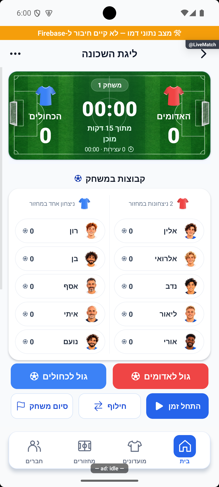
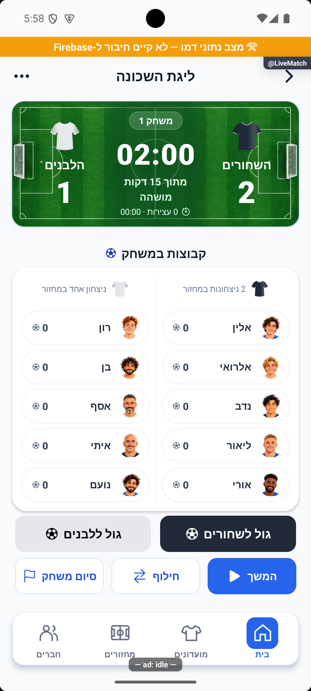

# כפתורי שערים וכותרות הרכבים — 16.10.2026

לפי בקשת הבעלים, כיתוב כפתורי הגולים גדל מ־14 ל־16 ומופיע בלבן; רק בקבוצה הלבנה הכיתוב והכדור שחורים. לאחר אישור הבעלים, כותרת כל הרכב משחק מציגה חולצה קטנה ומספר ניצחונות במקום שם הקבוצה החוזר על לוח התוצאה. מקור `4a3cb346` עם שינויים מקומיים, טרם הופץ.

`AdvancedLiveMatchScreen` שומר על רקע הקבוצה, כדור משמאל ותנאי ההפעלה הקיימים. `TeamScore` משנה רק את כותרת התצוגה המצומצמת ברשימות של שני הצדדים. החולצה היא אותו איור משותף, ברוחב 24. בשם הנגיש נשמרים שם הקבוצה ומספר הניצחונות; ניצחון יחיד מנוסח ביחיד. הכותרת של קבוצה ממתינה ובורר מנצחים לא שונו. אין שינוי בחישוב, בסגל, בשערים, בשעון, ברוטציה, בשירותים, בממיר, בניווט, בהרשאות או במכני נתונים.

## שם מחזור ההדגמה

״בדיקת כוחות ולייב״ היה שם המחזור המקומי, ולא טקסט קבוע במסך. השם שונה ל״ליגת השכונה״ בזיכרון ובשדה הכותרת בבסיס המקומי השמור. הרשומה נקראה מחדש ואומתה; אין בה כוחות, רוטציה או מצב משחק. שאר הגדרות הבסיס נשמרו. טעינה מלאה הבאה ממשיכה לפתוח מחזור נקי מחלוקה, כפי שביקש הבעלים.

חיבור הרענון באימולטור היה מנותק. כדי לקבל את העיצוב האחרון נדרש חיבור מחדש; הכוחות שכבר בחר המשתמש הוחזרו לזיכרון בלבד, ושני קובצי המעבר הזמניים הוסרו. בסיום אובייקט המחזור הושווה למצב שלאחר שינוי השם ונשאר זהה. לא נשמרו כוחות בבסיס המכשיר, לא הופעל זמן במשחק המשתמש ולא נרשם בו שער.

## אימות מרונדר

במחזור המשתמש נבדקו השם החדש, שמירת הכוחות הכחולים והירוקים והכותרות ללא שם כפול. במצב המצולם כפתורי הגולים מושבתים לפי התנאי שהיה קיים. בתרחישי דמו נפרדים נבדקו כפתורים פעילים באדומים וכחולים, וכן לבנים ושחורים. הצבעים, הטקסט המוגדל, הכדור משמאל וכיווניות הכותרת נבדקו בצילומים בפועל. בתרחיש יש ניצחון יחיד ושני ניצחונות כדי לוודא את הניסוח ואת המונה.

בדיקת הטיפוסים נקייה וכל 338 חבילות / 3,983 בדיקות עברו לאחר השינוי האחרון. לוגים: `tmp/live-goal-typecheck-final.log`, `tmp/live-goal-jest-final.log`. אימות מצב המחזור והבסיס הנקי: `tmp/live-controls-state-verification.json`, `tmp/live-controls-persistence-verification.json`. לא נוספו בדיקות המשכפלות סגנון. בדיקת מפת המוצר עברה: 212 מסמכים, 84 זוגות פיצ׳רים, 61 קובצי מסכים ו־802 צילומים, ללא כשלים.

אין בדיקה חדשה של מסד מרוחק, אייפון, רוחב אחר, גופן מוגדל או קורא מסך. תרחישי כפתורים פעילים מבודדים בזיכרון הדמו. אין פריסה או שינוי משחקי ייצור. [מסמך הלייב](../features/rounds/live-advanced.md) · [ההדגמה המקומית](../features/entry/legacy-and-hidden.md).

תיקון הממשק תועד ביומן הפרויקט עם צילום הוכחה ונקרא מחדש: `live-goal-polish-20261016-24362474f7`. ממתין להפצה.
