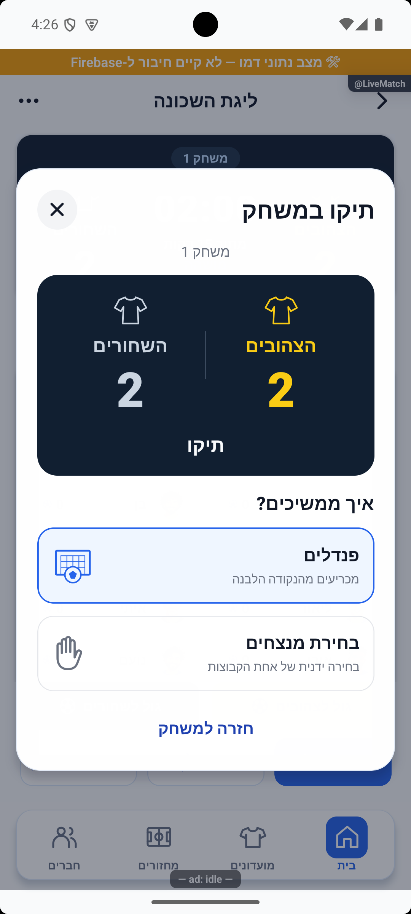
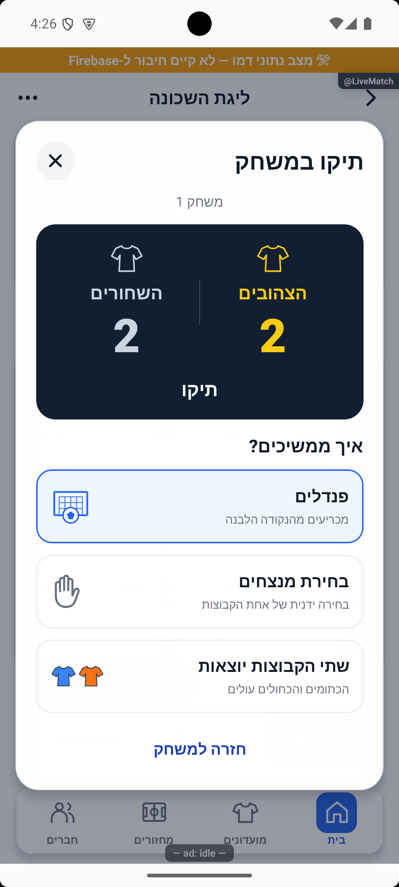
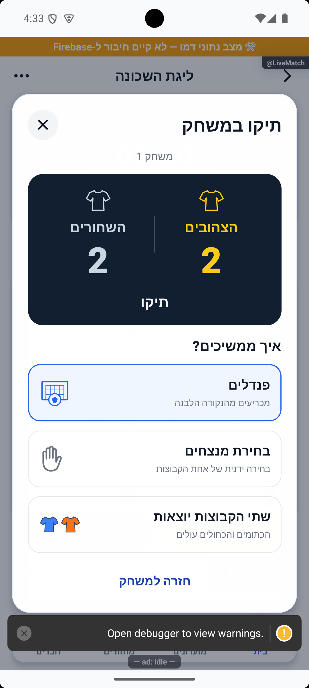
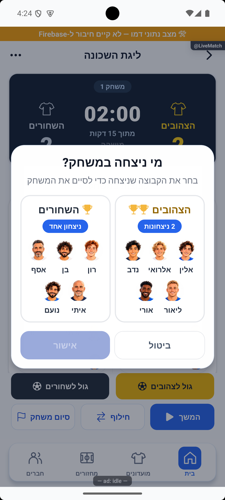
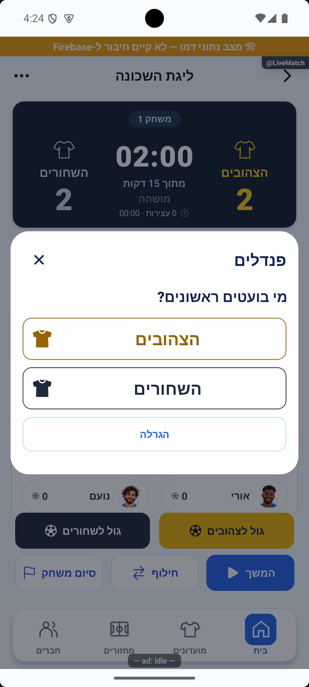
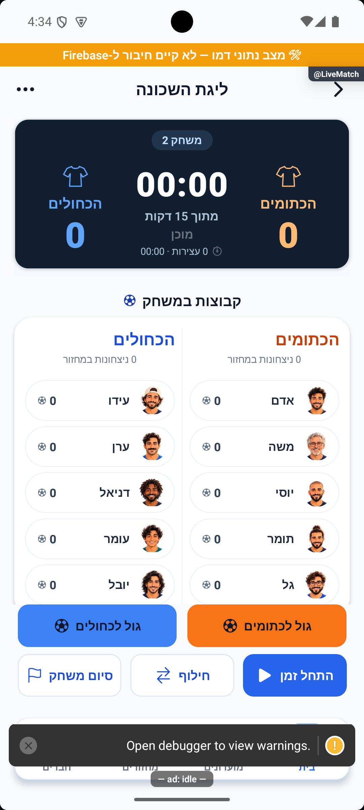

# חלון תיקו ואישור באותו מסך — 16.10.2026

מקור `4a3cb346` עם שינויים מקומיים. הסקיצה המאושרת של חלון התיקו מומשה, ובהמשך בקשת הבעלים הוסר אישור היציאה הכפולה שנפתח מעליה. האישור נמצא כעת בתוך חלון התיקו עצמו.

## התנהגות

החלון מציג את שתי הקבוצות, חולצות, תוצאה ומספר משחק באותו לוח כהה של חלון הניצחון. פנדלים ובחירת מנצחים פותחים את המסלולים הקיימים ישירות. בשלוש קבוצות ומטה אין אפשרות להוציא את שני הצדדים. מארבע קבוצות, ועם שתי ממתינות, האפשרות מציינת את שמות וצבעי העולות.

לחיצה על ״שתי הקבוצות יוצאות״ היא בחירה בלבד. היא מסמנת את הכרטיס, מציגה הסבר קצר ואת ״אישור וסיום משחק״ באותו חלון. רק הלחיצה באישור מפעילה את מסלול שמירת התיקו והמעבר. חזרה מהחלון אינה שומרת תוצאה. אין חלונית אישור נוספת. בחירה מקומית מתאפסת בסגירה או בהחלפת הקשר הרוטציה.

במהלך בדיקת המעבר לידני נמצא ש־`WinnerPickerModal` לא העביר את צבעי החלוקה ל־`TeamScore`; לכן הצהובים והשחורים הוצגו שם כאדומים וכחולים. העברת `draftTeams.teams` תוקנה, ונבדקה בצילום לאחר התיקון. זהות ההרכבים והבחירה לא השתנתה.

## אימות באימולטור

נבדקו תרחישי דמו נפרדים עם שתיים, שלוש, ארבע וחמש קבוצות. בשתיים ובשלוש לא הוצגה יציאה כפולה. בארבע ובחמש הוצגו שתי העולות הראשונות בתור. נבדקו שמות, צבעי חולצות, תוצאה וכיווניות בפועל.

לחיצה על פנדלים פתחה את בחירת הראשונים, ובחירה ידנית פתחה את הקבוצות בצבעיהן הנכונים; לא נרשמה בעיטה או מנצחת במסלולים אלה. סגירת חלון התיקו השאירה את אובייקט משחק הדמו ללא שינוי. הבחירה ביציאה הכפולה הושוותה מול צילום הנתונים לפני הבחירה ולא שמרה דבר. האישור באותו חלון, בתרחיש חמש הקבוצות, קידם למשחק שני של הכתומים והכחולים, תור המתנה של הירוקים, השחורים והצהובים, אפס מול אפס ושעון שאינו רץ. ההשוואה למחזור הראשי נשמרה ללא שינוי במהלך תרחישי הבדיקה.

## בדיקות ומגבלות

בדיקת הטיפוסים נקייה וכל 338 חבילות / 3,983 בדיקות עברו מול המימוש הסופי. נוספו בדיקות לפקדים עצמם: בחירה אינה שומרת, האישור מפעיל את הפעולה, מצב עבודה חוסם שמירה, ובשתיים/שלוש אין אפשרות יציאה או אישור שלה. בדיקות פעולת המארח מוודאות את הגבול ואת הסרת החלונית הכללית. לוגים: `tmp/tie-popup-typecheck.log`, `tmp/tie-popup-jest-final.log`.

כל הנתונים והכתיבות בתרחישי ההרצה היו בזיכרון דמו מקומי בלבד. אין הוכחה חדשה למסד אמיתי, סנכרון בין מנהלים, אייפון, קורא מסך או גופן מוגדל. לא שונו שרת, הרשאות, ממירי מסד, חישובי סטטיסטיקה או נתיבי ניווט. לא בוצעה הפצה או בניית חנות; שרת הפיתוח נשאר פועל.

תיעוד: [לייב מתקדם](../features/rounds/live-advanced.md), [הכרעת תיקו ופנדלים](../features/rounds/penalties.md).

החלון והאישור המובנה, וכן תיקון צבעי הבחירה הידנית, תועדו עם צילומי הוכחה ונקראו מחדש ביומן הפרויקט: `tie-popup-20261016-7fb6204bb3`, `tie-manual-color-20261016-47b7e7c168`. השינויים ממתינים להפצה.
