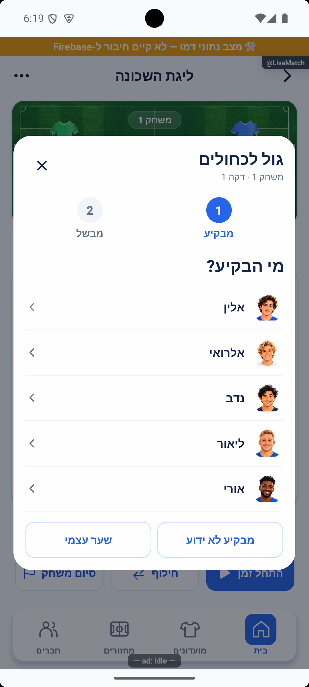
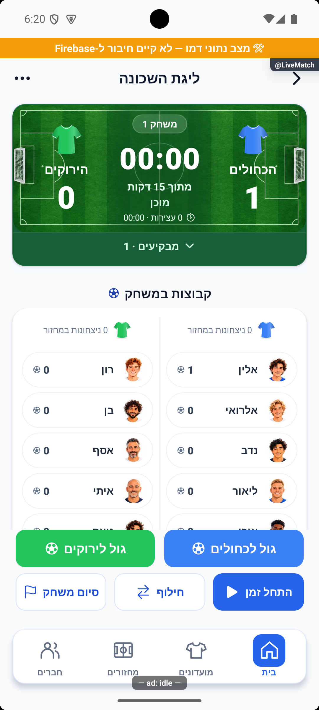

# חולצות בממתינים וגולים לפני הפעלת הזמן — 16.10.2026

נוספה חולצה בצבע הקבוצה ליד שם הממתינים, במקום סמל האנשים. לפי חידוד הבעלים בוטלה החסימה שהצריכה הפעלת שעון ראשונה לפני הזנת גול. מקור `4a3cb346` עם שינויים מקומיים; טרם הופץ.

## המימוש

`RotationPanel` משתמש באותו `TeamShirtIllustration` של יתר המסכים, ברוחב 28 ובצבע `teamColor`. הכותרת, התור והרכב הממתינים נשמרו; החולצה מימין לשם בכיווניות המערכת.

`canEnterGoals` במסך המתקדם מאפשר כניסה למנהל לאחר שהרוטציה מוכנה, גם כשהלוח עדיין משתמש במודל הכנה בלי מצב חי שמור. חסימות שמירה בתהליך, משחק חתום/סופי, צופה ופנדלים נשארות. ההסבר הזמני שדרש להפעיל זמן הוסר.

`recordGoal` יוצר מצב מוכן עם השער הראשון רק כאשר זהות המשחקון תואמת לרוטציה ולא נחתמה תוצאה. היצירה והגול באותה עסקה. השעון עצור, ללא חותמת התחלה ואירועי זמן; לא מופעל זמן ולא משתנה סטטוס המחזור בגלל שער. מזהה הניסיון מונע זיכוי כפול. בדמו מתעדכן חותם המחזור כדי שההאזנה תציג מיד את הגול. בקשה ישנה ללא זהות משחקון אינה יוצרת מצב חסר.

`markGameStarted` קורא מחדש את המצב בעסקה כדי לשמור על שער שיכול להיכנס אחרי הקריאה הראשונית ולפני ההתחלה. מצב קיים אינו מוחלף באפס. לא שונו הממיר, הרשאות, הרכבים, רוטציה, נוסחת הדקה או מכני הסטטיסטיקה. [מסמך הלייב](../features/rounds/live-advanced.md) · [שירות הזמן המשותף](../features/rounds/live-timer.md).

## ראיות מרונדרות ומספריות

בתרחיש דמו נפרד עם הרכבים מאושרים וללא מצב חי נלחץ גול לכחולים, נבחר מבקיע ונבחר ללא מבשל. נשמר אירוע יחיד, התוצאה 1:0, השעון עצור במצטבר אפס, ללא חותמת התחלה וללא אירוע זמן. לאחר לחיצה על התחלת זמן והשהיה נותרו אותה תוצאה ואותו מזהה שער, עם 9,092 אלפיות שנייה מצטברות ושני אירועי זמן. זהו אימות דרך הממשק ושירות הדמו, לא הזרקת תוצאה לצילום.

אימותים מספריים: `tmp/waiting-shirt-zero-clock-verification.json`, `tmp/waiting-shirt-after-clock-verification.json`. מחזור המשתמש הושווה לפני ואחרי ונשאר זהה, בלי שער או התחלת זמן במהלך הבדיקה; הכוחות שבחר נשמרו בזיכרון. הבסיס המקומי נקרא מחדש ונשאר ללא כוחות, רוטציה או מצב משחק. קובצי המעבר הזמניים לחידוש חיבור הפיתוח הוסרו. האימולטור הוחזר למסך המשחק של המשתמש ושרת הפיתוח נשאר פועל.

## בדיקות ומגבלות

נוספו שש בדיקות: שער ראשון לפני שעון וניסיון חוזר בדמו ובעסקה, שמירה בתחרות עם התחלה, דחיית רוטציה חסרה, זהות מיושנת ומשחק שמור או סופי בשני הנתיבים, ובדיקת תנאי הזמינות במסך. בדיקת הטיפוסים נקייה וכל 338 חבילות / 3,989 בדיקות עברו: `tmp/wait-shirt-typecheck-final.log`, `tmp/wait-shirt-jest-final.log`. בדיקת מפת המוצר עברה: 212 מסמכים, 84 זוגות פיצ׳רים, 61 קובצי מסכים ו־806 צילומים, ללא כשלים.

אין בדיקת כתיבה למסד מרוחק, מקביליות בין שני מכשירים, אייפון, גופן מוגדל, רוחב נוסף או קורא מסך. המקביליות נבדקה בתרחיש שירות מבודד; האימולטור משתמש בנתוני דמו מקומיים בלבד. מסך הלייב הרגיל לא נפתח מחדש. לא שונו כללי הרשאות ולא בוצעה פריסה.

השינוי תועד ביומן הפרויקט עם צילום הוכחה ונקרא מחדש: `wait-shirt-preclock-20261016-0fd043c510`. ממתין להפצה.
