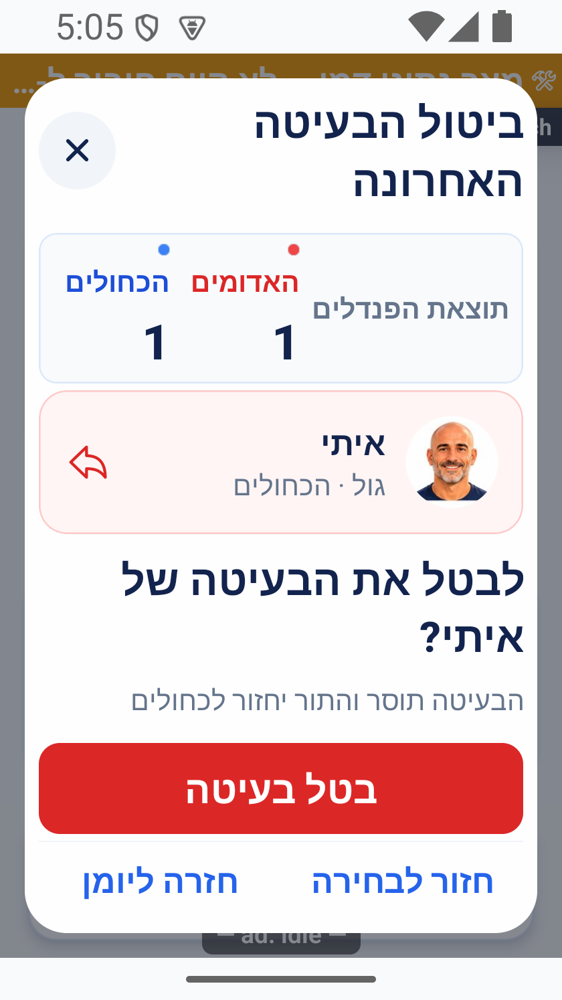
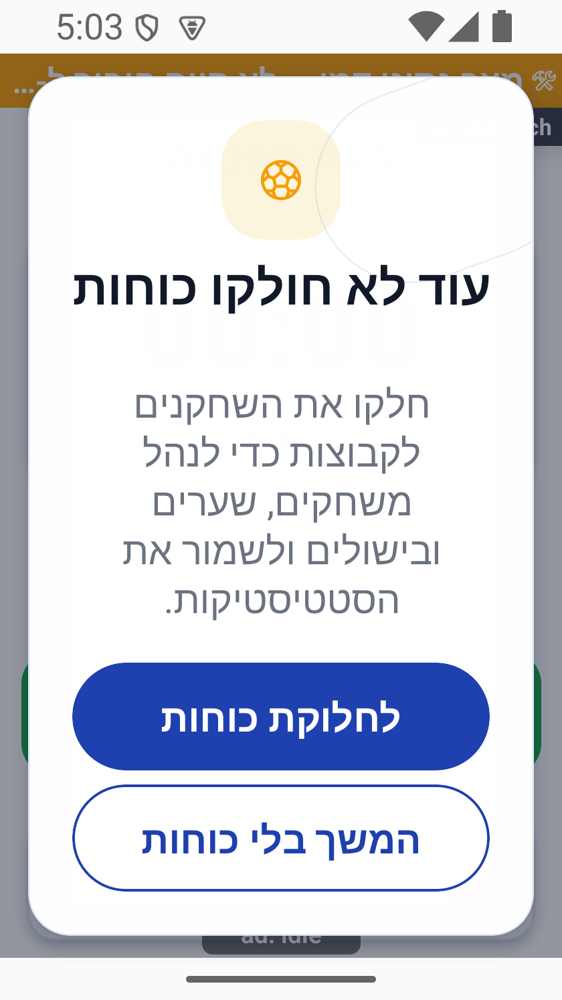
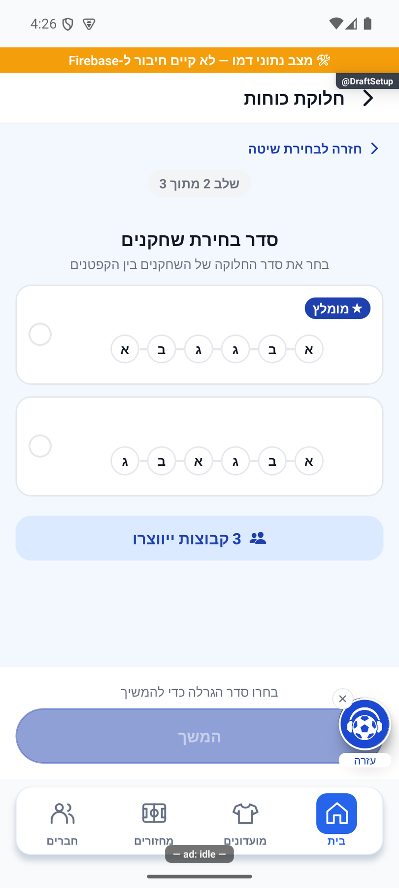
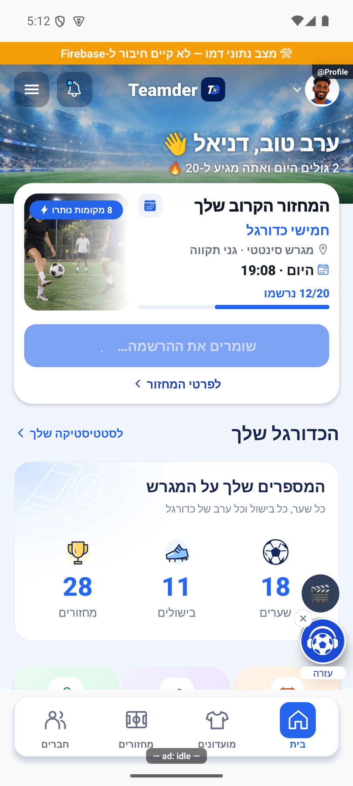

# גרסה פנימית 1.1.55 — בדיקות הפולס ועיצוב החלוניות

מצב: `1.1.55 / 288` הועלתה ואומתה במסלול הפנימי באנדרואיד ב־`2026-10-17T17:13:12.879Z`. הייצור נשאר `1.1.46 / 279` וכל יתר המסלולים ללא שינוי. תיקון השרת נפרס באישור מפורש. לא הועלתה גרסת אפל.

מקור: `4a3cb346b1792b7e84cd71a8b9723bf6af88e500` עם שינויים מקומיים. לא בוצעו התחייבות או דחיפה למאגר.

## היקף הבדיקה

נבדקו מחדש כל 89 הפריטים הפתוחים שאינם רעיונות חונים: 53 דיווחים, 23 משימות ו־13 שגיאות. מתוכם 16 דיווחים חדשים מבדיקת `1.1.53`; כל 16 הצילומים שלהם נפתחו ונבחנו לפני המיון. הסקירה הקודמת של 73 פריטים ו־40 צילומים נשמרת ב־[דוח ההכנה](2026-10-17-preinternal-audit.md). 15 רעיונות חונים לא שונו.

הבעלים הבהיר ש״מחר״ היה שגיאת הקלדה של ״מהר״. כל העיצוב טופל בסבב הנוכחי; לא נוצרה משימת המשך למחר.

## התיקונים

| תחום | התנהגות ותיקון | אימות וגבול |
|---|---|---|
| סיכום מחזור שהסתיים | בשרת נמצאה שגיאת `Cannot collapse mutations with different version preconditions`. מונה העונה ושמירת גרסת המועדון משתמשים כעת באותה כתיבה מותנית בתוך חבילת החתימה האטומית | בדיקות שמירה, כשל וניסיון חוזר; `onGameRosterChanged` נפרסה ואומתה מול 133 קבצים. 97 פונקציות אחרות לא השתנו. אין הסבת נתונים או כתיבת תיקון ידנית למחזור המדווח |
| סטטיסטיקה לפני סיום | אין קריאת סיכום חתום לפני `finished`; מוצג הסבר מתי הנתונים יופיעו | בדיקות מסך ומצב פתוח בהדגמה |
| סיכום שטרם נחתם | שאילתה מוגבלת למועדון ולמחזור מבחינה בין היעדר מאושר לבין כשל. מטמון ריק אינו הוכחת היעדר. מאזין ממוקד קולט חתימה מאוחרת בלי פתיחה מחדש | בדיקות תגובות מאוחרות, ניתוק במעבר, מטמון ורשת; שלוש בדיקות הרשאות נוספות ללא שינוי בכללים |
| מעבר למשחק הבא | מקור ההרכבים מעוגן למצב שרת לאחר אישור שמירת התוצאה. שינוי אמיתי בסגל או בזהות המשחקון עדיין נדחה | בדיקת שירותי ההדגמה שמרה 2:0 פעם אחת ועברה למשחק 2 ב־0:0, עם שעון עצור, זהות חדשה וצבעים שמורים. אין שחזור כתיבה בחשבון המדווח |
| שינוי בועט | השוער שנבחר נשמר אם הוא עדיין בהרכב המגן. ההילה פועלת גם על תמונת שחקן בעת עריכה | בדיקות תפקידים, שמירה כפולה ותנועה מופחתת; נצפה שינוי מאלין לאלרואי כשהשוער אסף נשאר |
| קבוצה ראשונה ויומן פנדלים | חזרה לפני הבעיטה הראשונה מאפשרת שינוי קבוצה; שינוי אחרי בעיטה נחסם בעסקה. יומן ריק נפתח ומציג הסבר | בדיקות שירות ומסך; בהדגמה הוחלפה הקבוצה הראשונה לכחולים ללא מחיקת יומן |
| תוצאת הפנדלים | שורת הניקוד מעל המגרש | צילום אנדרואיד בהדגמה |
| אישור ביטול בעיטה | כרטיס קומפקטי עם פרטי הבועט ותוצאה; האישור מחוץ לתוכן הנגלל | נצפה האישור הקבוע במסך רגיל וברוחב 320 עם גופן 140%; צילום סופי נבדק לפני הבנייה |
| מחיקת גול ואזהרת כוחות | עיצוב כדורגל מפורש בשתי החלוניות בלבד, עם כפתורים רחבים | שתי חלוניות מרונדרות בהדגמה. נמצא ותוקן חיתוך במסך קטן: התוכן נגלל והכפתורים קבועים. נצפתה גלילה בפועל ברוחב 320 ובגופן 140%. אישור מחיקה לא בוצע |
| בחירת קפטנים | קפטנים, סדר תורות ולוח הם שלושה שלבים. בחירה שאינה עוד בסגל מוסרת וחוזרת להשלמה | נצפו שלבי קפטנים וסדר נפרדים ולוח עם שלב 3 מתוך 3. האימות האטומי בשמירת הסגל נשמר; צילום הלוח נפתח בנתוני הדגמה בלי שמירת חלוקה |
| מספר שחקנים לכוחות | נדרשות שתי קבוצות מלאות לפי הפורמט; ארבעה מול ארבעה דורשים שמונה. אורחים בהמתנה אינם נספרים | שבעה רשומים נחסמו במידע ובשחקנים; הודעת החסר משתמשת ביחיד כשחסר אחד |
| הוספת אורח | הסמל משמאל למלל תחת הכיווניות של האפליקציה | צילום שורת הוספת אורח; הרשאות ההוספה לא שונו |
| יוצר מחזור | `createdBy` מצורף להידרציית הזהויות גם כשאינו משתתף | בדיקת מסלול הקריאה הציבורי הקיים; אין קריאת מסמך משתמש פרטי חדשה |
| הצטרפות מהבית | מצב ההמתנה מציג הודעת שמירה וגלגל טעינה עד לתשובת ההרשמה האמיתית | נצפה משוב שמירה עם תשובה מעוכבת בזיכרון בהדגמה בלבד. יומן המדווח מצביע על כ־1.1 שניות בין לחיצה להצטרפות. אין טענה לקיצור זמן שרת שלא נמדד מחדש |

## בדיקות ופריסה

- 375 קבוצות בדיקה, 4,494 בדיקות יישום עברו; `all-tests-final-55.log`.
- 350 בדיקות הרשאות עברו באופן סדרתי, כולל סיכום קיים, חסר וחסימת מי שאינו חבר; `rules-final.log`.
- בדיקת הטיפוסים מול המקור הסופי נקייה; בדיקת טיפוסי השרת ובנייתו עברו.
- הפונקציה הפעילה `onGameRosterChanged` עודכנה ב־`2026-10-17T16:37:50Z`; הארכיון הפעיל תואם ל־133 קובצי מקור, תבניות ותוצרי הידור. 97 הפונקציות האחרות נשמרו.
- כללי ההרשאות לא שונו. קריאת גוגל לאחר ההגשה אישרה פנימי `1.1.55 / 288`, ייצור `1.1.46 / 279` ושאר המסלולים ללא שינוי. כל 13 השגיאות נקראו שוב לאחר ההפצה; אין מזהה חדש או שינוי במונים ובמועד ההופעה האחרון ביחס לתמונת תחילת הסבב. זו אינה הוכחה שהגרסה החדשה כבר נוסתה במכשיר פיזי.

קובצי הבדיקה והקבלות נמצאים ב־`artifacts/pulse-after-1.1.53-2026-10-17/`; קובצי הבנייה המאומתת ב־`artifacts/release-1.1.55/`. אלו קבצים מקומיים שאינם נשלחים לאפליקציה.

## מגבלות ופריטים שנותרו

שגיאת ספק ההתראות `joryioRegisterPushToken`, הכוללת `Date.getTime` על ערך ריק, הופיעה שוב ב־1.1.53. אין תיקון ספק או רישום חי חדש מוכח, ולכן הפריט נשאר פתוח. גם אי־תגובה ללחיצות במכשיר המדווח וכניסת אפל דורשות אימות במכשיר המתאים; בדיקות ההדגמה אינן סוגרות אותן.

אין החלטת אפיון חדשה שחוסמת את 16 התיקונים. רעיונות חונים נשארו להחלטת הבעלים. הפולס שומר את הסטטוס המקורי ואת ההערות ההיסטוריות; אין לסגור דיווח שלא תוקן או לטעון שאמולטור הדגמה הוא אימות במכשיר המדווח.

## התאוששות המחזור המדווח

ב־`2026-10-17T16:47:45Z` נחתם הסיכום בניסיון החוזר האוטומטי של האירוע המקורי: שני משחקים, שני שערים, בישול אחד, הכרעה אחת בפנדלים ואפס תיקו. לוג השרת אישר שחיוב ההשתתפות וסיכומי הצמדים שכבר נכתבו דולגו, ולכן לא בוצעה ספירה חוזרת. לא נכתבו נתוני תיקון ידניים ולא הורצה הסבה. הקבלות: `server-recovery.json`, `recovered-summary.json` ו־`server-deployment.json` בתיקיית הביקורת.

## מקור החבילה והגשה

הבנייה הסופית בוצעה מקומית ב־Windows בסביבת בנייה מבודדת, עם ארבע ארכיטקטורות ודגלי הדגמה ובדיקות כבויים. מספר הגרסה והבנייה נקראו ממניפסט החבילה; החתימה תואמת לתעודת ההעלאה הקיימת. נבדקו 952 קובצי יישום, ו־23 רכיבים הושוו גם למפת המקור הארוזה, כולל החלונית המתוקנת האחרונה. תמונת התמיכה הארוזה זהה בפיקסלים למקור ורכיב עדכון החנות נמצא בקוד המקורי המקובץ.

- חותמת מקור הבינארי: `e44a13ff896da7de65592b46c987ca86cafe4c49daea2a53238c6a35df41ada2`.
- חותמת החבילה: `2a73c2c67cf215dd9f9c6749bc9cb32bde09f3ce25d7e4e4d2cb5de264b8c8a1`; גודל 106,902,125 בתים.
- עוגן המקור `4a3cb346b1792b7e84cd71a8b9723bf6af88e500` עם שינויים מקומיים; אין קומיט חדש. צילום הארכיון כולל 2,091 קבצים. תיעוד ההפצה והצילומים הושלמו לאחר הקפאת המקור; אימות הבינארי מבוסס על קובצי היישום ומפת המקור בפועל.
- בניית המועמדת `1.1.54 / 287` הושלמה מקומית אך לא נחתמה ולא הוגשה; בדיקת מסך קטן חשפה חיתוך, ולכן נבנתה והוגשה במקומה `1.1.55 / 288` עם התיקון.
- ההגשה בפרופיל `internal` הושלמה; מזהה `c4d476ca-9586-4839-80f4-e42ed4e6078c`. רק לאחר ההשלמה נקראו המסלולים מגוגל ואומתו.
- ביומן ההפצה נשמרו 16 סעיפי תיקון, רשומת ההפצה ו־17 צילומי הוכחה. היסטוריית הסעיפים ומטא־נתוני הארכיון נשמרו. בפולס צורפו סיכום וצילומים לדיווחים הרלוונטיים בלי לסגור את הסטטוס המקורי.

החבילה החתומה לא הותקנה במכשיר פיזי בסבב הזה. אין אימות חדש לעדכון חי מהחנות, קבלת מדידת עדכון מרחוק, פוש פיזי או כניסת אפל. כל בדיקות המסך בוצעו רק באמולטור ההדגמה; נתוניו, מידותיו והגופן הוחזרו למצבם המקורי. חשבון הייצור באמולטור הנפרד לא שונה.

קבלות: `verified-build.json`, `source-proof-final.json`, `new-assets-proof.json`, `original-image-verified.json`, `submit-receipt.json`, `tracks-verified.json`, `release-log-receipt.json`. מסירת הפולס: `pulse-handover-receipt.json` בתיקיית הביקורת.

## צילומים מהמקור הסופי

