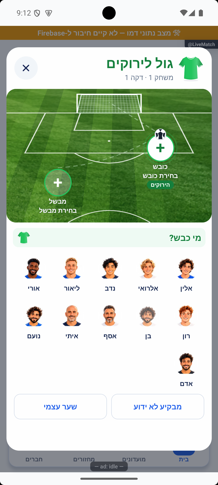
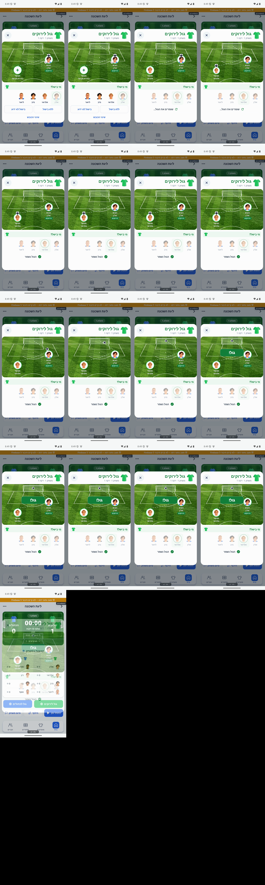
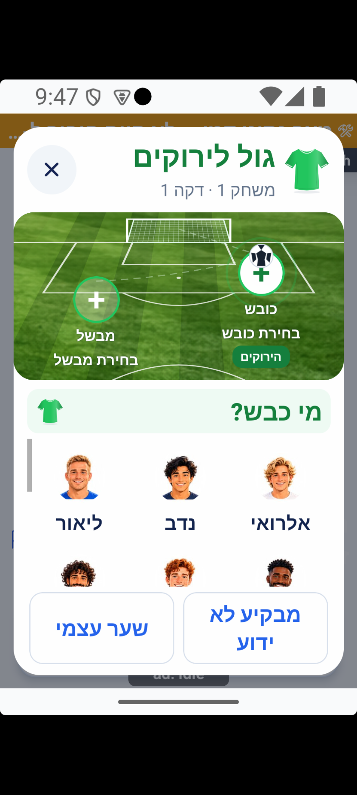
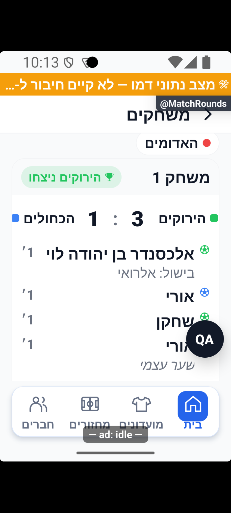

# ראיות מקומיות למגרש הזנת שער ופנדלים — 17.10.2026

הבדיקות בדוח זה מקומיות בלבד: אימולטור אנדרואיד `emulator-5554`, חשבון הדמו `p7`, ומצב `USE_MOCK_DATA=true`. הנתונים נוצרו בזיכרון דרך כלי הפיתוח הקיים; אין כאן בדיקת קריאה או כתיבה במסד הייצור, בדיקת הרשאות של חשבון אמיתי או אישור פריסה. [הדוח המשולב](2026-10-17-live-action-pitch.md) מרכז בנפרד את המימוש, בדיקות הקוד, הייצור והמלצת המוכנות.

## מקור, תאריכים ושמירת סביבת המשתמש

מקור הקוד הוא `4a3cb346` עם השינויים המקומיים, לרבות קבצים חדשים שלא נכנסו להתחייבות. ההרצות החלו ב־16.10 ונמשכו אחרי חצות ל־17.10. שמות הצילומים בארכיון נושאים 17.10, יום איסוף הראיות; שדה `captured` במניפסט שומר את יום הצילום המקורי לפי שעון ישראל. צילומי ארבעה מול ארבעה ושגיאת הגול בשבעה צולמו לפני חצות; יתר הראיות המפורטות צולמו אחריו.

נקראו דוח סוכן הבדיקות `tmp/live-action-qa/report.md`, תמונות המקור, מסגרות ההקלטות וצילומי מצב הנתונים. כל תמונה שנרשמה במניפסט נפתחה ונבחנה. קובצי התמונה הועתקו ללא שינוי בתוכן; נשמרו נתיב המקור, גיבוב, סביבה, פלטפורמה ומגבלות. לוחות המסגרות הם נגזרות של הקלטת מסך מקורית, ומסומנים כך; הם אינם הדמיה שנוצרה מתיאור ואינם צילום יחיד.

לפני הכנת התרחישים נשמר מצב מחזור הדמו הקיים `gv2-live`. כלי הבדיקה בודקים שהוא זהה לצילום המקור לפני יצוא, שחזור או ניקוי. שלושת מחזורי הבדיקה המקומיים:

| גודל | מזהה מקומי שנוצר במערכת | היקף |
|---|---|---|
| ארבעה מול ארבעה | `qa-live-design-four-1792183659395` | שלוש קבוצות; משחק שדה, חילוף זמני ורוטציה |
| שבעה מול שבעה | `qa-live-design-seven-1792183659404` | שלוש קבוצות; ניסיון חוזר, תיקו ופנדלים |
| אחד עשר מול אחד עשר | `qa-live-design-large-1792183659417` | הרכבים גדולים; שם ארוך, תמונה חסרה וחילוף קבוע |

אלה אינם מזהי מחזורים בייצור. `session.json` ו־`restore.js` משמשים לשחזור הדמו אחרי הפעלה קרה תחת הגנת סביבת דמו ומשתמש; אין להפעילם מול ייצור. לא נוצרו חשבון או מועדון לצורך ההרצות המקומיות האלה.

בסיום הבדיקות הוחזרו גודל המכשיר, צפיפות, גופן והגדרות התנועה לערכיהם המקוריים, ובוצעה הפעלה קרה. מחזור `gv2-live` וההיסטוריה שלו הושוו לצילום המקורי והוחזרו; רק שלושת מחזורי הבדיקה המקומיים נוקו מהזיכרון לאחר ההשוואה. הם והיסטוריותיהם מגובים לשחזור בקבצים המקומיים. האימולטור המקומי נעצר ושרת הפיתוח נשאר פעיל. אין בכך מחיקה או ביטול של מחזור ייצור.

## ארבעה מול ארבעה — פעולות ותוצאות שנצפו

בחלון הירוקים נבחרו אלין ככובש ואלרואי כמבשל בשתי לחיצות. הבורר עבר מיד ל״מי בישל?״, שמר את סדר ארבעת התאים והשאיר את הכובש באותו מקום כשהוא מושבת. צילום הנתונים הראשון מכיל אירוע יחיד: מזהה כובש `qa-live-design-player-0`, מבשל `qa-live-design-player-1`, סיווג בישול `player`, ותוצאה 1 מול 0. השעון נשאר אפס ומושהה, ללא אירועי שעון.

נוספו גול לכחולים עם אורי וללא בישול, גול עם מבקיע לא ידוע ושער עצמי של אורי מהכחולים לזכות הירוקים. אחרי ארבעת האירועים התוצאה הייתה 3 מול 1. נבדקו בפועל משמעות `none`, כובש ריק ו־`ownGoal=true`. בשער עצמי הבורר כחול והכותרת ירוקה; הכובש אינו מקבל שער אישי והאירוע אינו מקבל בישול.

אחר כך הופעל השעון, הושהה והמשיך בלי לאפס את השערים. בחילוף זמני בין ליאור הירוק לאיתי מהאדומים הממתינים נשמרו קבוצות המקור ונוצרו שני שיוכים עם אותו מזהה חילוף. חלון הניצחון הציג 3 מול 1 ואת הירוקים מול האדומים במשחק הבא. אחרי אישור הסיום נצפתה היסטוריה אחת עם ארבעה שערים, משחק שני בתוצאה אפס מול אפס, שעון עצור ואפס שיוכים זמניים.

מקורות הנתונים המקומיים: `state-four-first-goal.json`, `state-four-swapped.json`, `state-four-finished.json` שבתיקיית הבדיקות. המספרים נבדקו בקבצים האלה; צילום לבדו אינו מוכיח את תוכן הכתיבה.

## שבעה מול שבעה — כשל, ניסיון חוזר ופנדלים

בגול הראשון נבחרו כובש ומבשל, השירות המדומה כתב את האירוע ואז הוזרק אובדן אישור. חלון הכשל שמר את שתי התמונות, חסם שינוי והציג ניסיון חוזר. שתי לחיצות מהירות בניסיון החוזר השתמשו באותו מזהה ולא הוסיפו אירוע: `state-seven-retry.json` מכיל גול אחד בלבד ותוצאה 1 מול 0. גול כחול ללא בישול הביא לתיקו 1 מול 1.

דרך חלון התיקו נבחרו פנדלים ואישור, ואז הירוקים כבועטים ראשונים. נבחר בועט מהירוקים ושוער מהכחולים בלבד. לאחר שמירת בעיטה התחלפו סגלי התפקידים, החולצות והצבעים. שלוש הבעיטות הראשונות היו גול ירוק, עצירה של בעיטה כחולה והחטאה ירוקה. תוצאת השדה נשארה 1 מול 1 ותוצאת הפנדלים הייתה 1 מול 0. כל מזהה בעיטה הופיע פעם אחת. גם בעצירה הוזרק אובדן אישור לאחר כתיבה; ניסיון חוזר כפול לא הכפיל את האירוע.

בתמונת הכשל הסופית של הפנדל הכותרת, שתי החולצות, כרטיסי התפקידים והמגרש נשארים שייכים לניסיון הממתין. צילום מוקדם שבו הכותרת התקדמה לצד הבא לפני אישור השמירה אינו ראיה לעיצוב הסופי. אין ערבוב בין סגל הבועטים לסגל השוערים היריב בבחירה שתועדה.

דרך הממשק נשמרו שש בעיטות לסירוגין; האחרונה נפתחה לתיקון, שונתה מהחטאה לעצירה ונשמרה. אחר כך נלחץ ביטול הבעיטה האחרונה ואושר הביטול. נשארו חמש בעיטות: גול, עצירה, החטאה, גול ועצירה, שלוש לירוקים ושתיים לכחולים. נפתח סיום עם אזהרת מספר בעיטות שונה ותוצאת פנדלים שוויונית, ונלחץ ״קבע ניצחון לירוקים״. `state-seven-finished.json` מכיל היסטוריה אחת של תוצאת שדה 1 מול 1, שני שערי שדה, חמש הבעיטות, מנצחת א׳ ומשחק שני בתוצאה אפס מול אפס. פעולות התיקון, הביטול והסיום נצפו ונוספו לדוח סוכן הבדיקות; קובץ הנתונים מאמת את התוצאה שלהן.

ב־`penalty-stats.json` נבדק חישוב חמש הבעיטות: השוער `qa-live-design-player-0` התמודד מול שתי בעיטות, ספג אחת ועצר אחת; השוער `qa-live-design-player-7` התמודד מול שלוש, ספג אחת ועצר אחת. ההחטאה מוסיפה בעיטה למכנה ואינה מוסיפה עצירה. אחוזי העצירות המתאימים הם 50% ושליש, בהתאמה. זה חישוב על נתוני הדמו; אינו מונה חשבון שנקרא מייצור.

## אחד עשר מול אחד עשר — סגל גדול וחילוף קבוע

לאחר תיקון רוחבי התאים נצפו חמש עמודות עקביות: חמש, חמש ואחד. השחקן החמישי אינו נדחף לשורה נוספת בגלל עיגול אחוזים. נבחר השחקן האחד עשר, אדם, ככובש, והשם הארוך אלכסנדר בן יהודה לוי כמבשל. תמונה חסרה קיבלה אווטאר חלופי מאויר. צילום הנתונים מכיל שער אחד בתוצאה 1 מול 0 כשהשעון עדיין עצור ואפס.

בחילוף קבוע נבחר בעל השם הארוך מול רז מהקבוצה הממתינה. אחרי הביצוע השתנו קבוצות המקור, לא נוצרו שיוכים זמניים, ומספר השחקנים נשאר אחד עשר בכל קבוצה. מצב ההרכבים נבדק בקובץ `state-eleven-permanent.json`. במסך הקטן נפתח חלון ניצחון והוחזר למשחק, ואחרי גול כחול עם מבקיע לא ידוע נפתח תיקו 1 מול 1 לצורך בדיקת התחתית.

לאחר תיקון בורר המנצחת נגללו שני הסגלים עד רז ורועי, כשהכותרת והפעולות נשארו גלויות. הירוקים נבחרו והסיום אושר. קובץ `state-eleven-finished.json` נבדק: היסטוריה אחת למשחק הראשון בתוצאה 1 מול 1, מנצחת א׳, שני שערים ושתי רשימות של אחד עשר שחקנים; משחק שני בתוצאה אפס מול אפס. זה מסלול סיום משחק בדמו, ואינו סיום המחזור כולו או סיכום חשבון/מועדון אמיתי.

## תנועה: מסירה, שער ושלוש תוצאות בעיטה

בהקלטת `goal-four-pass.mp4` נבחן רצף המקור: תמונת המבשל נכנסת, הכדור יוצא ממקומו משמאל, מגיע לכובש מימין, ממשיך לשער ורק לאחר מכן מופיעה חגיגה ירוקה. מסגרות ההקלטה מראות את מצב השמירה ואת הודעת השמירה לפני החגיגה. אין כפתור אישור בין בחירת המבשל להתחלת הפעולה, והכיווניות אינה הופכת את המסלול לצד הלא נכון.

הקלטות פנדלים מוקדמות בוצעו בזמן שינוי העדפת הפחתת תנועה, ולכן אינן נחשבות הוכחה מלאה. ההקלטות המחודשות נעשו אחרי הפעלה קרה ובדיקת תנועה פעילה:

| הקלטה מחודשת | מה נראה במסגרות המקור | משמעות הנתון |
|---|---|---|
| `penalty-final-goal.mp4` | הכדור יוצא מהנקודה, נכנס לרשת ומופיע ״גול!״ בצבע הבועט | גול, ולא עצירה או החטאה |
| `penalty-final-save.mp4` | השוער מגיב והכדור נעצר לידו; מופיע ״עצירה!״ | עצירה מפורשת |
| `penalty-final-miss.mp4` | הכדור יוצא מימין למסגרת ומופיע ״מחוץ למסגרת״ | החטאה שאינה מזכה את השוער בעצירה |

לוחות המסגרות מראים גם שהבחירה הבאה בפנדלים זמינה בזמן הצגת האירוע שנשמר. תמונות בודדות של הכדור בדרך, ברשת, סמוך לשוער ומחוץ למסגרת נמצאות בטבלת הראיות. צילום אינו מודד לבדו קצב פריימים או ביצועים במכשיר פיזי. הפחתת תנועה וניקוי תזמונים נבדקו בקוד; ההקלטות המחודשות מוכיחות את המסלול עם תנועה פעילה בלבד.

## מסך קטן, טקסט מוגדל וכיווניות

נבדקו בפועל ממדים של 320 על 569 נקודות וגופן 140%. בצילום המוקדם נחתכו תפקיד המבשל ושמות השורה הראשונה מול הפעולות; בפנדלים הבורר התכווץ וסיכום הסדרה חרג. התמונות המוקדמות נשארו בתיקיית העבודה לצורך שחזור, ולא קוטלגו כהוכחה למצב המתוקן.

בחלון הגול הסופי המגרש קומפקטי, שני התפקידים ותוויותיהם בתוך גבולותיו, שורת שחקנים ראשונה שלמה והפעולות נשארות בתחתית ללא חפיפה. הגלילה הגיעה לשחקן האחד עשר רז; בחירתו עברה מיד למבשל, ולחיצה על העיפרון ״שינוי כובש, רז״ חזרה לבחירה. שורות נוספות עשויות להיראות חלקית בקצה אזור הגלילה, ואפשר לגלול אליהן; אין טענה שכל אחד עשר השחקנים נראים בבת אחת.

בפנדלים הסופי הכותרת והמטא־דאטה נשברות לשורות, המגרש בגובה 140 והמשתתפים בקוטר 32, וסיכום הסדרה נשאר בתוך החלון. צילום הפתיחה `action-small-penalty-ready.png` נבחן ללא גלילה: שורת שלושה שחקנים ותמונה חלופית נראות, שתי שורות השם הארוך שלמות עם קיצור רגיל בסופן, ואין חפיפה לסיכום או לפעולות. הצילום הזה מחליף את `polished` ואת `first-row`, שבהם עדיין נחתכה השורה השנייה; אלה אינם ראיות למצב הסופי.

נבדקה גם ההיררכיה המקורית `penalty-small-final.xml`: שם השחקן הארוך נמצא בגבולות `[551,1023][775,1137]`, בעוד שסיכום הפנדלים מתחיל בגובה 1167. יש הפרדה של 30 פיקסלים בין סוף הטקסט לתחילת הסיכום. זהו ממצא של ההיררכיה באותה הרצה, לצד בחינת התמונה, ולא חישוב מסגנונות. צילום תוצאה נוסף אחרי גלילת הגוף מציג גול, עצירה והחמצה בשלמותם בטור; היומן וסיום הסדרה נשארים בתחתית.

בחלון התיקו הקטן נבחנו פתיחה ללא בחירה, גלילת גוף החלון ובחירה ידנית. האישור והחזרה נשארים גלויים. קובצי `tie-before.xml` ו־`tie-after.xml` מראים אישור מושבת ואחריו פעיל באותם גבולות `[98,1066][744,1209]`; כפתור החזרה נשאר בגבולות `[98,1238][744,1354]`. צילומי הבחירה אינם אישור תוצאה.

חלון בחירת המנצחת שנפתח אחריו הציג תחילה חריגה במסך הקטן. לאחר תחימת גובהו והפרדת הכותרת והפעולות, שלושת צילומי `action-small-winner-ready`, `roster-end` ו־`selected` נבחנו: אפשר לגלול עד סוף שני סגלי אחד עשר, לבחור קבוצה ולהפעיל אישור, בלי לאבד את הכותרת או הביטול. המשחק אושר בפועל והנתונים נבדקו כמפורט בסעיף אחד עשר. שמות רבים מקוצרים בשתי עמודות ובהגדלת טקסט; הראיה מוכיחה גישה לסגלים ולפעולות ואינה מוכיחה שמות מלאים לכל המשתתפים. צילום החריגה הקודם אינו מקוטלג כתקין.

אחרי החזרת המכשיר לגודל הפיזי 1080 על 2400, צפיפות 420 וגופן 1.0 נבחנו שוב הפנדלים במבט רגיל. צילום `action-penalty-normal-ready.png` מציג את התפקידים, הצבעים, הרכב שבעה ושם ארוך, עם תווית הבועט בתוך המגרש. הוא מחליף את צילום הניסיון השחור, שאינו ראיה למוכנות.

סדר קריאה עברי נבחן בצילומים: חולצת הכותרת מימין, כובש מימין ומבשל משמאל, בועט מתחת לשער ושוער בשער, סדר תאים יציב, כותרות ותוצאות תואמות לצבע ולצד. אין בדוח זה בדיקת אייפון, שפה אחרת או כל שילובי ההגדלה האפשריים.

## היסטוריה וכשל קריאה

הוזרק כשל קריאה בהיסטוריה. המסך הציג ״לא הצלחנו לטעון את המשחקים״ ו״ניסיון חוזר״, במקום לטעון שאין משחקים. צילום הניסיון החוזר המוקדם הציג תוצאה עם צבעי קבוצות ושם מנצחת שלא תאמו לנתוני הבדיקה, ולכן לא קוטלג כהוכחה תקינה. לאחר תיקון הזהות נבחן `action-history-text-ready.png`: הירוקים 3 מול הכחולים 1, הירוקים ניצחו, ושם הכובש הארוך ובישול אלרואי גלויים בשורות נפרדות אחרי גלילה. עיגול כלי הפיתוח עדיין מכסה חלק מאירוע אחר למטה; הראיה מוכיחה את האזור הגלוי ואינה טענה שכל ההיסטוריה חופשית מהסתרה. צילום שנקרא `error-final` הציג בפועל טעינה ונפסל; הודעת הכשל המקורית היא הראיה שנשמרה.

## בדיקות קוד משלימות ומגבלות

`goalPitchFlow` כולל 18 בדיקות של בחירה ושמירה, ובהן שתי לחיצות מהירות, זהות אירוע בניסיון חוזר, כובש מנוטרל, שער עצמי, אישור לפני חגיגה והקשר ישן. `actionPitchAnimation` ו־`actionPitchPicker` הריצו 20 בדיקות על הרכיבים האמיתיים עם מעטפת מבודדת, כולל שלושת מסלולי התוצאה בכיווניות עברית, הפחתת תנועה, ניקוי, סדר ורוחב שברי. בדיקות אלה משלימות את התצפית המקורית ואינן מחליפות אותה. תוצאות החבילה המלאה ובדיקות שירות/שרת מופיעות בדוח המשולב.

בדוח המקומי עדיין נדרש להשלים או להפריד במפורש: יצירת מחזור ואורחים דרך המוצר, כל דרכי ההכנה והצבעים, תיקון/ביטול שערי שדה שאינם חלק מהתרחישים המפורטים, סיכומי מחזור וחשבון, כל ענפי הרשת וההתחברות מחדש, ושיתוף פעולה בין שתי זהויות מנהל. העברות מסך, טעינות מחדש והתחלות קרות בוצעו עם שחזור דמו ידני מ־`restore.js`; אינן הוכחה לשמירת מוצר אוטומטית או לחידוש חיבור למסד מרוחק. כשל רענון היסטוריה ששומר כרטיסים קודמים נבדק בקוד בלבד, וטקסטי תוצאות הפנדל בהיסטוריה נקראו בקוד ולא נצפו כאן. שינויי הגדרות תנועה מחייבים אימות מתוך היישום, ולא רק שינוי במערכת.

אחרי תיקון גובה המסגרת האחרון נבדקו בממשק התיקו ובורר המנצחת. חלון הניצחון נצפה קודם לכן; הגובה המספרי האחרון שלו נבדק בקוד ובבדיקות הרכיב בלבד בסבב המקומי. צילום הניצחון שנשמר הוא ראיה לתוצאה, לחולצות ולמשחק הבא בזמן הצילום, ואינו מוכיח את הגובה האחרון במסך קטן.

מכאן אפשר להסיק שהזרימות והמצבים המתועדים הורצו ונצפו בדמו; אין להסיק שכל הענפים נבדקו, שכל לקוחות הייצור תואמים או שהשינוי מוכן לפריסה. לא נמחקו ולא בוטלו נתוני ייצור כחלק מההרצות האלה. המלצת המוכנות נשארת אצל המוביל לאחר שילוב כלל הראיות.

## טבלת צילומים ומסגרות שנפתחו ונבחנו

הנתיבים להלן הם העותקים הקבועים. קובץ המקור והגיבוב המדויק רשומים במניפסט; כל צילום מקבל מגבלות משלו. צילום לפני אישור אינו הוכחה שהפעולה נשמרה, ולוח מסגרות אינו תחליף לנתוני אירוע.

| ראיה | מצב וגבול |
|---|---|
| [action-pitch-goal-four-scorer-2026-10-17.png](../features/screenshots/action-pitch-goal-four-scorer-2026-10-17.png) | ארבעה מול ארבעה; פתיחת כובש עם ארבעה אווטרים, חולצה ירוקה ורשימה זמינה. |
| [action-pitch-goal-four-assist-2026-10-17.png](../features/screenshots/action-pitch-goal-four-assist-2026-10-17.png) | ארבעה מול ארבעה; מעבר ישיר למבשל, הכובש נשאר בתאו ומושבת. |
| [action-pitch-goal-own-2026-10-17.png](../features/screenshots/action-pitch-goal-own-2026-10-17.png) | בחירת שער עצמי: סגל כחול וצבע יריב, בעוד הכותרת מזהה את הירוקים המזוכים. |
| [action-pitch-goal-seven-error-2026-10-17.png](../features/screenshots/action-pitch-goal-seven-error-2026-10-17.png) | שבעה מול שבעה; אובדן אישור שהוזרק אחרי כתיבה מדומה; שתי הבחירות נשארות ואפשר לנסות שוב. |
| [action-pitch-goal-eleven-roster-2026-10-17.png](../features/screenshots/action-pitch-goal-eleven-roster-2026-10-17.png) | אחד עשר מול אחד עשר; רוחב תאים מתוקן, חמש ועוד חמש ועוד אחד; צילום אחר תיקון העיגול. |
| [action-pitch-goal-eleven-long-name-2026-10-17.png](../features/screenshots/action-pitch-goal-eleven-long-name-2026-10-17.png) | אחד עשר מול אחד עשר; שם ארוך בשתי שורות ואווטאר חלופי לתמונה חסרה. |
| [action-pitch-goal-eleven-assist-2026-10-17.png](../features/screenshots/action-pitch-goal-eleven-assist-2026-10-17.png) | בחירת המבשל אחרי בחירת השחקן האחד עשר; הכובש אדם נשאר מנוטרל בתא המקורי. |
| [action-pitch-live-four-2026-10-17.png](../features/screenshots/action-pitch-live-four-2026-10-17.png) | לייב ארבעה מול ארבעה; תוצאה שלוש מול אחת וארבעה אירועי שער; השעון הופעל לאחר השערים. |
| [action-pitch-swap-four-temporary-2026-10-17.png](../features/screenshots/action-pitch-swap-four-temporary-2026-10-17.png) | בחירת זוג לחילוף זמני מול הקבוצה הממתינה; צילום לפני לחיצת ביצוע. |
| [action-pitch-end-four-2026-10-17.png](../features/screenshots/action-pitch-end-four-2026-10-17.png) | חלון ניצחון בשלוש מול אחת, מגרש וחולצות וסדר הקבוצות למשחק הבא; צילום לפני אישור. |
| [action-pitch-swap-eleven-permanent-2026-10-17.png](../features/screenshots/action-pitch-swap-eleven-permanent-2026-10-17.png) | בחירת זוג לחילוף קבוע בהרכב אחד עשר; גלילה אופקית ושם ארוך. צילום לפני הביצוע. |
| [action-pitch-penalty-keeper-seven-2026-10-17.png](../features/screenshots/action-pitch-penalty-keeper-seven-2026-10-17.png) | בועט כחול ושוער מהירוקים בלבד; שם ארוך ואווטאר חלופי ברשימת היריבה; תצוגה רגילה. |
| [action-pitch-penalty-result-seven-2026-10-17.png](../features/screenshots/action-pitch-penalty-result-seven-2026-10-17.png) | שני בעלי תפקידים ושתי קבוצות מובחנות, שלוש תוצאות לבחירה ישירה וללא אישור נוסף. |
| [action-pitch-penalty-error-seven-2026-10-17.png](../features/screenshots/action-pitch-penalty-error-seven-2026-10-17.png) | אובדן אישור שהוזרק אחרי כתיבת בעיטה; הכותרת, החולצות, הבועט והשוער נשארים שייכים לניסיון הממתין. |
| [action-pitch-small-goal-2026-10-17.png](../features/screenshots/action-pitch-small-goal-2026-10-17.png) | מסך של שלוש מאות ועשרים על חמש מאות שישים ותשע וגופן מאה וארבעים אחוז; אחרי העלאת מקומות המשתתפים. שורה ראשונה שלמה ופעולות קבועות; שורות נוספות נגללות. |
| [action-pitch-small-penalty-2026-10-17.png](../features/screenshots/action-pitch-small-penalty-2026-10-17.png) | מסך של שלוש מאות ועשרים על חמש מאות שישים ותשע וגופן מאה וארבעים אחוז; צילום פתיחה ללא גלילה אחרי התקציב הסופי: מגרש מאה וארבעים, משתתפים שלושים ושתיים, שתי שורות שם ארוך שלמות עם קיצור רגיל. אין חפיפה לסיכום או לפעולות. |
| [action-pitch-goal-animation-sequence-2026-10-17.png](../features/screenshots/action-pitch-goal-animation-sequence-2026-10-17.png) | לוח מסגרות מהקלטת מסך goal-four-pass.mp4; בחירה, שמירה, מסירה משמאל לימין, בעיטה לשער וחגיגה. זו נגזרת של הקלטה מקורית ואינה צילום יחיד. |
| [action-pitch-goal-saved-pass-frame-2026-10-17.png](../features/screenshots/action-pitch-goal-saved-pass-frame-2026-10-17.png) | מסגרת מהקלטת הגול; אחרי אישור השמירה ולפני השלמת המסירה. הכדור סמוך למבשל ושתי הבחירות נשארות. |
| [action-pitch-penalty-goal-sequence-2026-10-17.png](../features/screenshots/action-pitch-penalty-goal-sequence-2026-10-17.png) | לוח מסגרות מההקלטה המחודשת penalty-final-goal.mp4 לאחר הפעלה קרה ותנועה פעילה; כדור אל הרשת וחגיגת גול. |
| [action-pitch-penalty-save-sequence-2026-10-17.png](../features/screenshots/action-pitch-penalty-save-sequence-2026-10-17.png) | לוח מסגרות מההקלטה המחודשת penalty-final-save.mp4; בעיטה, תגובת שוער ועצירה. הבעיטה נשמרה בסיווג עצירה. |
| [action-pitch-penalty-miss-sequence-2026-10-17.png](../features/screenshots/action-pitch-penalty-miss-sequence-2026-10-17.png) | לוח מסגרות מההקלטה המחודשת penalty-final-miss.mp4; הכדור יוצא מימין למסגרת, בלי חגיגת גול או זיכוי עצירה. |
| [action-pitch-penalty-goal-moving-frame-2026-10-17.png](../features/screenshots/action-pitch-penalty-goal-moving-frame-2026-10-17.png) | מסגרת מן ההקלטה המחודשת של גול; הכדור במעבר מנקודת הפנדל לשער. רשימת הצד הבא כבר זמינה בזמן הצגת האירוע שנשמר. |
| [action-pitch-penalty-goal-celebration-frame-2026-10-17.png](../features/screenshots/action-pitch-penalty-goal-celebration-frame-2026-10-17.png) | מסגרת מן ההקלטה המחודשת; הכדור בתוך השער וחגיגת גול כחולה של הבועט. לא ראיה לכתיבה בייצור. |
| [action-pitch-penalty-save-frame-2026-10-17.png](../features/screenshots/action-pitch-penalty-save-frame-2026-10-17.png) | מסגרת מן ההקלטה המחודשת; הכדור נעצר סמוך לשוער הכחול ומוצגת עצירה. אין שער. |
| [action-pitch-penalty-miss-frame-2026-10-17.png](../features/screenshots/action-pitch-penalty-miss-frame-2026-10-17.png) | מסגרת מן ההקלטה המחודשת; הכדור מחוץ למסגרת בצד ימין ומופיע כיתוב מתאים להחמצה. |
| [action-pitch-history-error-2026-10-17.png](../features/screenshots/action-pitch-history-error-2026-10-17.png) | כשל קריאה מדומה בהיסטוריה מציג הודעת כשל וניסיון חוזר, במקום רשימה ריקה. צילום מסך קטן עם טקסט מוגדל. |
| [action-pitch-penalty-kicker-seven-2026-10-17.png](../features/screenshots/action-pitch-penalty-kicker-seven-2026-10-17.png) | שבעה מול שבעה; רשימת בועטים כחולה זמינה מיד ושוער ירוק בשער. צילום רגיל אחרי הפעלה קרה, לפני בחירת בועט. |
| [action-pitch-small-penalty-results-2026-10-17.png](../features/screenshots/action-pitch-small-penalty-results-2026-10-17.png) | מסך קטן וגופן מאה וארבעים אחוז; לאחר גלילת גוף החלון שלוש פעולות התוצאה מוצגות בשלמותן בטור, עם שוער יריב והיומן/סיום הקבועים. צילום לפני שמירה. |
| [action-pitch-history-retry-2026-10-17.png](../features/screenshots/action-pitch-history-retry-2026-10-17.png) | אחרי ניסיון חוזר ותיקון הזהות: ירוקים שלוש מול כחולים אחת והירוקים ניצחו; שם כובש ארוך ובישול אלרואי בשורות נפרדות אחרי גלילה. כלי הפיתוח מכסה חלק מאירוע אחר למטה; אינו הוכחה שכל רשימת ההיסטוריה נקייה מהסתרה. |
| [action-pitch-small-tie-disabled-2026-10-17.png](../features/screenshots/action-pitch-small-tie-disabled-2026-10-17.png) | חלון תיקו במסך קטן עם טקסט מוגדל, לפני בחירה; האישור מושבת והחזרה גלויה בתחתית קבועה. האפשרויות נגישות בגלילה. |
| [action-pitch-small-tie-selected-2026-10-17.png](../features/screenshots/action-pitch-small-tie-selected-2026-10-17.png) | חלון תיקו במסך קטן אחרי גלילה ובחירה ידנית; האישור פעיל והחזרה נשארת באותו אזור. צילום לפני אישור, אינו שמירת מנצחת. |
| [action-pitch-penalty-finish-seven-2026-10-17.png](../features/screenshots/action-pitch-penalty-finish-seven-2026-10-17.png) | סיום סדרת פנדלים בתוצאה שוויונית ומספר בעיטות שונה; אזהרה ושלוש אפשרויות להמשך או לקביעת מנצחת ידנית. צילום לפני פעולה. |
| [action-pitch-penalty-next-match-seven-2026-10-17.png](../features/screenshots/action-pitch-penalty-next-match-seven-2026-10-17.png) | אחרי קביעת ניצחון לירוקים: משחק שני, ירוקים מול אדומים, תוצאה אפס מול אפס ושעון מוכן. היסטוריה אחת עם חמש בעיטות אומתה בנפרד בזיכרון. |
| [action-pitch-small-winner-ready-2026-10-17.png](../features/screenshots/action-pitch-small-winner-ready-2026-10-17.png) | בורר מנצחת מתוקן בהרכב אחד עשר, מסך קטן וגופן מוגדל; כותרת ופעולות קבועות, אישור מושבת בפתיחה. שמות השחקנים מקוצרים בשתי עמודות סגל. |
| [action-pitch-small-winner-roster-end-2026-10-17.png](../features/screenshots/action-pitch-small-winner-roster-end-2026-10-17.png) | גלילה עד רז ורועי בסוף שני סגלי אחד עשר; הכותרת והפעולות נשארות גלויות. כל השחקנים נגישים אך חלק מהשמות מקוצרים. |
| [action-pitch-small-winner-selected-2026-10-17.png](../features/screenshots/action-pitch-small-winner-selected-2026-10-17.png) | בחירת הירוקים בבורר המנצחת הקטן אחרי גלילה; האישור הופעל וביטול נשאר גלוי. צילום לפני אישור; היסטוריית הסיום אומתה בנפרד. |
| [action-pitch-penalty-normal-final-2026-10-17.png](../features/screenshots/action-pitch-penalty-normal-final-2026-10-17.png) | פנדל רגיל סופי אחרי החזרת גודל, צפיפות וגופן המכשיר והפעלה קרה; תפקידי הירוקים מול האדומים, הרכב שבעה ושם ארוך. תווית הבועט בתוך המגרש. |
