# ראיות בדיקה בסביבת הייצור — חלוניות המגרש והלייב

זהו דוח של בדיקות אמיתיות בנתוני בדיקה ייעודיים בלבד. שלושת מחזורי הבדיקה — ארבעה, שבעה ואחד עשר מול אותו מספר שחקנים — הסתיימו, ובכל אחד שני משחקים חתומים. סעיפי הביניים נשמרו לפי זמן האימות שלהם; סעיף הסיום של אחד עשר ותיקוני התצוגה המאוחרים בסוף המסמך הם הנקודה המאוחרת. אין בדוח אישור מוכנות, פריסה או שינוי של מחזור אמיתי אחר. [הדוח המשולב](2026-10-17-live-action-pitch.md) מרכז את היקף הפיתוח ובדיקות הקוד; [ראיות הדמו המקומיות](2026-10-17-live-action-local-proof.md) נפרדות מהנתונים כאן.

| מחזור הבדיקה | מצב סופי שנקרא | אימותי נתונים שעברו | בדיקות פער תלויות שרת | תחומים לא מוכחים |
|---|---|---|---|---|
| ארבעה מול ארבעה | הסתיים, שני משחקים וסימני סיום | 76 | 6 בשלוש משפחות | 6 |
| שבעה מול שבעה | הסתיים, שני משחקים וסימני סיום | 148 | 4 בשלוש משפחות | 7 |
| אחד עשר מול אחד עשר | הסתיים, שני משחקים וסימני סיום | 240 | 4 בשתי משפחות | 5 |

ספירות אלה שייכות לביקורות הנתונים הקפואות, ואינן מספר תרחישי המכשיר. פערי השרת הידועים, ובהם פרטי בישול ותוצאות בעיטה בהיסטוריה, זקיפת עצירה עודפת והרכב היסטורי חלקי, נשארים מתועדים ואינם מוצגים כמתוקנים בייצור. קריאת האימות המאוחרת מאשרת שכל שלוש חבילות הנתונים נשארו זהות אחרי בדיקות התצוגה. סעיפים שבהם נכתב ״ממתין״ או ״טרם הסתיים״ מתארים נקודת ביניים כרונולוגית, ולא את מצב המחזורים הנוכחי.

## סביבה, מקורות וגבולות

המוביל ביצע פעולות דרך מסכי המוצר באימולטור אנדרואיד המחובר למסד הייצור `soccer-app-52b6b`, בחשבון הבדיקה ובמועדון הפרטי הייעודיים. הנתונים נוצרו דרך מסלולי הרשמה, יצירת מועדון ומחזור, צירוף אורחים והלייב. מסמך זה אינו מבצע כתיבה למסד; הוא בוחן את הצילומים ואת תשובות הקריאה שנשמרו ב־`tmp/live-action-production`.

לקוח הפיתוח מבוסס על `4a3cb346` עם שינויים מקומיים וקבצים חדשים. חיבור למסד ייצור אינו אומר שהקוד המקומי נפרס ללקוחות או לשרת. בפרט, רשומות התיקונים ביומן הגרסה אינן הוכחת פריסה, ותיקוני השרת המקומיים עדיין אינם פעילים בשרת הייצור.

זמני הקריאה נלקחו משדה `readAt` של תשובות המסד, וזמני הצילום מזמן קובץ המקור ב־UTC. שעון שורת המצב המצולם שונה מזמני הקבצים ואינו משמש מקור לזמן הבדיקה. יום האיסוף לפי שעון ישראל הוא 17.10.2026; צילומי שלב ארבעה צולמו בין 23:00 ל־23:23 ב־UTC ביום 16.10, וצילומי שלב שבעה לאחר חצות ב־UTC ביום 17.10. במניפסט נשמרים יום מקומי וזמן UTC מפורש.

## זהויות ונתוני הבדיקה שנוצרו

| ישות | מזהה שנקרא מהמערכת | מצב מתועד |
|---|---|---|
| חשבון הבדיקה, ״בדיקות לייב״ | `8HYLuzxlnOeZAAoCQwfd8tnPWCq1` | החשבון היחיד במועדון; אין במסמך פרטי התחברות |
| מועדון הבדיקות הפרטי | `J060YQu6QTcgk3glUDj2` | מנהל וחבר יחיד; אין הזמנות חיצוניות |
| מחזור ארבעה מול ארבעה | `lmUUmQru2HtKvQkRDVeD` | `format=4v4`, שלוש קבוצות, לייב מתקדם וחילופים זמניים |
| המשחק הראשון שנחתם | `r_mvbkmbvw_hoku9lb8` | היסטוריה אחת וסמן התחייבות אחד, תוצאה 3:1 |
| המשחק השני שנחתם | `r_mvbl2aod_9j30k8mo` | הצהובים מול הירוקים, 0:0 עם מנצחת ידנית ב׳ |
| משחק שלישי מוכן שלא שוחק | `r_mvblaet6_r7z8myn3` | רוטציה אחרי ההכרעה השנייה; אין רשומת היסטוריה עבורו |

האורחים הם משתתפים ייעודיים של מחזור הבדיקה, ולא חשבונות משתמש חדשים. הקידומת `guest:` משמשת במזהי משתתפים בתוך המשחק והסטטיסטיקה; מזהה האורח עצמו נשמר בלי הקידומת במערך `guests`.

| שם האורח | מזהה אורח מהמערכת |
|---|---|
| דניאל בדיקה א | `mvbjgb67-u04vso` |
| איתי בדיקה ב | `mvbjilg2-21mb8n` |
| תומר בדיקה ג | `mvbjiyzz-8ugfdn` |
| אורי בדיקה ד | `mvbjjc1i-eftlp1` |
| אלין בדיקה ה | `mvbjjot4-5lpn25` |
| בן בדיקה ו | `mvbjk1tn-9phn5y` |
| רון בדיקה ז | `mvbjkex3-i5vwra` |
| ליאור בדיקה ח | `mvbjks6b-y7m9ey` |
| נועם בדיקה ט | `mvbjl50h-jh9uot` |
| גל בדיקה י | `mvbjlic4-08kp80` |
| רועי בדיקה יא | `mvbjlvvj-qf4zqq` |

מקור הסגל הוא `data-round-four-full-roster.json`, שנקרא ב־`2026-10-16T22:33:19.626798+00:00`: חשבון אחד ואחד עשר אורחים, כלומר שנים עשר משתתפים לשלוש קבוצות של ארבעה. המזהים מועתקים מתשובות הקריאה לצורך תיעוד בלבד; הם אינם משמשים לבניית כתיבות ידניות.

## ארבעה מול ארבעה — הכנה ושערים

`data-round-four-created.json` מאשר יצירת מחזור במודל ארבעה מול ארבעה ב־`2026-10-16T22:25:31.230611+00:00`. לפני הלייב נשמרו מצבי חלוקת כוחות ועריכה נוספים. שמות קובצי העבודה אינם הוכחה לאלגוריתם שהורץ: למשל הקובץ ששמו `random` מכיל בפועל `draftTeams.method=snake`, ואילו מצב העריכה הידנית מכיל `regular`. אין להסיק מכותרות הקבצים שכל שיטות החלוקה האוטומטית נבדקו.

ב־`data-round-four-ready.json`, בשעה `2026-10-16T23:00:30.791074+00:00`, החלוקה מפורסמת, שלוש הקבוצות מכילות ארבעה משתתפים, והצבעים השמורים הם צהוב, כחול וירוק. הצהובים והכחולים משחקים. התוצאה 0:0, `timerRunning=false`, הזמן המצטבר אפס ומערך אירועי השעון ריק. הצילום תואם לנתונים האלה; אורחי הבדיקה משתמשים באווטרים קיימים של כדור, שער וגביע, ולכן אינו מוכיח תצוגת תמונות פנים אמיתיות.

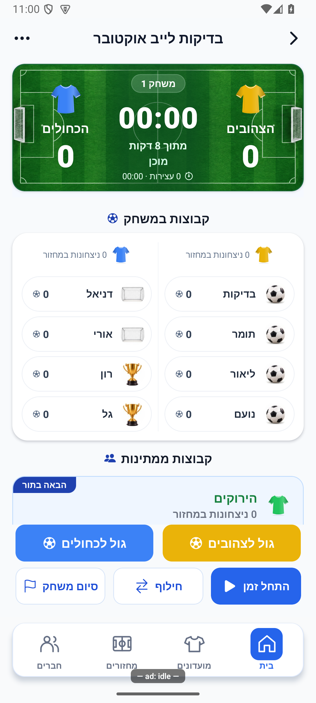

נרשמו חמישה אירועי שער, לפני הפעלת השעון. מקור הנתונים הוא `data-round-four-five-goals.json`, שנקרא ב־`2026-10-16T23:05:05.000770+00:00`:

| אירוע | זהות מהמערכת | הנתון שנשמר בלייב |
|---|---|---|
| שער לצהובים עם בישול | `g_1792191733841_bpe6izece8e` | כובש חשבון הבדיקה, מבשל תומר, `assistStatus=player` |
| שער לכחולים ללא בישול | `g_1792191812633_vrkqelmsv7g` | כובש דניאל, `assistStatus=none` |
| שער לצהובים עם מבקיע לא ידוע | `g_1792191830162_swuy59lhzuf` | `scorerId=null`, ללא בישול |
| שער עצמי לטובת הצהובים | `g_1792191890243_rk1kpz6bjjq` | כובש אורי מהכחולים, `ownGoal=true`, ללא בישול |
| שער לצהובים עם מבשל לא ידוע | `g_1792191901072_23ctegl4ufyj` | כובש תומר, `assistStatus=unknown` |

אחרי האירוע החמישי התוצאה הייתה 4:1. הוא בוטל דרך המסלול הנתמך לצורך הבדיקה; `data-round-four-removed.json`, שנקרא ב־`2026-10-16T23:06:13.768630+00:00`, מכיל את ארבעת האירועים הראשונים בלבד ותוצאה 3:1. מונה שערי תומר חזר לאפס. זו הוכחת ביטול אירוע שנוצר במחזור הבדיקה; לא בוטל אירוע של משתתף חיצוני ולא שונה מחזור אחר. תיקון כובש או מבשל של אירוע קיים עדיין אינו מוכח בסעיף הזה.

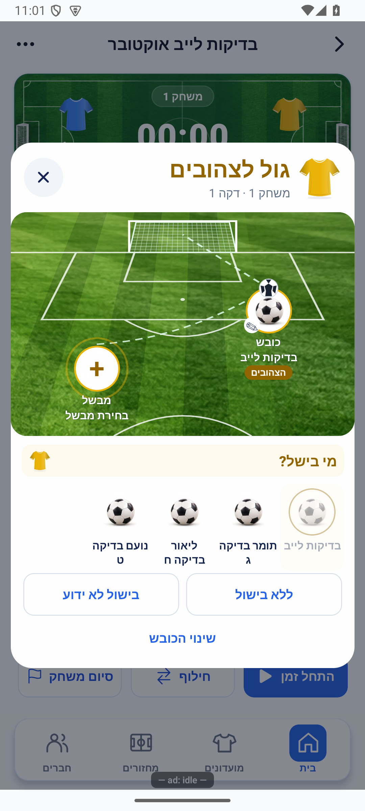
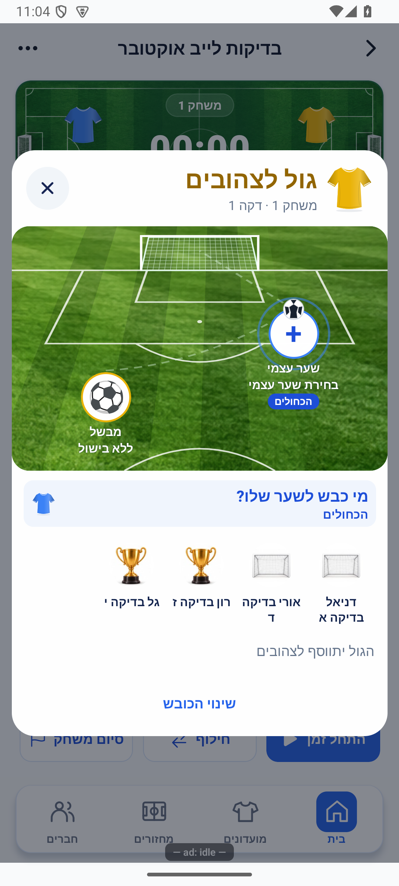

## שמירה ותנועה שנצפו

בחלון הצהובים הכובש נשאר במשבצתו ומושבת בשלב המבשל; רשימת ארבעת השחקנים נשארה יציבה. בחלון הכחולים הכותרת, החולצה, תג הקבוצה ובורר השחקנים הוחלפו לצד המתאים. בצילום השער העצמי הכותרת נשארת צהובה והבחירה כחולה, עם ניסוח מפורש שהגול יתווסף לצהובים.

הסרטון [four-goal-pass.mp4](evidence/live-action-2026-10-17/animation-sources/four-goal-pass.mp4), שאורכו 1,183 אלפיות שנייה, מכיל **בחירת מבשל בלבד**. אחרי חילוץ דגימות מתחילתו ומסופו לא נראית בו בחירה סופית או מסירה, ולכן הוא אינו הוכחת אנימציית מסירה בייצור. [מניפסט מגבלת הסרטון](evidence/live-action-2026-10-17/manifest-four-video-limit.json) מתעד זאת. צילום המקור הנפרד `four-goal-pass-frame-4.png` כן מציג כדור ברשת, שני משתתפים, הודעת ״הגול נשמר״ וחגיגה; השם `frame-4` אינו מוכיח שנגזר מהסרטון. זהו אישור חזותי סטטי של מצב אחרי שמירה, ללא הוכחת מסלול המסירה.

לגול ללא מבשל נשמרו [הקלטה](../../tmp/live-action-production/shots/four-goal-no-assist.mp4) וצילומי מקור נפרדים: צילומים 1–2 מציגים שמירה ללא חגיגה, צילום 3 מציג כדור בקטע הכובש–שער אחרי אישור השמירה, וצילום 4 כבר מציג את לוח המשחק בתוצאה 1:1. אין לייחס לצילומים הנפרדים זמן מדויק בסרטון או להציגם כרצף מפוענח. הם אינם מדידת קצב תמונות, ואינם מוכיחים לבדם כל רגע במסלול או תגובת רשת.

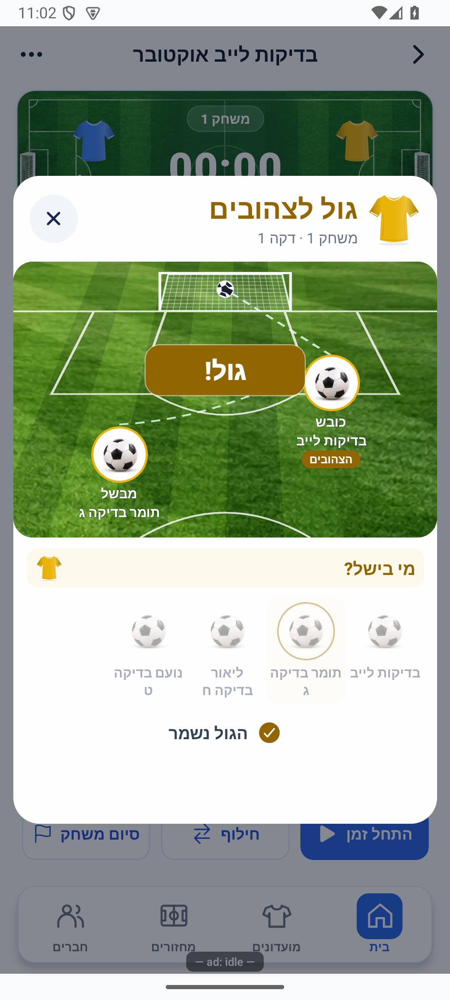

הנתון `data-round-four-goal-one.json` מאשר שער אחד בלבד עם כובש ומבשל בזמן 0:00. בסבב הזה לא הוזרקו עדיין ניתוק אמיתי או אובדן אישור שמירה בייצור; בדיקות אלה בדמו ובקוד אינן הופכות להוכחת ייצור בגלל ההקלטות. גם הפחתת תנועה, שינוי העדפת תנועה בזמן חלונית פתוחה וסגירה בזמן מסירה עדיין אינם מוכחים בסביבת הייצור בסעיף הזה.

## חילוף זמני, סיום ורוטציה

לפני הסיום הוחלף תומר מהצהובים באיתי מהירוקים הממתינים. `data-round-four-temp-swap.json`, שנקרא ב־`2026-10-16T23:07:14.834472+00:00`, מכיל שני שיוכים זמניים באותו מזהה `swap_1792192029885_ilnouwemplc`: תומר מקבוצת המקור 0 אל 2 ואיתי מקבוצת המקור 2 אל 0. קבוצות הבסיס נשמרו. חלון החילוף המצולם הוא פתיחה לפני הבחירה, ולכן ביצוע החילוף מוכח בנתונים הנפרדים ולא בו לבדו.

המשחק הסתיים בתוצאה 3:1 כשהשעון לא הופעל: מערך אירועי השעון נשאר ריק והזמן המצטבר אפס. חלון הניצחון הרגיל מציג מגרש וחולצות מעודכנות, ניצחון לצהובים, צהובים מול ירוקים במשחק הבא וכחולים בהמתנה.

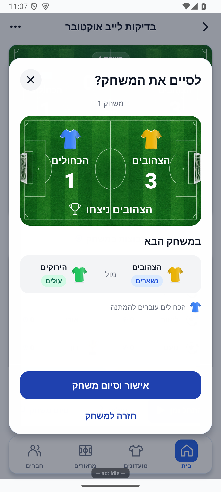

`data-round-four-first-commit.json`, שנקרא ב־`2026-10-16T23:12:50.181473+00:00`, מאשר רשומת היסטוריה אחת, סמן התחייבות אחד ותשע רשומות סטטיסטיקה. בהיסטוריה התוצאה 3:1, המנצחת בצד א׳, ארבעה שערים ושני הרכבים של ארבעה. באותו רגע הרוטציה עדיין מספר 1 והשאלות החילוף עדיין קיימות; זו קריאה של מצב ביניים ולא הוכחה לכשל רוטציה.

הקריאה המאוחרת `data-round-four-second-ready.json`, אחרי טעינה חוזרת והתייצבות לפי תצפית המוביל, ב־`2026-10-16T23:16:23.631045+00:00`, מאשרת `round=2`, משחקות `[0,2]`, ממתינה `[1]`, `loans=[]`, ניצחון אחד לקבוצה 0 ותוצאה 0:0. החלוקה ו־`originalTeams` שמרו את שיוכי המקור: תומר בצהובים ואיתי בירוקים. ההיסטוריה וסמן ההתחייבות נשארו יחידים; אין היסטוריה כפולה אחרי הטעינה הזאת. אין בכך הוכחה לכל ענפי ניתוק הרשת או לשיתוף פעולה בין מכשירים.

## סטטיסטיקה ותלות בשרת הקיים

תשע רשומות הסטטיסטיקה כוללות שמונה משתתפי הרכב הסיום ועוד תומר, המבשל שהוחלף. לחשבון הבדיקה ולדניאל נרשם שער אחד לכל אחד; תומר קיבל בישול אחד. לאורי לא נזקף שער אישי על השער העצמי, והמבקיע הלא ידוע אינו מזכה שחקן. שמונה משתתפים קיבלו משחק אחד, עם ארבעה ניצחונות וארבעה הפסדים לפי הרכב הסיום. תומר קיבל בישול אך ללא מונה משחק באותה רשומה. אין להסיק שמספר רשומות סטטיסטיקה שווה למספר המשתתפים ששיחקו.

נמצאה מגבלה ממשית של השרת הפרוס: הבישול של תומר קיים באירוע הלייב ובסטטיסטיקה (`assists=1`), אך בהיסטוריית המשחק `assisterId=null` בכל ארבעת השערים. תיקון שימור מבשל אורח כבר קיים בקוד המקומי ובבדיקות השרת המבודדות; הוא לא נפרס במשימה ולכן אינו מתקן את ההיסטוריה שנוצרה כאן. גם `assistStatus` אינו נשמר ברשומות ההיסטוריה הישנות במצב המצולם. אין להציג את סיכום הבישולים הזה כתקין מקצה לקצה בייצור.

`roundSummary` היה `null` בשתי הקריאות הראשונות האלה. המחזור הסתיים לאחר המשחק השני, והסיכום שנוצר מתועד להלן. אין להסיק משלב הביניים שסיכום לא נוצר, או מהסיכום לבדו שהנוכחות והמונים לאורך זמן אומתו.

## המשחק השני, שעון ותיקו

הצילום `four-clock-paused.png` נפתח ונבחן: הצהובים מול הירוקים במשחק 2, תוצאה 0:0, תצוגת שעון 00:23 ומצב ״מושהה״; כפתור ״המשך״ גלוי. בקריאת הנתונים אחרי המשחק ובסיום נשמרו שני מקטעי פעילות סגורים: 23,880 ועוד 3,270 אלפיות שנייה, בסך הכול 27,150. הפער בין המקטעים תומך בעצירה ובחידוש. הנתונים הם `activeIntervals` במסמך הלייב, ולא משך משחק חתום בהיסטוריה; `timerEvents` ריק והזמן המצטבר התאפס בסיום. אין לערבב את זמן הצילום הראשון עם סכום הריצה לאחר ההמשך.

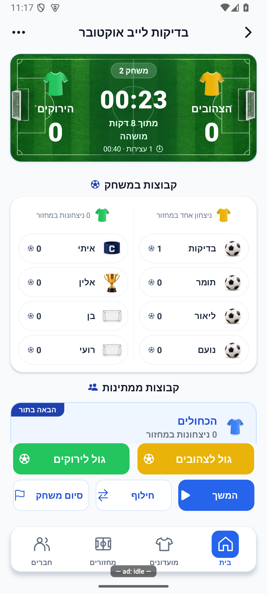

בחלון התיקו נראו מגרש ושתי חולצות, תוצאה 0:0, אפשרויות ״פנדלים״ ו״בחירת מנצחים״, אישור מושבת וחזרה למשחק. האפשרות ״שתי הקבוצות יוצאות״ אינה מופיעה כאשר יש שלוש קבוצות. זו הוכחת מצב פתיחה; הבחירה והאישור עצמם נתמכים בהיסטוריה ובתצפית המוביל: נבחרו הירוקים כמנצחים, ונשמר משחק שני עם `winnerSide=B` וללא בעיטות.

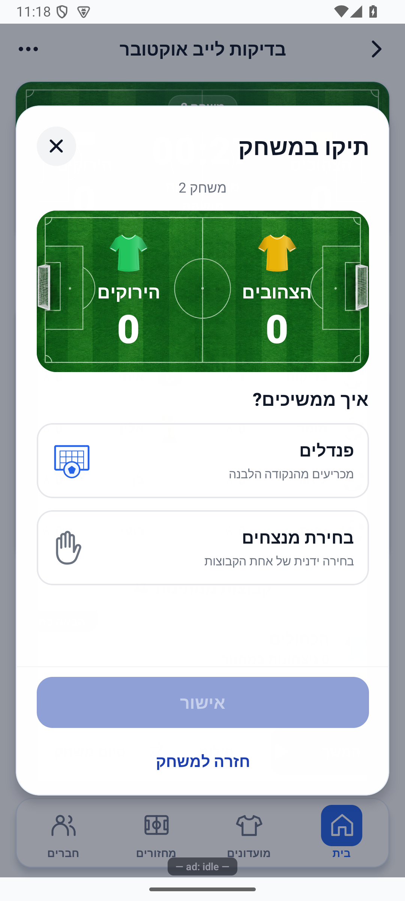

`data-round-four-second-commit.json` נקרא ב־`2026-10-16T23:19:13.019747+00:00`. ב־`data-round-four-finished.json`, שנקרא ב־`2026-10-16T23:20:22.535989+00:00`, המחזור מסומן `finished`, עם שתי היסטוריות ושני סמני התחייבות בלבד. משחק שלישי מוכן אינו נספר כמשחק ששוחק. יש שתים עשרה רשומות נתוני משתתפים, אחת לכל זהות ייעודית, וללא בעיטות פנדל.

## סיכום המחזור והסיכום האישי

הצילום `four-summary-stats.png` מציג שני משחקים, שלושה שערים, בישול אחד ואפס הכרעות פנדלים. מקור ההיסטוריה מכיל ארבעה שערי שדה: שלושה לצהובים ואחד לכחולים. לכן הצגת שלושה בסיכום היא פער נתונים ממשי, הנובע מהשמטת השער בעל הכובש הלא ידוע בשרת הפרוס. התיקון המקומי אינו פרוס ואין להציג את המספר שלוש כתקין. בועת העזרה מכסה חלק מכרטיס הכוכבים התחתון, אך ארבעת מוני הסיכום גלויים.

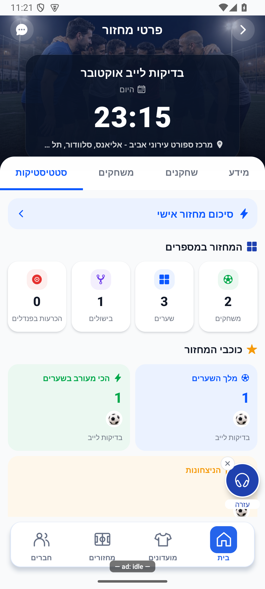

הצילום `four-personal-summary.png` מציג עבור חשבון הבדיקה שני משחקים, ניצחון אחד, שער אחד ואפס בישולים, בהתאמה לרשומת השחקן. הוא מציג גם ציון 8.2; צילום הציון לבדו אינו הוכחת חישוב, וההתאמה למודול הקנוני נבדקה בנפרד בקריאה המאוחרת להלן. בועת העזרה מכסה חלק מאזור אחוז הניצחונות, ולכן אין לייחס לצילום ראיה לכל פרטי הכרטיס התחתון.

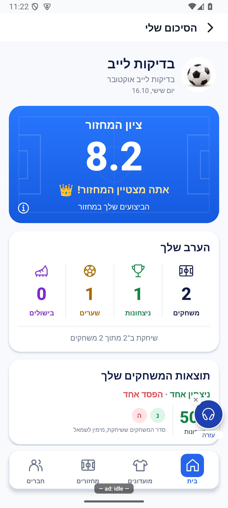

בנתונים הסופיים נצפו שש עשרה הופעות שחקן מצטברות, לעומת שבע עשרה כאשר כוללים גם את תומר שיצא אחרי הבישול במשחק הראשון. תומר קיבל את הבישול, אך לא את ההופעה והניצחון של המשחק הראשון; במשחק השני נרשמו לו הופעה והפסד. זו תלות שרת נוספת שנצפתה בפועל. תיקון ההיסטוריה של בישול האורח, זקיפת הופעת האורח היוצא והכללת הכובש הלא ידוע בסיכום קיימים בקוד המקומי ובבדיקות, ולא נפרסו.

### הקריאה המאוחרת: נוכחות, חתימה וציון

בשלב הסיכום הראשון הנוכחות טרם אומתה ישירות, ו־`correctionBasis.career.games=1` היה ראיה עקיפה בלבד. לאחר מכן נקרא `data-round-four-sealed-proof.json` ב־`2026-10-16T23:38:54.322400+00:00`. הקריאה מכילה בפועל את `finishCredited/once`, שלבי `finishStages/standings` ו־`finishStages/complete`, רשומת דירוג הערב ונתוני המועדון של חשבון הבדיקה. העותק בארכיון מסנן מהקריאה הזאת את המחזור הנוסף שטרם שייך להוכחת ארבעה מול ארבעה.

ב־`communityPlayerStats` של החשבון נצפו `games=1` ו־`rounds=2`: מחזור נוכחות אחד ושני משחקים בתוכו. נצפו גם `eveningScoreCount=1`, `eveningScoreSum=8.2` ו־`lastEveningScore=8.2`; ברשומת `eveningStandings` הציון הוא 8.2 ו־`scoreBasis.counted=true`. ביקורת הנתונים חישבה את הציון במודול הקנוני של המערכת עם בסיס הכיול שנשמר, והתוצאה התאימה ל־8.2. זו הוכחה ישירה של המצב השמור והחישוב עבור חשבון הבדיקה, בנוסף לצילום.

לא הופעל מחדש סיום המחזור לצורך ניסוי מסירה חוזרת. לכן סמני החתימה ומוני הציון אינם הוכחה ניסויית לעמידות בפני מסירה כפולה של פעולת הסיום. אין כאן קריאה של מסמכי נוכחות וצמדים לכל שאר המשתתפים, או אימות ניתוק וחיבור בין מכשירים.

## ביקורת נתונים וארכיון קבוע

[ביקורת הנתונים המפורטת](evidence/live-action-2026-10-17/audit-four-data.md) ו[הפלט המובנה](evidence/live-action-2026-10-17/audit-four-data.json) נוצרו מקריאת תמונות המסד בלבד: 76 אימותים עברו, שישה פערים נצפו בשלוש קבוצות של תיקוני שרת ושישה תחומים סומנו לא מוכחים. ״אפס כשלים לא צפויים״ בפלט אינו טענה שהזרימה תקינה: ששת פערי השרת נותרו קיימים ונכללים בממצאים לעיל.

הפלט משווה זהויות, שיוכים, שערים, סגלי סיום, רוטציה, מוני אורחים, סיכום ונתוני נוכחות וציון של חשבון הבדיקה. הוא מבדיל בין רשומה יציבה בכמה קריאות לבין ניתוק וחיבור מחדש, ובין סמני חתימה קיימים לבין ניסוי מסירה כפולה שלא הורץ. אין במחזור הזה בדיקת פנדלים. מזהי אירועי השער אינם נשמרים בהיסטוריה הקיימת; אפשר להשוות תוכן וסדר, ולא לטעון שמזהי האירועים שרדו בשרת.

[ארכיון הראיות](evidence/live-action-2026-10-17/README.md) שומר שש עשרה תשובות מסד מסוננות ושני פלטי ביקורת. נשמרו רק נתוני חשבון, מועדון, מחזור ואורחים ייעודיים; כתובת דואר, קוד הזמנה, מיקום והעדפות חשבון הושמטו. [מניפסט הארכיון](evidence/live-action-2026-10-17/manifest.json) קושר כל עותק לחותמת קובץ המקור ול־`readAt`, ומציין שחותמת העותק המסונן שונה מחותמת המקור. ההוכחה אינה תלויה עוד רק ב־`tmp`; הארכיון אינו כלי לשחזור או לכתיבה בייצור.

## תקלות במסך קטן — פתוחות בזמן הצילום

שני הצילומים להלן הם ראיות תקלה. שם קובץ הכולל ״סופי״ מתאר שם עבודה בלבד ואינו אישור תקינות.

בחלון הניצחון הקטן כפתור האישור והחזרה גלויים, אך אזור ״במשחק הבא״ אינו נראה וניסיון גלילה לא עבד לפי תצפית המוביל. התיקון נמצא בעבודה; צילום חדש של פתיחה וגלילה נדרש לאחריו.

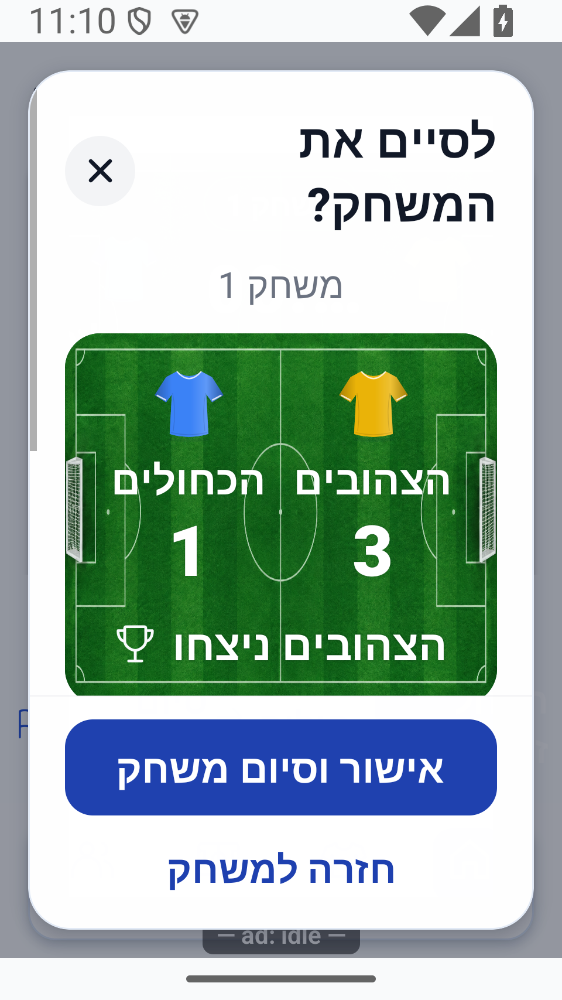

אחרי התחייבות המשחק, לוח המשחק השני מציג את הצהובים והירוקים עם אפס שערים, אך השעון והמטא־דאטה מקוצרים, שם הצהובים חופף לאזור האמצע, וטקסטי כפתורי הגול והשעון חורגים. התמונה מוכיחה מעבר למשחק השני ותקלת פריסה; היא אינה הוכחת עיצוב גמור. נתוני הרוטציה אושרו בקריאה המאוחרת בנפרד.

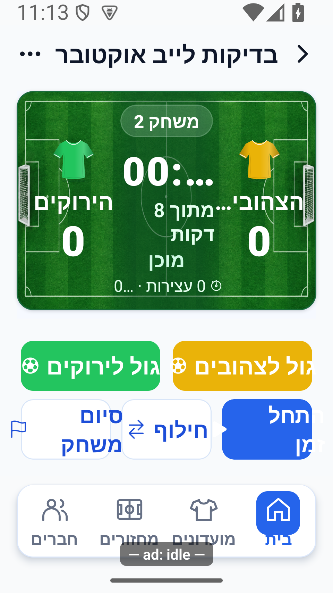

## מקור הצילומים והמשך הבדיקות

חמישה עשר הצילומים שנרשמו בשלב ארבעה נפתחו ונבחנו, הועתקו ללא שינוי ושויכו במניפסט לסביבת ייצור עם לקוח פיתוח מקומי. המקור, חותמת התוכן וזמן UTC מפורשים בכל רשומה. שני צילומי הפריסה והצילום של פער סיכום השערים מסומנים כראיות תקלה גם במניפסט; אין להחליפם בשקט בצילום תיקון. נוספה מסגרת של גול ללא מבשל, המציגה כדור בקטע הכובש–שער אחרי שמירה, ללא מסירה מהמשבצת השמאלית.

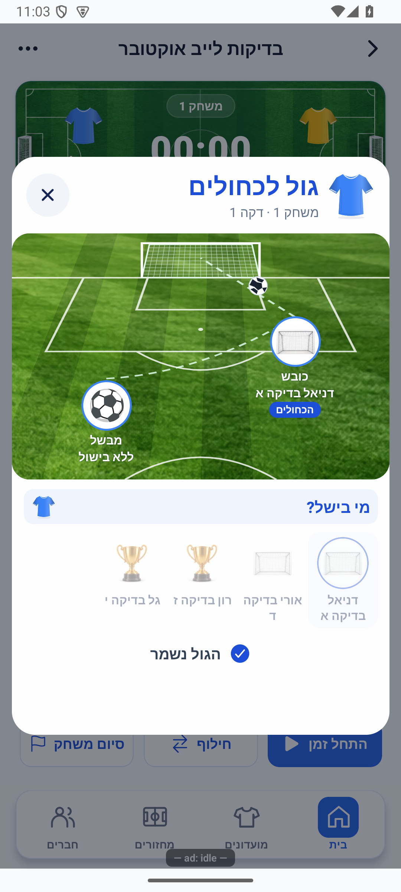

היקף מאומת עד כה: הכנת מחזור ארבעה מול ארבעה עם אורחים, חלוקה מפורסמת ושלושה צבעים; בחירת קבוצות משחקות; שערים בחמש משמעויות וביטול שער הבדיקה החמישי; חילוף זמני; סיום ראשון ללא שעון; היסטוריה, סטטיסטיקה, טעינה חוזרת ורוטציה; ריצה, עצירה וחידוש במשחק השני; תיקו ובחירת מנצחת ידנית; סיום מחזור וסיכומים עם פערי השרת שתועדו; סמני נוכחות וחתימה ומונה ציון יחיד של חשבון הבדיקה. אימות צילומי מסך אינו מחליף את קריאות המסד המפורטות.

היקף שטרם הושלם בדוח זה: משחקי שבעה ואחד עשר, פנדלים בייצור, חילוף קבוע, השלמות וכל דרכי חלוקת הכוחות, תיקון שער קיים, כשל שמירה וניסיון חוזר בייצור, ניתוק וחיבור מחדש, ניסוי מסירה חוזרת של סיום ותיקון התקלות הקטנות. הפעלה קרה עם גופן מוגדל דורשת ראיה שההגדרה הייתה פעילה לפני התחלת תהליך היישום; אין להסיק זאת מכל צילום קטן קיים. הבדיקות ממשיכות אצל המוביל; ההחלטה על מוכנות טרם התקבלה. נתוני הבדיקה בייצור נשארים ולא נמחקים או מבוטלים אוטומטית בסיום העבודה.

## חותמות ראיות של שלב ארבעה מול ארבעה

הזמנים בטבלה הם UTC מזמן קובצי המקור; תוכן התמונות לא שונה.

| צילום שמור | זמן UTC | סוג ראיה |
|---|---|---|
| [action-pitch-production-four-live-ready-2026-10-17.png](../features/screenshots/action-pitch-production-four-live-ready-2026-10-17.png) | `2026-10-16T23:00:30.600Z` | בדיקת מוצר בייצור |
| [action-pitch-production-four-goal-assist-2026-10-17.png](../features/screenshots/action-pitch-production-four-goal-assist-2026-10-17.png) | `2026-10-16T23:01:43.744Z` | בדיקת מוצר בייצור |
| [action-pitch-production-four-goal-net-frame-2026-10-17.png](../features/screenshots/action-pitch-production-four-goal-net-frame-2026-10-17.png) | `2026-10-16T23:02:29.520Z` | בדיקת מוצר בייצור |
| [action-pitch-production-four-blue-assist-2026-10-17.png](../features/screenshots/action-pitch-production-four-blue-assist-2026-10-17.png) | `2026-10-16T23:03:14.670Z` | בדיקת מוצר בייצור |
| [action-pitch-production-four-own-goal-2026-10-17.png](../features/screenshots/action-pitch-production-four-own-goal-2026-10-17.png) | `2026-10-16T23:04:26.719Z` | בדיקת מוצר בייצור |
| [action-pitch-production-four-scorers-2026-10-17.png](../features/screenshots/action-pitch-production-four-scorers-2026-10-17.png) | `2026-10-16T23:05:28.422Z` | בדיקת מוצר בייצור |
| [action-pitch-production-four-swap-2026-10-17.png](../features/screenshots/action-pitch-production-four-swap-2026-10-17.png) | `2026-10-16T23:06:13.552Z` | בדיקת מוצר בייצור |
| [action-pitch-production-four-end-before-clock-2026-10-17.png](../features/screenshots/action-pitch-production-four-end-before-clock-2026-10-17.png) | `2026-10-16T23:07:22.429Z` | בדיקת מוצר בייצור |
| [action-pitch-production-four-end-small-defect-2026-10-17.png](../features/screenshots/action-pitch-production-four-end-small-defect-2026-10-17.png) | `2026-10-16T23:10:14.028Z` | תקלה שנצפתה |
| [action-pitch-production-four-next-live-small-defect-2026-10-17.png](../features/screenshots/action-pitch-production-four-next-live-small-defect-2026-10-17.png) | `2026-10-16T23:13:35.922Z` | תקלה שנצפתה |
| [action-pitch-production-four-summary-stats-2026-10-17.png](../features/screenshots/action-pitch-production-four-summary-stats-2026-10-17.png) | `2026-10-16T23:21:30.831Z` | תקלה שנצפתה |
| [action-pitch-production-four-personal-summary-2026-10-17.png](../features/screenshots/action-pitch-production-four-personal-summary-2026-10-17.png) | `2026-10-16T23:22:02.930Z` | בדיקת מוצר בייצור |
| [action-pitch-production-four-clock-paused-2026-10-17.png](../features/screenshots/action-pitch-production-four-clock-paused-2026-10-17.png) | `2026-10-16T23:17:35.406Z` | בדיקת מוצר בייצור |
| [action-pitch-production-four-tie-options-2026-10-17.png](../features/screenshots/action-pitch-production-four-tie-options-2026-10-17.png) | `2026-10-16T23:18:08.709Z` | בדיקת מוצר בייצור |
| [action-pitch-production-four-goal-no-assist-moving-2026-10-17.png](../features/screenshots/action-pitch-production-four-goal-no-assist-moving-2026-10-17.png) | `2026-10-16T23:03:44.436Z` | בדיקת מוצר בייצור |

תשובות המסד המקומיות אינן מועתקות למסמך. החותמות הבאות מאפשרות לזהות את חומר הגלם שנבדק:

| קובץ מקור | חותמת תוכן |
|---|---|
| `data-round-four-five-goals.json` | `8e1cf2415616a43731ebb53cba51a9a971b5d6ce9300b49bd6c462acb169d49d` |
| `data-round-four-removed.json` | `81178909f51b054b9d72158d639f2d5645acdb1d7d48bed63b7a11c14a81e8e1` |
| `data-round-four-temp-swap.json` | `c7815b47684ef084cbe3bf12d68e8705daa8ba7c2a20dfc33b382ae4c4aa3e50` |
| `data-round-four-first-commit.json` | `e4ac4b9bb68c6c4a13addee960bbdd62945334a211d53bcd2431180aa992e052` |
| `data-round-four-second-ready.json` | `0791d041ad469b88bb03d0104bab95cd99e39bcd6cbf922a2f2c2df12a665b10` |
| `data-round-four-second-commit.json` | `8452ee4ad67949a83f76012a87857f6632c16be1c5c021f241f9c06d4ffa0da4` |
| `data-round-four-finished.json` | `81c458c24b3cd255dac747132da3774ee37df8df92031a2bea316246ab5b8e63` |
| `data-round-four-sealed-proof.json` | `fc551c7ccefce10de4b953dfa59115ff7d0fbbb998210b77a642d08cdb4fd114` |

## שבעה מול שבעה — הוכחות ביניים לפני חתימת המשחק

הסעיף הבא שומר את נקודת הביניים המוקדמת. עדכון מאוחר יותר בהמשך הדוח מאמת את חתימת המשחק הראשון ואת הפעילות במשחק השני; אין לקרוא את החסרים כאן כמצב העדכני אחרי אותו עדכון.

שלב זה אינו בדיקת מחזור שהושלם. המחזור `YEdIR3MviDK82D581ELk` נוצר באותו מועדון בדיקות עם חשבון הבדיקה ועשרים אורחים ייעודיים. יש שלוש קבוצות של שבעה, 21 זהויות שונות, לייב מתקדם וחילופים זמניים. מזהי כל האורחים ושמותיהם נשמרו ב[תשובת הסגל המסוננת](evidence/live-action-2026-10-17/data-round-seven-full-roster.json); לא נוצרו כאן חשבונות אורחים.

המשחק הראשון הוא `r_mvboblq9_ynnomoks`. ב־`data-round-seven-ready.json`, שנקרא ב־`2026-10-17T00:44:08.076555+00:00`, החלוקה מפורסמת: קבוצה 1 הירוקה וקבוצה 2 הלבנה משחקות, וקבוצה 0 האדומה ממתינה. כל קבוצה מכילה שבעה משתתפים. השעון עצור באפס, ללא אירועי שעון.

### חלוקה, ניסיון חוזר והתאמת הסגל השמור

אחרי תרחיש היצירה מחדש והניסיון החוזר נשמרה חלוקה בעלת `createdAt=1792197590117`. `data-seven-regenerate-version.json` וההקשר המקורי של המכשיר מסכימים על אותה גרסה צפויה. [הוכחת חברות הסגל](evidence/live-action-2026-10-17/seven-native-draft-members-proof.json) משווה את כל 21 השמות השמורים לתוכן של שלוש הקבוצות המקוריות ומחזירה התאמה. הקפטן מוצג בנפרד; זו התאמת חברות בקבוצה ולא דרישה שסדר התאים המרונדר יהיה זהה לסדר המערך במסד.

הצילום ששמו `seven-version-guard-retry` מציג סיכום של 21 שחקנים אחרי הניסיון החוזר; הוא אינו מציג את נוסח הודעת חסימת הגרסה עצמה. אזהרת פיתוח כללית ובועת עזרה חופפות לחלק התחתון. לכן הוא אינו הוכחה עצמאית להתנהגות כל מרוץ יצירה מחדש. אפשרות קריאת השרת שנוספה אחרי הצילום טרם נבחנה כאן ביצירה חדשה נוספת, ואין לסמן את התוספת כמוכחת בגלל צילום הסגל.

### הפעלה קרה, הגדלת טקסט והפחתת תנועה

[תשובת המכשיר בהפעלה הקרה](evidence/live-action-2026-10-17/seven-cold-small-motion-runtime.json) מאשרת `mock=false`, חלון 320×569, מכפיל גופן בקירוב 1.4 ו־`reducedMotionAtLaunch=true`. [קריאת העדפת התנועה](evidence/live-action-2026-10-17/seven-reduced-motion-pref.json) מחזירה `ready` ו־`true`. זו הוכחת ההגדרות שהלקוח קרא, מעבר להנחה שהגדרת מערכת בלבד מספיקה; היא אינה מוכיחה לבדה שכל הנפשה וכל שינוי חי של ההעדפה פעלו נכון.

בצילום הלייב אחרי הפעלה קרה השעון 00:00 נראה בשלמותו, אך ״הירוקים״ ו״הלבנים״ נשברים באמצע המילה. זהו ממצא פריסה, ולא אישור לעיצוב קטן גמור. תיקון שבירת המילים שנוסף אחריו עדיין מחייב צילום חדש. חלון הגול הקטן מציג את שני התפקידים, חולצה, שורת שלושה בוחרים מלאה ופעולות גלויות. בחירת משה העבירה מיד למבשל והשביתה אותו באותה משבצת; יתר הסגל דורש גלילה.

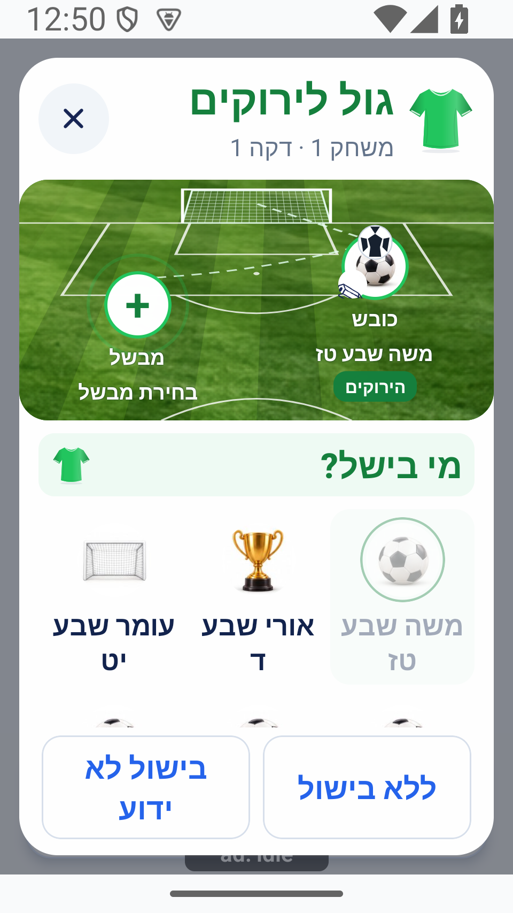

### שני שערי שדה לפני הפעלת שעון

| מקור וזמן UTC | אירוע מהמערכת | תוצאה שנקראה |
|---|---|---|
| `data-seven-reduced-goal.json`, ‏`2026-10-17T00:50:23.531710+00:00` | `g_1792198217132_ktus20y6u6q`: משה `guest:mvbm3ekm-bwv413` מהירוקים, `assistStatus=none` | 1:0, שער אחד בלבד |
| `data-seven-tie-goals.json`, ‏`2026-10-17T00:52:10.790821+00:00` | `g_1792198324917_psuloczqwdi`: אסף `guest:mvbm1i0e-fn72ab` מהלבנים, מבשל ליאור `guest:mvblzjh8-sqyjaj`, ‏`assistStatus=player` | 1:1, שני מזהי שער שונים |

בשתי הקריאות השעון עצור באפס, והכובשים והמבשל שייכים לצד המשחק המתאים. לפני הסיום ההיסטוריה, סמני ההתחייבות ונתוני השחקנים של המחזור ריקים. אין לייחס מונים קודמים של חשבון הבדיקה ממחזור ארבעה לתרומה במחזור שבעה.

### חלונות הניצחון והתיקו הקטנים

בחלון הניצחון בתוצאת הביניים 1:0 נגלל התוכן עד ״במשחק הבא״, בזמן שהאישור והחזרה נשארו גלויים. כרטיסי המשחק הבא עדיין שוברים את שמות הקבוצות ואת תגי ״עולים״ ו״נשארים״ באמצע מילה. התיקון המאוחר למבנה הטור אינו מצולם כאן. החלון הוחזר למשחק לפני חתימה, ובהמשך הוזן השער השני.

בתיקו 1:1 האישור נראה מושבת לפני בחירה. אחרי גלילה ובחירת פנדלים הוא נראה פעיל באותו אזור תחתית קבוע, ולחיצה פתחה את ההכרעה. אלה צילומים לפני הפריסה הקומפקטית האחרונה: האפשרויות דורשות גלילת גוף, ואין להשתמש בהם לאישור תיקון שעדיין לא צולם. האפשרות ששתי הקבוצות יוצאות אינה זמינה בשלוש קבוצות.

### פנדל ראשון, ניתוק וחידוש חיבור

המוביל בחר את הירוקים כבועטים ראשונים. משה נבחר מהירוקים, וחשבון הבדיקה נבחר לשוער מהלבנים בשתי בחירות משתתפים; בחירת התוצאה היא פעולה שלישית. `data-seven-kick-one.json`, שנקרא ב־`2026-10-17T00:56:06.128152+00:00`, מכיל בעיטה יחידה `pk_1792198560083_9kh0go869q8`, עם בועט משה, שוער חשבון הבדיקה, `team=A`, ‏`outcome=goal` ו־`scored=true`. השוער נשמר גם ב־`keeperB`, ותוצאת השדה נשארה 1:1.

בצילום השוער הקטן מופיעים רק הלבנים המותרים לבחירה. עם זאת, גלילת הגוף הישנה מסתירה את השער והשוער וחלק מאווטר הבועט. במסך התוצאה נראים השחקנים הנכונים בכרטיסים, אבל המגרש מוסתר ורק חלק מכפתור הגול גלוי מעל היומן. שייכות נכונה אינה אישור לפריסה; תיקוני המגרש הקבוע וגלילת האפשרויות עדיין דורשים צילום קטן חדש.

אחרי תרחיש ניתוק וחיבור שביצע המוביל, `data-seven-reconnected.json` נקרא ב־`2026-10-17T00:57:25.600738+00:00`. אותם שני שערי שדה ואותה בעיטת פנדל נשארו, עם אותם מזהים, סגלים ורוטציה וללא כפילות. זו הוכחת שימור הנתונים בין שתי נקודות הקריאה ובתרחיש החיבור שנצפה; לא בוצעה כאן כתיבת אירוע בזמן ניתוק או הזרקת תגובה אבודה.

בצילומי הניתוק והחיבור הכפתור הכחול מתחת ל״הפנדלים עדיין נמשכים״ נראה ללא כיתוב. לפי תצפית המוביל הטקסט קיים בהיררכיה; טרם הושלמה בדיקה קרה רגילה של המצב העדכני. לכן זה מתועד כמגבלה חזותית של הצילומים, ולא ככשל תפקודי מוכרע. אותם צילומים עדיין מראים שבירת שמות קבוצות באמצע מילה.

### תוספת בגודל רגיל: בעיטה שנייה ועצירה

אחרי חזרה להכרעה בגודל רגיל, הצילום `seven-normal-penalty-restored` מציג את הלבנים כבועטים הבאים, את הירוקים כשוערים, שבעה מועמדים והגול הראשון שנשמר. בתוצאת הבעיטה השנייה אסף מהלבנים מול משה מהירוקים; כל המגרש ושלוש האפשרויות נראים. זהו סבב נוסף מעבר לנקודת הביקורת הקפואה של הבעיטה הראשונה.

`data-seven-kick-two.json`, שנקרא ב־`2026-10-17T01:01:55.200489+00:00`, מכיל בעיטה שנייה `pk_1792198905239_gqp2zt74n8j`, של אסף בצד ב׳ מול משה בצד א׳, עם `outcome=goal`. תוצאת הפנדלים היא 1:1, והצד הבא חזר לירוקים. [העדפת התנועה שנקראה בסבב הזה](evidence/live-action-2026-10-17/seven-kick-two-motion-pref.json) היא `false`, ולכן המסגרות האלה אינן ראיה להפחתת תנועה. המוביל ייצב זמנית את תנועת המכשיר לצורך בחירת המשתתפים ואז החזיר תנועה לפני בחירת התוצאה; אין להסיק שההעדפה נשארה כבויה לאורך כל הבדיקות הקודמות.

מסגרת 1 של [הקלטת הגול השנייה](../../tmp/live-action-production/shots/seven-normal-penalty-goal.mp4) מציגה עבודה וכפתורים מוחלשים בלי חגיגה. מסגרת 2 מציגה כדור ברשת ו״גול!״ לאחר האישור. ההקשר הקודם הלבן נשאר במגרש, בעוד הכותרת והבורר מכריזים במפורש על הירוקים הבאים. נפתחו ונבחנו מסגרות המקור; אין כאן חילוץ של רצף צפוף מהסרטון, ולכן אין לטעון שהמסגרות הבודדות מוכיחות כל רגע במסלול הכדור או את קצב התנועה.

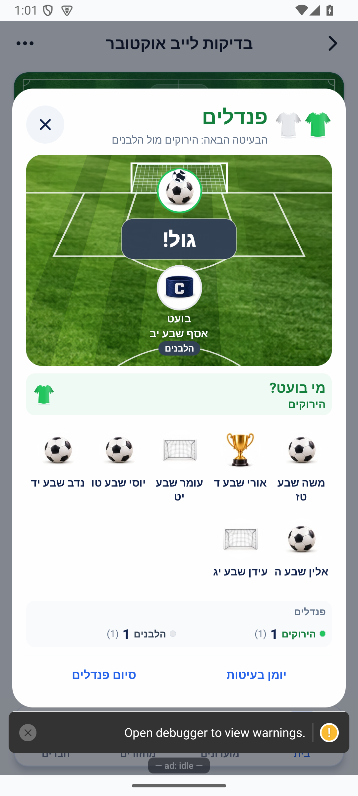

`data-seven-kick-three.json`, שנקרא ב־`2026-10-17T01:04:22.392098+00:00`, מוסיף בעיטה שלישית `pk_1792199052098_5279qm840xh`, משה מהירוקים מול חשבון הבדיקה מהלבנים, עם `outcome=save` ו־`scored=false`. מסגרת 2 של [הקלטת העצירה](../../tmp/live-action-production/shots/seven-normal-penalty-save.mp4) מציגה כדור ליד השוער ו״עצירה!״; תוצאת הפנדלים נשארת 1:1, שתי בעיטות לירוקים ואחת ללבנים. זו עצירה מפורשת, ואין בסבב המתועד כאן עדיין בעיטת החטאה או אישור חישובי שוער אחרי חתימת משחק.

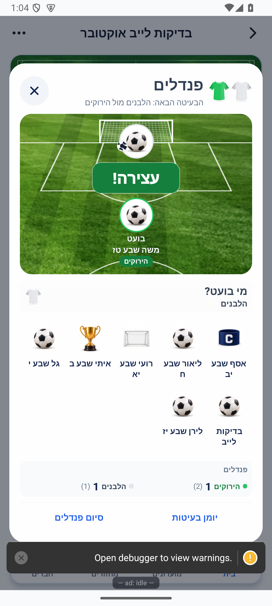

### ביקורת קפואה, ארכיון ומגבלות השלב

[דוח הביניים הקפוא](evidence/live-action-2026-10-17/audit-seven-partial-data.md) ו[הפלט המובנה](evidence/live-action-2026-10-17/audit-seven-partial-data.json) כוללים 36 אימותים שעברו ושמונה תחומים שטרם הוכחו, עד `data-seven-reconnected.json`: סגלים וזהויות, שני שערים, בעיטה ראשונה וחידוש חיבור. הם אינם טוענים לשמירת משחק, סיום מחזור, זקיפות או סיכום. נתוני הבעיטה השנייה והשלישית נבדקו בנפרד אחר כך ואינם חלק מספירת 36 האימותים.

[מניפסט ארכיון השבעה](evidence/live-action-2026-10-17/manifest-seven-partial.json) שומר מקורות מסוננים של מחזור הבדיקה בלבד, הוכחת חברות סגל במכשיר, הקשר גופן ותנועה ושני פלטי הביקורת הקפואים. מחזורים אחרים, דואר, קוד הזמנה ומיקום אינם נכללים בתמונות המסד המסוננות. נשמרות חותמות מקור ועותק בנפרד. הצילומים שנבחרו לשלב המקורי ולתוספת הרגילה נפתחו ונבחנו, עם סיווג מפורש של פגם, מצב ביניים או מסגרת תוצאה; תמונות הביניים אינן מוחלפות בשקט בתיקונים עתידיים.

עדיין חסרים בשלב זה סיום הכרעה ומשחק, היסטוריה ומוני שוער, החטאה, תיקון וביטול בעיטה, סיום מחזור וסיכומים של שבעה, כשל שמירה וניסיון חוזר בייצור, כתיבה בזמן ניתוק, חילוף קבוע והשלמות, אימות חי מלא של העדפת התנועה וצילומי התיקונים הקטנים העדכניים. ההחלטה על מוכנות נשארת פתוחה; אין להסיק ש־36 אימותי הנתונים או צילומי התוצאה מכסים את כל הרשימה.

### מקורות הצילום בשלב שבעה

הזמנים הם UTC מזמן קובץ המקור. אלה צילומי ביניים ומסגרות מקור, ולא הכרזת מוכנות.

| צילום שמור | זמן UTC | סוג ראיה |
|---|---|---|
| [action-pitch-production-seven-draft-after-retry-2026-10-17.png](../features/screenshots/action-pitch-production-seven-draft-after-retry-2026-10-17.png) | `2026-10-17T00:40:17.144Z` | מצב ביניים לאחר ניסיון חוזר |
| [action-pitch-production-seven-cold-live-word-wrap-defect-2026-10-17.png](../features/screenshots/action-pitch-production-seven-cold-live-word-wrap-defect-2026-10-17.png) | `2026-10-17T00:48:39.157Z` | תקלה שנצפתה |
| [action-pitch-production-seven-small-goal-scorer-2026-10-17.png](../features/screenshots/action-pitch-production-seven-small-goal-scorer-2026-10-17.png) | `2026-10-17T00:49:44.604Z` | בדיקת מוצר חלקית בייצור |
| [action-pitch-production-seven-small-goal-assist-2026-10-17.png](../features/screenshots/action-pitch-production-seven-small-goal-assist-2026-10-17.png) | `2026-10-17T00:50:01.892Z` | בדיקת מוצר חלקית בייצור |
| [action-pitch-production-seven-end-scroll-word-wrap-defect-2026-10-17.png](../features/screenshots/action-pitch-production-seven-end-scroll-word-wrap-defect-2026-10-17.png) | `2026-10-17T00:50:58.832Z` | תקלה שנצפתה |
| [action-pitch-production-seven-tie-unselected-before-compact-2026-10-17.png](../features/screenshots/action-pitch-production-seven-tie-unselected-before-compact-2026-10-17.png) | `2026-10-17T00:52:20.209Z` | בדיקת מוצר חלקית בייצור |
| [action-pitch-production-seven-tie-selected-before-compact-2026-10-17.png](../features/screenshots/action-pitch-production-seven-tie-selected-before-compact-2026-10-17.png) | `2026-10-17T00:53:31.369Z` | בדיקת מוצר חלקית בייצור |
| [action-pitch-production-seven-kicker-list-2026-10-17.png](../features/screenshots/action-pitch-production-seven-kicker-list-2026-10-17.png) | `2026-10-17T00:54:04.757Z` | בדיקת מוצר חלקית בייצור |
| [action-pitch-production-seven-keeper-scroll-pitch-defect-2026-10-17.png](../features/screenshots/action-pitch-production-seven-keeper-scroll-pitch-defect-2026-10-17.png) | `2026-10-17T00:54:25.362Z` | תקלה שנצפתה |
| [action-pitch-production-seven-result-scroll-pitch-defect-2026-10-17.png](../features/screenshots/action-pitch-production-seven-result-scroll-pitch-defect-2026-10-17.png) | `2026-10-17T00:54:43.631Z` | תקלה שנצפתה |
| [action-pitch-production-seven-offline-unlabelled-resume-2026-10-17.png](../features/screenshots/action-pitch-production-seven-offline-unlabelled-resume-2026-10-17.png) | `2026-10-17T00:57:21.254Z` | צילום ניתוק עם מגבלה חזותית |
| [action-pitch-production-seven-reconnected-unlabelled-resume-2026-10-17.png](../features/screenshots/action-pitch-production-seven-reconnected-unlabelled-resume-2026-10-17.png) | `2026-10-17T00:57:32.498Z` | צילום חיבור עם מגבלה חזותית |
| [action-pitch-production-seven-normal-penalty-restored-2026-10-17.png](../features/screenshots/action-pitch-production-seven-normal-penalty-restored-2026-10-17.png) | `2026-10-17T00:59:07.573Z` | בדיקת מוצר חלקית בייצור |
| [action-pitch-production-seven-normal-result-two-2026-10-17.png](../features/screenshots/action-pitch-production-seven-normal-result-two-2026-10-17.png) | `2026-10-17T01:01:01.431Z` | בדיקת מוצר חלקית בייצור |
| [action-pitch-production-seven-normal-penalty-saving-frame-2026-10-17.png](../features/screenshots/action-pitch-production-seven-normal-penalty-saving-frame-2026-10-17.png) | `2026-10-17T01:01:47.998Z` | מסגרת שמירה לפני אישור |
| [action-pitch-production-seven-normal-penalty-net-frame-2026-10-17.png](../features/screenshots/action-pitch-production-seven-normal-penalty-net-frame-2026-10-17.png) | `2026-10-17T01:01:49.594Z` | מסגרת גול לאחר אישור |
| [action-pitch-production-seven-normal-penalty-save-frame-2026-10-17.png](../features/screenshots/action-pitch-production-seven-normal-penalty-save-frame-2026-10-17.png) | `2026-10-17T01:04:17.372Z` | מסגרת עצירה לאחר אישור |

## עדכון שבעה — משחק ראשון חתום ומשחק שני פעיל

זהו עדכון מאוחר לשלב הביניים שלעיל. המחזור עדיין לא הסתיים במקורות שנכללים בעדכון הזה. [ביקורת השמירה הקפואה](evidence/live-action-2026-10-17/audit-seven-committed-partial-data.md) ו[הפלט המובנה](evidence/live-action-2026-10-17/audit-seven-committed-partial-data.json) כוללים 115 אימותים שעברו, שלושה פערים התלויים בשרת ושבעה תחומים שאינם מוכחים, עד `data-seven-clock-paused.json`. אין להחליף את המספרים האלה בספירת הביקורת המוקדמת 36/8, או לייחס להם מקורות מאוחרים שאינם כלולים בה.

### החטאות, תיקון וביטול בעיטה

אחרי שני הגולים והעצירה המתועדים לעיל נוספו שתי החטאות. נשמר רצף של חמש בעיטות לסירוגין: גול, גול, עצירה, החטאה, החטאה. נוספה בעיטה שישית, של אסף מהלבנים מול משה מהירוקים, במזהה `pk_1792199316346_x8kq0iqjbkp`. היא נשמרה כהחטאה, תוקנה לעצירה באותו מזהה ואחר כך בוטלה. `data-seven-kick-six-edited.json` ו־`data-seven-kick-six-undone.json` מאשרים שהחמש הראשונות נשארו בדיוק באותו סדר ותוכן, ושהתור חזר ללבנים.

| סדר בחתימה | צד | תוצאה מפורשת בלייב | מזהה הבעיטה |
|---|---|---|---|
| 1 | הירוקים, א׳ | גול | `pk_1792198560083_9kh0go869q8` |
| 2 | הלבנים, ב׳ | גול | `pk_1792198905239_gqp2zt74n8j` |
| 3 | הירוקים, א׳ | עצירה | `pk_1792199052098_5279qm840xh` |
| 4 | הלבנים, ב׳ | החטאה | `pk_1792199159115_7owiohteec` |
| 5 | הירוקים, א׳ | החטאה | `pk_1792199238298_fjbzqybkos5` |

תוצאת הפנדלים הייתה 1:1, עם שלוש בעיטות לירוקים ושתיים ללבנים. המנהל בחר לסיים ולקבוע ניצחון ללבנים. אין להסיק שהמערכת הכריעה אוטומטית לפי שוויון הבעיטות או התוצאה; סיום ידני הוא ההתנהגות המאושרת של הפיצ׳ר.

### שמירת המשחק הראשון ושלושה פערי שרת

`data-seven-first-commit.json` נקרא ב־`2026-10-17T01:11:26.233823+00:00`: היסטוריה אחת וסמן התחייבות אחד למשחק `r_mvboblq9_ynnomoks`, תוצאת שדה 1:1, מנצחת ב׳ הלבנה וחמש בעיטות. יש ארבע עשרה רשומות שחקנים והופעות, שבעה ניצחונות ושבעה הפסדים. הרוטציה התקדמה למשחק שני `r_mvbpasvp_s94nyeui`, עם הלבנים והאדומים במגרש, הירוקים בהמתנה, השאלות ריקות ותוצאת שדה חדשה 0:0.

ההשוואה בין הלייב להיסטוריה ולסטטיסטיקה גילתה שלושה פערים בשרת הפרוס:

- ליאור נשמר כמבשל בלייב וקיבל בישול בנתוני המחזור, אך בהיסטוריית השערים אין `assisterId` שלו ואין `assistStatus` של שני השערים.
- ההיסטוריה שומרת חמש בעיטות ואת `scored`, אך משמיטה את `outcome` מכולן. לכן אי אפשר להבחין בהחטאה ובעצירה על סמך הרשומה ההיסטורית בלבד.
- לשוער חשבון הבדיקה נזקפו `penFaced=3`, ‏`penSaved=2`, ‏`penConceded=1`. לפי אירועי הלייב הייתה מולו עצירה אחת, גול אחד והחטאה אחת: העצירה הנכונה היא אחת מתוך שלוש, כלומר כ־33.3%, ולא שתי עצירות מתוך שלוש, כ־66.7%. ההחטאה שייכת למכנה אך אינה עצירה.

ביקורת הנתונים הריצה את `reduceRounds` המקומי על ההיסטוריה השמורה והשוותה לעותק וירטואלי שהושלמו בו אירועי הלייב שאומתו. גם חישוב הלקוח מושפע מאובדן הסיווג: לשוער חשבון הבדיקה מתקבלות שתי עצירות במקום אחת, ולמשה עצירה במקום אפס. זהו ניסוי חישוב מקומי עם נתוני ייצור, ללא תיקון של מסמך הייצור. תיקוני השרת המקומיים שמטפלים בפערים טרם נפרסו; אין להציג את היסטוריית הפנדלים או נתוני השוער האלה כתקינים מקצה לקצה.

### המשחק השני, שער ושעון אחרי חידוש חיבור

`data-seven-second-goal.json` נקרא ב־`2026-10-17T01:19:08.601953+00:00`. הלבנים מובילים 1:0 על האדומים בשער `g_1792199944732_i1x0xz2tbji`: חשבון הבדיקה כבש ואסף בישל, שניהם מהלבנים. השער נרשם לפני הפעלת השעון. ההיסטוריה והסטטיסטיקה של המשחק הראשון נשארו יחידות; הגול החדש עדיין לא נזקף לנתוני השחקן לפני חתימת המשחק השני. מונה שערי המחזור כולל בנפרד את שני השערים הקודמים ואת הגול החדש.

`data-seven-clock-disconnect.json` נקרא ב־`2026-10-17T01:22:14.229215+00:00` ומציג התחלה שמורה, `timerRunning=true` ותוצאה 1:0. צילום ההתאוששות מציג 05:34, שמות קבוצות שלמים וכפתורי גול והשהיה קריאים. הוא נאסף לפני שורת המטא־דאטה הקומפקטית האחרונה, ואינו מוכיח שהסגל כולו נגיש במסך הקטן.

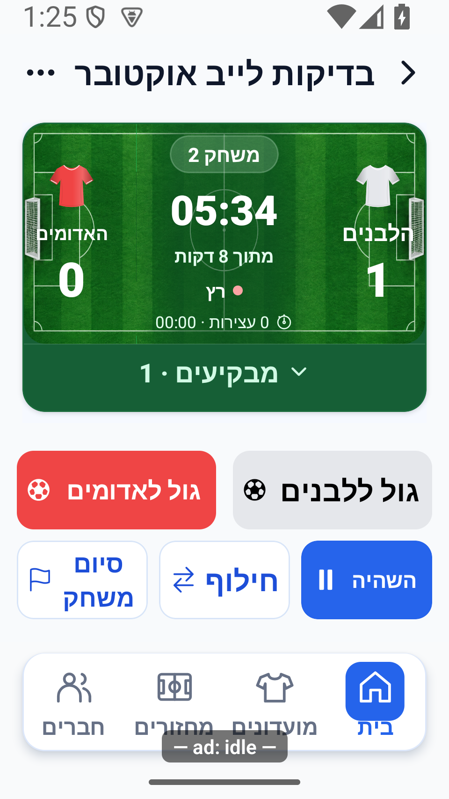

`data-seven-clock-paused.json` נקרא ב־`2026-10-17T01:28:53.124664+00:00` ומציג השהיה, `timerRunning=false`, ‏`timerAccumulatedMs=460742.5` ומקטע סגור שסכומו 460743.5 אלפיות שנייה. הפרש של אלפית שנייה נובע מהחותמות הנפרדות בלקוח שקדם לתיקון העסקה. הצילום מציג 07:40 ומצב מושהה, בהתאם לעיגול לשניות. צילום ההשהיה הזה והביקורת הקפואה אינם הוכחה לתיקון עסקת השעון שנוסף אחריהם.

### תוספת מאוחרת: חידוש והשהיה בעסקאות

שני מקורות מאוחרים נבדקו בנפרד ואינם חלק מספירת 115 האימותים. `data-seven-timer-transaction-resume.json`, בשעה `2026-10-17T01:55:40.715614+00:00`, מאשר `timerRunning=true`, חותמת התחלה חדשה ואירוע `resume` נוסף, תוך שימור הזמן המצטבר הקודם. `data-seven-timer-transaction-paused.json`, בשעה `2026-10-17T01:55:53.840056+00:00`, מאשר עצירה נוספת וזמן מצטבר 488733.5 אלפיות שנייה. התוספת היא 27,991 אלפיות שנייה, בדיוק אורך המקטע הסגור החדש; חותמות אירועי החידוש וההשהיה מתאימות למקטע. השער, ההיסטוריה והרוטציה נשמרו.

צילום ההשהיה המאוחר מציג 08:00 ועוד תוספת 00:08, שתי עצירות ומצב מושהה. הוא תואם לכ־8 דקות ו־8.7 שניות שנשמרו, כאשר התוספת מוצגת בנפרד אחרי משך המשחק המתוכנן. הצילום ששמו `seven-timer-transaction-resumed` צולם לפני אישור הפעולה ועדיין מציג השהיה; הוא לא קוטלג כהוכחת חידוש. אימות העסקה כאן מוגבל לתרחיש שבעה הזה, ואינו מחליף את בדיקת האמינות הנדרשת באחד עשר.

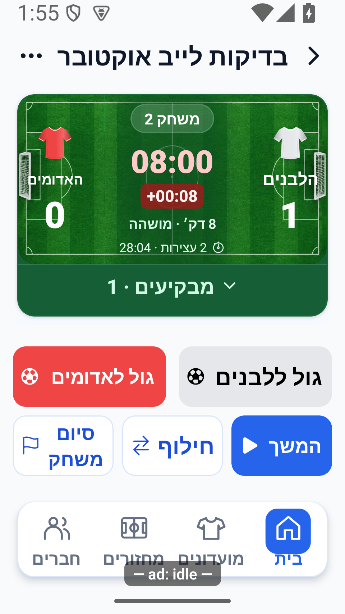

### אימות חזותי מעודכן ומגבלות שנותרו

שני צילומי הניצחון הקטנים החדשים נפתחו ונבחנו. בפתיחה נראים המגרש, החולצות, תוצאת 1:0 והאישור והחזרה. בגלילה מגיעים לכרטיסי המשחק הבא: הלבנים נשארים, הירוקים עולים והאדומים ממתינים. השמות ותגי התפקיד שלמים, והפעולות נשארות גלויות. אלה מחליפים את צילומי הביניים כהוכחת התיקון לגלילה ולשבירת המילים בחלון הניצחון, אך אינם אישור שהמשחק השני כבר נשמר.

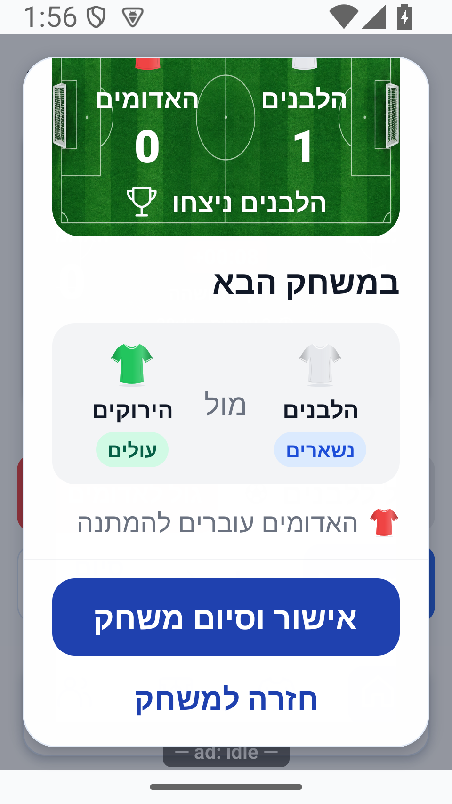

בצילומי התיקו החדשים, שנאספו בתחילת המשחק השני לפני השער, לוח 0:0 ושתי האפשרויות קריאים לאחר גלילה, והאישור המושבת נשאר באזור התחתית. אזהרת פיתוח שחורה מכסה את כפתור החזרה בשתי התמונות. לפיכך אלה ראיות לפריסה ולגלילת הגוף עם מגבלת הסתרה מפורשת, ולא צילום נקי של כל הפעולות.

צילום `seven-compact-metadata-cold` מציג משך ומצב בשורה אחת, אבל עדיין אין אזור נראה מספיק להרכבים. הוא נרשם כראיית פגם לפני השינוי המאוחר שמאפשר גלילת הלוח והסגל במסך קומפקטי קצר. השינוי המאוחר הזה עדיין דורש תצפית מקורית; אין להשתמש בצילום המטא־דאטה כאישור שלו. צילומי `seven-final-compact-clock` שנלכדו בבית או בטעינה לא קוטלגו כראיות לייב.

[מניפסט השמירה החלקית](evidence/live-action-2026-10-17/manifest-seven-committed-partial.json) שומר את מקורות הנתונים המסוננים, שני פלטי הביקורת הקפואים ושני מקורות העסקה המאוחרים, תוך שמירה על העותקים הקודמים וחותמותיהם. ההיקף הוא מחזור שבעה הייעודי בלבד, ללא מיקום, דואר, קוד הזמנה או נתוני מחזורים אחרים.

בנקודת התיעוד הזאת עדיין חסרים סיום המחזור, סיכום ונוכחות של שבעה, אימות זקיפות המשחק השני, כתיבה בזמן ניתוק וניסיון חוזר בייצור, וכל צילומי הליטוש המאוחרים של הלייב והפנדלים. שבעת תחומי ה״לא מוכח״ בביקורת הקפואה שייכים לזמן יצירתה; התוספת המאוחרת לעסקאות השעון מתועדת בנפרד ואינה משנה בדיעבד את הפלט הקפוא. אין בדוח הכרזת מוכנות מלאה.

### צילומי עדכון המשחק החתום והשעון

| צילום שמור | זמן UTC | סוג ראיה |
|---|---|---|
| [action-pitch-production-seven-clock-recovered-2026-10-17.png](../features/screenshots/action-pitch-production-seven-clock-recovered-2026-10-17.png) | `2026-10-17T01:25:19.584Z` | בדיקת משחק שני פעיל |
| [action-pitch-production-seven-clock-paused-2026-10-17.png](../features/screenshots/action-pitch-production-seven-clock-paused-2026-10-17.png) | `2026-10-17T01:28:59.560Z` | בדיקת השהיית שעון |
| [action-pitch-production-seven-tie-compact-top-2026-10-17.png](../features/screenshots/action-pitch-production-seven-tie-compact-top-2026-10-17.png) | `2026-10-17T01:15:14.268Z` | בדיקת תיקו עם מגבלת צילום |
| [action-pitch-production-seven-tie-compact-options-2026-10-17.png](../features/screenshots/action-pitch-production-seven-tie-compact-options-2026-10-17.png) | `2026-10-17T01:15:16.612Z` | בדיקת גלילה עם מגבלת צילום |
| [action-pitch-production-seven-end-small-ready-2026-10-17.png](../features/screenshots/action-pitch-production-seven-end-small-ready-2026-10-17.png) | `2026-10-17T01:56:23.703Z` | בדיקת חלון ניצחון קטן |
| [action-pitch-production-seven-end-small-next-2026-10-17.png](../features/screenshots/action-pitch-production-seven-end-small-next-2026-10-17.png) | `2026-10-17T01:56:35.762Z` | בדיקת משחק הבא וגלילה |
| [action-pitch-production-seven-compact-roster-space-defect-2026-10-17.png](../features/screenshots/action-pitch-production-seven-compact-roster-space-defect-2026-10-17.png) | `2026-10-17T01:53:30.495Z` | תקלה שנצפתה |
| [action-pitch-production-seven-timer-transaction-paused-2026-10-17.png](../features/screenshots/action-pitch-production-seven-timer-transaction-paused-2026-10-17.png) | `2026-10-17T01:55:59.344Z` | בדיקת שעון אחרי אישור עסקה |

## סיום שבעה — שני משחקים, נוכחות, ציון ופריימי תנועה מקוריים

זהו העדכון המאוחר למחזור שבעה. סעיפי 36 ו־115 האימותים לעיל נשארים תיעוד של נקודות ביניים; הם אינם מייצגים את מצבו הסופי. [ביקורת הסיום הקפואה](evidence/live-action-2026-10-17/audit-seven-final-data.md) ו[הפלט המובנה](evidence/live-action-2026-10-17/audit-seven-final-data.json) כוללים 148 אימותים שעברו, ארבעה פערי שרת בשלוש משפחות ושבעה תחומים שאינם מוכחים, ללא כשל נוסף לא צפוי. הביקורת היא בדיקת קבצים מקומית של תשובות ייצור, ואינה פעולת מוצר או פריסה.

### שני המשחקים וסיכום הנתונים

`data-seven-second-commit-ready.json` נקרא ב־`2026-10-17T01:57:11.757415+00:00` ואישר את שתי רשומות ההיסטוריה ושני סמני ההתחייבות. הקריאה המוקדמת `data-seven-second-commit.json` הכילה עדיין רשומה אחת; זו נקודת ביניים לפני התייצבות, ולא כשל השמירה הסופי. `data-seven-finish-reconnect.json` שמר את שתי הרשומות אחרי חידוש חיבור.

| משחק חתום | קבוצות | תוצאת שדה | הכרעה | שערים ובישולים לפי הלייב |
|---|---|---|---|---|
| `r_mvboblq9_ynnomoks` | הירוקים מול הלבנים | 1:1 | הלבנים, אחרי חמש בעיטות וסיום ידני | משה ללא בישול; אסף עם ליאור |
| `r_mvbpasvp_s94nyeui` | הלבנים מול האדומים | 1:0 | הלבנים לפי התוצאה | חשבון הבדיקה עם אסף |

בקריאה הסופית `data-seven-sealed-proof.json`, בשעה `2026-10-17T02:04:21.359379+00:00`, מצב המחזור הוא `finished`. יש 21 שורות שחקנים ו־28 הופעות: ארבע עשרה משתתפים בכל משחק, עם שבעה שחקנים בכל צד. מוני שערי ובישולי השחקנים כוללים את האורחים. `roundSummary.stats` מכיל שני משחקים, שלושה שערי שדה, שני בישולים והכרעת פנדלים אחת. שערי ההכרעה אינם נספרים כשערי שדה. המשחק השלישי `r_mvbqx9n2_mr9bu0ww` נותר מוכן בלבד, ואינו נזקף למשחקים, לנוכחות במשחק או להיסטוריה.

המקורות האלה מאמתים את **נתוני** הסיכום. הם אינם מוכיחים שמסך הסיכום הציג אותם כראוי; מגבלת התצוגה מתועדת בהמשך.

### ארבעת פערי השרת והשפעתם

ארבעה אימותים מצביעים על שלוש משפחות של פערים בשרת הפרוס. אין כאן ארבע תקלות עצמאיות חדשות או טענה שהן תוקנו בייצור:

- המבשל ליאור וסיווגי הבישול חסרים בהיסטוריית המשחק הראשון, למרות שנשמרו בלייב ובמוני המחזור.
- גם המבשל אסף וסיווג הבישול חסרים בהיסטוריית המשחק השני; המונה שלו נשמר כבישול אחד.
- `outcome` חסר בכל חמש בעיטות ההכרעה בהיסטוריה. נשמרים הצד, המשתתפים והאם נכנס גול, אך ההבחנה בין עצירה והחטאה אובדת.
- לשוער חשבון הבדיקה נשמרו שתי עצירות מתוך שלוש בעיטות, במקום עצירה אחת, גול אחד והחטאה אחת. המכנה שלוש נכון; מספר העצירות שגוי.

חישוב `reduceRounds` המקומי על ההיסטוריה השמורה ממחיש את ההשלכה: חשבון הבדיקה מקבל שתי עצירות במקום אחת, ומשה מקבל עצירה במקום אפס; המעורבות של אסף ושל ליאור חסרה בגלל אובדן הבישולים. ההשוואה מול עותק וירטואלי המשחזר רק את אירועי הלייב הידועים היא בדיקת קוד, ללא שינוי של מקור הייצור. תיקוני השרת המקומיים טרם נפרסו; ההיסטוריה, מוני השוער והחישובים הנגזרים אינם מוכחים כתקינים מקצה לקצה כל עוד הפערים קיימים.

### נוכחות וציון שנקראו בפועל

במקור הסופי נקרא סמן יחיד `finishCredited/once`, בזמן `1792202609093`. לאחריו שלב `finishStages/standings` בזמן `1792202611392`, עם `hadPointsTable=true`, ואחריו `finishStages/complete` בזמן `1792202615568`. דירוג המחזור של חשבון הבדיקה שייך לאותו מחזור ואותו מועדון, עם `scoreBasis.counted=true` וציון 8.8.

בנתוני חשבון הבדיקה במועדון, אחרי מחזורי ארבעה ושבעה יחד, נשמרו שני מחזורים, ארבעה משחקים, שלושה ניצחונות והפסד אחד. שמות השדות במודל הם `games=2` עבור המחזורים ו־`rounds=4` עבור המשחקים. `eveningScoreCount=2` ו־`eveningScoreSum=17`, כלומר 8.2 ועוד 8.8, ו־`lastEveningScore=8.8`. אלה נתונים שנקראו ישירות, לא מסקנה רק משורת סיכום במסך.

מודול הציון הקנוני המקומי משחזר 8.8 על המונים שנשמרו. זה אינו אישור לאמינות העצירות: בעותק חישוב מקומי שבו תוקנה העצירה העודפת מתקבל 8.7. **8.7 הוא חישוב קוד בלבד; הוא לא נכתב ולא הוצג כציון השמור בייצור.** השדה `statsSealed` לא נכלל במקור הקריאה המסונן, ולכן לא נטען שאומת; סמני הנוכחות ושלבי הסיום עצמם כן נקראו. גם קיומו של סמן יחיד אינו ניסוי של מסירה חוזרת מכוונת של אירוע הסיום.

### תנועת הכדור בשלוש תוצאות הפנדל

נפתחו ונבחנו תשעה פריימים מקוריים שחולצו במכשיר אנדרואיד משלוש הקלטות ייצור. [מניפסט האנימציה](evidence/live-action-2026-10-17/manifest-seven-animation.json) קושר את הפריימים להקלטות ולמניפסטי החילוץ המקוריים באמצעות חותמות תוכן. ההקלטות עצמן נשמרו בארכיון: [גול](evidence/live-action-2026-10-17/animation-sources/seven-normal-penalty-goal.mp4), [עצירה](evidence/live-action-2026-10-17/animation-sources/seven-normal-penalty-save.mp4), [החטאה](evidence/live-action-2026-10-17/animation-sources/seven-normal-penalty-miss.mp4).

המפענח הוא `MediaMetadataRetriever.OPTION_CLOSEST`. המספרים בטבלה הם זמני בקשה במיקרו־שניות מתחילת ההקלטה, **לא חותמות זמן מדויקות של הפריימים שנבחרו**. זמן הצילום במניפסט מגיע מקובץ ההקלטה, וזמן החילוץ נשמר בנפרד. הפריימים הועתקו ללא חיתוך, שינוי גודל או עיבוד; דפי מגע שימשו רק לבחירת הראיות ואינם מקוטלגים כהוכחה.

| תוצאה ואירוע שמור | בקשת חילוץ | מה נראה בפועל |
|---|---|---|
| גול של אסף, `pk_1792198905239_gqp2zt74n8j` | `2400000`, `2700000`, `3300000` | הכדור ליד נקודת הפנדל, מתקדם לאזור השוער, ובהמשך בתוך מסגרת השער והרשת עם ״גול!״ |
| עצירה מול משה, `pk_1792199052098_5279qm840xh` | `1800000`, `2100000`, `2700000` | הכדור נע לכיוון השוער המגיב הצידה, פוגש את אזור האווטר שלו ונשאר לידו עם ״עצירה!״ |
| החטאת אסף, `pk_1792199159115_7owiohteec` | `2400000`, `2700000`, `3000000` | הכדור יוצא מנקודת הפנדל ונע ימינה מחוץ למסגרת; כיתוב תוצאת ההחטאה אינו מופיע בדגימות הנבחרות |

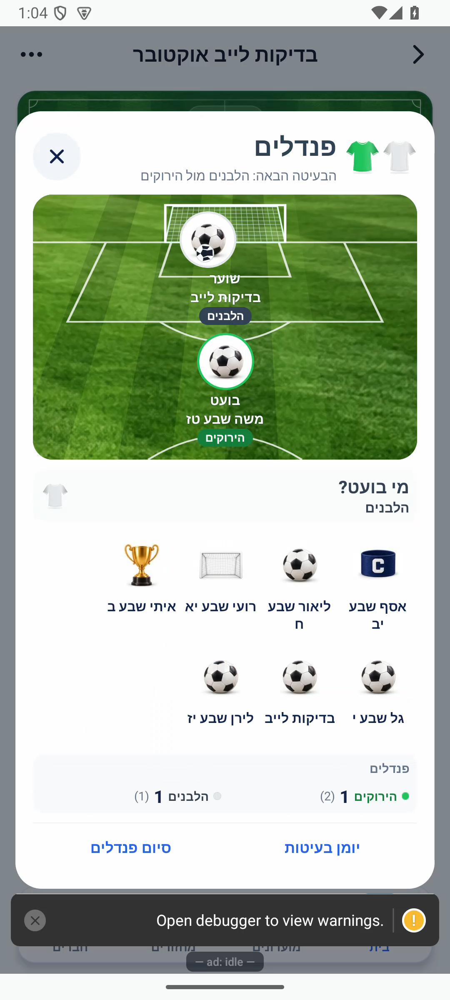
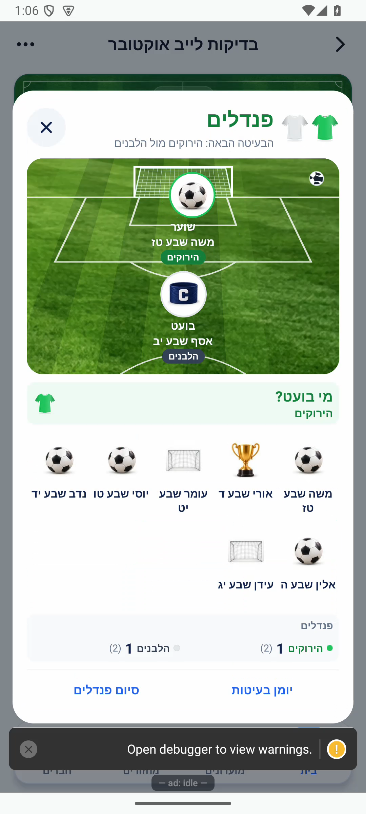

בכל רצף תנועת הכדור תואמת לתוצאה המפורשת שנשמרה בלייב. התפקידים והמשתתפים של הבעיטה נשארים על המגרש בזמן שכותרת התור הבא כבר מופיעה, עם ניסוח נפרד. אזהרת פיתוח שחורה נראית בתחתית ההקלטה, אך אינה מסתירה את המסלול ואת התוצאה במגרש. הפריימים אינם מדידת קצב תמונות, זמן תגובה או תנועה מופחתת. מסגרת השמירה המוקדמת לעיל מציגה שמירה ללא חגיגה; הפריימים המאוחרים אינם בפני עצמם מדידת זמן אישור השרת. לא נבחנה כאן תגובת הרשת בכל פריים.

לגול השדה עם בישול בארבעה נבדקה ההקלטה הקצרה גם בדגימות המבוקשות ב־100 וב־1,100 אלפיות שנייה. שתיהן מציגות רק בחירת מבשל, ללא השלמה או מסירה. לכן הוסר שיוכה הקודם כהוכחת מסירה; צילום הרשת הנפרד נשאר ראיה סטטית בלבד. הוכחת מסלול מסירה בייצור עדיין חסרה. אין להרחיב את הוכחת שלוש תוצאות הפנדל להוכחה שכל אנימציות הגול, סגירה באמצע תנועה והעדפת תנועה חיה אומתו בייצור.

### המסך הקטן — מה תוקן ומה עדיין לא מוכח

צילום `seven-compact-roster-scroll` מראה שהגללת גוף הלייב מאפשרת להגיע לשורות השחקנים במסך 320×569 ובגופן 140%. עם זאת, רוב השמות מצטמצמים לשלוש נקודות או לאות אחת, ולכן הבחירה אינה מזוהה היטב. הוא נשמר כראיית פגם לפני תיקון `TeamScore` המאוחר. צילום תיקון מקורי עדכני עדיין נדרש; אין להציג את הגלילה לבדה כאישור לסגל מלוטש.

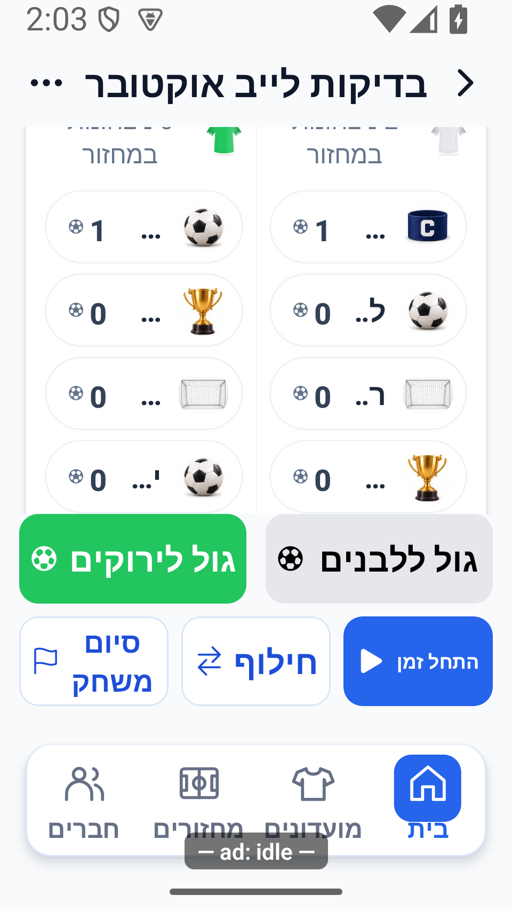

צילום `seven-round-summary-actual-small` הוא מסך פרטי המחזור בלשונית הסטטיסטיקות, ובו רק תחילת הכותרת ״מחזור במספרים״ ללא ערכי הסיכום הנדרשים באזור שנראה. קיימים גם שבירת מילים בניווט ובועת עזרה. הוא נשמר כראיית תצוגה שלא הושלמה; דיווח `noCoverage` נמצא בחקירה ובתיקון נפרדים. צילום `seven-round-summary-small` נמצא בלשונית המידע ואינו משמש הוכחה לסיכום. הנתונים של שלושה שערים ושני בישולים אומתו במסד, אך **לא הוכחו בצילום סיכום מלא של שבעה**.

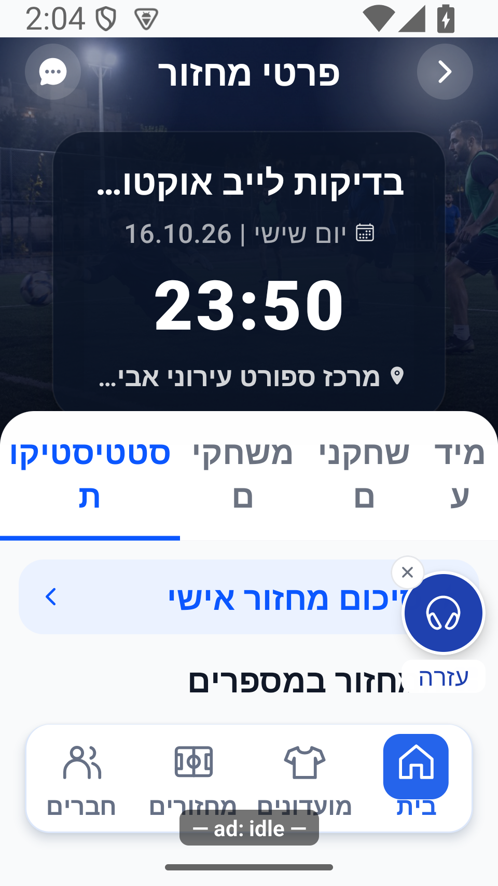

### ארכיון וגבולות האימות הסופי של שבעה

[מניפסט הסיום](evidence/live-action-2026-10-17/manifest-seven-final.json) כולל 32 מקורות של הביקורת ושני פלטים קפואים, 34 רשומות בסך הכול. נשמר רק מחזור שבעה מתוך תשובות מעורבות, עם סגלים, אירועים, היסטוריה, סטטיסטיקה, סיכום וסמני סיום. במקור האחרון נשמרו גם מוני המועדון של חשבון הבדיקה והמועדון הייעודיים לצורך אימות הציון והנוכחות. אין דואר, קוד הזמנה, מיקום, העדפות חשבון או נתוני מחזור אחר. העותקים הקודמים והחותמות שלהם לא שוכתבו.

| מקור סופי | חותמת המקור ללא שינוי |
|---|---|
| `audit-seven-final-data.md` | `42de06599035760e165830f482c678aee3b7b1671ac68581ae3dcbe211292688` |
| `audit-seven-final-data.json` | `b86e8174261822cc0cfd5ab2cfee920772c87f088b6c9b7cf36e10c56d3eaeb9` |
| `data-seven-sealed-proof.json` | `b3a67d0cf483b5dc5841bb57c15c37d40e9d75ba1f89d76cca5fce384e358186` |

שבעת תחומי ה״לא מוכח״ בביקורת הקפואה כוללים תיעוד לחיצות כפולות בגול ובפנדל, רצף בחירת צבעים, תנועה ומספר לחיצות במכשיר, כתיבה בזמן ניתוק או אישור אבוד, התנגשות שעון בשני מכשירים ומסירה חוזרת של סיום. חלק מתנועת הפנדלים נוסף כאן כראיה חזותית נפרדת; אין לשנות בדיעבד את ספירת דוח הנתונים או לטעון שהפריימים מוכיחים את כל התחום. ההרצה הרגילה המאוחרת אינה מוכיחה את ההעדפה המופחתת שנקראה בפתיחה הקרה. עדיין נדרשים גם צילומי הליטוש האחרונים וסיכום שבעה מלא. נתוני הבדיקה נשארו בייצור, והבדיקה אינה אישור העלאה.

## עדכון סיכום שבעה — קריאה מוצלחת ותיקון זהות הקבוצות

לאחר הצילום החסר שתועד לעיל היישום הופעל מחדש עם קורא הסיכום המעודכן. צילומי המקור `seven-summary-new-reader-initial` ו־`seven-summary-team-colours-fixed` נפתחו ונבחנו: מסך הסטטיסטיקות מציג שני משחקים, שלושה שערים, שני בישולים והכרעת פנדלים אחת, בהתאמה לנתוני המחזור הסופי. בצילום המאוחר מופיעים הלבנים עם שני ניצחונות והאדומים עם הפסד אחד. הצילום המקדים `seven-summary-team-colour-defect` הראה בטעות את הירוקים במקום הלבנים עבור קבוצת מספר 2; הוא נשמר בנפרד כפגם לפני תיקון מיפוי הצבעים. התיקון המאוחר אינו מוחק את פערי נתוני הפנדלים וההיסטוריה בשרת.

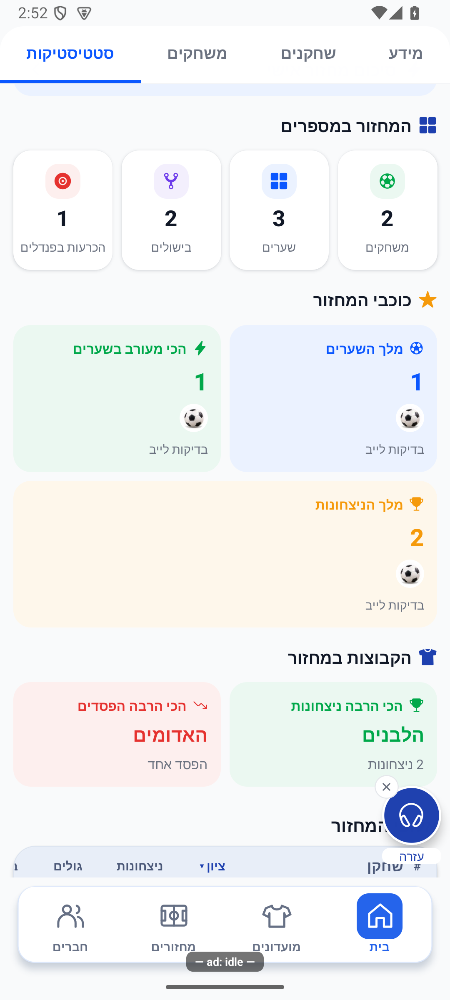

[אבחון קריאת הסיכום במכשיר](evidence/live-action-2026-10-17/seven-summary-sdk-read-result.json), שנשמר במקור בלי שינוי, מאשר את אותו מחזור, מועדון וחשבון בדיקה. ניסיון קריאה מהמטמון בלבד החזיר `unavailable`; קריאות `default` ו־`server` החזירו את מסמך הסיכום עם אותם סכומים, `fromCache=false`, ‏`hasPendingWrites=false` וכיסוי שערים ובישולים. זו קריאה אבחונית שמשלימה את הראיה החזותית. אין כאן צילום ששחזר מצב כשל בסיכום, לחיצה על ניסיון חוזר שלו או כשל שמירה; אין לייחס לצילום המוצלח הוכחת מסלול שגיאה שלא הופעל.

הסיכום האישי מציג ציון 8.8, שני משחקים, שני ניצחונות, שער אחד ואפס בישולים. בגלילה נראות שתי עצירות פנדל, והכרטיס אומר ״עצרת 2 פנדלים״. זה תואם לנתון השגוי בשרת וממחיש את התלות בתיקון שלא נפרס: אירועי הלייב מוכיחים עצירה אחת. בועת העזרה מסתירה חלק משורת הספיגות ומכרטיס התוצאות בצילום העליון. אין אישור שכל תוכן הסיכום נקי מהסתרה, ואין להציג את שתי העצירות כנתון שתוקן.

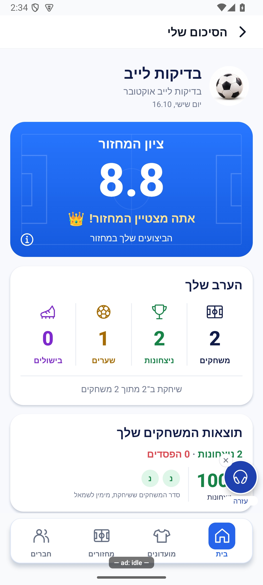
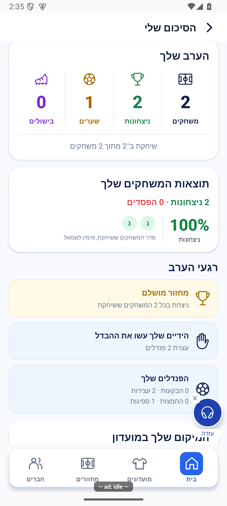

[מניפסט תוספת הסיכום](evidence/live-action-2026-10-17/manifest-seven-summary-ui.json) מתעד את מקור הקריאה האבחונית; חמש תמונות הסיכום נשמרו ללא שינוי במניפסט הצילומים עם מקור, חותמת וזמן UTC. תוספת זו מוכיחה עכשיו תצוגת סכומי סיכום שבעה וזהות הקבוצה הלבנה אחרי התיקון. היא אינה מוסיפה הוכחה למצב כשל חזותי, תנועה מופחתת, כשל שמירה או הליטוש המאוחר של הסגל בלייב.

## תחילת אחד עשר — טיוטה ידנית חלקית בלבד

מחזור הבדיקה השלישי שמוחזר ב־`test-identities.json` הוא `mBO5HqJdnOPWjRE2zMh8`, במועדון ובחשבון הבדיקה שכבר תועדו. בתמונת המקור `eleven-manual-partial-saved` נראים הכחולים עם 11 מתוך 11, הירוקים עם אפס מתוך 11, הודעת ״נותרו 11 שחקנים לשיבוץ״ וכפתור שמירת טיוטה. זו חלוקה ידנית חלקית, ולא חלוקה מלאה או מפורסמת.

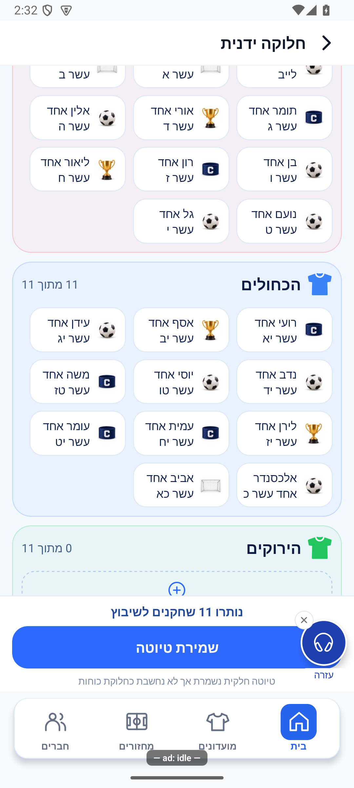

`eleven-manual-local-proof.json` הוא מסמך שמכיל מחרוזת מקודדת נוספת. הוא פוענח פעמיים לצורך בדיקה, והמקור הועתק ללא שינוי. זהות המחזור והבעלים תואמת, ספירות הקבוצות הן `[11,11,0]`, ו־22 המשתתפים שבטיוטה ייחודיים. `data-eleven-partial-manual.json`, שנקרא ב־`2026-10-17T02:30:47.021232+00:00`, מכיל `draftTeams=null` במחזור הזה. לכן ההוכחה היא **שמירת טיוטה חלקית מקומית**, בלי חלוקת כוחות שמורה בשרת באותה נקודה.

[מניפסט הטיוטה החלקית](evidence/live-action-2026-10-17/manifest-eleven-manual-partial.json) קושר את שני המקורות וחותמותיהם. תמונת המסד מסוננת למחזור אחד עשר בלבד ומסירה את מחזורי ארבעה ושבעה, דואר, קוד הזמנה ומיקום. פלט ביקורת אחד עשר הפעיל אינו נכלל: הוא עדיין מתעדכן ולא נמסר כקפוא. תוספת זו אינה הוכחת לייב, שערים, פנדלים, שמירת משחק, נוכחות או סיום אחד עשר. בדיקות ההמשך נשארות אצל המוביל.

## אחד עשר — חלוקה מלאה, תיקון כיווניות ולייב עם גול ראשון

התוספת הזאת מאוחרת לטיוטה החלקית `[11,11,0]` שלעיל. [ביקורת ההקצאה הקפואה](evidence/live-action-2026-10-17/audit-eleven-allocation-partial-data.md) ו[הפלט המובנה](evidence/live-action-2026-10-17/audit-eleven-allocation-partial-data.json) כוללים 43 אימותים שעברו, חמישה תחומים לא מוכחים ואפס כשלים, עד `data-eleven-time-confirm-check.json`, לפני הלייב. שלושת מקורות הגדרת הזמן, הכניסה ללייב והגול הראשון שנוספו אחריה נבדקו בנפרד; הם אינם חלק מספירת 43. פלט `audit-eleven-data` הפעיל לא הועתק ואינו מוצג כביקורת סופית.

### סגל, חלוקה ופרסום

במחזור `mBO5HqJdnOPWjRE2zMh8` נשמרו חשבון הבדיקה ו־32 אורחים, 33 זהויות שונות לשלוש קבוצות של 11. בפועל `advancedFillMode=permanent`, ‏`advancedMode=true`, ‏`visibility=community` והמועדון סגור `isOpen=false`. הרשמה מלאה אינה הוכחת הגעה בפועל או דקות משחק. התאריך תוקן באותו מסמך לפני הצטרפות המארח; אין כאן יצירת מחזור רביעי.

`data-eleven-manual-saved.json` מאשר טיוטה ידנית מלאה בשיטת `regular`. יצירה מחדש בשיטת `snake` החליפה את הגרסה ואת ההרכבים עם כל 33 המשתתפים פעם אחת. לפני התיקון נצפתה קריאה ראשונה שהחזירה גרסת חלוקה קודמת למרות שמירת החדשה; זו תקלת המתנה לקריאה עדכנית, ולא מזהה שגוי או השמטת ממיר. `data-eleven-regenerated-stream.json`, שנקרא ב־`2026-10-17T03:02:36.531653+00:00`, מכיל את הגרסה החדשה `1792206143482`. המוביל צפה אחרי הפעלה קרה במעבר מטעינה למוכן ללא ניסיון חוזר.

[הוכחת הסגל המקורית](evidence/live-action-2026-10-17/eleven-native-draft-stream-proof.md), [הפלט המובנה](evidence/live-action-2026-10-17/eleven-native-draft-stream-proof.json) ו[עץ המכשיר הקפוא](evidence/live-action-2026-10-17/eleven-regenerate-stream-ui-proof.xml) מאמתים בעשר השוואות את כל 33 התוויות המלאות, 11 בכל קבוצה, זהות הקפטן וסדר המקור. המזהים נפתרו מהשמות הייחודיים במסד; העץ אינו מציג מזהים פנימיים. **העץ הזה נאסף לפני תיקון הכיווניות המאוחר**: הוא מציג את סדר המקור משמאל לימין וקפטן משמאל, ושני שמות אלכסנדר מקוצרים חזותית. אין להציג אותו כהוכחת התיקון העברי החדש.

הצילום המאוחר `eleven-draft-rtl-full`, שנפתח ונבחן אחרי שינוי הרכיב וטעינה קרה, מציג קפטן האדומים עידן מימין ואת סדר הקריאה מימין לשמאל. שני שמות אלכסנדר באדומים מלאים ונבדלים: ״אלכסנדר אחד עשר כ״ ו״אלכסנדר הארוך עשר לב״. כל 11 האדומים נראים, הכחולים בהמשך, ותחילת הירוקים בתחתית בלבד. כך הוכחו התיקון החזותי והזהויות הארוכות באזור הזה; אין טענה שכל 33 השחקנים נראים יחד באותו צילום. בועת העזרה מכסה חלק מאזור הכחולים בתחתית.

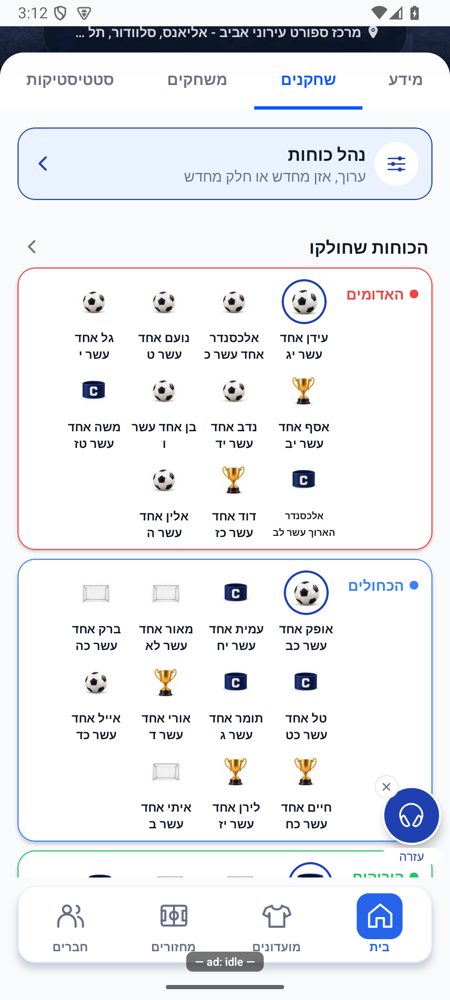

מקורות הפרסום מאשרים את אותה גרסה ואותם 33 שחקנים. הפרסום לבדו לא יצר לייב, אירועי שעון, היסטוריה, סטטיסטיקה או נוכחות. בצילום ההכנה המאוחר נראים 11 האדומים בסידור 5+5+1, שינוי צבע נפרד מעיגול הבחירה ואישור מושבת לפני בחירת שתי קבוצות. הכרטיס הבא דורש גלילה; אין טענה שכל הקבוצות נראות בלי גלילה.

### הכניסה ללייב והזנת הגול ללא שעון

`data-eleven-time-ready-confirmed.json` נקרא ב־`2026-10-17T03:10:10.286975+00:00` עם משך של שמונה דקות וללא לייב. `data-eleven-ready.json`, ב־`2026-10-17T03:14:25.386288+00:00`, מכיל את המשחק הראשון `r_mvbtoxwh_f3ntv5pc`, האדומים א׳ מול הירוקים ב׳, הכחולים ממתינים, ללא השאלות ועם תוצאה 0:0. השעון אינו רץ, הזמן המצטבר אפס ואירועי השעון ריקים. שני המקורות וגם צילומי ההכנה והלייב עדיין מציגים שמונה דקות. ניסיון לבחור שש דקות אינו נתון שנשמר במקורות האלה; אין להציגם כהוכחת שינוי משך לשש דקות.

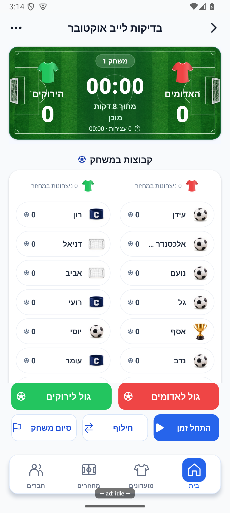

המוביל ביצע שתי בחירות ברשימה: חשבון הבדיקה, השחקן ה־11 בירוקים, ככובש; אדם כמבשל. צילום הכובש מציג 11 שחקנים בסידור 5+5+1 ואת שתי האפשרויות המיוחדות. צילום המבשל מציג אותם שחקנים באותם מקומות, עם הכובש מנוטרל במקומו, אווטר הכובש במגרש ופלוס המבשל פעיל. ״ללא בישול״ ו״בישול לא ידוע״ גלויות, ואין כפתור אישור נוסף.

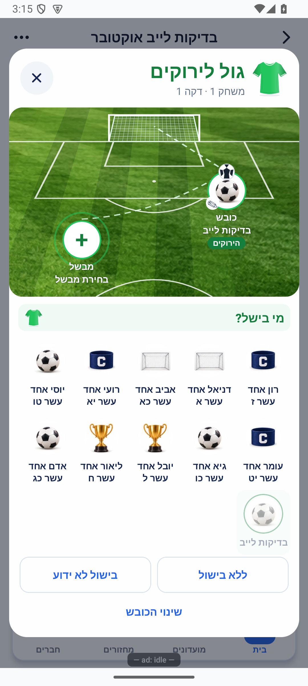

`data-eleven-first-goal.json`, שנקרא ב־`2026-10-17T03:15:27.462851+00:00`, מאשר שער יחיד `g_1792206919822_hhb4200kfzu` לטובת הירוקים ב׳: חשבון הבדיקה כבש, `guest:mvbrvg8q-a3l7tc` — אדם אחד עשר כג — בישל, ו־`assistStatus=player`. התוצאה היא 0:1 בסדר א׳:ב׳. השעון נשאר כבוי באפס זמן, ללא אירועי שעון. זו הוכחת גול ובישול בלייב ללא תלות בהפעלת השעון; היא אינה חתימת המשחק או זקיפה להיסטוריה ולקריירה.

### שמירה וחגיגה — הפרדה בין צילומים להקלטה

צילומי המקור הנפרדים `eleven-goal-assist-pass-frame-1/2` מציגים את שני המשתתפים, ״שומרים את הגול״ ורשימה מוחלשת, ללא הודעת הצלחה או חגיגה. צילום 3 מציג כדור בתוך מסגרת השער והרשת עם ״הגול נשמר״; צילום 4 מציג חגיגת ״גול!״ בזמן שהחלונית נסגרת בשקיפות. אלה ראיות סטטיות של המצבים שנצפו, ולא פריימים שיוחס להם זמן בהקלטה. אין להסיק מהם לבדם שהכדור עבר בכל מסלול המבשל–כובש–שער.

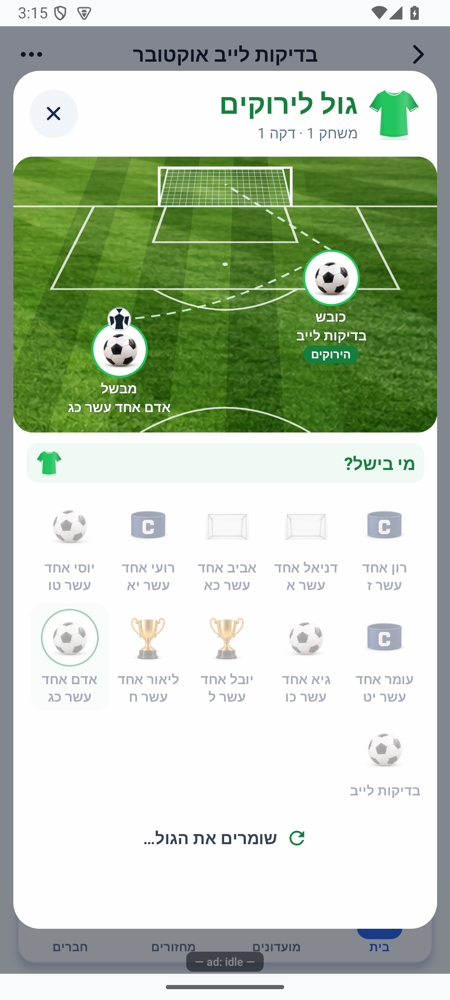
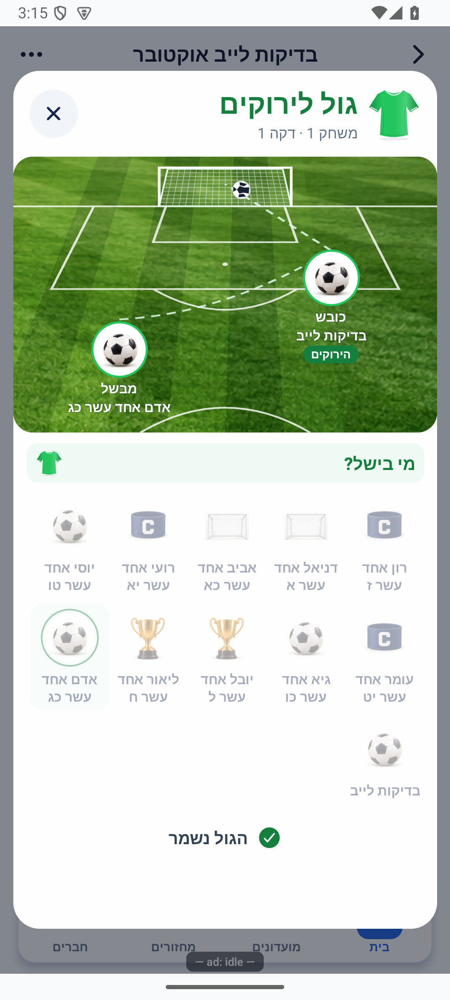

[ההקלטה המקורית החדשה](evidence/live-action-2026-10-17/animation-sources/eleven-goal-assist-pass.mp4) אורכת 6,542 אלפיות שנייה. נבחנו 12 דגימות מבוקשות בין 900 ל־4,000 אלפיות שנייה: כולן עדיין בחירת מבשל. נפתחו גם חמש דגימות בין 4,500 ל־6,500: הן מציגות ״שומרים את הגול״ ללא הצלחה או חגיגה. לכן **גם ההקלטה הזאת מסתיימת לפני אישור השמירה ואינה מוכיחה מסירה, בעיטה ורשת ברצף**. [מניפסט מגבלת ההקלטה](evidence/live-action-2026-10-17/manifest-eleven-first-video-limit.json) שומר את החותמות ואת גבול התצפית. המפענח בוחר פריים קרוב לזמן המבוקש, לא זמן פריים מדויק. הצילומים הנפרדים המאוחרים אינם הופכים את הסרטון להוכחת רצף; המוביל מכין הקלטה נוספת ארוכה יותר.

### מקורות וגבולות של שלב אחד עשר הראשון

[מניפסט הכניסה ללייב](evidence/live-action-2026-10-17/manifest-eleven-first-live.json) כולל 23 רשומות: 16 מקורות ביקורת ההקצאה, שני פלטי הביקורת הקפואים, תיאור ועץ ההוכחה המקורית ושלוש תשובות מסד מאוחרות. העותקים הקודמים של הטיוטה החלקית נשמרו. כל תשובת מסד מסוננת למחזור אחד עשר בלבד, ללא דואר, קוד הזמנה, מיקום או מחזורי ארבעה ושבעה. שמונת הצילומים שנבחרו נפתחו ונבחנו ונשמרו ללא שינוי, עם זמן UTC מקובץ המקור.

| פלט קפוא | חותמת המקור |
|---|---|
| `audit-eleven-allocation-partial-data.md` | `de7e8f64242788c33a83b884da294730514f5df022df74134544774c92653dbd` |
| `audit-eleven-allocation-partial-data.json` | `8d341e5f2a507d33ddf9bb610b5812cda65e6bb0ae4e6208322144b9aea54fde` |

בנקודה הזאת עדיין חסרים חילופים קבועים ותוצאתם השמורה, משחק חתום, רוטציה, פנדלים, שעון וחידוש חיבור באחד עשר, סיכום ונוכחות, כשל שמירה וניסיון חוזר בייצור, אנימציית מסירה מלאה והוכחת כל המצבים הקטנים. חמישה תחומי ה״לא מוכח״ בביקורת ההקצאה מתארים את זמן הקפאתה; השער הראשון נוסף כאן כראיה מאוחרת נפרדת, בלי לשכתב את הספירה. אין הכרזת מוכנות והמחזור טרם הסתיים במקורות האלה.

## תוספת חזותית באחד עשר — מסירה מקורית, חילוף, השלמה ומסך קטן

זהו סבב חזותי מאוחר לכניסה ללייב ולגול הראשון. מקורות ביקורת הנתונים הפעילה של אחד עשר עדיין לא הועתקו בסבב הזה; אין להרחיב את 43 אימותי ההקצאה לכיסוי כל פעולות הלייב. מקור ההקלטה וצילומי הממשק נבחנו בנפרד, והם אינם אישור לחתימת המשחק או לסיום המחזור.

### מסירה, הגעה לכובש ובעיטה ברצף מקורי

[ההקלטה הארוכה החדשה](evidence/live-action-2026-10-17/animation-sources/eleven-goal-long-pass.mp4) מתעדת גול לאדומים: אלכסנדר הארוך כובש ונדב מבשל. אורך קובץ ההקלטה בפועל לפי המפענח הוא 10,456 אלפיות שנייה. בניגוד לשתי ההקלטות הקודמות שהסתיימו לפני אישור, הפעם נצפה בהמשך אותו מקור רצף ממשי של תנועה לאחר ״הגול נשמר״. [מניפסט אנימציית הגול](evidence/live-action-2026-10-17/manifest-eleven-goal-animation.json) קושר את ההקלטה, מניפסט החילוץ המקורי ושישה פריימים מקוריים, עם חותמות תוכן.

| זמן חילוץ מבוקש באלפיות שנייה | מה נראה בפריים המקורי |
|---|---|
| 5,000 | שני המשתתפים במגרש, ״שומרים את הגול״, כדור ליד נדב וללא הצלחה או חגיגה |
| 6,750 | ״הגול נשמר״, כדור ליד המבשל בתחילת המסירה |
| 7,250 | הכדור באמצע הדרך מהמבשל אל הכובש |
| 7,350 | הכדור הגיע למקום שמעל אווטר אלכסנדר הכובש, לפני המעבר לשער |
| 7,500 | הכדור בדרך מהכובש אל הרשת, בין הכובש לשער |
| 8,000 | הכדור בתוך מסגרת השער והרשת וחגיגת ״גול!״ אדומה |

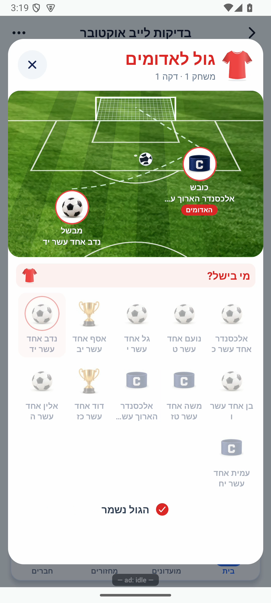
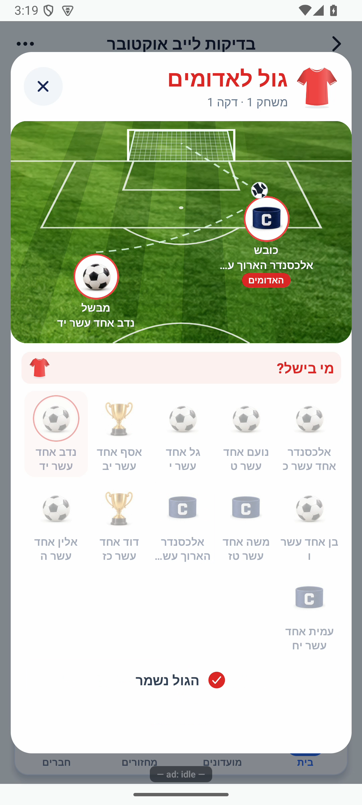
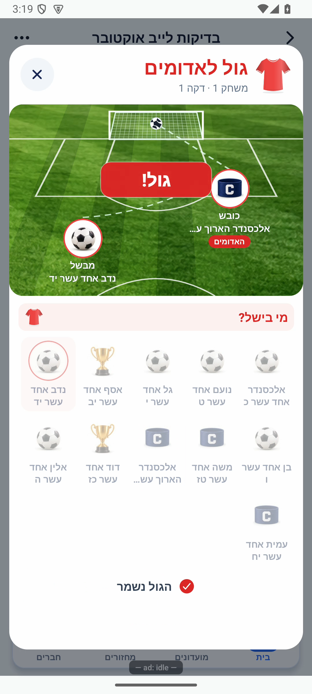

כל הפריימים הנבחרים נפתחו ונבחנו בגודלם המקורי והועתקו ללא חיתוך, שינוי גודל או ציור. דף מגע שימש סקירה בלבד. החילוץ הוא `MediaMetadataRetriever.OPTION_CLOSEST`; זמן הבקשה בטבלה אינו זמן פריים מדויק. בדגימות קרובות אפשר לקבל אותו פריים, ולכן לא נלמדים מכאן קצב תמונות או משך האנימציה המדויק. זהו אימות תנועה רגילה אחרי שמירה; אין מכאן הוכחת שינוי חי של העדפת תנועה מופחתת, סגירה באמצע המסירה, אנימציית שער עצמי או כשל רשת.

צילום `eleven-goal-long-name-assist` מזהה בבירור את האדומים באמצעות כותרת, חולצה וצבע. הכובש הארוך מושבת באותו תא בשלב המבשל, אבל שמו מתקצר גם במגרש וגם ברשימה. לכן הצלחת התנועה אינה אישור להצגת שם ארוך מלא בכל רכיב. שיוך הסרטונים הקודמים נשאר מוגבל: `four-goal-pass` הוא בחירת מבשל בלבד, ו־`eleven-goal-assist-pass` מסתיים בזמן השמירה. אין להחליף אותם בשקט בהקלטה החדשה או לייחס להם את הרצף שהוכח עכשיו.

### חילוף קבוע והשלמת הרכב

צילום `eleven-substitution-last-player` מציג גלילה אופקית עד חשבון הבדיקה האחרון בשורת הירוקים, לפני בחירתו. בצילום התצוגה המקדימה נבחרו חשבון הבדיקה ואופק מהכחולים: חשבון הבדיקה עובר לכחולים ואופק נכנס לירוקים. שתי הבחירות מסומנות, סיכום הזוג מופיע בתחתית ומוצג ״חילוף קבוע · נשארים בקבוצות החדשות״. כפתור הביצוע גלוי ואין שורת ״מחליפים את״ כפולה מעל הסגלים. אלה ראיות לבחירה ולתצוגה המקדימה; אימות השמירה ותוצאותיה בנתוני המקור נותר לביקורת הנתונים הנפרדת.

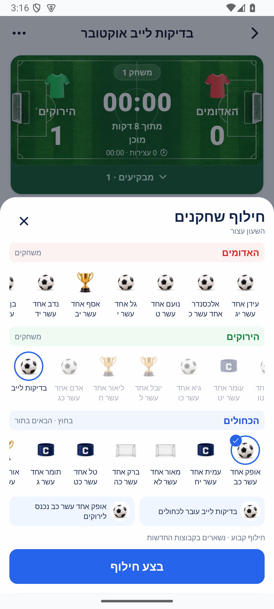

בחלון ההשלמה רואים שני סגלים ושתי חולצות: האדומים 10 מתוך 11 וחסר שחקן אחד, הירוקים 11 מתוך 11. אזור הבחירה אומר במפורש ״משלימים לקבוצת האדומים״ ומציג מועמדים מהכחולים. האישור מושבת לפני בחירה, עם ״עוד שחקן אחד״, ומצוין שהשינוי מיועד גם למשחקים הבאים ושהמצב של השעון נשמר. הצילום הוא לפני אישור ההרכב, ולכן אינו הוכחת שמירת המשלים או השפעתו על קבוצות המקור.

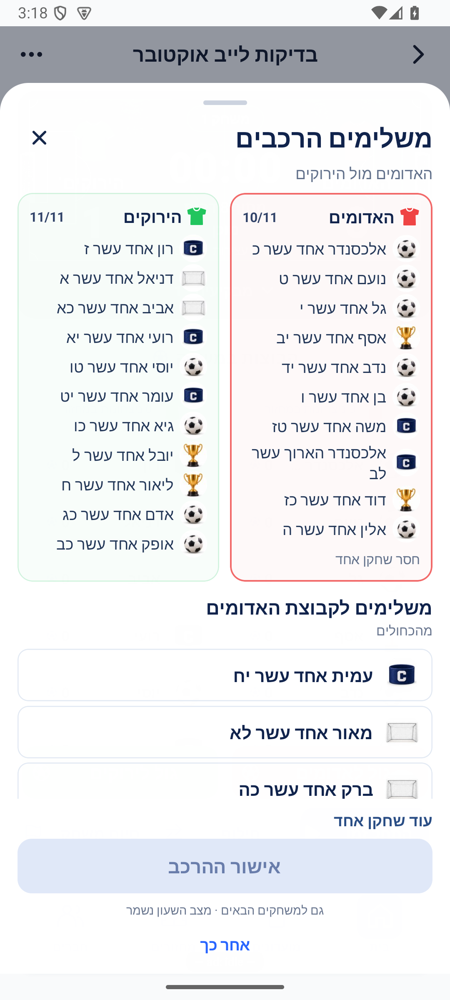

### פתיחה קרה במסך 320×569 ובגופן 140%

המוביל תיעד פתיחה קרה עם המידות והגופן האלה לפני איסוף הצילומים החדשים. בצילום `eleven-live-small-top` לוח 1:1 מציג שמות וחולצות, שמונה דקות, מצב מוכן ושעון 00:00; כפתורי הגולים, החילוף וסיום המשחק גלויות. הסגל אינו נראה באזור הזה. גלילת הגוף אל `eleven-live-small-roster` מביאה את תחילת ההרכבים, עם שם בשורה אחת או שתיים ושערים באזור נפרד, ללא החפיפה הקודמת. המחיר הוא מעט שורות בכל פעם ולוח התוצאה שנגלל מחוץ למסך; אין כאן הצגה בו־זמנית של כל הסגל ושל הלוח.

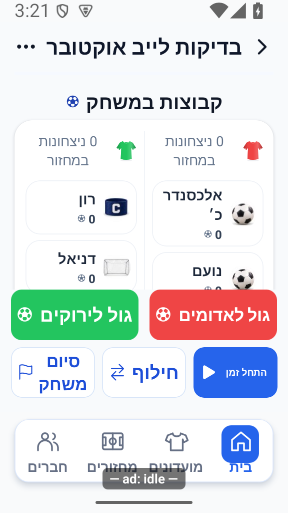

`eleven-live-small-last-roster` מציג אמצע סגל, כגון גל, אסף ונדב, ואינו הוכחת הגעה לשחקן האחרון בלייב. הוא לא קוטלג בשם שמטעה לגבי סופו. גם `eleven-goal-small-initial` הוא בפועל צילום לייב ללא חלונית, ולכן לא קוטלג כהוכחת פתיחת חלון גול.

בחלון הגול הקטן, גלילה מגיעה לעמית, השחקן האחרון באדומים. לחיצה עליו מעבירה מיד לבחירת מבשל; הוא מופיע במגרש ומנוטרל באותו תא ברשימה. עם זאת, התא התחתון נוגע בכפתורי האפשרויות ושורת השם השנייה אינה נראית במלואה; גם שם הכובש במגרש מקוצר. לכן הראיה היא **הגעה ובחירה אפשריות**, ולא שורה תחתונה מלאה או ליטוש מושלם. לפי תיעוד פעולת המוביל החלונית נסגרה בלי בחירת מבשל ובלי השלמת אירוע; הצילום אינו מקור עצמאי למספר האירועים במסד.

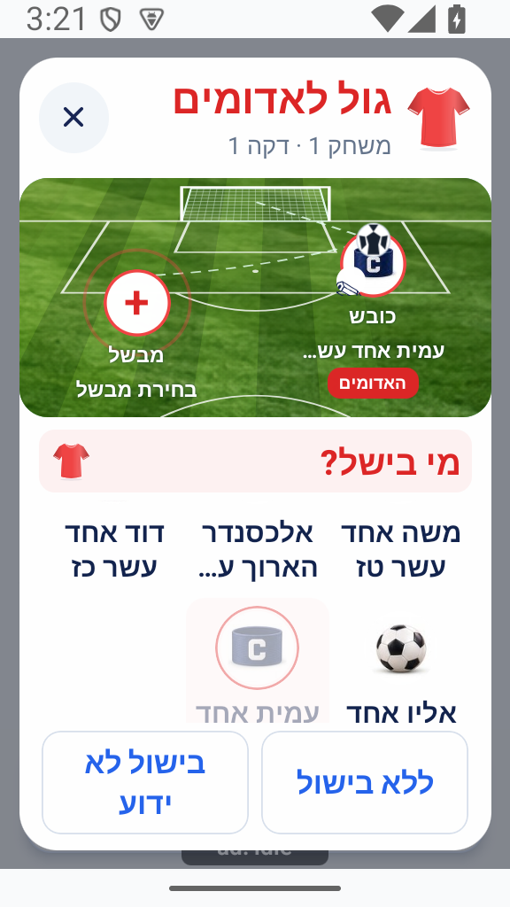

צילום מאוחר נוסף, `eleven-next-fill-small`, מציג חסם בחלון השלמה במסך הקטן אחרי תוצאת 1:1. סגל האדומים נראה, אבל אזור המועמדים והאישור גולשים מעבר לגבול החלונית. הוא נשמר כראיית פגם לפני תיקון `BalancedFillModal`, ואינו הוכחת השלמה מוצלחת. התיקון נבדק בנפרד בידי סוכן הממשק ודורש צילום חדש; צילום ההשלמה הרגיל אינו מחליף אימות של המצב הקטן הזה.

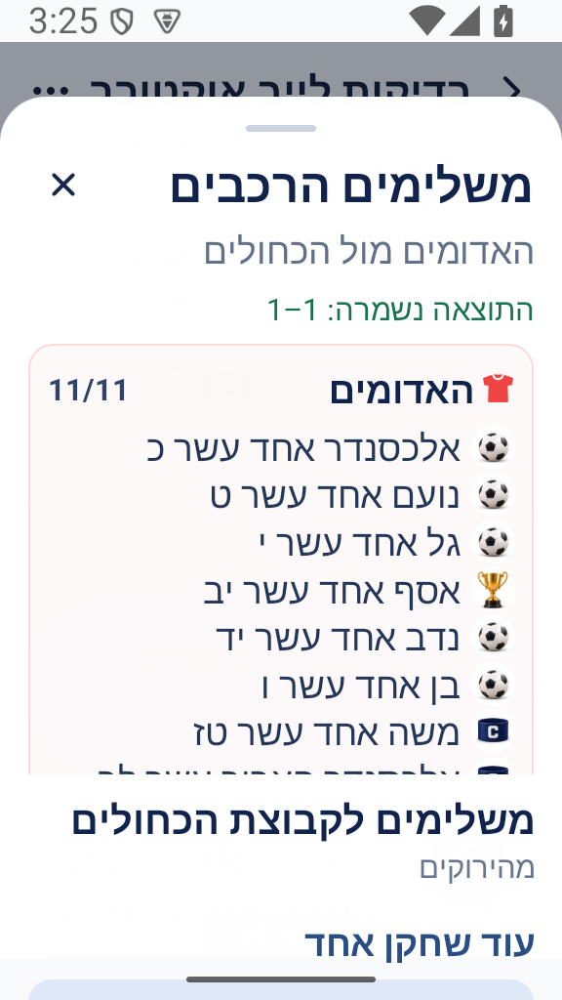

חמש עשרה תמונות נוספו בסבב החזותי הזה: שישה פריימים מקוריים מן ההקלטה ותשעה צילומי ממשק. מקור, חותמת, סביבה וזמן UTC נשמרו במניפסט הצילומים; לפריימים נשמרו זמן ההקלטה וזמן החילוץ בנפרד. לא נוסף פלט ביקורת פעיל ולא נטען כאן שכל ענפי אחד עשר, הסיכום, הנוכחות או השמירה הסופית הושלמו.

## עדכון חזותי באחד עשר — מעבר יציב והשלמה קטנה נגישה

נפתחו ונבחנו תשעה צילומי מקור נוספים, בלי להעתיק את ביקורת הנתונים הפעילה. צילומי התיקון החדשים נפרדים מראיות הפגמים שקדמו להם; אין החלפה של תמונה ישנה כאילו כבר הוכיחה את המצב המאוחר.

### שימור הפגמים והוכחת התיקון המאוחר

`eleven-fill-small-fixed-ready` הוא **תיקון ביניים שנכשל**: המועמדים והפעולות נעשו נגישים, אך שני הסגלים נעלמו לחלוטין בגלל אזור סגל בגובה אפס. הוא נשמר כפגם, בנוסף לחלון הראשון שהסתיר מועמדים ופעולות. `eleven-fill-small-resume-state` מציג מצב מעבר אחרי פתיחה קרה, עם תוצאת 1:1 ושעון 00:55, אבל טקסט כפתור ההמשך נחתך וזמן העצירות כלל זמן מאוחר שלא שייך למשחק שהסתיים. גם הוא נשמר כמצב שלפני תיקון.

בצילומי `eleven-pending-stoppages-fixed-one/two`, שנאספו בנפרד בזמן ששעון המכשיר התקדם, נראים בשניהם 00:55, שתי עצירות וזמן עצירות 02:00. כפתור ״המשך להכנת המשחק הבא״ שלם בשתי שורות. זהו אימות חזותי שהמצב המוצג אחרי סיום נשאר יציב; אימות חותמות הזמן במסד ומניעת כפילות בשמירה שייכים לביקורת הנתונים, ולא נלמדים מקיומו של הכפתור.

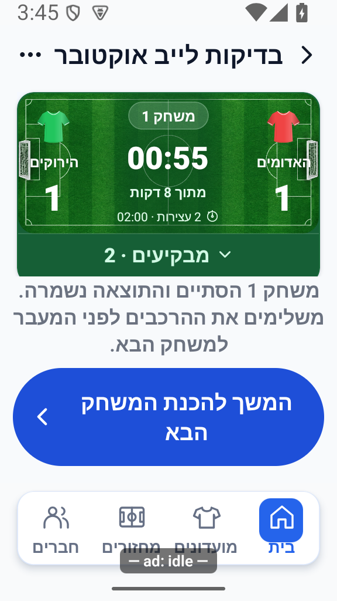

### גלילת סגל ומועמדים בחלון ההשלמה הקטן

בחלון המתוקן בגודל 320×569 ובגופן 140%, לפי תיעוד המוביל, אזור הסגל נפרד מרשימת המועמדים והתחתית נשארת קבועה. בצילום הראשון נראים האדומים 11/11 מעל מועמדי הירוקים. גלילת אזור הסגל בלבד מביאה את הכחולים 10/11, עם שם וחולצה כחולים, בזמן שמיקום המועמדים והפעולות נשמר. לא מוצגים כל 11 השמות יחד; ההוכחה היא שאזור הסגל קיים ונגיש בגלילה, ולא גובה אפס או פריסה שדוחפת את האישור החוצה.

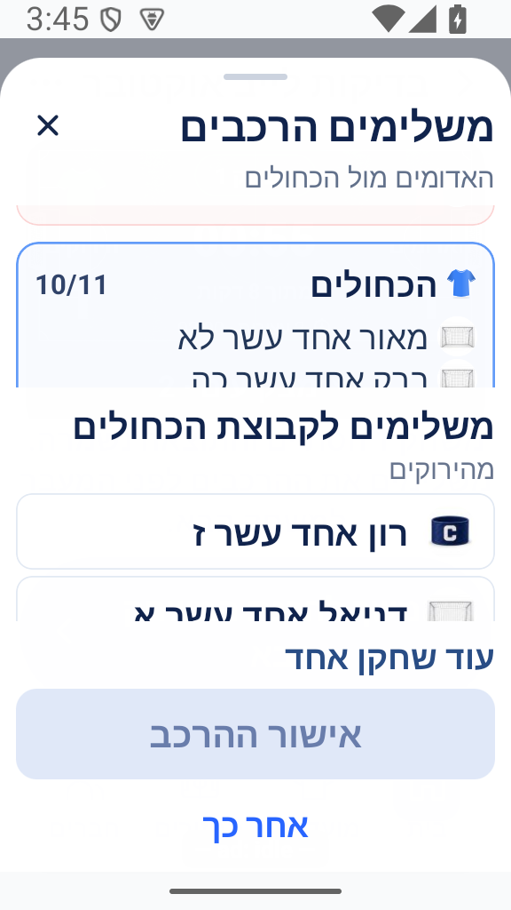

גלילת רשימת המועמדים בנפרד מגיעה לאופק האחרון מהירוקים. שורתו מלאה, עם אווטר ושם גלויים, ובאותו צילום הכחולים עדיין 10/11 והאישור מושבת. אחרי בחירת אופק השורה מסומנת, הסגל המיועד מציג 11/11, ההודעה משתנה ל״הבחירה מוכנה לאישור״ והאישור פעיל וגלוי. ״אחר כך״ נשאר נגיש. זו הוכחה חזותית לתיקון חסם ההשלמה הקטן ולבחירה המקדימה, ולא אישור שהכתיבה עצמה הושלמה; המוביל המשיך לאישור ולמשחק הבא, שייבדקו בנפרד במקורות הנתונים הסופיים.

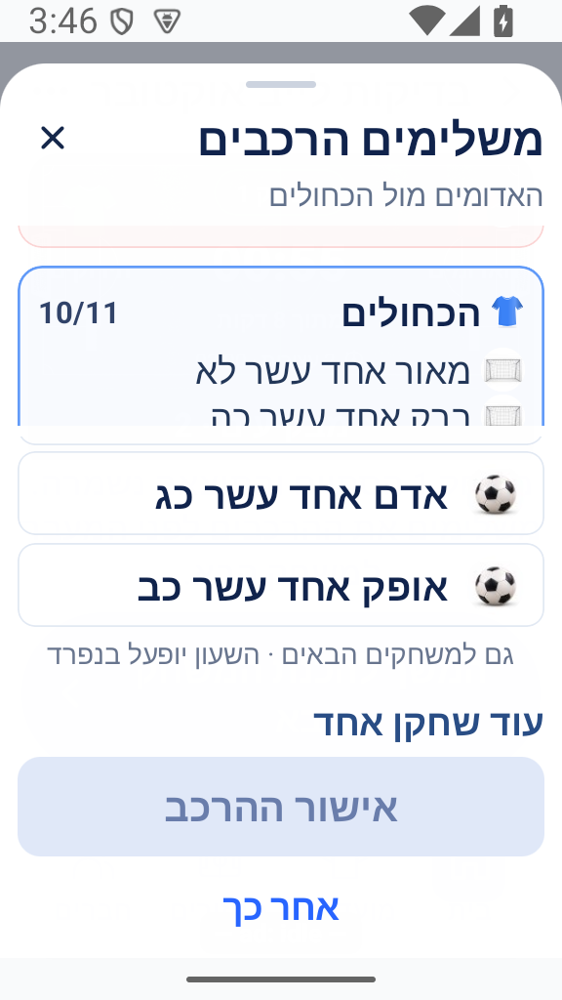

### צילום המקור החסר של היצירה מחדש

נוסף `eleven-regenerate-stream-ready`, צילום סיכום החלוקה המקורי לגרסה `1792206143482`. נראים 33 שחקנים ושלוש קבוצות, 11 בכל קבוצה, בהתאמה לנתוני הגרסה ולהוכחת העץ הקפואה. זהו צילום **לפני** תיקון הכיווניות והשמות: הקפטן משמאל ושני שמות אלכסנדר מתקצרים. הוא מוכיח מצב חלוקה חדשה מוכן; המעבר ללא ניסיון חוזר תועד בידי המוביל ואינו נלמד מהצילום הסטטי לבדו. הוכחת הקפטן מימין והשמות המלאים נשארת הצילום המאוחר `eleven-draft-rtl-full` שנבחן קודם.

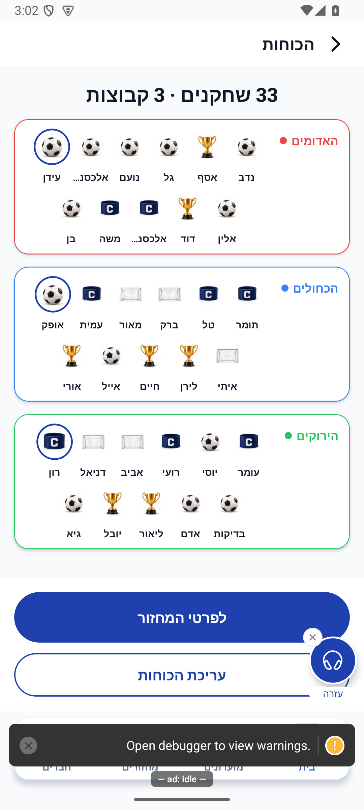

כל תשע התמונות הועתקו ללא שינוי ונרשמו עם מקור, חותמת וזמן UTC במניפסט הצילומים. ביקורת נתוני אחד עשר הסופית עדיין ממתינה למסירה קפואה; אין בתוספת הזאת סיכום מחזור, נוכחות, זקיפות משחק שני או הכרזת מוכנות. צילום הפנדלים, המסירה וההשלמה המוצלחת אינם אישור גורף לכל מצבי השגיאה.

## כשל אמיתי וניסיון חוזר באחד עשר — תיקון החלונית וביטול נגיש

המוביל ביצע בדיקה נוספת אחרי טעינה קרה של תיקון `GoalEntryModal`, במסך 320×569 ובגופן 140%. חיבור המערכת נותק בפועל, חשבון הבדיקה נבחר ככובש בכחולים במשחק השלישי, ונבחר ״ללא בישול״. השמירה נכשלה. צילום `eleven-offline-goal-error-fixed` נפתח ונבחן: הכותרת, הכובש וללא בישול נשמרו, הודעת הכשל מלאה וכפתור הניסיון החוזר נראה במלואו, ללא חגיגה.

[עץ המקור של השגיאה](evidence/live-action-2026-10-17/eleven-offline-retry-fixed-ui-before.xml) מאמת את הודעת הכשל בגבולות `[47,751][530,841]` ואת כפתור הניסיון החוזר בגבולות `[47,856][530,943]`. גובה הכפתור הוא 87 פיקסלים, כ־48.33 יחידות בצפיפות 1.8 שדווחה בידי המוביל, לעומת כ־32 יחידות גלויות בכשל הקודם. הרשימה מעל התחתית יכולה להציג חלק משורה בזמן הגלילה, אבל ההודעה והפעולה הקבועות אינן נחתכות. בדיקת 320×480 ובגופן 180% נותרת בדיקת רכיב בלבד, ללא צילום מכשיר נוסף.

### ניתוק, ניסיון חוזר וביטול באירועים שנוצרו לבדיקה

[מניפסט ניסוי השגיאה](evidence/live-action-2026-10-17/manifest-eleven-error-retry-ui.json) שומר שלוש תשובות מסד מסוננות למחזור אחד עשר בלבד, את עץ השגיאה ואת חותמת [הקלטת הניסיון החוזר](evidence/live-action-2026-10-17/animation-sources/eleven-offline-retry-fixed.mp4). אלה מקורות של הניסוי המתוקן, ואינם ארכיון סיום המחזור או פלט ביקורת נתונים פעיל.

| מקור | זמן קריאה UTC | שערים במשחק השלישי | תוצאה א׳:ב׳ | היסטוריות / שורות סטטיסטיקה |
|---|---|---|---|---|
| `data-eleven-offline-fixed-attempt.json` | `2026-10-17T04:06:17.675637+00:00` | 0 | 0:0 | 2 / 32 |
| `data-eleven-offline-fixed-retried.json` | `2026-10-17T04:06:56.161069+00:00` | 1 | 1:0 | 2 / 32 |
| `data-eleven-offline-fixed-undone.json` | `2026-10-17T04:07:51.793385+00:00` | 0 | 0:0 | 2 / 32 |

המוביל החזיר את חיבור המערכת ולחץ פעמיים על הניסיון החוזר. המקור לאחר מכן מכיל אירוע שער אחד בלבד, של חשבון הבדיקה ללא בישול, והמשחקים הקודמים נשארו שתי היסטוריות. פעולת הביטול נעשתה דרך הממשק על האירוע שנוצר לבדיקה בלבד והחזירה את המשחק השלישי לאפס, בלי ליצור היסטוריה נוספת או זקיפת משחק. מקורות הנתונים מוכיחים את הרצף שנשמר 0→1→0; מספר הלחיצות ושחזור חיבור המערכת הם תיעוד פעולת המוביל דרך המכשיר. לא הוזרקה תגובה אבודה אחרי כתיבה מוצלחת, ולכן הניסוי הזה אינו הוכחה לאותו ענף.

### פעולת ביטול עם אזור מגע ותווית

צילום `eleven-goal-undo-accessible-fixed` נפתח ונבחן: הגול היחיד מופיע ביומן, וסמל הביטול הקטן נשאר בתוך הפקד המקורי הגדול. במימוש יש אזור לחיצה 44×44 ותווית ״ביטול הגול של…״, עם השבתה בזמן עבודה. המוביל קרא ב־`device.dump` המקורי תווית ״ביטול הגול של בדיקות לייב״ וגבולות `[53,470][132,549]`: גודל 79×79 פיקסלים, כ־43.89 יחידות בצפיפות 1.8. **לא נשמר קובץ XML נפרד של מדידת הביטול**; המדידה נרשמת כתצפית המוביל והצילום מאמת את התצוגה. עץ השגיאה השמור אינו מוצג כאילו הוא גם עץ כפתור הביטול.

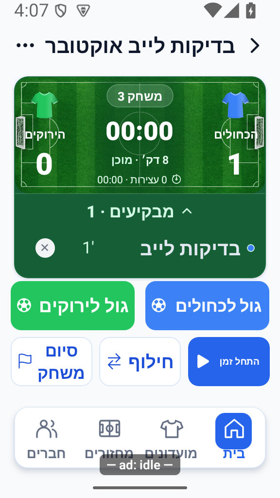

שני צילומי התיקון הועתקו ללא שינוי ונרשמו במניפסט הצילומים. תיקון הפריסה נבדק ב־20 בדיקות חלון גול; יחד עם שומרי סדר הקריאות והכיווניות עברו 346 בדיקות ממוקדות ובדיקת הטיפוסים נקייה. ההרצה המלאה האחרונה של המוביל מרוכזת בדוח המשולב. מקורות הסיום והביקורת הקפואה הסופית של אחד עשר מובאים בסעיף הבא; אין בתוספת הזאת הכרזת מוכנות או פריסה.

## סיום אחד עשר מול אחד עשר — הנתונים הקפואים

מחזור `mBO5HqJdnOPWjRE2zMh8` הסתיים דרך המוצר. מקור `data-eleven-finished.json` נקרא ב־`2026-10-17T04:08:55.323262+00:00`; הקריאה המאוחרת `data-eleven-sealed-proof.json` ב־`2026-10-17T04:09:23.582410+00:00` מאשרת את אותם המשחק, ההיסטוריה, סימני הזקיפה, שורות השחקנים, הסיכום ושלבי הסיום. אין יותר בדיקת לייב פעילה במחזור זה. המחזור המוכן השלישי ואירועי הניסוי שבוטלו לא נזקפו כמשחק נוסף.

[הביקורת הסופית הקפואה](evidence/live-action-2026-10-17/audit-eleven-final-data.md) ו[פלטה המובנה](evidence/live-action-2026-10-17/audit-eleven-final-data.json) כוללים **240 אימותים שעברו, ארבע בדיקות פער בשתי משפחות שרת וחמישה תחומים לא מוכחים, ללא כשל נתונים נוסף**. זוהי ביקורת מקומית של מקורות שנקראו בייצור, עם הרצה מבודדת של מודולי המוצר הקנוניים; היא אינה הרצת כל הממשק. הוכחות המכשיר מתועדות בנפרד להלן ובסעיפים הקודמים.

[מניפסט הסיום](evidence/live-action-2026-10-17/manifest-eleven-final.json) מכיל 44 רשומות: 42 מקורות קפואים ושני פלטי הביקורת. קריאות מסד מעורבות סוננו למחזור אחד עשר בלבד, והושמטו דואר, מיקום, קוד הזמנה והעדפות חשבון. לכל עותק חותמת משלו ולמקור חותמת נפרדת. מקורות שהועתקו בשלבים קודמים לא שוכתבו. שני פלטי הביקורת הועתקו ללא שינוי, עם חותמות מקור גולמיות:

| מקור | SHA256 של המקור הגולמי |
|---|---|
| `audit-eleven-final-data.md` | `ec33d5a2ed5f37f6a48b8ac8ba1ec6a24c6b192a557f3d26700534e72f6d2efb` |
| `audit-eleven-final-data.json` | `3751846ad61572ad1f6c2689400a28045c5912a413dd15fe538152b792eee026` |

### המשחקים, ההשלמות והשעון

| משחק בתוך המחזור | מזהה | צד א׳ מול צד ב׳ | תוצאה א׳:ב׳ | הכרעה וזקיפה |
|---|---|---|---|---|
| ראשון | `r_mvbtoxwh_f3ntv5pc` | האדומים מול הירוקים | 1:1 | המנהל בחר באדומים; היסטוריה וסמן יחידים; 23 משתתפים נזקפו, כולל הכובש שהוחלף |
| שני | `r_mvbuu5ds_i2fcwkqp` | האדומים מול הכחולים | 0:1 | הכחולים ניצחו; היסטוריה וסמן יחידים; 22 משתתפים נזקפו |
| שלישי מוכן | `r_mvbv0sdo_ymvv4nn9` | הכחולים מול הירוקים | 0:0 בסיום | לא נשמר כמשחק; שערי בדיקה נוספו ובוטלו בתוך תרחישי הרשת בלבד |

בסך הכול נשמרו שני משחקים, 32 שורות שחקנים ו־45 הופעות, שלושה שערי שדה ושלושה בישולים, בלי תיקו בלתי מוכרע ובלי הכרעת פנדלים. שני המשחקים הסתיימו עם מנצחת, גם כשהתוצאה המספרית של הראשון הייתה שווה. הכרעת הפנדלים ושלוש תוצאות הבעיטה נבדקו במחזור שבעה; אין טענה שהן בוצעו גם באחד עשר.

ההגדרה במחזור היא `advancedFillMode=permanent`. בחילוף הראשון חשבון הבדיקה עבר מהירוקים לכחולים ואופק עבר מהכחולים לירוקים, והשער הקודם נשאר לטובת הירוקים. אחרי יציאת עידן הושלם עמית מהכחולים לאדומים בקביעות. לפני המשחק השני אופק הועבר בקביעות מהירוקים לכחולים; לפני השלישי אלכסנדר הרגיל עבר מהאדומים לירוקים. המקורות מאמתים את קבוצות הבית לאחר כל מעבר ואת ההרכבים הבאים, ולא רק את תצוגת הבחירה. השינויים לא יצרו השאלה זמנית, לא החזירו את חשבון הבדיקה לירוקים ולא יצרו זקיפה נוספת.

תחילת המשחק והזנת שערים נעשו גם לפני הפעלת השעון. במשחק הראשון תועדו התחלה, השהיה והמשך במכשיר אחד, ושני מקטעי פעילות נחתמו בסך 55,173.5 אלפיות שנייה. אחרי שתי פתיחות קרות במצב הממתין נשמרו אותו מזהה משחק, היסטוריה אחת, סמן זקיפה אחד ו־23 שורות שחקנים; לאחר ההשלמה הקבועה המשחק השני התחיל באפס. הודעת המעבר, זמן העצירות והכפתור המלא נבחנו בצילומים הקודמים, ומקורות הסיום משלימים את הוכחת השמירה. לא בוצע מרוץ שעונים בשני מכשירים.

### זהויות האורחים והפערים בשרת

[הסגל המלא](evidence/live-action-2026-10-17/data-eleven-full-roster.json) שומר חשבון בדיקה ו־32 אורחים עם שמות ומזהים שונים. [קבלת הוספת האורחים](evidence/live-action-2026-10-17/guests-eleven-receipt.json) מכילה 31 אורחים, נוסף על [האורח הראשון](evidence/live-action-2026-10-17/data-round-eleven-first-guest.json). איחוד המזהים משני המקורות הושווה לכל 32 מזהי האורחים במקור הסופי. טבלת כל השמות ומזהי `guest:` כלולה בביקורת הקפואה; [זהויות הבדיקה](evidence/live-action-2026-10-17/test-identities.json) קושרות את שלושת המחזורים לאותו חשבון ומועדון. אין כאן חשבונות אורח חדשים או נתוני משתתפים שאינם חלק מהבדיקה.

ארבע בדיקות הפער משויכות לשתי משפחות שרת קיימות שטרם נפרס עבורן התיקון המקומי:

- **רשימת משתתפים היסטורית:** במשחק הראשון חשבון הבדיקה כבש ואז הוחלף בקביעות. שורת הסטטיסטיקה זיכתה אותו פעם אחת בגול, הופעה והפסד; רשימת הירוקים בהיסטוריה מכילה רק את 11 שחקני הסיום ומשמיטה אותו. מזהה הכובש עצמו נשאר באירוע הגול. אלה שני סוגי נתון שונים, ואין להציג את זקיפת הגול כאילו היא מוכיחה גם שלמות של רשימת ההרכב.
- **פרטי בישול בהיסטוריה:** שני בישולי האורחים אדם ונדב נשמרו בשורות הסטטיסטיקה, אך זהויותיהם וסוג הבישול אבדו בהיסטוריה הראשונה; כתוצאה מכך גם שחזור המעורבות מן ההיסטוריה חלקי. במשחק השני מזהה חשבון הבדיקה כמבשל נשמר, אבל `assistStatus` עדיין חסר. כך מתקבלות שלוש בדיקות פער באותה משפחת חוזה.

אין שינוי מסמכי ייצור לצורך תיקון הפערים האלה. חישוב מקומי עם פרטי הלייב המקוריים הוא תחזית של החוזה המתוקן, ולא נתון שנכתב. עידן, שיצא בלי גול או בישול, חסר משורות הזקיפה בהתאם למגבלת החוזה המתועדת: נשמרים צדדי הסיום ותורמי שערים, ללא יומן השתתפות מלא. המקורות מוכיחים שיבוץ ויציאה לפני הפעלת הזמן, אבל לא דקות משחק אישיות. לכן לא הוכנסה זקיפה ספקולטיבית ולא הוגדרה הפעלת השעון כתנאי להשתתפות.

### נוכחות, ציון וסיכום

במקור הסופי נמצאים סימן `finishCredited/once`, שלב דירוג `finishStages/standings`, סיכום המחזור ושלב `finishStages/complete`, לפי סדר חותמות הזמן. ציון חשבון הבדיקה 9.0 חושב במודול הציון הקנוני ונמצא תואם למכנים ולמונים השמורים. מודול ההשתתפות הקנוני מאשר שהמחזור התקיים ונספר בלי להסיק זאת מהשעון של המשחק המוכן האחרון.

מוני המועדון של חשבון הבדיקה אחרי שלושת המחזורים כוללים שלוש נוכחויות מחזור, שישה משחקים, שלושה ציונים וסכום ציונים 26.0: 8.2, 8.8 ו־9.0. אלה יחידות נפרדות; שני משחקים באותו מחזור אינם שתי נוכחויות מחזור. הציון 8.8 של שבעה עדיין נגזר ממוני השרת הקיים ובהם העצירה העודפת שתועדה, ואינו ציון מתוקן שנכתב מחדש.

פונקציית `buildRoundSummary` האמיתית הורצה בבידוד על בסיס החישוב השמור. כל הפלט — סכומים, מובילים, קבוצות, זוגות, אירועים וכיסוי — תואם לסיכום השמור. בסיסו מכיל 32 שחקנים, מהם 31 אורחים, עם אותם מונים שנשמרו בשורות המשחק. הדבר מוכיח התאמה לבסיס השמור; הוא אינו משחזר את פרטי הבישולים שהשרת השמיט מההיסטוריה. חתימה מוכחת כאן במסמכי הסיום, לא בשדה `statsSealed` שלא נכלל בקריאה. סימן יחיד ומונים תואמים אינם ניסוי מסירה חוזרת של אירוע סיום.

### צילומי הסיום לפני תיקוני התצוגה

נפתחו ונבחנו שמונה צילומי סיום מקוריים. הם נשמרו בנפרד מהצילומים המאוחרים של התיקונים, בלי להחליף ראיית פגם כאילו כבר הוכיחה תיקון.

| ראיה קנונית | מה נצפה ומה מוגבל |
|---|---|
| [סכומי הסיכום לפני תיקון תווית](../features/screenshots/action-pitch-production-eleven-summary-counts-before-label-fix-2026-10-17.png) | 2 משחקים, 3 שערים, 3 בישולים ו־0 הכרעות; תווית ההכרעות מקוצרת |
| [סיכום אישי](../features/screenshots/action-pitch-production-eleven-personal-final-2026-10-17.png) | ציון 9.0, שני משחקים, ניצחון, גול ובישול; כלי עזרה מסתיר אזור אחר בתחתית |
| [היסטוריית המשחק הראשון](../features/screenshots/action-pitch-production-eleven-history-first-final-2026-10-17.png) | 1:1 והכרעת מנהל לאדומים; שני הכובשים גלויים ובישולי האורחים חסרים בהתאם לשרת |
| [היסטוריית המשחק השני](../features/screenshots/action-pitch-production-eleven-history-second-final-2026-10-17.png) | ניצחון הכחולים 1:0, אופק כובש וחשבון הבדיקה מבשל; סוג הבישול אינו מוכח בצילום |
| [ראש הטבלה לפני תיקון דירוג](../features/screenshots/action-pitch-production-eleven-standings-before-rank-fix-2026-10-17.png) | ציון חשבון הבדיקה 9.0; מספר 10 נשבר לשתי שורות |
| [עמודות המשחקים לפני התיקון](../features/screenshots/action-pitch-production-eleven-standings-games-before-rank-fix-2026-10-17.png) | משחקים, שער נקי והפסדים גלויים; שם המקור כולל assists אבל אין בו עמודת בישולים מלאה |
| [אמצע טבלת האורחים לפני התיקון](../features/screenshots/action-pitch-production-eleven-standings-guests-before-rank-fix-2026-10-17.png) | אורחים ודירוגים שבורים; אינו צילום המאמת מספרי בישולים |
| [סוף הטבלה לפני הסרת התקרה](../features/screenshots/action-pitch-production-eleven-standings-cap-before-fix-2026-10-17.png) | הטבלה נעצרת ב־30, ועידן במקום 28 עם אפס משחקים |

הוכחת הקריאה [eleven-standings-cap-read-proof.json](evidence/live-action-2026-10-17/eleven-standings-cap-read-proof.json) הפעילה את שירות הטבלה, ביטוי המשתתפים והמיון האמיתיים לפני התיקון: 32 שורות סטטיסטיקה התמזגו עם הסגל הרשום ל־33 שורות, ואילו תקרת התצוגה הציגה רק 30. אביב, גיא ויובל הוסתרו אף שלכל אחד הופעה. [קוד הבדיקה המקומי](evidence/live-action-2026-10-17/inspect-eleven-standings-cap.cjs) וחותמות מקורות הקוד נשמרו כפי שהיו; לא הורץ מחדש אחרי השינוי. זהו פגם תצוגה, ללא אובדן שלוש שורות במסד. המסמך אינו מייחס לצילום הישן הוכחת תיקון.

### צילומי תיקוני התצוגה לאחר הסיום

נפתחו ונבחנו שמונה צילומים מקוריים נוספים. הבית אחרי פתיחה קרה מציג 33 שחקנים ושני משחקים, כולל האורחים הפעילים; הסיכום מציג את התווית ״הכרעות בפנדלים״ במלואה; דירוגי 10 ו־11 נשארים בשורה אחת; וסוף הטבלה מגיע לאביב 31, גיא 32 ויובל 33. אלו תיקוני תצוגה על אותם נתונים חתומים, ללא יצירת משחקים נוספים.

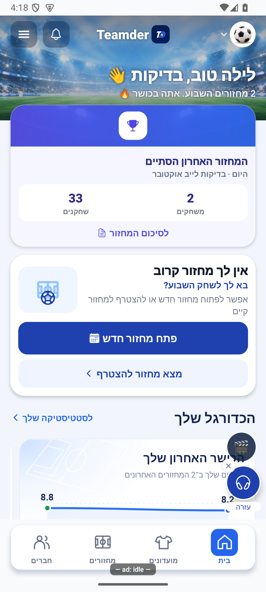
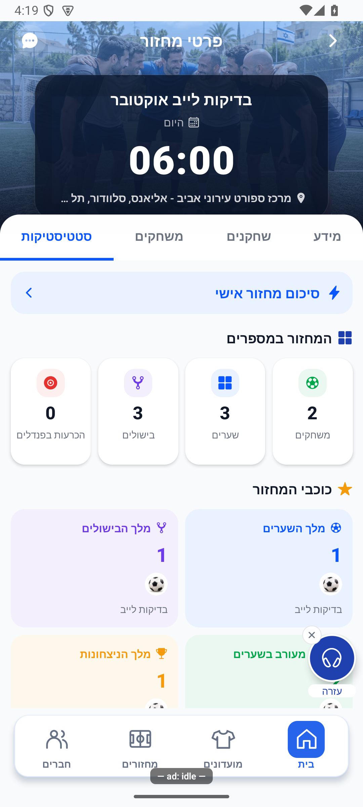

הצילום [בישולים עם כותרת מלאה](../features/screenshots/action-pitch-production-eleven-standings-assists-column-full-2026-10-17.png) מציג בפועל בישול אחד לחשבון הבדיקה ובישול אחד לנדב. הוא שונה מהצילומים הקודמים ששמם כלל assists אך העמודה לא הייתה גלויה בהם. [דירוג רגיל מתוקן](../features/screenshots/action-pitch-production-eleven-standings-rank-fixed-normal-2026-10-17.png) מציג 10 ו־11 בשורה אחת. [סוף טבלה רגיל מתוקן](../features/screenshots/action-pitch-production-eleven-standings-all33-fixed-normal-2026-10-17.png) כולל גם את עידן בשורת האפס ואת שורות 31–33.

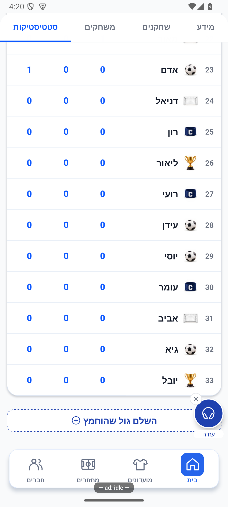

בפתיחה קרה של 320×569 וגופן 140%, לפי תיעוד המוביל, [הבית הקטן](../features/screenshots/action-pitch-production-eleven-home-guests-fixed-small-2026-10-17.png) מציג אותם 33 ושני משחקים, [סיכום המדדים הקטן](../features/screenshots/action-pitch-production-eleven-summary-labels-fixed-small-before-tabs-2026-10-17.png) מציג תווית הכרעות מלאה בשתי שורות, ו[סוף הטבלה הקטן](../features/screenshots/action-pitch-production-eleven-standings-all33-fixed-small-before-tabs-2026-10-17.png) מציג 31–33 במספרים שלמים. בשני צילומי פרטי המחזור הקטנים הלשוניות עדיין נשברות לאות אחרונה; לכן הם מוכיחים את תיקון המדדים והטבלה בלבד, לפני תיקון הלשוניות המאוחר. צילום התיקון המאוחר מובא בנפרד להלן. בבית הקטן כלי העזרה חופף חלק מתווית המשחקים, אך לא את המספר 2; מספר השחקנים 33 גלוי. מספר השחקנים השגוי בבית קודם לתיקון נצפה בידי המוביל, אך לא נשמר צילום קודם שלו.

[מניפסט ממשק הסיום](evidence/live-action-2026-10-17/manifest-eleven-final-ui.json) קושר את 19 צילומי המקור, ובהם שלושה מצילומי תיקון הלשוניות המאוחרים, ואת חמשת עצי המכשיר. שני עצי סוף הטבלה הראשונים [במידה הרגילה](evidence/live-action-2026-10-17/eleven-standings-all33-normal-ui.xml) ו[במידה הקטנה](evidence/live-action-2026-10-17/eleven-standings-all33-small-ui.xml) כוללים 31,32,33 ואביב, גיא ויובל; עץ הקטן הזה עדיין קודם לתיקון הלשוניות. זמני UTC נלקחו מקובצי הצילום, וכל התמונות נשמרו ללא עיבוד.

### תיקון הלשוניות האחרון ואימות קריאה מאוחר

נפתחו ונבחנו שני צילומים חדשים אחרי פתיחה קרה ב־320×569 וגופן 140%, בתנועה רגילה ובחשבון הבדיקה, לפי תיעוד המוביל. כל ארבע לשוניות פרטי המחזור שלמות בשורה אחת. הסיכום מציג 2 משחקים, 3 שערים, 3 בישולים ואפס הכרעות בפנדלים, עם תווית ההכרעות שלמה בשתי שורות. הטבלה מגיעה לאביב 31, גיא 32 ויובל 33, עם דירוגים בשורה אחת. אלה הראיות המאוחרות לתיקון הלשוניות, ולא התמונות הקודמות עם האות האחרונה שנשברה.

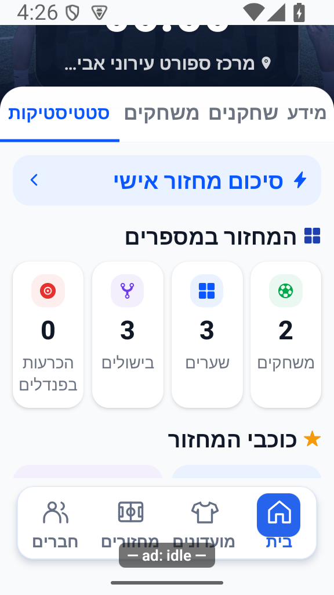
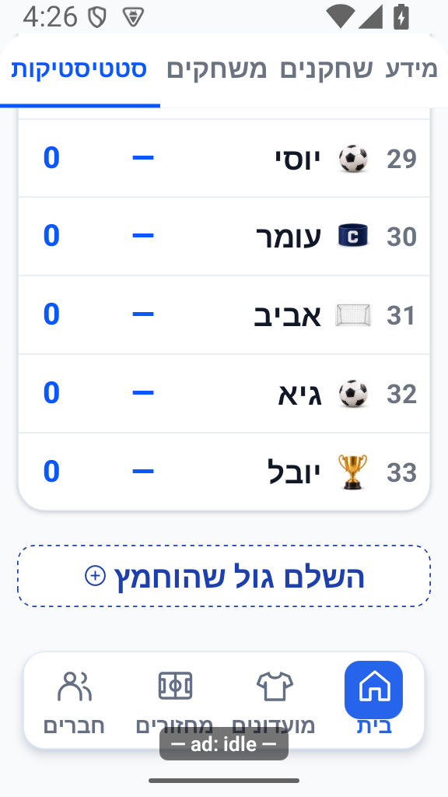

נשמרו גם [עץ הסיכום הקטן הסופי](evidence/live-action-2026-10-17/eleven-tabs-summary-final-small-ui.xml) ו[עץ סוף הטבלה הקטן הסופי](evidence/live-action-2026-10-17/eleven-tabs-standings-final-small-ui.xml), שבהם ארבע התוויות המלאות. [צילום המידה הרגילה הסופי](../features/screenshots/action-pitch-production-eleven-tabs-summary-final-normal-2026-10-17.png) ו[העץ שלו](evidence/live-action-2026-10-17/eleven-tabs-summary-final-normal-ui.xml) נבחנו לאחר פתיחה קרה בגופן 100%: ארבע תוויות שלמות וארבעת המדדים המלאים. אין צילום מכשיר חדש של לשוניות פרטי המועדון המשותפות; הראיה כאן שייכת לפרטי מחזור.

קריאה מאוחרת ב־`2026-10-17T04:28:39.206275+00:00` נשמרה ב[אימות הקריאה הסופי](evidence/live-action-2026-10-17/manifest-final-read-confirmation.json), בנפרד מביקורת 240 האימותים הקפואה. כל שלוש חבילות מחזורי הבדיקה בתשובה זהות בדיוק לאלה שבמקור החתימה: משחקים, היסטוריות, סטטיסטיקות, סימני זקיפה, סיכומים ומסמכי סיום. גם המועדון, `qaClubStats` ו־`qaClubTotals` זהים. השינוי היחיד בחשבון הוא `lastSeenAt`, לאחר הכניסות לצפייה. העותק המסונן כולל רק את שלושת מחזורי הבדיקה המאושרים, בלי פרטי קשר או מיקום. זו הוכחת יציבות בקריאה מאוחרת; 240 האימותים לא הורצו מחדש ולא שוכתבו, ולא בוצע ניסוי מסירה חוזרת של סיום.

### גבולות המסקנה אחרי שלושת המחזורים

כל שלושת המחזורים הסתיימו עם שתי זקיפות משחק לכל מחזור, וסימני הנוכחות והציונים נשמרו. ענפי הבדיקה התחלקו ביניהם: חילופים זמניים בארבעה, פנדלים ותוצאותיהם בשבעה, וחילופים והשלמות קבועים, מסירת גול מלאה ושגיאה אמיתית וניסיון חוזר באחד עשר. הראיות אינן טענה שכל ענף הורץ בכל גודל.

נשארים פערי שרת מתועדים וגבולות מפורשים: הופעת יוצא ללא תרומת שער אינה יומן השתתפות מלא; סגל רשום אינו הוכחת הגעה או דקות; לא בוצעו מסירה חוזרת של אירוע סיום, אובדן אישור אחרי כתיבה מוצלחת או מרוץ שעון בשני מכשירים. בדיקת הנתונים לבדה אינה מאשרת את כל הפריסות והאנימציות. הסרטון הקצר בארבעה אינו הוכחת מסירה; המסירה המקורית באחד עשר ופריימי הפנדלים בשבעה נבחנו ונשמרו בנפרד. הוכחת הפחתת התנועה והפתיחה הקרה מוגבלת למה שתועד בפרט במחזור שבעה ובדוח המקומי, ואינה ניסוי תנועה מופחתת בכל שלושת הגדלים.

לא בוצעו בעבודת הארכיון פעולות מכשיר, רשת או כתיבות ייצור. נתוני הבדיקה נשארו במערכת. התיקונים המקומיים, הצילומים והיומן אינם הוכחת פריסה; המלצת המוכנות והבדיקות המלאות המאוחרות מופיעות בדוח המשולב שבבעלות המוביל.
