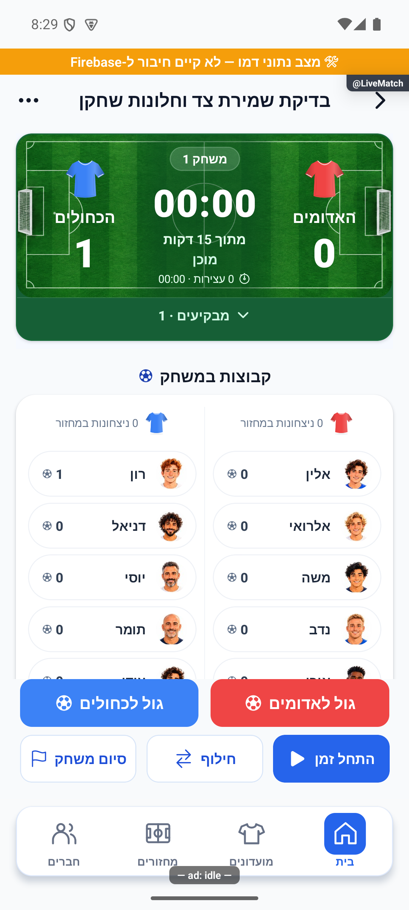
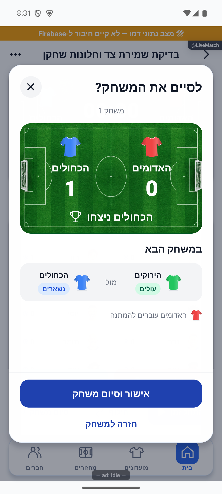
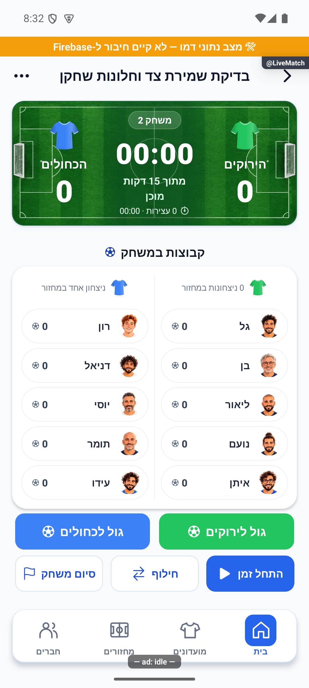
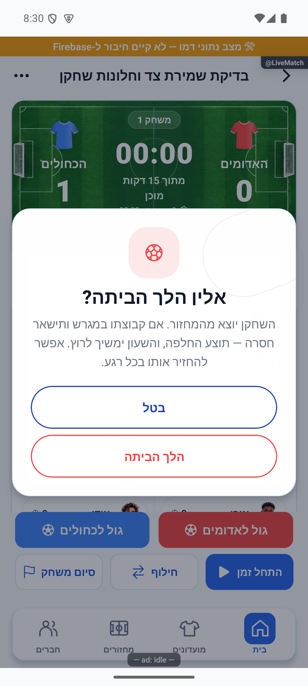
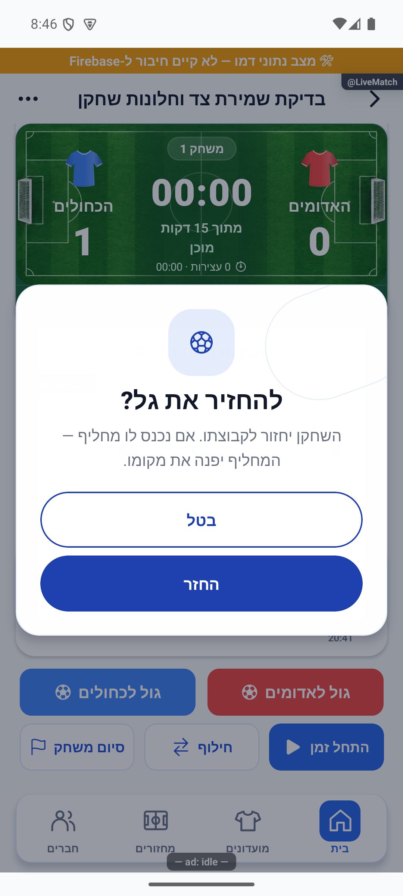

# דיווחי פולס חדשים — 17.10.2026

מקור: `4a3cb346` עם עבודה מקומית קיימת. העבודה הקיימת נשמרה. נסקרו כל הערוצים הפעילים דרך חיבור הפולס לקריאה; נפתחו ונבחנו שלושת צילומי המשוב וצילום ההתראה החדשה. רעיונות חונים לא טופלו.

## ארבעת הממצאים והתיקונים

| דיווח | ממצא ותיקון | מצב |
|---|---|---|
| `MlExTVbHn2LgSOWAzznq` | `recordWinnerSkeleton` הציב תמיד את המנצחים בתא הראשון. כעת מחליפים רק את תא המפסידים; גם `winnerRotationPreview` משמר צד זהה בתוכנית המשחק הבא, לרבות סיום פנדלים. | מקומי, דורש גרסת לקוח |
| `EbMhrKeKZOCdQMhommvj` | אישור החזרת שחקן מפעיל את עיצוב הכדורגל הקיים ב־`AppDialog`, עם כותרת וגוף ממורכזים וכפתורים מלאים. | מקומי, דורש גרסת לקוח |
| `mP0woPhULwl6vrn2InOc` | אישור ״הלך הביתה״ משתמש באותו עיצוב; פעולת היציאה והנעילה הקיימות נשמרו. | מקומי, דורש גרסת לקוח |
| `task-1792265361945-7ra1` | שתי הודעות ייצור מ־19:26 ו־19:27 בזמן אוניברסלי חסרו `senderName`, אף שלפרופילי השולחים היה שם. השרת הפעיל היה ישן ולא השלים זהות אחרי שינוי חוזה הלקוח. נפרס המקור המקומי שמאמת ומשלים זהות מהפרופיל לפני הפצה. | שלוש פונקציות הצ׳אט נפרסו ואומתו; מסירה חדשה למכשיר לא נבדקה |

אין שינוי כללים, הרשאות, ממירי נתוני משחק או מכני סטטיסטיקה. אין הסבת הודעות ישנות. בחלוניות שונה העיצוב בלבד. הקבוצה שנשארת אינה מוחלפת כדי ליישר תוצאה חזותית: התאים נשמרים במודל הרוטציה עצמו, ולכן גם הסגל וכפתורי הגול תואמים.

## מה הורץ ונצפה

באמולטור אנדרואיד, ברוחב 411 נקודות ובטקסט רגיל, נוצר תרחיש דמו מבודד `qa-pulse-new-side-and-roster-20261017`, עם שלוש קבוצות של חמישה. זה אינו מחזור ייצור ואינו בודק ממירי מסד.

1. האדומים היו מימין והכחולים משמאל, בתוצאה 0:1. בחלונית הסיום הכחולים נשארו משמאל והירוקים עלו מימין. אישור המוצר הוביל למשחק 2 עם אותם צדדים ו־0:0. מקור הנתונים הראה `playing:[2,1]`, `waiting:[0]`, ניצחון יחיד לכחולים ורשומת תוצאה יחידה עם `winnerSide:B`. הראיה: `artifacts/pulse-new-2026-10-17/after-win.json`.
2. חלונית ״הלך הביתה״ נפתחה, נבחנה ובוטלה. בתרחיש נפרד אחרי הפעלה מחדש נבחר גל בקבוצת ההמתנה, נפתח אישור היציאה ואושר דרך הממשק. גל הוסר מהירוקים ונוסף ל־`leftHome` עם `homeTeam:2`.
3. בדמו בלבד המסך לא התרענן אחרי שינוי הסגל; טעינת המסך מחדש הציגה את גל ברשימת היוצאים. משם נפתחה חלונית ״להחזיר את גל?״ ואושרה. הנתונים אחרי ההחזרה הראו `leftHome:[]`, גל שוב בקבוצה 2, וחמשת השחקנים בכל קבוצה. הצדדים נשארו `[0,1]`. הראיה: `artifacts/pulse-new-2026-10-17/after-restore.json`.

האמולטור נתקע פעם אחת והופעל מחדש. אין לייחס מכך תקלה חדשה בייצור. מגבלת הרענון בדמו מתועדת; אין טענה שהוכח רענון סגל מול מנוי ייצור. התרחיש המבודד הוסר בסיום, והניווט הוחזר למסך הבית של חשבון הדמו.

### צילומים שנבחנו

לפני הניצחון:

הצעת המשחק הבא:

אחרי אישור הסיום:

## שרת ההתראות

בהמשך לאישור המפורש של הבעלים לפריסת תיקוני שרת נפרסו רק `onGameChatMessage`, `onCommunityChatMessage` ו־`onDmChatMessage` בפרויקט `soccer-app-52b6b`, באזור `us-central1`. תהליך הפריסה הסתיים בהצלחה לכל השלוש, עם בניית פונקציות תקינה. זמני העדכון: 20:34:21–20:34:26 בזמן אוניברסלי.

מקור שלוש הפונקציות הורד מחדש מהמקור המצוין במידע הפריסה: בכל אחת אומתו מצב `ACTIVE`, נוכחות `trustedChatMessage` והתאמה של כל 134 קובצי תמונת המקור לפני הפריסה, ללא קובץ חסר או הבדל. חותמת חבילת המקור: `5046dfc0a8d5e61d81f6d964736b8e1fb526065d85c45a4b7e65866ab82bf607`.

ראיות: `artifacts/pulse-new-2026-10-17/chat-deploy.log`, `chat-deploy-verification.json`, `notification-source-audit.json`. האבחון קרא מזהים ושדות זהות וזמן; לא העתיק את תוכן ההודעות. לא נשלחה הודעה לאנשים אחרים לצורך הבדיקה, לא נוצרה התראה מדומה כתחליף להוכחת מסירה, ולא שוכתבו הודעות קודמות. הופעת השם בהתראה עתידית במכשיר עדיין דורשת תצפית.

## בדיקות

| בדיקה | תוצאה |
|---|---|
| `npx tsc --noEmit` | עבר ללא שגיאות |
| `npx jest --runInBand` | 387 חבילות, 4,567 בדיקות עברו |
| בדיקות רוטציה ממוקדות | 4 חבילות, 27 בדיקות עברו |
| זהות שולח ומדיניות צ׳אט | 2 חבילות, 14 בדיקות עברו |
| `npm --prefix functions run build` | עבר; הורץ גם כחלק מהפריסה |

נוספו `rotationWinnerSide.test.ts` ו־`chatTrustedSenderIdentity.test.ts`. הראשונה בודקת רצף ניצחונות, החלפת מנצחים, שני מצבי מילוי, התאמת ההצעה וללא קבוצה ממתינה. השנייה מריצה את מקור פונקציות הצ׳אט עם מתאמי תשתית ובודקת זהות חסרה, כללית ומתחזה, זהות מותג וכשלי קריאה וכתיבה. אלו בדיקות קוד, ואינן מסירת דחיפה פיזית.

## שאר התיבה ומגבלות מוכנות

ברענון הסיום היו אותן 9 רשומות משוב, 19 משימות ו־7 שגיאות פתוחות; לא הגיע דיווח חדש נוסף. יתר הפריטים כבר נושאים תיעוד בירור קודם או ממתינים להחלטה או לפריסה. הם לא סומנו כמתוקנים מחדש. התקלה `joryioRegisterPushToken` עדיין פתוחה עם 68 מופעים; אין הוכחה חדשה שתיקון רכיב הספק הגיע למכשיר. אין בקשות פיצ׳ר או דיווחי צ׳אט פתוחים. 15 רעיונות חונים לא שונו.

ארבעת התיקונים נרשמו ביומן השחרור, ושלושת שינויי הלקוח החזותיים כוללים צילום. תיעוד התיקון וההוכחות נוסף לרשומות הפולס לצפיית הבעלים, בלי לשנות את סטטוס הסגירה שלו. לא נבנתה ולא הועלתה גרסת אפליקציה, ולא בוצעו התחייבות או דחיפה. תיקוני הלקוח מוכנים לבחינה; הם אינם נמצאים בבינארי שכבר הותקן. לא נטען שכל התיבה נקייה מתקלות.
