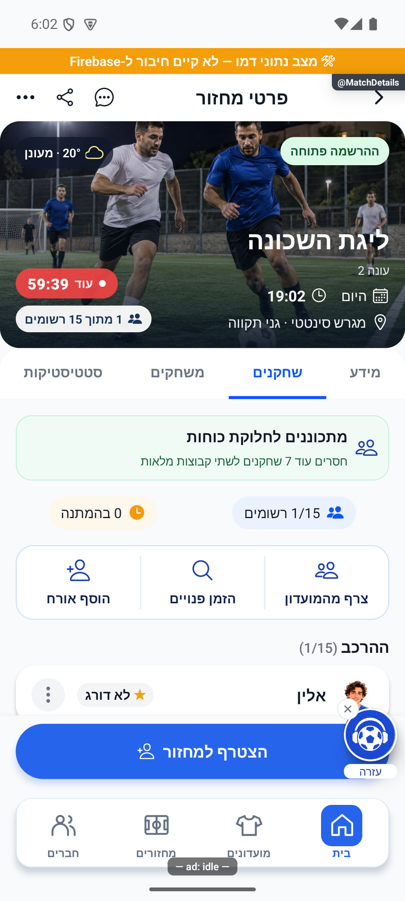
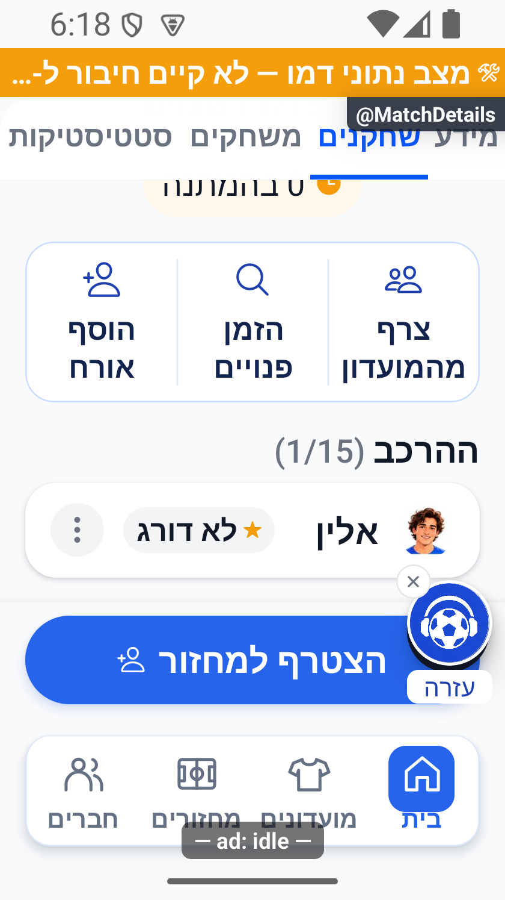
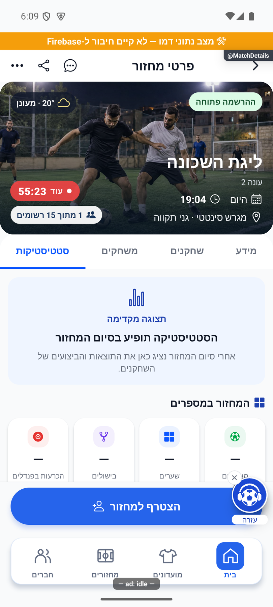
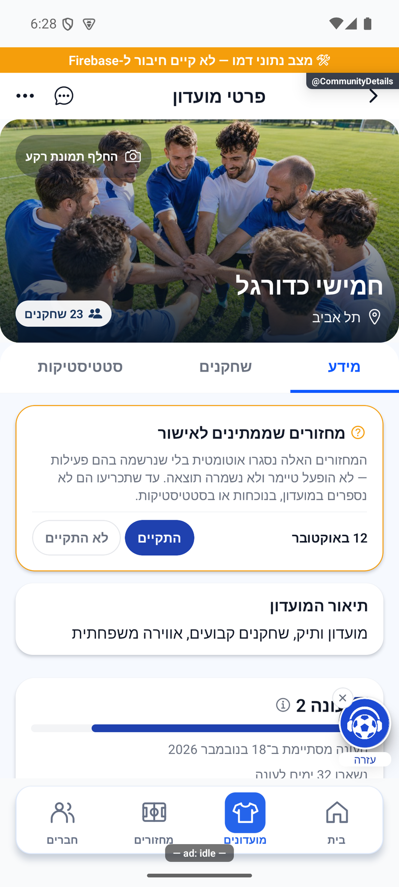
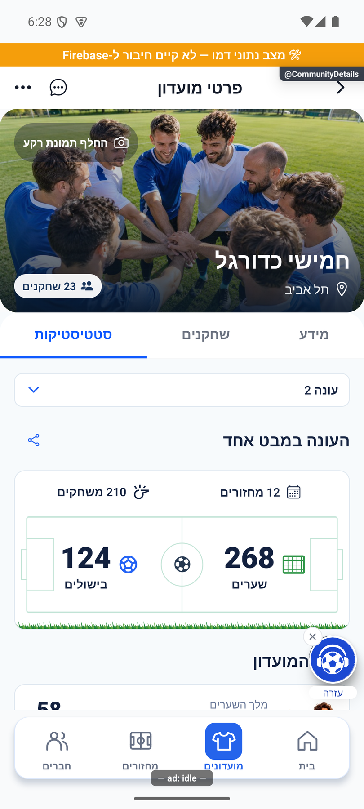
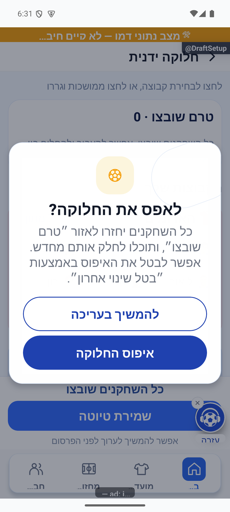
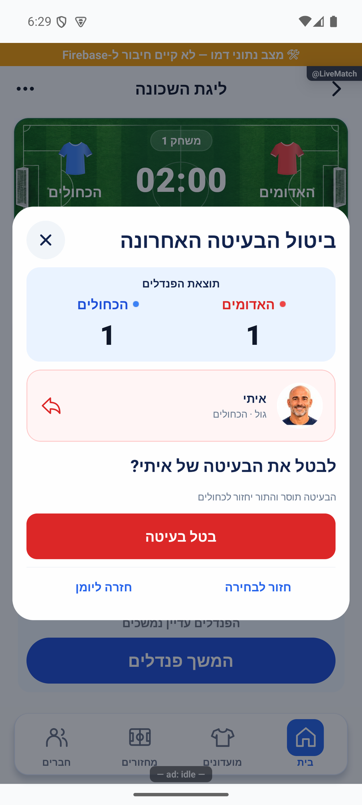
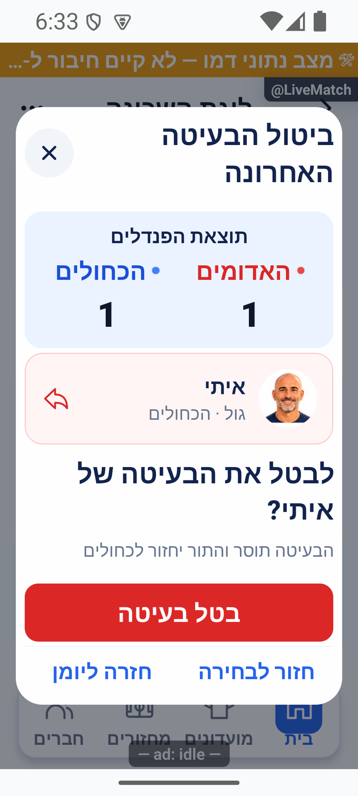

# שורת צירוף שחקנים וסבב פולס — 17.10.2026

העיצוב שאושר בסקיצה מומש בלקוח המקומי. לא נבנתה או הועלתה גרסת חנות במשימה זו; הגרסה הפנימית הקיימת היא 1.1.55/288. שתי פונקציות שרת נפרסו באישור מפורש ואומתו בנפרד. עוגן המקור `4a3cb346b1792b7e84cd71a8b9723bf6af88e500` עם שינויים מקומיים; אין קומיט או דחיפה.

## שחקנים וניווט

- שלוש פעולות בשורה אחת: צרף מהמועדון, הזמן פנויים והוסף אורח. הספירות כעת בתוויות קטנות והודעת החסר קומפקטית. הסגל אינו נדחק על ידי שלושה כפתורים חדשים.
- הפעולות המקבילות הוסרו מתפריט פרטי המחזור. ניהול הרשומים והממתינים נשאר בו.
- צירוף חברים: מנהל ומחזור לא סופי, עם שריון במצב scheduled. פנויים: מנהל ומצב open. אורח: אותו canAddGuest שהיה קודם. שחקן רגיל אינו מקבל פעולה ניהולית, וסרגל ריק אינו מוצג. כל זכאות נבדקת גם במסכים ובשירותים הקיימים.
- יעדי AddMembers ו־AvailablePlayers נפתחו בהדגמה משלוש הפעולות החדשות בלי לשלוח הוספה או הזמנה. ההרשאות והחישובים לא שונו.
- בדיקת הניווט חשפה שמסך MatchDetails שנשאר מותקן שומר initialTabApplied של מחזור קודם. כעת הבקשה קשורה למחזור וללשונית, ממתינה למסמך הנכון ואינה גוברת על בחירת המשתמש בעדכון רגיל. יעד סטטיסטיקה נעול מחזיר למידע.

## הפולס

בפתיחת הסבב נקראו 94 פריטים, ובקריאה המאוחרת נכללו כל 103 הפריטים הפתוחים שאינם רעיונות חונים: 62 דיווחים, 23 משימות ו־18 שגיאות. נוספו תשעה דיווחי משתמש וחמש חתימות שגיאה מאז סבב 1.1.55. כל תשעת הצילומים החדשים נפתחו ונבחנו לפני מיון; הצילומים ההיסטוריים וההערות מהסבבים הקודמים נשמרו. רעיונות חונים לא שונו.

| דיווח | ממצא ותיקון | גבול ההוכחה |
|---|---|---|
| EwiIkxMVCtnuODcNVHJh | שמירת הכרעת פנדלים נדחתה עם closedSeasonGame. המחזור חדש, status=open, לוח 1:1 וללא seasonId/startedAt. כעת יש חותמת עונה גם למסלול ללא שעון וגיבוי אטומי בזמן השמירה | מקור פעיל ושמירת אמת בבדיקות מבודדות אומתו; לא בוצעה שמירה יזומה בחשבון המדווח |
| QcXmhegrAw25eGNJrbWs | פעולת ההצטרפות המתינה לקריאות עוקבות ואז לאישור התור. קריאת המחזור ובדיקת ההתנגשות רצות במקביל כשהשעה ידועה; שינוי שעה גורר בדיקה חוזרת. מוצג מלל שמירה בזמן ההמתנה | הבדיקות מוכיחות חפיפה, שמירת הגנות ואישור אמיתי; לא נמדד זמן חדש במכשיר המדווח |
| t88Diy5hSI8MYi3cCJT4 | תצוגת הסטטיסטיקה המקדימה הוחזרה: מבנה המדדים ואזור המצטיינים, עם מקפים והסבר עד לסיום המחזור | צילום דמו ובדיקות פתוח/פעיל; אין מספרי דוגמה, אפסים או זוכים מומצאים |
| f422df754d1fdf6420e7a8285a9f243c / 47bc873eff908871f7a6e576b21db031 | דחיות חוזרות של אותו מחזור של מחזור ללא שיוך. הדיווח כבר נרשם אוטומטית לפני שנפתחה תלונת המשתמש | הלוגים הקיימים נשמרו; נוספה גם מדידה לכל כשל setup/בעיטה עם שלב ומזהה, ומסר עברי מפורט לשגיאת עונה |

אירוע game_joined נשלח קודם אחרי כתיבת בקשה, לפני תשובת ההקצאה. הוא נשלח עכשיו אחרי האישור עם bucket, requestMs ו־totalMs; game_join_requested מסמן את רגע כתיבת הבקשה בנפרד. אין מכאן טענה שהתקבלו אירועים חדשים בשרת המדידה אחרי התקנת הלקוח החדש.

## תיקון השרת

`liveSeasonStamp` משתמש ב־playEvidence המשותף וב־createTime של Firestore, שאינו זמן הטלפון. חותמת חדשה מותרת רק למסמך שנוצר בתקופה הפעילה, במצב לא סופי, ללא חותמת וללא operation/pendingClose. מצב עונות כבוי נבדק מול disabledAt ונשמר תחת off_count_disabledAt. חותמת קיימת, מחזור היסטורי, חסר זמן שרת או מצב סופי אינם מפורשים מחדש כעונה נוכחית. כללי seasonOfEvening והנעילה ההיסטורית נשמרו.

החותמת נשמרת באותה כתיבה מותנית של ניקוי הלוח והסמן; היסטוריית המשחק, מוני השחקנים והסמן החסין לכפילות נשארים באותה חבילה אטומית. מסמך המועדון נבדק תחת אותו תנאי גרסה. מחזור ללא שעון אינו דורש הפעלת שעון מדומה או מחיקת בעיטות.

נפרסו באישור רק onGameRosterChanged ו־commitRoundStats. מועדי העדכון הפעיל הם `2026-10-17T18:10:26.914478644Z` ו־`2026-10-17T18:10:41.049369526Z`. 135 קובצי מקור, הידור ותבניות הושוו לכל ארכיון פעיל; 96 פונקציות אחרות נשארו עם אותן חותמות. אין שינוי כללי הרשאות, הסבה או כתיבת תיקון ידנית בייצור. קבלת התאוששות של המחזור המדווח תידרש מניסיון חוזר אמיתי של המשתמש; הוכחת הקריאה בלבד מצביעה על שיוך נכון ל־s3.

## בדיקות וצילומים

380 חבילות / 4,529 בדיקות יישום עברו מול המקור הסופי; בדיקת טיפוסים נקייה. בניית השרת ובדיקת הטיפוסים שלו עברו. התווספו בדיקות חותמת לפי זמן שרת ותקופה, חסימת היסטוריה, שמירה אטומית וניסיון חוזר של ה־callable המלא, פעולות סרגל לפי זכאות, ניווט חוזר בין מחזורים, תצוגה מקדימה וחפיפת קריאות עם שינוי שעה. לא נדרשה עריכת כללים או ריצת כללים חדשה.

בדיקות המקור שמחלצות callbacks קיבלו את התלות החדשה במצב הודעת שגיאה ובחותמת, בלי לשנות את ההיגיון הנבדק. שתי הרצות ביניים נכשלו עקב תלויות חסרות במארחי הבדיקות; ההרצה הסופית עברה במלואה. יומן הבדיקה ההיסטורי verify-fixed.cjs עודכן כמריץ שחזור בלבד, לא כממצא היסטורי חדש.

צילומי אנדרואיד בהדגמה: רוחב 411 וגופן רגיל; רוחב 320 וגופן 140% עם גלילה לשורת הפעולות ולסגל. כל שלוש הפעולות נשארות באותה שורה, והמלל גדל לשתי שורות בלי חיתוך. בתפריט נצפתה הסרת שתי האפשרויות. יעדי הצירוף והפנויים נפתחו בלי שליחה. תצוגת הסטטיסטיקה המקדימה נצפתה עם מקפים. אין אימות אייפון, מסירת הזמנות לייצור או מדידת זמן הרשמה חדש במכשיר המדווח.

## השלמת הדיווחים המאוחרים

- UOYvfF2GpQhci54HmBDu: רקע כפתור החלפת תמונה הוקל מאלפא 0.78 ל־0.38; טקסט לבן ושטח המגע נשמרו.
- y1vHbiNtVF679Di4sA0y: השיתוף הועבר לצד כותרת המבט הכללי; שורת הבורר לא תופסת מקום כשהיא חסרת תוכן. השיתוף משתמש באותו היקף ונתונים.
- 28M5Sx2EhCC1YlZ8rGMg: אישור איפוס חלוקה משתמש בחלונית הכדורגל הקיימת ובכפתורים מלאים. לא אושר איפוס בבדיקה.
- dr5tuDnDLtdEs5ZvIUWX: תוצאת הפנדלים בחלונית הביטול מציגה כותרת ממורכזת ושתי קבוצות שוות; אישור הביטול נשאר זמין מחוץ לגלילה. לא בוטלה בעיטה בבדיקה.
- ux9SR79TvzK5G3Qwukyp ו־YmWXuYvxP5nonO2C8Wpe, ושגיאות 5c7ae7292d4ed4cc0eb0007e3186814d / 7c416e91da96c39fc86cc630834c433b: אותו סירוב עונה שתוקן בשרת. ההודעות בסיום הרגיל ובהכרעת התיקו ממופות כעת לעברית במקום להציג את closedSeasonGame הגולמי. אין ניסיון שמירה יזום בייצור.
- e33f74f42af2eede1e5cc0a66fc24583: זו הגנת שינוי פנדלים במעבר להכרעה אחרת. המסלול נבדק בקוד; קריאת ההמשך אחרי clearShootout דורשת כעת מקור שרת כדי שלא לקבל סדרה ישנה מהמטמון. ההגנה עדיין מסרבת לסדרה שהתחילה מחדש. לא הוכח שזה מקור השגיאה היחיד במכשיר המדווח.

נוספו בדיקות להודעות שגיאה ושמירת ההגנות במעבר להכרעה אחרת. הצילומים הבאים הם רכיבים אמיתיים בדמו; החלוניות נפתחו דרך callbacks מרונדרים, ללא איפוס, ביטול בעיטה או שיתוף חיצוני. אין בכך הוכחת מגע במכשיר המדווח.

## פריטים שנשארים פתוחים

שגיאת INIT_ERROR של רכיב ההתראות חזרה עם Date.getTime על תאריך ריק באתחול. נבדק ארכיון המקור של החבילה שבאמת נבנית; טרם הוכח תיקון ספק או רישום ופוש פיזי חדשים. לא נמחקו סשנים כדי להסתיר את התקלה. גם תקלות מגע במכשיר המדווח וכניסת אפל עדיין דורשות אימות מתאים. חיפוש הכתובת רשם 403 נוסף מספק המיפוי; מסלול הגיבוי כבר קיים ונבדק, אך אין הבטחה שהספק הראשי תוקן או שחיפוש הכתובת המדויקת הצליח במכשיר המדווח. פריטים אלה אינם מסומנים כסגורים בעקבות תיקונים אחרים.

החלטות אפיון שנותרו: עדיפות הרשמה לקבועים, פנדל במהלך משחק רגיל, התראות זמן והארכה, חשיפה ברירת מחדל של מועדון, הרחבת שולחים בשם האפליקציה, מדדי חילופים, יעד חדש למסלול הכניסה/דירוגי המנהל/אמצע מסך המחזורים, יצירת מחזורים לפי זמינות וטיפול במשתמשים לא פעילים. תקנון, פרטיות ושיווק דורשים החלטת בעלים. חלונית עדכון הגרסה כבר מומשה בסבב הקודם ואינה עוד החלטת אפיון פתוחה.

לא נסגר סטטוס המקור של דיווח בפולס במקום אישור הבעלים. הערות, צילומים והיסטוריה נשמרים במסירה. תיקוני הלקוח ממתינים לגרסה הבאה; פריסת השרת היא הפעולה החיה היחידה שאושרה בסבב הזה.

קבלות ולוגים: artifacts/roster-actions-pulse-2026-10-17 — inventory-final.json, timerless-season-proof.json, server-source.json, onGameRosterChanged-deployment.json, commitRoundStats-deployment.json, all-tests-late.log, types-late.log, server-build.log, journal-receipt.json ו־pulse-handover-receipt.json.

## סגירת הפריטים שתוקנו לפי הוראת הבעלים — 17.10.2026

בהמשך ניתנה הוראה מפורשת לסגור משימות, באגים, דיווחים ושגיאות שתוקנו. בסקירת הסגירה נמצאו 104 פריטים פתוחים שאינם רעיונות חונים, לרבות משימת התראה חדשה שטרם טופלה. נסגרו בפועל ואומתו 72 פריטים: 56 דיווחים ו־5 משימות בסטטוס done, ו־11 שגיאות בסטטוס resolved. ההערות וצילומי ההוכחה נשמרו; נוספה הערת סגירה שמבחינה בין השלמת הקוד לבין הפצה או בדיקת מכשיר בפועל. הסגירה לא בונה או מפיצה גרסה.

לא הסתפקנו אוטומטית בסימון claudeStatus: נשארו פתוחים גם פריטים שסומנו בעבר done אבל הממצא אינו מוכיח פתרון מלא — שגיאת ספק המיפוי, מסלול הכרעת פנדלים שמצריך אימות נוסף, ושיפור תור ההצטרפות שעדיין תלוי בפריסה נפרדת. לעומתם נסגרו גם משימות שסווגו בעבר לאפיון אך כבר מומשו: חלונית העדכון ועיצוב הלייב ובחירת הקבוצות. תיקוני כפילות ההתראות ובקשת דירוג החנות נסגרו על סמך בדיקותיהם המתועדות.

נותרו 32 פריטים פתוחים: 6 דיווחים, 19 משימות ו־7 שגיאות. הם כוללים תקלות שטרם נפתרו, אימותים חסרים והחלטות אפיון. 15 הרעיונות החונים לא שונו. קבלת הסגירה: artifacts/roster-actions-pulse-2026-10-17/closure-receipt.json; תוכנית הפריטים והמצב הקודם נשמרו באותה תיקייה. כל הכתיבות הותנו בגרסת המסמך הקיימת, ובשגיאות נבדק שלא נוסף מופע מאז הקריאה.
