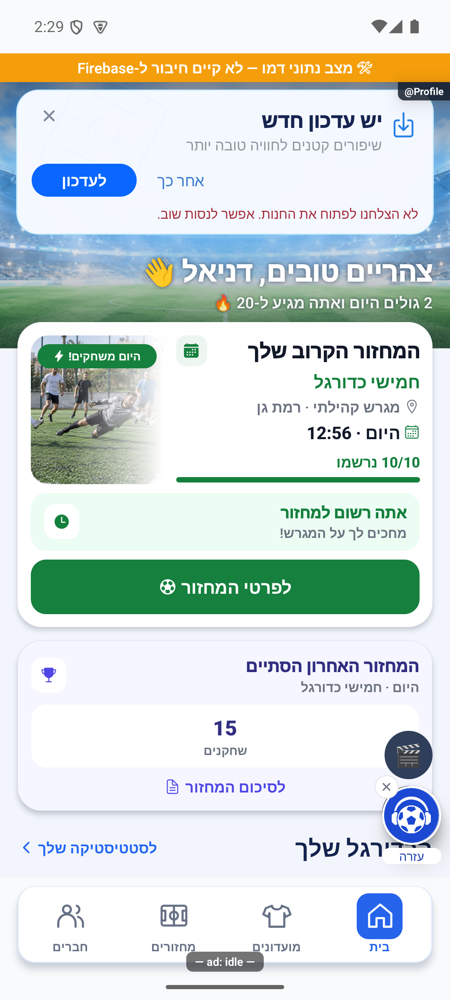

# חלונית עדכון בחלק העליון של הבית — 17.10.2026

לפי תמונת הבעלים, ההצעה לעדכון עברה מחלון מרכזי חוסם לכרטיס בהיר בכותרת הבית: אייקון הורדה מימין, ״יש עדכון חדש״, ״שיפורים קטנים לחוויה טובה יותר״, איור מגרש חלש משמאל, ״לעדכון״ ו״אחר כך״ משמאל ופעולת סגירה בפינה. צילום הבקשה: `1000225136.jpg`. כותרת התפריט/אווטאר/פעמון חוזרת עם הסגירה; יתר נתוני הבית אינם משתנים.

## מתי מוצגת

- באנדרואיד, הגשר `TeamderStoreUpdate` קורא `AppUpdateManager.appUpdateInfo` ומציע עדכון רק כאשר גוגל מדווחת `UPDATE_AVAILABLE` ו־`availableVersionCode` גדול ממספר הבנייה המותקן. גרסה פנימית של משתמש אחר או מספר שרת עתידי אינם מספיקים. גם שם גרסה זהה עם מספר בנייה חדש מזוהה.
- באייפון, קריאת Apple Lookup מזהה מספר יישום וחבילה מדויקים ומשווה מספר גרסה שפורסם למספר המותקן, לפי מקטעים מספריים. המדינה היא מדינת ההגדרות המקומיות, עם ישראל כברירת מחדל. זו אינה קריאה של מדינת חשבון החנות: חשבון שמדינתו שונה מהגדרות המכשיר הוא מגבלת אימות ידועה. גרסאות TestFlight אינן נלקחות מהקטלוג הציבורי.
- הבדיקה רצה לאחר מסך הפתיחה ובחזרה לקדמה; בדיקות מקבילות חולקות בקשה. בדיקת חנות מוגבלת לשמונה שניות; מדיניות השרת לשלוש שניות נוספות. חוסר רשת, בעלות גוגל חסרה או גשר חסר אינם חוסמים שימוש ואינם מוכיחים שהגרסה עדכנית.
- `latestVersion` המרוחק אינו מפעיל עוד הצעה בעצמו. `minimumSupportedVersion` שומר את מדיניות החובה הקיימת רק אחרי שנמצא עדכון בחנות. באייפון מינימום שטרם פורסם אינו הופך את ההצעה לחובה. באנדרואיד השוואת מדיניות המינימום היא לפי שם הגרסה המותקן; גוגל מחזירה מספר בנייה של היעד ולא את שמו.
- ״אחר כך״ וסגירה מסתירים ל־24 שעות את אותו יעד, גם לאחר פתיחה מחדש; יעד חדש יכול להופיע מיד. עדכון חובה אינו ניתן לדחייה וממשיך להשתמש בחלון החוסם. זו החלטת המימוש שניתנה לבחירת הסוכן בבקשת הבעלים, ומחליפה את פריט האפיון הפתוח לגבי דחייה.
- ההצעה הרגילה מופיעה רק בבית ואינה חוסמת תמיכה, קמפיינים, הישגים או הודעת ״מה חדש״. מצב חובה ממשיך לחסום שערים מתחרים.

## מדידה וגבולות הייחוס

| אירוע | משמעות |
|---|---|
| `update_prompt_shown` | הכרטיס הורכב בבית ממוקד, פעם ליעד באותה הרכבה; זו אינה מדידת פיקסלים בחלון הגלילה |
| `update_prompt_tapped` | לחיצה שהתקבלה בכפתור; כוללת `attempt_id`, `actor_id`, מקור, גרסת מוצא ובנייה ויעד |
| `update_store_opened` | מערכת ההפעלה אישרה פתיחת קישור החנות; אינו מוכיח התקנה |
| `update_store_open_failed` | גם פתיחת הקישור נכשלת; מופיע חיווי שאפשר לנסות שוב |
| `update_prompt_dismissed` | דחיית ההצעה הרגילה |
| `update_prompt_completed` | בהפעלה הבאה נצפה באותו חשבון בינארי חדש שעומד ביעד, בתוך 14 יום מפתיחת החנות |

האירועים נשלחים דרך `analyticsService.logEvent` לערוצי המדידה הקיימים. אין אוסף מסד או הרשאה חדשים. מקור הכרטיס הוא `home_banner`; מקור חלון חובה הוא `force_modal`, כך שאפשר לסנן את המשפך לחלונית הקטנה בלבד. משתמש מחובר מצורף באמצעות מזהה חשבון ללא שם, דואר או טלפון. משתמש לא מחובר מזוהה ברמת התקנת כלי המדידה.

`storeUpdateAttribution:v1` שומר לפני פתיחת החנות קבלה מקומית עם מזהה ניסיון, חשבון, זמן ויעד; `opened=true` נכתב רק אחרי פתיחה מוצלחת. לחיצה חוזרת מוצלחת מחליפה את הקבלה ומייחסת את ההתקנה ללחיצה האחרונה. כשל פתיחה משחזר קבלה קודמת. שתי לחיצות מקבילות אינן פותחות שתי חנויות. קבלה מסומנת `reported` לפני שיגור השלמה, כדי ששתי הרכבות או כשל במחיקה לא יספרו פעמיים. כשל אחסון אינו מונע פתיחת חנות.

באנדרואיד נדרש `installedBuild > fromBuild` וגם `installedBuild >= targetBuild`. באייפון נדרש `installedVersion > fromVersion` וגם `installedVersion >= targetVersion`. חזרה מהחנות באותו בינארי, החלפת חשבון, יעד שטרם הושג וקבלה שפג תוקפה אינם השלמה. התקנה חדשה בלי קבלה אינה משויכת לכרטיס.

אפשר לחשב שיעור השלמה לפי מספר מזהי ניסיון ייחודיים שהושלמו חלקי מספר מזהי לחיצה ייחודיים באותו חלון זמן ובמקור `home_banner`; לספירת אנשים משתמשים במזהי חשבון ייחודיים. יש להמתין לחלון הייחוס, ולהבחין בין אנשים, לחיצות וחשיפות.

אין מהחנות החיצונית אישור הקושר באופן בלעדי הורדה לכפתור: זהו ייחוס של בינארי חדש שנצפה אחרי פתיחת החנות. עדכון אוטומטי באותו חלון יכול להיכלל. ללא פתיחת האפליקציה החדשה אין אישור השלמה; הסרה, מעבר מכשיר, כשל כתיבת קבלה, סגירת התהליך לפני סימון פתיחה או כשל שיגור מדידה עלולים לגרום לחסר. המנגנון אינו מבטיח מסירה בדיוק פעם אחת לשרת.

## אימות

- בדיקות `storeUpdateAvailability`, `storeUpdateAttribution`, `storeUpdateSnooze`, `storeUpdatePlugin`: זמינות ומספרי בנייה, זהות אפל, גרסאות ישנות/שוות/פגומות, מינימום, בקשות מקבילות, גיבוי קישורים, אחסון, זהות חשבון, דילוג גרסאות, תפוגה ומניעת ספירה כפולה; רישום תוסף ההכנה אידמפוטנטי וכשל גלוי כשמשתנה תבנית המקור.
- `npx tsc --noEmit` נקי; כל 375 חבילות הבדיקה ו־4,480 בדיקות היישום עברו. הפלטים בתיקיית `artifacts/update-banner-2026-10-17`. לא שונו כללים ואין צורך בהרצת הרשאות נוספת בגלל שינוי זה.
- `:app:compileDebugKotlin` עבר מול תלות Play `2.1.0`. הוכנו רק קובצי Android הנוצרים מהתוסף; אין יצירת APK/AAB, התקנה או העלאה.
- הרינדור, הכיווניות, כשל פתיחת חנות ודחייה נבדקו באמולטור דמו. רוחב רגיל 411.43 נקודות וגופן 1.0; קטן 320 וגופן 1.4, ללא חיתוך של מלל החלונית או כפתוריה. טקסט ההסבר נשבר לשתי שורות במסך הקטן.
- מצב הזכאות הוזרק לחנות המצב בדמו; כשל פתיחת החנות הוזרק במתאם. אין כאן הוכחת זמינות עדכון חי לחשבון חנות או מסירת אירוע מיישום חנות. הגשר החדש חייב להיכלל בבנייה הבאה; לא ניתן להוסיפו באמצעות רענון JavaScript ליישום ישן. אייפון ומכשיר פיזי לא הורצו.

מקורות רשמיים שנבדקו: [זמינות עדכון בגוגל](https://developer.android.com/guide/playcore/in-app-updates/kotlin-java), [Apple Lookup](https://developer.apple.com/library/archive/documentation/AudioVideo/Conceptual/iTuneSearchAPI/LookupExamples.html). אין שינוי כללי מסד, הגדרות חנות, פריסה, גרסת האפליקציה או נתוני ייצור.

הרשומה ביומן ההפצה והצילום `releaseShots/update-banner-home-20261017-01` נקראו חזרה ואומתו. נתוני כל 16 מחזורי הדמו, ההיסטוריות והשחקנים נשמרו, שני מפתחות האחסון הזמניים שוחזרו, והמסך והגופן חזרו ל־411.43×914.29 נקודות וגופן 1.0. קבלות האימות בתיקיית הראיות.

## הפצה פנימית מאוחרת יותר באותו יום

לאחר השלמת המשימה המתועדת כאן, בקשת ההפצה הבאה בוצעה: `1.1.53 / 286` זמינה במסלול הפנימי באנדרואיד, ו־`ensurePersonalGroup` נפרסה בנפרד באותה משימת הפצה. [ראיות, בדיקות והגבולות שנותרו](2026-10-17-internal-1.1.53.md). אין בכך שינוי למגבלות האימות בזמן הסקירה המקורית.
