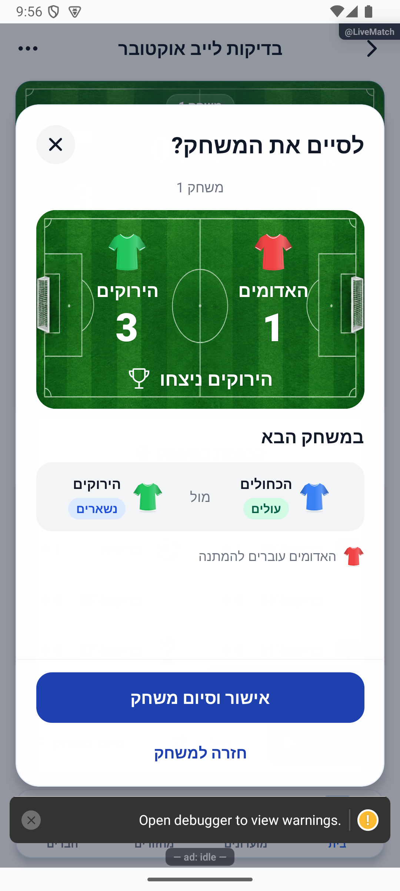
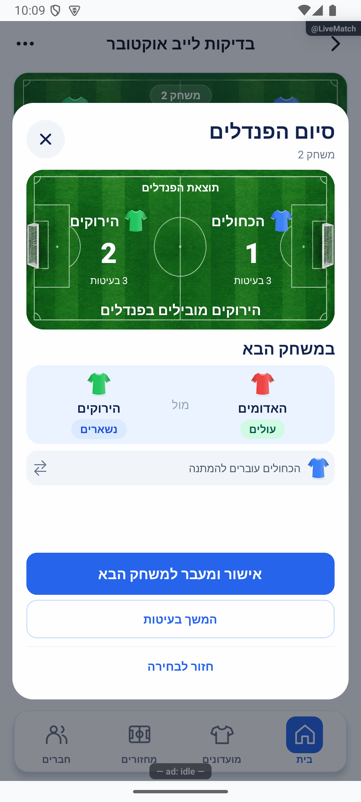
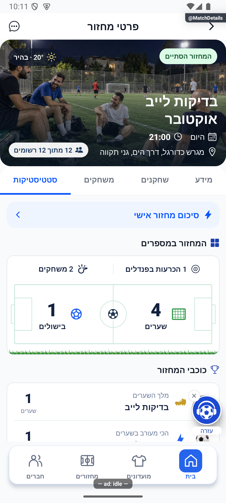
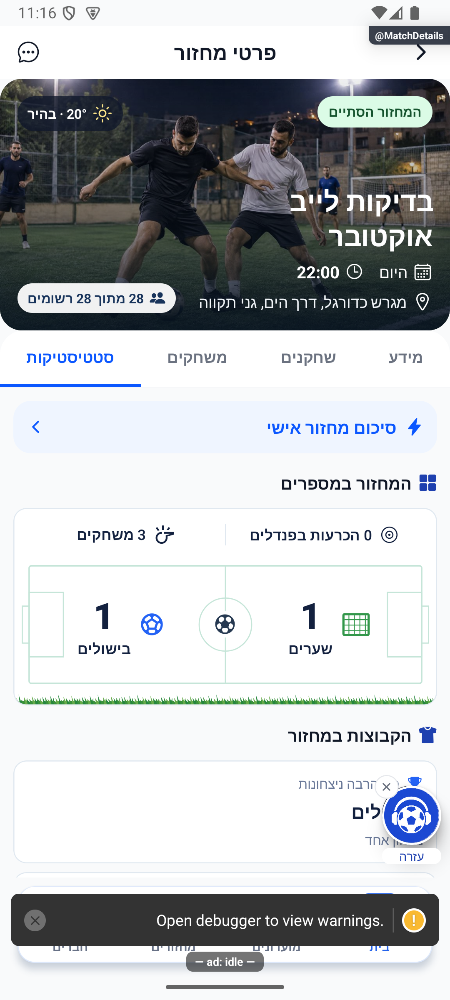
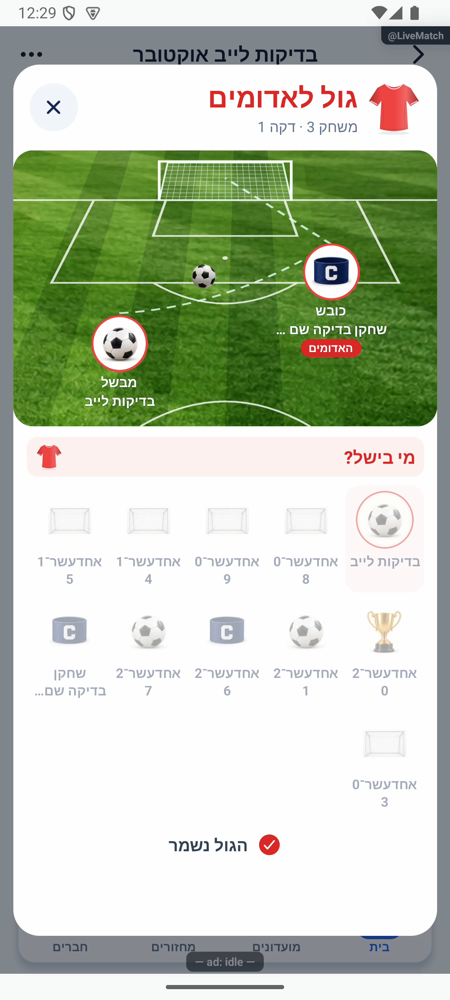
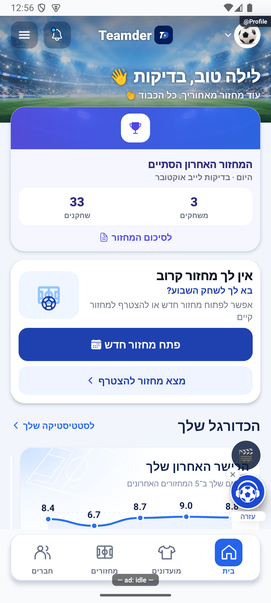

# ביקורת מקצה לקצה לקראת ייצור — 18.10.2026

עדכון מאוחר באותו יום: [השלמת חסמי המוכנות](2026-10-18-production-blockers.md) מחליפה את מצב הסיכונים של שתי כתיבות הפנדלים ושל ניסיון יצירה שאבד, ומוסיפה תיקון לרכיב ההתראות המקורי. ספירות הבדיקות והפריסה שלהלן מתארות את סוף סבב הביקורת הראשון; אין לערבב אותן עם סבב ההשלמה. מגבלת בדיקת שימור הבסיס החדש והצורך בבינארי פנימי נשארו.

דוח ביקורת עם ראיות קוד, מכשיר ונתוני ייצור נפרדות. אין כאן אישור להפצת יישום. שלושת מחזורי הבדיקה המאושרים הסתיימו; כשלים שנמצאו בדרך נשמרו לצד התיקון והבדיקה החוזרת. מגבלות שלא אומתו מפורטות בסוף.

המצב בסיום ההיקף המאושר: 409 חבילות ו־4,853 בדיקות יישום עברו, הטיפוסים נקיים ו־350 בדיקות כללים עברו. שלושת מחזורי הבדיקה נחתמו, עם 201/269/442 אימותי נתונים סופיים. נרשמו 32 תיקונים, ונפרסו שתי פונקציות שרת. בדיקה חדשה בייצור לשימור בסיס קיים במעבר משחק עדיין אינה מוכחת; אין ליצור מחזור רביעי בלי אישור. [מגבלות והחלטות](#מוכנות-והחלטות-שנותרו).

## היקף והעלאה ראשונית למאגר

באישור הבעלים הועלו תחילה כל השינויים הקיימים בענף `codex/internal-1.1.37`, בהתחייבות `92cfd73d2d9f3a8e281cdb561f12df8f518d8f30`: 1,244 קבצים, 137,954 שורות שנוספו ו־6,743 שנגרעו. תיקיות תוצרים מקומיים `tmp/out/output` וקובצי נעילה הוחרגו ונשמרו במחשב. לאחר מכן נערכה הביקורת והוכנו התיקונים החדשים המתוארים כאן. לא נבנה יישום ולא הועלה מסלול חנות.

העבודה חולקה לחמישה סוכנים בסך הכול, בגלים: מוביל, הזנת גול ופנדלים, לוגיקה ונתונים, בדיקות וכניסה, וחלוקת כוחות. הבעלות על הקבצים חולקה; כתיבות הייצור והפריסה נשארו אצל המוביל. דוחות המקור ב־`artifacts/final-deep-audit-2026-10-17/`.

## תיקונים

- פעולות עזיבה, החזרה ופרישת קבוצה ריקה נבנות במסמך העדכני בתוך עסקה. ניסיון חוזר אינו משנה סגל פעמיים; מחזור סגור נדחה. בהחזרה קבועה גם ממלא אורח חוזר לקבוצתו.
- חלוקה מחדש משתמשת בסגל הזמין, שומרת מי שהלך הביתה ואינה מחזירה אותו אוטומטית. שינוי סגל בזמן עריכה מחייב רענון. הסרת אורח מנקה את צוותי העבודה וההלוואות באותה שמירה, ללא מחיקת תרומות היסטוריות.
- טריגר סגל מזהה גם הסרת אורח בלקוח ישן והחלפת אורח באותה תפוסה. אירוע הסרה ישן אינו מנקה שחקן שכבר חזר לפני העסקה.
- החלטת סיום משחק נקשרת למשחק, הרכב, אירועים ותוצאה. סגל או תוצאה שהשתנו פוסלים הכרעה ישנה; תזוזת שעון בלבד אינה פוסלת. חתימת הרכב נוספת נבדקת בשרת עם תאימות לקריאות הישנות.
- בקריאה מיידית שמציגה עדיין סדרת פנדלים שנמחקה ואושרה, מתבצעת המתנה תחומה לתמונה מאושרת ללא הסדרה. באותו אופן מגושרת קבלת תוצאה שאושרה אך טרם הופיעה בקריאה. שתי ההמתנות מוגבלות ללוח המקור המדויק; שינוי הרכב, שער, משחק, מצב סופי או קבלה אחרת ממשיך להידחות. אין כתיבה חוזרת בזמן ההמתנה.
- שמירת משחק מאומת אינה חותכת בשקט שערים, היסטוריה או משתתפים. חריגה ממגבלת הכתיבות נדחית לפני שינוי חלקי; משחק שכבר נזקף ניתן לניסיון חוזר, ומשחק חדש במחזור סגור נדחה.
- בחירת גול/פנדל מגיבה לשינוי סמכותי בסגל ובתור הבועט. כשל סגל ודאי מאפשר לבחור מחדש; כשל תקשורת שומר את מזהה האירוע ואת הבחירות כדי למנוע כפילות. ביטול בעיטה לאחר אובדן תשובה אינו מבטל בעיטה נוספת.
- כשל קריאת סטטיסטיקה אינו מוחלף באפס או ברשימה ריקה. מוני מועדון משמרים תשובה קודמת ברענון כושל, מציגים מקף ללא תשובה ומאפשרים ניסיון חוזר.
- חידוש פעולה לאחר התחברות נקשר לטיוטה, לזהות ולהרשאה העדכניות. תגובות ישנות אינן צורכות פעולה חדשה; התחברות לפרופיל חסר משלימה אותו לפני חידוש. שמירת פרופיל מגינה מול החלפת חשבון, לחיצה כפולה והעלאה מאוחרת; תמונה קיימת אינה נמחקת לפני הצלחת שמירה. הוצגו הודעות הכשל המדויקות.
- שרת הפיתוח אינו עוקב אחר תיקיות תוצרים זמניים גדולות. זהו תיקון כלי עבודה בלבד.

## בדיקות קוד

| בדיקה | תוצאה | מקור |
|---|---|---|
| כל בדיקות היישום לאחר תיקון מנויי ההתחברות | 409 חבילות, 4,853 בדיקות עברו, אפס כשלים | [ההרצה המלאה](evidence/2026-10-18-preproduction/tests/jest-final-auth-lifecycle.log) |
| טיפוסי היישום לאחר תיקון מנויי ההתחברות | עבר, קוד יציאה0 | [הקבלה](evidence/2026-10-18-preproduction/tests/verification.json) |
| בניית פונקציות | עבר | [ההרצה](evidence/2026-10-18-preproduction/tests/functions-last.log) וגם קדם הפריסה |
| כללי המסד המלאים בסדרה | 350 עברו, אפס נכשלו | [ההרצה הסדרתית](evidence/2026-10-18-preproduction/tests/rules-last.log) |
| אימות היסטורי אחרי התאמת התלויות | 15 עברו | [התוצאות](evidence/2026-10-18-preproduction/tests/historical-guard-final.json) |

מתאמי בדיקה ישנים עודכנו לגבולות גוף הפונקציה ולתלויות החדשות. הציפיות העסקיות נשמרו. שגיאות הרשאה בתוך לוג בדיקות הכללים הן בדיקות דחייה צפויות; סיכום ההרצה הוא 350 שעברו.

הבדיקה המקומית `release-preflight` אישרה את נוכחות קובצי התצורה וחשבון ההפצה של אנדרואיד, אך אינה מאמתת חתימה, זכאות או חנות. מסלול אפל במחשב זה חסר `credentials.json` וקובץ מפתח לפי הנתיב שהוגדר במחשב המקורי; אין מכך קביעה שהמסלול במחשב אפל אחר אינו תקין. [פלט הבדיקה המקומית](evidence/2026-10-18-preproduction/release-local-preflight.json). בזמן הפריסה נרשמה אזהרת הכלי על סיום התמיכה הקרב בסביבת Node20; זהו ממצא מפלט הפריסה ולא שדרוג שרת שבוצע במשימה.

## פריסה ובדיקות ייצור

באישור מפורש נוצר המחזור הראשון דרך הממשק, בחשבון ובמועדון הבדיקות הקיימים. הבעלים אישר שלושה חדשים בלבד. לא נוצרו חשבון או מועדון נוספים. תמונת בסיס נלקחה לפני כל יצירה; שלושת מחזורי העבר מוגנים בהשוואת טביעות. כל אורח חדש נוצר בממשק ומזההו נשמר מתשובת המוצר והמסד, ללא הקלדת מזהה לכתיבה.

נפרסו רק `commitRoundStats` ו־`onGameRosterChanged`; שתיהן פעילות, ועדכון המקור שלהן אומת מול 134 קבצים ללא חוסר או הבדל. ארכיון כל אחת נושא SHA256 `5a9828b6ad1f46e5a37db3a275db7ca07da03ff3652765488144595184fee988`. ראיה: `server-deploy-verification.json`. כללי המסד, הסבות וחנויות לא שונו.

במחזור ארבעה מול ארבעה נוצרו 11 אורחים ונרשם חשבון הבדיקה, עם שלוש קבוצות. נבחרה חלוקה אוטומטית; נצפתה אזהרה מדויקת שהלא מדורגים שובצו לפי ממוצע. נבחרו האדומים והירוקים. בלי הפעלת שעון נשמרו ארבעה אירועים: הירוקים עם כובש חשבון הבדיקה ובישול אורח05; האדומים עם אורח08 ללא בישול; שער לא מזוהה לירוקים; ושער עצמי של אורח04 מהאדומים לירוקים. התוצאה 1:3. השער הלא מזוהה בוטל דרך היומן ואושר, התוצאה ירדה ל־1:2, ואז נוסף מחדש והחזיר ל־1:3. סיום המשחק נזקף להיסטוריה אחת ולשמונה שורות סטטיסטיקה; המשחק הבא נפתח עם הכחולים והירוקים ב־0:0. כל 24 הטביעות של מחזורי העבר נשארו ללא שינוי.

במשחק השני הופעל, הושהה והומשך השעון. התרחיש חשף הבדל יחיד בין חתימת ההכרעה למסמך הסמכותי: `status=open` במסך מול `active` בשרת. `subscribeLiveGame` העביר עד כה רק את חלקי הלייב ולכן פרטי המחזור והאורחים יכלו להישאר ישנים. הזרמת המסמך המומר המלא באותו מנוי מעדכנת כעת גם את `game`; נרמול open/active מאפשר תחילת שעון בלי לפסול את לוח המשחק, אך מצבי סיום וביטול עדיין פוסלים. 44 בדיקות ממוקדות עברו. ראיות השחזור: `decision-debug.json` ו־`activation-regressions.log`. בדיקת המכשיר החוזרת פתחה את הכרעת התיקו, השלימה שש בעיטות ואת אישור הסיום, והמחזור נחתם בהצלחה. השלמת שני הגדלים הנוספים מתועדת בהמשך.

## גבולות והחלטות בסוף הביקורת

- קריאות קוד ובדיקות מבודדות אינן הוכחה להפעלת טריגר בענן או לרינדור מקורי. כל ראיה מסווגת בנפרד.
- אורחים נשמרים בהיסטוריית הפנדלים, אך מדיניות המונים האישיים של בעיטות ושוערות לאורחים נשארה כפי שהייתה. השתתפות נשענת על הרכב הסיום ועל תרומה לאירוע, ללא יומן דקות; אלה החלטות מדיניות פתוחות ולא חישוב חדש שהוחל.
- מחיקת סדרת פנדלים ואישור הכרעה חלופית הם שתי פעולות. כשל ביניהן אינו משחזר אוטומטית את הסדרה. נדרשת החלטה אם להרחיב לחוזה שרת אטומי.
- יצירת מועדון/מחזור לאחר תשובת שרת שאבדה אינה משתמשת במפתח קבוע לכל ניסיון שנשמר לאורך חידוש. המנעולים הקיימים מגינים מלחיצות חופפות, אך אינם הוכחת יצירה אחת לאחר ניתוק.
- אייפון, ספקי גוגל ואפל, התקנה מהחנות ומנהל שני במכשיר נוסף לא נבדקו בסבב זה. כניסה חוזרת בדואר לחשבון הקיים נבדקה בהמשך.

## ראיות מתמשכות ואימות ארבעה מול ארבעה

המקורות התמציתיים נשמרים גם במאגר, ב־[תיקיית הראיות](evidence/2026-10-18-preproduction/identities.json), בנפרד מתיקיות העבודה המקומיות. דוח אימות ארבעה מול ארבעה סופי קפוא כולל 201 אימותים שעברו ללא כשל: [הדוח](evidence/2026-10-18-preproduction/audit-four-final-data.md), [הנתונים](evidence/2026-10-18-preproduction/audit-four-final-data.json), [חותמות](evidence/2026-10-18-preproduction/audit-four-final-hashes.json). מקורות הגדלים הנוספים נרשמו בהמשך; אין להשתמש בקבלת הזהויות כהיתר למשימת ייצור עתידית.

הסיכום החתום כולו תואם לשתי ליבות החישוב, לרבות בסיס התיקון. ציון חשבון הבדיקה הוא 8.7 בשני מחשבונים והפרש ‎−0.3. נשמרה נוכחות once אחת. מספר המחזורים האישי עלה 3→4 ומספר המשחקים 6→8; במועדון מספר המחזורים שהסתיימו עלה 3→4 והמשחקים 6→8. סך ההופעות בשורות המחזור 16, 8 ניצחונות, 8 הפסדים ו־8 שערים נקיים. סיום המחזור לא יצר משחק שלישי ולא שינה את שתי החתימות הקיימות. נתוני הפנדלים החדשים לחשבון הבדיקה: בעט3, כבש2, החטיא1; עמד מול3, עצר1, ספג1. מכאן 67% הכנסה ו־33% עצירות במחזור. במצטבר השיעור הוא 50% כי נתוני הבסיס נשארו; הם אינם מתוקנים אוטומטית.

מגבלת הראיה: היסטוריית המשחק אינה שומרת את מזהי הגול והבעיטה המקוריים. הביטול וההזנה מחדש נצפו דרך הממשק, והמספר הסופי והמונים אומתו; לא נטען שיש הוכחת מסד לכל מזהה ביניים שנמחק.

## כניסה ומוני מועדון במכשיר

בדיקות הכניסה נערכו בדמו של חשבון p7, כולל כניסה בדואר והרשמה ריקות, השלמת פרופיל, העלאת תמונה שנכשלה, שם שמור והגעה לדמות האחרונה ב־320×569.14 עם גופן140%. לא נשלחה התחברות לספק ולא נשמר פרופיל ייצור. שמונת הצילומים ב־manifest מתחילים ב־`final-audit-onboarding-`.

מוני המועדון נבדקו בדמו: כשל ראשון מציג מקפים ו״נסו שוב״; ניסיון חוזר מחזיר 910 שערים ו־328 משחקים, שהם 268+642 ו־210+118 לפי הפעילות והארכיון. כשל רענון שומר את התשובה הקודמת. במסך צר נמצאה תווית חתוכה; התווית קיבלה רוחב תא מלא מתחת למספר ולאייקון, עם שתי שורות מותרות, גופן ללא הקטנה וגובה טבעי. נצפו מחדש כל ארבע התוויות ב־320/140%, לצד כשל, הצלחה וניסיון חוזר. שישה צילומים סופיים נרשמו ב־manifest. הסביבה שוחזרה; לא נערכו נתוני מועדון אמיתי.

## קריאת שגיאות ייצור

נקראו שמונה פריטי errors פתוחים אחרי הבדיקה הראשונה. הכשל החדש liveFinalizeRound נוצר משלושת שחזורי מצב open/active שתוקנו; לאחר פתיחה קרה התיקו וסיום הפנדלים עברו בפועל. חיפוש המגרש החזיר Govmap403 והמשיך בהצלחה לספק הגיבוי, עם תוצאת מגרש שנבחרה במוצר. שגיאת רישום ההתראות אצל הספק (68 מופעים), השגיאות ההיסטוריות של secure-store/מועדון אישי וקריאת טיוטה נשארות מתועדות, ללא הסקה שתיקון אחר פתר אותן. לא שונו סטטוסים או יומני דיווחים של משתמשים אחרים. [קריאה תמציתית](evidence/2026-10-18-preproduction/errors-latest-compact.json).

## שבעה מול שבעה — אימות מתמשך

נוצרו ארבע קבוצות בקיבולת 28, ונוספו דרך הממשק 27 אורחים וחשבון הבדיקה. האורח ה־28 נוסף להמתנה. חלוקה אקראית לא כללה אותו. הסרת אורח פעיל קידמה את הממתין בלי לשבץ אותו אוטומטית, וניקתה את הצוות הנוכחי ואת בסיס הרוטציה. תמונת החלוקה ההיסטורית נשמרה. נבדקה גם ההשלמה הזמנית של הקבוצה החסרה.

המשחק הראשון הסתיים ב־0:0 ללא שעון ובבחירת שתי הקבוצות יוצאות. המשחק השני כלל החלפה זמנית בין קבוצות, גול של שחקן מושאל עם מבשל, יציאת המבשל הביתה, מילוי מקומו וסיום ב־1:0. המבשל העוזב נשאר בתרומה ההיסטורית: הופעה אחת, ניצחון אחד ובישול אחד. לאחר המעבר למשחק השלישי חזרו המושאלים לבסיס. החזרת המבשל למחזור החזירה אותו לקבוצתו ואת ממלא המקום לקבוצת המקור, ללא הלוואות או עוזבים שנשארו.

לאחר מכן שויך האורח שקודם מהמתנה לקבוצה החסרה דרך העורך הידני. נשמרו ארבע קבוצות מלאות של שבעה, 28 זהויות שונות ובסיס תואם. מזהה המשחק השלישי, הצדדים, התוצאה, השעון, שני המשחקים שכבר נחתמו ו־27 שורות הסטטיסטיקה נשארו ללא שינוי. פתיחה קרה החזירה את אותו משחק ואותו הרכב. [אימות ביניים: 211 תנאים שעברו](evidence/2026-10-18-preproduction/audit-seven-data.md).

תצוגת החלוקה הפעילה הציגה אורח שהוסר כ־״…״ משום שהשתמשה בתמונת העבר. נוסף מסנן תצוגה לרשומים ולאורחים פעילים, משותף לכרטיסים, לספירה ולשיתוף; לא שונתה תמונת העבר. העורך ממשיך להציג את האורח שקודם במאגר הפנויים. התיקון נצפה בדמו מקורי עם אותה אי־התאמה בין תמונת העבר לסגל, עם 15 אימותים ושחזור מלא של נתוני הדמו. שתי הראיות `final-audit-forces-current-*` נרשמו במניפסט.

במשחק השלישי נשמרה בעיטת פנדל בודדת ונבחרה הכרעה חלופית. לפני אישור המנצחת נשמרה הסדרה, כפי שהאזהרה מבטיחה. האישור מחק אותה, אך קריאת השרת המיידית שבוצעה מתוך `prepareRoundResult` החזירה עדיין את הסדרה הישנה. שני שחזורים נתנו התאמה מלאה בכל חלקי חתימת המשחק למעט הסדרה. ראיה: [הקריאות הפנימיות](evidence/2026-10-18-preproduction/seven-alternative-read-trace.json). אין להציג את שני הניסיונות האלה כהכרעה שהצליחה; התיקון וההרצה החוזרת נרשמים בהמשך.

ניסיון ליצור מחזור11 באותו חלון של המחזור7 נחסם במסלול המוצר לפני כתיבת מסמך. לא הוחזר מזהה ולא נוצר מחזור נוסף. המגבלה לא נעקפה.

## יומן התיקונים

32 תיקונים נרשמו ואומתו ב־`appConfig/releaseLog`, ואחת־עשרה ראיות חזותיות נשמרו ב־`releaseShots` ונקשרו באמצעות `shotId`. תיקון מחזור החיים של מנויי ההתחברות אינו משנה עיצוב; ראיית המכשיר שלו נשמרה במניפסט בנפרד. [קבלת האימות האחרונה](evidence/2026-10-18-preproduction/journal-final-verification.json). הקבלה הראשונה נשמרה בנפרד ואינה מחליפה את המצב הסופי.

## שבעה מול שבעה — סיום ואימות חוזר

אחרי פתיחה קרה והרצת אותו רצף, המנצחת הידנית נשמרה פעם אחת והמשחק הבא נפתח: האדומים נכנסו במקום הירוקים, הכחולים נשארו בצד שמאל ועם ניצחון אחד. העקבה החדשה כוללת קריאה עם הסדרה הישנה ולאחר השמירה קריאה עם מזהה הקבלה החדש; היא אינה לוכדת ישירות את אירוע ההאזנה שביניהן. [העקבה אחרי התיקון](evidence/2026-10-18-preproduction/seven-alternative-fixed-trace.json).

המחזור הסתיים לאחר שלושה משחקים. דוח סופי קפוא כולל 269 אימותים שעברו ואפס כשלים: [הדוח](evidence/2026-10-18-preproduction/audit-seven-final-data.md), [הנתונים](evidence/2026-10-18-preproduction/audit-seven-final-data.json), [החותמות](evidence/2026-10-18-preproduction/audit-seven-final-hashes.json). הסיכום החתום תואם במלואו לשני המימושים: שלושה משחקים, שער אחד, בישול אחד, תיקו אחד ואפס הכרעות פנדלים. בהיסטוריה השלישית נשמר 0:0 עם ניצחון כחולים ידני וללא בעיטות. כל מוני הפנדלים של 27 השחקנים במחזור נשארו אפס.

43 הופעות חושבו מחדש: 15 ניצחונות, 14 הפסדים ו־14 תוצאות תיקו. המבשל שעזב נשמר במשחק השני והשתתף שוב אחרי החזרתו. בסיום נשארו בדיוק שלוש היסטוריות, שלוש קבלות ו־27 שורות סטטיסטיקה; המשחק הרביעי הריק לא נזקף. נוכחות המחזור נזקפה פעם אחת. לחשבון הבדיקה נוספו מחזור אחד ומשחק אחד: בסך הכול חמישה מחזורים ותשעה משחקים, וציון המחזור החדש 6.7 מול 8.7 בקודם. נצפתה גם חלונית הישג חמישה מחזורים, והיא נסגרה דרך כפתור המוצר.

במסך הסטטיסטיקות עצמו נצפו 3 משחקים, 1 שער, 1 בישול ו־0 הכרעות. חלונית ההישג, כרטיסי הקבוצות, העורך הידני, האזהרה לפני הכרעה אחרת והמשחק הבא תועדו בשמונה צילומים מקוריים. צילום המידע של המחזור סווג כמידע, ואינו הוכחת סטטיסטיקות. אין בין צילומי הסבב הזה צילום ייעודי של חלון חילוף; תוצאות החילוף מאומתות במקורות הנתונים ובבדיקות הקוד. כלי העזרה ואזהרות הפיתוח מסתירים חלק מהתצוגה בחלק מהצילומים, כמפורט במניפסט.

## אנימציה — הראיות שנצפו

שלושה פריימים מקוריים מתוך סרטון הפנדל4 מציגים כדור ליד הבועט, תנועה לכיוון השער וחגיגת ״גול!״ בתוצאת 1:0. השוער מכסה חלק מפתח השער, ולכן אין טענה למדידה מדויקת של מגע ברשת. הסרטון הקצר של מחזור7 הסתיים בתחילת המסירה. במחזור11 נצפה הרצף המלא בארבעה פריימים שנפתחו: ליד המבשל, באמצע המסירה, אצל הכובש, וברשת עם חגיגה אדומה. שני פריימים נוספים מציגים שגיאת שמירה ולאחר ניסיון חוזר הצלחה וחגיגה כחולה ללא מבשל. זמני הבקשה הם בחירת פריים קרוב ולא מדידת זמן מדויקת. המידות, החותמות והמקורות נרשמו במניפסט.

## אחד־עשר מול אחד־עשר — תוצאה סופית והכשלים בדרך

נוצרו 32 אורחים דרך המוצר ונרשם החשבון הקיים. חלוקת קפטנים בשיטת נחש יצרה שלושה סגלים של 11; נבדקו גם ביטול הבחירה האחרונה ובחירתה מחדש. בדיקת הצעת משלים לפני הפעלת שעון חשפה קריאה מיידית ישנה אחרי יציאת שחקן. העסקה מחזירה כעת קבלה עם ההרכב שלפני ואחרי, והכנת ההצעה ממתינה רק למעבר הזה. בהפעלה החוזרת נפתחה ההצעה הנכונה כשהשעון אפס. אירוע המאזין עצמו לא נלכד, ולכן התאמת המסלול להסבר הקוד מסווגת כהסקה מהקבלה, מהקריאה ומהתוצאה.

השלמה קבועה של קפטן חשפה שמירת מזהה קפטן שאינו עוד בקבוצתו. הכותב משמר כעת קפטן תקף או בוחר שחקן שנותר בקבוצה. בהרצה החוזרת קפטן הכחולים01 עבר לאדומים וקפטן04 נשאר בכחולים; קפטן האדומים נשמר. הלוח, מזהה המשחק והשעון המושהה לא השתנו.

לאחר מעבר למשחק השני התגלה שבמסלול הרגיל אבד `rotation.baseTeams`. החזרת03 הוסיפה אותו לאדומים בלי להחזיר את01 לכחולים, ויצרה 12/10/11. השימור תוקן בשני ענפי המעבר ונבדק ברצף מעבר→השלמה→החזרה בשני מסלולי השירות. הבסיס שכבר אבד במחזור הבדיקה לא שוחזר בהסקה או בכתיבה ישירה. המשחק השני נשמר כתרחיש הכשל, עם 12 מול 11 ו־23 הופעות; הוא אינו הוכחת משחק תקין של 11 מול 11. ההרכבים תוקנו דרך חלון החילופים ונבדקו שוב מול השיוכים המקוריים.

למחזור ישן ללא בסיס נוספה הגנת `RESTORE_REQUIRES_SPACE`: ניסיון להוסיף שחקן להרכב מלא נדחה לפני כל כתיבה ומציג הנחיה לפנות מקום בחילופים. בהרצה מקורית נצפו ההודעה והשחקן שנשאר בהלכו הביתה; מקור המחזור והמונים היו זהים לפני ואחרי, לרבות `updatedAt`. חותמת `updateTime` של המסד לא נכללה בקורא ולכן לא אומתה. אחרי פינוי מקום בממשק ההחזרה הצליחה ונשארו 33 שחקנים ייחודיים בשלושה סגלים מלאים. זו הוכחת ההגנה והשחזור הידני; היא אינה אימות בייצור לשימור בסיס קיים במעבר חדש.

בפנדלים נבדקו 11 מועמדים נגללים, כובש בעל שם ארוך ושוער מהיריבה. ההחטאה היחידה נשארה עד אישור הכרעה חלופית, ואז הוסרה ללא זקיפת פנדלים. החלון נשאר קבוע; במסך320 ובטקסט140% הכדור הוזז לצד הבועט ולא כיסה עוד את תג השוער. בצילום ללא גלילה חלק משמות הבורר חתוכים, ולכן אין טענה שכל הסגל קריא בבת אחת. השם הארוך מופיע במלואו בכרטיס התוצאה, ומקוצר בחלק משורות ההרכב.

במשחק השלישי נותק חיבור האימולטור בזמן השלמת גול: בשרת נשארו אפס אירועים, ובחלון נשמרו הכובש והבחירה ללא בישול עם ניסיון חוזר. אחרי חיבור וניסיון חוזר, לרבות לחיצה נוספת, נשמר אירוע כחול04 אחד בלבד. נוסף גול של השחקן בעל השם הארוך עם בישול החשבון ועוד גול אדום08 ללא בישול. שני מזהי האירועים הראשונים נשמרו ללא כפילות. לאחר פתיחה קרה אותה תוצאה1:1 חזרה לפני הגול השלישי; המשחק הסתיים2:1 ללא הפעלת שעון במשחק זה.

המחזור נחתם בשלוש היסטוריות, שלוש קבלות ו־33 שורות שחקנים. המשחק הרביעי הריק לא נזקף. חישוב מחדש נתן67 הופעות:34 ניצחונות,33 הפסדים,45 שערים נקיים,3 שערים ובישול1. כל מוני הפנדלים אפס. הסיכום החתום כולו תואם לשני מחשבוני הסיכום, וציון החשבון8.4 עם שינוי1.7 תואם ללקוח ולשרת. הנוכחות נזקפה פעם אחת; שלושת המחזורים הישנים ושני החדשים הקודמים נשארו ללא שינוי.

[הדוח הסופי — 442 אימותים, אפס כשלים פתוחים ושלושה כשלי עבר מתועדים](evidence/2026-10-18-preproduction/audit-eleven-final-data.md). [ארכיון60 מקורות עם חותמות](evidence/2026-10-18-preproduction/eleven-data-README.md). [כל מזהי נתוני הבדיקה](evidence/2026-10-18-preproduction/test-data-inventory.md):71 אורחים נוצרו,70 נשארו ואחד הוסר במסגרת בדיקת7; לא נמחק מחזור בסיום.

## טבלת האימות של שלושת המחזורים

| גודל המחזור | משחקים שנשמרו | אימותי נתונים סופיים | תוצאה ומגבלה |
|---|---:|---:|---|
| 4 | 2 | 201 עברו | גולים עם כל ענפי הזיהוי, ביטול, שעון, שש בעיטות, תיקון וביטול, סיום וסיכומים |
| 7 | 3 | 269 עברו | ארבע קבוצות, אורח ממתין שהתקדם, חלוקה מחדש, השלמות זמניות, החזרה והכרעה חלופית |
| 11 | 3 | 442 עברו | חלוקת קפטנים, השלמה קבועה, ניתוק וניסיון חוזר, החזרה מוגנת וסיכומים; משחק2 נשמר עם ההרכב הפגום כראיית כשל |

בממשק המחזור11 נצפו3 משחקים,3 שערים ובישול1. בסיכום האישי נצפו3 משחקים,3 ניצחונות,בישול1 וציון8.4; במצטבר6 מחזורים,4 שערים ו־2 בישולים. במועדון נצפו6 מחזורים ו־14 משחקים. מוני השערים והבישולים בראש המועדון הם של השחקנים הרשומים לפי החוזה הקיים; נתוני האורחים נבדקו בנפרד בהיסטוריה, בשורות השחקנים ובמוני האורחים. אין לערבב בין מספר מחזורים, משחקים, שחקנים והופעות.

## קריאת השגיאות בסיום

[קריאה תמציתית מ־00:41 זמן אוניברסלי](evidence/2026-10-18-preproduction/errors-final-compact.json) כוללת11 פריטים פתוחים. החדש הוא סירוב ההחזרה הצפוי `RESTORE_REQUIRES_SPACE` מחשבון הבדיקה, שנרשם ביומן הפעולות במהלך בדיקת ההגנה; הוא אינו עדות שנכתבו12 שחקנים אחרי התיקון. שגיאות ההכרעה שנוצרו לפני התיקונים נשארו מתועדות. כשל מיקום403 השתמש בגיבוי במוצר; שגיאות רישום התראות, טעינת חלוקה ושגיאות ישנות נוספות אינן מוכחות כתוקנו בסבב זה. לא שונה סטטוס דיווח רק כי מסלול אחר עבר.

## יציאה וכניסה אמיתיות ותיקון המנויים

בוצעה יציאה דרך המוצר וחזרה לחשבון הבדיקה הקיים בדואר, באמצעות הפרטים המוגנים השמורים. לא נוצרו חשבון בדיקה או מועדון חדשים. במסלול היציאה האורח האוטומטי הוא התנהגות המוצר הרגילה. לפני התיקון הופיעה אזהרת מנוי ללא מטפל שגיאה ושתי אזהרות שאילתת משחקים בזמן ביטול הזהות. בקוד, `signOut` ביטל את ההתחברות לפני איפוס המשתמש וניקויי התצוגה; למנוי ההודעות גם חסר מטפל שגיאה. אין עקבת מקור המוכיחה שמנוי זה היה המקור היחיד לאזהרה ההיסטורית.

`userSessionListeners` מרכז בעלות, השהיה ודור של מנוי. מנויי ההודעות, המשחקים, הפרופיל והמועדונים נעצרים סינכרונית לפני ביטול ההתחברות. מנויים חדשים בזמן ההשהיה אינם מתחברים; תשובות מדור ישן אינן חוזרות גם אם יציאה שנכשלה חידשה את אותה זהות. שגיאת החשבון הפעיל נשארת מדווחת ואינה מוחלפת ברשימה ריקה. השחזור הראשוני ממשיך להמתין להזדהות לפני פרסום המשתמש; לא נוסף מסלול הרשאות או מנוי הזדהות נוסף.

לאחר פתיחה קרה נבדק שוב הרצף יציאה→אורח→דואר→בית. חזרו אותו מזהה חשבון ואותו מועדון. ב־2,573 שורות זמינות מתהליך המכשיר החדש לא נמצאה התאמה לארבעת דפוסי שגיאות המנויים שנבדקו. [קבלת המכשיר](evidence/2026-10-18-preproduction/real-email-login-after-listener-fix.json) ו־[מצב הזהות המשוחזרת](evidence/2026-10-18-preproduction/real-email-login-after-listener-fix-runtime.json). היומן שנשמר הוא פלט סינון, לא היומן הגולמי. זו הוכחת המסלול הנצפה במכשיר פיתוח מול שרת אמיתי; אין מכאן הוכחת הרשמה חדשה, גוגל, אפל, כל מנוי אפשרי או גרסת חנות.

## מוכנות והחלטות שנותרו

הקוד והתיקונים החדשים מיועדים לבדיקה בבינארי פנימי חדש, לפני החלטת הבעלים על ייצור. לא בוצעו במשימה בנייה, העלאה או קידום מסלול. השרת שנפרס נבדק במקור ובזרימות הנתונים; שינויי הלקוח הופעלו בלקוח פיתוח מקומי מול שרת הייצור, ולא בבינארי חנות שנבנה מההתחייבות הסופית.

אין עדיין הוכחת ייצור חדשה לרצף שימור בסיס קיים→מעבר משחק→השלמה קבועה→החזרה אוטומטית אחרי התיקון, מפני שהמחזור שבו התגלה הכשל כבר איבד את הבסיס. הבדיקות המבודדות של הרצף עברו, והגנת המחזור הישן עם פינוי מקום וניסיון חוזר הוכחה במכשיר. התבקשה הרחבה נקודתית למחזור רביעי; ללא אישור אין ליצור אותו. שלושת המחזורים המאושרים נשארו חתומים ולא אופסו לצורך השחזור.

החלטות המוצר שנשמרו לסוף: האם להרחיב צבירת פנדלים ושוערות לאורחים, האם נדרש יומן דקות להופעות, ומהי ההתנהגות הרצויה אם שמירת הכרעה חלופית נכשלת באמת אחרי מחיקת הסדרה. למחזור/מועדון שנוצרו אך תשובתם אבדה אין עדיין מפתח ניסיון מתמשך; לא הוחל שינוי במדיניות היצירה. בדיקת מכשיר פיזי פנימי, ספקי גוגל ואפל, אייפון ושני מנהלים במקביל נשארו מחוץ לראיות שהופקו. שגיאת ספק ההתראות בפולס לא הוכרזה כתוקנה.

קריאת סיום נוספת בפולס ב־01:00 זמן אוניברסלי שמרה על אותם 11 פריטי שגיאה פתוחים, לצד 9 דיווחים ו־19 משימות; לא נוסף דיווח מנויים אחרי ההתחברות החוזרת. [הקריאה](evidence/2026-10-18-preproduction/pulse-release-check.json). [אימות הנתונים לאחר ההתחברות](evidence/2026-10-18-preproduction/after-auth-data-verification.json) אישר ששורות שלושת המחזורים, המונים העסקיים והגנת מחזורי העבר זהים למצב החתום. מוני החשבון הם 6 מחזורים ו־12 משחקים; במועדון 6 מחזורים ו־14 משחקים.
