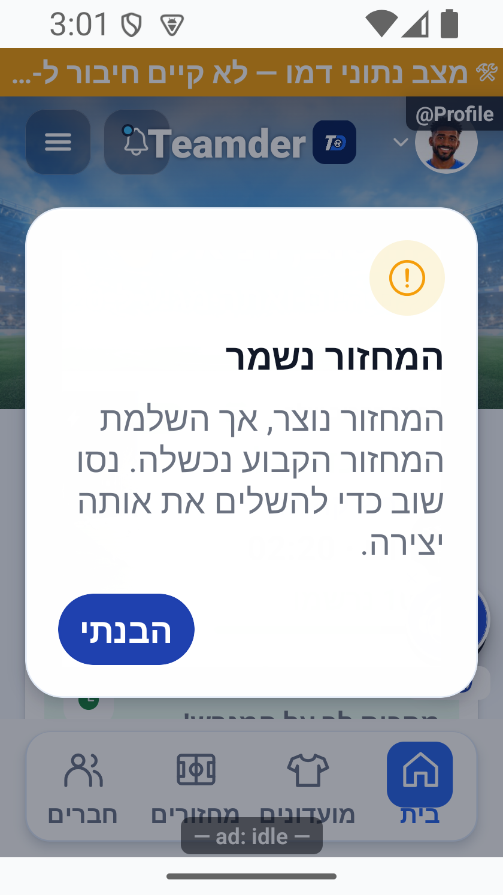
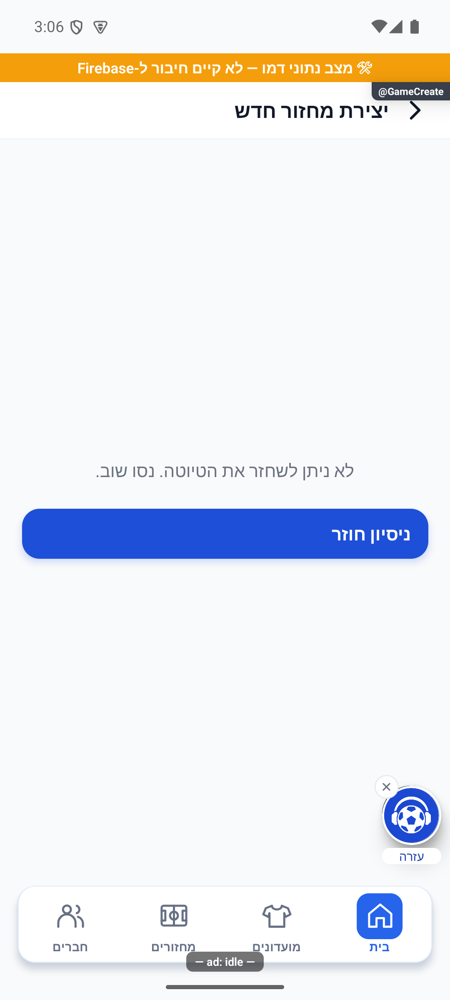

# השלמת חסמי מוכנות לייצור — 18.10.2026

המשך לבקשת הבעלים לתקן את הנדרש לפני ייצור, מעל `be02b074c935f40b7087ef43620c9ef6aba7c18c`. [הביקורת המלאה הקודמת](2026-10-18-preproduction-end-to-end.md) נשארת מקור הראיות לשלושת המחזורים שהסתיימו; אין להציג בדיקות נוספות כאילו נכללו בה.

## היקף העבודה הנוכחי

- הכרעה חלופית אחרי פנדלים: הסרת הסדרה ושמירת התוצאה באותה עסקה, עם אימות הלוח וניסיון חוזר בטוח.
- יצירת מחזור ומועדון: זהות ניסיון מתמשכת, כדי שתשובת שרת שאבדה לא תיצור נתון נוסף.
- רישום ההתראות: שחזור ובדיקת כשל תאריך חסר בסשן של הספרייה המקורית, תוך בדיקת התלות שנארזת בפועל.
- בדיקות חוזרות ותיעוד; פריסת שרת ממוקדת רק כאשר נדרשת מהתיקונים המאושרים.

אין שינוי במדיניות ספירת הופעות או צבירת נתוני אורחים. אין שינוי הרשאות, הסבת נתונים, יצירת חשבון או מועדון בדיקות נוספים. אין בנייה, העלאה לחנות או קידום לייצור במשימה הזו.

## מצב פתיחה שנבדק

עץ העבודה היה נקי. קריאת השגיאות החזירה אותן 11 רשומות פתוחות. שירות `ensurePersonalGroup` פעיל מאז `2026-10-17T14:50:54.773124296Z`; גוף הפונקציה הפעיל תואם בדיוק למימוש האטומי המקומי. אין צורך לפרוס אותו שוב בגלל נוסח היסטורי של ״טרם נפרס״. אין מכאן הוכחה שסיבת `internal` הישנה זוהתה.

באימולטור הייצור נבדקו בקריאה בלבד החשבון והמועדון הקיימים, חיבור אמיתי, גודל411.43×914.29 נקודות וגופן100%. הרכיב המקורי `ExpoSecureStore` נמצא זמין. השגיאה ההיסטורית של רכיב חסר נרשמה בגרסת פיתוח1.1.42; אין שחזור שלה במצב הנוכחי.

בדיקת הקבצים המקומית לקראת בניית אנדרואיד עברה בפרופיל בנייה `production` והגשה `internal`. היא אינה בדיקת חתימה, בנייה או חנות.

## אימות נוסף בייצור

שלושת המחזורים המאושרים כבר הסתיימו. נשלחה בקשת אישור נקודתית למחזור נוסף אחד של11מול11 כדי לבדוק שימור בסיס→מעבר משחק→השלמה קבועה→החזרה, בלי לאפס או לשנות את המחזורים החתומים. עד לקבלת תשובה אין יצירה של מחזור נוסף.

## מה תוקן

חמישה סוכנים עבדו בגלים: מוביל לשילוב, פריסה וראיות; סוכן להזנת גול והכרעה; סוכן לכוחות וליצירה; סוכן לבדיקות ולרכיב ההתראות; וסוכן לביקורת עצמאית של מסלול הנתונים. כל הכתיבות לייצור רוכזו אצל המוביל.

1. **הכרעה חלופית אחרי פנדלים.** הלקוח אינו מוחק עוד את הסדרה לפני שמירת התוצאה. השרת מאמת את המשחק, הלוח, הסגלים והסדרה, ואז שומר היסטוריה, סטטיסטיקות וקבלה ומסיר את הפנדלים באותה כתיבה אטומית. כשל משאיר את הסדרה; ניסיון חוזר מחזיר את הקבלה בלי זקיפה כפולה. שינוי מקביל או הכרעה שונה נדחים. השדות החדשים אופציונליים לתאימות, אך לקוח ישן עדיין משתמש במסלול הישן ואינו מקבל אטומיות זו מעצם פריסת השרת. [דוח החוזה והבדיקות](evidence/2026-10-18-production-blockers/atomic-alternative-audit.md).
2. **יצירת מחזור ומועדון לאחר אובדן תשובה.** מזהה הניסיון ותוכן הבקשה נשמרים לפני השליחה ומבודדים לפי חשבון וטיוטה. יצירה חוזרת של מחזור קוראת את אותו יעד; יצירת מועדון שומרת את המועדון, המידע הציבורי, המכסה וקבלת הניסיון בעסקה אחת. לאחר הצלחה נשמרת קבלה מינימלית, ללא פרופיל משתמש מלא. הוחזרו ערכי הטופס המקוריים גם כשהמועדים כבר עברו, והוסרה תלות בשם מועדון משתנה מטביעת הכוונה.
3. **סדרה שבועית ושחזור טיוטה.** קישור סדרה למחזור מתבצע בעסקה אחת. כשל בהשלמת הסדרה מודיע שהמחזור כבר נשמר ומשאיר ניסיון חוזר לאותה יצירה. שחזור טיוטה קורא את המועדון מחדש מהשרת, במקום לוותר עליה אם המטמון מגיע באיחור. כשל קריאה משאיר מסך ניסיון חוזר בעברית. גם מצב חד־פעמי אינו תלוי בתזמון הקצאת המועדון האישי. תשובה של ״עונות כבר פעילות״ לאחר יצירת מועדון אינה מוצגת עוד ככשל הפעלה. [דוח היצירה](evidence/2026-10-18-production-blockers/creation-recovery-audit.md), [ביקורת עצמאית והבדיקה החוזרת](evidence/2026-10-18-production-blockers/readiness-independent-review.md).
4. **כשל האתחול ברכיב ההתראות באנדרואיד.** שוחזרה קריאת תאריך חסר מסשן שמור בספרייה המקורית. הוחלפה מחלקה אחת שבודקת את תקינות הסשן לפני שימוש בתאריכיו ומפעילה את מחזור החיים הקיים לסשן שפג. לא נמחקו זהות, הסכמה, תור או אסימון. התלות שנפתרת בפועל לבנייה מפנה לגרסה המקומית המתוקנת; ממשק הספק נשאר מקורי. [מקור, חותמות וגבולות](evidence/2026-10-18-production-blockers/joryio-push-audit.md). זו עדיין אינה הוכחת אתחול או מסירת התראה בבינארי חדש.

מניעת הכפילות ביצירה תחומה לאותו חשבון, התקנה, טיוטה ותוכן. היא אינה מיזוג בין מכשירים או בין טיוטות חדשות, ואינה משחזרת אחסון שנמחק או טיוטה שפגה. שליחת הזמנות והתראות נלוות נשארת מיטבית ואינה הבטחת מסירה יחידה.

## בדיקות שהסתיימו

| בדיקה | תוצאה | ראיה וגבול |
|---|---|---|
| `npx tsc --noEmit` | עבר | [פלט סופי](evidence/2026-10-18-production-blockers/readiness-types-final.log); פלט ריק עם יציאה תקינה |
| `npx jest --runInBand` | 4,961 בדיקות, 417 חבילות, אפס כשלונות | [כל החבילה](evidence/2026-10-18-production-blockers/readiness-jest-full.log), 162.503 שניות |
| `npm run test:rules` בסדרה | 352 בדיקות, 34 חבילות | [פלט כללי ההרשאות](evidence/2026-10-18-production-blockers/readiness-rules-final.log); כללים מלאים, ללא שינוי הרשאות |
| בניית מקור השרת | עבר | [פלט](evidence/2026-10-18-production-blockers/readiness-functions.log) |
| סשן הספרייה המקורית | 12 תרחישים עברו לאחר התיקון; לפניו 9 נכשלו ו־3 עברו | [קבלת האימות](evidence/2026-10-18-production-blockers/joryio-session/verification.json); בדיקת ספרייה בלבד |
| פענוח תלויות הבנייה המקורית | הבסיס המתוקן והממשק הרשמי נבחרו ונבדקו בחותמות | [קבצים שנבחרו](evidence/2026-10-18-production-blockers/joryio-session/release-artifacts.json); לא בניית אפליקציה |
| קידוד קריאות, קורא נתונים אמיתי וחוזה שרת | 18 תרחישים עברו | [בדיקה עצמאית](evidence/2026-10-18-production-blockers/readiness-independent-callable-codec.json); תעבורה מקומית, לא כתיבת ייצור |
| אשף יצירה ושחזור | ארבעה מסלולי מועדים ושלושה מסלולי שחזור עברו | [האשף](evidence/2026-10-18-production-blockers/readiness-independent-wizard.json), [השחזור](evidence/2026-10-18-production-blockers/readiness-independent-restore-after.json); הפעלת מטפלי המקור |

הריצה המלאה האחרונה כוללת גם את מיפוי שגיאת השחזור לעברית. [השוואת 47 קובצי הקוד](evidence/2026-10-18-production-blockers/readiness-code-unchanged.json) מאשרת שלא השתנו בזמן הריצה. פלטי הבדיקות הממוקדות בדוחות המשנה הם נקודות ביניים, ולא תחליף לתוצאה הסופית. בפרט, פלט טיפוסים מוקדם של סוכן ההתראות מתעד כשל זמני שכבר תוקן; פלט הטיפוסים הסופי לעיל הוא הקובע.

## תצוגה שנפתחה ונבחנה

ארבע תמונות מקוריות נפתחו ונבחנו. הודעת ״המחזור נשמר״ נבדקה ברכיב המקורי במידות רגילות ובמסך320×569 בקירוב עם גופן140%. מסך שחזור הטיוטה הופעל דרך הניווט הרגיל: כשל הקריאה הראה הודעה עברית, ולחיצה בפועל על ״ניסיון חוזר״ החזירה את הטופס עם המועדון והמגרש המקוריים. מתאמי הקריאה היו מקומיים; לא נשלח טופס ולא נכתבו טיוטה, ניסיון או נתוני מוצר. [מקור הצילומים והחזרת סביבת הבדיקה](evidence/2026-10-18-production-blockers/creation-series-error-proof.md).

[תצוגה רגילה](../features/screenshots/final-audit-creation-series-error-normal-2026-10-18.png) · [הטופס לאחר ניסיון חוזר](../features/screenshots/final-audit-creation-draft-recovery-retried-2026-10-18.png). כלי העזרה מכסה חלק מכפתור ההמשך בתמונה האחרונה; היא אינה הוכחת נגישות הכפתור. הסביבה והממדים הוחזרו בסיום. שינוי ממפה ההודעה המאוחר לא שינה את המלל המצולם; ענפיו נבדקו בקוד ולא צולמו מחדש. המניפסט מכיל1,200 צילומים; אין מסך חדש או הסרה שמחייבים שינוי במפת הכיסוי.

## פריסת שרת ואימות מקור

נפרסו רק `createGroupCallable` ו־`commitRoundStats` לפרויקט `soccer-app-52b6b`, באזור `us-central1`. שתיהן פעילות, עם חותמות עדכון `2026-10-18T03:01:29.910364360Z` ו־`2026-10-18T03:01:39.570246185Z` בהתאמה. 136 קובצי המקור הושוו לארכיון הפעיל ללא אי־התאמה;95 פונקציות אחרות נשארו ללא שינוי. קריאות ללא הזדהות נדחו ב־401 לפני גישה עסקית. [קבלה מפורטת](evidence/2026-10-18-production-blockers/readiness-server-after.json), [פלט הפריסה](evidence/2026-10-18-production-blockers/readiness-server-deploy.log).

לא נפרסו כללים, אינדקסים או אירוח ולא בוצעה הסבת נתונים. כלי הפריסה התריע על סוף התמיכה הקרוב ב־Node20 ועל ספריית פונקציות ישנה; אין בדוח זה טענה שבוצע שדרוג רוחבי של סביבת השרת.

## נתוני הבדיקה הקיימים

אין מחזור בדיקה חדש בסבב הזה. הקריאה התחומה האחרונה אישרה שכל שורות שלושת המחזורים החדשים, המונים העסקיים בשלמותם וחותמות שלושת מחזורי העבר זהים למצב שלפני הסבב. [אימות השימור](evidence/2026-10-18-production-blockers/readiness-data-preservation.json). נתוני המקור התחומים נשמרו בארכיון, בלי פרטי הזדהות.

| גודל | מזהה מחזור קיים | תוצאה מהבדיקה הקודמת |
|---|---|---|
| 4 מול4 | `Ra5ZBzOUjR5zQlMojHke` | 2 משחקים, 201 אימותי נתונים שעברו |
| 7 מול7 | `FQ4T7izEbuYfprKFS75n` | 3 משחקים, 269 אימותי נתונים שעברו |
| 11 מול11 | `cF3CjQbLH8vzo7uaFqHx` | 3 משחקים, 442 אימותי נתונים שעברו; המשחק השני נשמר עם12 מול11 כראיית הכשל ההיסטורי |

החשבון והמועדון הקיימים נשמרו. [מלאי כל האורחים, המשחקים והקבלות מהסבב הקודם](evidence/2026-10-18-preproduction/test-data-inventory.md). לא אופסו מחזורים שהסתיימו כדי לייצר הוכחה חדשה.

שישה תיקונים נוספים ושתי תמונות נוספות נרשמו ואומתו ב־`appConfig/releaseLog` וב־`releaseShots`. יחד עם32 התיקונים ו־11 התמונות מהביקורת הקודמת, הקבלה מאמתת38 תיקונים ו־13 תמונות; אין פירוש הדבר שכולם נוצרו בסבב הנוכחי. [קבלת האימות החדשה](evidence/2026-10-18-production-blockers/readiness-journal-verification.json).

## קריאת השגיאות והמוכנות

קריאת הפולס האחרונה ב־03:08 לפי הזמן העולמי החזירה11 שגיאות פתוחות,9 דיווחים ו־19 משימות;15 הרעיונות החונים נשארו ללא טיפול. לא נוספה שגיאה לעומת תחילת הסבב. [הקריאה המסוננת](evidence/2026-10-18-production-blockers/readiness-errors-final.json). פריט ההתראות נשאר פתוח עד הוכחת בינארי. שגיאות הלייב הישנות והסירוב הצפוי `RESTORE_REQUIRES_SPACE` נשמרים כתיעוד; שגיאת המיקום השתמשה בגיבוי. כשל `SecureStore` הישן לא שוחזר ברכיב הקיים, ואין הכרזה שסיבתו תוקנה. לא נסגר פריט רק משום שבדיקת קוד עברה.

**הקוד והשרת מוכנים לבדיקה פנימית חדשה; עדיין אין המלצה לקידום לייצור.** נותרו שני אימותים מהותיים:

- להתקין בינארי חדש מההתחייבות הסופית, לבדוק אתחול עם סשן ישן, רישום התראות ומסירה, ואת הלקוח החדש מול שני חוזי השרת. רענון קוד בלקוח פיתוח אינו מחליף את ספריית האנדרואיד המקורית.
- להפעיל בייצור את הרצף שימור בסיס→מעבר משחק→השלמה קבועה→החזרה במחזור חדש של11 מול11. בדיקות השירות עברו, אך אין ראיית מכשיר חדשה לרצף הזה. האישור למחזור נוסף אחד עדיין ממתין; לא נוצר מחזור רביעי.

אין בסבב ראיה חדשה למכשיר פיזי, אייפון, גוגל, אפל או שני מנהלים בו־זמנית. מדיניות פנדלים ושוערות של אורחים ויומן דקות להופעות נשארו החלטות מוצר נפרדות; לא שונו מכנים בלי החלטה. האטומיות של ההכרעה ומניעת כפילות היצירה, שסומנו קודם כפערים, תוקנו כמפורט לעיל. לא בוצעו בנייה, הגשה או קידום לחנות.
