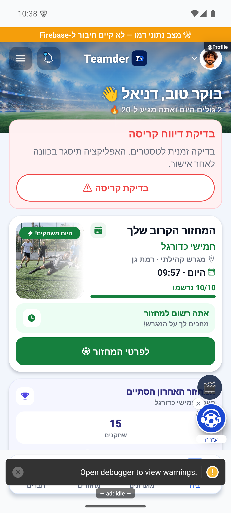
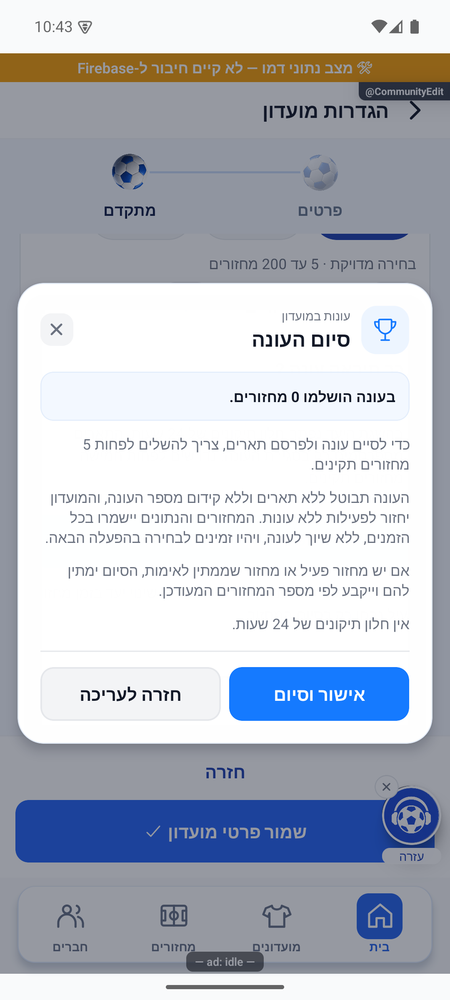

# כפתור בדיקת קריסה והמשך טיפול בפולס — 23.10.2026

## היקף ואישור

הבעלים ביקש כפתור קריסה בבית לכל המשתמשים, עם שיוך לחשבון המחובר, ולאחריו מעבר על כל פריטי הפולס שאינם רעיון או פיצ׳ר. אין אישור לבנייה או להעלאת גרסה פנימית בסבב זה. לא בוצעו פריסה, בניית חנות, שינוי הרשאות, הסבת נתונים, קומיט או דחיפה.

נקראו מחדש מקורות הלוח המאוחד באמצעות שאילתות שרת: 253 משימות, 292 דיווחים, 110 שגיאות ו־20 רעיונות. מתוכם היו 52 פריטים שלא נסגרו סופית מחוץ לרעיונות; 17 כבר המתינו לאישור הבעלים ו־35 טרם נמסרו. צילומי חמשת הדיווחים הפתוחים נפתחו; צילומי המקור לא נדרסו. המקורות המלאים והמיון הפרטני נשמרו ב־`artifacts/pulse-followup-2026-10-23/board.json`.

## שינויים מקומיים

- `src/components/home/CrashTestCard.tsx` מוצג בראש גוף `ProfileScreen`, לכל משתמש מלא, בלי סינון דוא״ל. רק אישור מפורש מפעיל את `src/services/crashlyticsTestService.ts`. השירות בודק גרסה מקורית, מצב איסוף וזהות מול האימות, מגדיר את מזהה החשבון בלי שם או דוא״ל, בודק שוב את הזהות ומפעיל קריסה מקורית. פיתוח, דמו, דפדפן, מודול חסר, איסוף כבוי והחלפת זהות אינם מפעילים קריסה. הכפתור זמני; אין הבחנה אוטומטית בקוד בין מסלול חנות פנימי לציבורי, ויש להסירו לפני קידום ציבורי. לא הופעלה קריסה אמיתית ולא אומתה קליטת דוח בשירות.
- `src/services/readRetry.ts` מנסה פעם נוספת קריאות שנכשלו זמנית, בהפרש 500 מילישניות. הוא מחובר לקריאות השמות וההזמנות ב־`publicPlayerService`, לדירוגים ב־`clubAdminRatings`, לזמינות ב־`availabilityFeedService` ולחברים במועדונים ב־`clubFriendsService`. בדיקת זהות נעשית לפני ואחרי הקריאה ולפני ניסיון חוזר; כשל מתמשך נזרק ולא מוחזר כנתון ריק. אין ניסיונות חוזרים לכתיבות ואין עקיפת הרשאות. שיפור ההתאוששות נבדק באמצעות שגיאות עם הקודים המדווחים; אין בכך הוכחת סיבת הכשל ההיסטורי ברשת.
- `src/services/govmapService.ts` אינו שומר תשובה ריקה תקינה כשגם המקור החלופי נכשל. חיפוש שהחלופה שלו הצליחה אינו מדווח עוד ככשל חיפוש של המקור הראשי. כששני המקורות נכשלים, הכשל עדיין מדווח ומסומן כלא זמין.
- `src/components/community/SeasonsSettings.tsx` מציג בחלונית סיום וכיבוי עונה את הסף מתוך `MIN_SEASON_ROUNDS`: לפחות חמישה מחזורים תקינים כדי לסיים עונה ולפרסם תארים. אין שינוי בסף או בחישוב.

## אימות מכשיר

באימולטור אנדרואיד 35, עם שרת פיתוח ונתוני דמו מנותקים, נצפו כפתור הקריסה והמלל החדש בחלונית סיום העונה. נבדקה הכיווניות גם בחיתוך של כרטיס הקריסה. לא אושר סיום עונה ולא הופעלה קריסה.

התיקון הקיים ללחיצות אחרי גלילה נבדק מחדש, ללא שינוי נוסף במנגנון: במועדון נבחרה לשונית השחקנים בלחיצה הראשונה אחרי גלילה מטה וחזרה למעלה. לאחר גלילה הלוך וחזור בסטטיסטיקה, הלחיצה הראשונה פתחה את כרטיס השיתוף; לא בוצע שיתוף חיצוני. במחזור, לאחר גלילה, נבחרה לשונית המשחקים הנעוצה בלחיצה הראשונה. אירועי `club_tab_selected`, `club_share_open` ו־`round_tab` נשמרו ב־`native-touch-log.json` ו־`native-match-touch-log.json` בתיקיית הראיות המקומית. זה אימות אנדרואיד בדמו; אין שחזור במכשירי המדווחים או באייפון ואין טענה שכל הדיווחים נבעו מאותה סיבה.

## בדיקות וגבולות

נוספו בדיקות התאוששות מקריאת מידע, עצירה בהחלפת זהות, שימור כשל סופי, חיפוש חלופי, שיוך דוח הבדיקה ואישור/ביטול הכפתור. בדיקות הלחיצה על הכותרת המקורית והגנת התנע עברו בהרצה המלאה. תוצאות סופיות וקבלות כתיבה נשמרות בתיקיית הראיות המקומית ומעודכנות בסיום הסבב.

נקראו 210 רשומות יומני שרת מאז 18.10.2026 ומלאי 103 הפונקציות הפרוסות. נקודות הקריאה הרלוונטיות קיימות; לא נמצאה ביומנים סיבת שרת שמוכיחה את מקור שגיאות הקריאה ההיסטוריות. אין להסיק מזה שהרשת במכשיר תקינה. שגיאות שאינן מקבלות תיקון מאומת נשארות פתוחות עם ממצא פרטני; כניסת אפל עדיין חסרה אימות ספק חי באייפון. פריטי רעיון ופיצ׳ר לא בוצעו ולא נסגרו.

המסירה בפולס שומרת `claudeStatus: done` עם הסבר וצילום תיקון נפרד, בלי לשנות את `status` הסופי ובלי לדרוס את תמונות המקור. כל כתיבה נבדקת בקריאה חוזרת. יומן השחרור מסומן `next`, ללא טענת הפצה.

## ארבעה דיווחים חדשים במהלך העבודה

בקריאה החוזרת נמצאו ארבעה דיווחים חדשים ונפתחו כל צילומיהם. בסיכום עונה סגורה הוחלף המלל המבטיח משחקים עתידיים בהסבר שאין מספיק נתוני צמדים בעונה הזאת; בלשונית המועדון ההסבר מפנה לסטטיסטיקות המועדון בבחירת כל הזמנים. חלונית הצמד הקטלני מציגה כל צמד כקבוצה נפרדת. הקורא בונה `SeasonTitleAwarded.pairs` ממזהי הצמדים בארכיון, לרבות שחקן שזכה עם יותר משותף אחד; אין ניחוש לפי שמות או שינוי בזוכים.

`SeasonsSettings.onDirtyChange` מודיע למסך העריכה על שינויי עונה שלא נשמרו. שמירת פרטי המועדון נעצרת לפני כתיבה וניווט ומסבירה לשמור קודם את הגדרות העונה. ערכי ברירת מחדל ברשומה ישנה אינם נחשבים עריכה, והצלחת שמירת עונה מנקה את הדגל.

כל ארבעת המצבים נצפו באנדרואיד עם נתוני דמו. נבדקה הפרדה בין שני צמדים, מלל העונה הסגורה, ההסבר בלשונית המועדון, ושינוי משלושה לשני חודשים שלא נשמר ועצר את שמירת פרטי המועדון. לא נשמרו נתוני ייצור. צילומי המקור של הדיווחים הועתקו בנפרד כראיות לפני; צילומי התיקון והמגבלות נרשמו במניפסט.

בהרצה המלאה לאחר השינויים עברו 468 חבילות ו־5,234 בדיקות. לאחריה עברו גם תשע בדיקות קורא הסיכום, כולל בדיקה חדשה לשיוך שני צמדים עם שחקן משותף ושמות זהים. בדיקת הטיפוסים עברה. יומני ההרצות נמצאים ב־`artifacts/pulse-followup-2026-10-23`.

בסך הכול אומתה מסירת 17 פריטים ל״בוצע ע״י רובנס״: תשעה קיבלו שינוי בגל הראשון, ארבעה דיווחי לחיצות קיבלו אימות מחודש לתיקון קיים וארבעת הדיווחים החדשים תוקנו. שבעה פריטים נותרו פתוחים: כניסת אפל, דחיית יצירת מחזור וחמישה דיווחי רשת/חריגת זמן שאין להם סיבת כשל מוכחת. לכל אחד נשמרו ממצא וצעד הבדיקה הנדרש. לא הוצהר שכל הבאגים נפתרו.

נשמרו ונקראו חזרה שמונה רישומי שחרור מקומיים ו־שישה צילומי תיקון נפרדים, ללא שינוי הגרסאות שפורסמו. קבלות: `handover-receipts.json`, `new-reports-receipts.json`, `release-log-receipt.json`, `new-reports-release-receipt.json` בתיקיית הראיות המקומית. שתי חותמות מקור שהיו מיושנות לפני הסבב, בקובצי תמונות הרקע ושדות תצוגת ההזמנה, אינן מרועננות כאן בלי בדיקת השינוי האחר. גם קישורים היסטוריים חסרים נשארו בבדיקת התיעוד הכללית.
