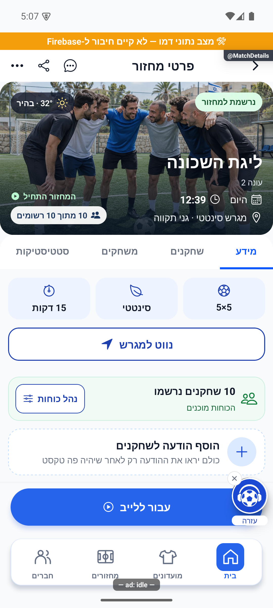
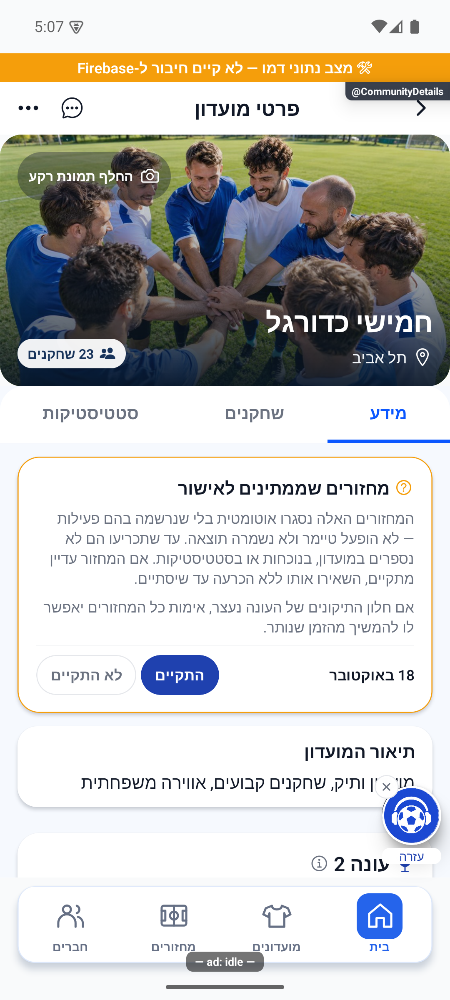
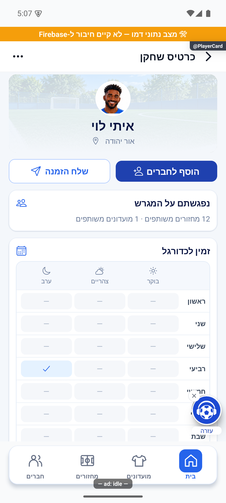

# קיצור טעינת מסכים — 23.10.2026

שינוי מקומי מעל `2f93005a`. לא נבנתה גרסה, לא בוצעה פריסה ולא שונו הרשאות. קובצי `docs/marketing/` שהיו לא מנוהלים בתחילת המשימה נשארו מחוץ להיקף.

## הממצאים והתיקונים

| מסלול | לפני | אחרי | גבול ההוכחה |
|---|---|---|---|
| פרטי מחזור | אפקט הרכבה ומיקוד קראו לאותו `reload` | קריאה אחת בפתיחה דרך מיקוד | שתי הפעלות שירות הופכות לאחת; לא הבטחה לזמן טעינה בחצי |
| רשימת מחזורים | שני מסלולים הפעילו ארבע קריאות כל אחד | ארבע הפעלות שירות בטעינה עם תלויות יציבות | שינוי תלויות עדיין מרענן; מספר קריאות מסד פנימיות לא נמדד |
| פרטי מועדון | תוצאות ארבע קריאות המשנה פורסמו יחד | כל חלק מתעדכן עם קבלת תשובתו | קריאת המועדון הראשונית עדיין כוללת אישור וטעינת דירוגים לפי השירות הקיים |
| כרטיס עצמי | המתנה לרשומת המשתמש אף שהיא בחנות הנתונים | הצגה מהחשבון המלא ורענון ברקע | אורח נשאר במסלול הציבורי; אין החלפת פרופיל פרטי בזהות ציבורית |
| הזמנה מכרטיס שחקן | הכנה במיקוד וקריאה זהה בפתיחת החלונית | שימוש בבקשה פעילה או בהצלחה צעירה מ־30 שניות | חישוב הפרופיל האחר בשרת לא השתנה; שליחת הזמנה עדיין נבדקת בשרת |

במועדון נוספה הגנה של דור טעינה, מזהה מועדון ומזהה חשבון לכל תשובת משנה. חזרה ממיקוד פוסלת את בקשת המיקוד הקודם. כשל ברענון אינו מחליף מידע קודם במערך ריק; חוסר מועדון או דחיית הרשאה מנקים אותו. תלות הטעינה צומצמה למזהה חשבון כדי שעדכון פרופיל שאינו מעבר חשבון לא יתחיל שוב את כל קריאות המועדון.

## אימות

`tests/logic/screenLoading.test.ts` מבצע את גופי הטעינה והרישום מהמקורות האמיתיים דרך עץ התחביר. נבדקים פרסום חלקי כשההיסטוריה והסטטיסטיקה עדיין תלויות; כשל קריאת משנה; החלפת חשבון/מועדון/דור; מספר הטעינות בכניסה ובחזרה; שימוש בפרופיל עצמי עם כשל רענון; הפרדת אורח; ושימוש בהכנת הזמנות פעילה, טרייה, ריקה, פגה או שנכשלה. אלה בדיקות עם הבטחות נשלטות, ללא עיכוב שרת אמיתי וללא מדידת שיפור בשניות.

בהרצה הסופית, אחרי חיזוק הפרדת האורח, עברו כל 473 החבילות ו־5,276 בדיקות, מתוכן 15 בדיקות טעינה חדשות. בדיקת הטיפוסים נקייה. יומן מלא: `artifacts/screen-loading-jest.log`.

בוצע רענון של הדמו המקומי דרך החיבור ב־8082. פרטי מחזור, פרטי מועדון וכרטיס שחקן אחר נפתחו דרך מסלולי הבדיקה הקיימים. צילומי המסכים נפתחו ונבדקו: הכותרות, התוכן, סדר הלשוניות והמלל העברי מוצגים. אין שינוי בעיצוב; לא נאסף צילום לפני, ולכן הצילומים אינם השוואת ביצועים. לא נלחצו פעולות כתיבה או ניהול. הכרטיס העצמי לא צולם; הוא מכוסה בבדיקות הקוד. אייפון, טלפון פיזי ורשת ייצור לא נבדקו.

## מגבלות שנותרו

הטעינה הראשונה של פרופיל שחקן אחר עדיין תלויה בחישובי `getSocialPlayerProfile` ובזמן תשובת השרת. גם `groupService.get` ממתין לדירוגים לפי המנגנון הקיים. לא הוכח שכל ההמתנות ביישום נפתרו, ולא הוכנס מטמון של נתונים אישיים כדי להסתיר את ההמתנה. בדיקת זמני שרת אמיתיים במכשיר המדווח נדרשת לפני הצהרה על משך טעינה בפועל.

מפתח התיעוד רוענן לששת הזוגות שהושפעו. בדיקת התיעוד הכוללת עדיין מציגה קישורי ראיות היסטוריים חסרים, חותמת ישנה של `docs/RELEASING.md` וחותמת קוד ישנה ב־`entry/landing-and-links` עבור `functions/src/invitePreviewFields.ts`, מחוץ למשימה. אין כשל חדש המדווח עבור ששת הזוגות או שלושת הצילומים; המפתח החיצוני אינו מרוענן כדי להסתיר פער שאינו קשור לשינויים כאן. הפלט המלא: `artifacts/screen-loading-docs-check.log`.

## יומן שחרור

שלושה רישומים נוספו ל־`appConfig/releaseLog` בגרסת `next`: מחזורים, מועדון וכרטיס שחקן. שלושה צילומי דמו נשמרו בנפרד ב־`releaseShots` ונקשרו לרישומים. הרישומים ותוכן הצילומים נקראו חזרה ואומתו לאחר השמירה, בזמן `2026-10-23T17:45:35.747003Z`. קבלה: `artifacts/screen-loading/release-receipt.json`. אלו רישומי תיקון מקומי, ללא טענת הפצה. המשימה אינה מקושרת למזהה פריט בפולס, ולא הועבר פריט ללוח הביצוע.
