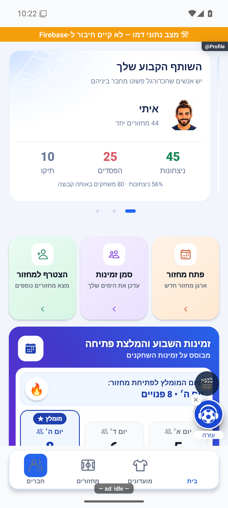

# הכדורגל שלי בעמוד הראשון בקרוסלת הבית

מימוש מקומי מ-25.10.2026 מעל `56d4189746853e211a04be98848b1c2088026a05`. לא נבנתה או הופצה גרסה במסגרת המשימה.

הקרוסלה הקיימת נשמרה. עמוד הנתונים המאוחד מחליף את עמוד המספרים הישן ומופיע ראשון. הוא מציג מחזורים, שערים ובישולים מכל הזמנים, תובנה אישית וכניסות נפרדות לסטטיסטיקה ולכרטיס השחקן העצמי. הכותרת והקישור החיצוניים הוסרו כדי למנוע כפילות. עמודי הכושר, השותף והיעד נשמרו לפי אותם תנאי נתונים.

`HomeProfileOverview` הוא רכיב תצוגה בתוך `HomePersonalStats`, ללא עטיפת לחיצה המפעילה את הסטטיסטיקה. כפתור הסטטיסטיקה פותח את `Statistics`, וכפתור הכרטיס דוחף `PlayerCard` עם מזהה המשתמש הנוכחי באותה מחסנית. הדפים האחרים ממשיכים לפתוח את הסטטיסטיקה. אין מסך חדש, שינוי בהרשאות או כתיבה עסקית.

התובנה מעדיפה רצף הגעה מתוך מחזורים שהתקיימו ושאליהם המשתמש רשום בכל המועדונים. הסדר לפי תאריך ואז מזהה. אי הגעה מאפסת את הרצף, והשיא הוא המרב לאורך הרשימה. החישוב משתמש בכל רשימת הבסיס של השירות, ולא בחלון חמשת ציוני הבית, ואינו מוסיף קריאות שרת. תאריך לא אמין משמיט את נתון הרצף. רצף 4 מול שיא 5 מוצג כהתקדמות להשוואת השיא, לא כהשגת שיא חדש. כשאין בסיס אמין לרצף מוצגים אחוז הגעה, חיבורים לשחקנים או מסר התחלה, לפי הנתונים.

נשמרו טעינה, כשל עם ניסיון נוסף, שימור תשובה קודמת של אותו חשבון, ביטול תשובות ישנות, החלקה ידנית, נקודות נגישות, צמצום תנועה וגובה משותף הנמדד מהתוכן. הצלחה ללא פעילות מציגה אפסים אמיתיים ועמוד ראשון בלבד. כשל אינו הופך לאפס.

## אימות שבוצע

- `tsc --noEmit` עבר ללא שגיאות. היומן ב-`artifacts/home-profile-carousel-2026-10-25/tsc.log`.
- כל 516 חבילות הבדיקה ו-5,796 בדיקות עברו. היומן ב-`artifacts/home-profile-carousel-2026-10-25/jest-full.log`.
- 29 בדיקות ממוקדות בארבע חבילות עברו: סדר העמודים, ציון אפס, שותף ויעד, ספי תובנות, התקדמות לשיא, שני כפתורים נפרדים, היסטוריית הגעה מעבר לחמישה מחזורים, תאריך חסר ואי הגעה אחרונה. היומן ב-`artifacts/home-profile-carousel-2026-10-25/focused.log`.
- באימולטור אנדרואיד נפרד עם נתוני המחשה נצפה העמוד הראשון לאחר פתיחה נקייה. נצפו 54 מחזורים, 31 שערים, 24 בישולים ורצף 4 מול 5, עם הכפתורים והמספרים בכיווניות נכונה. נבדקו התאמת הנקודות לעמודי הכושר והשותף, מעבר דרך שני הכפתורים והצגת אפסים ומסר התחלה בתרחיש ללא פעילות. עצי הממשק נשמרו בתיקיית הראיות, ללא צילומי ניווט נוספים.

## גבולות האימות

האפליקציה הופעלה במצב נתוני המחשה ללא חיבור למסד הייצור. בדיקות השירות משתמשות בתשובות מדומות ומריצות את חישוב המקור. לא נבדקו חשבון ייצור, אייפון או מכשיר פיזי. ניסיון לבדוק חלון קטן עם גופן מוגדל לא סיפק ראיית תצוגה מספקת ולכן אינו מסומן כאימות; הגדרות האימולטור הוחזרו. אין מדידת מהירות חדשה. לא בוצעו בנייה, דחיפה לגיט או הפצה.

חוזה התצוגה מתועד ב[לוח הבית](../features/home/dashboard.md), החישוב ב[סטטיסטיקה האישית](../features/statistics/personal-statistics.md), והכניסה ב[כרטיס השחקן](../features/profile/player-card.md).

## תיעוד ויומן

עודכנו זוגות המסמכים, מפת הכיסוי ומניפסט שני הצילומים. רועננו 12 כרטיסי מצב, לרבות תלויות קובץ הבית וכלי הבדיקה. בדיקת המצב עדיין מציגה מקור ששונה בפיצר לא קשור: `entry/landing-and-links` עבור `functions/src/invitePreviewFields.ts`. בדיקת התיעוד הכללית עדיין נכשלת גם בשל קישורים ישנים לראיות מקומיות שאינן קיימות. אין פער חותמות חדש בכרטיסי השינוי הזה. היומנים נשמרו ב-`artifacts/home-profile-carousel-2026-10-25/status-check.json` וב-`artifacts/home-profile-carousel-2026-10-25/docs-check.json`.

השינוי נרשם ב-`appConfig/releaseLog` כ-`next`, יחד עם צילום הוכחה נפרד ב-`releaseShots`. קריאה חוזרת אימתה את הרשומה ואת הצילום. המזהה הוא `home-profile-carousel-20261025-2318ef81439043de9a91f4ce45f4ce64` ומזהה הצילום `35bafb7400ab4b48b77685422e5decb0`. האישור המקומי נשמר ב-`artifacts/home-profile-carousel-2026-10-25/release-receipt.json`. זה רישום שינוי שטרם הופץ, ללא הפצת לקוח או שרת.

## מיקום האייקונים בכפתורים

בהמשך בקשת הבעלים ב-25.10.2026, האייקון עבר לשמאל הטקסט בכפתורי "הסטטיסטיקה שלי" ו"כרטיס השחקן שלי". רק סדר שני הילדים בכל כפתור שונה ב-`HomeProfileOverview.tsx`; שורת הכפתור נשארה `row`, והפעולות, הנגישות והנתונים לא השתנו. באימולטור אנדרואיד עם נתוני המחשה נצפו שני האייקונים משמאל לטקסט. צילום הלפני הוא עותק הצילום המאומת משלב המימוש הקודם, וצילום האחרי עדכני. צילומי הפעלה שלא הציגו את הכפתורים אינם הוכחה.

בדיקת הטיפוסים עברה, וכל 516 חבילות הבדיקה עם 5,796 בדיקות עברו בהרצה מלאה לאחר השינוי. היומנים בתיקייה `artifacts/home-profile-button-icons-2026-10-25`. לא נוספה בדיקה שמעתיקה את סדר הילדים, כי השינוי חזותי בלבד ובדיקות הפעולות הקיימות נשמרו.

התיקון וצילום ההוכחה נרשמו ביומן כ-`next`, ואומתו בקריאה חוזרת. מזהה הרשומה `home-profile-button-icons-20261025-d6b5d07a08374e9ba8d32ba3849ca0e5` ומזהה הצילום `6a5b265911f84e2289e4ef938030983e`. התיקון מקומי וטרם הופץ. אין אימות מכשיר פיזי או אייפון.

בדיקת התיעוד הכללית מצאה 114 פערים מחוץ לשינוי, לרבות קישורי ראיות ישנים ושינויים מקבילים בפיצרים אחרים. לא נמצא פער עבור כרטיס הבית, הרכיב ששונה או צילומי התיקון. פרטי הבדיקה נשמרו ב-`artifacts/home-profile-button-icons-2026-10-25/docs-check.json`.
