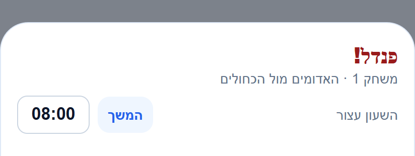
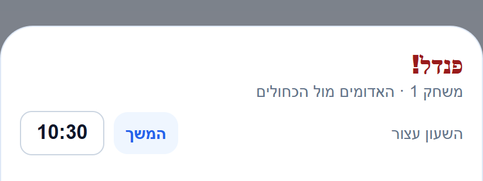

# זמן אירועים מלא אחרי משך המשחק

תאריך: 25.10.2026. תיקון מקומי בלבד, ללא בנייה או פריסה וללא שינוי נתוני משחקים קיימים.

## הבעיה והתיקון

בלייב המתקדם זמן האירועים נלקח מהשעון הראשי המוגבל למשך שנקבע. אחרי חריגה, גולים נשארו באותה דקה וחלון הפנדל הראה ושמר את זמן התקרה.

`src/screens/AdvancedLiveMatchScreen.tsx` מעביר כעת ל-`LiveScoreboardCard` דקת אירוע מתוך `Math.floor(timerMs / 60000) + 1` וזמן מדויק מתוך `timerMs`. השעון הראשי ותצוגת החריגה נשארים כפי שהיו. משחק בן שמונה דקות שהגיע לזמן פעיל של `10:30` מעביר דקה `11` לגול וזמן `630000` לפנדל; השעון הראשי עדיין מציג `08:00` עם חריגה `02:30`.

הדקה המשותפת משמשת לגול רגיל ולשער עצמי. חלון פנדל גוזר בעצמו דקה מהזמן המלא, שומר שניות שלמות בעת אישור ומחזיק זמן מקורי בעריכה ובניסיון חוזר. מסלול השירות, הממירים וההיסטוריה מקבלים אותם שדות קיימים. אין שדה חדש, שינוי מכנים, מונים, הרשאות, ניווט או מסך חדש. אין תיקון רטרואקטיבי לאירועים ישנים.

## אימות תצוגה

רונדר רכיב הפנדל המקורי עם מתאמי תצוגה בדפדפן ובנתוני בדיקה מנותקים ממסד. פרמטר הזמן חושב מביטוי הקוד של המסך לפני ואחרי התיקון. נצפו שני הצילומים, כולל סדר עברי, שמות הקבוצות ושעון משמאל לפקד ההמשך.

הראיה מוגבלת לכותרת ולשעון של הרכיב. המגרש ובחירת השחקנים לא רונדרו בבדיקה זו. אין חיבור לאימולטור פעיל בכתובות הפיתוח שנבדקו, ולא נערכה בדיקה במכשיר או כתיבת משחק לייצור. הצילומים רשומים ב-`docs/features/screenshots/manifest.json`.

## בדיקות ומסירה

בדיקת טיפוסים מלאה עברה. כל 5857 הבדיקות ב-520 חבילות עברו. הפקודות הורצו דרך `node node_modules/typescript/bin/tsc --noEmit` ו-`node node_modules/jest/bin/jest.js --runInBand`, משום שהפקודה `npx` אינה זמינה בתהליך.

נוספו חמש בדיקות לפרמטרי הזמן האמיתיים שבמסך: אפס, לפני הגבול, בגבול, אחרי הגבול וללא משך מוגדר. נוספה בדיקת חלון פנדל להצגת `10:30` ולשמירת `clockMs:630000` ו-`minute:11`. נוספה בדיקת שמירה דרך השירותים, הממירים והתחייבות התוצאה להיסטוריה, כולל דקת הגול המקושר לפנדל. הבדיקות הקיימות לעריכה ולניסיון חוזר עברו בהרצה המלאה.

עודכנו זוגות המסמכים וכרטיסי המצב של לייב מתקדם, השעון, הפנדלים והממלאים. מפתח המצב מצביע רק על שינוי מחוץ למשימה ב-`functions/src/invitePreviewFields.ts`. בדיקת התיעוד הכללית נשארה עם 108 פערים מחוץ לתיקון, המתועדים ב-`artifacts/overtime-event-time-2026-10-25/docs-check.json`; אין כשל שמזכיר את קובצי ההוכחה החדשים.

נוסף רישום `overtime-event-time-2026-10-25` ל-`appConfig/releaseLog`, עם צילום תיקון נפרד ב-`releaseShots` בעל המזהה `d1d1f5af29754c3697dba39be2a1da33`. הרישום והצילום נקראו חזרה ואומתו. האישור נמצא ב-`artifacts/overtime-event-time-2026-10-25/release-receipt.json`. זהו רישום ביומן בלבד, ללא פריסה או שינוי משחקים בייצור. לא נמסר מזהה משימת פולס ולכן לא עודכן פריט בלוח.

יומני הבדיקות, קוד הרינדור ותוצאותיו, העותק המקומי מלפני השינוי ומסירת היומן נמצאים ב-`artifacts/overtime-event-time-2026-10-25`.
