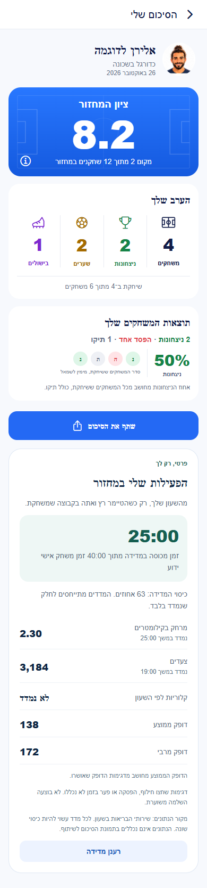

# פעילות אישית בשעון אנדרואיד ובסיכום מחזור

עודכן ב-26.10.2026. המימוש מקומי וטרם הופץ.

## היקף והכרעות

המדידה נפתחת מרצון באפליקציית השעון. דגימה נספרת רק כאשר הטיימר רץ והשחקן באחת משתי הקבוצות שמשחקות. רישום למחזור, תור המתנה ונוכחות במסך אינם השתתפות. ברוטציה נלקחים בחשבון שחקנים מושאלים ומי שעזב; בהרכב רגיל נכללים שחקני שתי הקבוצות והשוערים בלבד. עצירה, החלפה או מידע שפג תוקפו מפסיקים את הזכאות.

השלב הנוכחי מציג מדידה פרטית בסיכום המחזור האישי. אין צבירה לעונה, דירוג חברתי, מפה, חישוב ספרינטים או הסקת מרחק מצעדים. הנתונים נמצאים מחוץ לרכיב שתמונתו נשלחת בשיתוף. אין הפעלה של המסלול הישן `physicalSyncService.ts` ואין ייחוס פעילות כללית בטווח של ארבע שעות למחזור.

## מסלול הנתונים והוכחת זמן

1. הטלפון קורא מצב שרת עדכני באמצעות `WidgetRosterWorker`. `WidgetGameModel.activityPlayerIds` ו-`activityEligible` מחשבים זכאות נוכחית. החבילה כוללת משתמש, מחזור, מזהה משחק, דור חיבור ותוקף של תשעים שניות. אימות חיישנים אינו נובע מכך שהזכאות חיובית.
2. במהלך מדידה השעון מבקש רענון מצב כל שלושים שניות, גם בהפסקה. כשל שומר תצוגה אחרונה אך אינו מחדש את תוקף הזכאות. בקשת שעון אינה כתיבה ישירה למצב משחק.
3. `PhoneServerClock` מודד זמן שרת באמצעות שלוש קריאות עם מדידת זמן הלוך ושוב. נבחר הגישוש עם אי הוודאות הקטנה. השעון מבצע כיול נוסף בארבע חותמות זמן. קפיצת שעון או כיול חסר עוצרים ספירה; אין הנחה ששני המכשירים חולקים שעון זהה.
4. שירות המדידה בודק יכולות חיישנים ומסנן כל דגימה. גם דופק, שעשוי להגיע בעת השהיית אימון, מסונן בנפרד. מרחק, צעדים וקלוריות הם הפרשי מדידה על פני קטע; הם אינם מחולקים יחסית כאשר הקטע חוצה חילוף או הפסקה. דופק הוא דגימה נקודתית.
5. מקבצים בעלי מספר רציף נשמרים מקומית ומועברים בנתוני סנכרון עמידים. הטלפון שומר עותק מקומי. `PersonalActivityUploadWorker` מעלה גם ללא ממשק פתוח, ו-`personalActivityService` מספק סנכרון נוסף כשהממשק פעיל. שני המסלולים משתמשים באותו חוזה שרת ובמניעת כפילויות.
6. `onGamePersonalActivityChanged` שומר יומן שרת עצמאי לכל שינוי במסמך מחזור. כל קטע מתאר את גרסת לפני השינוי בין חותמות ההתחייבות של שתי הגרסאות. סדר מסירה אינו סדר המשחק; מזהה קטע קבוע מונע כפילות. גרסת מסמך נוכחית מוכיחה את מצבה מאז חותמת הגרסה ועד הקריאה, והקליטה בודקת שוב את הגרסה בעסקה. אין הסקת היסטוריה מההרכב הסופי לפני חותמת גרסתו.
7. `savePersonalActivity` בודק חשבון מלא, זהות צפויה, גישה למחזור, רצף מקבצים, גבולות וערכים, ראיות זמניות וחפיפה בין שעונים. רק אחרי אישור שמירה או כפילות זהה נשלח אישור עמיד לשעון ונמחק עותק הטלפון. כשל או עיבוד ממתין אינם אישור למחיקה.

נתונים גולמיים וצבירות נשמרים באוספים פרטיים של השרת ומוחזרים בקריאה מאומתת לבעליהם. לא שונו כללי מסד הנתונים. מידע מחשבון קודם אינו מוחזר או מוצג בחשבון חדש. שגיאות סנכרון אינן כוללות ערכי חיישנים ביומן האבחון.

בביקורת הסיום נוסף גם טיפול בנתוני המדידה בעת מחיקת חשבון: השינוי נבדק מקומית, בלי למחוק חשבון או נתון ייצור. בדיקותיו ומסלולו המפורטים נמצאים בדוח השרת. אין די ביציאה מקומית כדי לטעון שמידע נמחק בשרת.

## חישובים ותצוגה

- `eligibleMs`: איחוד קטעי הזמן שבהם הוכחו גם ריצת טיימר וגם שיבוץ במגרש.
- `measuredMs`: איחוד קטעי זמן של מדדי משך שאושרו. דופק נקודתי אינו ממציא כיסוי זמן.
- `coverageRatio`: זמן מדוד חלקי זמן זכאי, כאשר יש מכנה ומדידת משך. ללא ראיה מספקת מוחזר ערך חסר. לכל אחד מהמדדים מרחק, צעדים וקלוריות נשמר גם משך כיסוי משלו.
- מרחק מוצג בקילומטרים עם שתי ספרות אחרי הנקודה; צעדים וקלוריות מעוגלים בתצוגה בלבד. אפס אמיתי נשמר, וערך חסר מוצג כלא נמדד.
- דופק ממוצע הוא ממוצע חשבוני של דגימות מאושרות, לא ממוצע משוקלל לפי זמן. דופק מרבי הוא הערך הגבוה מביניהן.
- לדוגמה, שלושים דקות משחק אישי ידוע ועשרים דקות מדידה מאושרת הן כשישים ושבעה אחוזי כיסוי. הסכומים אינם השלמה לשלושים דקות, וכל מדד עשוי לכסות זמן שונה.

הפאנל נטען במקביל לתור ההעלאה ואינו חוסם את סיכום הכדורגל. מוצגים טעינה, היעדר מדידה, המתנה לסנכרון, שגיאה, מדידה חלקית ואפס שנמדד. רענון שומר מדידה קודמת ומסמן כשל עדכון. החלפת חשבון או מחזור מסתירה מיד תוצאה קודמת. הכניסה נשארת במסלול `EveningSummary` מתוך פרטי המחזור שהסתיים, בערימות שבהן המסך כבר רשום.

## שלושת סבבי העבודה

בסבב הראשון נבנו מודל הזכאות, יומן השרת, חוזה המקבצים, שירות המדידה, כיול הזמן והאריח האסינכרוני. בסבב השני תוקנו מעברי רוטציה שלא סגרו חלונות זמן, קפיצות שעון, סדר אישורים, החלפת חשבון ותלות בממשק פתוח. בסבב השלישי בוצעה ביקורת עצמאית של השרת והממשק: תוקנו סדר מסירת אירועים הפוך, עוגן ריצה חסר, חסימת תחילת כיסוי שמרנית מדי, רענון ונתון חסר לעומת אפס. תוצאות בדיקות הסיום מפורטות להלן.

## ראיות ומגבלות נוכחיות

תיקון מחזור חיים אחרון: מופע מדידה מחזיק בעלות בלעדית בתהליך עד סיום ניקוי האימון, וכל פעולת יומן קשורה לסשן שיצר אותה. התחלה חדשה בזמן סגירת המופע הישן נדחית, ופעולה ישנה אינה יכולה לחתום סשן חדש. נוספו תשע עשרה בדיקות של המודלים המשמשים בשירות עצמו; יחד עם המודלים הקודמים עברו 67 בדיקות שעון. זהו תיקון שאינו משנה את התצוגה שצולמה. הפעלה אמיתית של השירות עדיין לא בוצעה.

### אימות חזותי מקורי של השעון

נבנו והותקנו שתי חבילות פיתוח באמולטור שעון עגול, ברזולוציה של 384 על 384. מקור הבסיס הוא `56d4189746853e211a04be98848b1c2088026a05`, והאחרי הוא עץ העבודה המקומי. ארבעת הצילומים נצפו ונבדקו בפועל: טיימר לפני ואחרי, מסך הפעילות ואזור כפתור ההתחלה לאחר גלילה. הטיימר והעברית קריאים, והסבר העברת הנתונים לחשבון מופיע לפני תחילת מדידה. השעונים בצילומים הם נתוני הדגמה חיים בזמני צילום שונים ואינם מדידת סטייה בין מכשירים.

[לפני](../features/screenshots/wear-live-before-2026-10-26.png), [אחרי](../features/screenshots/wear-live-after-2026-10-26.png), [הפעילות האישית](../features/screenshots/wear-personal-activity-after-2026-10-26.png), [הסבר ותחילת מדידה לאחר גלילה](../features/screenshots/wear-personal-controls-after-2026-10-26.png).

הצילומים נרשמו במניפסט עם חותמות, ללא שינוי פיקסלים. `wear-ui-build-receipt.json` מתעד חותמת חבילה לכל מקור. לא הוכנס חשבון לאמולטור השעון, לא הוחלו הרשאות חיישנים ולא הופעלה מדידה. לא בוצע זיווג לטלפון או הוספת אריח בממשק המערכת. קוד האריח הודר ונבדק במקור, וזה היקף האימות שלו כעת. [מסירת הבדיקות המקוריות](../../artifacts/android-personal-activity-2026-10-26/wear-native-handoff.md).

אימות ביניים מאוחר: שלוש עשרה בדיקות העלאה מקוריות עברו בפועל באמולטור טלפון, בחבילת בדיקה נפרדת `com.studiogameslime.soccerapp.widgetqa`. נבדקו שמירה וכפילות, שימור מידע בהמתנה ובכשל, כשל אישור, סדר גרסאות, שני סשנים, החלפת חשבון במהלך שליחה ואישור, תור של חשבון אחר והגבלת בקשות. לא נכתבו מדידות למסד חי; רק גבולות הקלט והפלט החיצוניים הוזרקו, ומנגנון העבודה המקורי הורץ. שני הניסיונות הראשונים נכשלו בעומס ובמגבלת המתנה; רק הריצה ב-`activity-upload-instrumentation-final.log` היא הוכחת מעבר.

בדיקות הטיפוסים הסופיות של שורש הפרויקט ושל השרת הסתיימו בקוד יציאה אפס. שלושים ואחת בדיקות מודל הווידגט עברו שוב, והקורא והעובדים הודרו מול ממשקי המערכת והספריות השמורים. בדיקה זו אינה תחליף לבדיקת מכשיר. בדיקות מודל השעון כוללות שלושים ושבעה מקרי שער זמן, פרוטוקול וכיול, ואחת עשרה בדיקות פענוח מצב.

בריצה המלאה הראשונה עברו חמש מאות עשרים ושבע חבילות וחמשת אלפים תשע מאות שמונים ותשע בדיקות, עם כשל יחיד בכיסוי תיעוד שגיאות. הכשל תוקן באמצעות דיווח מסונן ובדיקות המוודאות שאין נתוני חיישנים בדיווח. בריצה הסופית עברו כל 528 החבילות ו-6002 הבדיקות. אין לסמן את הריצה הראשונה כנקייה. יומן ההרצה הוא `artifacts/android-personal-activity-2026-10-26/jest-full-final.log`.

הידור משולב של קוד טלפון וקוד שעון עבר בסבב השני. עשרים ושבע בדיקות מוקדמות הורחבו בביקורות נוספות; מספרי הסיום נשמרים בקבלות הריצה בתיקייה `artifacts/android-personal-activity-2026-10-26`. אין לחבר מספרי ריצות חופפים לספירה כוללת.

תצוגת המסך, הכרטיס המקוריים והפאנל רונדרו ברוחב שלוש מאות ותשעים ושלוש מאות ועשרים. הצילומים `personal-activity-*-2026-10-26.png` רשומים ב-[מניפסט](../features/screenshots/manifest.json) וכוללים לפני, אחרי, היעדר נתון, המתנה, שגיאה, חלקי ואפס. הרכיבים המקוריים הורצו עם מתאמי דפדפן ונתוני דוגמה; זו אינה הוכחת הרצת אנדרואיד, חיישנים, שרת חי או שיתוף מערכת.

הרשאות המדידה החדשות ושירות המדידה במניפסט טרם הוחלו, עד לתשובה להצעה המפורשת בהתאם להנחיות המאגר. בלי אישור זה אין להפעיל מדידה או לבנות את גרסת המדידה להפצה. לא בוצעו פריסה או העלאה פנימית במסגרת המסמך הנוכחי. אין שעון פיזי מחובר. בדיקות התוכנה, צילומי הממשק, יומן השחרור וקריאת השגיאות הושלמו כמפורט כאן; נותרו אישור והפעלת הרשאות, אימות מדידה ומסירה בין מכשירים מתאימים, בדיקת הצהרת החנות, פריסה קשורה ואימות מקור וחתימת שני הבינאריים.

לפרטי שרת: [חוזה ומגבלות השרת](2026-10-25-personal-activity-server.md). לפרטי הרוטציה: [משחק מתקדם](../features/rounds/live-advanced.md).

## הכנת הפצה פנימית

רעיון להמשך, שטרם מומש: אריח פעילות אישית שמראה אם הספירה פעילה, מושהית או ממתינה לחיבור, ואת זמן המשחק האישי שנמדד. הוא ישתמש באותו שער זמן ובאותו תור מאושר, ולא יציג סך משוער כשהכיסוי חסר. בגרסה הנוכחית נשאר האריח הקיים של הטיימר והמחזור הבא, עם התיקונים המתועדים כאן.

בדיקת התיעוד הכללית איתרה 107 קישורי ראיות היסטוריות חסרות וחותמת קוד קודמת אחת ב-`entry/landing-and-links`. לא נמצא כשל בקישורים או בצילומי המשימה החדשים. כל 1542 הצילומים במניפסט קיימים ובעלי חותמת תקפה. אין לתאר את בדיקת התיעוד הכללית כנקייה. קבלת הבדיקה: `artifacts/android-personal-activity-2026-10-26/feature-docs-final.log`.

קריאת מסלולי החנות ב-25.10 אישרה טלפון פנימי `1.1.61/295` וטלפון ייצור `1.1.57/291`. בשעון הייצור `1.0.30/1027`, והמסלול הפנימי הישן הוא `1005`. טרם הוגדלה גרסה וטרם נבנה בינארי חדש; יש לבדוק שוב מסלולים לפני קיבוע המספרים בפועל. היעד הוא `internal` ו-`wear:internal` בלבד.

נקראו מאה חמישים ושניים מסמכי שגיאה עדכניים לפי `lastSeen`. שלושים וחמישה עדיין פתוחים, ומהם עשרים וחמישה כבר מסומנים כממתינים לביקורת הבעלים. עשר התקלות הנוספות עוסקות בעונות, הרשמה, התחברות, חברים, מיקום ורשת; לא נמצאה ביניהן קריאה למסלול המדידה החדש שטרם נפרס. לא בוצע בהן תיקון או שינוי סטטוס במסגרת משימת השעון. הקבלה הפרטית נמצאת בתיקיית הראיות.

נרשמה ונקראה חזרה רשומת העבודה המקומית `android-personal-activity-2026-10-25` ביומן השחרור, כולל צילום נפרד ומגבלותיו. הרשומה אינה טענת הפצה.

לפני העלאת גרסה שכוללת מדידה יש לבדוק שהצהרת תכונות הבריאות ודף הפרטיות בחנות מתארים את איסוף נתוני הכושר, העברתם לטלפון ושמירתם בחשבון. זו תכונה חדשה שדורשת בדיקת הצהרה בפועל, ואין במסמך ראיה שהצהרת החנות עודכנה. [הנחיות ההצהרה הרשמיות](https://support.google.com/googleplay/android-developer/answer/14738291?hl=en), [דרישות הרשאות חיישנים](https://support.google.com/googleplay/android-developer/answer/16558241?hl=en).

## אישור המשך ב-26.10.2026

הבעלים השיב כן לאישור הרשאות המדידה והשירות הגלוי. חמש ההרשאות ורישום השירות הוחלו במניפסט הקנוני ואומתו בבדיקה מפורשת, בלי מיקום או הרשאת בריאות ברקע. אישור ההפצה הפנימית לטלפון ולשעון נשמר. נבחרו גרסאות 1.1.62/296 ו-1.0.31/1028 לפי קריאה חדשה בחנות. הבדיקות וההפצה עדיין בעבודה; אין כאן טענת השלמה.
