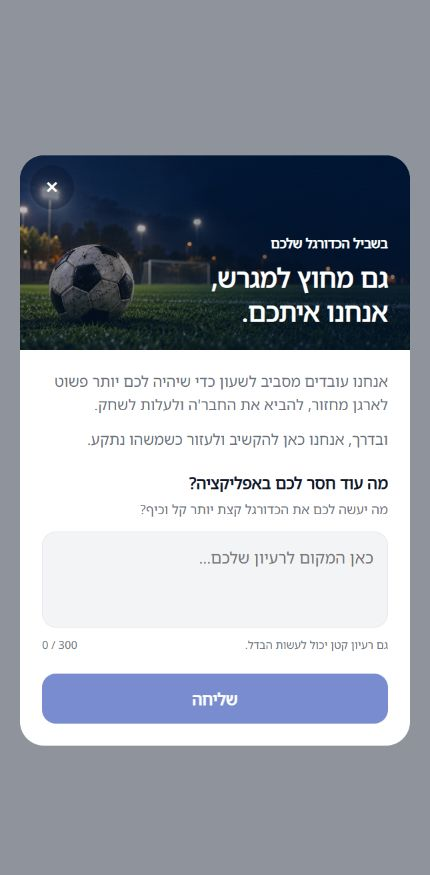

# גרסה פנימית 1.1.66, חלון הצעות והשבתת איסוף הספורט

הופצה ואומתה גרסת הטלפון `1.1.66/300` במסלול הפנימי באנדרואיד. ממשק החנות מאשר מצב הושלם ואת חתימת החבילה המדויקת. הייצור נשאר `1.1.57/291`, השעון הפנימי `1.0.32/1029` וכל יתר המסלולים נשארו ללא שינוי. לא בוצעו קומיט או דחיפה.

## התנהגות ומגבלות

נכלל חלון ההצעות עם באנר הכדורגל, מלל עברי חי, תיבת טקסט וכפתור שליחה, בלי אולי אחר כך. התשובות מחוברות לאוסף הדיווחים הקיים של הפולס, עם שם המשתמש וסיווג הצעת שיפור. החלון מופיע בבית אחרי התחברות והשלמת פרופיל והיכרות, בתיאום עם ההודעות הקיימות. סימון מקומי לאחר סגירה או הצלחה מגביל לפעם לחשבון בהתקנה; מכשיר אחר, התקנה מחדש או כשל שמירת הסימון עשויים להציג שוב. בכשל שליחה הטקסט נשמר בטופס לניסיון חוזר, והאיקס זמין גם בזמן כתיבה ממתינה ללא רשת. [התנהגות ובדיקות](2026-10-27-feedback-prompt.md).

הפעילות האישית ואיסוף הספורט מושבתים. בחבילה הסופית אין הרשאות בריאות, חיישני ספורט או הרשאת שירות מיקום בקדמה, ואין שירות מדידת הטלפון. נתוני עבר נשמרו; זמן המחזור ונתוני הכדורגל הרגילים נשארו. השעון העצמאי המותקן לא עודכן במשימה זו. [היקף ההשבתה](2026-10-27-sports-activity-disabled.md).

נכללים שינויי הלקוח המקומיים שבתמונת המקור, לרבות תיקון ספק המיקום והרחבת האבחון. אין טענה ששינויי השרת או ממשק הפולס המקומיים נפרסו: שינויים כאלה נשארים מסומנים בנפרד ביומן. אין מחיקת נתונים או שינוי כללים בייצור.

## מקור, חתימה ובדיקות

בסיס הגיט הוא `56d4189746853e211a04be98848b1c2088026a05` עם עבודה מקומית. כל 1121 קובצי המקור נחתמו לפני הבנייה ונבדקו אחריה. ארכיון המקור המדויק: `artifacts/internal66/working-source.zip`, חתימה `d39aa92a282cfa17009928dc638ccc1f8d1bc5a2e70460e572b898a19120c67b`. חתימת חבילת ההעלאה: `9ea5644f4c23f71e40bb2b09552e9b74161d0f5dc7a90cad58f3677ef4082315`. אין הסתמכות על קומיט הבסיס בלבד לצורך שיוך התיקונים.

הבנייה המקומית נחתמה בתעודת ההעלאה הקיימת. נבדקו חתימה, תעודה, תקינות חבילה, מזהה, גרסה ומספר בנייה מהמניפסט. נמצאו קוד חלון ההצעות והבאנר בתוך החבילה, ואומתה היעדרות הרשאות הספורט ושירות המדידה. זהות הקוד וזיהוי הבנייה המקומית נשמרים בהגדרות המוטמעות.

עברו כל 6252 בדיקות היישום ב-558 חבילות, 353 בדיקות כללים ב-34 חבילות בסדרה, ובדיקות הטיפוסים של האפליקציה, השרת והפולס. פרויקט ההרשאות היה demo-soccer והכללים לא השתנו. תצוגת החלון נבדקה מרכיב המקור עם מתאמי דפדפן, כולל רוחב 320, שגיאה ותודה. אין אימות התקנה, מקלדת מקורית, מכשיר או תשובה חיה מהבנייה החדשה לפולס.

## שירותי שרת ובדיקת שגיאות

נקראו מאה השגיאות האחרונות; 54 מהן טרם נסגרו סופית ו-38 כבר ממתינות לאישור הבעלים. בין השאר נצפו ניתוקי רשת, זמני המתנה ובעיות התחברות מוכרות בגרסאות קיימות. לא בוצעו תיקונים נוספים או סגירות במהלך ההפצה.

כל אחד עשר שירותי החברים והפרטיות פעילים ללא שינוי מאז ההפצה המאומתת. מקור socialPlayers.ts המקומי זהה לחבילה המאומתת של השירות הפרוס, ולכן לא נדרשה פריסה חוזרת. קריאה עדכנית של שירות כללי ההרשאות נדחתה בהרשאת קריאה; קובץ הכללים המקומי זהה לחתימה שאומתה בהפצה הקודמת. לא הורחבו הרשאות ולא הוחלו כללים חדשים. בדיקות הכללים המקומיות המלאות עברו.

## ראיות ויומן

ההגשה הראשונה נעצרה בגוגל בגלל שני הסברים חסרים בהצהרת הבריאות, עבור הרשאות פעילות ודופק שקיימות בגרסת השעון שכבר פורסמה. הושלמו שני ההסברים, עם הבהרה שבטלפון 1.1.66 האיסוף ובקשות ההרשאה כבויים. ההצהרה נשמרה, ללא שינוי בהרשאות החבילה החדשה. לא נשלחה מחדש הצהרת שירות המיקום של הגרסאות הישנות. ההגשה השנייה התקבלה וממשק החנות אומת; אין טענה שהצהרת הבריאות אושרה בבדיקה ראשית. [ההגשה שהושלמה](https://expo.dev/accounts/studiogameslimes-organization/projects/soccer-game/submissions/8ddab81f-e478-4568-b8a0-cb6cf32c8e88).

ראיות הבנייה והחנות נמצאות ב-artifacts/internal66: source-before.json, working-source-proof.json, build-receipt.json, packaging-proof.json, tracks-before.json, tracks-verified.json, release-log-receipt.json. נרשמה גרסה חדשה ביומן ושויכו רק פריטי הלקוח שהוכחו, עם שימור הצילומים והפריטים שלא נפרסו. הכל נשמר ונקרא חזרה; אין סגירת משימות בעלים. צילום החלון הוא צילום מקור בדפדפן, לא צילום התקנה מהחנות.

