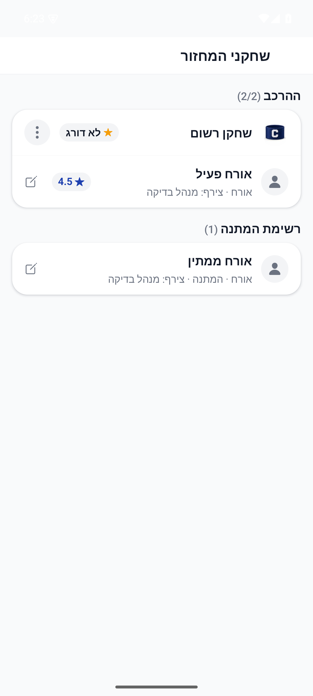
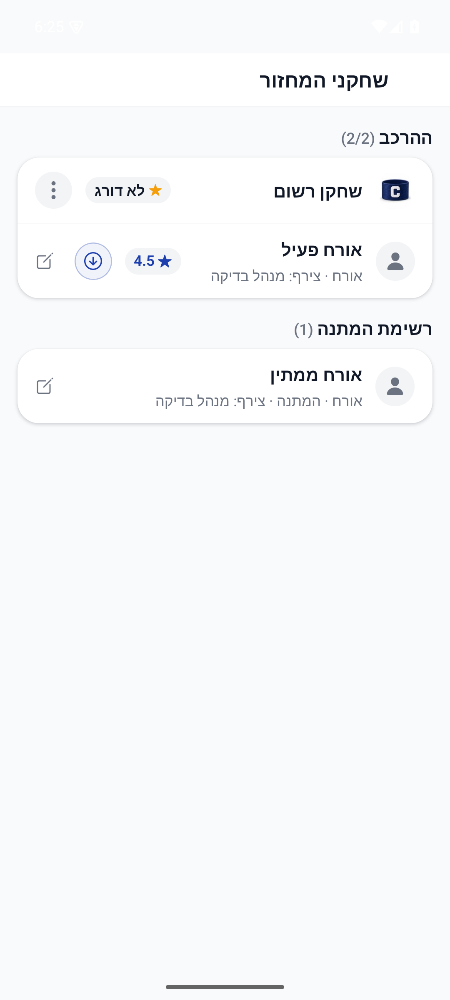

# העברת אורח לרשימת המתנה, 3.11.2026

## מצב הפצה מאומת, 3.11.2026

קוד הלקוח נכלל בגרסת האנדרואיד הפנימית 1.1.73/305. מקור החבילה, חתימתה ומסלול החנות אומתו; אין אימות התקנה במכשיר או גרסת אייפון חדשה. תיקוני שירות הסגל טרם נפרסו וממתינים לאישור נפרד. תיאורי המצב המקומי בהמשך נכתבו לפני ההפצה. [מסירת ההפצה והחריגים](2026-11-03-internal-1.1.73.md).

נמצאה אפשרות חסרה: אורח פעיל קיבל עריכת פרטים בלבד, ואילו אורח ממתין קיבל קידום להרכב. נוסף למנהל חץ מטה בשורת אורח פעיל, במסך העצמאי ובלשונית השחקנים. האורח מועבר לסוף ההמתנה תוך שימור המזהה, השם, מי שצירף, זמן ההוספה ודירוגו. הפעולה אינה מוצגת לחבר רגיל או במחזור סופי.

נמצא גם סיכון בשרת: ירידה בספירת האורחים הפעילים נחשבה למקום שהתפנה, לרבות העברה ידנית להמתנה. תנאי הגילוי תוקן מקומית כך שנדרשת הסרה ממשית של מזהה אורח פעיל. הסרת אורח ממשיכה בקידום הרגיל; העברה ידנית אינה ממלאת מחדש את המקום.

## בדיקה חזותית והתנהגות

נבדק רכיב `MatchPlayersScreen` המקורי באנדרואיד, בכיווניות עברית ובחבילת פיתוח קיימת `1.1.56-demo`. צילום לפני משתמש במקור מהקומיט `06417f6132f4c7636aaee25574354ed7722966b9`; צילום אחרי משתמש בשינוי המקומי. המשתמש, המועדון, המחזור ושמירת ההעברה היו נתונים ומתאמים בזיכרון בלבד. לא נוצרו חשבון או מועדון ולא שונו נתונים עסקיים בייצור.

לפני התיקון לא היה כפתור העברה ליד אורח פעיל. אחרי התיקון חץ מטה מוצג לצד העריכה ושמו של האורח נשאר קריא. לחיצה מקורית עברה מ-2/2 בהרכב והמתנה 1 ל-1/2 בהרכב והמתנה 2. האורח הופיע אחרי הממתין הקודם ודירוג 4.5 נשמר. התוצאה נקראה חזרה מעץ הפקדים וממצב הרכיב ומתאם השמירה, ללא צילום ביניים נוסף.

ניסיונות הכנת המארח נתקלו בחיבור שרת מבודד, בנתוני מועדון חלקיים ובמתאם ציור וניווט חסר. הם תוקנו במארח הבדיקה בלבד. אין לראות בהם תקלות מוצר חדשות או ראיית ייצור. המארח הסופי מצייר את רכיב המקור עם מתאם ניווט ושמירה מקומיים.

## בדיקות ומסירה

כל 6,794 הבדיקות ב-605 חבילות עברו בהרצה מלאה על המקור הסופי, במשך 174.825 שניות. בדיקות הטיפוסים של הלקוח והשרת נקיות. בדיקת התיעוד מחזירה את אותם 116 פערי בסיס ללא פער חדש; עודכנו ורועננו 35 זוגות מסמכים שנוגעים למקורות המשותפים. תשע סטיות מקור קודמות בשלושה כרטיסים נשמרו במפורש ולא הוכשרו. 29 הבדיקות הממוקדות הראשונות עברו, ובדיקות הטיפוסים של הלקוח והשרת עברו. בהרצה המלאה הראשונה חסר מתאם ערכת נושא בבדיקת הרגרסיה החדשה; הוא נוסף. בדיקות המוצר הקיימות באותה הרצה עברו. הרצה שהחלה לפני סיום שינוי הכפתור הוחלפה בהרצה מלאה על המקור הסופי.

הראיות המקומיות ב-`artifacts/guest-waitlist-2026-11-03`: קוד המארח, שני צילומי ההשוואה, עצי הפקדים, קבלת המצב, יומני הבדיקות וקבלות התיעוד והיומן.

התיקון מקומי וטרם הופץ. נדרשת פריסת `onGameRosterChanged` המתוקן לפני הפצת הלקוח; שרת קודם עלול לקדם מחדש אורח שהועבר ידנית. אין שינוי כללי הרשאות, פריסה, בניית חנות, קומיט או דחיפה. אין מזהה משימת פולס לבקשה זו, ולכן לא עודכן סטטוס בפולס; מסמך זה הוא המסירה המקומית.

נשמר רישום תיקון ב-`appConfig/releaseLog` עם צילום נפרד ב-`releaseShots`, ושניהם נקראו חזרה ואומתו. הרישום מציין שהשינוי מקומי וטרם הופץ, ושנדרשת פריסת שרת. קבלה: `artifacts/guest-waitlist-2026-11-03/release-log-receipt.json`.
