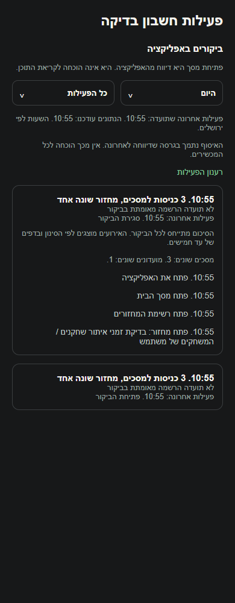

# הפעלת ציר הפעילות לבדיקות פנימיות, 5.11.2026

הבעלים ביקש להפעיל ולחבר את ציר הפעילות לבדיקה על החשבונות שלנו. השרת פועל ושלושת האינדקסים מוכנים. טימדר 1.1.76/308 הועלתה ונקראה חזרה במסלול הפנימי באנדרואיד. פולס 1.0.105/112 נבנתה בחתימה הקודמת, הועלתה ונקראה חזרה. יתר מסלולי החנות לא השתנו. אין קומיט או דחיפה.

## איך בודקים

1. מעדכנים את טימדר לגרסה 1.1.76 דרך [המסלול הפנימי](https://play.google.com/apps/testing/com.studiogameslime.soccerapp).
2. מתקינים את [פולס 1.0.105](https://tmpfiles.org/wUAcJuHX36ke/pulse-1.0.105-v112.apk) כעדכון. הקישור זמני, ונקרא חזרה עם כמעט 48 שעות תוקף בעת ההעלאה.
3. בחשבון הניהול הקיים בטימדר פותחים מסכים, מחזור ולשונית מועדון.
4. בפולס נכנסים למשתמשים, בוחרים את אותו משתמש ופותחים היסטוריה וביקור באזור הביקורים באפליקציה. אפשר לרענן ידנית; רענון אוטומטי פועל כשהאזור פתוח.

האיסוף מוגבל בשרת לשני חשבונות הניהול הקיימים ולחשבון הבדיקה המשוחזר. לא נוצר חשבון ולא נוספה הרשאת ניהול. לקוח חדש של חשבון אחר אינו מורשה להוסיף תיעוד לזרם. לקוח ישן אינו מתחיל לתעד בעקבות פריסת השרת בלבד. לא שוחזרה היסטוריה ישנה. הרחבה למשתמשים נוספים דורשת עדכון הסבר האיסוף והרחבה מפורשת של היקף ההפעלה.

עדכון פולס כולל גם הפרדת הצעות משתמשים ודיווחי תקלות והמרת פנייה או הודעת תמיכה למשימה. ההמרה אינה סוגרת את המקור או שולחת הודעה.

## השרת

נוספו `recordUsageActivity`, `onUsageJoinReceipt`, `materializeUsageOperation` ו-`cleanupUsageActivity`, עם `USAGE_ACTIVITY_ENABLED=true` ורשימת חשבונות מפורשת ב-`USAGE_ACTIVITY_UIDS`. נוספו שלושה אינדקסים עבור ביקורים, אירועים ודוח פעולות. משימת השמירה היומית לפי ירושלים הופעלה ונבדקה בהפעלה יזומה מוצלחת.

`onJoinRequestCreated` ו-`reconcileJoinsTask` עודכנו מתוך המקור שהיה פרוס, עם תוספת `registrationCreated` לקבלת ההרשמה בלבד. יתר שינויי הקובץ המקומי המשותף לא הוחלפו. `deleteMyAccount` קיבלה ניקוי שימוש אחרי שלב סימון החשבון כמחוק ולפני מחיקת האימות; כשל בניקוי השימוש עוצר את המשך המחיקה. לא נערכה מחיקת חשבון חיה.

הרשאת הפעלת נקודת הקליטה החדשה הוגדרה בהתאם למסלול הקריאות המזוהות הקיים: נקודת הכניסה מקבלת בקשות מהלקוח, והקוד מאמת את החשבון ואת רשימת ההפעלה. נקודת הניקוי מוגבלת לחשבון השירות של המתזמן. לא השתנו כללי מסד הנתונים או רשימת מנהלי הפולס. מקור שבע הפונקציות נקרא חזרה ואומת; יתר הפונקציות הקיימות לא השתנו.

## בדיקות וראיות

עברו 7,182 בדיקות ב-645 חבילות, 48 בדיקות שרת במסד הדגמה ובדיקות הטיפוסים בשלושת היישומים. 1,361 קובצי מקור נשארו זהים במהלך הבנייה והאימות. 11 קבצים מרכזיים אומתו גם מול מפות המקור של התוצרים. נבדקו החתימות, הגרסאות, מצב בניית הפצה וחותמת הקוד המוטמעת. מפתח מצב הפיצרים תקין. בבדיקת התיעוד נשארו אותם 107 קישורים חסרים לראיות ישנות, ללא כשל חדש.

בבדיקה חיה הופעל התור המקורי של הלקוח בחשבון בדיקה קיים, והתוצאות נקראו באמצעות שירותי הקריאה המקוריים של פולס ושער הניהול הפרוס. נקלטו ארבעה אירועים ובהם שלוש כניסות למסכים ומחזור אחד עם תווית שנפתרה בשרת. משלוח חוזר לא הגדיל את המונים. התחברות בדיקה זמנית לזהות מנהלית קיימת אומתה במסלול האימות; חשבון הבדיקה הרגיל נדחה מקריאת שער הניהול. לא נוצר חשבון, לא נשלחה הודעת תמיכה ולא שונו מסמכי מחזור או מועדון.

זו בדיקת תור ושירותים חיה, ולא הרצת היישום בטלפון. הצילום מרנדר את רכיב המקור בדפדפן מתוך תשובת השרת שנקראה בשער המאומת, עם מתאמי תצוגה. לא אומתו התקנה במכשיר, הרשמה עסקית חדשה דרך הממשק, זמן הופעה מקצה לקצה או תקורת ביצועים במכשיר. אין בנייה או הפצה לאייפון.

[קבלות הבדיקות וההפצה](evidence/2026-11-05-usage-activation/verification.json). יומני הריצה והמקורות הפרטיים שמורים ב-`artifacts/usage-activation-2026-11-05` ואינם מיועדים להפצה. שני רישומי יומן השחרור והצילום המקושר נקראו חזרה ואומתו.

## מסירה

לא נמסר מזהה פריט מאומת בפולס, ולכן לא עודכן סטטוס של פריט. גרסת הבדיקה מחוברת בפועל; נותרה בדיקת ההתקנה והניווט במכשירים שלכם.
