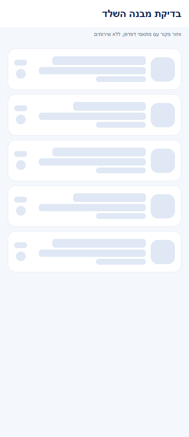

# רשימת השיחות החדשה

## מדידת פעולות ואמינות נתונים, 5.11.2026

במיפוי מקור הרכיבים המוזכרים במסמך נמצאו 23 נקודות מטפל ו-23 מזהי פעולה. הספירה מתארת קוד וכוללת רכיבים משותפים; אין לחבר אותה לספירות של מסמכים אחרים ואין לראות בה הרצת כל המסך. המדידה מפורטת לפי גבול פקד מקורי, פעולה עסקית ומצב חשבון. תשובה מאוחרת נבדקת מול בעל הפעולה, ומצב קיים או בקשה חוזרת אינם תמיד הצלחה חדשה. רשימת המקרים שהורצו ומגבלות המסד, המכשיר והכיסוי נשמרות [בדוח המדידה](../../audits/2026-11-04-system-night/product-measurement.md) ובדוחות המקושרים אליו. המימוש מקומי; לא בוצעה בדיקה חדשה של כל מצבי הפיצר.

## מדידה מול הייצור, 4.11.2026

המסלול המשותף לחיפוש שחקנים נבדק מול שירות הייצור. הזמן מפתיחת רשימת השחקנים עד לשורה הראשונה התקצר בחציון מ-1.746 ל-1.349 שניות. בנפרד, זמן בקשת הרשימה ללא מסנן דווקא עלה מ-1.026 ל-1.124 שניות; אין לייחס את כל השיפור במסך לשירות. [מדידות, בדיקות ומגבלות](../../changes/2026-11-04-player-discovery-production.md).

## חיפוש שחקנים וזמני טעינה, 4.11.2026

לשונית הגילוי נשארת מורכבת אחרי ביקור ראשון. `active` והמיקוד קובעים אם מותר להפעיל חיפוש. `src/components/chat/DmPlayerSearch.tsx` משתמש באותו מנגנון ומציג חסר רק בסיום החיפוש. מימוש מקומי שטרם הופץ. [השינוי, המדידות והבדיקות](../../changes/2026-11-04-player-discovery-speed.md).

## השפעת שיפורי הטעינה המשותפים, 4.11.2026

עודכנה תלות משותפת במסלול טעינה או במתאם הבדיקה, בהיקף השינוי המתועד בלבד. אין שינוי מכוון בחישובים או בפעולות העצמאיות של הפיצר הזה.

מקורות משויכים שנבדקו בהיקף השינוי: `tests/logic/communityRosterLoading.test.ts`.

מימוש מקומי וטרם הופץ. אין בכך אימות מכשיר חדש של הפיצר הזה או מדידת מהירות של כל מסלוליו. [המדידות התחומות, הבדיקות והמגבלות](../../changes/2026-11-04-screen-performance.md).

## הפצה פנימית 1.1.74, 3.11.2026

עדכוני הלקוח ב-`src/components/ReadStatusNotice.tsx`, `src/hooks/useRoundChanges.ts`, `src/services/roundVisitService.ts`, `src/utils/photoPhase.ts`, `src/utils/roundVisit.ts`, `src/components/loading/PageSkeletons.tsx`, `src/components/loading/ScreenSkeletons.tsx` כלולים בחבילה הפנימית 1.1.74/306. ארכיון המקור המקומי וחתימת החבילה אומתו מול החבילה שהחזירה גוגל. מקור הבסיס הוא `06417f6132f4c7636aaee25574354ed7722966b9` עם שינויים שלא נשמרו לגיט.

עברו 6864 בדיקות יישום, בדיקות טיפוסים, 360 בדיקות הרשאות בסדרה ו-38 בדיקות שרת במסד הדגמה. ההרשאות והשירותים הפעילים נשמרו, ללא הסבת נתונים או קידום לייצור. האימות החזותי הוא מצילומי המקור בדפדפן שכבר תועדו, ללא התקנה או הרצת הפיצר הזה במכשיר בגרסה החדשה. אין בכך הכרזה על הפצת שינויים אחרים המתועדים במסמך. [מקור, קבלות, תכולה ומגבלות](../../changes/2026-11-03-internal-1.1.74.md).

## מצבים ריקים והמשכיות פעולה, 3.11.2026

נבדק ההפרש במקורות המשותפים בלבד. אין מכאן אימות חדש של הפיצר המלא.

מקורות משויכים שנערכו: `tests/logic/chatDiscoveryLoading.test.ts`.

ההתנהגות, טבלת המצבים, מסלול הנתונים, בידוד הזהות, ניווט, שמירת שישים ביקורי מחזור מקומיים, השהיית חיווי של שש שניות ושלבי התמונה מתועדים ב[דוח השינוי](../../changes/2026-11-03-experience-followup.md). מקורות המנגנונים: `src/components/ReadStatusNotice.tsx`, `src/hooks/useRoundChanges.ts`, `src/services/roundVisitService.ts`, `src/utils/roundVisit.ts`, `src/utils/photoPhase.ts`. אין שינוי בחישובים, במכנים או בהרשאות. חיווי עיכוב אינו הוכחה להתנתקות ואינו אישור כתיבה; אין מטמון תוכן קבוע חדש.

המימוש מקומי. נבדקו עשרים ושניים מצבי מקור ושני אזורי השוואה ב-72 בדיקות רוחב בדפדפן. תמונות וסמלים הוחלפו במצייני מקום; מצב עיכוב מוזן למתאם והתזמון נבדק בקוד. אין אימות מכשיר, שרת חי או מסך מלא חדש.

תוצאות האימות בסבב זה: כל 6864 הבדיקות ב-614 חבילות ובדיקת הטיפוסים עברו. בדיקות המצבים הממוקדות עברו ב-83 מקרים. נבדקו 72 פריסות של אזורי מקור בדפדפן, ונבדקה כיווניות בצילומים. אין אימות מכשיר או שירות חי חדש.

## התאמת מבנה שלדי הטעינה, 3.11.2026

באזורים המשויכים לפיצר הזה נבדק שלד `inbox`, `newchat` במתאם דפדפן. אין בכך אימות המסך המלא או כל מצב נתונים. ההתאמה עוסקת בפריסה ובהודעת ההמתנה הנגישה; שירותי הטעינה, מצבי הכשל, המיון, החישובים, המכנים והניווט נשארו ללא שינוי. מקורות משויכים שנערכו: `src/components/loading/ScreenSkeletons.tsx`, `src/components/loading/PageSkeletons.tsx`, `tests/logic/communityRosterLoading.test.ts`.

[טבלת השינויים לפי אזור, המידות, השוואות למקור, הבדיקות והמגבלות](../../changes/2026-11-03-skeleton-layout-alignment.md). מקומי וטרם הופץ, ללא בדיקת מכשיר או שרת חי חדשה.

אימות במשימה זו: 6,820 בדיקות ב-608 חבילות ובדיקת טיפוסים עברו; 84 בדיקות רוחב של אזורי מקור ותשע השוואות מידות לכרטיסים אמיתיים עברו. אין בכך אימות מכשיר חדש של הפיצר או של מצבי נתונים שלא נבדקו.

## התאמת בדיקה משותפת, 3.11.2026

ב-`tests/logic/chatDiscoveryLoading.test.ts` נוסף רק `setLoadFailed` למתאם של אפקט גילוי המועדונים, בעקבות השלמת טיפול הכשל ב-`PublicGroupsFeedScreen`. לא השתנו בדיקות השיחות או מקורות המסך, הנתונים והניווט של השיחות. כל 6,820 הבדיקות ב-608 חבילות ובדיקת הטיפוסים עברו. אין אימות מכשיר חדש לשיחות או הפצה חדשה במשימה זו. [התיקון, הבדיקות והמגבלות](../../changes/2026-11-03-club-feed-skeleton.md).

## ליטוש מקומי והשפעת רכיבים, 3.11.2026

השפעה עקיפה דרך `ScreenHeader`: רק פעולות נוספות המועברות ב-actions נחשפות ככפתורים בעלי שם, עם סמל ותג דקורטיביים. אין שינוי בתוכן הודעות, בשליחה או בהרשאות השיחה. לפירוט הנעילה, הנתונים, הכשל וגבולות ההרצה ראו [חוזי הרכיבים המשותפים](../shared/menus-and-motion.md). אין כאן טענה שכל זרימת רשימת שיחות ומונים הורצה.

השינוי מקומי וטרם הופץ. אין כאן אימות חדש של מסך מוצר מלא, מכשיר, קורא מסך או שרת. [הראיות והמגבלות של המשימה](../../changes/2026-11-03-overnight-mission.md).

## בדיקת קצה ואימות מקורי, 2.11.2026

`useRememberedScroll` מבחין בין גאומטריית השלד לתוכן המוכן. מעבר או הקשר חדש ממתינים לשני פריימים כדי לא להחליף מיקום במדידה קודמת, בלי לעכב את הצגת התוכן. ברשימה וירטואלית מועבר גם מספר הפריטים, ומצביע `onViewableItemsChanged` מאשר שהפריט האחרון באמת נראה לפני חיתוך מיקום שאינו נכנס. תוצאה ריקה מאושרת יכולה לאפס מיקום. יעד שטרם נכנס נשמר לאורך מדידות הביניים, ומורחב חלון התאים באמצעות בקשת גלילה. לא מנחשים סיום לפי השהיה. אירוע גלילה מקורי מאשר את המיקום בטווח של נקודת תצוגה אחת; נשמר גם היסט שנצפה קודם, כי בקשת אותו מיקום אינה מייצרת אירוע נוסף. גרירה יזומה קודמת לשחזור. אירוע מדידה של רכיב מצב ריק נזרק לפי תג הרכיב המקורי, כדי שגובהו לא ייחשב לגובה המסך. `ChatInbox` מעביר את מספר השיחות המוצגות או החברים המסוננים ואת תצפית הפריטים. רווחים בין תאי רשימה הועברו מ-`gap` של המכל ל-`ItemSeparatorComponent`, כדי שייכללו במדידת התא ובאומדני הגלילה. המרווחים נשמרו: 16 בסגל, 9 בתיבת השיחות ו-8 בציר השיחה. רווחי כותרת ותחתית נשמרים במפורש במקומות שבהם היו. ביטול ארכוב עבר בדיקת ממשק מקורית במצב מקומי, כולל סיום בקשה מושהית. תנאי העסקה וההגנות מפני שינוי מקביל נבדקו במבחני השירות הקיימים. לא הופעלה פעולת ארכוב עסקית על חשבון אמיתי.

הבדיקות ב-`tests/logic/experiencePolish.test.ts` וב-`tests/logic/communityRosterLoading.test.ts` כוללות תזמון מדידות, תוצאות קצרות וריקות, ביטול שחזור בגרירה, שימור נתון מאושר בכשל והפרדת הקשרים. צילום מקורי אינו אימות שרת או גרסת חנות. מקומי וטרם הופץ. [שחזור, תיקונים, בדיקות ומגבלות](../../changes/2026-11-02-experience-review.md).

## המשכיות ומשוב בשימוש, 2.11.2026

`useRememberedValue`, `useRememberedScroll` ו-`listMemory` שומרים מצב תצוגה בזיכרון התהליך בלבד, לפי חשבון והקשר. החלפת בעלים מנקה, ונשמרים עד 40 הקשרים. ההיסט משוחזר פעם אחת אחרי נתונים ומידות זמינים, נחתך לגבולות התוכן, וגרירה יזומה קודמת לשחזור. חיפוש ומצב תצוגה נשמרים בלי לשמור רשומות משתמשים או להוסיף קריאות מסד. אין הוכחת שחזור ברכיב גלילה מקורי בסבב זה. ההקשר כולל מצב אורח, תצוגת הדגמה, מצב תיבה, מסנן וחיפוש; מעבר מצב יזום ממשיך לאפס חיפוש ומסנן. `ContentReveal` מציג תוכן זמין מיד, ומבצע מעבר אטימות מ-0.78 ל-1 במשך 180 אלפיות שנייה רק אחרי ההמתנה הראשונה באותו הקשר. צמצום תנועה מכבה את המעבר. אין השהיה, חסימת מגע או הזזה, ורענון עם תוכן קיים אינו מפעיל אותו מחדש.

`ChatInbox.update` נועל כתיבה סינכרונית ומציע ביטול רק אחרי אישור ארכוב שאינו שיחה סגורה. `chatService.undoArchive` מריץ עסקה על מסמך ההעדפות של המשתמש, בודק זהות לפני ואחרי הקריאה ומשווה זמן ארכוב ומזהה הודעה לערכים שהפעולה שמרה. חוסר מסמך או שינוי מקביל מחזירים `changed` ללא יצירה או דריסה. הצלחה משחזרת רק `archivedAt` ו-`archivedMessageId`; שדה קודם חסר נמחק באמצעות `deleteField`, והשתקה ונעיצה נשמרות. הביטול יכול להסתיים אחרי יציאה מהתיבה, אבל אינו מעדכן רכיב שפורק או בעלים אחר. כשל מציע ניסיון חוזר ללא הודעת הצלחה. המסלול משתמש באותם שדות ומסמכים, ללא הרשאות או הסבת נתונים. מצב הדגמה אינו מדמה אישור שרת בשירות.

בדיקות התנהגות חדשות: `tests/logic/experiencePolish.test.ts`. האימות החזותי כולל אזורי מקור עם נתוני הדגמה ומתאמי דפדפן בלבד, ללא אימות מכשיר או מסד. מימוש מקומי שטרם הופץ. [התנהגות, בדיקות, צילומים ומגבלות](../../changes/2026-11-02-experience-polish.md).

## הרחבת שלדי הטעינה, 2.11.2026

`src/components/chat/ChatInbox.tsx` משתמש ב-`ConversationListSkeleton` במצב הריק של תיבת השיחות בזמן טעינה ובכניסה ראשונה לבורר חברים. `friendsDataKey` ו-`friendsRequestKey` מוצמדים לחשבון ולמצב אורח; `ownsFriends`, `friendsPending` ו-`visibleFriends` מפרידים בין טרם נענתה קריאה, תשובה ריקה, רענון וכשל. תשובה מתקבלת רק בזמן שהאפקט חי והחשבון ומצב האורח עדיין תואמים. קריאה חוזרת אינה מאפסת חברים קיימים. מנויי התיבה, שליחה, בקשות שיחה, נעיצה, השתקה, ארכוב וסינון נשמרו.

מציגי הטעינה החדשים נמצאים ב-`src/components/loading/PageSkeletons.tsx`; תרחישי המתנה ובעלות נבדקים ב-`tests/logic/pageSkeletonLoading.test.ts`.

בסיס השלדים הוא `src/components/loading/ScreenSkeletons.tsx`: פעימה שמכבדת צמצום תנועה, הודעה אחרי ארבע שניות, ניקוי בעזיבה וצורות שאינן מקבלות מיקוד. אין בכך אימות מכשיר, תנועה אמיתית או חיבור למסד. מימוש מקומי שטרם הופץ. [התנהגות, בדיקות, צילומים ומגבלות](../../changes/2026-11-02-loading-skeletons-expanded.md).

## בקשות לשיחה אישית, 2.11.2026

נוספו אזור בקשות לשיחה, אזור בקשות שנדחו וחיפוש שחקנים מתוך שיחה חדשה. בקשות יוצאות מופיעות עם מצב המתנה או ביטול. המימוש מקומי וטרם הופץ או נפרס. [התנהגות, בדיקות ומגבלות](../chat/message-requests.md).

מקורות משותפים שנבדקו בהיקף השינוי הזה: `src/components/chat/ChatInbox.tsx`, `tests/logic/chatPushPolicy.test.ts`. אין בסעיף זה טענה להרצת כל המסלולים ההיסטוריים של הפיצר. [מסירת המימוש](../../changes/2026-11-02-message-requests.md).

## תיעוד כשלים — 20.10.2026

נוספו תצפיות דיווח בנקודות הכשל של המקורות המשויכים לפיצ׳ר, במסגרת הרחבה רוחבית. נשמרו ערכי החזרה, הזריקות ותנאי הפעולה הקיימים; נוסף מקור קוד והקשר לדיווח. כיסוי תחבירי אינו הוכחת הרצה של כל מצב. השינוי מקומי וטרם הופץ; בדיקות המסירה, מגבלות מניעת הכפילויות והמסלולים שטרם חוברו מתועדים בדוח המשותף.

[דוח דיווח השגיאות והראיות](../../changes/2026-10-20-error-reporting-audit.md).

## השלמת שם השולח — 12.10.2026

בתצוגה המקדימה `chatMessagePreview` מצרף שם ונקודתיים עם רווח להודעת מועדון או מחזור. `chatSenderNeedsIdentity` מזהה תקציר בעל טקסט ומזהה שולח, שהשם בו ריק או ״שחקן״. `ChatInbox` מאחד מזהי שולחים כאלה וקורא את `groupService.hydratePublicUsers`, באמצעות מסלול הזהויות הציבוריות הקיים. אין קריאה לתוכן הודעות או לפרופיל פרטי לצורך ההשלמה, ואין כתיבה למסד. מפתח בקשה ממוין ויציב מונע קריאה נוספת בכל שינוי במונה הלא־נקרא. החלפת חשבון או ביטול האפקט מבטלים שימוש בתשובה ישנה; השמות משויכים גם לבעל החשבון בזמן התצוגה. ניסיון נוסף במסך מפעיל מחדש גם את השלמת השמות.

שם תקין שכבר נשמר נשאר בתוקף. בהיעדר מזהה שולח, זהות שנמחקה או כשל תקשורת, ההודעה נשארת גלויה עם השם השמור או ״שחקן״, בלי להמציא שם. הודעה עצמית מקבלת ״אני״; הודעה אישית של הצד השני נשארת בלי קידומת כפולה. שמות הכוללים אותיות לטיניות מבודדים בכיווניות. אין שינוי בסדר השיחות, בניווט, במונים או בהרשאות. קוד השרת הנוכחי כבר משלים זהות בזמן יצירת הודעה; התיקון בצד התצוגה מכסה גם תקצירים קיימים.

בדיקות: `tests/logic/chatSenderPreview.test.ts` מאמת השלמת שם בתקציר ישן במועדון ובמחזור, שמירת שם תקין, הודעה עצמית, שיחה אישית, טקסט חסר, זהות חסרה וכיווניות שם לטיני. [צילום](../screenshots/chat-sender-2026-10-12.png) נלקח מהמסך האמיתי באימולטור אנדרואיד במצב דמו מנותק, דרך `_chat_sender`: הוזרק תקציר ״שחקן״ עם מזהה של אלין; מוצג ״אלין: להביא מצב רוח״ לאחר מסלול ההשלמה האמיתי. זה אינו צילום מחשבונו של מתן ואינו אימות מול שרת הייצור. לא נבדק אייפון ולא בוצעה פריסה.

עדכון 11.10.2026: `ChatsListScreen` מציג מעל שתי הלשוניות כניסה קבועה ל־`Friends` בשם ״חברים והזמנות״. הכניסה זהה לזו שבתפריט הבית, ומרכזת בקשות והזמנות בלי להוסיף לשונית או מסך נוסף. [פירוט, בדיקות ומגבלות](../profile/friends.md). [צילום הדגמה](../screenshots/friends-invites-entry-2026-10-11.png).

[להסבר הפשוט](chats-list.simple.md)

עודכן 11.10.2026 מול `ec536c6f` ושינויים מקומיים. טרם הופץ. המימוש נמצא ב־`src/components/chat/ChatInbox.tsx` בתוך `src/screens/chat/ChatsListScreen.tsx` הקיים. לא נוספו מסכי ניווט: ארכיון ובחירת חבר הם מצבים פנימיים עם חזרה בכפתור ובכפתור המערכת. לשונית חיפוש השחקנים נשמרה.

## מבנה ומקורות

`chatUnread` האישי מספק תקציר, מונה, שעת הודעה אחרונה ומזהה הודעה. `subscribeInboxGames` מאזין במקביל לשאילתת `participantIds`, לשאילתת `createdBy` ולשאילתות `groupId in` למועדונים המנוהלים, במקטעים של 30. ממירי `GameDoc` הקיימים קוראים את ההורים בלי לטעון משחקים פנימיים או הודעות. כל המקורות צריכים לענות לפני החלפת הרשימה; כשל מציג הודעה וניסיון נוסף, ולא נטען כאילו אין שיחות. הרשימה כוללת מחזורים היסטוריים ולכן עלות הקריאה גדלה עם היסטוריית המשתמש; אין כאן דפדוף הורים. הרשאות ההודעות נפרדות מהרשאות מטא־הנתונים.

לרשימת המחזורים נכנסים רק הרשומים בפועל, היוצר ומנהלי המועדון; עצם ההופעה ב־`participantIds` או ברשימת ההמתנה אינה מספיקה. המועדונים נלקחים מהמאגר המקומי המעודכן; מועדון אישי מוסתר אינו הופך לשיחת מועדון. תמונת מחזור נפתרת ב־`resolveRoundCover` המשותף. שיחות אישיות מגיעות רק מאינדקס שיחות שנפתחו, ולא מכל רשימת החברים. זהויות נשלפות דרך שירות הזהות הציבורית הקיים.

## מיון ומצבים

1. קודם נעוצות, בתוכן מיון לפי `lastMessageAt` יורד; אחר כך שאר השיחות באותו מיון. שם משמש הכרעה יציבה לשוויון.
2. `touchMyDmEntry` מעדכן זהות ו־`openedAt`, ואינו משנה `lastMessageAt`. פתיחה ללא הודעה אינה מקפיצה שיחה.
3. שיחות ללא הודעות מופיעות למטה תחת ״מתחילים שיחה״; נעיצה מפורשת יכולה להעלות אותן.
4. החיפוש כולל שם ותקציר ההודעה האחרונה בלבד. אין חיפוש בכל ההיסטוריה. המסננים הם הכל, לא נקראו, אישי, מועדונים ומחזורים.
5. לחיצה ארוכה או שלוש הנקודות פותחות חלונית נעיצה, השתקה וארכוב. השמירה ממוזגת ב־`users/{uid}/chatSettings/{scope}__{id}`. אין מחיקת שיחה.
6. ארכוב אישי שומר `archivedAt` ו־`archivedMessageId`. כשהמזהה קיים, הודעה חדשה בעלת מזהה אחר מחזירה את השיחה גם אם שעון השולח מפגר. במסמכים ישנים ללא מזהה משתמשים בזמן האחרון. השתקה ונעיצה נשמרות. מחזור סגור נשאר בארכיון גם לאחר הודעה מאוחרת.
7. מחזור סגור מחושב ב־`roundChatState`, ללא מחיקת הודעות או שינוי מחזור. מעבר הזמן ברשימה נבדק בכל דקה; במסך השיחה הכתיבה נסגרת בגבול המדויק, וגם השרת אוכף את הגבול בכל בקשת כתיבה.
8. "שיחה חדשה" משאירה את רשימת החברים, ומאפשרת גם חיפוש שחקנים דרך `DmPlayerSearch` ושליחת בקשת שיחה. אין יצירת קבוצה. כשל טעינה נפרד מרשימה ריקה. החזרה משמרת את מסך השיחות המקורי.

## חשבון, כשלים והתראות

המנויים החדשים ממתינים לשחזור ההתחברות לפני הצמדה למסד; עזיבת המסך בזמן ההמתנה מבטלת את ההצמדה. החלפת חשבון מנקה העדפות, זהויות ומחזורים ומבטלת את המנויים. כשל שמירת העדפות מוצג למשתמש; אין הצלחה מדומה במצב הדמה הרגיל. נתוני ההמחשה מוזרקים רק כאשר גם מצב פיתוח, גם נתוני דמה וגם נתיבי הבדיקה מופעלים. [הקשר והרשאות](conversation-scopes.md), [כתיבת הודעות](message-interface.md), [התראות](notification-delivery.md).

## אימות וגבולות

נצפו רשימה עם נעיצה והשתקה, חלונית אפשרויות ובורר חברים באימולטור אנדרואיד עם נתוני המחשה מנותקים. ראיות: [רשימה](../screenshots/ChatsList-redesign.png), [אפשרויות](../screenshots/ChatsList-options.png), [שיחה חדשה](../screenshots/ChatsList-new.png). [הארכיון](../screenshots/ChatsList-archive.png) נצפה גם הוא. הפס הכתום, כפתור הבדיקות וסימון המודעה הם כלי פיתוח.

בדיקות חישוב וגבולות ב־`tests/logic/chatInbox.test.ts`; בדיקות הרשאות עם קובץ הכללים המלא ב־`tests/rules/roundChatLifecycle.test.mjs`; בדיקות התראות עם שרת מדומה ב־`chatPushPolicy.test.ts`. תוצאות הריצות נשמרות ב־`artifacts/chat-redesign`. טרם נבדקו שליחה בין מכשירים, קבלת פוש אמיתי, אייפון או ייצור; לא בוצעה פריסה או בנייה.

## סבב דיווחים — 12.10.2026

לתפריט האפשרויות של שיחה אישית נוסף קישור ל־`PlayerCard` עם מזהה `selected.user.id`. הסגירה מתבצעת לפני הניווט. האפשרות אינה מוצגת לשיחות מועדון, מחזור או לחשבון הרשמי; נתיבי ההמחשה אינם מנווטים בפועל. `PlayerCard` כבר רשום ב־`ChatStack`. [צילום האפשרות](../screenshots/pulse-chat-profile-menu-2026-10-12.png). כניסת חברים והזמנות הועברה מהכרטיס הרחב לפעולת מעטפה בכותרת; תיאור המונה, הקריאות והכשלים העדכני נמצא ב־[חברים והזמנות](../profile/friends.md). לא שונו פעולות השתקה, נעיצה וארכוב.

התיקונים מקומיים וטרם הופצו. מקור: `ec536c6f` עם שינויים מקומיים. [דוח הסבב ומגבלות הבדיקה](../../changes/2026-10-12-pulse-sweep.md).

## תמיכה זמינה — 14.10.2026

`ChatInbox` מציג כניסת אוזנייה קבועה ב־`ListHeaderComponent` במצב תיבה, עם המונה של השיחה הקנונית אם קיים; היא נשארת גם בחיפוש ובסינון ואינה מופיעה פעמיים בין השיחות הרגילות. אין כתיבת הורה בפתיחה ואין ארכוב של כניסת התמיכה. [חלונית התמיכה, אבטחה וראיות](../shared/support-chat.md).

## סבב פולס — 15.10.2026

`useSocialInboxBadge` עבר ל־`receivedInvitationsService.listInbox`; הוא ממשיך לספור רק הזמנות רלוונטיות שלא נקראו ובקשות חברות. תוצאות ממושב ישן נזרקות באותו מנגנון. כשל אינו מוכרז כאפס אמיתי. פירוט המקור ובדיקת קריאה תקועה במסמך החברים.

השינויים בסבב זה מקומיים וטרם הופצו. [דוח הסבב](../../changes/2026-10-15-pulse-sweep.md).

## דיווחים ושגיאות וסגירה לפי גיל — 24.10.2026

`friendsService.listFriendIds` זורק שגיאה מובחנת בשם `FriendOwnerMissingError` על פרופיל חסר; `ChatInbox` משאיר `friendsFailed:true` ללא דיווח שגיאת מערכת צפויה. לפני טיפול בדחייה נבדקים `live` וזהות המשתמש הנוכחית. שגיאות אחרות נרשמות. פרופיל המקור מהדיווח נמצא חסר בקריאה מנהלית; לא שוחזר או נוצר חשבון. שלוש בדיקות גוף האפקט מוודאות מצב כשל מול חשבון מיושן ושגיאה אמיתית.

[מקור הדיווחים, הבדיקות ומגבלות הסבב](../../changes/2026-10-24-pulse-age-pass.md). השינויים מקומיים וטרם הופצו.

## קיצור טעינות בשיחות ובגילוי - 25.10.2026

`ChatInbox` בונה מפתח ממוין וייחודי של מזהי השותפים בשיחות אישיות השייכות לבעל החשבון. שינוי בתוכן הודעה, במונה או בסדר הרשימה אינו מפעיל שוב `getUserById` לאותם שותפים. הטעינה מתבצעת ב-`useFocusEffect`: חזרה למסך, שינוי שותפים וניסיון נוסף מרעננים את הפרופילים. עזיבת המסך או החלפת חשבון מונעות פרסום תשובה או דיווח כשל ישנים. כשל בפרופיל יחיד אינו מעלים שותף שהצליח להיטען. אין מטמון מתמשך חדש ואין שינוי במונים, בהרשאות או במנויי ההודעות. איפוס הפרופילים קשור לחשבון ולמצב הדגמה, ולא לחידוש מנוי המחזורים בעקבות שינוי במועדונים המנוהלים.

`tests/logic/chatDiscoveryLoading.test.ts` מפעיל את גופי המפתח ואפקט המיקוד עם תזמון מבוקר. נבדקו הודעה חדשה ללא קריאה כפולה, מיקוד חוזר, ניסיון נוסף, שותף חדש, חשבון אחר וכשל חלקי. הבדיקה אינה הרצת ניווט במכשיר. אין שינוי עיצוב או צילום חדש. התיקון מקומי וטרם הופץ. [בדיקות ומגבלות](../../changes/2026-10-24-loading-performance.md).
