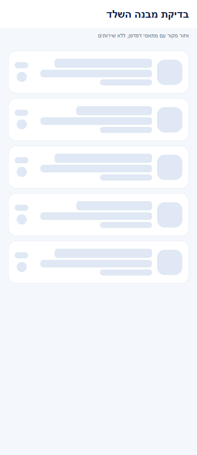

# כל השיחות במקום אחד

## מדידת פעולות ואמינות נתונים, 5.11.2026

נוספה הכנה למדידת הפעולות ברכיבים המתועדים כאן. בפולס אפשר לראות ביצועים וחשבונות ייחודיים לפי פעולה ותקופה, כאשר קיים כיסוי מדידה. איסוף החשבונות החדש עדיין כבוי והמימוש מקומי. [פירוט והיקף הבדיקות](../../audits/2026-11-04-system-night/product-measurement.md).

## מדידה מול הייצור, 4.11.2026

בבדיקה באמולטור מול השרת, בכניסה לחיפוש הופיעה שורת שחקן ראשונה אחרי 1.35 שניות במקום 1.75. החיפוש לפי שם שנבדק היה מהיר יותר גם כשההתאמה לא היתה בעמוד הראשון. [מדידות, בדיקות ומגבלות](../../changes/2026-11-04-player-discovery-production.md).

## חיפוש שחקנים וזמני טעינה, 4.11.2026

אחרי מעבר בין השיחות לבין מצא שחקנים, החיפוש והמסננים חוזרים למקומם. בחיפוש לשיחה חדשה המערכת ממשיכה בעמודים שטרם נמצאה בהם התאמה. מימוש מקומי שטרם הופץ. [השינוי, המדידות והבדיקות](../../changes/2026-11-04-player-discovery-speed.md).

## שיפורי טעינה משותפים, 4.11.2026

עודכנו מנגנוני הטעינה המשותפים כדי לצמצם עבודה וקריאות חוזרות. דרך השימוש בפיצר נשמרת. השינוי מקומי וטרם הופץ, ואין אימות מכשיר חדש של המסך הזה. [היקף, מדידות ומגבלות](../../changes/2026-11-04-screen-performance.md).

## הפצה פנימית 1.1.74, 3.11.2026

עדכוני הלקוח הנוגעים לטעינה ולחיווי, במקורות המשותפים המשויכים למסמך הזה, כלולים בגרסת האנדרואיד הפנימית 1.1.74/306. החבילה ומסלול החנות אומתו; האימות החזותי נשאר בצילומי הדפדפן של סבבי המימוש, ואין אימות התקנה במכשיר. [תכולה, בדיקות ומגבלות](../../changes/2026-11-03-internal-1.1.74.md).

## מצבים ריקים והמשכיות פעולה, 3.11.2026

עודכנו חיוויי קריאה והמתנה במקורות משותפים שמשויכים לתהליך הזה. אין שינוי בחישובים ובפעולות העצמאיות שלו. המימוש מקומי וטרם הופץ. האימות החזותי נעשה באזורים מהמקור בדפדפן בלבד. [התנהגות, בדיקות ומגבלות](../../changes/2026-11-03-experience-followup.md).

תוצאות האימות בסבב זה: כל 6864 הבדיקות ב-614 חבילות ובדיקת הטיפוסים עברו. בדיקות המצבים הממוקדות עברו ב-83 מקרים. נבדקו 72 פריסות של אזורי מקור בדפדפן, ונבדקה כיווניות בצילומים. אין אימות מכשיר או שירות חי חדש.

## התאמת מבנה שלדי הטעינה, 3.11.2026

השלד הותאם למבנה התוכן, כולל מיקום התמונות, האזורים והריווח. אין שינוי בנתונים או בפעולות המסך. השינוי מקומי וטרם הופץ. נבדקו אזורי מקור בדפדפן בשלושה רוחבים, ללא בדיקת מכשיר חדשה. [המידות, הבדיקות והמגבלות](../../changes/2026-11-03-skeleton-layout-alignment.md).

כל 6,820 הבדיקות ובדיקת הטיפוסים עברו. האימות החזותי במשימה זו הוא בדפדפן בלבד.

## התאמת בדיקה משותפת, 3.11.2026

בהשלמת טעינת רשימת המועדונים הותאם רק מתאם בדיקה שמשותף לשני המסכים. אין שינוי בהתנהגות השיחות. כל 6,820 הבדיקות ובדיקת הטיפוסים עברו; לא נערכה בדיקת מכשיר חדשה למסך השיחות. [היקף הבדיקה](../../changes/2026-11-03-club-feed-skeleton.md).

## ליטוש מקומי והשפעת רכיבים, 3.11.2026

השיפור ברכיבים המשותפים המשמשים את רשימת שיחות ומונים כולל שמות לפעולות נוספות בכותרת. אין שינוי בתוכן הודעות, בשליחה או בהרשאות השיחה. הבדיקה הממוקדת של רכיבי המקור אינה בדיקה חדשה של המסך המלא במכשיר.

[הראיות והמגבלות של המשימה](../../changes/2026-11-03-overnight-mission.md).

## בדיקת קצה ואימות מקורי, 2.11.2026

שחזור המיקום בתיבה ובבורר החברים מתחשב במדידות התאים ובתוצאה ריקה. רווחי השורות נשמרים בלי לשבש את חישוב גובה הרשימה. מקומי וטרם הופץ. [שחזור, תיקונים, בדיקות ומגבלות](../../changes/2026-11-02-experience-review.md).

## המשכיות ומשוב בשימוש, 2.11.2026

החיפוש, המסנן, התצוגה והמיקום נשמרים בחזרה לשיחות. אחרי העברה לארכיון מופיע כפתור בטל למשך שש שניות. הביטול מחזיר רק את מצב הארכיון ושומר הגדרות אחרות. מימוש מקומי שטרם הופץ. [התנהגות, בדיקות, צילומים ומגבלות](../../changes/2026-11-02-experience-polish.md).

## הרחבת שלדי הטעינה, 2.11.2026

בטעינה הראשונה מופיע שלד של שיחות או חברים. בשיחה חדשה נשמרים חברים שכבר הגיעו בזמן רענון ובכשל, ואפשר לנסות שוב. מעבר לחשבון אחר מסתיר מיד את הרשימה הקודמת. מימוש מקומי שטרם הופץ. [התנהגות, בדיקות, צילומים ומגבלות](../../changes/2026-11-02-loading-skeletons-expanded.md).

## בקשות לשיחה אישית, 2.11.2026

נוספו אזור בקשות לשיחה, אזור בקשות שנדחו וחיפוש שחקנים מתוך שיחה חדשה. בקשות יוצאות מופיעות עם מצב המתנה או ביטול. המימוש מקומי וטרם הופץ או נפרס. [התנהגות, בדיקות ומגבלות](../chat/message-requests.md).

## תיעוד כשלים — 20.10.2026

נוסף תיעוד אוטומטי לנקודות כשל במסלול הזה, עם מקור התקלה. הפעולה המקורית שומרת על ערכי החזרה והודעות השגיאה שלה. השינוי מקומי, טרם הופץ, ואין אימות מסירה חיה לפולס.

[דוח דיווח השגיאות והראיות](../../changes/2026-10-20-error-reporting-audit.md).

עדכון 12.10.2026: בתצוגה המקדימה של שיחת מועדון או מחזור מופיע שם שולח ההודעה, למשל ״מתן: להביא מצב רוח״. כשבתקציר ישן נשמר רק ״שחקן״, השם מושלם לפי זהות השולח. הודעות ששלחתם מוצגות עם ״אני״. השינוי מקומי וטרם הופץ. [צילום מדמו מנותק](../screenshots/chat-sender-2026-10-12.png).

השיחות של החברים, המועדונים והמחזורים מופיעות לפי ההודעה האחרונה. אפשר לחפש, לסנן, לנעוץ שיחה חשובה, להשתיק אותה או להעביר לארכיון. מועדונים שעדיין לא התחילה בהם שיחה מופיעים בתחתית.

כדי להתחיל שיחה אישית בוחרים חבר או מחפשים שחקן ושולחים בקשת שיחה. שיחות מחזור נסגרות לכתיבה יום לאחר סיום המחזור ונשמרות בארכיון. השינוי מומש מקומית וטרם הופץ.

[לפירוט המעמיק](chats-list.md)
# כניסה לבקשות ולהזמנות — 11.10.2026

מעל השיחות וחיפוש השחקנים מופיע ״חברים והזמנות״. הוא פותח את אותו מסך שקיים בתפריט הבית. [הסבר וצילום](../profile/friends.simple.md).

## סבב דיווחים — 12.10.2026

בתפריט של שיחה אישית נוספה האפשרות ״כרטיס השחקן״. המעטפה ליד ההגדרות פותחת בקשות והזמנות ומציגה תג כשממתין משהו.

התיקונים מקומיים וטרם הופצו. מקור: `ec536c6f` עם שינויים מקומיים. [דוח הסבב ומגבלות הבדיקה](../../changes/2026-10-12-pulse-sweep.md).

## תמיכה זמינה — 14.10.2026

בראש הרשימה נוספה שיחה קבועה עם Teamder, גם אם עוד לא התכתבתם. אפשר לפנות לצוות מתוך החלונית שמעל המסך ולצרף צילום. [איך התמיכה עובדת](../shared/support-chat.simple.md). המימוש מקומי וטרם הופץ.

## סבב פולס — 15.10.2026

תג ההזמנות נטען לפי התיבה עצמה בלי להמתין לתמונות ופרטי מזמינים.

השינויים בסבב זה מקומיים וטרם הופצו. [דוח הסבב](../../changes/2026-10-15-pulse-sweep.md).

## דיווחים ושגיאות וסגירה לפי גיל — 24.10.2026

כאשר פרטי החשבון חסרים, רשימת החברים נשארת במצב כשל טעינה עם ניסיון חוזר ואינה מוצגת כרשימה ריקה תקינה. תשובה שהגיעה אחרי יציאה או החלפת חשבון אינה מדווחת כתקלה חדשה.

[מקור הדיווחים, הבדיקות ומגבלות הסבב](../../changes/2026-10-24-pulse-age-pass.md). השינויים מקומיים וטרם הופצו.

## קיצור טעינות בשיחות ובגילוי - 25.10.2026

הודעות ומונים חדשים אינם טוענים שוב את אותם שמות ותמונות ברשימת השיחות. חזרה לרשימה או ניסיון נוסף עדיין מרעננים אותם, ותשובה מחשבון קודם אינה מוצגת. נבדק בקוד; מקומי וטרם הופץ, ללא מדידת זמן במכשיר. [בדיקות ומגבלות](../../changes/2026-10-24-loading-performance.md).
