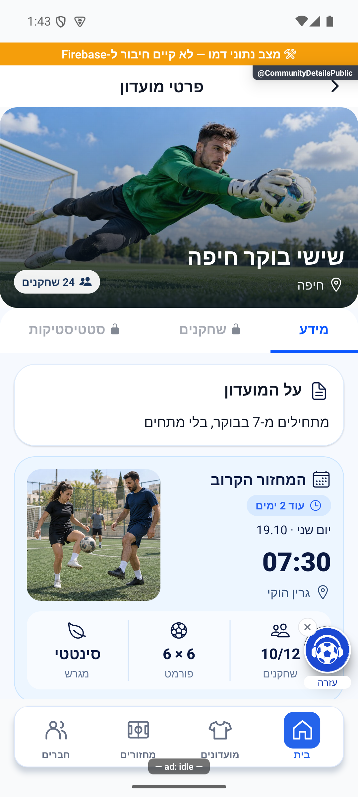

# תמונת מועדון והזמנת חברים

## חלון הצעות בכניסה, 27.10.2026

החלון החדש להצעות מתואם עם ההודעות וההתראות הקיימות כדי שלא יפריעו לכתיבה. אין שינוי בפעולות הפיצר עצמו. השינוי מקומי וטרם הופץ. [פרטים וראיות](../../changes/2026-10-27-feedback-prompt.md).

## הרחבת אבחון דיווחים, 27.10.2026

הדיווחים יוכלו לכלול מה ניסו לבצע, מה היה מצב האפליקציה ומה החזיר השרת. פרטים חסרים מוצגים כלא ידועים, ומספר מוגבל של מופעים נשמר בלי למחוק את המופע הראשון. השינוי מקומי וטרם הופץ, ואינו משלים פרטים לדיווחים ישנים. [היקף, ראיות ומגבלות](../../changes/2026-10-27-diagnostic-context.md).

בדיקות הקוד הושלמו, אך השינוי עדיין מקומי ולא הופץ. פרטים שלא נאספו בדיווחים ישנים אינם משוחזרים בדיעבד.

## טיפול מלא בפריטי הפולס הפתוחים, 27.10.2026

הושלם סבב טיפול בפריטי הפולס עם תיקונים ותוצאות מחקר מוכנות לביקורת. פריטים שלא תוקנו נשארים פתוחים עם הסבר וצעד הבא. לא בוצעה הפצה או בדיקת מכשיר חדשה. [ממצאים, בדיקות ומסירה](../../changes/2026-10-27-pulse-completion.md).

## טיפול בתקלות הפולס, 26.10.2026

נבדק שינוי ממוקד במקור משותף במהלך טיפול בתקלות הפולס. אין שינוי נוסף בפעולות הפיצר המתואר כאן.

השינוי מקומי וטרם הופץ. [בדיקות, מסירה ומגבלות](../../changes/2026-10-26-pulse-fixes.md).

## קישורי שיתוף בדומיין החדש - 26.10.2026

הזמנות מועדון ומחזור משתמשות בדומיין החדש ובקוד קצר. ההעתקה והמעבר להתקנה באתר משתמשים גם הם בכתובת החדשה, עם שמירת פרטי ההזמנה.

השינוי מקומי וטרם הופץ. הבדיקות, מסלולי הנתונים ומגבלות האימות מפורטים ב[דוח השינוי](../../changes/2026-10-26-share-domain.md). אין כאן אימות חדש של כל מצבי המסך.

## ביטול פעילות אחרי מחיקת מועדון - 26.10.2026

מחיקת מועדון עוצרת כעת את המחזורים השבועיים שלו, ובשרת נוספה הגנה שמונעת פתיחת מחזור למועדון שכבר נמחק. הטיפול מבטל מחזורים שטרם הסתיימו, דוחה בקשות חברות ממתינות, מסיר הרשמה להתראות ואת כרטיס המועדון הציבורי. נתוני עבר והישגים אישיים נשמרים. תיקון השרת נפרס ואומת באישור הבעלים. הסדרה שנותרה כובתה, ההרשמה להתראות והכרטיס הציבורי הוסרו; המחזור עצמו כבר לא היה קיים בבדיקה העדכנית. עצירת הסדרה המוקדמת בצד הלקוח תיכלל בבינארי עתידי. נשמרה ההיסטוריה. [המימוש, בדיקת השאריות ומגבלות האישור](../../changes/2026-10-26-deleted-club-recurring.md).

## השפעת מקור משותף במשימת השעון - 26.10.2026

במקור השרת המשותף נוספה כניסה נפרדת לסנכרון הפעילות האישית מהשעון. פתרון קוד הזמנה, ייחוס המזמין ורקע המועדון אינם משתנים בהוספת הייצוא. לא נערכה כאן בדיקה חדשה של כל מצבי המסך. השינוי מקומי, ומצב ההפצה ומגבלות הבדיקה מפורטים בדוח המקושר. [היקף המימוש, הבדיקות, מגבלות האישור והצילומים](../../changes/2026-10-26-android-personal-activity.md).

## הפצה פנימית 1.1.61 - 25.10.2026

הבינארי `1.1.61/295` הופץ ואומת במסלול הפנימי באנדרואיד. תיקוני הלקוח נכללים בו, ושירות הפרופיל נפרס ואומת בנפרד. גם תיקוני הסגל, שמירת התוצאה והתראת השגיאה בשרת נפרסו ואומתו באישור מפורש. שינויי יישום הפולס עצמו טרם הופצו. אין שינוי כללי הרשאה או הסבת נתונים. ניסוחי המצב המקומי בסעיפים הקודמים נכתבו לפני ההפצה; [דוח ההפצה](../../changes/2026-10-25-internal-1.1.61.md) מפרט בדיוק מה נכלל, מה נבדק ומה עדיין מקומי.

## תיקוני הפולס - 25.10.2026

נבדק תיקון ממוקד בקובץ משותף במהלך סבב הפולס. אין שינוי מכוון בתהליך העצמאי המתואר כאן ואין טענה לבדיקת מסך חדשה שלו. מקומי וטרם הופץ.

[מקורות, בדיקות, צילומים ומגבלות](../../changes/2026-10-25-pulse-fixes.md).

## שעון מדויק וכיתוב פנדל - 25.10.2026

במקורות המשותפים נוסף שימור השעון המדויק של פנדל במהלך משחק, וכיתוב ההבקעה ביומן קוצר. אין שינוי במונים או בתהליך העצמאי המתואר כאן; לא נערכה לו בדיקת ממשק חדשה במסגרת העדכון. השינוי מקומי וטרם הופץ. [פרטים וראיות](../../changes/2026-10-25-in-play-penalties.md#שעון-מדויק-וכיתוב-אירוע).

## פנדל במהלך משחק חי - 25.10.2026

עודכנו מקורות משותפים לצורך פנדלים במהלך משחק. אין שינוי מכוון בתהליך העצמאי המתואר במסמך הזה, ולא נערכה לו בדיקת ממשק חדשה במסגרת המשימה.

השינוי מקומי. נדרשת פריסת שרת לפני הפצת לקוח שמשתמש באפשרות; לא בוצעו פריסה או שינוי הרשאות. [חוזה הנתונים, התהליך, הבדיקות ומגבלות ההפצה](../../changes/2026-10-25-in-play-penalties.md).

## עיצוב הודעת ההזמנה, 25.10.2026

הודעת המסע עוצבה מחדש בצבעי האפליקציה: תמונת האצטדיון הקיימת, כרטיס נקי, כותרת קצרה וכפתור שיתוף כחול. יש התאמה למסך צר ולמצב כהה. התמונה כלולה בהודעה ואינה דורשת הורדה נפרדת.

העיצוב נשמר בטיוטה בגוריו ונקרא חזרה לאימות. הוא נבדק בדפדפן בלבד ולא נשלח למשתמשים. התמיכה בשיתוף הישיר עדיין דורשת גרסת לקוח ואימות במכשיר. [צילום העיצוב](../screenshots/organiser-invite-premium-after-light-390-2026-10-25.png).

## שיתוף מתוך מסע מארגנים, 24.10.2026

נוספה תמיכה מקומית בכפתור שיתוף בהודעות מסע. הכפתור משתף הזמנה למועדון המסוים שהתחיל את המסע, ולא למועדון שנבחר במקרה באפליקציה. לפני ההצגה ולפני השיתוף נבדק שהמשתמש עדיין מנהל במועדון ושיש פחות מעשרה חברים.

המסע נשמר בטיוטה ולא הופעל. התמיכה בכפתור דורשת גרסה עתידית של האפליקציה; אין אימות שיתוף במכשיר או שליחת הזמנה אמיתית. ביטול חלון השיתוף אינו נספר כשיתוף, וגם השלמת החלון אינה הוכחה שהודעה נמסרה לחבר.

## תיעוד כשלים — 20.10.2026

נוסף תיעוד אוטומטי לנקודות כשל במסלול הזה, עם מקור התקלה. הפעולה המקורית שומרת על ערכי החזרה והודעות השגיאה שלה. השינוי מקומי, טרם הופץ, ואין אימות מסירה חיה לפולס.

[דוח דיווח השגיאות והראיות](../../changes/2026-10-20-error-reporting-audit.md).

## תיקון פערי העונות — 20.10.2026

השינוי בקובץ השרת המשותף במסגרת תיקוני העונות נוגע לשער הסגירה, אימות מחזור והשלמת סטטיסטיקה בלבד. נתיבי הפיצ׳ר המתועדים כאן לא שונו בסבב זה. הבדיקות המלאות עברו; אין בכך אימות חדש של פריסה או שירות חיצוני.

[דוח תיקונים, בדיקות ומגבלות](../reviews/2026-10-20-seasons-fixes.md).

## השלמת דיווחי הפולס — 17.10.2026

כפתור החלפת הרקע שקוף יותר, כך שהתמונה נשארת נראית מאחוריו.

[צילומים, בדיקות ומגבלות](../../changes/2026-10-17-roster-recruitment-and-pulse.md).

בבדיקה מ־13.10.2026 נצפו בורר התמונות והגלילה בגלריה, ונבדקה סגירה בכפתור החזרה של המכשיר. הבדיקה נעשתה בדמו ללא החלפת תמונת מועדון. [צילום הבורר](../screenshots/overlays-cover-picker-2026-10-13.png).

תיקון מ־8.10.2026: תמונות הרקע מוצגות בגבולות כותרת המועדון. בחירת רקע והזמנת חברים ממשיכות לפעול באותה דרך; בדיקת התצוגה נעשתה באנדרואיד עם נתוני דמו.

אפשר לבחור רקע למועדון או להעלות תמונה מהמכשיר. דרך השיתוף שולחים לחברים קישור למועדון כדי שיוכלו להכיר אותו ולהצטרף.

הגלריה כוללת כעת 16 תמונות: שש תמונות היום הקודמות ועוד עשר תמונות בהירות ומגוונות במקום הישנות. מועדון שבחר רקע ישן קיבל בחירה אקראית וקבועה מתוך עשר התמונות החדשות; היא תוצג לאחר עדכון האפליקציה. תמונה שהעליתם מהמכשיר נשארת שלכם.

[לפירוט המעמיק](covers-and-invitations.md)

## עדכון 8.10.2026 — תנועה ותיקוני דיווחים

בחירת רקע מקבלת תגובה קצרה והכותרת עוברת לתמונה החדשה בעדינות. גם סמל השיתוף מגיב ללחיצה.

## תיקוני סבב הבאגים — 8.10.2026

כשבחירת רקע חדש אינה נטענת, התמונה הקודמת נשארת. תשובה מאוחרת של תמונה אחרת אינה מחליפה את הבחירה הנוכחית.

## רענון הגלריה — 8.10.2026

עשר התמונות החדשות נצפו בגלריה באמולטור. שש הקודמות נשמרו ונצפו בגלילה; אזהרת פיתוח מכסה חלק מתחתית הצילום. לא נשמרה בחירה ולא בוצעה כתיבה למועדון בייצור; אייפון לא נבדק. בדיקת הטיפוסים ו־2,820 בדיקות ב־191 חבילות עברו. [מקורות והוראות היצירה](../../changes/2026-10-08-club-covers-refresh.md).

## החלפה אקראית למועדונים קיימים — 8.10.2026

לפי בקשת הבעלים, עודכנו בפועל 25 מועדונים עם `coverImageId` בטווח `c01`–`c10` וללא תמונה שהועלתה. לכל מועדון הוגרל מזהה אחר מתוך עשרת החדשים ונשמר במסד, כך שהבחירה קבועה בין מסכים, מכשירים ופתיחות. שבע תמונות שהועלו ושתי בחירות מהשש הקודמות נשמרו; 187 מועדונים ללא מזהה רקע נבחר נשארו עם ברירת המחדל.

הקריאה בוצעה באמצעות שאילתה. העדכון נגע רק ב־`coverImageId`, עם תנאי התאמה לזמן העדכון שנקרא ובדיקה חוזרת שאין `coverPhotoUrl` לא ריק. אפס רשומות השתנו במקביל, ואימות לאחר הכתיבה אישר את כל 25 השיוכים. התוכנית וגיבוי המזהים הקודמים שמורים מקומית ב־`artifacts/club-cover-randomization-plan.json`, ואישור הכתיבה ב־`artifacts/club-cover-randomization-receipt.json`. אין החלפה אקראית בכל רינדור. צילום הגלריה לעיל מוכיח את הנכסים החדשים; אינו צילום של המועדונים בייצור. הקוד לא השתנה במשימה זו, והבדיקות שעברו במשימת רענון הגלריה תקפות לאותו קוד.

## תיקוני ההזמנה וההיכרות — 8.10.2026

קישורי המועדון שומרים את פרטי המזמין ואת יעד המועדון גם לאחר מעבר לחנות. באייפון כפתורי ההורדה ממתינים להעתקת ההזמנה ומסבירים מה לעשות אם היא לא הצליחה.

## עדכון ההזמנות — 9.10.2026

תוקנו מקומית מקרי הקצה שנמצאו בסקירה הקודמת, ונבדקו גם קישורים קצרים, קישורים רגילים, דף המועדון ודפי ההורדה. ההזמנה אמורה לשמור את המחזור או המועדון ששיתפו ואת פרטי המזמין והמקור שלה. מחזור שהסתיים נשאר היעד ששיתפו, במקום לפתוח במקומו מועדון אחר.

באייפון ובאייפד ההורדה מנסה לשמור את ההזמנה בלוח לפני מעבר לחנות. אם אין הרשאה או שהשמירה נכשלת, מוצג הסבר לחזור לקישור המקורי לאחר ההתקנה. אי אפשר להבטיח שחזור אוטומטי באייפון ללא ההרשאה הזאת. למי שכבר התקין יש כפתור פתיחה נפרד.

באנדרואיד פרטי ההזמנה עוברים דרך החנות. כאשר קוד קצר אינו נפתר בזמן, נשמר הקישור המקורי לניסיון נוסף במקום לשכוח אותו. הזמנה חדשה שהמשתמש פתח גוברת על הזמנה ישנה מההתקנה.

שמות ארוכים נפרסים על המסך, הכפתורים מתאימים את גובהם לתוכן, ושם מזמין נשאר טקסט רגיל. בדיקות הקוד והדפדפן המקומי עברו; התקנה אמיתית מהחנות ובדיקה באייפון פיזי עדיין אינן מוכחות. התיקון מקומי ואינו אומר שכבר פורסם למשתמשים.

[דוח התיקונים והבדיקות העדכני](../reviews/onboarding-expanded-fixes-2026-10-09.md).

## תיקוני דיווחים — 9.10.2026

מועדון ללא תמונה שהועלתה או רקע שנבחר מקבל אחת מעשר התמונות החדשות. אותה תמונה נשמרת בין כניסות ומוצגת גם במחזורים שלו. תמונות שהועלו נשמרות.

מקור: שינויים מקומיים מעל a348b9f; טרם נבנתה גרסה. [ראיות ומגבלות](../../changes/2026-10-09-pulse-round2.md).

## תיקון הזמנות — 12.10.2026

כשקיבלת הזמנה למועדון, כפתור אישור ההזמנה מופיע גם אם הגעת דרך רשימת המועדונים. הזמנות למועדונים ולמחזורים שכבר הצטרפת אליהם מוסתרות מרשימת ההזמנות בחזרה למסך. הזמנה שרק פתחת עדיין תופיע עד להצטרפות. נבדק באנדרואיד בדמו מנותק; טרם הופץ.

## נשארים במועדון לאחר הצטרפות — 12.10.2026

לאחר הצטרפות מוצלחת פרטי אותו מועדון עוברים לתצוגה של חבר, במקום לחזור לרשימת המועדונים. נוספה טעינה ממוקדת של המועדון כדי שלא להמתין לרענון כל המועדונים כשאין צורך. נבדק באנדרואיד בדמו; זמני שרת אמיתיים לא נמדדו, והתיקון טרם הופץ.

## כרטיסי הזמנות עם תמונה ואישור ישיר — 12.10.2026

הזמנות למועדונים ולמחזורים מוצגות בכרטיסים עם תמונת המקום, פרטי המזמין וכפתורי ״אישור והצטרפות״ ופרטים. במחזור רואים גם תאריך, שעה, מיקום, סוג מגרש ופורמט כשיש נתונים.

אישור הזמנת מנהל תקפה מצרף ישירות ופותח את פרטי אותו מועדון או מחזור במצב המעודכן. כשההרכב מלא, הכרטיס מציין שההצטרפות היא לרשימת ההמתנה; לאחר האישור המשתמש נכנס להמתנה, בלי להגדיל את ההרכב מעבר למכסה. במהלך האישור מופיע מחוון טעינה ולחיצות חוזרות חסומות. ההזמנה נעלמת אחרי הצטרפות או כניסה להמתנה. הזמנה אינה עוקפת חסימה, דחייה, מחזור סגור או תוקף שפג. הזמנה שאינה אישור מנהל עשויה להישאר ממתינה לאישור בהתאם להגדרות.

נבדק באמולטור אנדרואיד בדמו מנותק, וכן בבדיקות אוטומטיות של מסלולי הלקוח והשרת הקיימים. טרם הופץ.

## גיבוי לתמונת מועדון שלא נטענת — 17.10.2026

אם תמונה שהועלתה אינה נטענת, נשארת תמונת מועדון מובנית מאחורי הכותרת. בחירת התמונה והשמירה אינן משתנות.

[סקירת ההכנה, בדיקות ומגבלות](../../changes/2026-10-17-preinternal-audit.md).

## הפצה פנימית — 17.10.2026

שינויי הלקוח האחרונים המתועדים כאן נכללו בבינארי הפנימי `1.1.53 / 286` באנדרואיד. המסלול אומת בגוגל; הייצור נשאר בגרסה הקודמת. זה אינו אימות חדש של תרחיש ייצור או של מכשיר אפל. [מקור הבינארי, פריסת השרת, בדיקות ומגבלות](../../changes/2026-10-17-internal-1.1.53.md).

## תלות בעדכון העונות — 19.10.2026

קובץ תשתית משותף עודכן במסגרת העונות. שינוי זה אינו מוסיף פעולה חדשה למסך המתואר כאן; פרטי העונות והבדיקות מופיעים במסמך העונות.

[מצב המימוש, הבדיקות ומגבלות האימות של העונות](../clubs/seasons.md). מקומי בלבד; לא בוצעה פריסה במסגרת המשימה.

## בידוד מונה בקשות והתאוששות מרקע — 23.10.2026

ספירת בקשות הצטרפות אינה ממתינה יותר לדירוגי השחקנים במועדונים. מסך הבית טוען את המונה מחדש בחזרה מרקע ומתעלם מתוצאה ישנה שמגיעה אחריה. כשל אמיתי בקריאת הבקשות נשאר כשל ושומר את הספירה האחרונה; אין שינוי בעיצוב. נבדק בבדיקות קוד, מקומי וטרם הופץ. [הסבר, יומני שרת ומגבלות](../../changes/2026-10-23-inbox-resume.md).

## עדכון תלות משותפת בקריאות מידע — 23.10.2026

בקובצי השירות המשותפים נוספה אפשרות מפורשת לניסיון חוזר אחד בקריאה זמנית שנכשלה, תוך עצירה אם החשבון מתחלף. החיבור מוגבל ל־14 נקודות קריאה המפורטות בדוח; אין כאן טענה שכל פעולה בפיצ׳ר קיבלה ניסיון חוזר או שנבדק מסך חדש. בדיקות המאגר המלאות עברו (5,261 בדיקות ב־472 חבילות), אך אינן הוכחת הרצה במכשיר. הקוד מקומי וטרם הופץ. [מסלול, ראיות ומגבלות](../../changes/2026-10-23-four-open-errors.md).

## עדכון תלות מסבב הפולס — 23.10.2026

בתלות המשותפת נוספו התאוששות מוגבלת להעשרת מועדונים ובדיקות לביטול קריאה של חשבון או דור ישן. אין שינוי מכוון בכללי המוצר של המסך הזה ואין אימות מסך חדש עבורו. הקוד מקומי וטרם הופץ. [תחום השינוי והבדיקות](../../changes/2026-10-23-pulse-resweep.md).

## שינוי מוגבל בקובץ השרת המשותף — 24.10.2026

ב־`functions/src/index.ts` נוסף ייצוא רכיב קליטת הקריסות, ו־`onErrorLogged` מדלג על מקור הקריסות החדש כדי למנוע התראה כפולה. אין שינוי במסלול הפיצ׳ר המתואר כאן או בחישוביו. לפריסה הוכנה חבילה מהמקור הפרוס עצמו, עם תנאי הדילוג בלבד; אין פריסה של פונקציות הפיצ׳ר הזה. [היקף וראיות](../../changes/2026-10-24-crashlytics-pulse.md).

## תלות בשמירת צבעי המחזור — 24.10.2026

שמירת המידע המשותפת עודכנה כדי להעביר את צבעי הקבוצות ממסכי הכוחות להכנה וללייב. אין תוספת פעולה במסך הזה, והוא לא נבדק מחדש במכשיר במסגרת התוספת. השינוי מקומי וטרם הופץ. [פרטי התוספת ומגבלות הבדיקה](../rounds/draft-setup.md#צבעים-לפני-שיבוץ-ובכל-שיטת-חלוקה--24102026).

## טיפול בפולס — 24.10.2026

עודכן רכיב משותף של חלונות האישור ומסלול השרת להרשמה. אין בסבב הזה שינוי ייעודי או אימות חדש של מסך זה.

[פירוט התיקונים, הבדיקות והמגבלות](../../changes/2026-10-24-pulse-current.md). התיקונים מקומיים וטרם הופצו.

## תלות ביצוא היסטוריית השוואות — 24.10.2026

במשימה זו נוספה בקובץ השרת המשותף רק שורת יצוא של `recordPlayerComparison` ו־`getMyComparisonActivity`. מסלולי הפיצ׳ר המתוארים כאן לא שונו במסגרת התוספת הזאת ולא הורצו מחדש כתרחיש נפרד. אין פריסה או שינוי כללים. [המימוש, הבדיקות וגבולות האימות](../../changes/2026-10-24-comparison-activity.md).

## בדיקת תלות משותפת ברענון סגל בווידגט - 25.10.2026

נוסף תיקון נפרד לרענון רשימת השחקנים ברכיב הבית כשהאפליקציה סגורה. התוספת אינה משנה את התהליך המתואר בעמוד זה. היא מקומית וטרם הופצה. [פרטי הבדיקה והמגבלות](../../changes/2026-10-25-widget-roster-background.md).
