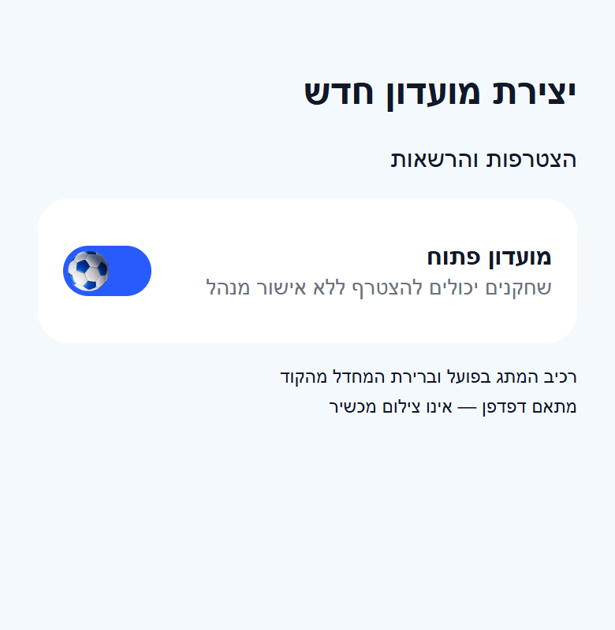

# יצירה ועריכת מועדון

## הסבר הסף בחלונית סיום עונה — 23.10.2026

`src/components/community/SeasonsSettings.tsx` מוסיף ל־`closeBody` פסקה המשתמשת ב־`MIN_SEASON_ROUNDS`, גם בסיום וגם בכיבוי. אין שינוי במונה, במכנה, בשרת או בהחלטת ביטול/סגירה. מקור הבקשה והצילום הם `feedback/Y47IGCJUASVYmcACpltq`; אין לחיצה על אישור הסיום בחשבון ייצור. [פירוט האימות והמגבלות](../../changes/2026-10-23-crash-test-and-pulse-followup.md).

## תיעוד כשלים — 20.10.2026

נוספו תצפיות דיווח בנקודות הכשל של המקורות המשויכים לפיצ׳ר, במסגרת הרחבה רוחבית. נשמרו ערכי החזרה, הזריקות ותנאי הפעולה הקיימים; נוסף מקור קוד והקשר לדיווח. כיסוי תחבירי אינו הוכחת הרצה של כל מצב. השינוי מקומי וטרם הופץ; בדיקות המסירה, מגבלות מניעת הכפילויות והמסלולים שטרם חוברו מתועדים בדוח המשותף.

[דוח דיווח השגיאות והראיות](../../changes/2026-10-20-error-reporting-audit.md).

## אימות מול שרת אמיתי והגבלת המתנה — 20.10.2026

נפרסו באישור16 שירותי עונות ונבדקו140 קובצי מקור לכל שירות. במועדון הבדיקות עבר רצף הפעלה עם7 מחזורים, יעד שכבר הושג, חלון תיקונים מדויק, סגירה ידנית, שמונה תארים, ארכיון ופתיחת עונה2 עם0 מחזורים ויעד24. עברו50 השוואות נתונים; המצטיין8.36 ומלך הניצחונות78.57%. ברכיב הסטטיסטיקות נוסף `withSeasonReadTimeout`:30 שניות לתמונת מצב עקבית, רשימת עונות וארכיון/כל הזמנים כולל בדיקת עקביות בסוף. כשל מוביל לניסיון חוזר ואינו מספר אפס; תוצאה מאוחרת אינה מוחלת. התיקון המקומי בלקוח נבדק במסך עם קריאה מושהית והחלמה, וב־5,093 בדיקות ובדיקת טיפוסים. נוסחאות התארים לא שונו. הסגירה הטבעית אחרי24 שעות, כמה זכאים וכימיה של שני חשבונות אמיתיים לא הורצו בייצור.

[הבדיקה, המקור, הצילומים והמגבלות](../reviews/2026-10-20-seasons-live.md).

## תיקון פערי העונות — 20.10.2026

`seasonLock.ts` אוכפת פקיעה גם לפני הסריקה; השלמת עיבוד מחזור מותרת במפורש בלי לפתוח ארכיון חתום. שינוי יעד נבדק גם בעסקת `acquireSeasonOperation`. `seasonManager.needsVerification` משותפת לרשימה ולחסמי הסגירה; `setEveningPlayed` בודקת מועד, שיוך והרשאה מתוך נתונים עדכניים בעסקה. `src/utils/seasonReadConsistency.ts` וחותמת עונה מהחנות מונעות קריאה מעורבת ומרעננות לשונית שנשארה מותקנת. `seasonSummaryService.ts` בוחרת מונים חיים לעונה פעילה ואינה דורשת ארכיון חסר; משתתף שעזב ממשיך לקרוא ארכיון מורשה. אין שינוי בנוסחאות או בהרשאות.

עברו 5,090 בדיקות באפליקציה, 352 בדיקות הרשאות, 52 תרחישי מדיניות/גבולות/רצף, 38 תרחישי ארכיון ובדיקות טיפוסים והידור. שני תרחישי הרצף הורצו גם דרך שירותי הקריאה של האפליקציה ולקוח מזוהה מול הכללים המלאים. `functions/seasonAudit20261020.emulator.test.mjs` עובר כעת; נוספו `functions/seasonFullFlow.emulator.test.mjs`, `tests/logic/seasonReadConsistency.test.ts` ו־`tests/logic/communitySeasonRefresh.test.ts`. הפלטים ב־`artifacts/seasons-fixes-2026-10-20`. מסירת אירועי הענן מדומה; אין טענה לפריסה או לבדיקת שני מכשירים/אייפון.

[דוח תיקונים, בדיקות ומגבלות](../reviews/2026-10-20-seasons-fixes.md).

## יצירה חוזרת לאחר אישור שאבד — 18.10.2026

`CreateGroupScreen` כותב טיוטה לפני שליחה גם לחשבון מלא, עם מזהה הטיוטה ו־`__creationOwnerId`. שחזור מסך משתמש במזהה המקורי ומסרב להציע טיוטה המסומנת לחשבון אחר. `actionResumers` מעביר את `draft.id` לאותו `createClubFromValues`; לאחר הצלחה המסך צורך רק את גרסת הטיוטה ששלח, בלי למחוק טיוטה חדשה יותר.

`runCreationAttempt` ב־`src/services/creationAttempt.ts` שומר לפני בקשת הרשת רשומת ניסיון באחסון המקומי: מפתח SHA256 של משתמש, סוג יצירה, מזהה טיוטה וחותמת SHA256 של תוכן קנוני; הרשומה הממתינה כוללת מזהה אקראי ותוכן מוכן קבוע. הגאוקוד ותמונת הכיסוי האקראית מחושבים פעם אחת לניסיון ואינם משתנים בניסיון חוזר. שינוי תוכן או חשבון או טיוטה נותן ניסיון נפרד; חזרה לתוכן הקודם מוצאת את הרשומה הקודמת. כשל אחסון או רשומה פגומה אינם גורמים לשליחת יצירה חלופית. לאחר הצלחה התוכן המוכן מוסר ונשמרת קבלה מינימלית עם מזהה ותוצאה, בלי פרטי הקשר והטיוטה. גם בזמן המתנה נשמר רק `creator.id`, בלי פרופיל המשתמש המלא או אסימוני הודעות. הצלחה שמורה מאפשרת חידוש בלי תופעות נלוות חוזרות.

`assertCreationOwner` בודק את זהות ההתחברות לפני ההכנה, לפני השליחה ואחרי התשובה; `groupService` בודק שוב בסמוך ל־callable ואחרי קריאת המועדון, ושומר את `StaleSessionError`. רשומת הצלחה מקומית אינה מוחזרת לסשן אחר. הרשאות השרת לא הורחבו.

`createGroupCallable` מקבל `creationAttemptId` אופציונלי ותומך בלקוחות ישנים ללא שדה זה. `creationReceiptId` ו־`fingerprintCreation` ב־`functions/src/creationReceipt.ts` קושרים קבלת שרת ב־`serverCreationAttempts` למשתמש המאומת ולתוכן היצירה המאומת. בעסקה אחת נכתבים הקבלה, המועדון הקנוני, הכרטיס הציבורי, מונה הקצב ו־`teamsCreated`. קבלה קיימת מחזירה את המזהה הקודם לפני חיוב קצב נוסף; אותו מזהה ניסיון עם תוכן שונה נדחה. פרטי זיהוי המשתמש מהבקשה אינם מקור סמכות. לקוח ישן ממשיך ליצור במסלול הרגיל ללא הגנת ניסיון מתמשכת.

מגבלות: הגנה זו קשורה לאותה התקנה, אותו חשבון, אותה טיוטה ואותו תוכן. מחיקת אחסון, טיוטה חדשה או שינוי הפרטים יוצרים כוונה נפרדת; אין איחוד יצירות דומות בין מכשירים. חיי הטיוטה נשארו שבעה ימים, בעוד רשומות ניסיון אינן נמחקות אוטומטית. הפעלת עונות נשארת פעולה נפרדת לאחר יצירה, עם התאוששות במסך עריכה בעת כשל. אין כאן שינוי חזותי.

בעת חידוש יצירת מועדון, `SeasonRefusedError('seasonsAlreadyOn')` נחשב הצלחה למטרת יצירה זו בלבד, משום שהשרת מאשר שהעונות כבר פעילות. כשל רשת אמיתי נשאר `seasonsFailed=true`; בדיקת זהות בתחילת ה־catch מונעת בליעת החלפת חשבון כהצלחה. חוזה `seasonService` הכללי לא השתנה.

ראיות: `creationAttemptRecovery`, `clubCreationReceipt`, `actionResumers` מפעילים אובדן תשובה אחרי כתיבה, הפעלה מחדש, מקביליות, החלפת זהות, אי־התאמת תוכן, מגבלת קצב וכשל עסקה. גוף ה־callable האמיתי רץ במתאם עסקאות; אין זו כתיבת ייצור. [דוח ומגבלות](../../changes/evidence/2026-10-18-production-blockers/creation-recovery-audit.md). המוביל דיווח על פריסת פונקציות השרת ואימות 136 קובצי מקור; אין בכך הוכחת יצירת מועדון נוספת או ניסיון אישור אבוד אמיתי בייצור.

[להסבר הקצר והפשוט](create-and-edit.simple.md)

עודכן: 07.10.2026; מקור: `8e8fde5`. מסכים: `src/screens/groups/CreateGroupScreen.tsx`, `src/screens/groups/GroupWizardForm.tsx`, `src/screens/communities/CommunityEditScreen.tsx`. מסלולים: `CommunitiesCreate`, `CommunityEdit` עם `groupId`.

## מבנה

אשף בן שני שלבים: זהות ופרטים בסיסיים, ולאחריהם הגדרות מתקדמות. שם ועיר חובה. תיאור, כללים ומספר קשר אופציונליים; מספר ישראלי נבדק אם הוזן. אין שדה בחירת מכסת חברים במסך הנוכחי. הגדרות עונות מתועדות ב[עונות](seasons.md); פעולותיהן נשלחות מיד ואינן חלק מטיוטת שמירת שם/תיאור.

| פעולה | נתונים | תנאי ותוצאה |
|---|---|---|
| מעבר לשלב הבא | שם ועיר | חסום כשחסרים פרטי חובה |
| יצירה כאורח | טיוטה מקומית | נשמרת לפני התחברות ומוחזרת להמשך |
| יצירת מועדון | פונקציה `createGroupCallable` | יוצר נוסף כמנהל וכשחקן; נוצרים מסמך פרטי וציבורי |
| עריכת פרטים | `updateGroupMetadata` | מנהל בלבד; רשימת שדות מותרת בלי מזהים/חברות |
| יציאה מטיוטה ששונתה | מצב מלוכלך | הגנה מפני אובדן שינויים |
| יצירת עונה ראשונה שנכשלה | מועדון כבר נוצר | לא ליצור מועדון נוסף; להתאושש באמצעות עריכה |

מגבלות שרת שנקראו: עד 5 יצירות ביום; שם 80 תווים, תיאור 500, כללים 2000, טלפון 40. בדיקה בצד הלקוח אינה מחליפה את בדיקות השרת. היוצר מקבל `joinedAt` ו־`adminSince` במצב שנכתב בשרת. שדה `maxMembers` היסטורי נשמר אם אינו נשלח; אין להחליפו אוטומטית בברירת מחדל של 40.

## מצבים והרשאות

### המראה הציבורית — תיקון הרשאה מאושר, 10.10.2026

יצירת `groupsPublic/{gid}` מוגבלת כעת בקובץ הכללים המקומי למנהל במקור הקנוני `groups/{gid}`. `adminIds` שנשלח במראה עצמה אינו מקנה סמכות. הבדיקה היא `getAfter` של המקור, ולכן יצירת המקור והמראה באותה אצווה או עסקה בלקוח יכולה להצליח אטומית: ההרשאה נבדקת מול המקור שאחרי הכתיבה, והכתיבה של המקור חייבת לעמוד בכללים שלה. מקור חסר, מזהה מראה אחר, שחקן שאינו מנהל, הסלמת מנהלים במקור של אחר או מונה ראשוני מעל 1 נדחים; כשל באחד המסמכים מבטל את כל הכתיבה.

הצעה ראשונית השתמשה ב־`isGroupAdminSafe` שקוראת את המצב לפני הכתיבה. בדיקות שחזור מול כל הכללים הוכיחו ששתי כתיבות נפרדות עוברות, אך אותן כתיבות תקינות באצווה ובעסקה נכשלות. לכן אושר תיקון `getAfter` ממוקד לתנאי יצירת המראה בלבד. אין שינוי בקריאת הגילוי או בהגנות העדכון האחרות. הלקוח הנוכחי יוצר דרך `createGroupCallable` עם ערכת מנהל השרת, העוקפת את כללי הלקוח; בדיקת האצווה אינה טענה שהפונקציה רצה במכשיר או שנוצר מועדון בייצור. פריסה מתועדת בנפרד, ויישום מקומי אינו הוכחת פריסה.

כל 303 בדיקות הכללים עברו על הקובץ הפעיל המלא ובסדר טורי, כולל 18 בדיקות חוזה חדשות. [דוח ההרשאות והגבולות](../../../artifacts/pre-release-2026-10-10/permissions-approved-validation.md) מפנה לכשל המשוחזר לפני `getAfter` ולהצלחה אחריו. לא בוצעה יצירת מועדון בחשבון אמיתי.

טופס ריק, טופס קיים, שגיאות שדה, עסוק, כישלון רשת, כישלון חלקי של הפעלת עונה, אורח לפני התחברות ומנהל עורֵך. מסך העריכה משתמש במועדון שבמאגר החברות ובבדיקת מנהל; אין לראות היעדר במאגר כהוכחה למחיקה בשרת. פרטי תזמון המחזור הקבוע מנוהלים במקום אחר; טופס הזהות אינו מחליף עריכת מחזור קבוע.

## מקור אמת ובדיקות

`src/services/groupService.ts`; `functions/src/index.ts` עבור פונקציית היצירה; `src/firebase/firestore.ts`; `src/components/community/NewClubSeasons.tsx`; `src/components/community/SeasonsSettings.tsx`. בדיקות: `tests/logic/newClubSeasons.test.ts`, `tests/logic/seasonActivation.test.ts`, `tests/logic/groupSeasonsReader.test.ts`. יצירה ושמירה לא בוצעו במסגרת המיפוי.

## ראיות והיסטוריה

צולמו רק השלב הראשון של יצירה ושל עריכה בנתוני דמה. אין צילום של שלב מתקדם, אימות שדות, יציאה מטיוטה, מנהל חסר או כישלון חלקי. מקור 087 מתאר הוספת לוגו; בקוד הנוכחי לא אותרו `logoUrl` או פונקציית העלאת לוגו. לכן לוגו אינו מתועד כיכולת קיימת.

## הצעות בלבד

להסביר אילו הגדרות נשמרות מיידית ואילו דורשות שמירה; להציג סיכום לפני יצירה; להנפיש מעבר בין שלבים בלי להזיז שדות במהלך הקלדה. להוסיף מצב התאוששות ברור אחרי יצירה מוצלחת והפעלת עונה שנכשלה.

## פירוט טכני נוסף — זרימה, חישוב ונקודות שינוי

`createGroup` שולח ל־`createGroupCallable`; אין לייצר שוב מועדון אם רק הפעלת העונה שאחריו נכשלה. `updateGroupMetadata` בודק מנהל, מעביר רשימת שדות מפורשת, מנרמל שם וכותב ב־`writeBatch` את `groups` ואת השדות הציבוריים המותרים ב־`groupsPublic`. הכתיבה החלקית עוקפת ממיר מלא כדי למנוע ערכי `undefined`; לאחר האישור נקרא המועדון מחדש.

מכסת חברים אינה ניתנת להפחתה מתחת לסגל הקיים: סגל 29 ומכסה 25 מעלים `GROUP_MAX_BELOW_CURRENT` עם `currentCount=29`. אין הוצאה אוטומטית של ארבעה חברים. שם ועיר חובה באשף המקורי; מסלול ההצטרפות המוטמע של שירות ההדרכה מאפשר עיר אופציונלית, ולכן שינוי תיקוף חייב לבדוק את שתי הכניסות. שדה חדש דורש רשימת שדות, היטל ציבורי כשמתאים, ממיר, טופס ובדיקות; אין להוסיף שדות חברות למסלול המטא־נתונים.

הפירוט מתאר את הקוד שנקרא, ולא בדיקת כתיבה או הרשאות בסביבת הייצור. יש לקרוא את הקוד הממוקד וההפרש מאז מקור המיפוי לפני תיקון; בדיקות המוזכרות כאן לא הורצו מחדש לצורך עריכת התיעוד.

## תיקוני עיצוב ונגישות — 10.10.2026

מקור: `a348b9f235f1e1433497600555303231512a0834` עם שינויים מקומיים. אין בסעיף זה הוכחת גרסת חנות.

`GroupWizardForm` מעבירה שם ומצב ל־`BallSwitch`. עטיפת מלל שאינה פעולה עצמאית אינה תחנה כפולה; כפתור ההסבר נשאר נגיש בנפרד. `InputField` המשותף מספק תווית לשדות מלאים וסמנטיקת כפתור לשדות בחירה. חוזי הכתיבה, הרשאות וולידציה נשמרו. נבדק רכיב הקלט ביחידה, ולא הוגש טופס מועדון במכשיר.

## אימות פריסת הרשאות — 10.10.2026

שני התיקונים הממוקדים נפרסו לאחר אישור הבעלים. `deployment-after.json` מאמת שכללי השרת תואמים לקובץ שנבדק ב־303 בדיקות על מלוא הכללים. לא נשלחו הודעות אמת או נוצרו מועדונים לצורך הבדיקה; בדיקת פריסה אינה מסע כתיבה במכשיר.

## עיצוב הטפסים — 11.10.2026

מקור: `ec536c6f` עם שינויים מקומיים. `FormDesignContext` מופעל רק בתוך `GroupWizardForm` ו־`GameWizardForm`. `FormTheme.ts` מספק צבעים ועיצוב שדות ללא תלות באיור; `FormDesign.tsx` מציג מד צעדים, איור מגרש עדין וכרטיסי סעיפים. `FormSections` מקבץ את הילדים סביב `FormSectionHeader`, מדלג על סעיפים ללא תוכן, שומר את מפתחות הילדים המקוריים ופורס מקטעים שקופים בלבד. רכיבי קלט ובוררי תאריך מקבלים עיצוב מותנה בהקשר; מחוץ לטפסים אלו המראה הקיים נשמר.

אין שינוי במקורות הנתונים, ממירים, שירותים, הרשאות, אימות שדות או פעולות שמירה. תנאי מתגים ושדות תלויים נשמרו. המתגים משתמשים ברכיב המערכת עם תווית נגישות; כפתורי המידע נפרדים מהפעלת המתג. מלל לפני אייקון בשורת עברית מציב את האייקון משמאל. כפתור ההמשך או השמירה קבוע בתחתית; כפתור החזרה משני. מד הצעדים הוא חיווי ולא מסלול לעקיפת אימות.

הצילומים נאספו באימולטור אנדרואיד עם נתוני הדגמה מנותקים. הפס הכתום, כפתור הבדיקות וסימון המודעה הם רכיבי פיתוח. אין הוכחת כתיבה לשרת או בדיקה באייפון. לא נפרס ולא נבנה קובץ לחנות. תוצאות האימות נמצאות ב־`artifacts/form-redesign`.

שינויי המועדון: חוקי המועדון קיבלו כרטיס נפרד אחרי המיקום, דירוג וכרטיסי משמעת הופרדו לסעיפים, ומעבר שלב מחזיר את הגלילה לתחילתו. הגדרות עונות נשארות במקום שלהן ובאופן השמירה הנפרד שלהן.

צילומים עדכניים: [צילום 1](../screenshots/form-club-details-2026-10-11.png) · [צילום 2](../screenshots/form-club-advanced-2026-10-11.png) · [צילום 3](../screenshots/form-club-cards-2026-10-11.png).

## מד שלבים מתגלגל — 11.10.2026

`FormProgress` משותף לטפסי היצירה והעריכה: שני שלבים למועדון ושלושה למחזור. `WizardFootball` מצייר כדור לבן עם מחומשים כחולים באיור וקטורי, ללא תמונת רשת. שלבים לא פעילים בכחול־אפור. מד השלבים נשאר חיווי ואינו מאפשר דילוג על אימות.

מרחק בין מרכזי השלבים הוא רוחב המסילה חלקי מספר השלבים. ערך אנימציה יחיד מייצג את מספר השלב פחות אחד; התזוזה והסיבוב נגזרים מאותו ערך לאורך 650 אלפיות שנייה. זווית הגלגול היא מרחק חלקי היקף כדור בקוטר 36 כפול 360. בממשק עברי הכיוון שלילי: התקדמות שמאלה וחזרה ימינה. מעבר חדש עוצר את הקודם וממשיך מהמיקום הנוכחי. `useReducedMotion` מבטל תזוזה וסיבוב בהעדפת צמצום תנועה; אין סיבוב מתמשך במנוחה. כל שלב נגיש עם שם, מספר ומצב נבחר, והכדור הנע מוסתר מקורא המסך.

אומתו באימולטור אנדרואיד מנותק מעברים קדימה וחזרה בשני הטפסים, כולל שלושת שלבי המחזור. נצפו פריימים במהלך התנועה וכן מצבי סיום בעברית. 3379 בדיקות ב־246 חבילות ובדיקת טיפוסים עברו. הגדרת צמצום תנועה נבדקה בקוד בלבד; לא בוצעה בדיקה באייפון, שמירה לשרת, בנייה או פריסה. מקור: `ec536c6f` עם שינויים מקומיים.

[מועדון](../screenshots/wizard-ball-club-2026-10-11.png) · [מחזור](../screenshots/wizard-ball-round-2026-10-11.png) · [סרטון המעברים](../../../artifacts/form-redesign/wizard-football-demo.mp4).

## איור הכדור המאושר — 11.10.2026

הכדור הוחלף לאיור המאושר החדש: מחומש מרכזי, לוחות לבנים והיקפיים מסודרים, קווים דקים והצללה כחולה עדינה. גרסה כחולה לשלב הפעיל וגרסה כחולה־אפורה לשאר השלבים. תנועת הגלגול הקיימת נשמרה.

`WizardFootball` משתמש ב־`ClipPath` עגול ובשתי הגדרות `RadialGradient` עם מזהים ייחודיים מ־`useId`, כדי למנוע התנגשות בין כדורים. האיור מוטמע בקוד ואינו דורש טעינת רשת. 3379 בדיקות ובדיקת טיפוסים עברו. נצפו שני הטפסים באימולטור אנדרואיד עם נתוני הדגמה; לא נבדק אייפון ולא הועלתה גרסה.

[מועדון](../screenshots/wizard-ball-v2-club-2026-10-11.png) · [מחזור](../screenshots/wizard-ball-v2-round-2026-10-11.png).

## צמצום אזור ההסבר — 11.10.2026

אזור ההסבר שמתחת למד השלבים הונמך: הגובה מותאם לטקסט והמרווחים מעליו ומתחתיו קטנים יותר. איור המגרש הוקטן בהתאם.

ב־`FormIntro` הוסר גובה מינימום 58, נשמר גובה שורה 22 והמרווח התחתון ירד מ־16 ל־10. האיור ירד מ־100×64 ל־60×38. הריווח העליון של תוכן המועדון ירד מ־18 ל־8 ושל המחזור מ־12 ל־8. אין קיבוע גובה שיחתוך טקסט מוגדל או מלל הנפרס למספר שורות. אין שינוי בשדות, בניווט או בשמירה. נצפו שני הטפסים באימולטור אנדרואיד מנותק; לא נבדק אייפון ולא הועלתה גרסה.

[מועדון](../screenshots/form-compact-intro-club-2026-10-11.png) · [מחזור](../screenshots/form-compact-intro-round-2026-10-11.png).

## מתגי כדורגל בטפסים — 11.10.2026

בטפסי המועדון והמחזור, כדור מאויר מחליף את עיגול המתג: הפעלה מגלגלת אותו שמאלה על מסילה כחולה, וכיבוי ימינה על מסילה בהירה. גם מתג העונות בתוך טופס המועדון משתמש בעיצוב זה.

`BallSwitch` בוחר עיצוב דרך `useFormDesign`. בתוך ההקשר המסילה היא 56×32 והכדור 28, נע במרחק 24 עם סיבוב של מרחק חלקי היקף כפול 360. תזוזה, סיבוב וצבע נגזרים מאותו ערך משותף באנימציית קפיץ, עם מניעת חריגה מעבר למסילה. מחוץ להקשר נשמרים העיצוב והכיוון הקודמים. `WizardFootball` נשאר משותף למד השלבים; תמונת המתג הוחלפה בהמשך בכדור בעל נפח כמפורט להלן.

המתג מבוקר על ידי ערך הטופס ומפעיל את אותו `onValueChange`; השדות התלויים, הוולידציה והשמירה נשמרו. כפתור מידע נשאר פעולה נפרדת, ותוקנה הצטופפות מלל ארוך לידו. תפקיד נגישות `switch`, מצב מסומן ושם נשמרים. גובה אזור לחיצה מינימלי 44; צמצום תנועה מבטל גלגול. לא השתנו הרשאות או נתוני ייצור.

נצפו מתגים פעילים וכבויים בשני הטפסים באימולטור אנדרואיד מנותק, וצולמה הפעלה וכיבוי בטיוטת המועדון. מתג העונות נבדק בקוד בלבד. אין בדיקה באייפון או עם קורא מסך. בדיקות וטיפוסים ב־`artifacts/form-redesign/jest-toggle.txt` וב־`types-toggle.txt`.

[מועדון](../screenshots/form-ball-toggle-club-2026-10-11.png) · [מחזור](../screenshots/form-ball-toggle-round-2026-10-11.png).

## כדור בעל נפח במתגים — 11.10.2026

כדור לבן וכחול עם תפרים, תאורה והצללה מחליף את האיור השטוח במתגי הטפסים. הגלגול שמאלה בהפעלה וימינה בכיבוי נשמר.

`BallSwitch` מציג בתוך `FormDesignContext` תמונת `src/assets/images/form-toggle-football-3d.png` שקופה ומקומית באמצעות `Image`, בגודל 28×28 וללא דעיכת טעינה. אין בקשת רשת. אותה תמונה מוצגת במצב פעיל וכבוי; צבע המסילה והמיקום מבדילים ביניהם. האנימציה, חישוב הסיבוב, הנגישות, צמצום התנועה, האירועים והשמירה נשארו כמתואר לעיל. מד השלבים משתמש ב־`WizardFootball`, שעודכן בהמשך לאותה תמונה; מחוץ לטפסים נשאר `SoccerBall`.

נצפו בפועל שני הטפסים באנדרואיד, עם נתוני הדגמה ללא חיבור למסד. נבדקה כיווניות ונצפה סרטון הפעלה וכיבוי של מתג המועדון, לרבות פריימים של הסיבוב. המתג הוחזר לערכו המקורי ללא שמירה. מתג העונות נבדק בקוד בלבד. אין בדיקת אייפון או קורא מסך. כל 3380 הבדיקות ובדיקת הטיפוסים עברו; הפלט ב־`artifacts/form-redesign/jest-toggle-3d.txt` וב־`types-toggle-3d.txt`.

[צילום מועדון](../screenshots/form-ball-toggle-3d-club-2026-10-11.png) · [צילום מחזור](../screenshots/form-ball-toggle-3d-round-2026-10-11.png). סרטון: `artifacts/form-redesign/ball-toggles-3d-demo.mp4`.

## כדור בעל נפח במד השלבים — 11.10.2026

מד השלבים מציג כעת את אותו כדור בעל נפח שבמתגים. הכדור מתגלגל אל השלב הנוכחי במעבר קדימה ואחורה; שלבים לא פעילים מוצגים בעדינות.

`WizardFootball` מציג את התמונה המקומית השקופה `form-toggle-football-3d.png` בגודל 36, עם אטימות 1 לפעיל ו־0.35 לאחרים וללא דעיכת טעינה. `FormProgress` ממשיך לתזמן תנועה וסיבוב יחד ב־650 מילישניות, בכיוון לפי `I18nManager.isRTL`; זווית הסיבוב היא מרחק חלקי היקף הכדור כפול 360. צמצום תנועה מעביר מיד לשלב הנוכחי. השדות, הוולידציה והאירועים לא השתנו.

נצפו מד השלבים במועדון ובמחזור, ומעבר אחורה במחזור. סרטון הלוך וחזור במועדון נבדק גם בפריימים. נבדקה כיווניות באימולטור אנדרואיד מנותק, ללא שמירה; אין בדיקת אייפון או קורא מסך. כל 3380 הבדיקות ובדיקת הטיפוסים עברו, בפלט `artifacts/form-redesign/jest-wizard-3d.txt` ו־`types-wizard-3d.txt`.

[מועדון](../screenshots/wizard-ball-3d-club-2026-10-11.png) · [מחזור](../screenshots/wizard-ball-3d-round-2026-10-11.png). סרטון: `artifacts/form-redesign/wizard-3d-demo.mp4`.

## כיווניות המתגים וההסברים — 11.10.2026

במתגי הטפסים, הכדור נמצא מימין כשהאפשרות כבויה ומתגלגל שמאלה בהפעלה. חלוניות המידע המשותפות מציגות מלל עברי מימין לשמאל.

`BallSwitch` מחשב תזוזה מ־`+halfTravel` אל `-halfTravel` וסיבוב שלילי בהתאם למרחק ולהיקף, גם בהקשר הטפסים. הצבע נגזר מאותו ערך אנימציה. `InfoTip` שומר מסגרת פיזית משמאל לימין לצורך עיגון החץ, ובכל טקסט מוגדרות כיווניות עברית ויישור פיזי לימין; אין שילוב עם `RTL_LABEL_ALIGN`.

נצפה בפועל טופס עריכת מחזור באנדרואיד מנותק: מתג תזמון מושבת, לחיצה על המתג ועל הכותרת לא הפעילה אותו, הטולטיפ נפתח, ומלל ארוך נפרס לימין. נצפה מתג אחר פעיל משמאל וכבוי מימין והוחזר למצבו המקורי ללא שמירה. מצב דירוג פעיל נבדק בקוד בלבד; לא נבדקו אייפון, קורא מסך או כל חלונית בנפרד. כל 3380 הבדיקות ובדיקת הטיפוסים עברו (`artifacts/form-redesign/jest-toggle-rtl.txt`, `types-toggle-rtl.txt`).

[מתג מושבת](../screenshots/form-auto-teams-disabled-2026-10-11.png) · [טולטיפ](../screenshots/form-auto-teams-tooltip-rtl-2026-10-11.png) · [כיוון המתגים](../screenshots/form-toggle-rtl-on-2026-10-11.png).

## הסתרת הקו מאחורי כדורי השלבים — 11.10.2026

הקו המחבר בין השלבים אינו נראה דרך הכדורים הבהירים או בזמן גלגול הכדור הפעיל.

`WizardFootball` עוטף את התמונה בעיגול אטום בצבע `FORM_BG`, בגודל הכדור ובעל רדיוס חצי הגודל. האטימות המופחתת נשארת על התמונה בלבד ולא על העטיפה. מכיוון שהעטיפה בתוך הכדור המתגלגל, היא נעה ומסתובבת יחד איתו ומסתירה את המחבר בכל מיקום. לא שונו תזמון, כיווניות, גאומטריית המסלול או נגישות. השינוי משותף לטפסי מועדון ומחזור.

נצפה בפועל מד שלושת השלבים בטופס עריכת מחזור באימולטור אנדרואיד מנותק ונבדקו פריימים של מעבר הלוך וחזור. טופס המועדון משתמש באותו רכיב, אך לא נצפה מחדש בסבב זה. אין בדיקת אייפון או שמירה למסד. בדיקת טיפוסים וכל 3380 הבדיקות עברו: `artifacts/form-redesign/types-wizard-mask.txt`, `jest-wizard-mask.txt`.

[צילום עדכני](../screenshots/wizard-ball-mask-round-2026-10-11.png). סרטון המקור: `artifacts/form-redesign/wizard-mask-raw.mp4`.

## תמיכה זמינה — 14.10.2026

הטופס מדווח את `step` דרך `useSupportStep` רק בזמן מיקוד; `SupportChatHost` לוכד אותו בתחילת פנייה, בלי ערכי השדות. ההקשר מוקפא לטיוטה קיימת. [מימוש, בדיקות ומגבלות](../shared/support-chat.md). אין שינוי בשמירה או בהרשאות הטופס.

## סבב פולס — 15.10.2026

`NewClubSeasons.styles.label` משתמש ב־`typography.body` ומשקל 600 כמו אפשרויות הטופס, והוסר שילוב `writingDirection` סותר מההסבר. צילום מציג את הרכיב האמיתי במעטפת בדיקה, ללא יצירת מועדון. בקשת ברירת המחדל הפתוחה נשארת להחלטת הבעלים משום שהיא משנה חשיפה והרשאות ברירת מחדל.

השינויים בסבב זה מקומיים וטרם הופצו. [דוח הסבב](../../changes/2026-10-15-pulse-sweep.md).

## סבב פולס — 18.10.2026

`GroupWizardForm` מעביר רמז מפורש ל־`InputField` של `values.description`. `searchPlaces` משאיר את חסימת 403 ואת ההשהיה בת דקה, אך מדווח 403 רק אם גם ספק הגיבוי נכשל; שאר תקלות 4xx נשארות מדווחות. התוצאה עדיין מבחינה בין ריק תקין לבין unavailable. `placeSearchFallback.test.ts` מאמת הצלחה ללא דיווח וכשל כפול עם דיווח. הבקשה לפתיחה כברירת מחדל אושרה ומומשה בהמשך אותו יום, כמפורט להלן.

השינויים מקומיים וטרם הופצו. לא שונו הרשאות ולא נשלחו הזמנות או הודעות. בדיקת הדפדפן משתמשת בקוד הרכיבים בפועל, במתאם סגנונות, בסמלים חלופיים ובנתוני הדגמה; אינה הוכחת אנדרואיד או אייפון. שני האמולטורים לא הגיבו לפקודות או לצילום בסבב זה.

## מועדון חדש פתוח כברירת מחדל — 18.10.2026

לאחר בקשה מפורשת של הבעלים, `EMPTY_GROUP_FORM_VALUES.isOpen=true`. `CreateGroupScreen` מעביר ערך זה רק לטופס חדש ללא טיוטה; טיוטה משוחזרת נמסרת כפי שנשמרה, כולל `false` מפורש. אפשר לכבות את המתג לפני יצירה. `createClubFromValues` מעביר `v.isOpen` לשירות היצירה. מסך העריכה ממשיך לטעון `original.isOpen ?? false`, ולכן שינוי ברירת המחדל אינו פותח מועדונים קיימים. אין שינוי בכללי מסד, בממיר או בפונקציית השרת.

רכיבי `ToggleCard` ו־`BallSwitch` האמיתיים רונדרו במתאם דפדפן עם ערך ברירת המחדל מהקוד; מצב הנגישות נבדק כפעיל והצילום נבדק חזותית. המתאם מחליף רכיבים מקוריים וסגנונות כיווניות: אינו מאמת `forceRTL`, מחוות או הנפשות במכשיר. לא נוצר מועדון בייצור. השינוי מקומי וטרם הופץ.

## תלות בעדכון העונות — 19.10.2026

טופס המועדון שומר את הטיוטה שלו ברענון מצב עונות. כפתורו נקרא ״שמור פרטי מועדון״; SeasonsSettings מנהלת את פעולות העונה, טעינה, יעד נוכחי מול עתידי ושגיאת אישור שהתיישן. NewClubSeasons משתמשת באותם פקדי יעד ובמינימום 5.

[מצב המימוש, הבדיקות ומגבלות האימות של העונות](../clubs/seasons.md). מקומי בלבד; לא בוצעה פריסה במסגרת המשימה.

## החזרת ניסיון מבוטל למאגר ללא עונה — 19.10.2026

`src/components/community/SeasonsSettings.tsx` מציגה את המאגר המלא ומסירה את חסימת המעבר הישן. האישור מבחין בין ביטול קצר שמכבה את העונות לבין סגירה תחרותית אחרי המחזור החמישי. שלוש הבחירות ומצב הטעינה נשמרו. הבדיקות והצילומים בתיעוד העונות; אין אימות חדש במכשיר.

[הכללים, הבדיקות ומגבלות האימות](../clubs/seasons.md). מימוש מקומי בלבד, ללא פריסה או שינוי נתוני מועדונים בייצור.

## סיים את העונה והסבר התוצאה — 20.10.2026

כפתור הסיום נקרא תמיד ״סיים את העונה״, וכותרת האישור היא ״סיום העונה״. חלון האישור מציג את מספר המחזורים שהושלמו ומסביר את שתי התוצאות: לפני חמישה מחזורים העונה תבוטל ללא תארים וקידום מספר, הפעילות תישמר בכל הזמנים ללא שיוך לעונה והמועדון יחזור לפעילות ללא עונות; מחמישה מחזורים העונה תיסגר ויחולקו תארים. בסיום רגיל תיפתח העונה הבאה ובכיבוי העונות יכובו. מחזור פעיל או ערב הממתין לאימות דוחים את הפעולה, והמספר התקף בעת הביצוע קובע. אין חלון תיקונים נוסף בסיום ידני ואין פתיחה מחדש של עונה סגורה. שינוי מלל בלבד ב־`src/components/community/SeasonsSettings.tsx`: הוסרה הבחירה בין ״ניסיון עונה״ ל״סגור עונה״, ו־`closeBody` מחולק לפסקאות לפי תנאי התוצאה. מסלולי `endNow` ו־`disable` והלוגיקה בשרת נשארו ללא שינוי. [לפני](../screenshots/season-end-label-user-before-2026-10-20.png), [הכפתור המעודכן](../screenshots/season-end-label-after-2026-10-20.png), [חלון האישור](../screenshots/season-end-confirm-after-2026-10-20.png). צילומי אחרי מהאימולטור המקורי במצב דמה; נפתח אישור בלבד ולא בוצע סיום בפועל. כל 444 החבילות ו־5,081 הבדיקות עברו, בדיקת הטיפוסים נקייה; פלטי האימות עם הקידומת `end-label-`. השינוי מקומי וטרם הופץ.

## אישור סיום לפי המצב הנוכחי בלבד — 20.10.2026

חלון ״סיום העונה״ מציג רק את התוצאה המתאימה למספר המחזורים הנוכחי: לפני חמישה — ביטול ללא תארים ושמירת הפעילות בכל הזמנים ללא שיוך לעונה; מחמישה ומעלה — סגירה, פרסום תארים ופתיחת העונה הבאה, או כיבוי העונות בהתאם לפעולה שנבחרה. הסבר שתי האפשרויות יחד הוסר. נשמרת הערה קצרה שאם יש מחזור פעיל או מחזור שממתין לאימות, הפעולה ממתינה ופועלת לפי המספר המעודכן. הבחירה ב־`closeBody` ב־`SeasonsSettings` היא לפי `playedRounds < MIN_SEASON_ROUNDS`. עונה קצרה אינה מוצגת כעונה חתומה שאסור לפתוח מחדש; בעונה תחרותית מצוין שהסגירה סופית. לשתיהן אין חלון תיקונים נוסף של 24 שעות. אין שינוי בביצוע הפעולה מול השרת. הבחירה מחליפה את ניסוח שתי התוצאות שתועד בסעיף הקודם. השינוי מקומי וטרם הופץ.

ראיה לשינוי זה: [אישור קודם עם שתי האפשרויות](../screenshots/season-end-confirm-after-2026-10-20.png), [אישור מקוצר לפי המצב הנוכחי](../screenshots/season-end-context-confirm-after-2026-10-20.png). אומת באימולטור מקורי במועדון דמה עם אפס מחזורים, ללא אישור סיום; חלופת חמישה ומעלה נקראה בקוד בלבד במשימה זו.

## עיצוב כפתורי העונה וחלון האישור — 20.10.2026

כפתורי העונות הותאמו לשפת האפליקציה: כפתור שמירה כחול עם סימן אישור ופינות מעוגלות, ופעולות סיום וכיבוי בשורה נפרדת עם רקע עדין והבחנה אדומה לכיבוי. חלון האישור כולל כותרת עם אייקון תואר, כפתור סגירה, הדגשה של מספר המחזורים והפרדה ברורה בין פסקאות ההסבר. באישור סיום או כיבוי כפתורי האישור והחזרה מוצגים בשורה; בהפעלה הם נשארים זה מתחת לזה כדי שהכותרת הארוכה תיכנס במלואה. השינוי מקומי ל־`SeasonsSettings` ול־`SeasonConfirmSheet`; רכיב `Button` הכללי לא שונה. הרדיוס המקומי בכפתורים הוא 12 וגובהם לפחות 48. `closeBody` והבחירה לפי מספר המחזורים נשמרו; בפופאפ כל פסקה מקבלת רכיב נפרד והפסקה הראשונה כרטיס רקע. `busy` עדיין חוסם אישור כפול, סגירה וחזרה, ומציג טעינה. גוף החלון יכול להיגלל. אין שינוי בנתיבים לשרת, בתנאי הפעלה/ביטול או בחישובים. [פעולות לפני](../screenshots/season-style-label-before-2026-10-20.png), [פעולות אחרי](../screenshots/season-style-actions-after-2026-10-20.png), [חלון לפני](../screenshots/season-style-context-confirm-before-2026-10-20.png), [חלון אחרי](../screenshots/season-style-confirm-after-2026-10-20.png). התצוגות המעודכנות נבדקו באימולטור המקורי במצב דמה עם אפס מחזורים; לא אושר סיום. מצב הפעלה חדש, טעינה וגופן מוגדל לא הורצו חזותית במשימה זו. פלטי הבדיקות עם הקידומת `season-style-`. השינוי מקומי וטרם הופץ.

## כיבוי עונות דרך המתג בלבד — 20.10.2026

כפתור ״כבה עונות״ הוסר כדי למנוע כפילות. כיבוי מתבצע דרך מתג העונות ופותח את חלון האישור הקיים, עם ההסבר המתאים למספר המחזורים. בתחתית ההגדרות נותר ״סיים את העונה״ ברוחב מלא. השינוי מחליף את פריסת שני כפתורי הפעולה שתועדה קודם; הוא מקומי וטרם הופץ.

ב־`SeasonsSettings.tsx` הוסר הכפתור הנוסף והסגנונות שהתייתרו. `BallSwitch.onValueChange` ממשיך להעביר ל־`setConfirm('disable')` כאשר קיימת עונה פעילה ומכבים את המתג. האישור, הפעולה מול השרת, ההמתנה למחזור פעיל והטעינה לא שונו. לא נוספו מסכים או נתיבי ניווט.

[לפני הסרת הכפילות](../screenshots/season-style-actions-after-2026-10-20.png) · [לאחר ההסרה](../screenshots/season-toggle-only-after-2026-10-20.png). המסך המעודכן נבדק חזותית באימולטור אנדרואיד מקורי במצב דמה; הסרת הכפתור ופריסת כפתור הסיום אומתו. חיבור המתג לאישור נבדק בקוד בלבד במשימה זו; לא בוצעו כיבוי או סיום בפועל. בדיקת טיפוסים וכל 444 חבילות הבדיקה, 5,082 בדיקות, עברו; הפלטים ב־`artifacts/seasons-implementation-2026-10-19/toggle-only-tsc.log` וב־`toggle-only-jest.log`.

## תלות במידע על סגירת עונה — 23.10.2026

בדיקת ההבדל ב־`src/firebase/firestore.ts` וב־`src/types/index.ts` מראה שהשינוי מוגבל לקריאת `seasons.closureStatus` בחוזה `GroupSeasons`. יתר ממירי הנתונים והמסלולים המתועדים כאן לא שונו במשימה זו. אימות הריצה החדש מתייחס להתאוששות ולכרטיס העונה, ולא להרצה חדשה של כל מצבי המסך הזה. [המסלול, הבדיקות והמגבלות](../../changes/2026-10-23-season-automatic-recovery.md).

## דיווחים חדשים במהלך הסבב — 23.10.2026

`SeasonsSettings.onDirtyChange` מדווח להורה על יעד עונה שנערך ולא נשמר. ברירות המחדל בהשוואה זהות לערכים שמוצגים, גם ברשומה ישנה שחסר בה `months`. הצלחת פעולת עונה מנקה את הדגל; כשל אינו מנקה אותו. `src/screens/communities/CommunityEditScreen.tsx` עוצר ב־`submit` לפני `updateGroupMetadata` ולפני ניווט, ומסביר איך לשמור. אין שמירת עונה אוטומטית ואין מיזוג כתיבת העונה עם פרטי המועדון. `tests/logic/seasonUnsavedGuard.test.ts` מריץ את גוף המטפל האמיתי ומאמת שאין כתיבה או ניווט כשהדגל פעיל. [ראיות ומגבלות](../../changes/2026-10-23-crash-test-and-pulse-followup.md).

## בידוד מונה בקשות והתאוששות מרקע — 23.10.2026

`groupService.listForUser(userId, { includeAdminRatings: false })` מחזיר את נתוני החברות ללא קריאות `getClubAdminRatings` וללא שדה דירוגים. ברירת המחדל של מסכי המועדון שומרת את טעינת הדירוגים ואת התנהגות הכשל הקיימת. `requestsService.myAdminGroupsWithPending` משתמש במסלול המצומצם: מספר בקשות חברות + סכום הממתינים במועדונים שמנוהלים בידי המשתמש + סכום הממתינים במחזורים שיצר. אין שינוי במכנה או בהרשאות. אפקט המיקוד של מונה הבית מאזין גם ל־`AppState`: מעבר מצב מבטל דור קודם, חזרה ל־`active` מבצעת קריאה חדשה; ניקוי מסיר מאזין ומונע תוצאה מאוחרת. `inboxRatingsIsolation` מריץ את מתודות המקור ומוכיח ספירה של 4 גם כששרת הדירוגים נכשל ושימור כשל מקור אמיתי; `homeInboxResume` מריץ את אפקט המקור ומאמת תוצאה חדשה מול ישנה, ניקוי ואורח. אין כאן הוכחת פתרון לכל חריגת זמן, חיבור רשת או כניסת אפל. אין אימות מכשיר חדש של תרחיש רשת זה. [הסבר, יומני שרת ומגבלות](../../changes/2026-10-23-inbox-resume.md).

## עדכון תלות משותפת בקריאות מידע — 23.10.2026

בקובצי השירות המשותפים נוספה אפשרות מפורשת לניסיון חוזר אחד בקריאה זמנית שנכשלה, תוך עצירה אם החשבון מתחלף. החיבור מוגבל ל־14 נקודות קריאה המפורטות בדוח; אין כאן טענה שכל פעולה בפיצ׳ר קיבלה ניסיון חוזר או שנבדק מסך חדש. בדיקות המאגר המלאות עברו (5,261 בדיקות ב־472 חבילות), אך אינן הוכחת הרצה במכשיר. הקוד מקומי וטרם הופץ. [מסלול, ראיות ומגבלות](../../changes/2026-10-23-four-open-errors.md).

## תיקון מסבב הפולס החוזר — 23.10.2026

נבדקו התקלות מול צילומי הדיווח והמקורות. רשת זמינות ותיקה מתרחבת לכל השעות כאשר נשמרו ימים ללא שעות; רשת מפורשת ריקה אינה משתנה. שכבות הקרוסלה ממלאות מסגרת אחת שנמדדת לפי הטיפ הגבוה ביותר. חלונית שמירת עונה משתמשת בעיצוב הכדורגל הקיים, תוך שימור חסימת השמירה. העשרת תמונת מועדונים מקבלת ניסיון נוסף בכשל זמני ומבטלת תוצאה של חשבון או דור ישן. כשל ספק כתובות אנדרואיד המסוים נשאר בגיבוי מיקום ועיר ולא מוצג כתקלה באפליקציה. פירוט נקודות החיבור, המקרים שלא השתנו והבדיקות נמצא ב[דוח הסבב](../../changes/2026-10-23-pulse-resweep.md); אין להסיק שכל הפעולות בפיצ׳ר שונו.

הצילומים `pulse-resweep-before-2026-10-23.png`, `pulse-resweep-after-2026-10-23.png`, `pulse-dialog-before-2026-10-23.png`, `pulse-dialog-after-2026-10-23.png` רשומים במניפסט. הם מרכיבי מקור עם נתוני דמה, ולא מסכי ייצור. הקוד מקומי וטרם הופץ.

## שינוי מוגבל בקובץ השרת המשותף — 24.10.2026

ב־`functions/src/index.ts` נוסף ייצוא רכיב קליטת הקריסות, ו־`onErrorLogged` מדלג על מקור הקריסות החדש כדי למנוע התראה כפולה. אין שינוי במסלול הפיצ׳ר המתואר כאן או בחישוביו. לפריסה הוכנה חבילה מהמקור הפרוס עצמו, עם תנאי הדילוג בלבד; אין פריסה של פונקציות הפיצ׳ר הזה. [היקף וראיות](../../changes/2026-10-24-crashlytics-pulse.md).

## תלות בשמירת צבעי המחזור — 24.10.2026

במסגרת בחירת צבעים לפני שיבוץ עודכנו מקורות משותפים הרשומים לפיצ׳ר: `functions/src/index.ts`, `src/firebase/firestore.ts`, `src/types/index.ts`. השינוי מוסיף מפת צבעים למחזור, קריאה וכתיבה שלה ושימורה במסלולי הכוחות וההכנה. אין כאן פעולת ממשק חדשה במסך זה. זו בדיקת השפעת התוספת הממוקדת, ולא חקירה או אימות חזותי מחודש של הפיצ׳ר. כל 480 חבילות הבדיקה ו־5,343 הבדיקות עברו; טיפוסי הלקוח והשרת נקיים. השינוי מקומי וטרם הופץ. [מסלול הנתונים, ראיות ומגבלות](../rounds/draft-setup.md#צבעים-לפני-שיבוץ-ובכל-שיטת-חלוקה--24102026).

## טיפול בפולס — 24.10.2026

נבדקה התלות בקבצים המשותפים: שינוי `AppDialog` נוגע לעיצוב בקשות לייב ולפריסת חלון צר או גופן מוגדל; שינוי מסלול אירוע ההרשמה בשרת משמר את עסקת השיבוץ. שאר התנהגות הפיצ׳ר לא נבדקה מחדש בסבב זה. אין להסיק מכרטיס מרוענן על אימות מסך, משלוח או פריסה.

[פירוט התיקונים, הבדיקות והמגבלות](../../changes/2026-10-24-pulse-current.md). התיקונים מקומיים וטרם הופצו.

## תלות ביצוא היסטוריית השוואות — 24.10.2026

במשימה זו נוספה בקובץ השרת המשותף רק שורת יצוא של `recordPlayerComparison` ו־`getMyComparisonActivity`. מסלולי הפיצ׳ר המתוארים כאן לא שונו במסגרת התוספת הזאת ולא הורצו מחדש כתרחיש נפרד. אין פריסה או שינוי כללים. [המימוש, הבדיקות וגבולות האימות](../../changes/2026-10-24-comparison-activity.md).
