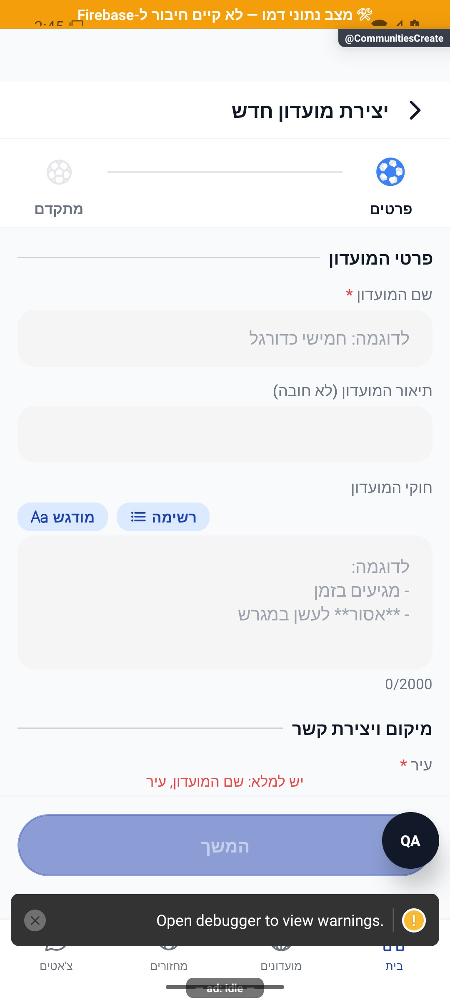
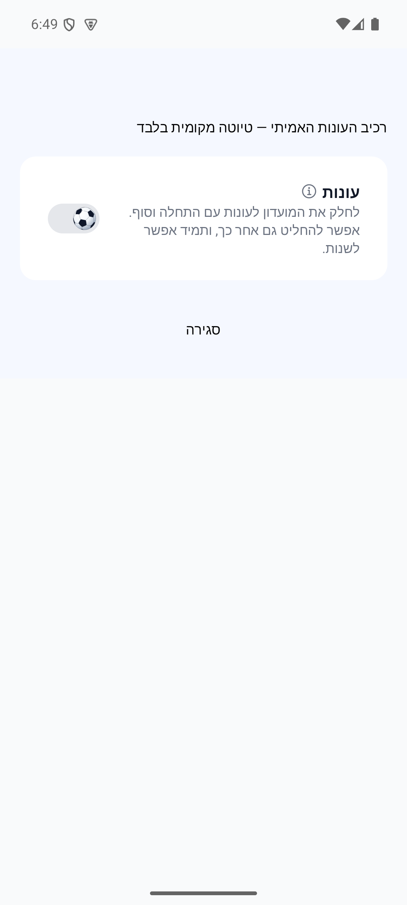
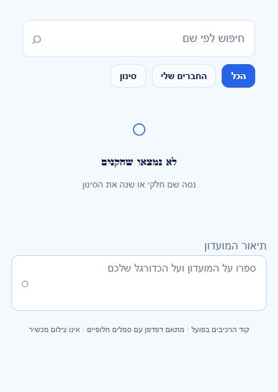

# יוצרים מועדון ומעדכנים פרטים

## הסבר הסף בחלונית סיום עונה — 23.10.2026

חלונית סיום העונה מסבירה במפורש שצריך להשלים לפחות חמישה מחזורים תקינים כדי לסיים עונה ולפרסם תארים. מספר המחזורים שהושלמו וההסבר על ביטול עונה קצרה נשארים מוצגים; זה שינוי מלל מקומי בלבד. [פירוט האימות והמגבלות](../../changes/2026-10-23-crash-test-and-pulse-followup.md).

## תיעוד כשלים — 20.10.2026

נוסף תיעוד אוטומטי לנקודות כשל במסלול הזה, עם מקור התקלה. הפעולה המקורית שומרת על ערכי החזרה והודעות השגיאה שלה. השינוי מקומי, טרם הופץ, ואין אימות מסירה חיה לפולס.

[דוח דיווח השגיאות והראיות](../../changes/2026-10-20-error-reporting-audit.md).

## אימות מול שרת אמיתי והגבלת המתנה — 20.10.2026

במועדון הבדיקות נבדקו מול השרת האמיתי הפעלת עונה עם שבעה מחזורים, סגירה ידנית, חלוקת שמונה תארים ופתיחת עונה שנייה ריקה. הנתונים נשמרו בארכיון ובכל הזמנים. שירותי העונות נפרסו באישור; תיקון נוסף בלקוח מציג אפשרות לנסות שוב אחרי30 שניות של קריאה תקועה, והוא עדיין דורש הפצת לקוח. לא המתנו24 שעות בפועל ולא בדקנו כאן סגירה של עונה קצרה.

[הבדיקה, המקור, הצילומים והמגבלות](../reviews/2026-10-20-seasons-live.md).

## תיקון פערי העונות — 20.10.2026

כל חמשת הפערים בביקורת טופלו מקומית: אכיפת סוף חלון התיקונים, חסימת הארכה מאוחרת, אימות ללא מועד, התאמת מועד לשיוך ורענון הסטטיסטיקות. תוקנה גם פתיחת סיכום עונה פעילה שנכשלה מול ההרשאות. אין שינוי בכללי התארים או בשלוש בחירות ההפעלה. אפשר לדחות מחזור שלא התקיים גם בלי להמציא לו תאריך; אישור שהתקיים עדיין דורש מועד. התיקון טרם הופץ.

[דוח תיקונים, בדיקות ומגבלות](../reviews/2026-10-20-seasons-fixes.md).

## מועדון חדש פתוח כברירת מחדל — 18.10.2026

ביצירת מועדון חדש, המתג ״מועדון פתוח״ מופעל מראש: שחקנים יכולים להצטרף ללא אישור מנהל. אפשר לכבות אותו לפני היצירה. מועדונים קיימים וטיוטות שמורות שומרים על הבחירה שלהם. השינוי הוכן בקוד וטרם הופץ; נצפה ברינדור רכיב בדפדפן ולא במכשיר.

## שחזור יצירה לאחר אובדן חיבור — 18.10.2026

הטיוטה נשמרת גם כשכבר מחוברים. ניסיון חוזר עם אותה טיוטה ואותם פרטים משתמש באותו ניסיון יצירה: אם המועדון נשמר אך האישור אבד, ממשיכים אליו במקום ליצור עוד מועדון. החלפת חשבון בזמן השמירה עוצרת את ההמשך לחשבון הישן. השינוי נבדק בשחזורי קוד ואינו אישור שהפונקציה החדשה נפרסה או שהתרחיש הופעל בייצור.

אם הפעלת העונות כבר הצליחה והאישור שלה אבד, תשובת השרת שהעונות כבר פועלות אינה מוצגת ככשל נוסף ביצירת המועדון.

מארגן יכול ליצור מועדון ולמלא שם, עיר ותיאור. לאחר מכן מנהלי המועדון יכולים לעדכן את הפרטים וההגדרות.

תוקנה מקומית הרשאה כדי שרק מנהל המועדון יוכל ליצור את הכרטיס הציבורי שלו, ושהיצירה של המועדון והכרטיס יחד תישאר תקינה. התיקון אושר ונבדק באמולטור מסד; אין בכך אישור שכבר נפרס לשרת. לא נוצר מועדון בדיקה בחשבון אמיתי.

[לפירוט המעמיק](create-and-edit.md)

## תיקוני עיצוב ונגישות — 10.10.2026

מקור: `a348b9f235f1e1433497600555303231512a0834` עם שינויים מקומיים. אין בסעיף זה הוכחת גרסת חנות.

למתגים בטופס המועדון יש שמות ברורים, וההסברים נשארים נגישים בנפרד.

התיקון נפרס באישור הבעלים ב־10.10.2026. נבדקו הרשאות בסביבה מקומית והתאמתן לשרת; לא בוצעו פעולות כתיבה בחשבונות אמת לצורך הבדיקה.

## עיצוב הטפסים — 11.10.2026

הטופס מוצג בכרטיסים לבנים על רקע תכלת עדין, עם שדות בעלי מסגרת דקה וכפתור פעולה בתחתית. ההסברים המלאים זמינים בכפתורי המידע. זהו שינוי מקומי בעיצוב; לא נשמרו נתוני אמת ולא הועלתה גרסה.

צילומים עדכניים: [צילום 1](../screenshots/form-club-details-2026-10-11.png) · [צילום 2](../screenshots/form-club-advanced-2026-10-11.png) · [צילום 3](../screenshots/form-club-cards-2026-10-11.png).

מד השלבים מציג כדורי כדורגל עדינים. הכדור הכחול מתגלגל לשלב הבא וחוזר בכיוון ההפוך בלחיצה על חזרה. כאשר צמצום תנועה מופעל במכשיר, השלב מתעדכן ללא גלגול. השינוי מקומי וטרם הועלתה גרסה.

## איור הכדור המאושר — 11.10.2026

הכדור הוחלף לאיור המאושר החדש: מחומש מרכזי, לוחות לבנים והיקפיים מסודרים, קווים דקים והצללה כחולה עדינה. גרסה כחולה לשלב הפעיל וגרסה כחולה־אפורה לשאר השלבים. תנועת הגלגול הקיימת נשמרה.

## צמצום אזור ההסבר — 11.10.2026

אזור ההסבר שמתחת למד השלבים הונמך: הגובה מותאם לטקסט והמרווחים מעליו ומתחתיו קטנים יותר. איור המגרש הוקטן בהתאם.

## מתגי כדורגל בטפסים — 11.10.2026

בטפסי המועדון והמחזור, כדור מאויר מחליף את עיגול המתג: הפעלה מגלגלת אותו שמאלה על מסילה כחולה, וכיבוי ימינה על מסילה בהירה. גם מתג העונות בתוך טופס המועדון משתמש בעיצוב זה.

## כדור בעל נפח במתגים — 11.10.2026

כדור לבן וכחול עם תפרים, תאורה והצללה מחליף את האיור השטוח במתגי הטפסים. הגלגול שמאלה בהפעלה וימינה בכיבוי נשמר.

## כדור בעל נפח במד השלבים — 11.10.2026

מד השלבים מציג כעת את אותו כדור בעל נפח שבמתגים. הכדור מתגלגל אל השלב הנוכחי במעבר קדימה ואחורה; שלבים לא פעילים מוצגים בעדינות.

## כיווניות המתגים וההסברים — 11.10.2026

במתגי הטפסים, הכדור נמצא מימין כשהאפשרות כבויה ומתגלגל שמאלה בהפעלה. חלוניות המידע המשותפות מציגות מלל עברי מימין לשמאל.

## הסתרת הקו מאחורי כדורי השלבים — 11.10.2026

הקו המחבר בין השלבים אינו נראה דרך הכדורים הבהירים או בזמן גלגול הכדור הפעיל.

## תמיכה זמינה — 14.10.2026

אם נתקעתם בטופס, בועת העזרה פותחת שיחה בלי לצאת ממנו. הצוות מקבל את מסך הפנייה ואת השלב שבו פתחתם אותה; צילום מצורף רק לפי בקשתכם. [פירוט](../shared/support-chat.simple.md). השינוי מקומי.

## סבב פולס — 15.10.2026

כותרת העונות בגודל אחיד לשאר אפשרויות המועדון. ברירת המחדל של מועדון פתוח או סגור לא שונתה.

השינויים בסבב זה מקומיים וטרם הופצו. [דוח הסבב](../../changes/2026-10-15-pulse-sweep.md).

## סבב פולס — 18.10.2026

בשדה תיאור המועדון מופיע כעת רמז שמסביר מה לכתוב. כשחיפוש המקומות עובר בהצלחה לספק החלופי, לא נרשמת עוד תקלה על חסימת הספק הראשי.

השינויים מקומיים וטרם הופצו. לא שונו הרשאות ולא נשלחו הזמנות או הודעות. בדיקת הדפדפן משתמשת בקוד הרכיבים בפועל, במתאם סגנונות, בסמלים חלופיים ובנתוני הדגמה; אינה הוכחת אנדרואיד או אייפון. שני האמולטורים לא הגיבו לפקודות או לצילום בסבב זה.

## תלות בעדכון העונות — 19.10.2026

הגדרות העונות נשמרות בנפרד מפרטי המועדון, עם שלוש בחירות היסטוריה והסבר לפני אישור. יעד תקין הוא לפחות חמישה מחזורים או מספר חודשים שלמים.

[מצב המימוש, הבדיקות ומגבלות האימות של העונות](../clubs/seasons.md). מקומי בלבד; לא בוצעה פריסה במסגרת המשימה.

## החזרת ניסיון מבוטל למאגר ללא עונה — 19.10.2026

בהפעלה ובהפעלה מחדש רואים את כל המחזורים ללא עונה, גם מניסיונות שבוטלו לפני חמישה מחזורים. ביטול ניסיון קצר מחזיר למצב ללא עונות, והאישור מסביר שהמחזורים יהיו זמינים בהפעלה הבאה.

[הכללים, הבדיקות ומגבלות האימות](../clubs/seasons.md). מימוש מקומי בלבד, ללא פריסה או שינוי נתוני מועדונים בייצור.

## סיים את העונה והסבר התוצאה — 20.10.2026

כפתור הסיום נקרא תמיד ״סיים את העונה״, וכותרת האישור היא ״סיום העונה״. חלון האישור מציג את מספר המחזורים שהושלמו ומסביר את שתי התוצאות: לפני חמישה מחזורים העונה תבוטל ללא תארים וקידום מספר, הפעילות תישמר בכל הזמנים ללא שיוך לעונה והמועדון יחזור לפעילות ללא עונות; מחמישה מחזורים העונה תיסגר ויחולקו תארים. בסיום רגיל תיפתח העונה הבאה ובכיבוי העונות יכובו. מחזור פעיל או ערב הממתין לאימות דוחים את הפעולה, והמספר התקף בעת הביצוע קובע. אין חלון תיקונים נוסף בסיום ידני ואין פתיחה מחדש של עונה סגורה. השינוי מקומי וטרם הופץ.

## אישור סיום לפי המצב הנוכחי בלבד — 20.10.2026

חלון ״סיום העונה״ מציג רק את התוצאה המתאימה למספר המחזורים הנוכחי: לפני חמישה — ביטול ללא תארים ושמירת הפעילות בכל הזמנים ללא שיוך לעונה; מחמישה ומעלה — סגירה, פרסום תארים ופתיחת העונה הבאה, או כיבוי העונות בהתאם לפעולה שנבחרה. הסבר שתי האפשרויות יחד הוסר. נשמרת הערה קצרה שאם יש מחזור פעיל או מחזור שממתין לאימות, הפעולה ממתינה ופועלת לפי המספר המעודכן. השינוי מקומי וטרם הופץ.

## עיצוב כפתורי העונה וחלון האישור — 20.10.2026

כפתורי העונות הותאמו לשפת האפליקציה: כפתור שמירה כחול עם סימן אישור ופינות מעוגלות, ופעולות סיום וכיבוי בשורה נפרדת עם רקע עדין והבחנה אדומה לכיבוי. חלון האישור כולל כותרת עם אייקון תואר, כפתור סגירה, הדגשה של מספר המחזורים והפרדה ברורה בין פסקאות ההסבר. באישור סיום או כיבוי כפתורי האישור והחזרה מוצגים בשורה; בהפעלה הם נשארים זה מתחת לזה כדי שהכותרת הארוכה תיכנס במלואה. השינוי מקומי וטרם הופץ.

## כיבוי עונות דרך המתג בלבד — 20.10.2026

כפתור ״כבה עונות״ הוסר כדי למנוע כפילות. כיבוי מתבצע דרך מתג העונות ופותח את חלון האישור הקיים, עם ההסבר המתאים למספר המחזורים. בתחתית ההגדרות נותר ״סיים את העונה״ ברוחב מלא. השינוי מחליף את פריסת שני כפתורי הפעולה שתועדה קודם; הוא מקומי וטרם הופץ.

## תלות במידע על סגירת עונה — 23.10.2026

נוסף מידע משותף שמאפשר להסביר מדוע עונה מתעכבת בסגירה. אין שינוי נוסף בפעולות המתוארות כאן; השינוי מקומי וטרם הופץ. [המסלול, הבדיקות והמגבלות](../../changes/2026-10-23-season-automatic-recovery.md).

## דיווחים חדשים במהלך הסבב — 23.10.2026

שינויי הגדרת עונה שלא נשמרו עוצרים את שמירת פרטי המועדון ומציגים הסבר ללחוץ קודם על שמור הגדרות עונה. הטופס נשאר פתוח. מקומי וטרם הופץ; נבדק באנדרואיד עם מועדון דמו. [ראיות ומגבלות](../../changes/2026-10-23-crash-test-and-pulse-followup.md).

## בידוד מונה בקשות והתאוששות מרקע — 23.10.2026

ספירת בקשות הצטרפות אינה ממתינה יותר לדירוגי השחקנים במועדונים. מסך הבית טוען את המונה מחדש בחזרה מרקע ומתעלם מתוצאה ישנה שמגיעה אחריה. כשל אמיתי בקריאת הבקשות נשאר כשל ושומר את הספירה האחרונה; אין שינוי בעיצוב. נבדק בבדיקות קוד, מקומי וטרם הופץ. [הסבר, יומני שרת ומגבלות](../../changes/2026-10-23-inbox-resume.md).

## עדכון תלות משותפת בקריאות מידע — 23.10.2026

בקובצי השירות המשותפים נוספה אפשרות מפורשת לניסיון חוזר אחד בקריאה זמנית שנכשלה, תוך עצירה אם החשבון מתחלף. החיבור מוגבל ל־14 נקודות קריאה המפורטות בדוח; אין כאן טענה שכל פעולה בפיצ׳ר קיבלה ניסיון חוזר או שנבדק מסך חדש. בדיקות המאגר המלאות עברו (5,261 בדיקות ב־472 חבילות), אך אינן הוכחת הרצה במכשיר. הקוד מקומי וטרם הופץ. [מסלול, ראיות ומגבלות](../../changes/2026-10-23-four-open-errors.md).

## עדכון מסבב הפולס — 23.10.2026

תוקנה הצגת זמינות ישנה בכרטיס שחקן, פריסת הטקסט בקרוסלת הטיפים ועיצוב חלונית שמירת העונה. נוסף טיפול מוגבל בתקלות זמניות בטעינת מועדונים ובספק הכתובת באנדרואיד. אלו שינויים ברכיבים משותפים; לא כל פעולה במסך השתנתה. התיקונים מקומיים וטרם הופצו. [בדיקות, צילומים ומגבלות](../../changes/2026-10-23-pulse-resweep.md).

## שינוי מוגבל בקובץ השרת המשותף — 24.10.2026

ב־`functions/src/index.ts` נוסף ייצוא רכיב קליטת הקריסות, ו־`onErrorLogged` מדלג על מקור הקריסות החדש כדי למנוע התראה כפולה. אין שינוי במסלול הפיצ׳ר המתואר כאן או בחישוביו. לפריסה הוכנה חבילה מהמקור הפרוס עצמו, עם תנאי הדילוג בלבד; אין פריסה של פונקציות הפיצ׳ר הזה. [היקף וראיות](../../changes/2026-10-24-crashlytics-pulse.md).

## תלות בשמירת צבעי המחזור — 24.10.2026

שמירת המידע המשותפת עודכנה כדי להעביר את צבעי הקבוצות ממסכי הכוחות להכנה וללייב. אין תוספת פעולה במסך הזה, והוא לא נבדק מחדש במכשיר במסגרת התוספת. השינוי מקומי וטרם הופץ. [פרטי התוספת ומגבלות הבדיקה](../rounds/draft-setup.md#צבעים-לפני-שיבוץ-ובכל-שיטת-חלוקה--24102026).

## טיפול בפולס — 24.10.2026

עודכן רכיב משותף של חלונות האישור ומסלול השרת להרשמה. אין בסבב הזה שינוי ייעודי או אימות חדש של מסך זה.

[פירוט התיקונים, הבדיקות והמגבלות](../../changes/2026-10-24-pulse-current.md). התיקונים מקומיים וטרם הופצו.

## תלות ביצוא היסטוריית השוואות — 24.10.2026

במשימה זו נוספה בקובץ השרת המשותף רק שורת יצוא של `recordPlayerComparison` ו־`getMyComparisonActivity`. מסלולי הפיצ׳ר המתוארים כאן לא שונו במסגרת התוספת הזאת ולא הורצו מחדש כתרחיש נפרד. אין פריסה או שינוי כללים. [המימוש, הבדיקות וגבולות האימות](../../changes/2026-10-24-comparison-activity.md).
