# פרטי מועדון ולשוניותיו

## סיבת עיכוב סגירת העונה — 23.10.2026

`SeasonsCard` קורא אבחון שרת דרך ממיר המועדון ומציג לכל חבר את סוגי החסם ומועדי המחזורים. חסר סיכום אינו מופיע כמחזור שצריך לאמת או לסיים מחדש; חידוש העיבוד הוא אוטומטי בשרת. לא השתנו רישום המסך, הרשאות או פעולות כרטיס האימות. רינדור עברית נבדק במתאם דפדפן בלבד, ולא במכשיר. [המסלול, החוזה, הבדיקות והצילומים](seasons.md). השינוי מקומי וטרם הופץ.

## איור למחזור שטרם נקבע — 23.10.2026

הכדור הגדול בכרטיס המחזור הקרוב הוחלף באיור לוח שנה עם מגרש. האיור מופיע רק כשאין מחזור מוגדר; המלל וכפתור יצירת המחזור נשארו כפי שהיו. השינוי מקומי וטרם הופץ.

הענף `typeof startsAt !== 'number'` ב־`src/components/community/NextGameCard.tsx` מרנדר איור וקטורי מקומי דרך `react-native-svg`, בגודל 112×90, במעטפת הקיימת. אין נתונים חדשים, חישובים, כתיבה למסד או שינוי בניווט. האיור דקורטיבי ומוסתר מנגישות במעטפת. בדיקת `tests/logic/clubNextGameCard.test.tsx` הותאמה לספריית האיור ולמצב ללא תמונת כדור; הבדיקות הקיימות ממשיכות לכסות פעולה, אפס נרשמים ונעילת הרשמה. נבדקה תצוגת רכיב המקור במתאם דפדפן: טקסט מימין, איור משמאל; אין אימות מכשיר.

[צילום לפני השינוי](../screenshots/club-empty-round-before-2026-10-23.png).

בדיקת טיפוסים וכל 5,199 הבדיקות ב־461 חבילות עברו. בדיקת התיעוד עדיין מציגה פערים היסטוריים שאינם קשורים לשינוי.

## תיעוד כשלים — 20.10.2026

נוספו תצפיות דיווח בנקודות הכשל של המקורות המשויכים לפיצ׳ר, במסגרת הרחבה רוחבית. נשמרו ערכי החזרה, הזריקות ותנאי הפעולה הקיימים; נוסף מקור קוד והקשר לדיווח. כיסוי תחבירי אינו הוכחת הרצה של כל מצב. השינוי מקומי וטרם הופץ; בדיקות המסירה, מגבלות מניעת הכפילויות והמסלולים שטרם חוברו מתועדים בדוח המשותף.

[דוח דיווח השגיאות והראיות](../../changes/2026-10-20-error-reporting-audit.md).

## אימות מול שרת אמיתי והגבלת המתנה — 20.10.2026

נפרסו באישור16 שירותי עונות ונבדקו140 קובצי מקור לכל שירות. במועדון הבדיקות עבר רצף הפעלה עם7 מחזורים, יעד שכבר הושג, חלון תיקונים מדויק, סגירה ידנית, שמונה תארים, ארכיון ופתיחת עונה2 עם0 מחזורים ויעד24. עברו50 השוואות נתונים; המצטיין8.36 ומלך הניצחונות78.57%. ברכיב הסטטיסטיקות נוסף `withSeasonReadTimeout`:30 שניות לתמונת מצב עקבית, רשימת עונות וארכיון/כל הזמנים כולל בדיקת עקביות בסוף. כשל מוביל לניסיון חוזר ואינו מספר אפס; תוצאה מאוחרת אינה מוחלת. התיקון המקומי בלקוח נבדק במסך עם קריאה מושהית והחלמה, וב־5,093 בדיקות ובדיקת טיפוסים. נוסחאות התארים לא שונו. הסגירה הטבעית אחרי24 שעות, כמה זכאים וכימיה של שני חשבונות אמיתיים לא הורצו בייצור.

[הבדיקה, המקור, הצילומים והמגבלות](../reviews/2026-10-20-seasons-live.md).

## תיקון פערי העונות — 20.10.2026

`seasonLock.ts` אוכפת פקיעה גם לפני הסריקה; השלמת עיבוד מחזור מותרת במפורש בלי לפתוח ארכיון חתום. שינוי יעד נבדק גם בעסקת `acquireSeasonOperation`. `seasonManager.needsVerification` משותפת לרשימה ולחסמי הסגירה; `setEveningPlayed` בודקת מועד, שיוך והרשאה מתוך נתונים עדכניים בעסקה. `src/utils/seasonReadConsistency.ts` וחותמת עונה מהחנות מונעות קריאה מעורבת ומרעננות לשונית שנשארה מותקנת. `seasonSummaryService.ts` בוחרת מונים חיים לעונה פעילה ואינה דורשת ארכיון חסר; משתתף שעזב ממשיך לקרוא ארכיון מורשה. אין שינוי בנוסחאות או בהרשאות.

עברו 5,090 בדיקות באפליקציה, 352 בדיקות הרשאות, 52 תרחישי מדיניות/גבולות/רצף, 38 תרחישי ארכיון ובדיקות טיפוסים והידור. שני תרחישי הרצף הורצו גם דרך שירותי הקריאה של האפליקציה ולקוח מזוהה מול הכללים המלאים. `functions/seasonAudit20261020.emulator.test.mjs` עובר כעת; נוספו `functions/seasonFullFlow.emulator.test.mjs`, `tests/logic/seasonReadConsistency.test.ts` ו־`tests/logic/communitySeasonRefresh.test.ts`. הפלטים ב־`artifacts/seasons-fixes-2026-10-20`. מסירת אירועי הענן מדומה; אין טענה לפריסה או לבדיקת שני מכשירים/אייפון.

[דוח תיקונים, בדיקות ומגבלות](../reviews/2026-10-20-seasons-fixes.md).

## כשל טעינת מונים אינו אפס — 18.10.2026

`getCommunityTotals/getCommunityChampionship` זורקים כשל אמיתי; מסמך חסר או שאילתה ריקה שהשרת אישר הם התשובה הריקה היחידה. טעינת המונים משלבת פעילות וארכיונים לאותה תשובה, שומרת תשובה קודמת בכשל רענון, מציגה — ללא תשובה ומאפשרת ניסיון חוזר גם במשיכה. תגובה מאוחרת של מועדון/חשבון/עונה קודמים אינה מתפרסמת. `finalStatsAuditCommunityRead.test.ts` מכסה כשל, חסר, ארכיון, שימור תשובה ובעלות. ראיות הרינדור הנפרדות נוספו בדמו כמתואר להלן; בדיקת הקוד אינה הוכחת מסד.

### תוויות וראיות מקוריות — 18.10.2026

בפתיחה קרה ברוחב 320 וגופן 140% נמצאו תוויות חתוכות בתאי המונים. שינוי מספר השורות לבדו עדיין פיצל את ״שחקנים״ ל־״שחקני״ ו־״ם״. בתיקון הסופי `StatCell` מפריד את התווית משורת המספר והאייקון ונותן לה את רוחב התא המלא. `numberOfLines={2}` ו־`lineHeight:16` מאפשרים גלישה; אין גובה קבוע לתא או לתווית, אין הקטנת גופן ואין חסימת הגדלה. הסדר המקורי נשמר: המספר מוביל מימין והאייקון משמאל בשורה; התווית מתחתיהם. אין שינוי יחידות, ערכים, קריאות או ניווט בתיקון הפריסה.

| שלב שנצפה בדמו | תצוגה ותוצאה |
|---|---|
| כניסה כשקריאת המונים נכשלת | גולים ומשחקים הם מקפים; הודעה ו״נסו שוב״. שחקנים ומחזורים שמגיעים ממקורות אחרים אינם מתאפסים |
| לחיצה על ״נסו שוב״ אחרי הסרת הכשל המקומי | 910 גולים ו־328 משחקים; הודעת הכשל נעלמת |
| משיכה לרענון עם כשל נוסף | המספרים הקודמים נשארים וההודעה והניסיון החוזר חוזרים |
| ניסיון חוזר אחרי כשל הרענון | המספרים נשארים וההודעה נעלמת |

המסלול כולו נצפה במידה הרגילה לפני ליטוש התוויות, ושוב ב־320/140% אחרי הליטוש. במידה הרגילה הסופית נבדקו מחדש הכשל הראשוני והצלחת הניסיון החוזר. מקור הדמו נקרא בנפרד: הפעילות מחזירה 268 גולים ו־210 משחקים, והארכיון 642 גולים ו־118 משחקים; החיבור הוא 910 ו־328. תצוגת 23 שחקנים ו־42 מחזורים אינה נגזרת משני סכומים אלה. לא נוצרו נתוני מועדון או פעולות עסקיות לצורך הבדיקה.

הכשל הוזרק זמנית בזיכרון רק ב־`gameService.getCommunityTotals` עבור `g1`, לאחר אימות `__DEV__`, `USE_MOCK_DATA` ו־`p7`. הוא אינו מוכיח הרשאות או כשל תקשורת של סביבת הייצור. המידה הרגילה שנקראה מהתהליך היא 411.43×914.29 בגופן 1, במכשיר 1080×2400 בצפיפות 420. במידה הקטנה בוצעה פתיחה קרה ונקראו 320×569.14 וגופן כ־1.4; אחריה נטען תיקון המוצר ברענון מקומי. הגדרה חמה שהשאירה רוחב ישן לא שימשה הוכחה.

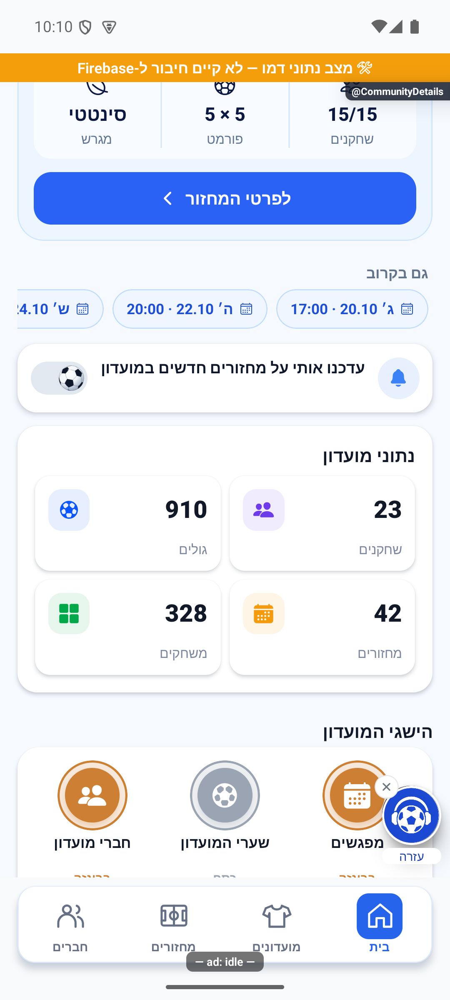
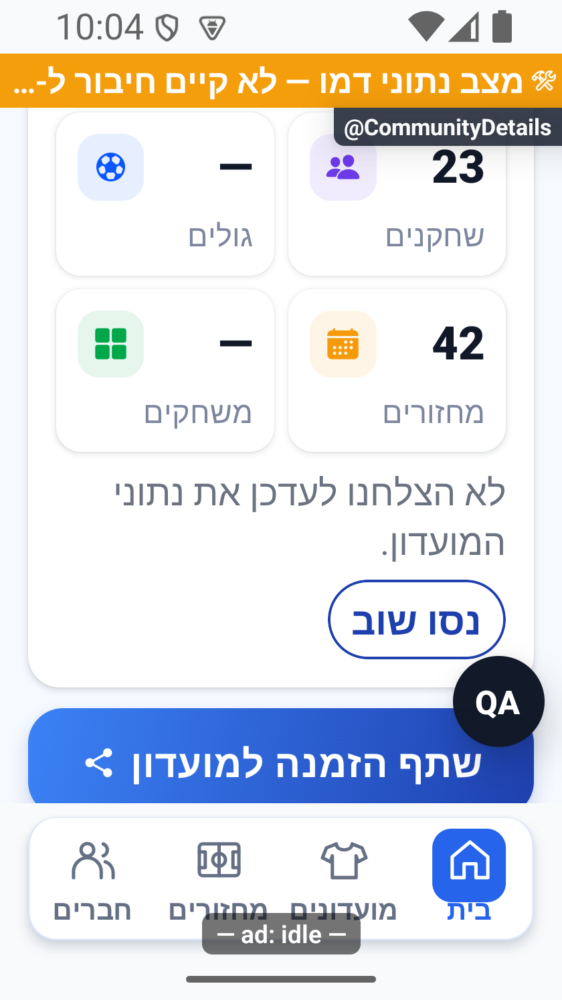

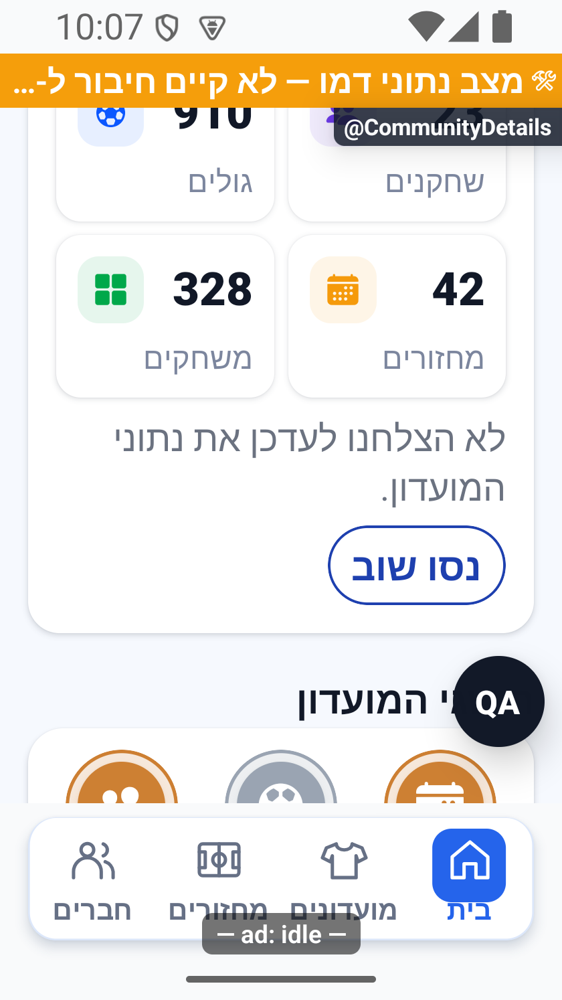
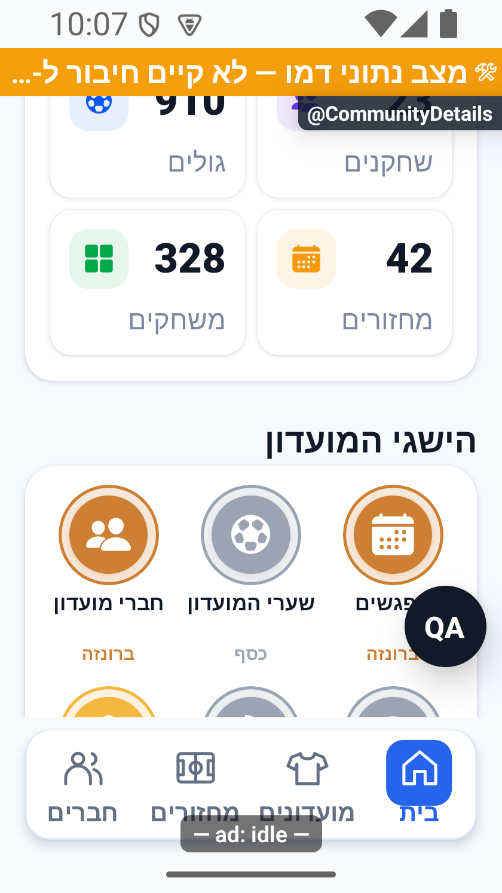

כל התמונות נפתחו ונבחנו. תמונות הרענון הקטנות מוכיחות שינוי מצב; השורה העליונה בהן חתוכה בגבול הגלילה, ולכן הן אינן ראיה לכל ארבעת התאים יחד. תמונת ההצלחה הקטנה מציגה את המספרים והתוויות השלמים. פס הדמו, סימון המסלול, כלי הבדיקה וסימון הפרסומות אינם ממשק מופץ, וחלקם חופפים לאזורים מחוץ למונים. כלי העזרה נסגר לביקור בחלק מהצילומים. אייפון, התקנה מהחנות ומסד ייצור לא נבדקו כאן.

`tests/logic/finalCommunityTotalsLabel.test.ts` מוסיף ארבע בדיקות של רכיב המקור: מלל וערך נשמרים בכל תא, התווית אינה מוגבלת לעמודת המספר הצרה, ההגדלה נשמרת ואין גובה קבוע שחוסם שורה נוספת. יחד עם 16 בדיקות `finalStatsAuditCommunityRead.test.ts` עברו 20 בדיקות בשתי חבילות; `npx tsc --noEmit` עבר בסיום. זו אינה ריצת כל החבילה. [דוח הבדיקה, המקורות והחזרת הסביבה](../../../artifacts/final-deep-audit-2026-10-17/community-totals/report.md).

בסיום הושב מתאם הקריאה המקורי ונבדקו המשתמש ונתוני הדמו מול צילום תחילת כל תהליך. הגופן חזר ל־1 והמידות ל־1080×2400; העדפת תנועה וצפיפות לא שונו. המכשיר נשאר בפרופיל הדמו, ב־8084, עם רענון חם פעיל. בפתיחות הקרות זמני הזריעה של הדמו נוצרו מחדש; זו אינה כתיבת עסקית, והיסטוריית מחזור הדמו נשארה זהה. לא נטען שכל הזרעים זהים בינארית בין תהליכים.

[דוח הביקורת, הבדיקות וגבולות האימות](../../changes/2026-10-18-preproduction-end-to-end.md).

## אחידות כרטיס המחזור הקרוב והסרת כפילות — 17.10.2026

כרטיס `NextGameCard` מציג אותה תצוגה בהירה לשני הקהלים: תמונה משמאל, כותרת/ספירה לאחור/תאריך/שעה/מגרש מימין ורצועת נתונים מתחת. במסך חבר נשארת פעולת ״לפרטי המחזור״ והלחיצה על הכרטיס משתמשת במטפל הניווט הקיים. בציבורי `publicPreview` מונע פעולת פתיחת פרטי המחזור גם אם מועבר בטעות `onPress`. הרשמה עתידית מציגה חיווי נעילה ומועד פתיחה; ההבחנה בין מנהל לחבר נשארת במטפל המסך הקיים. מצב ללא מחזור ממשיך להציג הודעה ופעולת יצירה למנהל כשקיימת.

מסך החבר מעביר `resolveRoundCover(nextGame, group, false, failedRoundCover)` ומשתמש באותו מנגנון בחירת תמונה וכשל תמונה של המסך הציבורי. אין שאילתה או שינוי בממיר. הספירה נשארת אורך `players`, והקיבולת `maxPlayers`; אפס נרשמים נשאר אפס, ושדה חסר אינו מציג תא מומצא. הפורמט וסוג המגרש מגיעים מהמחזור. כרטיס ציבורי ״על המועדון״ מציג רק `description`; עיר וכמות חברים הוסרו ממנו כי הן בהירו. כשאין תיאור לא מוצג כרטיס ריק.

נצפה בדמו באנדרואיד: הציבורי `pub_4` מציג תיאור ללא שורות כפולות, ומסך החבר `g1` מציג תמונה, שעה 17:00, מגרש, 13/21, 7×7 ודשא. לחיצה דרך הממשק פתחה `MatchDetails` עם `gameId=gv2-6`. כל נתוני הדמו וההיסטוריה זהים לגיבוי. לא בוצעה הצטרפות, יצירה או שינוי מחזור. אייפון, ייצור ומצבי רשת לא נבדקו.

בדיקות: `npx tsc --noEmit` נקי; כל 365 החבילות ו־4426 הבדיקות עברו. ארבע בדיקות `clubNextGameCard.test.tsx` מכסות פתיחת מחזור ושגיאת תמונה, אפס נרשמים, הגנת הציבורי מניווט, הרשמה עתידית והפעולה במצב ריק. ראיות: `artifacts/club-next-card-2026-10-17/`, כולל יעד ניווט והשוואת נתונים. אין מסך חדש או שינוי במפת הכיסוי.

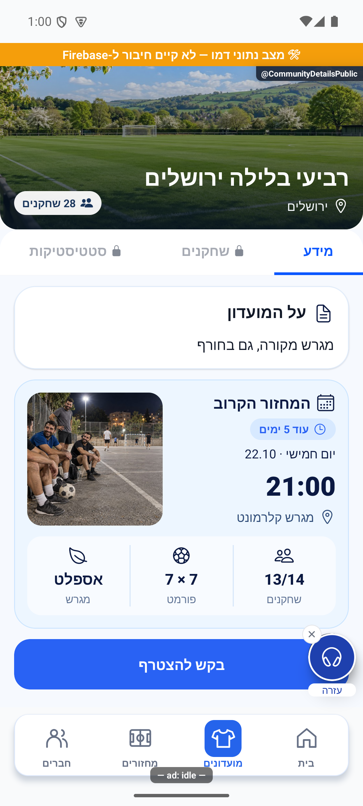

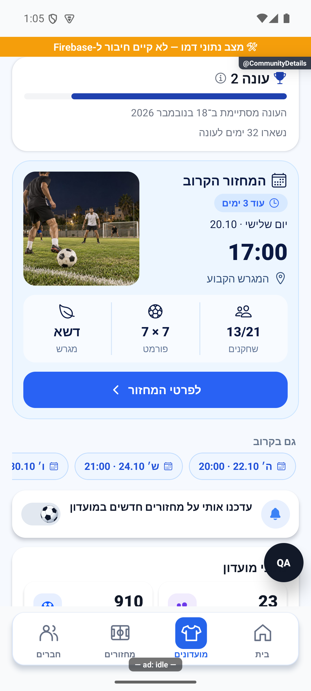

## הירו אחיד לפרטי המועדון — 17.10.2026

`CommunityStadiumHero` משתמש כעת באותה שפה חזותית של פרטי מחזור: סרגל פעולות לבן, תמונת רקע עם פינות מעוגלות והצללה תחתונה, שם המועדון והעיר בצד ימין למטה וספירת שחקנים בצד שמאל למטה. הטקסט יכול להישבר לשורות והספירה עוברת לשורה עצמאית כשאין רוחב. הכותרת אינה נחתכת למספר שורות קבוע.

שני המסכים מעבירים את `group.city` הקיים; אין שאילתה חדשה ואין עיר משוערת. במסך חבר הספירה נשארת `group.playerIds?.length ?? 0`; בציבורי היא נשארת `group.memberCount` מההיטל הציבורי. מקור התמונה והמעבר בין תמונות נשמרו: תמונה שהועלתה, תמונת גלריה, ואז ברירת מחדל לפי מזהה. אין שינוי בחישובים, שמירה או הרשאות.

חזרה, צ׳אט ותפריט שומרים על אותם מטפלי ניווט. מנהל רואה החלפת רקע בפינה העליונה השמאלית של התמונה; בזמן העלאה הפעולה מושבתת ומציגה מחוון. מבקר אינו מקבל תפריט ניהול, צ׳אט או החלפת תמונה. הלשוניות הציבוריות משתמשות כעת ב־`flush` ללא חפיפה לתמונה, כמו מסך החבר.

נצפו בפועל בדמו באנדרואיד: מסך חבר־מנהל עם עיר ו־23 שחקנים, כיווניות ותפריט שנפתח. בדיקת טיפוסים נקייה וכל 364 החבילות, 4422 בדיקות, עברו. לא נוספו בדיקות שמעתיקות סגנונות. אין שינוי בחוזי נתונים. בהשלמת הבדיקה באותו יום האמולטור התאושש לאחר אתחול עם עיבוד גרפי בתוכנה. התצוגה הציבורית נצפתה ברוחב רגיל ובמידות 840×1494, וכן היא ומסך החבר נצפו בהגדרת גופן מערכת 1.4. אין חפיפה בין השם, העיר וספירת השחקנים בהירו; ברוחב צר הספירה יורדת לשורה עצמאית משמאל. נצפתה גלילה אל תוכן המסך. פעולות מנהל אינן מוצגות בציבורי והלשוניות מוגנות בסמלי מנעול. לא בוצעה הצטרפות או הכרעה במחזור. הוחזרו 1080×2400 וגופן 1.0, ואומתו גם במנוע האפליקציה: רוחב 411.43, גובה 914.29, scale=2.625, fontScale=1. נתוני 16 המחזורים וההיסטוריה זהים לגיבוי. אייפון וייצור לא נבדקו.

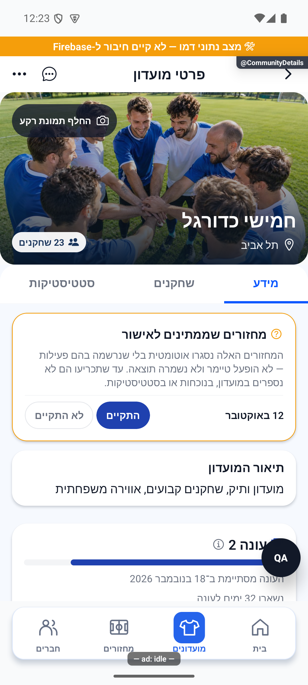

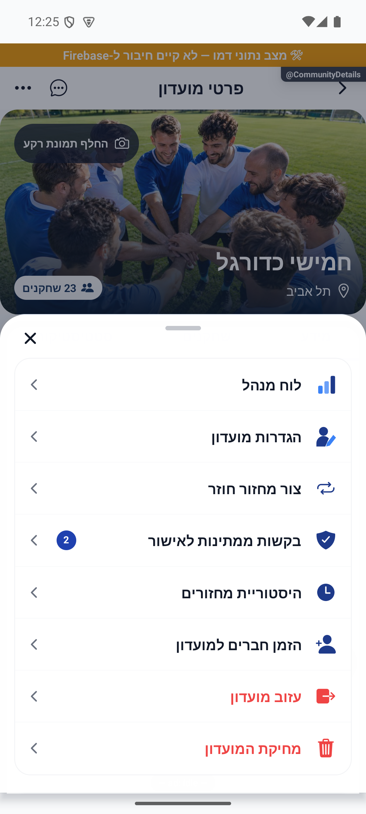

ראיות ובדיקות: `artifacts/club-hero-2026-10-17/`. אין מסך חדש או שינוי במפת הכיסוי.

### צילומי השלמת הבדיקה — התאוששות האמולטור

- [תצוגה ציבורית רגילה](../screenshots/club-hero-public-2026-10-17.png).
- [תצוגה ציבורית צרה](../screenshots/club-hero-public-small-2026-10-17.png).
- [תצוגה ציבורית צרה בגופן מוגדל](../screenshots/club-hero-public-small-large-2026-10-17.png).
- [חבר־מנהל במסך צר ובגופן מוגדל](../screenshots/club-hero-member-small-large-2026-10-17.png).
- [גלילה לתוכן](../screenshots/club-hero-member-small-scroll-2026-10-17.png).
- [החזרת התצוגה הרגילה](../screenshots/club-hero-restored-2026-10-17.png).

ראיות נוספות: `artifacts/club-hero-2026-10-17/final-runtime.json`, `preservation.json` וקובצי היררכיית הממשק. לא נדרש שינוי בקוד האפליקציה בסבב ההשלמה. תצוגת ההירו עברה; הסבב אינו אישור לכל מסכי האפליקציה או לכל פעולות החברות. טקסט ארוך בכרטיסי תוכן אחרים אינו חלק מבדיקת ההירו.

## הכרעת הזמנות והצטרפות — 11.10.2026

ההתנהגות העדכנית מחליפה את תיאור ההזמנות הקודם: הזמנת מנהל היא אישור מראש, אך אינה מצרפת ללא הסכמת הנמען. פרטי המימוש, המכנים לקיבולת, התוקף, הרשאות, המסלולים, תאימות ללקוחות ישנים ובדיקות: [תיקון הזמנות ואישור הצטרפות](../../changes/2026-10-11-invitation-admission.md).

במועדון משתמשים ב־`joinSocialClub` מול המועדון הקנוני ולא בהכרעה לפי המראה הציבורית. במחזור משתמשים ב־`reconcileGameJoins` ובאישור מפורש ב־`approvedInvites`; `invitedUserIds` אינו אישור. התוצאה במסך מגיעה ממסמך הבקשה בשרת. כל הזמנות המועדון נפתחות במסך `CommunityDetailsPublic` הקיים עם `fromInvitation`, כולל בקשות ישנות ממתינות; הרשאה אינה נובעת מהפרמטר.

אימות: 253 חבילות ו־3414 בדיקות יישום; 328 בדיקות הרשאות מול הכללים המלאים; 9 בדיקות פונקציות מול מסד הדגמה מקומי. לא בוצעו פריסה, הסבת נתונים או בדיקת מסירה לטלפון ייצור.

## תיקון גבולות הרקע — 8.10.2026

`CoverCrossfade` תוחם כעת את שתי שכבות התמונה לגודל הכותרת באמצעות רוחב וגובה של 100% ומשטח חיתוך. לפני התיקון, מידות הנכס המקומי נשארו בתוקף למרות ההיסטים המוחלטים; התמונה נמשכה מאחורי תוכן המועדון. שוחזר ותוקן באמולטור אנדרואיד בדמו. אין שינוי בנתונים, בתפקידים, במסלול הניווט או בחישובים. [גורם, בדיקות ומגבלות](../../changes/2026-10-08-cover-layout.md).

[להסבר הקצר והפשוט](details.simple.md)

עודכן: 07.10.2026; מקור: `8e8fde5`. מסך: `src/screens/communities/CommunityDetailsScreen.tsx`; מסלול: `CommunityDetails` עם `groupId` מתוך מועדונים, מחזור, קישור או צ׳אט.

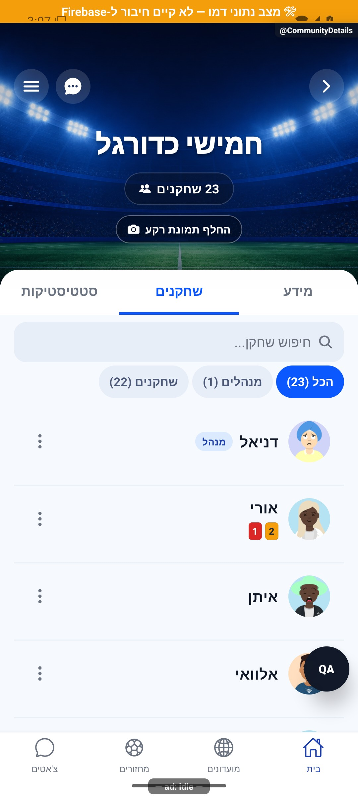
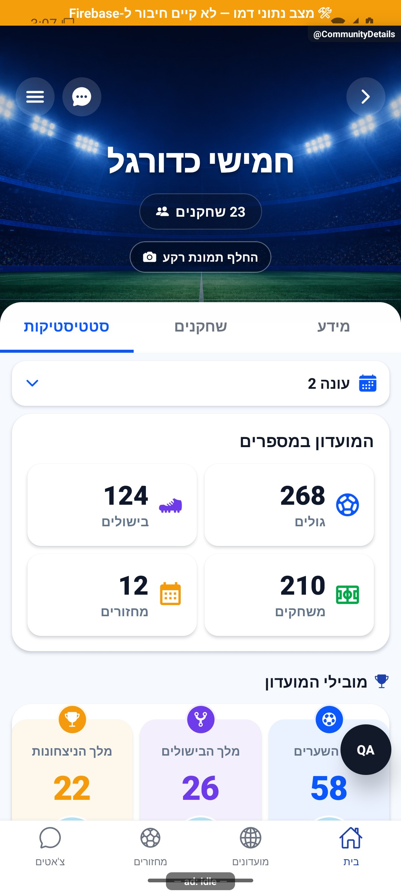

שלוש לשוניות: מידע, שחקנים וסטטיסטיקה. התוכן נטען לפי צורך ונשמר לאחר פתיחת הלשונית, כדי לא לטעון מחדש ולמחוק גלילה בכל מעבר. המסכים העצמאיים של סגל וסטטיסטיקה עדיין קיימים ונרשמים בניווט; אינם אותו צילום של הלשונית המוטמעת.

## אזורים

רקע מועדון, שם, מספר חברים, בחירת תמונה למנהל, צ׳אט ותפריט. במידע: מצב מחזור חי או מחזור עבר שדורש אימות, כרטיס עונה, מחזור קרוב, תיאור וכללים, ציוד, הודעות על מחזור חדש, מידע קשר ושיתוף. בסטטיסטיקה המקוצרת: הישגי המועדון ומעבר לסטטיסטיקה המפורטת. בסגל: חיפוש, שבבי תפקיד ורשימת שחקנים עם כלי ניהול לפי הרשאה.

| פעולה | נתונים | מי רואה ותוצאה |
|---|---|---|
| פתיחת צ׳אט | `groupId` | חבר → `CommunityChat` |
| עריכת מועדון | פרטים/הגדרות | מנהל → `CommunityEdit` |
| בקשות הצטרפות | ממתינים | מנהל → `AdminApproval`; מונה בקשות |
| היסטוריה | מחזורים שהתקיימו | חבר → `CommunityHistory` |
| הזמנה | קוד/קישור מועדון | חבר → שיתוף/הזמנת חברים |
| יצירת/ניהול מחזור קבוע | תזמון המחזור | מנהל; מפורט בתחום המחזורים |
| קשר עם מנהל | טלפון קשר קיים | חבר שאינו מנהל |
| עזיבה | חבר ומנהלים נוכחיים | אישור; מנהל אחרון נחסם |
| מחיקה | זהות יוצר | יוצר בלבד; פעולה הרסנית שלא בוצעה |

צילום התפריט נצפה אך אין לו קומיט מקור במניפסט; הוא מציג מנהל/יוצר ופעולות עזיבה ומחיקה שלא הופעלו. זו ראיה לפריסה היסטורית, לא בדיקת פעולת גרירה או הרשאות בבינארי החדש.

## מקור אמת

`src/store/groupStore.ts`; `src/services/groupService.ts`; `src/services/gameService.ts`; `src/components/community/CommunityStadiumHero.tsx`; `CommunityStatsGrid.tsx`, `CommunityChampionship.tsx`, `CommunityNotifyToggle.tsx`, `CommunityShareInviteCta.tsx`, `SeasonsCard.tsx`; `src/utils/eveningPlayed.ts`. הסטטיסטיקה המקוצרת והארוכה צריכות לתת אותו מענה לאותו חלון נתונים. אין לגזור מחדש ״מחזור התקיים״ מזמן, שערים או סטטוס בלבד.

## ראיות ופערים

הצילום הראשי הוא מועדון בנתוני דמה ובו מחזור עבר שטרם אושר וכרטיס עונה. לא נלחצו ״התקיים״/״לא התקיים״ ולא בוצעו עזיבה/מחיקה/שינוי עונה. תמונות הלשוניות המוטמעות מצורפות אם נאספו; קישור חסר אינו הוכחת צפייה. קצה תחתון בצילומי פיתוח עלול להיות מכוסה בכלי בדיקה. שגיאת קבלת מועדון, מחיקה בזמן שהמסך פתוח וכניסה מקישור אחרי שחזור חשבון דורשות אימות ייעודי.

## הצעות בלבד

להפוך מצבים דחופים לאזור קצר ומובחן לפני התוכן הרגיל; להנפיש מעבר לשוניות באמצעות שינוי שקיפות קצר תוך שמירת גובה; לעדכן מונה סגל באנימציה קצרה אחרי הצטרפות מאושרת. לא להציג הצלחה לפני השרת ולא להוסיף תנועה לכרטיס שמבקש אישור מציאותי מהמנהלים.

## פירוט טכני נוסף — זרימה, חישוב ונקודות שינוי

`CommunityDetailsScreen` טוען מחדש במיקוד דרך מסלול משותף ושומר תוכן לשוניות שכבר נפתחו. `groupStore` מספק זהות וחברות, בעוד שירותי המחזורים מספקים מידע על הערב; אין להפוך מועדון שאינו במאגר המקומי להוכחה למחיקה.

הצגת מנהל נגזרת מ־`adminIds`, והצגת פעולת יוצר מ־`creatorId`; יש לשמור את ההבחנה גם כאשר היוצר מנהל. שינוי לשונית דורש בדיקת רישום המסך העצמאי, מצב מוטמע, חזרה מניווט, גלילה ושימור הטווח. אין כאן כתיבה סטטיסטית חדשה: פעולות עריכה, עונות ורקע מפנות למסלולי השירות המתועדים בנפרד.

הפירוט מתאר את הקוד שנקרא, ולא בדיקת כתיבה או הרשאות בסביבת הייצור. יש לקרוא את הקוד הממוקד וההפרש מאז מקור המיפוי לפני תיקון; בדיקות המוזכרות כאן לא הורצו מחדש לצורך עריכת התיעוד.

## תיקוני סבב הבאגים — 8.10.2026

B12: ChatStack רושמת את MatchDetails, CommunityHistory, CommunityEdit ו־AdminApproval יחד עם CommunityDetails. שמות ופרמטרים תואמים למחסניות האחרות. בדיקת רישום מסלולים אינה הוכחת כל מעבר חי.

[ראיות, בדיקות ומגבלות](../../changes/2026-10-08-audit-fixes.md).

## עבודת ציור וגלילה — 9.10.2026

מקור: שינויים מקומיים מעל `a348b9f`, טרם פורסמו. תשתית `ScrollSurface` מחוברת לפרטי מועדון, ללשוניות פרטי מחזור, לסטטיסטיקות מועדון ולסיכום האישי. היא מסמנת תחילת/סוף מחווה ותנופה בלבד; אין שינוי נתונים או עדכון מצב בכל פריים. `CountUp` ו־`StatDonut` מתייצבים לערך הסופי במהלך גלילה; שורות ללא שינוי מיקום אינן מתזמנות תנועה. אנימציות `LivingIcon` ו־`Breathing` נעצרות כשמסך המקור מאבד מיקוד, כשהיישום ברקע, בזמן גלילה ובהגדרת צמצום תנועה. תמונות פרופיל ורקע משתמשות ב־`resizeMethod=resize`, לצמצום פענוח באנדרואיד לפי גודל התצוגה.

אין שינוי בחישובים, במכנים, בשדות המסד או בהרשאות. [התנהגות, בדיקות ומגבלות](../shared/menus-and-motion.md) · [מדידות וראיות](../reviews/scroll-performance-2026-10-09.md). הבדיקה בדמו אינה אימות גרסת חנות במכשיר פיזי.

## לוח מנהל — 9.10.2026

לתפריט המועדון נוסף קישור ״לוח מנהל״ למנהלים בלבד. [הסבר פשוט](manager-dashboard.simple.md) · [נתונים, הרשאות ובדיקות](manager-dashboard.md). המסך זמין מכל מחסנית שמארחת פרטי מועדון; השינוי מקומי, ושירות התזכורות טרם נפרס.

## תיקוני עיצוב ונגישות — 10.10.2026

מקור: `a348b9f235f1e1433497600555303231512a0834` עם שינויים מקומיים. אין בסעיף זה הוכחת גרסת חנות.

`CommunityNotifyToggle` מגדירה שורת מתג יחידה לקורא מסך ומסתירה את `BallSwitch` הפנימי. אין שינוי בהעדפת ההתראות של המועדון או בנתוני המועדון. נבדק בקוד בלבד.

## התאמת לשוניות לגופן מוגדל — 10.10.2026

מקור: `a348b9f235f1e1433497600555303231512a0834` ושינויים מקומיים. `ClubTabs` הוא הרכיב המשותף למועדון ולמחזור. לכל לשונית `flexBasis: auto` וגדילה/כיווץ לפי המקום הזמין, כך שתווית ארוכה מקבלת את הרוחב שהיא צריכה לפני חלוקת השטח הנוסף. גובה 52 הוחלף בגובה מינימלי 52 ובריווח אנכי; הטקסט יכול לעטוף כשנדרש מקום נוסף. הוסרו מגבלת שורה יחידה והקטנת גופן אוטומטית. סדר ימין־לשמאל, תפקיד לשונית, המצב הנבחר, פעולת החלפה ולשונית נעולה נשמרו. אין שינוי במסלול נתונים או בחישובים.

באמולטור אנדרואיד נצפו ארבע לשוניות מחזור, מעבר ביניהן וגלילה בגופן 130%. בצילום הסופי כל ארבע התוויות מופיעות במלואן בשורה אחת. בדיקת הטיפוסים עברה. סביבת הבדיקה: APK פיתוח מקומי שנבנה מתלויות המערכת הנוכחיות, עם תווית מעטפת `1.1.33/1` ושרת דמו `8083`. אין הוכחה לבינארי החנות, לאייפון או לקורא מסך. הפעלת כל מצבי המועדון בגופן מוגדל טרם הושלמה.

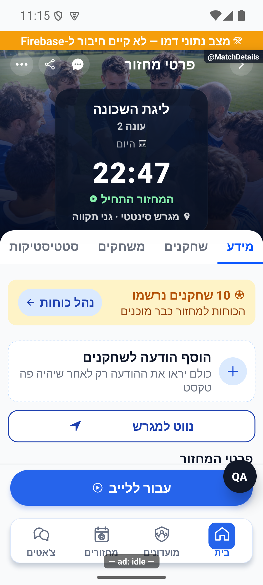

## אימות חסימת לחיצות אחרי גלילה — 10.10.2026

מקור: שינויים מקומיים מעל `a348b9f235f1e1433497600555303231512a0834`; מעטפת פיתוח מקומית `1.1.33/1`, Android/Fabric, RN0.79.6, Screens4.11.1, Metro8083 עם דמו ונתיבי בדיקה. אין הוכחת גרסת חנות/מכשיר פיזי/אייפון.

`ScrollSurface` שומרת את ההגנה הקיימת של250ms בלי שינוי הסף. RN בודקת את זמן begin מול end ואת זמן פריים הגלילה האחרון בזמן בירור responder; רק begin שלא נסגר ויותר250ms ללא פריים משחרר את הנעילה. תנופה עם פריימים טריים נשארת מוגנת, והמקלדת ממשיכה לפעול לפי `keyboardShouldPersistTaps`.

בקרה רגילה: גלילה עמוקה במחזור ואז לחיצה יחידה על סטטיסטיקות הצליחה. בניסוי זמני בדמו בלבד הושמט end: בלי ההגנה שתי לחיצות במחזור ולחיצות לשונית/תפריט במועדון נשארו חסומות; עם ההגנה הלחיצה הראשונה החליפה לשונית. הוכחות כוללות פקודות מגע אמיתיות, XML עם selected, צילום ולוג begin/drop_end/recovered. זה אינו שחזור טבעי או הוכחת סיבת השורש של דיווחי הבעלים. אין לסגור דיווח רק על סמך ניסוי מוזרק.

פער נוסף: `CommunityPlayersScreen` השתמשה ב־FlatList עם ScrollView רגילה ולכן לא קיבלה את ההגנה. `renderRosterScroll` יציבה מחזירה `ScrollSurface` כ־`renderScrollComponent`, עם `keyboardShouldPersistTaps="handled"`. אין ScrollView חיצונית או קינון: VirtualizedList עדיין מנהלת cells, חלון, מדידות ו־ref באמצעות cloneElement. כל props ואירועי הגלילה עוברים דרך המשטח המשותף; השורות, המיון, השאילתות, ההרשאות והפעולות לא השתנו.

`tests/scrollStaleMomentum.test.ts` מפעילה את תנאי RN ואת capture handler המותקנים עצמם. נוספו מקרי גבול250/251ms, פריים חדש, begin חדש, end תקין, opt-in אפס/שלילי, לחיצת ילד ראשונה ושמירת התנהגות המקלדת. [ראיות מלאות, תוצאות ומגבלות](../../../artifacts/pre-release-2026-10-10/scroll-press/README.md).

### תיקון יישור ציוד — 10.10.2026

כותרת ציוד המחזור האחרון (`lastCycleTitle`) משתמשת רק ב־`RTL_LABEL_ALIGN`; הוסר שילובו עם `writingDirection: rtl`, שהפך את היישור לפיזי. צילום מצב עם מחזיקי ציוד נדרש לאימות חזותי; הקוד אינו ראיית הרצה.

## תיקוני דיווחים — 10.10.2026, אחרי גרסה 1.1.45

CommunityDetails מעביר flush ל־ClubTabs כדי להסיר את החפיפה השלילית של 22 נקודות ולהשאיר את אזור הלשוניות בגבולותיו. זוהי הגנה על פריסה, לא הוכחת סיבת שורש לדיווח 1.1.45. אין סגירה של שלושת דיווחי חסימת הלחיצות.

שינוי מקומי מעל bcca0886; לא נבנתה גרסה בסבב הזה. נבדק בקוד ובבדיקות אוטומטיות. צילומי אנדרואיד בנתוני דמו בלבד; אין אימות באייפון או בטלפון המדווח.

## תיקוני עונות — 11.10.2026

ב־`CommunityDetailsScreen` צבירת המחזורים והשערים לכל הזמנים קוראת `seasonHistoryService.list(groupId, true)` כדי לכלול גם תקופות `nonSeason`. הצבירה כוללת מונים חיים וארכיונים ואינה מאבדת פעילות שהתרחשה בזמן שהעונות היו כבויות. לא שונה עיצוב מסך זה בסבב העונות.

השינוי מקומי בלבד. [ראיות, בדיקות ומגבלות](../reviews/2026-10-11-seasons-fixes.md).

## גבולות מידע אישי — 11.10.2026

לאחר אישור הבעלים, קוראי זהות של שחקן אחר משתמשים בהיטל ציבורי בלבד; `users`, `playerStats` ותארים אישיים מוגבלים לבעלים. נתוני זוג אישיים מוגבלים לאחד המשתתפים; סטטיסטיקה מלאה של אדם אחר נשלחת דרך שער הפרטיות בשרת. טבלאות, תוצאות, השוואות וארכיוני מועדון נשארו לפי הרשאת המועדון. פרטי מסלול הקריאה, המקרים והבדיקות ב[גילוי שחקנים ופרטיות](../profile/player-discovery.md). השינוי מקומי וטרם נפרס; אין כאן אימות חדש של תצוגת ייצור.

צילומי תיקון ההזמנות: [רשימה ומצב הרשמה](../screenshots/invitations-status-2026-10-11.png), [כפתור מימוש ההזמנה](../screenshots/invitation-accept-2026-10-11.png). נצפו באמולטור בקוד העדכני ובנתוני הדגמה בלבד.

## המשכיות מסך אחרי הצטרפות — 12.10.2026

תוקנה התנגשות בין החלפת המסך הציבורי למסך חבר כאשר המועדון מופיע בחנות הנתונים, לבין `goBack` בסיום ההצטרפות. `openMemberView` משותפת לתוצאת `joined`, לתוצאת `already_member` ולזיהוי החברות בחנות בעת מיקוד. היא מבצעת `replace` למסך `CommunityDetails` של אותו `groupId` פעם אחת למשתמש ולמועדון, ורק כשהמסך ממוקד. לכן לא נשארת תצוגת הצטרפות בהיסטוריית הניווט, ולא חוזרים לרשימת המועדונים אחרי הצטרפות מוצלחת. בקשה שבאמת ממתינה לאישור נשארת במסלול הקודם. נבדקת גם זהות המשתמש אחרי השלמת הפעולה.

ב־`groupStore.requestJoinById`, לאחר תשובת שרת חיובית נקרא המועדון המסוים דרך `groupService.get`. רק מסמך עם מזהה תואם וחברות מפורשת ב־`playerIds` או `adminIds` נוסף לחנות; לא משתמשים באובייקט הדמה החלקי שתשובת ההצטרפות מחזירה. המועדונים האחרים והבקשות האחרות נשמרים, והמועדון מוסר מרשימת הבקשות. הצלחת הקריאה הממוקדת אינה מחכה לשאילתות כל המועדונים וכל הבקשות. אם הקריאה נכשלת או אינה מאמתת חברות, נשאר מנגנון הרענון הקודם עם ניסיון חוזר יחיד. דור חשבון וזהות המשתמש מגינים מתשובה מאוחרת לחשבון אחר. אין שינוי בהרשאות או במדיניות ההצטרפות של השרת.

אימות: כל 3,530 הבדיקות עברו, לרבות בדיקות הצטרפות קיימות ושלוש בדיקות חדשות לקריאה ממוקדת, חברות קיימת ושינוי חשבון. באמולטור אנדרואיד בדמו מנותק נלחץ כפתור אישור ההזמנה במועדון הפתוח של הדמו: התצוגה נשארה באותו מועדון ועברה לתצוגת חבר, מספר השחקנים השתנה מ־18 ל־19 והלשוניות נפתחו. לא נוצרו נתוני ייצור ולא בוצעה הצטרפות למועדון של הבעלים או מתן. אין כאן מדידת זמן שרת בייצור או הוכחת קיצור לכל ההמתנה שמתן חווה. לא נבדק אייפון או אישור במועדון סגור מול שרת. מקור `ec536c6f1e2302ff40cfa3b16b230257cae8df53` עם שינויים מקומיים; אחרי 1.1.47/280, טרם הופץ.

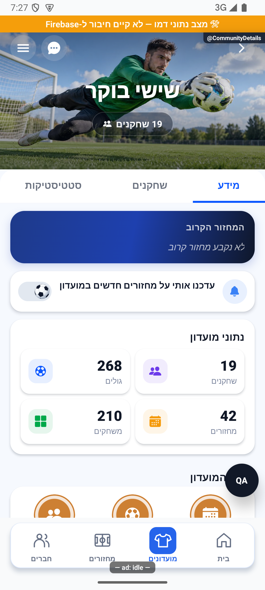

## לשונית הסטטיסטיקה — 15.10.2026

העיצוב המאושר ממומש בתוך לשונית הסטטיסטיקה בפרטי המועדון. כותרת המועדון והתמונה נשארות חלק מהמעטפת, ומתחתיהן בחירת עונה וסקירה/הטבלה/צמדים ושיאים. הסקירה כוללת מגרש בהיר עם פס דשא וכל התארים הזמינים; הצמדים מקושרים בסמל חיבור קטן. לא נוסף מסך נפרד. [תיעוד וראיות](../statistics/club-leaders-and-table.md).

`CommunityDetailsScreen` מעביר `active={tab === 'stats'}` ל־`CommunityStatsScreen`, בנוסף ל־`groupId` ול־`header`. זהו סימון נראות לתנועה בלבד; הוא אינו משנה טעינה, זהות, הרשאות, ניווט או את שמירת הלשונית מורכבת. `seen` ו־`tabPaneHidden` נשמרו. הכותרת נבדקה בנתוני דמו, ללא פעולות מנהל או כתיבה לנתוני המועדון.

## הישגי המועדון בסגנון הארון האישי — 18.10.2026

`ClubAchievementsCard`, מתחת לנתוני המועדון ב־`CommunityDetailsScreen`, משתמש כעת באותם `AchievementTile` ו־`AchievementDetail` של ארון ההישגים האישי. מדליות הרשת הקודמת הוחלפו בשתי עמודות של כרטיסים קטנים: סמל קטגוריה צבעוני משמאל, שם ותג דרגה מימין, מונה אל היעד הבא ופס התקדמות המתחיל מימין. המידות משותפות: רוחב 49%, גובה מינימלי 82, ריפוד 8, רדיוס 12, מרווח 6. אין גובה קשיח או הגבלת מספר שורות. הכותרת נשארה ללא אייקון; הוסר ממנה השילוב השגוי של `writingDirection: rtl` עם `RTL_LABEL_ALIGN`.

לחיצה פותחת חלונית תחתונה במקום `appAlert`, עם תנאי ההישג, ספי הדרגות, סימון הדרגה הנוכחית וההפרש ליעד הבא. הסגירה בכפתור, באזור הכהה, ב״הבנתי״ או בחזרת המכשיר. מועבר `context=club`, ולכן אין הבטחה לשמירת דרגה אישית או תאריך פתיחה מומצא: דרגות המועדון ממשיכות להיגזר מהנתונים העדכניים בכל תצוגה.

### נתונים וספים ללא שינוי

`computeClubBadges` ו־`resolveClubTier` ב־`src/data/clubAchievements.ts` נשארו המקור היחיד לזכאות. `ClubAchievementsCard` ממיר את התוצאה לחוזה התצוגה `AchievementDisplayItem` בלי לייצר מונה אישי או לשמור זכיות. `metrics=null` עדיין מסתיר את האזור עד שהמקור נטען; הזרימה של טעינת מונים וארכיונים במסך המארח נשארה כפי שהייתה.

| הישג | מקור/יחידה | ברונזה / כסף / זהב |
|---|---|---|
| מפגשים | `communityStats.lifetime.totalFinished`, מחזורים | 10 / 50 / 100 |
| שערי המועדון | שערי הפעילות והארכיונים דרך `lifetimeTotals.data.goals` | 100 / 500 / 1000 |
| חברי מועדון | חברים מאושרים נוכחיים | 10 / 25 / 50 |
| ותק המועדון | שנים שלמות מתאריך ההקמה | 1 / 2 / 5 |
| פעילות החודש | שחקנים ייחודיים פעילים ב־30 הימים האחרונים | 5 / 10 / 20 |
| מועדון מאורגן | שיעור מחזורים שהתקיימו ולא בוטלו | זהב בלבד, 90% |

הפס הוא המונה חלקי סף הדרגה הבאה, בטווח 0–100%; בהשלמה הוא מלא. לא נוספו ספים או חישובים של מוני המקור. נתון הארגון מסומן `unit=percent`: ערך וסף מקבלים סימן אחוז, והפער מוצג בנקודות אחוז. למשל 88% מול 90% מציג עוד 2 נקודות אחוז, בעוד הפס הוא 88/90. ב־93% מוצגת השלמה וזהב, עם שלב יחיד.

נבדקו בפועל בדמו מנותק: כל ששת הכרטיסים, כיווניות, פירוט מועדון מאורגן ב־93%, וסף נעול ב־88% שהוזרק זמנית למצב מסך בלבד. הנתון המקורי הוחזר ל־93% בסיום, ללא כתיבה למסד. 42 מחזורים, 910 שערים, 23 חברים, ותק שנתיים ו־14 פעילים הם נתוני הדמו המקוריים בסבב הזה. אין שינוי למסך מונים, שיתוף הזמנה, הרשאות או ניווט.

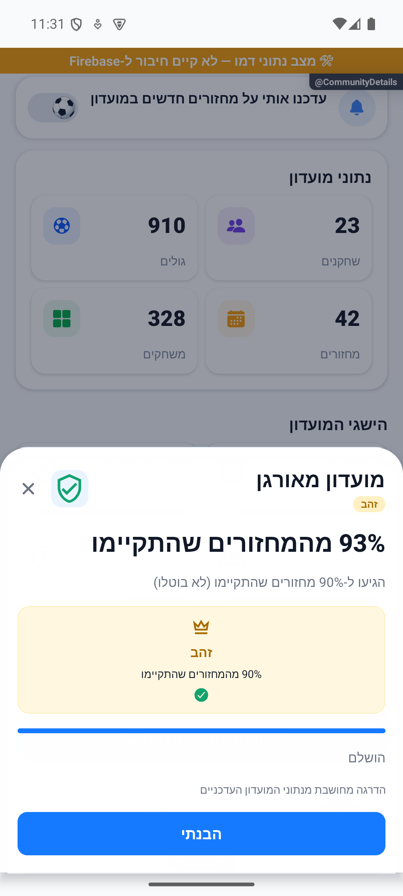
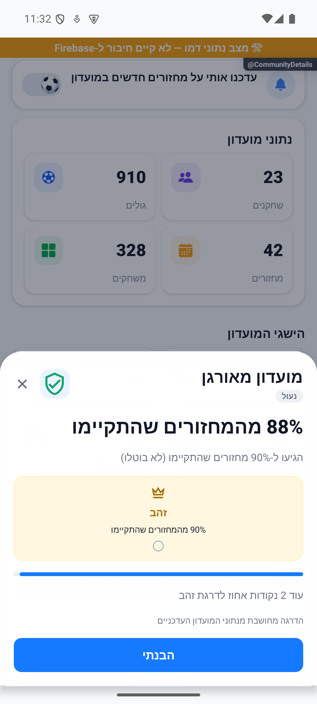

צילומים מקוריים של מקטעי חלון באנדרואיד; לא נבדקו ייצור, אייפון, גופן מוגדל או מצב כהה בסבב זה. [בדיקות, תיעוד ומגבלות](../../changes/2026-10-18-club-achievements-cards.md).

## סבב פולס — 18.10.2026

`NextGameCard` מחזיר במצב startsAt חסר את preview.card/preview.cta בלי להמציא תאריך או תפוסה. `ConfirmDestructiveModal` קיבל football opt-in, המופעל רק במחיקת המועדון: תמונה, מרכוז ו־fullWidth; acked ובקרת busy ללא שינוי. `ClubStatusOverview` מעביר iconLeft ל־Button. בדיקת הכרטיס הקיימת מאמתת שהפעולה פועלת פעם אחת ואין נתוני תפוסה מומצאים. לא בוצעה מחיקה או פעולת שיתוף.

השינויים מקומיים וטרם הופצו. לא שונו הרשאות ולא נשלחו הזמנות או הודעות. בדיקת הדפדפן משתמשת בקוד הרכיבים בפועל, במתאם סגנונות, בסמלים חלופיים ובנתוני הדגמה; אינה הוכחת אנדרואיד או אייפון. שני האמולטורים לא הגיבו לפקודות או לצילום בסבב זה.

## תלות בעדכון העונות — 19.10.2026

SeasonsCard מציגה חלון מושהה, בקשת סיום ידנית ומינימום 5, ומסנכרנת חלון שפג. src/components/community/UnverifiedEveningsCard.tsx קוראת את כל הממתינים דרך השרת, מבקשת מועד כשחסר וממתינה לתשובה לפני לחיצה נוספת.

[מצב המימוש, הבדיקות ומגבלות האימות של העונות](../clubs/seasons.md). מקומי בלבד; לא בוצעה פריסה במסגרת המשימה.

## אימות תצוגה מקורי אחרי התיקון — 20.10.2026

[סטטיסטיקות אחרי התיקון](../screenshots/seasons-integrity-statistics-after-2026-10-20.png) · [סיכום שנפתח מהכפתור](../screenshots/seasons-integrity-summary-after-2026-10-20.png). נבדקו באימולטור אנדרואיד מקורי במצב דמה כפוי: טעינה עד להצגת הנתונים, כיווניות ופתיחת הסיכום מכפתור הסטטיסטיקות. לא בוצעו סיום או כיבוי באימולטור. אימות שינוי עונה ורענון לשונית מותקנת נעשה בבדיקות הרכיב והמסד, ולא בשינוי נתוני מועדון במכשיר. מסך הסטטיסטיקות צולם כעת בנפרד, בעוד צילום הביקורת הקודם היה מוטמע בתוך המועדון; אין כאן השוואת פיקסלים של אותה מעטפת. נתוני הדמה אינם נתוני בדיקת הרצף המבודדת.

## אימות לחיצות באנדרואיד — 23.10.2026

התיקון הקיים ללחיצות לאחר גלילה נבדק מחדש באימולטור אנדרואיד 35 עם נתוני דמו: לשונית השחקנים במועדון, פתיחת כרטיס השיתוף ולשונית משחקים נעוצה במחזור פעלו בלחיצה הראשונה לאחר הגלילה. נשמר יומן אירועים מקומי; אין שינוי נוסף במנגנון ואין אימות במכשיר המדווח או באייפון. [ראיות וגבולות](../../changes/2026-10-23-crash-test-and-pulse-followup.md).

## תלות בקורא צמדי סיכום העונה — 23.10.2026

בסיכום העונה נשמר כעת גם השיוך המדויק של כל צמד זוכה, כדי להציג כל צמד בנפרד בחלונית. אין שינוי בבחירת זוכים, במכנים או בחישוב הנתונים של המסך המתואר כאן. הקריאה נבדקה עם עונה חתומה, שמות זהים ושחקן שזכה עם כמה שותפים; אין אימות ייצור חדש. [ראיות](../../changes/2026-10-23-crash-test-and-pulse-followup.md).

## בידוד מונה בקשות והתאוששות מרקע — 23.10.2026

`groupService.listForUser(userId, { includeAdminRatings: false })` מחזיר את נתוני החברות ללא קריאות `getClubAdminRatings` וללא שדה דירוגים. ברירת המחדל של מסכי המועדון שומרת את טעינת הדירוגים ואת התנהגות הכשל הקיימת. `requestsService.myAdminGroupsWithPending` משתמש במסלול המצומצם: מספר בקשות חברות + סכום הממתינים במועדונים שמנוהלים בידי המשתמש + סכום הממתינים במחזורים שיצר. אין שינוי במכנה או בהרשאות. אפקט המיקוד של מונה הבית מאזין גם ל־`AppState`: מעבר מצב מבטל דור קודם, חזרה ל־`active` מבצעת קריאה חדשה; ניקוי מסיר מאזין ומונע תוצאה מאוחרת. `inboxRatingsIsolation` מריץ את מתודות המקור ומוכיח ספירה של 4 גם כששרת הדירוגים נכשל ושימור כשל מקור אמיתי; `homeInboxResume` מריץ את אפקט המקור ומאמת תוצאה חדשה מול ישנה, ניקוי ואורח. אין כאן הוכחת פתרון לכל חריגת זמן, חיבור רשת או כניסת אפל. אין אימות מכשיר חדש של תרחיש רשת זה. [הסבר, יומני שרת ומגבלות](../../changes/2026-10-23-inbox-resume.md).

## עדכון תלות משותפת בקריאות מידע — 23.10.2026

בקובצי השירות המשותפים נוספה אפשרות מפורשת לניסיון חוזר אחד בקריאה זמנית שנכשלה, תוך עצירה אם החשבון מתחלף. החיבור מוגבל ל־14 נקודות קריאה המפורטות בדוח; אין כאן טענה שכל פעולה בפיצ׳ר קיבלה ניסיון חוזר או שנבדק מסך חדש. בדיקות המאגר המלאות עברו (5,261 בדיקות ב־472 חבילות), אך אינן הוכחת הרצה במכשיר. הקוד מקומי וטרם הופץ. [מסלול, ראיות ומגבלות](../../changes/2026-10-23-four-open-errors.md).
