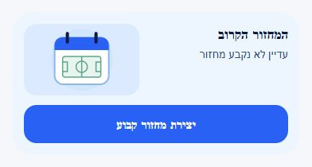
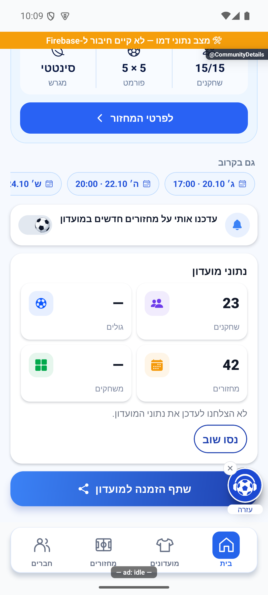
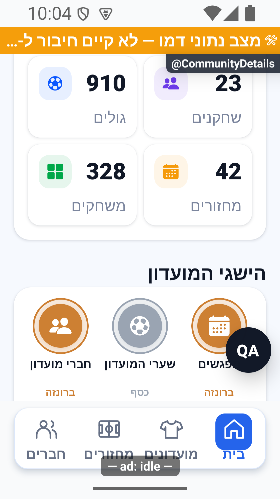
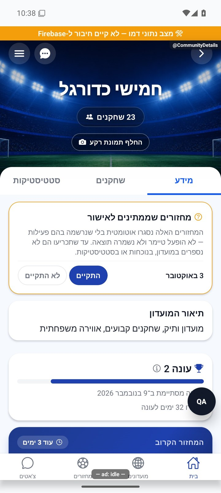
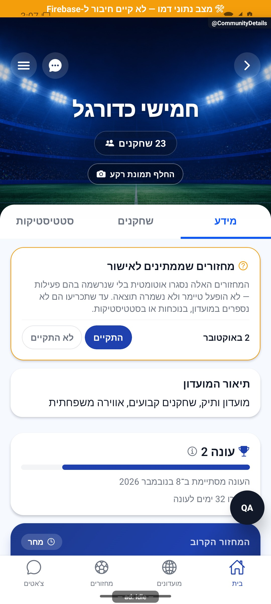
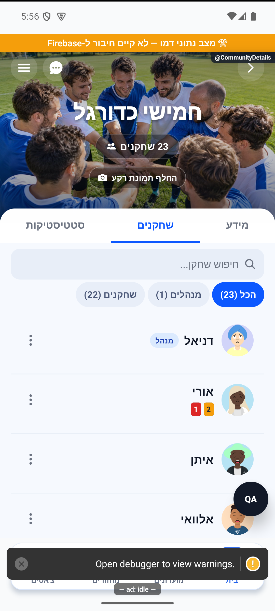
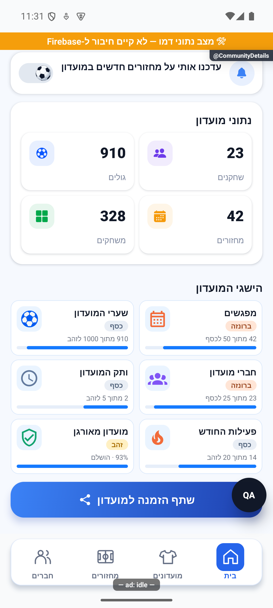
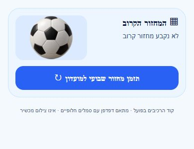

# כל מה שקשור למועדון

## הרחבת אבחון דיווחים, 27.10.2026

הדיווחים יוכלו לכלול מה ניסו לבצע, מה היה מצב האפליקציה ומה החזיר השרת. פרטים חסרים מוצגים כלא ידועים, ומספר מוגבל של מופעים נשמר בלי למחוק את המופע הראשון. השינוי מקומי וטרם הופץ, ואינו משלים פרטים לדיווחים ישנים. [היקף, ראיות ומגבלות](../../changes/2026-10-27-diagnostic-context.md).

בדיקות הקוד הושלמו, אך השינוי עדיין מקומי ולא הופץ. פרטים שלא נאספו בדיווחים ישנים אינם משוחזרים בדיעבד.

## טיפול מלא בפריטי הפולס הפתוחים, 27.10.2026

הושלם סבב טיפול בפריטי הפולס עם תיקונים ותוצאות מחקר מוכנות לביקורת. פריטים שלא תוקנו נשארים פתוחים עם הסבר וצעד הבא. לא בוצעה הפצה או בדיקת מכשיר חדשה. [ממצאים, בדיקות ומסירה](../../changes/2026-10-27-pulse-completion.md).

## טיפול בתקלות הפולס, 26.10.2026

נבדק שינוי ממוקד במקור משותף במהלך טיפול בתקלות הפולס. אין שינוי נוסף בפעולות הפיצר המתואר כאן.

השינוי מקומי וטרם הופץ. [בדיקות, מסירה ומגבלות](../../changes/2026-10-26-pulse-fixes.md).

## ביטול פעילות אחרי מחיקת מועדון - 26.10.2026

מחיקת מועדון עוצרת כעת את המחזורים השבועיים שלו, ובשרת נוספה הגנה שמונעת פתיחת מחזור למועדון שכבר נמחק. הטיפול מבטל מחזורים שטרם הסתיימו, דוחה בקשות חברות ממתינות, מסיר הרשמה להתראות ואת כרטיס המועדון הציבורי. נתוני עבר והישגים אישיים נשמרים. תיקון השרת נפרס ואומת באישור הבעלים. הסדרה שנותרה כובתה, ההרשמה להתראות והכרטיס הציבורי הוסרו; המחזור עצמו כבר לא היה קיים בבדיקה העדכנית. עצירת הסדרה המוקדמת בצד הלקוח תיכלל בבינארי עתידי. נשמרה ההיסטוריה. [המימוש, בדיקת השאריות ומגבלות האישור](../../changes/2026-10-26-deleted-club-recurring.md).

## השפעת מקור משותף במשימת השעון - 26.10.2026

במקור המחזורים המשותף תוקן שימור זמן הריצה בזמן עצירת רוטציה ומעבר למשחק הבא. קוראי נתוני המועדון והלשוניות שלו לא שונו בשתי מתודות הרוטציה. לא נערכה כאן בדיקה חדשה של כל מצבי המסך. השינוי מקומי, ומצב ההפצה ומגבלות הבדיקה מפורטים בדוח המקושר. [היקף המימוש, הבדיקות, מגבלות האישור והצילומים](../../changes/2026-10-26-android-personal-activity.md).

## שעון מדויק וכיתוב פנדל - 25.10.2026

במקורות המשותפים נוסף שימור השעון המדויק של פנדל במהלך משחק, וכיתוב ההבקעה ביומן קוצר. אין שינוי במונים או בתהליך העצמאי המתואר כאן; לא נערכה לו בדיקת ממשק חדשה במסגרת העדכון. השינוי מקומי וטרם הופץ. [פרטים וראיות](../../changes/2026-10-25-in-play-penalties.md#שעון-מדויק-וכיתוב-אירוע).

## פנדל במהלך משחק חי - 25.10.2026

עודכנו מקורות משותפים לצורך פנדלים במהלך משחק. אין שינוי מכוון בתהליך העצמאי המתואר במסמך הזה, ולא נערכה לו בדיקת ממשק חדשה במסגרת המשימה.

השינוי מקומי. נדרשת פריסת שרת לפני הפצת לקוח שמשתמש באפשרות; לא בוצעו פריסה או שינוי הרשאות. [חוזה הנתונים, התהליך, הבדיקות ומגבלות ההפצה](../../changes/2026-10-25-in-play-penalties.md).

## נקודות רשימת החוקים בצד העברי — 24.10.2026

נקודות הרשימה בחוקי המועדון הועברו לימין הטקסט, כך שכל סעיף מתחיל בצד הקריאה בעברית. תוכן החוקים נשאר כפי שהיה. התיקון נצפה במציג מבודד של הרכיב המקורי באימולטור אנדרואיד עם נתוני דמו; מסך המועדון השלם לא הורץ מחדש עבור התיקון. השינוי מקומי וטרם הופץ.

[הצילום לאחר התיקון](../screenshots/night-rules-after-2026-10-24.png) · [דוח הסריקה ומגבלות האימות](../../audits/2026-10-24-night-scan.md).

## קיצור טעינה ומניעת קריאות כפולות — 23.10.2026

המחזור הקרוב, השחקנים והנתונים במועדון מופיעים כשהמידע של כל חלק מוכן, בלי להמתין לחלק האיטי ביותר. רענון שנכשל שומר מידע שכבר נטען בהצלחה; מעבר לחשבון או למועדון אחר מבטל קבלת תשובות ישנות. השינוי מקומי וטרם הופץ.

[בדיקות, צילומים ומגבלות](../../changes/2026-10-23-screen-loading.md).

כרטיס העונה מציג כעת מקומית מה מעכב את הסגירה ובאילו מחזורים מדובר. ההבחנה היא בין מחזור פעיל, אישור מנהל ועיבוד סיכום בשרת. [המצבים והראיות](seasons.md); השינוי טרם הופץ.

## איור למחזור שטרם נקבע — 23.10.2026

הכדור הגדול בכרטיס המחזור הקרוב הוחלף באיור לוח שנה עם מגרש. האיור מופיע רק כשאין מחזור מוגדר; המלל וכפתור יצירת המחזור נשארו כפי שהיו. השינוי מקומי וטרם הופץ.

[צילום לפני השינוי](../screenshots/club-empty-round-before-2026-10-23.png).

בדיקת טיפוסים וכל 5,199 הבדיקות ב־461 חבילות עברו. בדיקת התיעוד עדיין מציגה פערים היסטוריים שאינם קשורים לשינוי.

## תיעוד כשלים — 20.10.2026

נוסף תיעוד אוטומטי לנקודות כשל במסלול הזה, עם מקור התקלה. הפעולה המקורית שומרת על ערכי החזרה והודעות השגיאה שלה. השינוי מקומי, טרם הופץ, ואין אימות מסירה חיה לפולס.

[דוח דיווח השגיאות והראיות](../../changes/2026-10-20-error-reporting-audit.md).

## אימות מול שרת אמיתי והגבלת המתנה — 20.10.2026

במועדון הבדיקות נבדקו מול השרת האמיתי הפעלת עונה עם שבעה מחזורים, סגירה ידנית, חלוקת שמונה תארים ופתיחת עונה שנייה ריקה. הנתונים נשמרו בארכיון ובכל הזמנים. שירותי העונות נפרסו באישור; תיקון נוסף בלקוח מציג אפשרות לנסות שוב אחרי30 שניות של קריאה תקועה, והוא עדיין דורש הפצת לקוח. לא המתנו24 שעות בפועל ולא בדקנו כאן סגירה של עונה קצרה.

[הבדיקה, המקור, הצילומים והמגבלות](../reviews/2026-10-20-seasons-live.md).

## תיקון פערי העונות — 20.10.2026

כל חמשת הפערים בביקורת טופלו מקומית: אכיפת סוף חלון התיקונים, חסימת הארכה מאוחרת, אימות ללא מועד, התאמת מועד לשיוך ורענון הסטטיסטיקות. תוקנה גם פתיחת סיכום עונה פעילה שנכשלה מול ההרשאות. אין שינוי בכללי התארים או בשלוש בחירות ההפעלה. אפשר לדחות מחזור שלא התקיים גם בלי להמציא לו תאריך; אישור שהתקיים עדיין דורש מועד. התיקון טרם הופץ.

[דוח תיקונים, בדיקות ומגבלות](../reviews/2026-10-20-seasons-fixes.md).

## כשל טעינת מונים אינו אפס — 18.10.2026

אם נתוני המועדון לא נטענו, מופיע מקף ואפשר לנסות שוב. אם כבר היו נתונים ורענון נכשל, הם נשארים מוצגים עד שהעדכון מצליח.

תוויות המונים מקבלות כעת את רוחב התא מתחת למספר ולאייקון, ויכולות להיפרס לשתי שורות בלי להקטין את הגופן. כך ״שחקנים״, ״מחזורים״ ו״משחקים״ אינם נחתכים ואינם משאירים אות בודדת בשורה נוספת במסך קטן.

בדמו באנדרואיד נבדקו כשל ראשון, ניסיון חוזר, כשל רענון ושיבה לתקין. נצפו 910 גולים ו־328 משחקים, ונבדקו גם רוחב 320 וגופן 140%. אלה נתוני הדמו, ולא אימות של מסד ייצור או תקלה אמיתית ברשת. בסיום הוחזרו מתאם הקריאה, הגופן והמידות המקוריים.

[דוח הביקורת, הבדיקות וגבולות האימות](../../changes/2026-10-18-preproduction-end-to-end.md).

## המחזור הקרוב — 17.10.2026

המחזור הקרוב מוצג באותו עיצוב בהיר עם תמונה גם לחברי המועדון. חברים יכולים לפתוח ממנו את פרטי המחזור. בתצוגה הציבורית ״על המועדון״ כולל רק תיאור, ללא חזרה על העיר ומספר החברים שכבר נמצאים למעלה. נבדק בדמו באנדרואיד.

## עיצוב הכותרת — 17.10.2026

תמונת המועדון מוצגת כמו בפרטי המחזור: שם ועיר בתחתית מימין ומספר השחקנים משמאל. פעולות המועדון נשארות למעלה, בהתאם לתפקיד שלך. העיצוב משותף גם לתצוגה הציבורית. מסך החבר והתצוגה הציבורית נבדקו בדמו, גם במסך צר ובטקסט מוגדל. האמולטור חזר לפעול והגדרות התצוגה הוחזרו בסיום.

## הזמנות ואישור מראש — 11.10.2026

הזמנה אישית ממנהל מאפשרת להצטרף בלי אישור נוסף, גם למועדון סגור. מצטרפים רק אחרי שלוחצים להצטרף; ההזמנה אינה שומרת מקום. במחזור מלא נכנסים להמתנה, ובמועדון מלא ההצטרפות נחסמת. קישור שיתוף רגיל אינו אישור מראש. הזמנה חדשה תקפה לשבעה ימים ולמחזור לא מעבר לגבול ההרשמה שלו; חסימה ודחייה קודמת אינן מתבטלות בגללה.

ברשימת ההזמנות מופיעים גם מצבים כמו הצטרפת, ממתין לאישור, המועדון מלא, הרשמה שטרם נפתחה והזמנה שאינה זמינה. השינוי מקומי ועדיין דורש פריסה והפצת גרסה.

תיקון מ־8.10.2026: תמונת המועדון נשארת בכותרת ואינה מופיעה מאחורי הכרטיסים. נבדק באמולטור אנדרואיד עם נתוני דמו; אייפון לא נבדק בפועל.

מסך המועדון מרכז מידע, שחקנים וסטטיסטיקה בשלוש לשוניות. ממנו אפשר להגיע למחזור הקרוב, לשיחה ולהיסטוריה, ומנהלים מקבלים גם כלי ניהול.

[לפירוט המעמיק](details.md)

## תיקוני סבב הבאגים — 8.10.2026

קישורים לפרטי מחזור, היסטוריה ופעולות ניהול זמינים גם כשנכנסים למועדון מתוך שיחה.

## שיפור תגובה בגלילה — 9.10.2026

צומצמה עבודה מיותרת של אנימציות ותמונות. מספרים מתייצבים בזמן גלילה, ואנימציות רקע מחזוריות נעצרות כשעוברים למסך אחר. הנתונים, סדר התוכן והניווט נשארים כפי שהיו. הבדיקה בוצעה באימולטור אנדרואיד עם נתוני דמו; טלפון פיזי ואייפון לא נבדקו.

## לוח מנהל — 9.10.2026

לתפריט המועדון נוסף קישור ״לוח מנהל״ למנהלים בלבד. [הסבר פשוט](manager-dashboard.simple.md) · [נתונים, הרשאות ובדיקות](manager-dashboard.md). המסך זמין מכל מחסנית שמארחת פרטי מועדון; השינוי מקומי, ושירות התזכורות טרם נפרס.

## תיקוני עיצוב ונגישות — 10.10.2026

מקור: `a348b9f235f1e1433497600555303231512a0834` עם שינויים מקומיים. אין בסעיף זה הוכחת גרסת חנות.

אפשרות ההתראות של המועדון מקבלת שם ומצב ברור בקורא מסך.

## התאמת הלשוניות לגופן גדול — 10.10.2026

הלשוניות שומרות על טקסט מלא גם כשהגופן במכשיר מוגדל. לתווית ארוכה ניתן יותר רוחב, והגובה יכול לגדול בעת הצורך במקום להקטין את הטקסט. נבדק בפרטי מחזור באמולטור אנדרואיד עם גופן בגודל130%; אייפון ומכשיר פיזי לא נבדקו.

## בדיקת לחיצות אחרי גלילה — 10.10.2026

בדקנו לחיצות לאחר עצירת גלילה בפרטי מחזור ובפרטי מועדון. בניסוי דמו שדימה אירוע סיום גלילה חסר, הגנת הגלילה הקיימת אפשרה כבר את הלחיצה הראשונה. נוספה אותה הגנה גם לרשימת השחקנים במועדון. הנתונים, סדר השחקנים והחישובים לא השתנו.

התקלה לא שוחזרה באופן טבעי באמולטור. הניסוי מוכיח מסלול כשל מסוים, ואינו מוכיח שזו הסיבה בטלפון המדווח; שני הדיווחים נשארים פתוחים לאימות. [ראיות ומגבלות](../../../artifacts/pre-release-2026-10-10/scroll-press/README.md).

### עדכון 10.10.2026

כותרת הציוד מהמחזור האחרון מיושרת לצד העברי של המסך.

## תיקוני דיווחים — 10.10.2026, אחרי גרסה 1.1.45

בוצעה התאמה לגבולות הלחיצה של הלשוניות ונוסף תיעוד ממוקד שלהן. חסימת הלחיצות המדווחת עדיין אינה נחשבת פתורה ללא אימות בטלפון.

שינוי מקומי מעל bcca0886; לא נבנתה גרסה בסבב הזה. נבדק בקוד ובבדיקות אוטומטיות. צילומי אנדרואיד בנתוני דמו בלבד; אין אימות באייפון או בטלפון המדווח.

## תיקוני עונות — 11.10.2026

המספרים המצטברים של המועדון כוללים גם מחזורים ששוחקו בתקופה שבה העונות היו כבויות. אין שינוי במראה מסך המועדון במסגרת התיקון הזה.

השינוי מקומי בלבד. [ראיות, בדיקות ומגבלות](../reviews/2026-10-11-seasons-fixes.md).

## גבולות מידע אישי — 11.10.2026

שמות ותמונות השחקנים נשמרים. מידע סטטיסטי של המועדון נשאר לפי הרשאות המועדון, והנתונים האישיים מוגבלים לפי הגדרות הפרטיות. השינוי הושלם מקומית וטרם הופץ.

## נשארים במועדון לאחר הצטרפות — 12.10.2026

לאחר הצטרפות מוצלחת פרטי אותו מועדון עוברים לתצוגה של חבר, במקום לחזור לרשימת המועדונים. נוספה טעינה ממוקדת של המועדון כדי שלא להמתין לרענון כל המועדונים כשאין צורך. נבדק באנדרואיד בדמו; זמני שרת אמיתיים לא נמדדו, והתיקון טרם הופץ.

## לשונית הסטטיסטיקה — 15.10.2026

העיצוב המאושר ממומש בתוך לשונית הסטטיסטיקה בפרטי המועדון. כותרת המועדון והתמונה נשארות חלק מהמעטפת, ומתחתיהן בחירת עונה וסקירה/הטבלה/צמדים ושיאים. הסקירה כוללת מגרש בהיר עם פס דשא וכל התארים הזמינים; הצמדים מקושרים בסמל חיבור קטן. לא נוסף מסך נפרד. [תיעוד וראיות](../statistics/club-leaders-and-table.md).

## הישגי המועדון בעיצוב אחיד — 18.10.2026

הישגי המועדון מוצגים עכשיו בכרטיסים קטנים כמו ההישגים האישיים: סמל צבעוני, דרגה ופס התקדמות ליעד הבא. לחיצה פותחת פירוט עם התנאים והספים. הדרגות מחושבות מנתוני המועדון העדכניים; תנאי הזכייה והנתונים נשארו כפי שהיו.

במועדון מאורגן מוצג אחוז המחזורים שהתקיימו, והסף נשאר 90% לזהב. כשיוצגו 88%, למשל, יירשם שחסרות עוד שתי נקודות אחוז.

נבדק מקומית בדמו מנותק באנדרואיד וטרם הופץ.

## סבב פולס — 18.10.2026

כרטיס ללא מחזור קרוב משתמש כעת באותו רקע בהיר ובאותו כפתור כחול של כרטיס המחזור הקיים. חלונית מחיקת המועדון ממורכזת עם כפתורים רחבים; עדיין חייבים לאשר את ההבנה לפני מחיקה. בכפתור שיתוף התמונה הסמל משמאל למלל.

השינויים מקומיים וטרם הופצו. לא שונו הרשאות ולא נשלחו הזמנות או הודעות. בדיקת הדפדפן משתמשת בקוד הרכיבים בפועל, במתאם סגנונות, בסמלים חלופיים ובנתוני הדגמה; אינה הוכחת אנדרואיד או אייפון. שני האמולטורים לא הגיבו לפקודות או לצילום בסבב זה.

## תלות בעדכון העונות — 19.10.2026

כרטיס העונה מסביר מתי הסגירה ממתינה לאימות ומתי חסרים מחזורים למינימום. אפשר לאמת גם ערב שרק אורגנו בו שחקנים.

[מצב המימוש, הבדיקות ומגבלות האימות של העונות](../clubs/seasons.md). מקומי בלבד; לא בוצעה פריסה במסגרת המשימה.

## אימות תצוגה מקורי אחרי התיקון — 20.10.2026

מסכי הסטטיסטיקות וסיכום העונה נפתחו ונבדקו באימולטור אנדרואיד עם נתוני דמה. בדיקות הנתונים נערכו במסד מבודד בנפרד; לא שונו נתוני מועדון אמיתי. הצילומים והמגבלות במסמך המעמיק.

## אימות לחיצות באנדרואיד — 23.10.2026

התיקון הקיים ללחיצות לאחר גלילה נבדק מחדש באימולטור אנדרואיד 35 עם נתוני דמו: לשונית השחקנים במועדון, פתיחת כרטיס השיתוף ולשונית משחקים נעוצה במחזור פעלו בלחיצה הראשונה לאחר הגלילה. נשמר יומן אירועים מקומי; אין שינוי נוסף במנגנון ואין אימות במכשיר המדווח או באייפון. [ראיות וגבולות](../../changes/2026-10-23-crash-test-and-pulse-followup.md).

## תלות בקורא צמדי סיכום העונה — 23.10.2026

בסיכום העונה נשמר כעת גם השיוך המדויק של כל צמד זוכה, כדי להציג כל צמד בנפרד בחלונית. אין שינוי בבחירת זוכים, במכנים או בחישוב הנתונים של המסך המתואר כאן. הקריאה נבדקה עם עונה חתומה, שמות זהים ושחקן שזכה עם כמה שותפים; אין אימות ייצור חדש. [ראיות](../../changes/2026-10-23-crash-test-and-pulse-followup.md).

## בידוד מונה בקשות והתאוששות מרקע — 23.10.2026

ספירת בקשות הצטרפות אינה ממתינה יותר לדירוגי השחקנים במועדונים. מסך הבית טוען את המונה מחדש בחזרה מרקע ומתעלם מתוצאה ישנה שמגיעה אחריה. כשל אמיתי בקריאת הבקשות נשאר כשל ושומר את הספירה האחרונה; אין שינוי בעיצוב. נבדק בבדיקות קוד, מקומי וטרם הופץ. [הסבר, יומני שרת ומגבלות](../../changes/2026-10-23-inbox-resume.md).

## עדכון תלות משותפת בקריאות מידע — 23.10.2026

בקובצי השירות המשותפים נוספה אפשרות מפורשת לניסיון חוזר אחד בקריאה זמנית שנכשלה, תוך עצירה אם החשבון מתחלף. החיבור מוגבל ל־14 נקודות קריאה המפורטות בדוח; אין כאן טענה שכל פעולה בפיצ׳ר קיבלה ניסיון חוזר או שנבדק מסך חדש. בדיקות המאגר המלאות עברו (5,261 בדיקות ב־472 חבילות), אך אינן הוכחת הרצה במכשיר. הקוד מקומי וטרם הופץ. [מסלול, ראיות ומגבלות](../../changes/2026-10-23-four-open-errors.md).

## עדכון תלות מסבב הפולס — 23.10.2026

בתלות המשותפת נוספו התאוששות מוגבלת להעשרת מועדונים ובדיקות לביטול קריאה של חשבון או דור ישן. אין שינוי מכוון בכללי המוצר של המסך הזה ואין אימות מסך חדש עבורו. הקוד מקומי וטרם הופץ. [תחום השינוי והבדיקות](../../changes/2026-10-23-pulse-resweep.md).

## תלות בשמירת צבעי המחזור — 24.10.2026

שמירת המידע המשותפת עודכנה כדי להעביר את צבעי הקבוצות ממסכי הכוחות להכנה וללייב. אין תוספת פעולה במסך הזה, והוא לא נבדק מחדש במכשיר במסגרת התוספת. השינוי מקומי וטרם הופץ. [פרטי התוספת ומגבלות הבדיקה](../rounds/draft-setup.md#צבעים-לפני-שיבוץ-ובכל-שיטת-חלוקה--24102026).

## תלות בעריכת קבוצות בלייב — 24.10.2026

בקובץ השירות המשותף נוסף מסלול לעריכת הקבוצות והתור במשחק חי, כולל איפוס המשחק הנוכחי בלבד בעת החלפת קבוצה. לא שונו מסלולי הפיצ׳ר הזה במסגרת התוספת ולא בוצע לו אימות מסך חדש. [מסלול השינוי, הבדיקות והמגבלות](../rounds/live-advanced.md#עריכת-הקבוצות-והתור-בזמן-הלייב--24102026). מקומי וטרם הופץ.

## בדיקת עומק לעריכת הקבוצות — 24.10.2026

בקובץ השירות המשותף תוקן שימור זהות המשחק במחזור ישן בעת שינוי תור בלייב. הדיווח על הצלחת החלפה נשלח כעת רק אחרי שמירה. מסלולי הפיצ׳ר הזה לא שונו ולא בוצעה לו בדיקת מסך חדשה. כל 5,496 בדיקות הפרויקט עברו; אין בכך הוכחת מסד חי או הפצה. [הראיות ומגבלות הבדיקה](../../audits/2026-10-24-live-teams.md). מקומי וטרם הופץ.

## המשך קיצור טעינות בלילה של 25.10.2026

עודכנו קריאות מידע משותפות או מתאם הבדיקה שלהן כדי לצמצם טעינות מיותרות. אין שינוי נוסף בפעולות העצמאיות המתוארות כאן, ואין אימות מכשיר חדש שלהן בסבב הזה. [בדיקות, ראיות ומגבלות](../../changes/2026-10-24-loading-performance.md).

## תגובה מיידית לכפתורי השעון - 25.10.2026

עודכן רכיב השעון המשותף למסכי הלייב. אין שינוי מכוון בהתנהגות הפיצר המתואר כאן. [בדיקות, ראיות ומגבלות](../../changes/2026-10-25-live-timer-response.md). התיקון מקומי וטרם הופץ.
