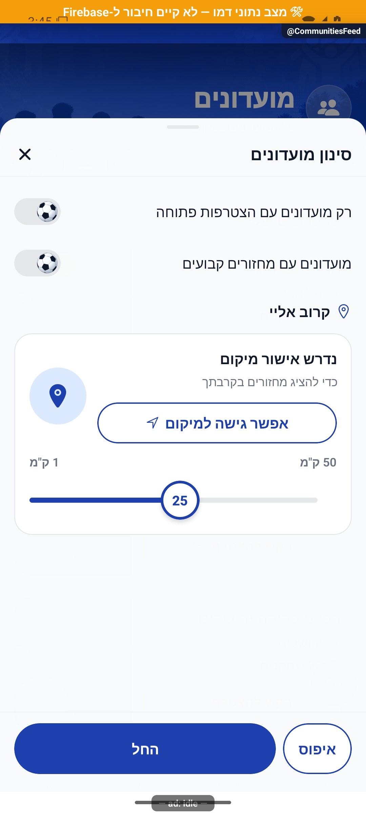

# גילוי מועדונים, חיפוש וסינון

## הרחבת אבחון דיווחים, 27.10.2026

נוספה מעטפת אבחון מקומית עם מצב בזמן הכשל, שלבים בעלי מזהה ותזמון, מצב רשת ובנייה ומופעים נפרדים לשגיאה. נקודת הכניסה לתעבורת השרת עוברת כעת דרך העטיפה המשותפת; תשובות, חריגות, אפשרויות קריאה ומדיניות הפיצר נשמרות. אין כאן שינוי בהרשאות או בחישובי המוצר. הבדיקות המלאות ומגבלות האימות מתועדות בדוח המקושר; אין טענה לאימות מכשיר או להפצה. [היקף, ראיות ומגבלות](../../changes/2026-10-27-diagnostic-context.md).

באימות הסופי עברו כל 6,231 הבדיקות ב-555 חבילות, ובדיקות הטיפוסים של הלקוח, השרת והפולס נקיות. צילום הדפדפן והידור מקורות האנדרואיד הם בדיקות מקומיות; אין הוכחת מכשיר, הידור אייפון או מסירה חיה של הבנייה החדשה. רישום יומן השחרור נחשב מאומת רק לפי קבלת הקריאה החוזרת בדוח השינוי.

## טיפול מלא בפריטי הפולס הפתוחים, 27.10.2026

שירות המיקום שומר כעת את מצב ההרשאה שכבר התקבל גם אם ספק המיקום מתנתק. איתור עיר שלא משיב מוגבל בזמן ושומר את המיקום והעיר החלופית; שעוני ההמתנה מסולקים. שלוש בדיקות נכשלו לפני התיקון ועברו אחריו. זהו תיקון מקומי ללא בדיקת מכשיר חדשה. [ממצאים, בדיקות ומסירה](../../changes/2026-10-27-pulse-completion.md).

## טיפול בתקלות הפולס, 26.10.2026

השינוי במקור המשותף מוגבל לסיווג תוצאה צפויה לפני רישום שגיאה: תיעוד מחיקת מחזור שכבר קיים אינו כשל חדש, והתנגשות גרסה בעדכון עונה אינה מבטלת את הגנת הגרסה. אין שינוי בחוזה הפיצר, במכנים, בניווט או בהרשאות; לא נערכה הרצה חדשה לכל מצבי הפיצר. כשל לא צפוי בתיעוד מחיקה נזרק שוב כדי לאפשר ניסיון שרת חוזר.

השינוי מקומי וטרם הופץ. [בדיקות, מסירה ומגבלות](../../changes/2026-10-26-pulse-fixes.md).

מקורות שנבדקו בסבב: `functions/src/index.ts`.

## ביטול פעילות אחרי מחיקת מועדון - 26.10.2026

נבדקה השפעת השינוי התחום ב-`src/services/groupService.ts`, ב-`src/services/seriesService.ts` וב-`functions/src/index.ts`: עצירת סדרות לפני מחיקת מסמך ההרשאה, הפעלת ביטול פעילות באירוע מחיקת המועדון, ועסקאות יצירה שמאמתות את קיום המועדון והסדרה גם במנגנון ההעתקה הישן. `functions/src/clubDeletion.ts` שומרת מחזורים שהסתיימו ונתוני עבר, מבטלת מצבים פעילים, דוחה בקשות חברות ממתינות, מסירה רק את המועדון שנמחק מהרשמות להתראות ומסירה את ההעתק הציבורי. המימוש והבדיקות ב-`tests/logic/clubDeletion.test.ts` וב-`tests/logic/clubDeletionClient.test.ts` מפורטים ב[דוח התיקון](../../changes/2026-10-26-deleted-club-recurring.md). אין שינוי מסכים, ניווט, נוסחאות או הרשאות במסגרת תיקון זה. זו בדיקת השפעה ממוקדת ואינה אימות מחודש של שינויים קודמים במקורות המשותפים. תיקון השרת נפרס ואומת באישור הבעלים, עם השוואת המקור הפרוס והקוד המהודר ושימור יתר הפונקציות. הסדרה, הרשמת ההתראות והכרטיס הציבורי של המקרה הידוע טופלו ונקראו חזרה; המחזור כבר היה חסר בבדיקה העדכנית. שינוי הלקוח טרם נכלל בבינארי. סעיף הפריסה בדוח כולל את מגבלות בדיקת החבילה המבודדת, ללא טענה למחיקת מועדון בדיקה בייצור.

## הפצה פנימית 1.1.61 - 25.10.2026

הבינארי `1.1.61/295` הופץ ואומת במסלול הפנימי באנדרואיד. תיקוני הלקוח נכללים בו, ושירות הפרופיל נפרס ואומת בנפרד. גם תיקוני הסגל, שמירת התוצאה והתראת השגיאה בשרת נפרסו ואומתו באישור מפורש. שינויי יישום הפולס עצמו טרם הופצו. אין שינוי כללי הרשאה או הסבת נתונים. ניסוחי המצב המקומי בסעיפים הקודמים נכתבו לפני ההפצה; [דוח ההפצה](../../changes/2026-10-25-internal-1.1.61.md) מפרט בדיוק מה נכלל, מה נבדק ומה עדיין מקומי.

## תיקוני הפולס - 25.10.2026

נבדקה השפעת שינוי המקור המשותף: `src/services/readRetry.ts`. השינוי מוגבל לטיפול בדחיות צפויות, ניסיונות קריאה חוזרים או רכיב חזותי משותף, כמפורט בדוח הסבב. אין שינוי נוסף בחוזה התהליך המתואר כאן, במכנים, בזכאות או בהרשאות; לא נערכה הרצה חדשה של כל מצבי הפיצר.

[מקורות, בדיקות, צילומים ומגבלות](../../changes/2026-10-25-pulse-fixes.md).

## שעון מדויק וכיתוב פנדל - 25.10.2026

במקורות המשותפים נוסף שימור השעון המדויק של פנדל במהלך משחק, וכיתוב ההבקעה ביומן קוצר. אין שינוי במונים או בתהליך העצמאי המתואר כאן; לא נערכה לו בדיקת ממשק חדשה במסגרת העדכון. השינוי מקומי וטרם הופץ. [פרטים וראיות](../../changes/2026-10-25-in-play-penalties.md#שעון-מדויק-וכיתוב-אירוע).

## פנדל במהלך משחק חי - 25.10.2026

נבדק השינוי הממוקד במקורות המשותפים: נוספו חוזי אירועי פנדל במהלך משחק, קוראים ומוני סטטיסטיקה, והגנות בעסקאות סיום ואיפוס משחק. מסלול הפיצר המתואר כאן אינו נקודת הכניסה להזנה החדשה. בדיקות המאגר עברו, אך אינן הוכחת הרצה חדשה של כל מצבי התהליך או של פריסה.

השינוי מקומי. נדרשת פריסת שרת לפני הפצת לקוח שמשתמש באפשרות; לא בוצעו פריסה או שינוי הרשאות. [חוזה הנתונים, התהליך, הבדיקות ומגבלות ההפצה](../../changes/2026-10-25-in-play-penalties.md).

## ניסיון חוזר לקריאת מידע זמנית — 23.10.2026

`src/services/readRetry.ts` מבצע עד שני ניסיונות לקריאות בלבד, בהפרש 500 מילישניות, עבור `functions/internal`, `functions/unavailable`, `functions/deadline-exceeded` והמקבילות ללא הקידומת. `src/services/publicPlayerService.ts`, `src/services/clubAdminRatings.ts`, `src/services/availabilityFeedService.ts` ו־`src/services/clubFriendsService.ts` משלבים אותו בקריאות השמות, ההזמנות, הדירוגים, הזמינות והחברים. בדיקת בעלות נעשית לפני בקשה, אחרי התשובה ולפני ניסיון חוזר. אין ניסיון חוזר לכתיבות, אין עקיפת הרשאות ואין המרת כשל לרשימה ריקה. שגיאה מתמשכת עדיין מדווחת; זה שיפור התאוששות שנבדק בכשל מדומה, ולא הוכחת סיבת הכשל ההיסטורי ברשת. [פירוט האימות והמגבלות](../../changes/2026-10-23-crash-test-and-pulse-followup.md).

## תלויות משותפות — 23.10.2026

הפעמון/מונה המשותף מדלג על טעינה במצב אורח ומבטל קבלת תשובה מחשבון קודם בניקוי האפקט. מסלולי ההצטרפות והאישור לא שונו; [פרטי החוזה והבדיקות](../profile/requests.md#טעינת-בקשות-במצב-אורח--23102026).

## תיעוד כשלים — 20.10.2026

נוספו תצפיות דיווח בנקודות הכשל של המקורות המשויכים לפיצ׳ר, במסגרת הרחבה רוחבית. נשמרו ערכי החזרה, הזריקות ותנאי הפעולה הקיימים; נוסף מקור קוד והקשר לדיווח. כיסוי תחבירי אינו הוכחת הרצה של כל מצב. השינוי מקומי וטרם הופץ; בדיקות המסירה, מגבלות מניעת הכפילויות והמסלולים שטרם חוברו מתועדים בדוח המשותף.

[דוח דיווח השגיאות והראיות](../../changes/2026-10-20-error-reporting-audit.md).

## סבב פולס מאושר — 16.10.2026

תוקנו שלוש תוויות מיקום ב־CommunityFilterSheet. אין שינוי ב־GroupFilters, nearbyRadiusKm, בקשת הרשאה או applyGroupFilters. מסנן המחזורים אינו משתנה.

השינוי מקומי וטרם הופץ. [דוח, בדיקות וראיות](../../changes/2026-10-16-pulse-sweep.md).

[להסבר הקצר והפשוט](discovery.simple.md)

עודכן: 07.10.2026; מקור: `8e8fde5`. מסלול: לשונית מועדונים → `CommunitiesFeed`. מסך: `src/screens/communities/PublicGroupsFeedScreen.tsx`.

## מבנה ותפקידים

כותרת מועדונים, חיפוש, כפתור סינון ופעמון בקשות; אזור המועדונים שלי ואזור גילוי מועדונים ציבוריים. כרטיס מציג רקע, שם, עיר, כמות שחקנים והקשר החברות/הניהול. יצירה נפתחת מכפתור ההוספה. לאורח יש גילוי ציבורי; פעולות המחייבות חשבון עוברות לשער ההתחברות.

כפתור המפה והכנת נתוניו הוסרו ב־28.9. המסלול CommunitiesMap נותר רשום, אך אין כפתור פעיל אליו ברשימה הנוכחית. מסך המפה המשותף מתועד כקוד רשום עם כניסה מוסרת, ולא כפיצ׳ר גילוי נגיש דרך מסך זה.

הרשימה הפרטית נגזרת מחברות ומניהול ומלווה במנוי חי. גילוי ציבורי נקרא דרך `groupsPublic`, כדי לא לחשוף רשומות מועדון פרטיות. בחירה בכרטיס של חבר מפנה לפרטים הפרטיים; כרטיס שאינו שלו מפנה לתצוגה הציבורית. מועדונים עם בקשה ממתינה מקבלים יחס שונה ממועדונים שהמשתמש כבר חבר בהם.

| פעולה | נתונים | תנאי ותוצאה |
|---|---|---|
| חיפוש | שם/עיר, טקסט חיפוש | השהיה של 250 אלפיות שנייה לפני החיפוש |
| סינון | `CommunityFilterSheet`, מסנני פעילות/קביעות/קרבה | רשימה מסוננת וכמות תוצאות; לא שינוי במועדון |
| בקרבת מקום | מיקום, מרחק 1–50 ק״מ; ברירת מחדל 25 | בקשת הרשאה מפורשת; דחייה מכבה את הסינון ומאפשרת פתיחת הגדרות |
| גלילה בגילוי | חלון תוצאות מקומי של 8 | הרחבת התוצאות בצד הלקוח; אין להסיק שזה דפדוף שרת בלתי מוגבל |
| פעמון | בקשות חברים/מועדון/מחזור | מעבר ל־`Requests`; אינו רשימת כל ההתראות |
| יצירה | טיוטת מועדון | חשבון קיים או שמירת טיוטה והמשך לאחר התחברות |

## מצבים

טעינה ראשונה, חבר ללא מועדונים, אורח, חיפוש ללא תוצאות, גילוי ללא תוצאות, מסננים פעילים, בקשה ממתינה, מיקום נדחה או לא זמין ושגיאת קריאה. בשחזור חשבון או מנוי יש להיזהר: החזרת `[]` משגיאת סשן עלולה למחוק בחירה שנשמרה. `staleSession.ts` מספק הבחנה בין תקלה לבין רשימה ריקה אמיתית.

## מקור אמת ותלות

`src/services/groupService.ts`: `listForUser`, `subscribeForUser`, `listPendingForUser`, `getPublic`, חיפוש ציבורי. `src/store/groupStore.ts`; `src/components/community/CommunityCard.tsx`; `src/components/community/CommunitiesHero.tsx`; `src/components/CommunityFilterSheet.tsx`; `src/components/RequestsBell.tsx`; `src/firebase/firestore.ts`. הממירים צריכים לקרוא כל שדה חדש במפורש. נתוני מועדון ציבורי נגזרים בשרת; אין להוסיף לתצוגה שדה פרטי רק מפני שהוא זמין לחבר.

בדיקות ממוקדות: `tests/logic/discovery.test.ts`, `tests/logic/groupHydrate.test.ts`, ובדיקות כללי גישה הרלוונטיות. לא הורצו בדיקות חדשות במסגרת מיפוי זה.

## ראיות ופערים

הצילום מאמת את הפריסה הראשית בנתוני דמה. בהשלמת המיפוי נפתח גם חלון הסינון, עם שני מתגים כבויים ומצב שבו הרשאת המיקום טרם ניתנה. הרשאה נדחית, חיפוש ריק, עומס תוצאות ואורח במסך זה לא צולמו במיפוי זה. אין אימות רשת או חברות אמיתית. מסמכי ספטמבר המתארים אורח שנחסם אינם הוכחה להתנהגות הנוכחית; יש לבדוק את שער ההתחברות הנוכחי.

## הצעות בלבד

להוסיף שבב ברור לסינון הפעיל ולספירת התוצאות; לשמר גלילה בעת חזרה מכרטיס; להנפיש בעדינות הופעת תוצאות חדשות בלי להזיז את שדה החיפוש. יש לכבד העדפת הפחתת תנועה ולהבדיל בין טעינה לבין אפס תוצאות.

## פירוט טכני נוסף — זרימה, חישוב ונקודות שינוי

`PublicGroupsFeedScreen` מחבר חברות קיימת עם התצוגה הציבורית, בלי להציג מידע פרטי למי שאינו חבר. `listForUser` ו־`listPendingForUser` אינם אותה רשימה: חברות פעילה ובקשה ממתינה מובילות לפעולות שונות; `searchPublicGroups` ו־`listPublicGroups` קוראים את ההיטל הציבורי.

נקודת שינוי: שדה חיפוש חדש דורש בדיקה של נרמול השם, הממיר הציבורי והפקת ההיטל, לצד מסנן המסך. אין לפרש `StaleSessionError` כרשימה ריקה ולמחוק את הבחירה ב־`groupStore`; יש לשמר הבחנה בין שחזור חשבון, ריקנות וכשל. בדיקות `discovery.test.ts` ו־`groupHydrate.test.ts` אינן הוכחת הרשאות או חיפוש חי.

הפירוט מתאר את הקוד שנקרא, ולא בדיקת כתיבה או הרשאות בסביבת הייצור. יש לקרוא את הקוד הממוקד וההפרש מאז מקור המיפוי לפני תיקון; בדיקות המוזכרות כאן לא הורצו מחדש לצורך עריכת התיעוד.

## עיצוב רשימת המועדונים — 8.10.2026

מקור `a348b9f` עם שינויים מקומיים. `FeedHero` משותף לכותרות המועדונים והמחזורים: טקסט ראשון בזרימת הכיווניות ולכן מימין, וכפתור יצירה בשמאל. למועדונים רקע `communitiesTabBackground.png`, ולמחזורים `gamesTabBackground.png`; אין תמונות חדשות או סמל מועדון. כפתור ״מועדון חדש״ מפעיל את שער היצירה הקיים במקום כפתור ההוספה הצף. החיפוש והמסננים נשארים קבועים מעל הגלילה עם רווח תחתון 12 נקודות.

אין לשוניות: המועדונים שלי, בקשות ממתינות אם קיימות, ואז ״מועדונים שאפשר להצטרף אליהם״. חלון התוצאות נשאר 8 והרחבה מקומית כפי שהיה; לא נוסף מנגנון דירוג לפי אזור. חברויות מוצגות פעם אחת לפי ההפרדה הקיימת.

`ClubCard` שומר את `resolveClubCard` כמקור החברות, הפעילות, החברים והפעולה. התמונה בשמאל הפיזי, ברוחב 35% עם רדיוס 18 כולל הקצה הפנימי; לתמונה הפנימית רוחב וגובה 100% כדי שלא תקבל שוב את 35%. כשל תמונה חוזר לרקע המקומי ומתאפס בשינוי כתובת. פעילות מוצגת לצד הנתונים ומוסתרת כשהמדד חסר, בלי להמציא ״לא פעיל״. תגיות מנהל/המלצה נשמרות, חבר מקבל תגית חבר. אין סמלי מועדון.

בתחתית: לחבר תגית חברות וכניסה למועדון; למי שיכול להצטרף ״צפה במועדון״ וכפתור הצטרפות/בקשה לפי המדיניות הקיימת. בקשה ממתינה היא תגית מצב. לחיצה על הצטרפות עוצרת התפשטות להורה; צפייה נפתחת דרך לחיצת הכרטיס. הטקסט קודם לחץ בשורה, לכן תחת `forceRTL` החץ משמאל ופונה שמאלה. חברים וגלישת שם לשתי שורות נשמרים. לא נוסף מידע על מחזורים פרטיים לכרטיס ציבורי.

נצפה באימולטור אנדרואיד עם נתוני דמו. סימוני פיתוח והפס הכתום בצילום אינם חלק מההפצה. לא בוצעו פעולות הצטרפות או יצירה, קריאת מסד חי או בדיקת אייפון וגופן מוגדל. בדיקת הטיפוסים ו־2,801 הבדיקות ב־190 חבילות עברו; יומנים `artifacts/club-feed-redesign-tsc.log`, `artifacts/club-feed-redesign-jest.log`.

## פרופורציות הכרטיס — 8.10.2026

תמונת ClubCard תופסת 41.5% מהרוחב במקום 35%. גובה התמונה המינימלי 104 במקום 120 נקודות; אין גובה קשיח לכרטיס ולכן שם ארוך, פעילות וטקסט מוגדל יכולים להרחיב אותו. שם המועדון נשאר בגודל 16, פרטי העיר והשחקנים 13 והפעילות 12. ריפוד גוף הכרטיס 10 אופקית ו־8 אנכית, עם רווח 4. שורת הפעולות ללא ריפוד אנכי נוסף ועם גובה פעולה מינימלי 40. כרטיס רגיל ללא הרחבת תוכן בגובה מינימלי 145 במקום 175 נקודות כולל קו ההפרדה. החץ נשאר משמאל ופונה שמאלה. לא השתנתה לוגיקת חברות, הצטרפות או פעילות; מדד פעילות חסר אינו מוצג.

נצפה באנדרואיד עם נתוני דמו, ללא פעולות הצטרפות או כתיבה למסד. פעילות חסרה בנתוני הדמו ולכן אינה מופיעה בצילום. סימוני הפיתוח אינם חלק מההפצה; אייפון וגופן מוגדל לא נבדקו. בדיקת טיפוסים ו־2,801 בדיקות ב־190 חבילות עברו; יומנים artifacts/club-card-proportions-final-tsc.log ו־artifacts/club-card-proportions-final-jest.log.

## ריווח כפתור ההצטרפות — 8.10.2026

כפתורי ההצטרפות והבקשה ב־ClubCard מקבלים marginVertical של 5 נקודות כדי שהמסגרת לא תיגע בקו ההפרדה או בקצה התחתון. המסגרת בעובי נקודה אחת במקום 1.5, רדיוס 10 במקום 12 וריפוד אנכי 6 במקום 8. גובה הפעולה המינימלי נשאר 40. כרטיס עם כפתור הצטרפות גדל ב־10 נקודות כדי לשמור רווח ושטח לחיצה. כרטיס חבר ללא כפתור זה נשאר בגובה הקודם. לא השתנתה לוגיקת ההצטרפות.

נצפה באנדרואיד עם נתוני דמו, ללא פעולות הצטרפות או כתיבה למסד. פעילות חסרה בנתוני הדמו ולכן אינה מופיעה בצילום. סימוני הפיתוח אינם חלק מההפצה; אייפון וגופן מוגדל לא נבדקו. בדיקת טיפוסים ו־2,801 בדיקות ב־190 חבילות עברו; יומנים artifacts/club-cta-spacing-tsc.log ו־artifacts/club-cta-spacing-jest.log.

## הקטנת כפתור ההצטרפות — 8.10.2026

כפתור ההצטרפות ב־ClubCard בגובה מינימלי 32 במקום 40 נקודות, טקסט בגודל 11 במקום 12, אייקון בגודל 14, רדיוס 8 וריפוד אנכי 4. רווח אנכי 6 בכל צד ו־hitSlop של 6 מרחיבים את אזור הלחיצה בלי להגדיל את המסגרת. אין גובה קשיח; טקסט מוגדל יכול להרחיב את הכפתור. החץ של הצפייה והנתונים נשמרים. לא השתנתה לוגיקת ההצטרפות.

נצפה באנדרואיד עם נתוני דמו, ללא פעולות הצטרפות או כתיבה למסד. פעילות חסרה בנתוני הדמו ולכן אינה מופיעה בצילום. סימוני הפיתוח אינם חלק מההפצה; אייפון וגופן מוגדל לא נבדקו. בדיקת טיפוסים ו־2,801 בדיקות ב־190 חבילות עברו; יומנים artifacts/club-cta-compact-tsc.log ו־artifacts/club-cta-compact-jest.log.

## הפלוס בכפתור יצירה — 8.10.2026

הפלוס מופיע משמאל לטקסט בכפתור היצירה. ברכיב FeedHero הטקסט קודם לאייקון add בתוך שורת הכפתור; תחת forceRTL הטקסט מימין והפלוס משמאל. לא השתנו הפעולה, גודל הכפתור או שער היצירה. אומת באימולטור אנדרואיד בנתוני דמו, ללא יצירת מועדון או מחזור. אייפון וגופן מוגדל לא נבדקו. בדיקת טיפוסים וכל 2,801 הבדיקות ב־190 חבילות עברו. יומנים artifacts/hero-plus-left-tsc.log ו־artifacts/hero-plus-left-jest.log.

## תיקוני דיווחים — 9.10.2026

ClubCard אינה מציירת תגית member על התמונה. vm.cta ממשיכה לקבוע את חברות המשתמש ואת הפעולה בתחתית; לא השתנו הרשאות או הרשמה.

מקור: שינויים מקומיים מעל a348b9f; טרם נבנתה גרסה. [ראיות ומגבלות](../../changes/2026-10-09-pulse-round2.md).

## תיקוני עיצוב ונגישות — 10.10.2026

מקור: `a348b9f235f1e1433497600555303231512a0834` עם שינויים מקומיים. אין בסעיף זה הוכחת גרסת חנות.

`CommunityFilterSheet` מעבירה שמות למתגים ומונעת תחנת נגישות כפולה כשכל השורה משמשת מתג. לא השתנו סינון, תוצאות או רשימות מועדונים. נבדק בקוד; חלון הסינון לא צולם בסבב זה.

## סבב פולס — 15.10.2026

`ClubCard` אינו מצייר את תגי הפעילות או את האנימציה שלהם. חישוב `vm.activity`, נתוני הפעילות ומיון הגילוי נשמרו; תגי חברות וניהול נשארו. הוסרו רק קוד וסטייל של התג. [צילום מסך המועדונים בדמו](../screenshots/club-feed-without-activity-2026-10-15.png). השינוי מקומי בלבד. [דוח הסבב](../../changes/2026-10-15-pulse-sweep.md).

## צילומי הסבב המאושר — 16.10.2026

## תלות בעדכון העונות — 19.10.2026

נבדק ההפרש בקבצים המשותפים הרשומים כאן: `src/firebase/firestore.ts`. השינוי ממוקד במדיניות העונות, קריאת מצבן, שיוך מחזור ופקודות ניהולן; אין שינוי מכוון בחוזה העצמאי המתואר במסמך זה. אין להסיק מכך שהמסך הזה הורץ מחדש.

[מצב המימוש, הבדיקות ומגבלות האימות של העונות](../clubs/seasons.md). מקומי בלבד; לא בוצעה פריסה במסגרת המשימה.

## תלות במידע על סגירת עונה — 23.10.2026

בדיקת ההבדל ב־`src/firebase/firestore.ts` וב־`src/types/index.ts` מראה שהשינוי מוגבל לקריאת `seasons.closureStatus` בחוזה `GroupSeasons`. יתר ממירי הנתונים והמסלולים המתועדים כאן לא שונו במשימה זו. אימות הריצה החדש מתייחס להתאוששות ולכרטיס העונה, ולא להרצה חדשה של כל מצבי המסך הזה. [המסלול, הבדיקות והמגבלות](../../changes/2026-10-23-season-automatic-recovery.md).

## בידוד מונה בקשות והתאוששות מרקע — 23.10.2026

`groupService.listForUser(userId, { includeAdminRatings: false })` מחזיר את נתוני החברות ללא קריאות `getClubAdminRatings` וללא שדה דירוגים. ברירת המחדל של מסכי המועדון שומרת את טעינת הדירוגים ואת התנהגות הכשל הקיימת. `requestsService.myAdminGroupsWithPending` משתמש במסלול המצומצם: מספר בקשות חברות + סכום הממתינים במועדונים שמנוהלים בידי המשתמש + סכום הממתינים במחזורים שיצר. אין שינוי במכנה או בהרשאות. אפקט המיקוד של מונה הבית מאזין גם ל־`AppState`: מעבר מצב מבטל דור קודם, חזרה ל־`active` מבצעת קריאה חדשה; ניקוי מסיר מאזין ומונע תוצאה מאוחרת. `inboxRatingsIsolation` מריץ את מתודות המקור ומוכיח ספירה של 4 גם כששרת הדירוגים נכשל ושימור כשל מקור אמיתי; `homeInboxResume` מריץ את אפקט המקור ומאמת תוצאה חדשה מול ישנה, ניקוי ואורח. אין כאן הוכחת פתרון לכל חריגת זמן, חיבור רשת או כניסת אפל. אין אימות מכשיר חדש של תרחיש רשת זה. [הסבר, יומני שרת ומגבלות](../../changes/2026-10-23-inbox-resume.md).

## עדכון תלות משותפת בקריאות מידע — 23.10.2026

בקובצי השירות המשותפים נוספה אפשרות מפורשת לניסיון חוזר אחד בקריאה זמנית שנכשלה, תוך עצירה אם החשבון מתחלף. החיבור מוגבל ל־14 נקודות קריאה המפורטות בדוח; אין כאן טענה שכל פעולה בפיצ׳ר קיבלה ניסיון חוזר או שנבדק מסך חדש. בדיקות המאגר המלאות עברו (5,261 בדיקות ב־472 חבילות), אך אינן הוכחת הרצה במכשיר. הקוד מקומי וטרם הופץ. [מסלול, ראיות ומגבלות](../../changes/2026-10-23-four-open-errors.md).

## תיקון מסבב הפולס החוזר — 23.10.2026

נבדקו התקלות מול צילומי הדיווח והמקורות. רשת זמינות ותיקה מתרחבת לכל השעות כאשר נשמרו ימים ללא שעות; רשת מפורשת ריקה אינה משתנה. שכבות הקרוסלה ממלאות מסגרת אחת שנמדדת לפי הטיפ הגבוה ביותר. חלונית שמירת עונה משתמשת בעיצוב הכדורגל הקיים, תוך שימור חסימת השמירה. העשרת תמונת מועדונים מקבלת ניסיון נוסף בכשל זמני ומבטלת תוצאה של חשבון או דור ישן. כשל ספק כתובות אנדרואיד המסוים נשאר בגיבוי מיקום ועיר ולא מוצג כתקלה באפליקציה. פירוט נקודות החיבור, המקרים שלא השתנו והבדיקות נמצא ב[דוח הסבב](../../changes/2026-10-23-pulse-resweep.md); אין להסיק שכל הפעולות בפיצ׳ר שונו.

הצילומים `pulse-resweep-before-2026-10-23.png`, `pulse-resweep-after-2026-10-23.png`, `pulse-dialog-before-2026-10-23.png`, `pulse-dialog-after-2026-10-23.png` רשומים במניפסט. הם מרכיבי מקור עם נתוני דמה, ולא מסכי ייצור. הקוד מקומי וטרם הופץ.

## תלות בשמירת צבעי המחזור — 24.10.2026

במסגרת בחירת צבעים לפני שיבוץ עודכנו מקורות משותפים הרשומים לפיצ׳ר: `src/firebase/firestore.ts`, `src/types/index.ts`. השינוי מוסיף מפת צבעים למחזור, קריאה וכתיבה שלה ושימורה במסלולי הכוחות וההכנה. אין כאן פעולת ממשק חדשה במסך זה. זו בדיקת השפעת התוספת הממוקדת, ולא חקירה או אימות חזותי מחודש של הפיצ׳ר. כל 480 חבילות הבדיקה ו־5,343 הבדיקות עברו; טיפוסי הלקוח והשרת נקיים. השינוי מקומי וטרם הופץ. [מסלול הנתונים, ראיות ומגבלות](../rounds/draft-setup.md#צבעים-לפני-שיבוץ-ובכל-שיטת-חלוקה--24102026).

## קיצור טעינות בשיחות ובגילוי - 25.10.2026

ב-`PublicGroupsFeedScreen` השהיית החיפוש היא כעת אפס כאשר `text.trim()` ריק, ו-250 אלפיות שנייה בעת הקלדת חיפוש. לכן כניסה ראשונה ורענון ללא חיפוש אינם ממתינים לחלון ההקלדה. ניקוי הטיימר ופסילת תשובה ישנה נשמרו. מסננים, בקשות מיקום, מיון וחלון ההצגה אינם משתנים; הקריאה עדיין עשויה לקרוא את כל המועדונים הציבוריים.

`tests/logic/chatDiscoveryLoading.test.ts` מפעיל את אפקט המקור עם שעונים מבוקרים: ריק ורענון מתחילים ללא 250 אלפיות שנייה, טקסט מקליד נשאר מושהה ובקשה שהוחלפה מבוטלת. זו הוכחת תזמון בקוד ולא מדידת רשת או מכשיר. אין שינוי עיצוב, צילום חדש או פריסה. [בדיקות ומגבלות](../../changes/2026-10-24-loading-performance.md).

## קריאת זהויות בסגל גדול - 25.10.2026

`readPlayerIdentities` ב-`src/services/publicPlayerService.ts` מחלק מזהים ייחודיים לקבוצות של עד 100, וקורא עד ארבע קבוצות במקביל דרך `mapConcurrent`. לדוגמה, 101 מזהים מתחילים בשתי קריאות עצמאיות במקום להמתין לקריאה הראשונה. המיזוג נשאר לפי סדר הקבוצות המקורי גם כשהתשובות חוזרות בסדר אחר. בדיקת בעלות החשבון לפני ואחרי כל קריאה ואחרי האיסוף נשמרה. כשל מפסיק התחלת קבוצות נוספות, ממתין לקריאות שכבר התחילו וזורק את שגיאת המקור; אין פרסום סגל חלקי. אין שינוי בהיתר השרת, במגבלת 100 מזהים, במטמון, במסלול האורח או בקורא מראה יחידה.

נוספו ארבע בדיקות ב-`tests/logic/publicPlayerRead.test.ts`: לכל היותר ארבע קריאות, שימור סדר ומזהים חסרים, כשל בלי תשובה חלקית, חשבון שהתחלף ללא התחלת קבוצות נוספות וקלט ריק ללא קריאה. 19 בדיקות ממוקדות עברו בשלוש חבילות יחד עם בדיקות המקביליות וחנות השחקנים. אין שינוי עיצוב או אימות חדש של זמן טעינה במכשיר. [בדיקות, ראיות ומגבלות](../../changes/2026-10-24-loading-performance.md).

## תאימות לשמירת פקודת רכיב הבית - 25.10.2026

השינוי התחום במקורות המשותפים `src/types/index.ts` ו-`src/firebase/firestore.ts` מוסיף ומשמר את `liveMatch.lastWidgetCommandId`, מזהה אטום למניעת ביצוע חוזר של פקודת רכיב הבית. הוא אופציונלי במסמכים ישנים ואינו משנה מונים, הכרעות, ניווט או הרשאות של הפיצר המתואר כאן. בדיקה מפעילה את ממיר הקריאה המקורי ומאמתת שימור ערך והיעדרו. אין בכך בדיקת מכשיר חדשה לכל מצבי הפיצר. [מקור הבדיקה והמגבלות](../../changes/2026-10-25-widget-completion.md).
