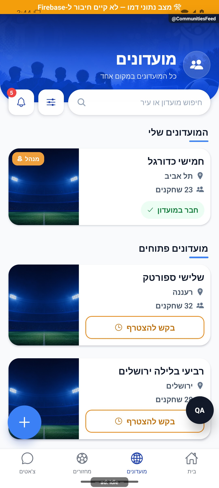
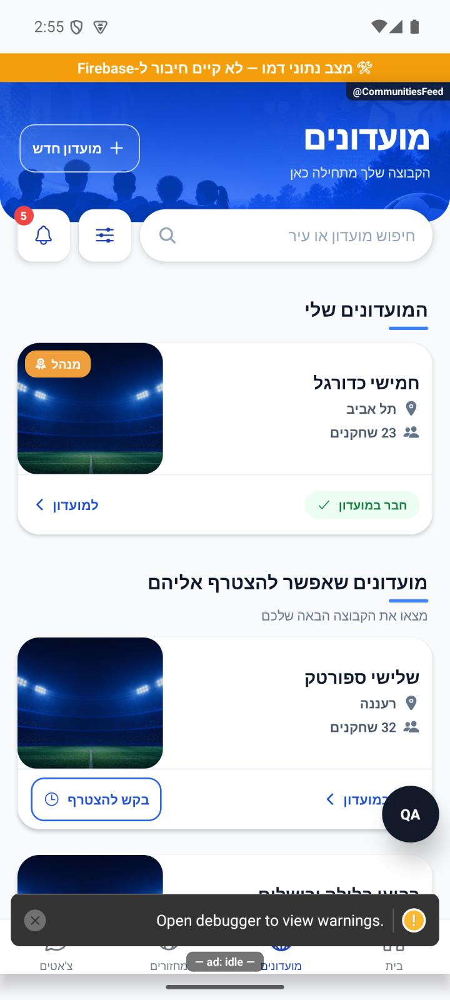
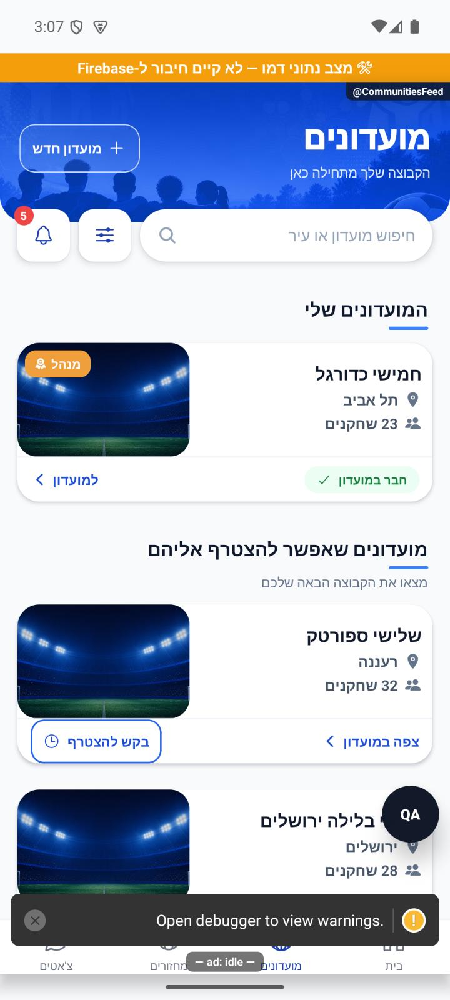
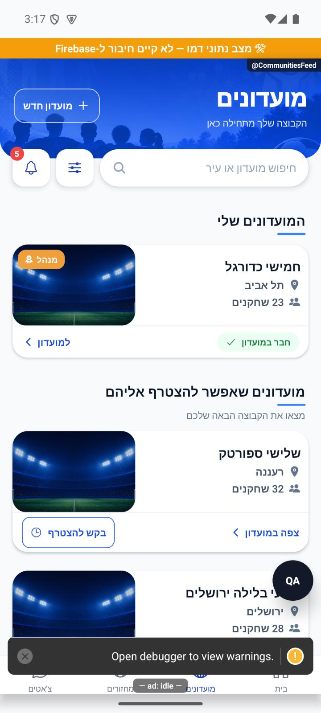
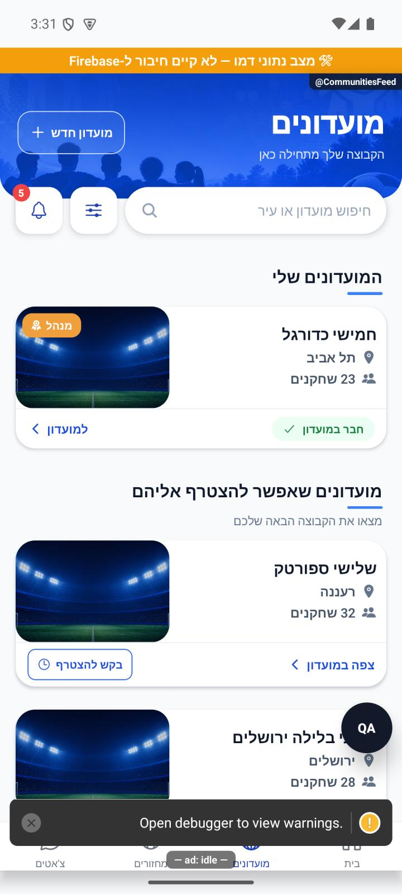
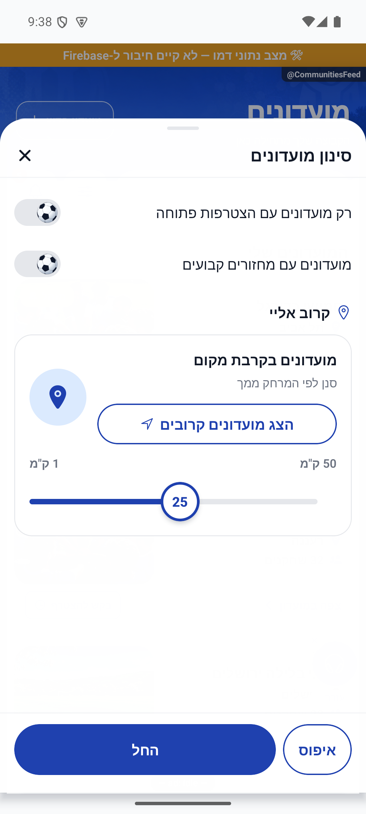

# מוצאים מועדון

## הרחבת אבחון דיווחים, 27.10.2026

הדיווחים יוכלו לכלול מה ניסו לבצע, מה היה מצב האפליקציה ומה החזיר השרת. פרטים חסרים מוצגים כלא ידועים, ומספר מוגבל של מופעים נשמר בלי למחוק את המופע הראשון. השינוי מקומי וטרם הופץ, ואינו משלים פרטים לדיווחים ישנים. [היקף, ראיות ומגבלות](../../changes/2026-10-27-diagnostic-context.md).

בדיקות הקוד הושלמו, אך השינוי עדיין מקומי ולא הופץ. פרטים שלא נאספו בדיווחים ישנים אינם משוחזרים בדיעבד.

## טיפול מלא בפריטי הפולס הפתוחים, 27.10.2026

תקלה בשירות המיקום אינה נראית עוד כסירוב הרשאה, והעיר השמורה נשארת חלופה. איתור עיר שלא משיב אינו משאיר את המסך בהמתנה ללא סוף. התיקון מקומי וטרם הופץ. [ממצאים, בדיקות ומסירה](../../changes/2026-10-27-pulse-completion.md).

## טיפול בתקלות הפולס, 26.10.2026

נבדק שינוי ממוקד במקור משותף במהלך טיפול בתקלות הפולס. אין שינוי נוסף בפעולות הפיצר המתואר כאן.

השינוי מקומי וטרם הופץ. [בדיקות, מסירה ומגבלות](../../changes/2026-10-26-pulse-fixes.md).

## ביטול פעילות אחרי מחיקת מועדון - 26.10.2026

מחיקת מועדון עוצרת כעת את המחזורים השבועיים שלו, ובשרת נוספה הגנה שמונעת פתיחת מחזור למועדון שכבר נמחק. הטיפול מבטל מחזורים שטרם הסתיימו, דוחה בקשות חברות ממתינות, מסיר הרשמה להתראות ואת כרטיס המועדון הציבורי. נתוני עבר והישגים אישיים נשמרים. תיקון השרת נפרס ואומת באישור הבעלים. הסדרה שנותרה כובתה, ההרשמה להתראות והכרטיס הציבורי הוסרו; המחזור עצמו כבר לא היה קיים בבדיקה העדכנית. עצירת הסדרה המוקדמת בצד הלקוח תיכלל בבינארי עתידי. נשמרה ההיסטוריה. [המימוש, בדיקת השאריות ומגבלות האישור](../../changes/2026-10-26-deleted-club-recurring.md).

## הפצה פנימית 1.1.61 - 25.10.2026

הבינארי `1.1.61/295` הופץ ואומת במסלול הפנימי באנדרואיד. תיקוני הלקוח נכללים בו, ושירות הפרופיל נפרס ואומת בנפרד. גם תיקוני הסגל, שמירת התוצאה והתראת השגיאה בשרת נפרסו ואומתו באישור מפורש. שינויי יישום הפולס עצמו טרם הופצו. אין שינוי כללי הרשאה או הסבת נתונים. ניסוחי המצב המקומי בסעיפים הקודמים נכתבו לפני ההפצה; [דוח ההפצה](../../changes/2026-10-25-internal-1.1.61.md) מפרט בדיוק מה נכלל, מה נבדק ומה עדיין מקומי.

## תיקוני הפולס - 25.10.2026

נבדק תיקון ממוקד בקובץ משותף במהלך סבב הפולס. אין שינוי מכוון בתהליך העצמאי המתואר כאן ואין טענה לבדיקת מסך חדשה שלו. מקומי וטרם הופץ.

[מקורות, בדיקות, צילומים ומגבלות](../../changes/2026-10-25-pulse-fixes.md).

## שעון מדויק וכיתוב פנדל - 25.10.2026

במקורות המשותפים נוסף שימור השעון המדויק של פנדל במהלך משחק, וכיתוב ההבקעה ביומן קוצר. אין שינוי במונים או בתהליך העצמאי המתואר כאן; לא נערכה לו בדיקת ממשק חדשה במסגרת העדכון. השינוי מקומי וטרם הופץ. [פרטים וראיות](../../changes/2026-10-25-in-play-penalties.md#שעון-מדויק-וכיתוב-אירוע).

## פנדל במהלך משחק חי - 25.10.2026

עודכנו מקורות משותפים לצורך פנדלים במהלך משחק. אין שינוי מכוון בתהליך העצמאי המתואר במסמך הזה, ולא נערכה לו בדיקת ממשק חדשה במסגרת המשימה.

השינוי מקומי. נדרשת פריסת שרת לפני הפצת לקוח שמשתמש באפשרות; לא בוצעו פריסה או שינוי הרשאות. [חוזה הנתונים, התהליך, הבדיקות ומגבלות ההפצה](../../changes/2026-10-25-in-play-penalties.md).

## ניסיון חוזר לקריאת מידע זמנית — 23.10.2026

קריאת מידע שנכשלת זמנית יכולה להתבצע פעם נוספת, במקום להיעלם מיד. חשבון שהתחלף מפסיק את הבקשה; כשל מתמשך נשאר כשל ולא מוצג כרשימה ריקה תקינה. השינוי מקומי וטרם הופץ. [פירוט האימות והמגבלות](../../changes/2026-10-23-crash-test-and-pulse-followup.md).

## תלויות משותפות — 23.10.2026

מונה הבקשות המשותף אינו טוען בקשות עבור אורח ואינו מקבל תשובה מאוחרת מחשבון קודם. התיקון מקומי וטרם הופץ.

## תיעוד כשלים — 20.10.2026

נוסף תיעוד אוטומטי לנקודות כשל במסלול הזה, עם מקור התקלה. הפעולה המקורית שומרת על ערכי החזרה והודעות השגיאה שלה. השינוי מקומי, טרם הופץ, ואין אימות מסירה חיה לפולס.

[דוח דיווח השגיאות והראיות](../../changes/2026-10-20-error-reporting-audit.md).

## סבב פולס מאושר — 16.10.2026

בסינון המועדונים מוצגים כעת הנוסחים מועדונים בקרבת מקום והצג מועדונים קרובים, במקום מחזורים. המרחק והסינון נשארו כפי שהיו.

השינוי מקומי וטרם הופץ. [דוח, בדיקות וראיות](../../changes/2026-10-16-pulse-sweep.md).

כאן מוצאים את המועדונים שלכם ומחפשים מועדונים נוספים לפי שם או עיר. אפשר לסנן את הרשימה, לפתוח מועדון ולבדוק אם אפשר להצטרף אליו.

[לפירוט המעמיק](discovery.md)

## העיצוב המעודכן

המועדונים שלכם מופיעים ראשונים, ומתחתיהם מועדונים נוספים שאפשר להצטרף אליהם. אין צורך להחליף לשונית גם כשיש רק מועדון אחד. יצירת מועדון נמצאת בכותרת, והכרטיסים מציגים תמונה, עיר, מספר שחקנים והמצב שלכם. החץ של ״צפה במועדון״ משמאל לטקסט ופונה שמאלה.

נצפה באימולטור אנדרואיד עם נתוני דמו. סימוני פיתוח והפס הכתום בצילום אינם חלק מההפצה. לא בוצעו פעולות הצטרפות או יצירה, קריאת מסד חי או בדיקת אייפון וגופן מוגדל. בדיקת הטיפוסים ו־2,801 הבדיקות ב־190 חבילות עברו; יומנים `artifacts/club-feed-redesign-tsc.log`, `artifacts/club-feed-redesign-jest.log`.

## פרופורציות הכרטיס — 8.10.2026

כרטיסי המועדונים נמוכים יותר, התמונה רחבה יותר והשם בולט מעל פרטי המועדון. כל הנתונים והפעולות נשמרו, והכרטיס יכול להתרחב כשיש יותר תוכן.

נצפה באנדרואיד עם נתוני דמו, ללא פעולות הצטרפות או כתיבה למסד. פעילות חסרה בנתוני הדמו ולכן אינה מופיעה בצילום. סימוני הפיתוח אינם חלק מההפצה; אייפון וגופן מוגדל לא נבדקו. בדיקת טיפוסים ו־2,801 בדיקות ב־190 חבילות עברו; יומנים artifacts/club-card-proportions-final-tsc.log ו־artifacts/club-card-proportions-final-jest.log.

## ריווח כפתור ההצטרפות — 8.10.2026

לכפתור בקש להצטרף יש עכשיו מעט רווח מעל ומתחת ומסגרת דקה יותר. כל הנתונים נשמרו.

נצפה באנדרואיד עם נתוני דמו, ללא פעולות הצטרפות או כתיבה למסד. פעילות חסרה בנתוני הדמו ולכן אינה מופיעה בצילום. סימוני הפיתוח אינם חלק מההפצה; אייפון וגופן מוגדל לא נבדקו. בדיקת טיפוסים ו־2,801 בדיקות ב־190 חבילות עברו; יומנים artifacts/club-cta-spacing-tsc.log ו־artifacts/club-cta-spacing-jest.log.

## הקטנת כפתור ההצטרפות — 8.10.2026

כפתור בקש להצטרף קטן ועדין יותר, עם טקסט ואייקון קטנים מעט ורווח סביב המסגרת. אזור הלחיצה מורחב מעבר למסגרת.

נצפה באנדרואיד עם נתוני דמו, ללא פעולות הצטרפות או כתיבה למסד. פעילות חסרה בנתוני הדמו ולכן אינה מופיעה בצילום. סימוני הפיתוח אינם חלק מההפצה; אייפון וגופן מוגדל לא נבדקו. בדיקת טיפוסים ו־2,801 בדיקות ב־190 חבילות עברו; יומנים artifacts/club-cta-compact-tsc.log ו־artifacts/club-cta-compact-jest.log.

## הפלוס בכפתור יצירה — 8.10.2026

הפלוס מופיע משמאל לטקסט בכפתור היצירה. אומת באימולטור אנדרואיד בנתוני דמו, ללא יצירת מועדון או מחזור. אייפון וגופן מוגדל לא נבדקו. בדיקת טיפוסים וכל 2,801 הבדיקות ב־190 חבילות עברו. יומנים artifacts/hero-plus-left-tsc.log ו־artifacts/hero-plus-left-jest.log.

## תיקוני דיווחים — 9.10.2026

תגית חברות מופיעה פעם אחת בתחתית הכרטיס. על התמונה נשארות רק תגיות מנהל או המלצה.

מקור: שינויים מקומיים מעל a348b9f; טרם נבנתה גרסה. [ראיות ומגבלות](../../changes/2026-10-09-pulse-round2.md).

## תיקוני עיצוב ונגישות — 10.10.2026

מקור: `a348b9f235f1e1433497600555303231512a0834` עם שינויים מקומיים. אין בסעיף זה הוכחת גרסת חנות.

אפשרויות הסינון מקבלות שם ומצב ברור בקורא מסך.

## סבב פולס — 15.10.2026

תגי ״פעיל״ ו״לא פעיל״ הוסרו מכרטיסי המועדונים. נשארים שם המועדון, העיר, מספר השחקנים והמצב שלכם במועדון. סדר הרשימה נשמר. [צילום דמו](../screenshots/club-feed-without-activity-2026-10-15.png). השינוי מקומי וטרם הופץ.

## צילומי הסבב המאושר — 16.10.2026

## תלות בעדכון העונות — 19.10.2026

קובץ תשתית משותף עודכן במסגרת העונות. שינוי זה אינו מוסיף פעולה חדשה למסך המתואר כאן; פרטי העונות והבדיקות מופיעים במסמך העונות.

[מצב המימוש, הבדיקות ומגבלות האימות של העונות](../clubs/seasons.md). מקומי בלבד; לא בוצעה פריסה במסגרת המשימה.

## תלות במידע על סגירת עונה — 23.10.2026

נוסף מידע משותף שמאפשר להסביר מדוע עונה מתעכבת בסגירה. אין שינוי נוסף בפעולות המתוארות כאן; השינוי מקומי וטרם הופץ. [המסלול, הבדיקות והמגבלות](../../changes/2026-10-23-season-automatic-recovery.md).

## בידוד מונה בקשות והתאוששות מרקע — 23.10.2026

ספירת בקשות הצטרפות אינה ממתינה יותר לדירוגי השחקנים במועדונים. מסך הבית טוען את המונה מחדש בחזרה מרקע ומתעלם מתוצאה ישנה שמגיעה אחריה. כשל אמיתי בקריאת הבקשות נשאר כשל ושומר את הספירה האחרונה; אין שינוי בעיצוב. נבדק בבדיקות קוד, מקומי וטרם הופץ. [הסבר, יומני שרת ומגבלות](../../changes/2026-10-23-inbox-resume.md).

## עדכון תלות משותפת בקריאות מידע — 23.10.2026

בקובצי השירות המשותפים נוספה אפשרות מפורשת לניסיון חוזר אחד בקריאה זמנית שנכשלה, תוך עצירה אם החשבון מתחלף. החיבור מוגבל ל־14 נקודות קריאה המפורטות בדוח; אין כאן טענה שכל פעולה בפיצ׳ר קיבלה ניסיון חוזר או שנבדק מסך חדש. בדיקות המאגר המלאות עברו (5,261 בדיקות ב־472 חבילות), אך אינן הוכחת הרצה במכשיר. הקוד מקומי וטרם הופץ. [מסלול, ראיות ומגבלות](../../changes/2026-10-23-four-open-errors.md).

## עדכון מסבב הפולס — 23.10.2026

תוקנה הצגת זמינות ישנה בכרטיס שחקן, פריסת הטקסט בקרוסלת הטיפים ועיצוב חלונית שמירת העונה. נוסף טיפול מוגבל בתקלות זמניות בטעינת מועדונים ובספק הכתובת באנדרואיד. אלו שינויים ברכיבים משותפים; לא כל פעולה במסך השתנתה. התיקונים מקומיים וטרם הופצו. [בדיקות, צילומים ומגבלות](../../changes/2026-10-23-pulse-resweep.md).

## תלות בשמירת צבעי המחזור — 24.10.2026

שמירת המידע המשותפת עודכנה כדי להעביר את צבעי הקבוצות ממסכי הכוחות להכנה וללייב. אין תוספת פעולה במסך הזה, והוא לא נבדק מחדש במכשיר במסגרת התוספת. השינוי מקומי וטרם הופץ. [פרטי התוספת ומגבלות הבדיקה](../rounds/draft-setup.md#צבעים-לפני-שיבוץ-ובכל-שיטת-חלוקה--24102026).

## קיצור טעינות בשיחות ובגילוי - 25.10.2026

פתיחת רשימת המועדונים ורענון ללא חיפוש מתחילים מיד בלי להמתין לחלון ההקלדה. בזמן הקלדה נשמרת ההמתנה הקצרה שמונעת בקשות על כל אות. נבדק בקוד; מקומי וטרם הופץ, ללא מדידת זמן במכשיר. [בדיקות ומגבלות](../../changes/2026-10-24-loading-performance.md).

## קריאת זהויות בסגל גדול - 25.10.2026

בסגלים גדולים ממאה שחקנים, חלקי רשימת השמות יכולים להיטען במקביל במקום בזה אחר זה. סדר הנתונים ובדיקת החשבון נשמרים, וכשל אינו מוצג כרשימה חלקית תקינה. נבדק בקוד; התיקון מקומי וטרם הופץ, ללא מדידת זמן במכשיר. [בדיקות, ראיות ומגבלות](../../changes/2026-10-24-loading-performance.md).

## תאימות לשמירת פקודת רכיב הבית - 25.10.2026

נוספה הגנה פנימית מפני ביצוע חוזר של פעולת רכיב הבית. התהליך המתואר בעמוד זה לא השתנה במכוון, ונתונים ישנים נשארים נתמכים. התיקון מקומי וטרם הופץ. [מקור הבדיקה והמגבלות](../../changes/2026-10-25-widget-completion.md).
