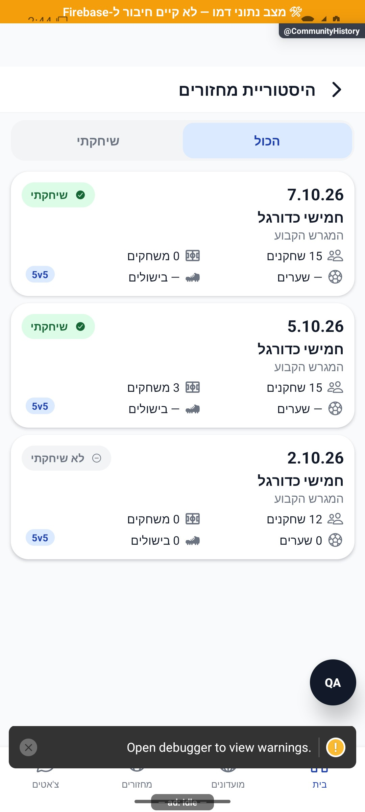
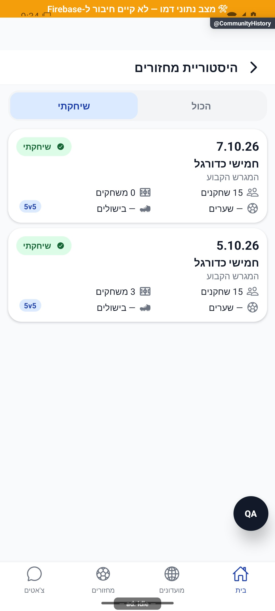
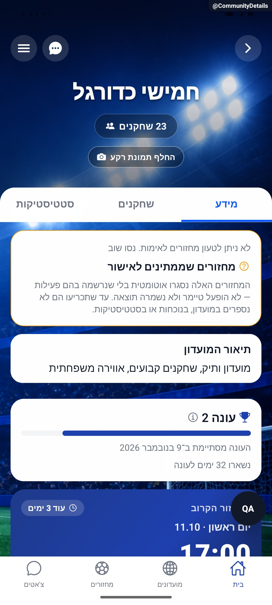

# היסטוריית מחזורי מועדון

## אימות פרסום קבוצות בפולס, 2.11.2026

נבדק ההפרש התחום בשירות המשותף של המחזורים: נוספה בדיקת אישור לפרסום קבוצות כאשר תשובת הפעולה אובדת. אין שינוי בחישוב, במכנים או בפעולות העצמאיות של הפיצר המתואר כאן. התיקון מקומי וטרם הופץ; אין בדיקת מכשיר חדשה לפיצר זה.

השינוי ב-`src/services/gameService.ts` מוגבל ל-`publishDraftTeams` ולתלות בסיווג כשלים זמניים. נבדקו גבולות קבלת השרת, התאמת החשבון והחלוקה, ושימור השגיאה כאשר האימות נכשל. `tests/logic/publishTeamsReceipt.test.ts` מפעיל את פונקציית השירות מול תחליפי קריאה וכתיבה; אין בכך הרצת כל המסלולים של המסמך הזה.

[דוח הטיפול, הבדיקות והמגבלות](../../changes/2026-11-02-pulse-sweep.md).

## בקשות לשיחה אישית, 2.11.2026

נבדקה השפעת תוספת בקשות השיחה במקורות המשותפים. השינוי ממוקד בהרשאת שיחה, בשדות פרטיות ההודעות ובחיבורי הבדיקות; אין מכך אימות חדש של מסך זה במכשיר. המימוש מקומי וטרם הופץ או נפרס. [התנהגות, בדיקות ומגבלות](../chat/message-requests.md).

מקורות משותפים שנבדקו בהיקף השינוי הזה: `functions/src/index.ts`, `src/firebase/firestore.ts`, `src/types/index.ts`. אין בסעיף זה טענה להרצת כל המסלולים ההיסטוריים של הפיצר. [מסירת המימוש](../../changes/2026-11-02-message-requests.md).

## הסרת מגבלת החברים במועדון, 1.11.2026

נבדקה השפעת השינוי הממוקד במקורות המשותפים: הוסרה מגבלת החברים במועדון. אין שינוי מכוון בהתנהגות העצמאית של המסך המתואר כאן או במספר המקומות במחזור. התיקון מקומי וטרם הופץ; אין בדיקת מכשיר חדשה לפיצר זה.

מקורות ששונו בהיקף המשימה: `functions/src/index.ts`. מספרי החברים אינם משמשים עוד כתנאי תפוסה במועדון. שדות התאימות הישנים אינם נאכפים.

[מסלול הנתונים, התנאים, התאימות, הבדיקות ומגבלות ההפצה](../../changes/2026-11-01-unlimited-club-members.md).

## פריסת הגנות הסרת המחזור, 30.10.2026

נפרסו שבע חבילות מבודדות, ועדכון המקור בלבד אומת מול כל הקבצים הפעילים. הגדרות השירותים והאירועים ו-111 השירותים האחרים נשמרו. אומתו מוכנות ותעבורה לגרסאות החדשות, קריאה עצמית עם חשבון בדיקות קיים ושימור גרסאות כל 496 המסמכים שבגיבוי. שש דחיות בקשות דפדפן לא תקינות סווגו לפי מזהי בקשה; לא זוהה כשל ריצה עסקי בלתי צפוי. לא הופעלו מחיקה, חסימת מחזור או בקשת שמירה תקינה על נתוני המועדון. זו ראיית הפריסה התחומה ולא הרצה מחודשת של כל מסך.

[גרסאות פעילות, בדיקות שרת וגבולות האישור](../../changes/2026-10-30-evening-removal-server-deployment.md).

## השלמת הגנת הסרת המחזור, 30.10.2026

הורחבה ההגנה ב-`functions/src/personalActivity.ts` וב-`functions/src/managerRoundHistory.ts`: קריאת `gameRemovalBlocksWrite` וקיום המחזור בתוך עסקת יצירת הנתונים. בקשת סנכרון לאחר הסרה מחזירה כשל מפורש במקום ניסיון חוזר ללא סוף. ב-`functions/src/index.ts` גם חבילת סטטיסטיקה מלקוח ישן מעדכנת את המחזור עם תנאי גרסה, ומכסת הפעולות כוללת תמיד כתיבת הגנה זו. אין שינוי בחישובי התוצאות, הפרטיות או הניווט מעבר להגדרת המחזור המתועד שפורטה קודם. נבדקו ארבעה עשר תרחישים ראשיים, שמונה תרחישי חסימה ושחזור, שמונה בדיקות חבילות ושבע בדיקות פעילות ונתוני מנהל במסד מקומי. ההיקף הוא בדיקת השינוי התחום במקורות משותפים, ולא הרצה מחודשת של כל מסך או של תשתית מסירת האירועים. התיקונים טרם נפרסו.

[תוכנית הביצוע, החבילות, הבדיקות וגבולות האישור](../../changes/2026-10-30-evening-removal-readiness.md).

## הגנה בהסרת מחזור היסטורי, 30.10.2026

`functions/src/gameProcessingGuard.ts` ו-`onGameRosterChanged` ב-`functions/src/index.ts` מוסיפים זכויות עיבוד וחסימת הסרה ב-`gameProcessingGuards/{gameId}`. הכנה דורשת סיום מלא וללא עיבודים פעילים; סימן הסרה קבוע נכתב יחד עם תיקוני הנתונים ותנאי גרסה. אין פקיעת נעילה אוטומטית. השלמת היסטוריה וסנכרון פעילות בודקים את המחזור בתוך עסקת הכתיבה. ארבע עשרה בדיקות הדמיה, שמונה בדיקות בקרה ושמונה בדיקות חבילות עברו במסד המקומי. אין תכונת מחיקה בממשק, שינוי הרשאות, פריסה או הסרה בייצור. גבולות השחזור, העונות והמסירה האמיתית מפורטים בדוח.

[התנהגות, סדר הפעולות, חישובים, בדיקות וגבולות האישור](../../changes/2026-10-30-evening-removal-readiness.md).

## החלפת הקבוצה הבועטת בפנדלים, 30.10.2026

נבדק ההבדל התחום במשימה במקורות המשותפים `src/services/gameService.ts`, `src/types/index.ts` ו-`src/firebase/firestore.ts`: הוא מוסיף ומשמר תור מפורש לפנדלי ההכרעה ומעדכן אותו ברישום ובביטול בעיטה. אין שינוי בשדות, בחישובים או במסלול הנתונים העצמאי של הפיצר המתואר כאן. בדיקת הקורא והעסקאות מפורטת בדוח; אין בכך הרצה מחדש של המסך הזה. [התנהגות, בדיקות ומגבלות](../../changes/2026-10-30-shootout-turn.md).

## התאוששות משגיאות בפולס, 28.10.2026

במקור המשותף `src/services/gameService.ts`, הקריאות `getGameById` ו-`getCommunityChampionship` משתמשות כעת ב-`withAuthRaceRetry` עם `retryTransientReads: true`. כשל זמני מאפשר ניסיון קריאה נוסף אחרי 500 אלפיות שנייה עם בדיקת בעלות על החשבון. מסלול החלוקה השמורה נשאר במסלול ההמתנה המדויק שלו. מסמך חסר נשאר חסר, סירוב הרשאה שומר על הטיפול הקיים וכשל מתמשך נזרק. אין שינוי בכתיבות, במכנים, בחישובי המחזור או בהכרעת התוצאה.

השינוי מקומי וטרם הופץ או נפרס. אין שינוי חזותי ואין צילום מכשיר חדש. [ממצאים, בדיקות ומגבלות](../../changes/2026-10-28-pulse-errors.md).

## הרחבת אבחון דיווחים, 27.10.2026

נוספה מעטפת אבחון מקומית עם מצב בזמן הכשל, שלבים בעלי מזהה ותזמון, מצב רשת ובנייה ומופעים נפרדים לשגיאה. נקודת הכניסה לתעבורת השרת עוברת כעת דרך העטיפה המשותפת; תשובות, חריגות, אפשרויות קריאה ומדיניות הפיצר נשמרות. אין כאן שינוי בהרשאות או בחישובי המוצר. הבדיקות המלאות ומגבלות האימות מתועדות בדוח המקושר; אין טענה לאימות מכשיר או להפצה. [היקף, ראיות ומגבלות](../../changes/2026-10-27-diagnostic-context.md).

באימות הסופי עברו כל 6,231 הבדיקות ב-555 חבילות, ובדיקות הטיפוסים של הלקוח, השרת והפולס נקיות. צילום הדפדפן והידור מקורות האנדרואיד הם בדיקות מקומיות; אין הוכחת מכשיר, הידור אייפון או מסירה חיה של הבנייה החדשה. רישום יומן השחרור נחשב מאומת רק לפי קבלת הקריאה החוזרת בדוח השינוי.

## השפעת מקור משותף במשימת השעון - 26.10.2026

נבדק ההפרש ב-`src/services/gameService.ts`: `stopRotation` עוצר את השעון וסוגר קטע ריצה באותה טרנזקציה שמשחזרת את ההרכב; `_persistRotation` משמר קטע ריצה פתוח לפני איפוס שעון המשחק הבא. נשמרים `startedAt` והיסטוריית `activeIntervals`, ונמנעים שיבוצים ישנים אחרי עצירת הרוטציה. השוואת שתי המתודות למצב הקודם משחזרת את חותמת המקור שנרשמה לפיצר לפני תיקון זה. ההכרעה אם מחזור התקיים וספירת משחקיו נשארות בחוזה הקיים, ללא ערבוב עם זמן פעילות שנמדד. זו בדיקת השפעת השינוי התחום במקור המשותף, ולא הרצה מחודשת של כל מצבי הפיצר. השינוי מקומי; מסמך זה אינו מאשר פריסה, שינוי הרשאות או העלאה לחנות. הצילומים בסיכום האישי מבוססים על רכיבי המקור עם מתאמי דפדפן ונתוני בדיקה, ולא על הרצת אנדרואיד או שעון. [היקף המימוש, הבדיקות, מגבלות האישור והצילומים](../../changes/2026-10-26-android-personal-activity.md).

## שעון מדויק וכיתוב פנדל - 25.10.2026

במקורות המשותפים נוסף שימור השעון המדויק של פנדל במהלך משחק, וכיתוב ההבקעה ביומן קוצר. אין שינוי במונים או בתהליך העצמאי המתואר כאן; לא נערכה לו בדיקת ממשק חדשה במסגרת העדכון. השינוי מקומי וטרם הופץ. [פרטים וראיות](../../changes/2026-10-25-in-play-penalties.md#שעון-מדויק-וכיתוב-אירוע).

## פנדל במהלך משחק חי - 25.10.2026

נבדק השינוי הממוקד במקורות המשותפים: נוספו חוזי אירועי פנדל במהלך משחק, קוראים ומוני סטטיסטיקה, והגנות בעסקאות סיום ואיפוס משחק. מסלול הפיצר המתואר כאן אינו נקודת הכניסה להזנה החדשה. בדיקות המאגר עברו, אך אינן הוכחת הרצה חדשה של כל מצבי התהליך או של פריסה.

השינוי מקומי. נדרשת פריסת שרת לפני הפצת לקוח שמשתמש באפשרות; לא בוצעו פריסה או שינוי הרשאות. [חוזה הנתונים, התהליך, הבדיקות ומגבלות ההפצה](../../changes/2026-10-25-in-play-penalties.md).

## תיעוד כשלים — 20.10.2026

נוספו תצפיות דיווח בנקודות הכשל של המקורות המשויכים לפיצ׳ר, במסגרת הרחבה רוחבית. נשמרו ערכי החזרה, הזריקות ותנאי הפעולה הקיימים; נוסף מקור קוד והקשר לדיווח. כיסוי תחבירי אינו הוכחת הרצה של כל מצב. השינוי מקומי וטרם הופץ; בדיקות המסירה, מגבלות מניעת הכפילויות והמסלולים שטרם חוברו מתועדים בדוח המשותף.

[דוח דיווח השגיאות והראיות](../../changes/2026-10-20-error-reporting-audit.md).

[להסבר הקצר והפשוט](history.simple.md)

עודכן: 07.10.2026; מקור: `8e8fde5`. מסך: `src/screens/communities/CommunityHistoryScreen.tsx`; מסלול `CommunityHistory` עם `groupId`, מתפריט המועדון. רכיב שורה: `src/components/match/CommunityHistoryRow.tsx`.

## מבנה הכרטיס

תאריך, מצב אישי ״שיחקתי״/״לא שיחקתי״, כותרת המחזור, שם המגרש, פורמט אם קיים, ושתי שורות בעלות ארבעה נתונים: שחקנים, משחקונים, שערים ובישולים אישיים. האייקונים מימין לטקסט תחת כיווניות האפליקציה. הכרטיס שומר מבנה אחיד גם ללא השתתפות; אין מצב ״השתתפות לא תועדה״.

כותרת ופורמט נותרו בעיצוב המאושר האחרון המצורף בשיחה. בקשה מוקדמת להסירם אינה בסיס להכריז שהעיצוב הנוכחי שגוי. אפשר להציע צמצום כפילות כהצעה חדשה בלבד.

| מצב/פעולה | מקור ותנאי | תצוגה |
|---|---|---|
| כל המחזורים | מחזורים שהתקיימו | כולל כאלה שבהם המשתמש לא השתתף |
| שיחקתי | `viewerPlayed` | סינון לפי השתתפות בפועל, לא הרשמה בלבד |
| נתון אישי חסר | סטטיסטיקה אישית `null` | מקף; אינו אפס מדויק |
| לא השתתף | התוצאה האישית אינה שלו | אפס לפי מודל השורה, ללא כרטיס מרוקן |
| פתיחת מחזור | מזהה המחזור מהתוצאה | `MatchDetails`; לא מזהה שהוקלד מחדש |

## חישוב ומקור אמת

`src/utils/communityHistory.ts`; `src/utils/eveningPlayed.ts`; `src/utils/roundHistoryOrder.ts`; `src/services/gameService.ts`; `src/firebase/firestore.ts`. מונה משחקונים משתמש במידע מחויב, בנתונים שהושלמו או בגיבוי סבבים היסטורי בהתאם למודל, ולא מערבב מחזור ערב עם משחקון. ממתין, לא הגיע ובוטל אינם השתתפות בפועל. מחזור עתידי/פעיל או שלא אושר אינו היסטוריה שהתקיימה. אורח ששיחק נכלל במספר השחקנים בהתאם לרשומת ההשתתפות.

בדיקות: `tests/logic/communityHistory.test.ts`, `tests/logic/roundHistoryOrder.test.ts`, `tests/rules/roundHistoryAccess.test.mjs`. היסטוריה אישית היא מסך נפרד בתחום הפרופיל/מחזורים; לא להעתיק לתוכו חישוב חדש במקום להשתמש במודלים המשותפים.

## ראיות ופערים

בצילום הדמה נראות שורות שיחקתי ולא שיחקתי, נתון אישי חסר, אפס ומשחקונים שונים. תאריכי הדמה אינם ראיה שהמחזור התקיים בעולם האמיתי. ריק, תקלה עם ניסיון חוזר, סינון, אורח ששיחק ומחזור שהוסר לא צולמו. חישוב השתתפות בשרת לא אומת כאן.

## הצעות בלבד

סיכום קטן מעל הרשימה: כמה מחזורים שוחקו מתוך הטווח, עם הגדרה מפורשת של הטווח; אפשרות צמצום שם מחזור/פורמט אם מאשרים עיצוב חדש; מעבר סינון קצר ואחיד בלי גבהים משתנים ובלי אנימציה שמשנה את סדר הרשימה.

## פירוט טכני נוסף — זרימה, חישוב ונקודות שינוי

`communityHistoryFacets` משתמש ב־`isAttendedGame` להשתתפות, ולא בסטטוס בלבד. מספר השחקנים הוא מספר מזהים ייחודיים ללא `no_show`, ועוד האורחים הפעילים. מספר המשחקונים הוא המקסימום בין `committedRoundCount`, מספר המשחקונים המושלמים, ו־`max(0,(rotation.round ?? 1)-1)`.

לדוגמה: שלושה מזהים ייחודיים, אחד שלא הגיע ושני אורחים פעילים נותנים ארבעה שחקנים. מונה מחויב 3, סבב נוכחי 5 ושני משחקונים מושלמים נותנים ארבעה משחקונים, ולא סכום של תשעה. למי שלא השתתף שערים ובישולים אפס; למי שהשתתף ורשומת הנתונים שלו חסרה הערך `null`; ברשומה קיימת שדה שערים חסר הופך לאפס. `communityHistory.test.ts` בודק את ההבחנות; שינוי תווית או מונה צריך להישאר עקבי עם ההיסטוריה האישית.

הפירוט מתאר את הקוד שנקרא, ולא בדיקת כתיבה או הרשאות בסביבת הייצור. יש לקרוא את הקוד הממוקד וההפרש מאז מקור המיפוי לפני תיקון; בדיקות המוזכרות כאן לא הורצו מחדש לצורך עריכת התיעוד.

## עדכון 8.10.2026 — תנועה ותיקוני דיווחים

`ChangeMotion` מחובר ל־`playedOnly` סביב הרשימה, בלי להרכיב מחדש את המסך ובלי לשנות את תנאי `eveningPlayed`.

**ראיה ומגבלות:** המסך והסינון הורצו בדמו. אין כאן בדיקת היסטוריה של חשבון ייצור.

בדיקת הטיפוסים ו־183 חבילות הבדיקות עברו, 2,752 בדיקות. מצב המקור: `9ec0dfd` עם שינויים מקומיים; אין גרסה חדשה שפורסמה. [יומן השינוי וההקלטות](../../changes/2026-10-08-motion-and-pulse.md).

## תיקוני סבב הבאגים — 8.10.2026

B10: eveningVerifyService.listUnverified מפיצה שגיאה גם כשהשאילתה הראשית והחלופית נכשלו. UnverifiedEveningsCard מציגה loadFailed במקום להיעלם, משמרת רשימה קודמת באותו מועדון ומנקה רשימה בהחלפת מועדון. alive חוסם תשובה אחרי פירוק. לא בוצע אישור או דחיית מחזור אמיתי.

[ראיות, בדיקות ומגבלות](../../changes/2026-10-08-audit-fixes.md).

כשל קריאה יזום בשירות אימות המחזורים בדמו. כרטיס השגיאה נשאר גלוי. מצב צילום הפרסומת כובה זמנית במסך כדי להציג את תצוגת המוצר הרגילה; המקור וכל הזרקת הכשל הוחזרו במדויק.

## תלות בעדכון העונות — 19.10.2026

נבדק ההפרש בקבצים המשותפים הרשומים כאן: `src/firebase/firestore.ts`, `src/services/gameService.ts`, `src/utils/eveningPlayed.ts`. השינוי ממוקד במדיניות העונות, קריאת מצבן, שיוך מחזור ופקודות ניהולן; אין שינוי מכוון בחוזה העצמאי המתואר במסמך זה. אין להסיק מכך שהמסך הזה הורץ מחדש.

[מצב המימוש, הבדיקות ומגבלות האימות של העונות](../clubs/seasons.md). מקומי בלבד; לא בוצעה פריסה במסגרת המשימה.

## תלות במידע על סגירת עונה — 23.10.2026

בדיקת ההבדל ב־`src/firebase/firestore.ts` וב־`src/types/index.ts` מראה שהשינוי מוגבל לקריאת `seasons.closureStatus` בחוזה `GroupSeasons`. יתר ממירי הנתונים והמסלולים המתועדים כאן לא שונו במשימה זו. אימות הריצה החדש מתייחס להתאוששות ולכרטיס העונה, ולא להרצה חדשה של כל מצבי המסך הזה. [המסלול, הבדיקות והמגבלות](../../changes/2026-10-23-season-automatic-recovery.md).

## עדכון תלות משותפת בקריאות מידע — 23.10.2026

בקובצי השירות המשותפים נוספה אפשרות מפורשת לניסיון חוזר אחד בקריאה זמנית שנכשלה, תוך עצירה אם החשבון מתחלף. החיבור מוגבל ל־14 נקודות קריאה המפורטות בדוח; אין כאן טענה שכל פעולה בפיצ׳ר קיבלה ניסיון חוזר או שנבדק מסך חדש. בדיקות המאגר המלאות עברו (5,261 בדיקות ב־472 חבילות), אך אינן הוכחת הרצה במכשיר. הקוד מקומי וטרם הופץ. [מסלול, ראיות ומגבלות](../../changes/2026-10-23-four-open-errors.md).

## שני מסלולי התאוששות שנוספו בסבב הפולס — 23.10.2026

src/components/games/LocationSearchSheet.tsx שומר את בחירת המיקום והודעת החלופה כשה־GPS עובר את מגבלת 15 השניות; LOCATION_TIMEOUT הפנימי אינו מדווח כקריסה, ושגיאת ספק אחרת ממשיכה להיות נצפית. src/services/eveningVerifyService.ts מחיל ניסיון חוזר מוגבל עם בדיקת זהות רק על listUnverified; setPlayed נשאר כתיבה ללא חזרה אחרי כשל עמום. אין שינוי בהרשאות, החלטת מנהל, סטטוס מחזור או עונה. 11 בדיקות ממוקדות עברו. הקוד מקומי וטרם הופץ. [ראיות ומגבלות](../../changes/2026-10-23-pulse-resweep.md).

## תלות בשמירת צבעי המחזור — 24.10.2026

במסגרת בחירת צבעים לפני שיבוץ עודכנו מקורות משותפים הרשומים לפיצ׳ר: `src/firebase/firestore.ts`, `src/services/gameService.ts`, `src/types/index.ts`. השינוי מוסיף מפת צבעים למחזור, קריאה וכתיבה שלה ושימורה במסלולי הכוחות וההכנה. אין כאן פעולת ממשק חדשה במסך זה. זו בדיקת השפעת התוספת הממוקדת, ולא חקירה או אימות חזותי מחודש של הפיצ׳ר. כל 480 חבילות הבדיקה ו־5,343 הבדיקות עברו; טיפוסי הלקוח והשרת נקיים. השינוי מקומי וטרם הופץ. [מסלול הנתונים, ראיות ומגבלות](../rounds/draft-setup.md#צבעים-לפני-שיבוץ-ובכל-שיטת-חלוקה--24102026).

## תלות בעריכת קבוצות בלייב — 24.10.2026

בקובץ השירות המשותף נוסף מסלול לעריכת הקבוצות והתור במשחק חי, כולל איפוס המשחק הנוכחי בלבד בעת החלפת קבוצה. לא שונו מסלולי הפיצ׳ר הזה במסגרת התוספת ולא בוצע לו אימות מסך חדש. [מסלול השינוי, הבדיקות והמגבלות](../rounds/live-advanced.md#עריכת-הקבוצות-והתור-בזמן-הלייב--24102026). מקומי וטרם הופץ.

## בדיקת עומק לעריכת הקבוצות — 24.10.2026

בקובץ השירות המשותף תוקן שימור זהות המשחק במחזור ישן בעת שינוי תור בלייב. הדיווח על הצלחת החלפה נשלח כעת רק אחרי שמירה. מסלולי הפיצ׳ר הזה לא שונו ולא בוצעה לו בדיקת מסך חדשה. כל 5,496 בדיקות הפרויקט עברו; אין בכך הוכחת מסד חי או הפצה. [הראיות ומגבלות הבדיקה](../../audits/2026-10-24-live-teams.md). מקומי וטרם הופץ.

## המשך קיצור טעינות בלילה של 25.10.2026

נבדק ההבדל ב-`src/services/gameService.ts`: הוא מוגבל לאיחוד בקשות פעילות במטמון רשימות המחזורים, מניעת מילוי המטמון מתשובה שלפני ביטולו, וזריקת כשל כששתי שאילתות הרשימה נכשלו. סינון הרשימות, חצי תשובה מוצלח, פעולות המחזור, מנויי הלייב והמונים לא שונו. [חוזה המטמון והבדיקות](../home/round-cards.md). אין אימות מכשיר חדש של כל מצבי הפיצר המתואר כאן. [בדיקות, ראיות ומגבלות](../../changes/2026-10-24-loading-performance.md).

## תגובה מיידית לכפתורי השעון - 25.10.2026

נבדק ההפרש ב-`src/services/gameService.ts`: פעולות התחלת והשהיית שעון מחזירות את מצב הלייב מהעסקה הקיימת לשימוש בתגובת התצוגה. אין שינוי בעוגני הזמן, בכתיבות, בהגנות מעבר משחק או במידע שהקוראים האחרים שומרים. אין הרצה חדשה של כל מצבי הפיצר המתואר כאן. [בדיקות, ראיות ומגבלות](../../changes/2026-10-25-live-timer-response.md). התיקון מקומי וטרם הופץ.

## תאימות לשמירת פקודת רכיב הבית - 25.10.2026

השינוי התחום במקורות המשותפים `src/types/index.ts` ו-`src/firebase/firestore.ts` מוסיף ומשמר את `liveMatch.lastWidgetCommandId`, מזהה אטום למניעת ביצוע חוזר של פקודת רכיב הבית. הוא אופציונלי במסמכים ישנים ואינו משנה מונים, הכרעות, ניווט או הרשאות של הפיצר המתואר כאן. בדיקה מפעילה את ממיר הקריאה המקורי ומאמתת שימור ערך והיעדרו. אין בכך בדיקת מכשיר חדשה לכל מצבי הפיצר. [מקור הבדיקה והמגבלות](../../changes/2026-10-25-widget-completion.md).

## שלמות החלוקה המתוזמנת, 29.10.2026

נבדק השינוי הממוקד במקורות המשותפים: נוספו אזורי קבוצה שש ושבע למתאמי החלוקה ולקורא ההשמות, וסוננו אורחים ממתינים בשני מסלולי היצירה בשרת. אין שינוי בליבת האיזון או בחישובים העצמאיים של המסלול המתואר כאן. 15 בדיקות ממוקדות של החלוקה וקורא הנתונים עברו, וכן בדיקות הטיפוסים של הלקוח והשרת. אין אימות מכשיר חדש, שינוי חזותי מתוכנן או פריסה.

[היקף, בדיקות, פערים פתוחים ומגבלות](../../changes/2026-10-29-scheduled-balance-integrity.md).

## איזון ופיזור רמות לפני גיוון, 30.10.2026

נבדק שינוי תחום במקורות המשותפים של חלוקת הכוחות ומדדי השמירה. החישוב נותן עדיפות לפער ממוצעים, אחריו לפיזור הקצוות ולפרופיל הרמות, ולבסוף לציוותים חוזרים. התג rating_priority_v3 נוסף בלי להסיר קריאת דורות ישנים. אין שינוי מכוון בחישובים העצמאיים או בניווט המתוארים כאן. 112 בדיקות ממוקדות ובדיקות הטיפוסים של הלקוח והשרת עברו; אין בכך הרצה של המסך במכשיר או הפצה.

[מימוש, נוסחאות, בדיקות ומגבלות](../../changes/2026-10-30-rating-balance-priority.md).

## הסרת המחזור המאושרת, 31.10.2026

בוצעה הסרה אטומית בייצור לאחר גיבוי מלא של 496 מסמכים, 319 שאילתות מיפוי חוזרות, חסימת עיבוד ובדיקות גרסה: 129 עדכוני מסכת שדות, 83 מחיקות וחסימה קבועה אחת. 21 סימני מניעת זקיפה חוזרת נשמרו. הקריאה החוזרת התאימה לתוכנית בכל השדות, ו-7,937 השוואות דרך ממירי המסד וקוראי הלקוח עברו לכל 19 חברי המועדון, 342 מודלי צמד, 171 כיוונים הפוכים ו-19 פרופילים אחרים. אין עונה פעילה או חתומה במועדון הזה; היעדרה נשמר. אין שינוי בקוד, ניווט או הפצת יישום במשימת ביצוע הנתונים, ואין אימות מסך במכשיר.

[תוצאה, ביצוע, גיבוי, ראיות ומגבלות](../../changes/2026-10-31-evening-removal-execution.md).

## אימות כשלים בקבלת פרסום, 2.11.2026

בבדיקת אישור פרסום הקבוצות, כשל שלא ניתן לאמת כהצלחה נשאר כשל גלוי ונשמר באבחון. הבדיקה אינה שולחת הודעות שוב ואינה משנה הרשאות. השינוי תחום לשירות המשותף, מקומי וטרם הופץ.

נוסף תיעוד תצפית בנקודות הכשל של אימות קבלת הפרסום ב-`src/services/gameService.ts`. בדיקת `tests/logic/authTransientReads.test.ts` סופרת כעת גם את קריאת הקבלה, עם הרשאת ניסיון חוזר לקריאה בלבד; כתיבת תחילת העונה נשארת ללא ניסיון חוזר זמני. אין שינוי בזרימות העצמאיות האחרות המתוארות במסמך זה.

[דוח הטיפול והראיות](../../changes/2026-11-02-pulse-sweep.md).
