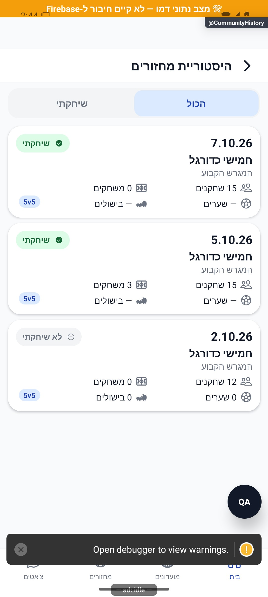

# המחזורים שכבר התקיימו

## תיעוד כשלים — 20.10.2026

נוסף תיעוד אוטומטי לנקודות כשל במסלול הזה, עם מקור התקלה. הפעולה המקורית שומרת על ערכי החזרה והודעות השגיאה שלה. השינוי מקומי, טרם הופץ, ואין אימות מסירה חיה לפולס.

[דוח דיווח השגיאות והראיות](../../changes/2026-10-20-error-reporting-audit.md).

כאן חוזרים למחזורי העבר של המועדון ורואים אם השתתפתם בכל אחד. כל כרטיס מציג גם את מספר השחקנים והמשחקים ואת השערים והבישולים שלכם.

[לפירוט המעמיק](history.md)

## עדכון 8.10.2026 — תנועה ותיקוני דיווחים

החלפת סינון מציגה את רשימת המחזורים במעבר קצר. פרטי הכרטיסים נשארים באותו מבנה.

## תיקוני סבב הבאגים — 8.10.2026

אם לא ניתן לבדוק אילו מחזורים זקוקים לאימות, מוצגת אפשרות לנסות שוב.

## תלות בעדכון העונות — 19.10.2026

קובץ תשתית משותף עודכן במסגרת העונות. שינוי זה אינו מוסיף פעולה חדשה למסך המתואר כאן; פרטי העונות והבדיקות מופיעים במסמך העונות.

[מצב המימוש, הבדיקות ומגבלות האימות של העונות](../clubs/seasons.md). מקומי בלבד; לא בוצעה פריסה במסגרת המשימה.
