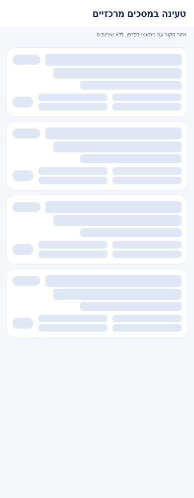
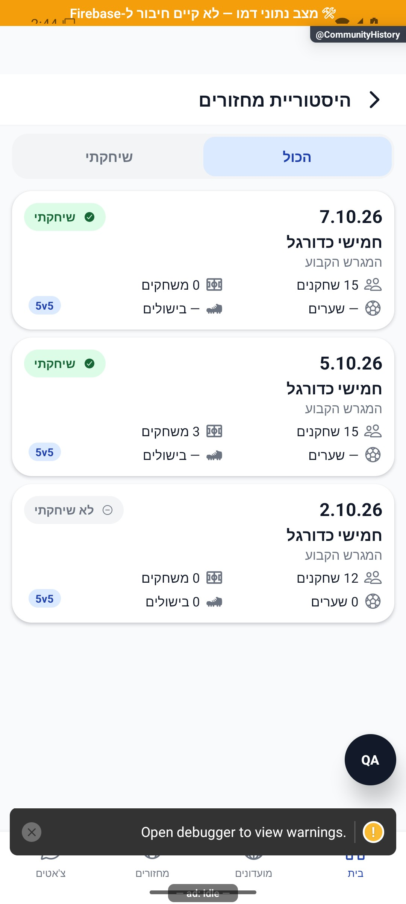

# המחזורים שכבר התקיימו

## עצירת מחזור קבוע ללא פעילות, 6.11.2026

נוספה במנגנון השרת עצירה של מחזור קבוע לאחר שלושה מחזורים רצופים ללא פעילות. ההשפעה כאן תחומה לתלות המשותפת בפתיחת מחזורים וניקוי מחזורים ריקים; אין אימות חדש של כל פעולות המסך. מנגנון השרת נפרס והופעל באישור הבעלים; אין צורך בגרסת טלפון חדשה להפעלתו. [ההתנהגות, מסלול הנתונים, הבדיקות ומגבלות ההפעלה](../../changes/2026-11-06-inactive-recurring-rounds.md).

## דירוג בסיס לשחקן ללא דירוג, 6.11.2026

נבדק שינוי תחום במקורות המשותפים של הכוחות האוטומטיים: שחקן ללא דירוג מחושב כ-2.5 מתוך 5, וההסברים תואמים. דירוג מפורש נשמר. אין כאן אימות חדש של כל מצבי הפיצר העצמאי; השינוי מקומי וטרם הופץ. [ההתנהגות, הבדיקות ומגבלות האימות](../rounds/draft-setup.md#דירוג-בסיס-לשחקן-ללא-דירוג-6112026).

## מדידת פעולות ואמינות נתונים, 5.11.2026

נוספה הכנה למדידת הפעולות ברכיבים המתועדים כאן. בפולס אפשר לראות ביצועים וחשבונות ייחודיים לפי פעולה ותקופה, כאשר קיים כיסוי מדידה. איסוף החשבונות החדש עדיין כבוי והמימוש מקומי. [פירוט והיקף הבדיקות](../../audits/2026-11-04-system-night/product-measurement.md).

## חיפוש שחקנים וזמני טעינה, 4.11.2026

שופרה טעינת חיפוש השחקנים, כרטיס שחקן אחר ואיתור פנויים למחזור ברכיבים המשותפים למסך זה. מימוש מקומי שטרם הופץ. [השינוי, המדידות והבדיקות](../../changes/2026-11-04-player-discovery-speed.md).

## ציר פעילות פרטי בפולס, 4.11.2026

בציר הפעילות, תשובת שרת על מצב הרשמה קיים אינה נספרת כהרשמה חדשה. קבלה ללא סימון יצירה מפורש מוצגת עם מגבלת אמינות.

נוסף תיעוד פרטי של ביקורים ופעילות במערכת הניהול. התוספת מקומית והאיסוף החדש כבוי כברירת מחדל; אין בדיקת מכשיר חדשה של מסך זה. מקומי וטרם הופץ או נפרס. [היקף, מקורות, בדיקות ומגבלות](../shared/usage-activity.md).

## הפצה פנימית 1.1.74, 3.11.2026

עדכוני הלקוח הנוגעים לטעינה ולחיווי, במקורות המשותפים המשויכים למסמך הזה, כלולים בגרסת האנדרואיד הפנימית 1.1.74/306. החבילה ומסלול החנות אומתו; האימות החזותי נשאר בצילומי הדפדפן של סבבי המימוש, ואין אימות התקנה במכשיר. [תכולה, בדיקות ומגבלות](../../changes/2026-11-03-internal-1.1.74.md).

## הרחבת טעינת השלד במסכים מרכזיים, 3.11.2026

היסטוריית המועדון מציגה בהמתנה כרטיסים קומפקטיים עם מקומות לתאריך, שם, מקום ומדדים, לפי השורות שמופיעות אחרי הטעינה. המימוש מקומי וטרם הופץ. נבדקו אזורי מקור בדפדפן, ללא בדיקת מכשיר חדשה. [הכיסוי, הבדיקות והמגבלות](../../changes/2026-11-03-central-screen-skeletons.md).

כל 6,831 הבדיקות ובדיקת הטיפוסים עברו. האימות החזותי בסבב הזה נעשה בדפדפן בלבד.

## תיקוני דיווחי הפולס, 3.11.2026

במקור השרת המשותף הועבר זיהוי של הרשמה שכבר נספרה לפני רישום השגיאה. אין שינוי מכוון בפעולות העצמאיות או בנתונים של הפיצר הזה. התיקון מקומי וטרם נפרס.

[פירוט התיקונים, הבדיקות, הצילומים והמגבלות](../../changes/2026-11-03-pulse-sweep.md).

## העברת אורח לרשימת המתנה, 3.11.2026

במקור המשותף תוקנה העברה ידנית של אורח מההרכב להמתנה, כדי שלא יקודם מיד מחדש. אין שינוי מכוון בפעולות העצמאיות של המסך המתואר כאן, ולא נערכה לו בדיקת מסך חדשה. התיקון מקומי וטרם הופץ.

[פרטי השינוי המשותף](../../changes/2026-11-03-guest-waitlist.md).

## אימות פרסום קבוצות בפולס, 2.11.2026

נבדק ההפרש התחום בשירות המשותף של המחזורים: נוספה בדיקת אישור לפרסום קבוצות כאשר תשובת הפעולה אובדת. אין שינוי בחישוב, במכנים או בפעולות העצמאיות של הפיצר המתואר כאן. התיקון מקומי וטרם הופץ; אין בדיקת מכשיר חדשה לפיצר זה.

[דוח הטיפול, הבדיקות והמגבלות](../../changes/2026-11-02-pulse-sweep.md).

## בקשות לשיחה אישית, 2.11.2026

נבדקה השפעת תוספת בקשות השיחה במקורות המשותפים. השינוי ממוקד בהרשאת שיחה, בשדות פרטיות ההודעות ובחיבורי הבדיקות; אין מכך אימות חדש של מסך זה במכשיר. המימוש מקומי וטרם הופץ או נפרס. [התנהגות, בדיקות ומגבלות](../chat/message-requests.md).

## הסרת מגבלת החברים במועדון, 1.11.2026

נבדקה השפעת השינוי הממוקד במקורות המשותפים: הוסרה מגבלת החברים במועדון. אין שינוי מכוון בהתנהגות העצמאית של המסך המתואר כאן או במספר המקומות במחזור. התיקון מקומי וטרם הופץ; אין בדיקת מכשיר חדשה לפיצר זה.

[מסלול הנתונים, התנאים, התאימות, הבדיקות ומגבלות ההפצה](../../changes/2026-11-01-unlimited-club-members.md).

## פריסת הגנות הסרת המחזור, 30.10.2026

שבעת תיקוני השרת להגנת הסרת מחזור ולספירת המחזורים המתועדים נפרסו באישור ונבדקו בשרת. המחזור לא נמחק, וכל נתוני המועדון שנבדקו נשמרו. אין כאן הפצת יישום חדשה או בדיקת מכשיר.

[גרסאות פעילות, בדיקות שרת וגבולות האישור](../../changes/2026-10-30-evening-removal-server-deployment.md).

## השלמת הגנת הסרת המחזור, 30.10.2026

ההכנה המקומית מגינה גם על סנכרון מדידות אישי ועל יומן הנתונים ללוח המנהל. עיבוד ישן אינו יכול להחזיר מידע אחרי הסרה או בזמן הקפאה. אין שינוי חזותי, הרשאות חדשות או פעולת מחיקה בממשק; שבעה תיקוני שרת מוכנים לבדיקה ולפריסה באישור נפרד. לא בוצעה הסרה בייצור.

[תוכנית הביצוע, החבילות, הבדיקות וגבולות האישור](../../changes/2026-10-30-evening-removal-readiness.md).

## הגנה בהסרת מחזור היסטורי, 30.10.2026

הוכנה הגנה שמונעת מתהליך ישן להחזיר נתונים של מחזור שהוסר בפעולה ניהולית מבוקרת. ההכנה מסרבת להסיר מחזור שעוד מעובד. נבדקו הסרה ושחזור במסד מקומי בלבד; אין כפתור מחיקה חדש והשינוי טרם נפרס.

[התנהגות, סדר הפעולות, חישובים, בדיקות וגבולות האישור](../../changes/2026-10-30-evening-removal-readiness.md).

## החלפת הקבוצה הבועטת בפנדלים, 30.10.2026

בפנדלי ההכרעה נוספה אפשרות לבחור את הקבוצה שבועטת כעת, בלי למחוק את הבעיטות הקודמות. זהו עדכון תחום במקורות משותפים; אין שינוי מתוכנן במסך המתואר כאן ואין אימות מכשיר חדש שלו. [התנהגות, בדיקות ומגבלות](../../changes/2026-10-30-shootout-turn.md).

## התאוששות משגיאות בפולס, 28.10.2026

טעינת פרטי מחזור וטבלת מועדון יכולה להתאושש מכשל חיבור קצר בעזרת ניסיון נוסף. כשל מתמשך נשאר גלוי ואינו מוצג כאפס או כמידע חסר שאומת.

השינוי מקומי וטרם הופץ. [ממצאים, בדיקות ומגבלות](../../changes/2026-10-28-pulse-errors.md).

## הרחבת אבחון דיווחים, 27.10.2026

הדיווחים יוכלו לכלול מה ניסו לבצע, מה היה מצב האפליקציה ומה החזיר השרת. פרטים חסרים מוצגים כלא ידועים, ומספר מוגבל של מופעים נשמר בלי למחוק את המופע הראשון. השינוי מקומי וטרם הופץ, ואינו משלים פרטים לדיווחים ישנים. [היקף, ראיות ומגבלות](../../changes/2026-10-27-diagnostic-context.md).

בדיקות הקוד הושלמו, אך השינוי עדיין מקומי ולא הופץ. פרטים שלא נאספו בדיווחים ישנים אינם משוחזרים בדיעבד.

## השפעת מקור משותף במשימת השעון - 26.10.2026

במקור המחזורים המשותף תוקן שימור זמן הריצה בזמן עצירת רוטציה ומעבר למשחק הבא. ההכרעה אם מחזור התקיים וספירת משחקיו נשארות בחוזה הקיים, ללא ערבוב עם זמן פעילות שנמדד. לא נערכה כאן בדיקה חדשה של כל מצבי המסך. השינוי מקומי, ומצב ההפצה ומגבלות הבדיקה מפורטים בדוח המקושר. [היקף המימוש, הבדיקות, מגבלות האישור והצילומים](../../changes/2026-10-26-android-personal-activity.md).

## שעון מדויק וכיתוב פנדל - 25.10.2026

במקורות המשותפים נוסף שימור השעון המדויק של פנדל במהלך משחק, וכיתוב ההבקעה ביומן קוצר. אין שינוי במונים או בתהליך העצמאי המתואר כאן; לא נערכה לו בדיקת ממשק חדשה במסגרת העדכון. השינוי מקומי וטרם הופץ. [פרטים וראיות](../../changes/2026-10-25-in-play-penalties.md#שעון-מדויק-וכיתוב-אירוע).

## פנדל במהלך משחק חי - 25.10.2026

עודכנו מקורות משותפים לצורך פנדלים במהלך משחק. אין שינוי מכוון בתהליך העצמאי המתואר במסמך הזה, ולא נערכה לו בדיקת ממשק חדשה במסגרת המשימה.

השינוי מקומי. נדרשת פריסת שרת לפני הפצת לקוח שמשתמש באפשרות; לא בוצעו פריסה או שינוי הרשאות. [חוזה הנתונים, התהליך, הבדיקות ומגבלות ההפצה](../../changes/2026-10-25-in-play-penalties.md).

## תיעוד כשלים — 20.10.2026

נוסף תיעוד אוטומטי לנקודות כשל במסלול הזה, עם מקור התקלה. הפעולה המקורית שומרת על ערכי החזרה והודעות השגיאה שלה. השינוי מקומי, טרם הופץ, ואין אימות מסירה חיה לפולס.

[דוח דיווח השגיאות והראיות](../../changes/2026-10-20-error-reporting-audit.md).

כאן חוזרים למחזורי העבר של המועדון ורואים אם השתתפתם בכל אחד. כל כרטיס מציג גם את מספר השחקנים והמשחקים ואת השערים והבישולים שלכם.

[לפירוט המעמיק](history.md)

## עדכון 8.10.2026 — תנועה ותיקוני דיווחים

החלפת סינון מציגה את רשימת המחזורים במעבר קצר. פרטי הכרטיסים נשארים באותו מבנה.

## תיקוני סבב הבאגים — 8.10.2026

אם לא ניתן לבדוק אילו מחזורים זקוקים לאימות, מוצגת אפשרות לנסות שוב.

## תלות בעדכון העונות — 19.10.2026

קובץ תשתית משותף עודכן במסגרת העונות. שינוי זה אינו מוסיף פעולה חדשה למסך המתואר כאן; פרטי העונות והבדיקות מופיעים במסמך העונות.

[מצב המימוש, הבדיקות ומגבלות האימות של העונות](../clubs/seasons.md). מקומי בלבד; לא בוצעה פריסה במסגרת המשימה.

## תלות במידע על סגירת עונה — 23.10.2026

נוסף מידע משותף שמאפשר להסביר מדוע עונה מתעכבת בסגירה. אין שינוי נוסף בפעולות המתוארות כאן; השינוי מקומי וטרם הופץ. [המסלול, הבדיקות והמגבלות](../../changes/2026-10-23-season-automatic-recovery.md).

## עדכון תלות משותפת בקריאות מידע — 23.10.2026

בקובצי השירות המשותפים נוספה אפשרות מפורשת לניסיון חוזר אחד בקריאה זמנית שנכשלה, תוך עצירה אם החשבון מתחלף. החיבור מוגבל ל־14 נקודות קריאה המפורטות בדוח; אין כאן טענה שכל פעולה בפיצ׳ר קיבלה ניסיון חוזר או שנבדק מסך חדש. בדיקות המאגר המלאות עברו (5,261 בדיקות ב־472 חבילות), אך אינן הוכחת הרצה במכשיר. הקוד מקומי וטרם הופץ. [מסלול, ראיות ומגבלות](../../changes/2026-10-23-four-open-errors.md).

## התאוששות מיקום וטעינת מחזורים לאימות — 23.10.2026

אם חיישן המיקום לא עונה בזמן, נשמרת האפשרות לבחור נקודה במפה או לנסות שוב. טעינת מחזורים שממתינים לאימות יכולה לנסות פעם נוספת בכשל זמני, בלי לשנות את החלטת המנהל ובלי להציג כשל כאילו אין מחזורים. התיקונים מקומיים וטרם הופצו. [בדיקות ומגבלות](../../changes/2026-10-23-pulse-resweep.md).

## תלות בשמירת צבעי המחזור — 24.10.2026

שמירת המידע המשותפת עודכנה כדי להעביר את צבעי הקבוצות ממסכי הכוחות להכנה וללייב. אין תוספת פעולה במסך הזה, והוא לא נבדק מחדש במכשיר במסגרת התוספת. השינוי מקומי וטרם הופץ. [פרטי התוספת ומגבלות הבדיקה](../rounds/draft-setup.md#צבעים-לפני-שיבוץ-ובכל-שיטת-חלוקה--24102026).

## תלות בעריכת קבוצות בלייב — 24.10.2026

בקובץ השירות המשותף נוסף מסלול לעריכת הקבוצות והתור במשחק חי, כולל איפוס המשחק הנוכחי בלבד בעת החלפת קבוצה. לא שונו מסלולי הפיצ׳ר הזה במסגרת התוספת ולא בוצע לו אימות מסך חדש. [מסלול השינוי, הבדיקות והמגבלות](../rounds/live-advanced.md#עריכת-הקבוצות-והתור-בזמן-הלייב--24102026). מקומי וטרם הופץ.

## בדיקת עומק לעריכת הקבוצות — 24.10.2026

בקובץ השירות המשותף תוקן שימור זהות המשחק במחזור ישן בעת שינוי תור בלייב. הדיווח על הצלחת החלפה נשלח כעת רק אחרי שמירה. מסלולי הפיצ׳ר הזה לא שונו ולא בוצעה לו בדיקת מסך חדשה. כל 5,496 בדיקות הפרויקט עברו; אין בכך הוכחת מסד חי או הפצה. [הראיות ומגבלות הבדיקה](../../audits/2026-10-24-live-teams.md). מקומי וטרם הופץ.

## המשך קיצור טעינות בלילה של 25.10.2026

עודכנו קריאות מידע משותפות או מתאם הבדיקה שלהן כדי לצמצם טעינות מיותרות. אין שינוי נוסף בפעולות העצמאיות המתוארות כאן, ואין אימות מכשיר חדש שלהן בסבב הזה. [בדיקות, ראיות ומגבלות](../../changes/2026-10-24-loading-performance.md).

## תגובה מיידית לכפתורי השעון - 25.10.2026

עודכן רכיב השעון המשותף למסכי הלייב. אין שינוי מכוון בהתנהגות הפיצר המתואר כאן. [בדיקות, ראיות ומגבלות](../../changes/2026-10-25-live-timer-response.md). התיקון מקומי וטרם הופץ.

## תאימות לשמירת פקודת רכיב הבית - 25.10.2026

נוספה הגנה פנימית מפני ביצוע חוזר של פעולת רכיב הבית. התהליך המתואר בעמוד זה לא השתנה במכוון, ונתונים ישנים נשארים נתמכים. התיקון מקומי וטרם הופץ. [מקור הבדיקה והמגבלות](../../changes/2026-10-25-widget-completion.md).

## שלמות החלוקה המתוזמנת, 29.10.2026

במקורות המשותפים תוקנה שמירת חלוקה מתוזמנת לשש ולשבע קבוצות וסוננו אורחים שממתינים. דרך חישוב האיזון נשמרה. אין שינוי מכוון בפעולות העצמאיות המתוארות בעמוד זה ואין אימות מסך חדש שלהן; השינוי מקומי וטרם הופץ.

[היקף, בדיקות, פערים פתוחים ומגבלות](../../changes/2026-10-29-scheduled-balance-integrity.md).

## איזון ופיזור רמות לפני גיוון, 30.10.2026

עודכן החישוב המשותף של חלוקת כוחות לפי הדירוג הכללי: איזון הממוצעים קודם לפיזור הרמות, והגיוון מכריע אחרי שניהם. אין שינוי מכוון במבנה המסך או בפעולות העצמאיות המתוארות כאן, ואין אימות מכשיר חדש שלהן. השינוי מקומי וטרם הופץ או נפרס.

[מימוש, נוסחאות, בדיקות ומגבלות](../../changes/2026-10-30-rating-balance-priority.md).

## הסרת המחזור המאושרת, 31.10.2026

המחזור מיום 21.10 הוסר באישור מהמועדון של רועי אורן, כולל תרומתו לסטטיסטיקה ולהשוואות. המחזור מיום 28.10 נשמר עם 12 משחקים, 11 שערים וארבע הכרעות פנדלים; כל 19 חברי המועדון נשמרו. נתוני השרת וקוראי האפליקציה נבדקו לאחר ההסרה, ללא בדיקת מסך במכשיר.

[תוצאה, ביצוע, גיבוי, ראיות ומגבלות](../../changes/2026-10-31-evening-removal-execution.md).

## אימות כשלים בקבלת פרסום, 2.11.2026

בבדיקת אישור פרסום הקבוצות, כשל שלא ניתן לאמת כהצלחה נשאר כשל גלוי ונשמר באבחון. הבדיקה אינה שולחת הודעות שוב ואינה משנה הרשאות. השינוי תחום לשירות המשותף, מקומי וטרם הופץ.

[דוח הטיפול והראיות](../../changes/2026-11-02-pulse-sweep.md).

## עדכון מקור משותף לבקשות השלמה, 4.11.2026

שינוי הסינון והטיפול בבקשות השלמה תועד בפיצר המחזורים. אין שינוי מכוון במסלול העצמאי המתועד כאן ולא נערך לו אימות מכשיר חדש. [הראיות והמגבלות](../../changes/2026-11-04-filler-requests.md).

## תיקו בשתיים או בשלוש קבוצות, 6.11.2026

נבדק שינוי תחום במקורות המשותפים `functions/src/index.ts`, `src/services/gameService.ts`, `src/types/index.ts`: נוסף מסלול סיום משחק בתיקו בשתיים או בשלוש קבוצות, עם בחירה ידנית של הקבוצה שנשארת ושמירה במוני התיקו הקיימים. אין שינוי מכוון בפעולות העצמאיות של הפיצר המתועד כאן. בדיקות המסלול מפעילות שירות לקוח, ממירים וגוף שרת במאגר זיכרון; אין בכך הרצה חדשה של מסך זה. המימוש מקומי, ללא הפצה או פריסת שירות השמירה החדש. [התנהגות, נתונים, בדיקות ומגבלות](../../changes/2026-11-06-manual-draw.md).

## תלות משותפת בציון המחזור החדש, 6.11.2026

נוספה תמיכה מקומית בגרסת ציון למחזורי העתיד ובקריאת הרף הקפוא, תוך שמירת המודל של מחזורים קודמים. השינוי כאן תחום לתלות במקורות המשותפים, ואינו אימות חדש של כל המסלול העצמאי. אין פריסה, הסבת נתונים או שינוי ציוני עבר. [התנהגות, בדיקות ומגבלות](../../changes/2026-11-06-shared-evening-score.md).
