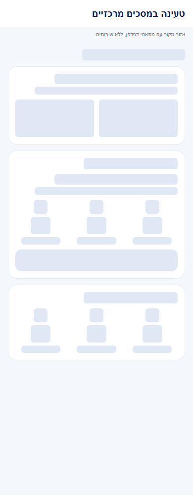
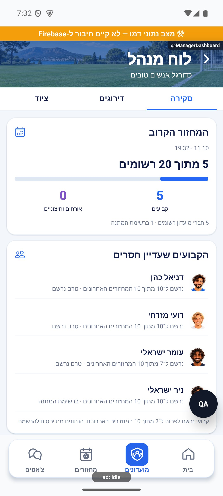
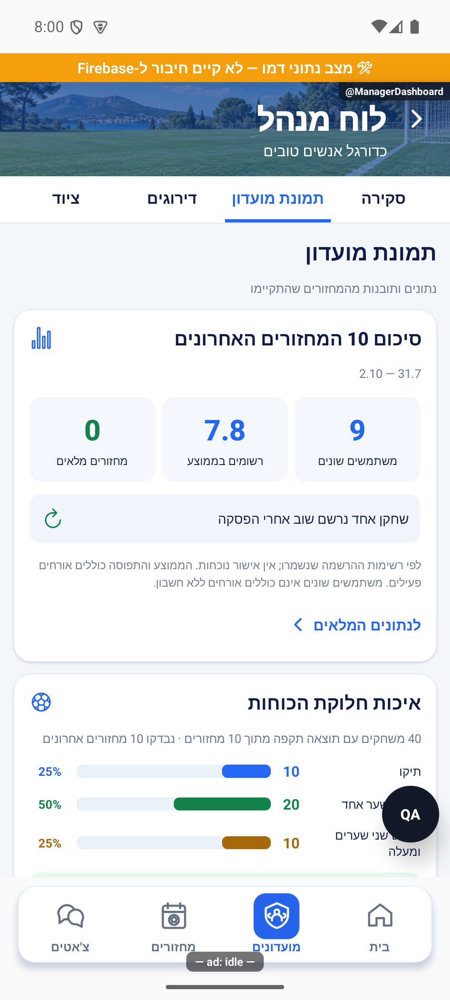
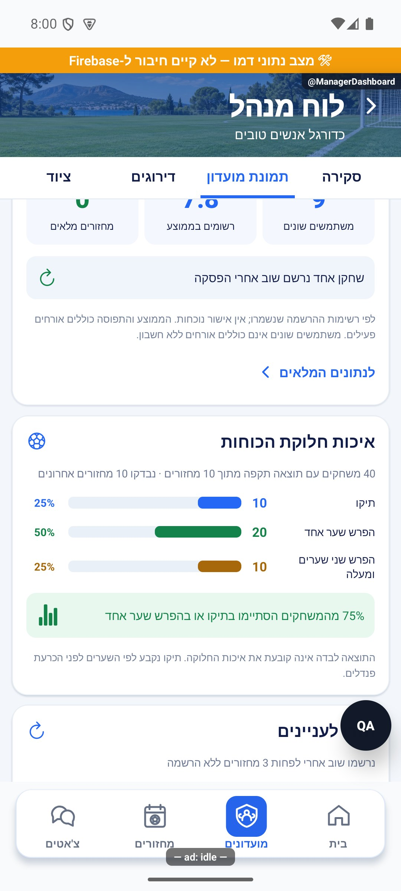
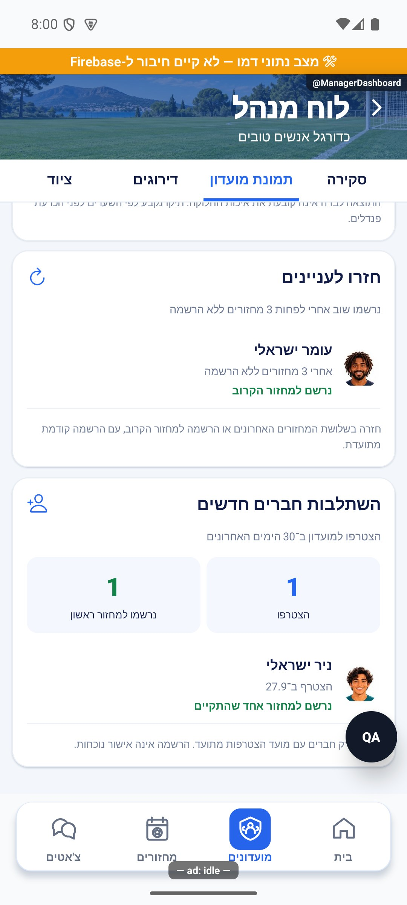
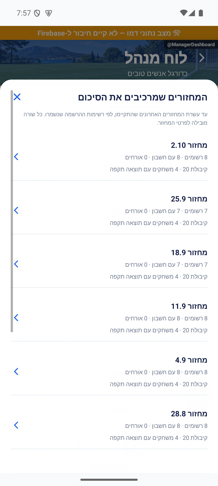
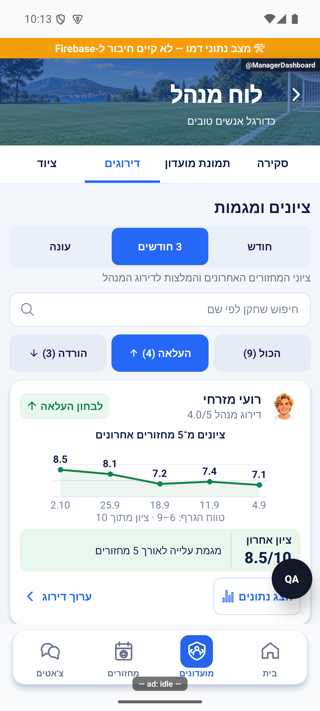
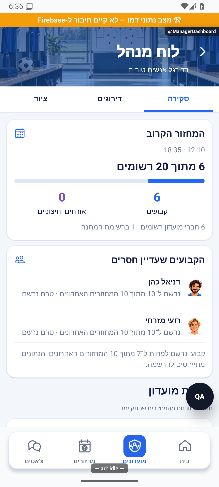
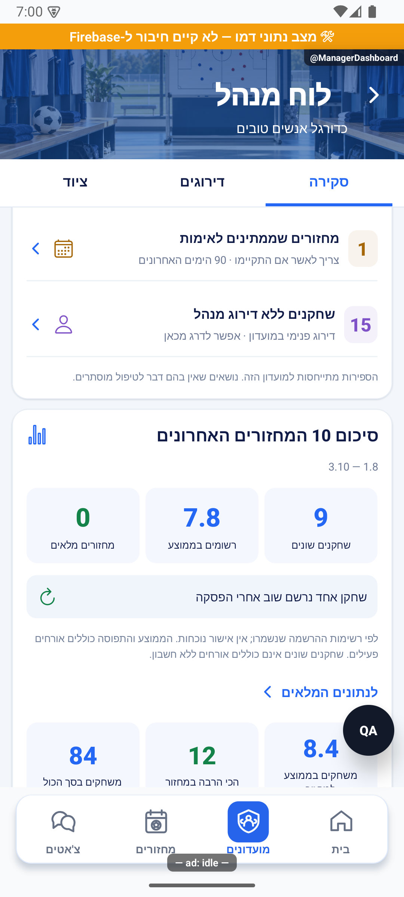
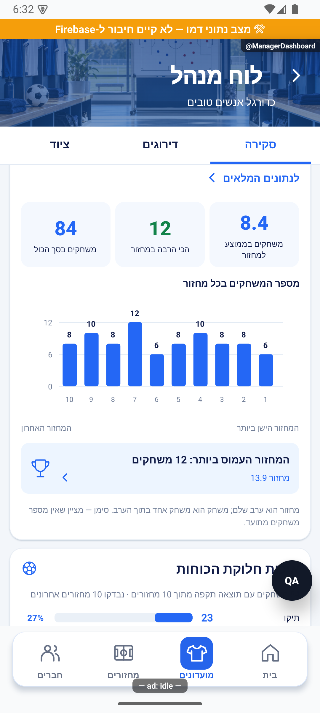

# לוח מנהל — נתונים, חישובים והרשאות

## עצירת מחזור קבוע ללא פעילות, 6.11.2026

נבדק השינוי התחום ב-`functions/src/index.ts`: בדיקת חוסר פעילות לפני יצירת מחזור קבוע ושמירת שלוש החלטות בזמן ניקוי מחזורים ריקים. ההכרעה משתמשת במקור הקיים לקיום מחזור ומגינה על מחזור עם הרשמה שנותר לא מוכרע. עסקאות היצירה והניקוי נשארות מוגנות מפני שינוי מקביל ומועדון חסר. אין שינוי מכוון בחישובים, במכנים, בהרשאות, בניווט או בפעולות העצמאיות האחרות של הפיצר הזה. בדיקות מקור השרת הורצו במאגר זיכרון; הפריסה הממוקדת של שני שירותי התזמון אומתה בייצור מול המקור שנבדק, ותועדה הרצת שירות חמש הדקות ללא שגיאות. אין בכך אימות חדש של המסך או של יתר פעולות הפיצר. [ההתנהגות, מסלול הנתונים, הבדיקות ומגבלות ההפעלה](../../changes/2026-11-06-inactive-recurring-rounds.md).

## דירוג בסיס לשחקן ללא דירוג, 6.11.2026

נבדק שינוי תחום במקורות המשותפים של הכוחות האוטומטיים: שחקן ללא דירוג מחושב כ-2.5 מתוך 5, וההסברים תואמים. דירוג מפורש נשמר. אין כאן אימות חדש של כל מצבי הפיצר העצמאי; השינוי מקומי וטרם הופץ. המקורות המשותפים שנבדקו בהפרש זה: `functions/src/index.ts`. [ההתנהגות, הבדיקות ומגבלות האימות](../rounds/draft-setup.md#דירוג-בסיס-לשחקן-ללא-דירוג-6112026).

## סבב תיקוני הפולס, 5.11.2026

ב-`src/components/manager/ManagerClubExtras.tsx`, אזור `ManagerAttention`, הוסרה השורה המסומנת על תחום הספירה. `managerNeedsAttention`, רשימת הנושאים, הסתרת נושא ריק, הצגת עוד נושאים ופתיחת אישורים או דירוגים נשארו ללא שינוי. זהו שינוי מלל ותצוגה בלבד.

מקומי וטרם הופץ. הבדיקה החזותית היא של רכיבי מקור במתאם דפדפן עם נתוני הדגמה, ולא בדיקת מכשיר או שרת חדשה. [מקורות, בדיקות ומגבלות](../../changes/2026-11-05-pulse-sweep.md). [לפני](../screenshots/pulse-review-manager-before-2026-11-05.png) ו[אחרי](../screenshots/pulse-review-manager-after-2026-11-05.png).

## מדידת פעולות ואמינות נתונים, 5.11.2026

במיפוי מקור הרכיבים המוזכרים במסמך נמצאו 64 נקודות מטפל ו-61 מזהי פעולה. הספירה מתארת קוד וכוללת רכיבים משותפים; אין לחבר אותה לספירות של מסמכים אחרים ואין לראות בה הרצת כל המסך. המדידה מפורטת לפי גבול פקד מקורי, פעולה עסקית ומצב חשבון. תשובה מאוחרת נבדקת מול בעל הפעולה, ומצב קיים או בקשה חוזרת אינם תמיד הצלחה חדשה. רשימת המקרים שהורצו ומגבלות המסד, המכשיר והכיסוי נשמרות [בדוח המדידה](../../audits/2026-11-04-system-night/product-measurement.md) ובדוחות המקושרים אליו. המימוש מקומי; לא בוצעה בדיקה חדשה של כל מצבי הפיצר.

## חיפוש שחקנים וזמני טעינה, 4.11.2026

שירות החיפוש, הכרטיס וגיוס הפנויים התעדכן. מסלולי התאימות של זהויות, סטטיסטיקה מלאה והזמנות ממשיכים לבדוק גישה. נקודת הכניסה מייצאת את מעדכן מפתח השמות הפרטי. אירוע זה דורש פריסה נפרדת. בדיקה זו תחומה למקור המשותף, ללא הרצה חדשה של כל המסך העצמאי. מימוש מקומי שטרם הופץ. [השינוי, המדידות והבדיקות](../../changes/2026-11-04-player-discovery-speed.md).

## ציר פעילות פרטי בפולס, 4.11.2026

בציר הפעילות, תשובת שרת על מצב הרשמה קיים אינה נספרת כהרשמה חדשה. קבלה ללא סימון יצירה מפורש מוצגת עם מגבלת אמינות.

הלשונית הפעילה בלוח מדווחת כשהמסך ממוקד, עם מזהה המועדון. חישובי הלוח, הרשאותיו ופעולות הניהול שלו אינם משתנים בגלל התיעוד. מקומי וטרם הופץ או נפרס. [היקף, מקורות, בדיקות ומגבלות](../shared/usage-activity.md).

## ראיות לשיפור טעינת מסכי הפירוט, 4.11.2026

נבדקו חמישה זוגות של אזורי מקור בשלושים פריסות בדפדפן, ברוחבים 320, 390 ו-430, ונבדקה כיווניות בצילומים. נתוני ההתקדמות מוזנים למתאם ומגובה להם בדיקת תזמון נפרדת. רכיבי ניווט, סמלים, תמונות שחקנים וחלונות מערכת מוחלפים בחלקם במתאמים; משטחי שיתוף מוסתרים אינם נכללים בבדיקת רוחב. אין בכך אימות מסך מלא במכשיר או מדידת זמן רשת. טבלת ההשוואות והבדיקות בדוח השינוי.

[מדידות, בדיקות ומגבלות](../../changes/2026-11-04-detail-performance.md).

## קיצור טעינת לוח המנהל, 4.11.2026

טעינת הבסיס של המסך מופרדת מקריאת ציוני המחזורים. `ManagerDashboardScreen` קורא כעת ל-`loadManagerDashboard` עם `includeScores: false`: המועדון, שמות הסגל ומחזיקי הציוד, עד 200 מחזורים ועד 1,000 אירועים ממשיכים להיטען אחרי בדיקת מנהל ובמקביל זה לזה, עם בדיקת ניהול נוספת לפני פרסום. סקירה וציוד אינם מתחילים קריאות לציוני מחזורים. ברירת המחדל של השירות נשארה טעינה מלאה כדי לשמור תאימות לצרכנים קיימים.

לשונית דירוגים מבקשת ציונים רק עבור התקופה שנבחרה, חודש, שלושה חודשים או העונה הנוכחית. `managerScoreGames` ב-`src/screens/communities/useManagerDashboardScores.ts` מסננת לפי מועדון, זמן עבר, `didEveningHappen` והתקופה או `inSeason`. אין קיצור לחמש קריאות: כל המחזורים בתחום עדיין נבדקים, כדי למצוא לכל חבר את חמשת ציוניו האחרונים ולא להניח שלכל הסגל אותם חמישה מחזורים. פתיחת דף שחקן ב-`ManagerWorkspace` מודיעה דרך `onScoresNeeded` על צורך בציוני 90 הימים האחרונים. יתר דפי הסקירה אינם מבקשים אותם.

`loadManagerDashboardScores` ב-`src/services/managerDashboardService.ts` מאמתת את זהות ההתחברות, ניהול המועדון וחותמת העונה לפני ואחרי הקריאות. שינוי אובייקט הזהות, גם למזהה חשבון זהה, פוסל את התוצאה. מחזור ממועדון אחר או מחזור שלא התקיים אינם נשלחים לקריאת הציונים. עד ארבע קריאות פועלות במקביל, והפסקת הביקור או שינוי ההקשר עוצרים התחלת קריאות שטרם התחילו. בקשות שכבר נשלחו אינן מבוטלות ברשת.

הצלחות נשמרות בזיכרון רק מול אובייקט נתוני הבסיס המאושר של הביקור הנוכחי. מעבר בין תקופות או חזרה לדירוגים קורא רק מזהי מחזורים שטרם התקבלה עבורם תשובה תקפה. גם מפה ריקה שהתקבלה בהצלחה היא תשובה מאושרת ואינה נקראת שוב באותו בסיס. כשל משאיר את המחזור חסר, שומר הצלחות ומונע המלצות; ניסיון חוזר קורא רק את החלק החסר. רענון, כניסה מחודשת, חשבון או מועדון חדשים יוצרים בסיס חדש ולכן אינם יורשים את ההצלחות הקודמות. ציונים אינם נשמרים בדיסק או במטמון גלובלי.

חריג מפורש הוא שינוי חותמת עונה בזמן הקריאה. `manager-season-changed` מסמן `needsBaseRefresh`, מסתיר ציונים מהבסיס שהתיישן ומציג הסבר שהעונה השתנתה. ניסיון חוזר מפעיל את רענון הבסיס של המסך לפני קריאת ציונים נוספת; אין לולאת ניסיון אוטומטי מול אותה חותמת ישנה. בדיקת המרוץ מאמתת כשל אחד, רענון ידני אחד והצלחה רק מהבסיס המאושר החדש.

בטעינת דירוגים מופיע שלד ציונים אחרי שהבסיס כבר זמין. דף שחקן מציג במדד הציון האחרון את המילה בטעינה וחיווי באזור המגמה כל עוד הציונים לא הושלמו. כשל מוצג כמידע שלא נטען עם ניסיון חוזר, וציונים שהצליחו נשארים גלויים. אין הצגת מצב ריק מאושר בזמן המתנה או כשל. לאחר הצלחה מלאה ללא ציונים נשאר ההסבר הקיים שמידע חסר אינו אפס. נוסחאות הציונים, ספי ההמלצות, מכנים, מדדי הרשמה וציוד והרשאות לא השתנו.

`ManagerRatingFilters` אינו מציג אפס מומצא: לפני השלמת הקריאות אין מוני המלצות, ומסנני ההעלאה וההורדה מושבתים. בלי ציונים זמינים מופיעות רק כותרות המסננים; כשיש מידע חלקי כתוב למשל זמינים ושלוש בסוגריים, וספירה זו מתייחסת לבעלי ציונים זמינים בלבד. הרשימה מציגה אז את כל הציונים הזמינים גם אם מסנן המלצות נבחר לפני הכשל. לאחר שלמות חוזרת הבחירה המבוקשת ומותר להציג גם אפס שנמדד. ארבע בדיקות רכיב מרונדר מאמתות טעינה, מידע חלקי, ריק מאושר וחזרת מסנן המלצות.

מקורות שנערכו: `src/screens/communities/ManagerDashboardScreen.tsx`, `src/screens/communities/useManagerDashboardScores.ts`, `src/components/manager/ManagerWorkspace.tsx`, `src/components/manager/ManagerRatingFilters.tsx`, `src/services/managerDashboardService.ts`. שירותי היסטוריית הרשמה ותוצאות משחקים נשארו ללא שינוי; הם כבר נקראים רק בדפי הפירוט המתאימים, וכעת יכולים להתחיל אחרי בסיס שאינו ממתין לציוני כל ההיסטוריה.

עברו 419 בדיקות בשבע חבילות ממוקדות, כולל 13 בדיקות חדשות ב-`tests/logic/managerDashboardPerformance.test.ts`, ארבע בדיקות מרונדרות ב-`tests/logic/managerRatingFilters.test.tsx`, בדיקות השירותים, חישובי הלוח ו-`tests/hooksAfterEarlyReturn.test.ts`. המקור המדויק שלפני נשמר גם ב-`tests/fixtures/managerDashboard.before-performance.txt`, עם חתימה זהה לעותק המקומי שנשמר לפני העריכה, והושווה למקור החדש בלי החלפת קובצי היישום. בסקירה של 200 מחזורים נמדדו אפס קריאות ציונים במקום 200. בתרחיש שעון נשלט עם עיכוב של 100 אלפיות שנייה בכל מקור נמדדה השלמת בסיס אחרי 300 אלפיות שנייה במקום 5,300. זו מדידת שירות בתנאי בדיקה, ולא מדידת זמן טלפון או הבטחה לאותו יחס בכל מועדון.

מצבי הצילום משותפים עם הבדיקות ב-`tests/fixtures/manager-dashboard-preview.json` ובעותק מקומי ב-`artifacts/detail-performance-2026-11-04/manager-preview-data.json`. הם כוללים בסיס מלא, ציונים בהמתנה וכשל חלקי. בדיקות הפרויקט המלאות, הטיפוסים והאימות החזותי החדש מרוכזים במסירת המשימה הראשית; אין בסעיף זה טענה להרצת טלפון, בדיקת רשת אמיתית או הפצה. השינוי מקומי וטרם הופץ.

## הפצה פנימית 1.1.74, 3.11.2026

עדכוני הלקוח ב-`src/components/loading/CentralSkeletons.tsx`, `src/screens/communities/ManagerDashboardScreen.tsx` כלולים בחבילה הפנימית 1.1.74/306. ארכיון המקור המקומי וחתימת החבילה אומתו מול החבילה שהחזירה גוגל. מקור הבסיס הוא `06417f6132f4c7636aaee25574354ed7722966b9` עם שינויים שלא נשמרו לגיט.

עברו 6864 בדיקות יישום, בדיקות טיפוסים, 360 בדיקות הרשאות בסדרה ו-38 בדיקות שרת במסד הדגמה. ההרשאות והשירותים הפעילים נשמרו, ללא הסבת נתונים או קידום לייצור. האימות החזותי הוא מצילומי המקור בדפדפן שכבר תועדו, ללא התקנה או הרצת הפיצר הזה במכשיר בגרסה החדשה. אין בכך הכרזה על הפצת שינויים אחרים המתועדים במסמך. [מקור, קבלות, תכולה ומגבלות](../../changes/2026-11-03-internal-1.1.74.md).

## הרחבת טעינת השלד במסכים מרכזיים, 3.11.2026

אזורי המקור המשויכים שנבדקו בדפדפן: `manager-club`, `manager-ratings`, `manager-equipment`. השלד יושב בענפי ההמתנה הקיימים; סוגי השלדים נמצאים ב-`src/components/loading/CentralSkeletons.tsx`. מצבי כשל, ריק, פרטיות והחלפת הקשר נשארים נפרדים. אין שינוי בשירותים, בחישובים, במכנים או בהרשאות. ההמתנה ברענון לוח המנהל שומרת מידע שכבר התקבל עבור אותו חשבון ומועדון; בכרטיס האישי נשמר מנגנון הקריאה הקיים, לרבות איפוס חלקיו בתחילת ביקור.

מקורות משויכים שנערכו: `src/screens/communities/ManagerDashboardScreen.tsx`.

[טבלת המבנים, תנאי ההכרעה, מסלול הנתונים, הבדיקות והמגבלות](../../changes/2026-11-03-central-screen-skeletons.md). מקומי וטרם הופץ. האימות החזותי תחום לאזורי מקור עם מתאמי דפדפן, ללא אימות מכשיר או שרת חי חדש.

בדיקות במשימה זו: 6,831 בדיקות ב-609 חבילות ובדיקת טיפוסים עברו. נבדקו 25 מצבי מקור ב-162 בדיקות רוחב, ובוצעו תשע השוואות מידות לרכיבי תוכן. אין בכך אימות מכשיר חדש של הפיצר או של מצבים שאינם כלולים בדוח.

## תיקוני דיווחי הפולס, 3.11.2026

נבדק ההפרש התחום ב-functions/src/index.ts, באתר index:20a83f91b9 בלבד: קוד כפילות של joinCredited נבדק לפני observeCaughtError. הסמן וההגדלה נשארים אטומיים, ושגיאות אחרות נשארות נצפות. אין שינוי מכוון בחישובים, במכנים, בניווט או בהרשאות של הפיצר המתואר כאן. בדיקת הלולאה הממוקדת מתועדת ב-shared/data-and-state-contracts; אין כאן בדיקת מסך או מסלול ייצור חדש של הפיצר הזה.

[פירוט התיקונים, הבדיקות, הצילומים והמגבלות](../../changes/2026-11-03-pulse-sweep.md).

## העברת אורח לרשימת המתנה, 3.11.2026

נבדק ההפרש הממוקד במקור המשותף `functions/src/index.ts`: תנאי `guestSeatFreed` ב-`onGameRosterChanged` מבחין כעת בין הסרת אורח פעיל לבין העברה ידנית להמתנה. אין שינוי מכוון בחישובים, בנתונים, בניווט או בפעולות העצמאיות של הפיצר המתואר כאן. בדיקות גילוי העזיבה והקידום מכסות את השינוי המשותף; אין בדיקת מסך חדשה לפיצר זה. התיקון מקומי וטרם נפרס או הופץ.

[היקף, בדיקות ומגבלות](../../changes/2026-11-03-guest-waitlist.md).

## ליטוש מקומי והשפעת רכיבים, 3.11.2026

`ManagerDashboard` אינו אחד מחמשת מסכי השורש המותרים בכלי `src/utils/supportBubbleVisibility.ts`. `App.tsx` מעביר הסתרת בועה בלבד, בלי להסיר את מארח התמיכה. השינוי מתייחס לחפיפה חזותית שהסוכן הראשי זיהה ליד פעולת הצגת הנתונים; אין הוכחת חסימת לחיצה. מדדי הלוח, חלונות הזמן, מקורות הקריאה והרשאות מנהל נשארו. בדיקות כלי הנראות נכללו ב-67 בדיקות תמיכה ממוקדות; אין כאן בדיקה חוזרת של הלוח כולו או של נתוניו.

השינוי מקומי וטרם הופץ. אין כאן אימות חדש של מסך מוצר מלא, מכשיר, קורא מסך או שרת. [הראיות והמגבלות של המשימה](../../changes/2026-11-03-overnight-mission.md).

## טיפול בפולס, 2.11.2026

ב-`ManagerWorkspace` הוקדם מקטע `insights.returned` למקטע `attentionAbsent`, בשתי נקודות התצוגה. בסקירה נשמרות עד שתי חזרות ועד שלוש הפסקות; בתמונת הסגל נשמרות עד חמש מכל קבוצה לפני הרחבה. `uniqueManagerAttention`, ספי החזרה ומכני הסגל לא השתנו.

בדיקת הרכיב המרונדר אימתה שבנתוני ההדגמה שחקן חוזר עבר מגובה 595 לגובה 453, מעל השחקן שבהפסקה שמוצג בגובה 544. [לפני](../screenshots/pulse-manager-returned-before-2026-11-02.png), [אחרי](../screenshots/pulse-manager-returned-after-2026-11-02.png). מתאם הדפדפן משתמש בראשי תיבות במקום תמונות משתמש ובמיפוי הכיווניות של המערכת; אין אימות מקור אנדרואיד או אייפון בסבב זה. ניסיון האימולטור לא סיפק תצוגה תקינה.

[דוח הטיפול, הבדיקות והמגבלות](../../changes/2026-11-02-pulse-sweep.md).

## בקשות לשיחה אישית, 2.11.2026

נבדקה השפעת תוספת בקשות השיחה במקורות המשותפים. השינוי ממוקד בהרשאת שיחה, בשדות פרטיות ההודעות ובחיבורי הבדיקות; אין מכך אימות חדש של מסך זה במכשיר. המימוש מקומי וטרם הופץ או נפרס. [התנהגות, בדיקות ומגבלות](../chat/message-requests.md).

מקורות משותפים שנבדקו בהיקף השינוי הזה: `functions/src/index.ts`, `functions/src/socialPlayers.ts`. אין בסעיף זה טענה להרצת כל המסלולים ההיסטוריים של הפיצר. [מסירת המימוש](../../changes/2026-11-02-message-requests.md).

## הסרת מגבלת החברים במועדון, 1.11.2026

נבדקה השפעת השינוי הממוקד במקורות המשותפים: הוסרה מגבלת החברים במועדון. אין שינוי מכוון בהתנהגות העצמאית של המסך המתואר כאן או במספר המקומות במחזור. התיקון מקומי וטרם הופץ; אין בדיקת מכשיר חדשה לפיצר זה.

מקורות ששונו בהיקף המשימה: `functions/src/index.ts`, `functions/src/socialPlayers.ts`. מספרי החברים אינם משמשים עוד כתנאי תפוסה במועדון. שדות התאימות הישנים אינם נאכפים.

[מסלול הנתונים, התנאים, התאימות, הבדיקות ומגבלות ההפצה](../../changes/2026-11-01-unlimited-club-members.md).

## פריסת הגנות הסרת המחזור, 30.10.2026

נפרסו שבע חבילות מבודדות, ועדכון המקור בלבד אומת מול כל הקבצים הפעילים. הגדרות השירותים והאירועים ו-111 השירותים האחרים נשמרו. אומתו מוכנות ותעבורה לגרסאות החדשות, קריאה עצמית עם חשבון בדיקות קיים ושימור גרסאות כל 496 המסמכים שבגיבוי. שש דחיות בקשות דפדפן לא תקינות סווגו לפי מזהי בקשה; לא זוהה כשל ריצה עסקי בלתי צפוי. לא הופעלו מחיקה, חסימת מחזור או בקשת שמירה תקינה על נתוני המועדון. זו ראיית הפריסה התחומה ולא הרצה מחודשת של כל מסך.

[גרסאות פעילות, בדיקות שרת וגבולות האישור](../../changes/2026-10-30-evening-removal-server-deployment.md).

## השלמת הגנת הסרת המחזור, 30.10.2026

הורחבה ההגנה ב-`functions/src/personalActivity.ts` וב-`functions/src/managerRoundHistory.ts`: קריאת `gameRemovalBlocksWrite` וקיום המחזור בתוך עסקת יצירת הנתונים. בקשת סנכרון לאחר הסרה מחזירה כשל מפורש במקום ניסיון חוזר ללא סוף. ב-`functions/src/index.ts` גם חבילת סטטיסטיקה מלקוח ישן מעדכנת את המחזור עם תנאי גרסה, ומכסת הפעולות כוללת תמיד כתיבת הגנה זו. אין שינוי בחישובי התוצאות, הפרטיות או הניווט מעבר להגדרת המחזור המתועד שפורטה קודם. נבדקו ארבעה עשר תרחישים ראשיים, שמונה תרחישי חסימה ושחזור, שמונה בדיקות חבילות ושבע בדיקות פעילות ונתוני מנהל במסד מקומי. ההיקף הוא בדיקת השינוי התחום במקורות משותפים, ולא הרצה מחודשת של כל מסך או של תשתית מסירת האירועים. התיקונים טרם נפרסו.

[תוכנית הביצוע, החבילות, הבדיקות וגבולות האישור](../../changes/2026-10-30-evening-removal-readiness.md).

## הגנה בהסרת מחזור היסטורי, 30.10.2026

השינוי התחום ב-`functions/src/index.ts` עוטף את עיבוד אירועי הסגל בזכות עיבוד כדי לסנכרן הסרה ניהולית עתידית; הוא מוסיף קריאת קיום מחזור בעסקאות של השלמת היסטוריה ושמירת פעילות. השינוי ב-`functions/src/socialPlayers.ts` משווה את הגדרת המחזור המתועד לחישוב העצמי. אין שינוי מכוון בפעולות העצמאיות האחרות המתועדות כאן, בהרשאות או בניווט. זו בדיקת השפעה תחומה של המקורות המשותפים, ולא הרצה של כל מצבי הפיצר. אין פריסה או אימות מכשיר חדש.

[התנהגות, סדר הפעולות, חישובים, בדיקות וגבולות האישור](../../changes/2026-10-30-evening-removal-readiness.md).

## הסרת כרטיס העמדות, 28.10.2026

הוסר כרטיס העמדות המועדפות מפירוט המוכנות למחזור. בחירת עמדה אינה זמינה באפליקציה, ולכן שדה עבר אינו בסיס להצגת מספר שוערים או ספירת עמדות חסרות. כרטיס הציוד והקישור לפרטי המחזור נשארו זמינים. התיקון מקומי וטרם הופץ; גרסה 1.1.68 שכבר הועלתה אינה כוללת אותו.

אומתו צילומי לפני ואחרי באימולטור עם נתוני הדגמה בחבילת תצוגה נפרדת. כל 6321 בדיקות היישום ב-564 חבילות ובדיקת הטיפוסים עברו. [צילום לאחר ההסרה](../screenshots/manager-no-position-after-2026-10-28.png), [צילום לפני](../screenshots/manager-no-position-before-2026-10-28.png).

השינוי ב-src/components/manager/ManagerWorkspace.tsx מסיר רק את כרטיס העמדות ממצב readiness, כאשר קיים מחזור קרוב. אין חישוב חלופי, שינוי מסלול ניווט, שינוי הרשאות או כתיבת נתונים. הכרטיס הסתמך על User.position הישן, בעוד שבחירת העמדה הוסרה מעורך הפרופיל. [החלטת הפרופיל הקיימת](../profile/profile-edit.md).

## הפצה פנימית מאומתת, 28.10.2026

לוח המנהל נכלל בגרסת האנדרואיד הפנימית `1.1.68/301`. שני שירותי היסטוריית המחזורים נפרסו ומקורם אומת. מדדים מלאים יצטברו ממידע חדש, ללא השלמת עבר. לא בוצעו שינוי כללים או בדיקת התקנה מהחנות. [הפצה, בדיקות ומגבלות](../../changes/2026-10-28-internal-1.1.68.md).

## לוח מנהל מורחב - 28.10.2026

מימוש מקומי בעקבות אישור הבעלים לסקיצות. לא בוצעו פריסה, שינוי כללי הרשאה, בנייה לחנות, הסבת נתוני ייצור, שמירת קוד במערכת ניהול הגרסאות או דחיפה לשרת הקוד. הסעיף הזה מחליף תיאורי תצוגה קודמים: כיום שלוש לשוניות, סקירה, דירוגים וציוד. ארבע המחסניות הקיימות ממשיכות לארח את אותו נתיב ManagerDashboard.

### מסלול שימוש ומצבים

- src/screens/communities/ManagerDashboardScreen.tsx מארח את src/components/manager/ManagerWorkspace.tsx. דפי הפירוט הם מצבים בתוך אותו מסך, ולא נתיבי מחסנית חדשים. חזרה בכותרת, חזרת המכשיר והפעולה חזרה למסך הקודם מחזירות תחילה לדף הפירוט הקודם. מעבר דף מאפס את הגלילה למעלה. מעבר חשבון או שלילת ניהול מסירים גם את הפירוט הפתוח.
- סקירה: נושאי אישור במחזור הקרוב ומחזיקי ציוד שאינם רשומים קודמים לבקשות חברות, אימות מחזורים ודירוגים חסרים. תחילה מוצגים שני נושאים, עם הרחבה מפורשת לשאר. הנושאים נשארים תחומים למועדון; אישור מחזור נפתח במסך המחזור בלשונית השחקנים.
- מוכנות: המחזור העתידי הראשון במצב פתוח, מתוזמן או נעול, גם אם הרשמתו טרם נפתחה. מוצגים מצב ההרשמה, פירוק רשומים מלא, מקומות פנויים, המתנה, אישורים וקבועים חסרים לפי מצב. אין הסקת נוכחות מהרשמה. נתוני העמדה הישנים אינם מוצגים בפירוט המוכנות, משום שאין אפשרות פעילה לבחור עמדה באפליקציה.
- סגל: חיפוש בכל הסגל, סינון לתשומת לב וכרטיסים פעילים כשהתכונה מופעלת. רשימות נפתחות בהדרגה. כרטיס ניהולי לשחקן מרכז תאריך הצטרפות רק אם מתועד, הרשמה עתידית, עד חמישה מחזורים זכאים, דירוג, ציונים, ציוד וכרטיסים. פעולות דירוג וציר אירועים ממשיכות לרכיבים ולשירותים הקיימים.
- השתלבות: מצטרפי 30 הימים האחרונים עם תאריך הצטרפות תקף, הרשמה ראשונה למחזור שהתקיים, הרשמה חוזרת והזדמנויות מאז ההצטרפות. הרשמה עתידית מוצגת בנפרד ואינה נספרת כהרשמה למחזור שהתקיים.
- פעילות: סיכום עשרת המחזורים, תפוסה ומקור ההרשמות, מספר משחקים וצמידות התוצאות. הכותרת איכות חלוקת הכוחות הוחלפה בעד כמה המשחקים צמודים, ללא שינוי בהתפלגות התוצאות או במכנה.
- עונה: מצב הפעילות, התקדמות שמורה ליעד מחזורים או מועד סיום, חלון תיקונים וסיבות סגירה קיימות דרך src/utils/seasonClosureStatus.ts. אין חישוב חלופי למונה העונה. קישורים לסיכום, לטבלה ולהיסטוריה משתמשים במסכים הקיימים.

### רכיבים ומקור נתונים

src/components/manager/ManagerUi.tsx מרכז כרטיסים, מדדים, שורות וקישורים בשפה החזותית הקיימת. src/components/manager/ManagerEquipmentHolders.tsx מציג את group.ballHolderIds ואת group.jerseysHolderIds מול הרשמת המחזור הבא. אין הסקת מצב החזקה מסכום אירועי לקיחה.

src/services/managerDashboardService.ts נשאר עם שער ניהול וזהות לפני ואחרי הטעינה. זהויות מחזיקי ציוד מצורפות לרשימת הסגל לקריאת זהויות. באותו אינדקס אירועים קיים, כאשר הכרטיסים מופעלים, נטענים גם red ו-yellow לצד ball ו-jerseys. גבול 1,000 מתייחס כעת לכל אירועי הציוד והכרטיסים יחד. כשל אירועים מסתיר ספירות כרטיסים ומוצג במפורש; המחזיקים הנוכחיים עדיין נקראים ממסמך המועדון. אזהרת חיתוך נשמרת ואין טענה להיסטוריה מלאה.

src/utils/managerWorkspace.ts הוא מודל הקריאה החדש. הוא אינו כותב מסמכים ואינו משנה את מוני הכדורגל, העונה או התארים. src/utils/managerDashboard.ts מחזיר מצב רשום רק כשאין ביטול פעיל, גם במסמך סותר שבו מזהה נשאר ברשימת השחקנים. ספי הקביעות נשארו 7 מתוך 10 מחזורים זכאים.

### חישובים ומכנים

- סגל: איחוד ייחודי של מנהלים ושחקנים. נרשמו בתקופה הוא מספר חברי הסגל הנוכחי עם הרשמה אחת לפחות בעד עשרת המחזורים האחרונים שהתקיימו. זה אינו מספר כלל החשבונות ששיחקו במועדון בעבר, ואינו נוכחות.
- תפוסה: חשבונות רשומים ייחודיים ללא ביטול פעיל ועוד אורחים פעילים. תפוסה מצטברת היא סכום ההרשמות חלקי סכום הקיבולות, בעיגול לאחוז שלם. אם חסרה קיבולת חיובית אפילו במחזור אחד, אין אחוז תפוסה. חלוקה בין חברים לחיצוניים משתמשת בחברות הנוכחית ומסומנת בהתאם. רישום חוזר של אותו אדם במחזורים שונים נספר בכל מחזור.
- מחזור קרוב: מספר חברים רשומים ועוד חשבונות חיצוניים ועוד אורחים שווה לסך הרשומים. המתנה ואישור אינם רשומים. מקומות פנויים הם המקסימום בין אפס לקיבולת פחות הרשומים; קיבולת לא תקפה מוצגת כלא ידועה.
- ציונים: עד חמשת הציונים הזמינים בתחום שנבחר, שאינם בהכרח ממחזורים רצופים. טווח הגרף אחיד 0 עד 10. דירוג מנהל מתוך 5 נשאר מדד נפרד. אין שינוי בנוסחת המלצת הדירוג או עריכה אוטומטית.
- כרטיסים: אותה פונקציית cardState, עם הקדימות הקיימת של תוקף שנשמר באירוע, ביטול ואפשרות ללא פקיעה. אדום פעיל חוסם הרשמה; צהוב אינו חוסם. כיבוי תכונת הכרטיסים מסתיר את המידע.
- המשכיות: חלוקה לפי חודש הצטרפות של חברי הסגל הנוכחי בלבד. זכאות אחרי שמונה מחזורים שהתקיימו מאז הצטרפות השחקן. חלון ראשון הוא מחזורים 1 עד 4, ושני הוא 5 עד 8. המשכיות מחייבת הרשמה בשניהם; המכנה הוא חברים עם שמונה הזדמנויות מתועדות. בחיתוך היסטוריה אין שימוש במצטרף שקדם למחזור הישן שנטען. אין כאן אחוז נטישה ואין מעקב אחרי חברים שעזבו.
- הגעה מדווחת: המחזור האחרון שהתקיים, חשבונות רשומים ייחודיים ללא ביטול. ארבע קטגוריות נפרדות: הגיע, איחר, לא הגיע ולא ידוע. הכיסוי הוא מספר הדיווחים הידועים מתוך החשבונות הרשומים. אין אורחים במכנה ואין השלמה של ערך לא ידוע להגעה.

### איסוף היסטוריה חדש, מקומי וטרם פריסה

functions/src/managerRoundHistory.ts מייצא דרך functions/src/index.ts את onManagerRoundChanged ואת getManagerRoundHistory. לא שונו כללי הרשאה. האוסף managerRoundMetrics ושכבת קבלות events נכתבים בשרת ונקראים ללקוח רק בשירות שמאמת משתמש מלא וניהול במסמך המועדון לפני ואחרי הקריאה. מזהי המחזורים נישאים מהתוצאות, נבדקים ומוגבלים ל-200; גם מסמכי המחזור העדכניים נבדקים כדי למנוע נתונים מתחום ישן אחרי שינוי מועדון או תאריך.

functions/src/managerRoundMeasurement.ts מחשב שינוי טהור. אירוע מקור נספר פעם באמצעות קבלה בעלת מזהה מגובב בתוך עסקה. שינויי שעון, שערים ונתונים שאינם משפיעים על ההרשמה אינם יוצרים כתיבה נוספת. זמן עדכון המקור קובע את סדר הדגימות, ולא מועד הרצת הפונקציה. שינוי תחום או קיבולת מבטל טענת היסטוריה מלאה; אירוע ישן מתחום קודם אינו דורס תחום חדש.

תיעוד מלא מתחיל רק כשנצפתה יצירת המחזור לפני פתיחת ההרשמה, או במועד הפתיחה עצמו. מחזורים קיימים אינם משודרגים בדיעבד להיסטוריה מלאה. מתועדים מועד מילוי ראשון, קידום מהמתנה, דגימת ההמתנה האחרונה לפני ההתחלה ופעולות ביטול ששינו חותמת זמן. הסרה בידי מנהל אינה ביטול. הרשמה מחדש אינה מוחקת את המונים שנאספו. מועד ביטול אחרון חסר נשאר בקטגוריה נפרדת.

src/services/managerHistoryService.ts בודק זהות לפני ואחרי הקריאה ומפענח את התשובה מול מזהי ותאריכי המחזורים שהועברו. נתון פגום או חורג מתחום הוא כשל, לא אפס. שירות שאינו פרוס מציג מצב לא זמין. כשל רשת או הרשאה מציג ניסיון חוזר, ולא היסטוריה ריקה תקינה.

src/utils/managerHistoryView.ts מסכם רק מחזורים עם תיעוד מלא בתחום. בביקוש נבחרים עד עשרת המחזורים האחרונים בתקופה. זמן חציוני למילוי מחושב רק ממחזורים שהתמלאו, ונכתב מכנה זה בממשק. ספירות המתנה וקידום הן הרשמות, לא אנשים ייחודיים. src/components/manager/ManagerHistoryPanels.tsx טוען את המידע רק כשנפתח אחד מדפי ההיסטוריה, עם חלונות 30 או 90 ימים. בביטולים, אם אין היסטוריה מלאה, מוצג גם התיעוד הישן עם המגבלה שהרשמה מחדש מסירה ביטול קודם.

### בדיקות וראיות שבוצעו

בדיקות הטיפוסים של הלקוח והשרת נקיות. כל 6312 הבדיקות ב-563 חבילות עברו. בבדיקה המלאה הראשונה התגלה חוסר תצפית בחריגה החדשה; נוסף הדיווח הנדרש ובוצעה הרצה מלאה חוזרת. הראיות נשמרו ב-artifacts/manager-implementation-2026-10-28/jest-final.log וב-type-checks.json.

בדיקות ממוקדות חדשות: tests/logic/managerWorkspace.test.ts, tests/logic/managerRoundMeasurement.test.ts, tests/managerHistoryService.test.ts, tests/managerRoundHistory.test.ts. הן בודקות תחומי מועדון, כפילויות, קיבולת חסרה, תאריכי הצטרפות, חלונות הזדמנויות שווים, כיסוי הגעה, תוקף כרטיסים, ביטול מול הסרה, חזרה להרשמה, אירועים מאוחרים, קבלה אידמפוטנטית, שערי ניהול וזהות ופענוח כשלים.

נבדקו באימולטור אנדרואיד רכיב המסך המקורי, דפי הפירוט, סינון כרטיסים וניווט לכרטיס ניהולי. צילומי לפני מאומתים נשמרו בלוח הסקירה ובציוד. ניסיון צילום הדירוגים לפני השינוי הציג בפועל סקירה ואינו משמש ראיה; צילומי אחרי שלהלן הם פיקסלים מקוריים מאותו אמולטור. חבילת התצוגה נפרדת ומחליפה שירותים בנתוני הדגמה. צילומי ההיסטוריה הם נתוני הדגמה מפורשים, לא הוכחה לשירות פרוס או להיסטוריית ייצור. קובצי native-preview-manager/entry.tsx, native-preview-manager/stubs.ts ו-native-preview-manager/server.cjs משמשים רק מעטפת בדיקה מקומית.

- [סקירה ראשית](../screenshots/manager-workspace-overview-2026-10-28.png)
- [מוכנות למחזור לאחר הסרת כרטיס העמדות](../screenshots/manager-no-position-after-2026-10-28.png)
- [תמונת הסגל](../screenshots/manager-workspace-roster-2026-10-28.png)
- [כרטיסים פעילים](../screenshots/manager-workspace-cards-2026-10-28.png)
- [מידע ניהולי לשחקן](../screenshots/manager-workspace-player-2026-10-28.png)
- [השתלבות חדשים](../screenshots/manager-workspace-newcomers-2026-10-28.png)
- [ציוד נוכחי](../screenshots/manager-workspace-equipment-2026-10-28.png)
- [ציונים ומגמות](../screenshots/manager-workspace-ratings-2026-10-28.png)
- [פעילות המועדון](../screenshots/manager-workspace-activity-2026-10-28.png)
- [מצב העונה](../screenshots/manager-workspace-season-2026-10-28.png)
- [ביקוש ומקומות](../screenshots/manager-workspace-demand-2026-10-28.png)
- [ביטולים והגעה](../screenshots/manager-workspace-attendance-2026-10-28.png)
- [המשכיות של חדשים](../screenshots/manager-workspace-retention-2026-10-28.png)

מגבלות: אין אימות אייפון, מסד חי, מסירה אמיתית של טריגר ענן, ניווט מלא למסכים החיצוניים מתוך מעטפת הבדיקה או התקנה מחנות. אין יצירת משתמשים או מועדונים, פריסה, שינוי הרשאות או הסבת עבר. לפני הפצת מדדי ההיסטוריה יש לפרוס באישור את שני שירותי השרת ולבדוק את מסירת האירועים בפועל.

## הרחבת אבחון דיווחים, 27.10.2026

נוספה מעטפת אבחון מקומית עם מצב בזמן הכשל, שלבים בעלי מזהה ותזמון, מצב רשת ובנייה ומופעים נפרדים לשגיאה. נקודת הכניסה לתעבורת השרת עוברת כעת דרך העטיפה המשותפת; תשובות, חריגות, אפשרויות קריאה ומדיניות הפיצר נשמרות. אין כאן שינוי בהרשאות או בחישובי המוצר. הבדיקות המלאות ומגבלות האימות מתועדות בדוח המקושר; אין טענה לאימות מכשיר או להפצה. [היקף, ראיות ומגבלות](../../changes/2026-10-27-diagnostic-context.md).

באימות הסופי עברו כל 6,231 הבדיקות ב-555 חבילות, ובדיקות הטיפוסים של הלקוח, השרת והפולס נקיות. צילום הדפדפן והידור מקורות האנדרואיד הם בדיקות מקומיות; אין הוכחת מכשיר, הידור אייפון או מסירה חיה של הבנייה החדשה. רישום יומן השחרור נחשב מאומת רק לפי קבלת הקריאה החוזרת בדוח השינוי.

## קיצור טעינת ציונים ותוצאות - 25.10.2026

`src/services/managerDashboardService.ts` קורא את ציוני המחזורים שהתקיימו בתור מתגלגל של עד ארבע קריאות דרך `mapConcurrent`, במקום גלים נפרדים של ארבעה. כאשר קריאה מסתיימת מתחילה הבאה בלי להמתין לאיטית בגל. גבול 200 המחזורים, סינון קיום מחזור ומיון החדשים תחילה נשמרו. כשל בציון יחיד מסומן ב-`scoresIncomplete`; הציונים שהצליחו נשמרים וההמלצות נשארות חסומות לפי החוזה הקיים.

אותו שינוי חל ב-`src/services/managerClubResultsService.ts` על עשרת המחזורים האחרונים: עד ארבע קריאות לתוצאות במקביל, ללא שינוי בגבול 501 רשומות לקריאה, הצגת 500 או סימון מידע חסר וקטוע. אין שינוי במכנים, באחוזי האיכות, בניווט או בממשק.

בשני המסלולים נשמרו בדיקת ניהול לפני הטעינה ובדיקת ניהול וזהות בסופה. לפני התחלת כל קריאה נוספת נבדקת גם זהות החשבון; חשבון שהתחלף אינו מתחיל את התור שנותר ואינו מקבל תמונה חלקית. אין מטמון משותף חדש ואין שינוי הרשאות שרת.

נוספו ארבע בדיקות ב-`tests/managerDashboardService.test.ts` וב-`tests/managerClubResultsService.test.ts`: מילוי מיידי של מקום שהתפנה כשהקריאות הראשונות עדיין ממתינות, מגבלת ארבע קריאות, שמירת כשל חלקי, גבול עשרה מחזורים ועצירת תור אחרי החלפת חשבון. 21 בדיקות ממוקדות עברו בשלוש חבילות עם `tests/logic/mapConcurrent.test.ts`. אין מדידת זמן במכשיר או צילום חדש; השינוי אינו משנה עיצוב, והוא מקומי וטרם הופץ. [תוצאות הבדיקות המלאות, ראיות ומגבלות](../../changes/2026-10-24-loading-performance.md).

## תיעוד כשלים — 20.10.2026

נוספו תצפיות דיווח בנקודות הכשל של המקורות המשויכים לפיצ׳ר, במסגרת הרחבה רוחבית. נשמרו ערכי החזרה, הזריקות ותנאי הפעולה הקיימים; נוסף מקור קוד והקשר לדיווח. כיסוי תחבירי אינו הוכחת הרצה של כל מצב. השינוי מקומי וטרם הופץ; בדיקות המסירה, מגבלות מניעת הכפילויות והמסלולים שטרם חוברו מתועדים בדוח המשותף.

[דוח דיווח השגיאות והראיות](../../changes/2026-10-20-error-reporting-audit.md).

עדכון הפצה: השינויים המתועדים כאן נכללים בגרסה הפנימית 1.1.42 / 276, שאומתה בגוגל ב־9.10.2026. קביעות קודמות של ״טרם פורסם״ מתארות את מועד הפיתוח. [תיעוד ההפצה והבדיקות](../../changes/2026-10-09-internal-1.1.42.md).

עודכן 9.10.2026. [הסבר פשוט](manager-dashboard.simple.md). תיקון טעינת הלוח נכלל בגרסה הפנימית `1.1.40 / 274`; הסרת הפעולות, שינוי הקביעות והרחבת הצגת הציונים כאן הם שינויים מקומיים שטרם פורסמו. [פרטי השחרור הקודם](../../changes/2026-10-09-internal-1.1.40.md).

## כניסה, ניווט והרשאות

מסך `src/screens/communities/ManagerDashboardScreen.tsx`, נתיב `ManagerDashboard({groupId,initialTab?,initialFilter?})`. ארבע לשוניות: overview, club, ratings, equipment. קישור בתפריט `CommunityDetailsScreen` מופיע רק למנהל. רשום ב־`CommunitiesStack`, `ProfileStack`, `GameStack`, `ChatStack`, כי פרטי מועדון נגישים מכולם. חזרה במחסנית הקיימת. אין בלוח פעולת צ׳אט או תזכורת.

`loadManagerDashboard` ב־`src/services/managerDashboardService.ts` קורא מועדון קנוני ובודק ניהול וזהות לפני קריאת הנתונים. אחרי הקריאות בודק שוב זהות והרשאה. המסך מנקה נתונים בכניסה וברענון, מבטל תוצאות לאחר יציאה, מבודד לפי משתמש ומועדון ומאזין לשלילה דרך `watchManagerAccess`. שלילה או כשל האזנה מסתירים גם חלונות פתוחים. אין שינוי בכללי המסד.

## מסלול הנתונים וגבולות

- סגל: איחוד ייחודי של `adminIds` ו־`playerIds`; שמות ותמונות דרך `groupService.hydrateUsers`.
- מחזורים: `col.games()` ו־`gameDocConverter`, מועדון קנוני, ששת מצבי החיים התקפים, `startsAt DESC`, עד 201 לזיהוי חיתוך ושימוש ב־200. אינדקס קיים `(groupId,status,startsAt DESC)`. מחזורים עתידיים נכללים במכסה. חיתוך מוצג למנהל.
- ציונים: **כל המחזורים שהתקיימו בהיסטוריה שנטענה**, ללא מכסת 20 וללא תלות בהפעלת דירוג פנימי. `didEveningHappen` קובע התקיימות; `getGameEveningScores` מחזיר ציוני מחזור חתומים. עד ארבע קריאות במקביל באצווה, ללא מטמון גלובלי בין חשבונות. כשל אחד שומר הצלחות ומסמן `scoresIncomplete`.
- ציוד: `communityPlayerEvents`, מועדון, סוג כדור או גופיות, `at DESC`, עד 1,001 לזיהוי חיתוך ושימוש ב־1,000. המזהה נישא מהמסמך. כשל ציוד נפרד ואינו אפס.
- תקופה: 30 או 90 ימים; עונה רק כשהופעלה. מחזורים דרך `inSeason`, כולל כלל המסמכים ללא חותמת בעונה הראשונה. ציוד לפי פתיחת העונה כי אין בו חותמת עונה. בחירת התקופה משותפת ללשוניות ומשפיעה על ציונים, ביטולים וציוד בלבד.

תיקון הטעינה הקודם החליף `orderBy ASC + limitToLast` ב־`DESC + limit`, כי היפוך סדר השרת דרש אינדקס חסר. קריאה חיה ללא כתיבה שחזרה את הכשל ואימתה את השאילתה המתוקנת. `managerLoadErrorMessage` מבדילה שלילת הרשאה, החלפת חשבון וכשל כללי; שגיאת שאילתה אינה טענה לחוסר הרשאה. ראיות פרטיות ב־`artifacts/manager-dashboard` המוחרגת.

## ציונים והמלצות

הלוגיקה ב־`src/utils/managerDashboard.ts`. `ratingSeries` בוחרת לכל חבר עד חמשת ציוני המחזור האחרונים התקפים בתחום `[0,10]` בתקופה, רק ממחזורי המועדון שהתקיימו. חסר אינו אפס; אפילו ציון אחד מוצג. דירוג מנהל לא תקף מוחזר כ־`null` ואינו מסתיר ציוני ביצוע. גרף בן נקודה אחת נתמך ללא המצאת נקודות.

`ratingAdvice` משתמשת באותן סדרות אך דורשת דירוג פנימי פעיל, דירוג מנהל בתחום `(0,5]` וחמישה ציונים. `delta = average(last 2) - average(first 2)`. נדרשים הפרש מוחלט של נקודה לפחות ושניים מארבעת המעברים בכיוונו. כל אחד משני הציונים האחרונים חייב להיות לפחות חצי נקודה מעבר לממוצע שני הראשונים באותו כיוון. כך מישור ותיקון קטן אינם פוסלים שינוי מתמשך, וחריג בודד אינו מספיק. דירוג 5 אינו מקבל המלצת העלאה. המלצות ממוינות לפי גודל ההפרש ומזהה יציב.

זו המלצה לבחינה ולא המרה מציון 10 ליכולת 5. אין ערבוב ביטולים או ציוד ביכולת, ואין שקלול חוזר של שערים וניצחונות שכבר נכנסו לציון. כשל חלקי מונע המלצות עד רענון אבל **אינו מסתיר ציונים שכבר נטענו**. כשהדירוג הפנימי כבוי, הציונים נשארים ללא המלצה או עריכה.

מסנן הכול כולל כל בעל ציונים, והעלאה/הורדה כוללים המלצות בלבד. בעלי המלצה מוצגים תחילה. כרטיס ללא המלצה כחול, העלאה ירוקה והורדה ענברית. מוצגים דירוג מנהל או ״טרם נקבע״, מספר מחזורים בגרף, ציון אחרון והסבר. אין מצב ריק רק בגלל היעדר המלצה.

`ManagerTrend` משתמשת ב־`react-native-svg`. הזמן מהישן מימין לחדש משמאל, עם תאריכים וציונים. הטווח האנכי המעוגל כתוב ואינו מוצג כאילו התחיל באפס. חלון ״הצג נתונים״ מציג ציונים ותאריכים וקישור מכל מחזור ל־`MatchDetails`. `AdminRatingSheet` ו־`groupService.setAdminRating` עורכים ידנית בלבד, עם חסימת שמירה כפולה ורענון לאחר הצלחה. עריכה אינה מוחקת מגמת עבר.

## הרשמה וקביעות

`managerOverview` משתמשת במחזורים שהתקיימו לפני עכשיו לפי `eveningPlayState`. מחזור לפני `group.joinedAt[uid]` אינו זכאי. בלי מועד הצטרפות מתחילים ברישום או ביטול ראשון ידוע; בלי מעורבות ידועה אין הסקת היעדרות.

`REGULAR_WINDOW = 10`, `REGULAR_MINIMUM = 7`: קבוע נרשם לפחות ל־7 מתוך **10 המחזורים האחרונים הזכאים**. פחות מעשרה פירושו היסטוריה לא מספקת, לא מזדמן. ליד הקבוע החסר מוצגים `count / sample` בחלון זה ובמפורש ״המחזורים האחרונים״. `totalRegistered / totalSample` נשמרים בתוצאת החישוב אך אינם הספירה המוצגת בשורה זו.

המחזור הקרוב הוא העתידי הראשון במצב open/scheduled/locked. רשומים = מזהי `players` ייחודיים ואורחים פעילים; אורח בהמתנה לא תופס מקום. בשורת המדדים מוצגים רק קבועים ואורחים וחיצוניים. סך חברי המועדון הרשומים מופיע בנפרד וכולל גם חברים שאינם קבועים או שאין להם עשרה מחזורים זכאים. newCount ו־occasionalCount נשמרים בחישוב הפנימי ואינם מוצגים; המדדים הגלויים אינם פירוק מלא של סך הרשומים. המתנה ואישור מנהל אינם הרשמה. בר תפוסה מוגבל ל־100%, המכנה לפחות 1; המספר לא נחתך אם הקיבולת הופחתה.

`registrationState` מבדילה רשום, המתנה, ממתין לאישור, נדחה, ביטל וטרם נרשם. כל קבוע שאינו רשום מוצג עם מצבו. היעדרות היא רצף מאז הרשמה אחרונה: מוצגת לאחר שלושה מחזורים, או שניים אם היה קבוע בעשרת המחזורים שלפני הרצף. כך קבוע שנעדר אינו נעלם רק כי חלון חדש אינו מסווגו כקבוע. אלה נתוני הרשמה ולא אישור נוכחות.

## ביטולים וציוד

ביטולים מתוך `Game.cancellations`, למחזור שהתקיים בתקופה. הסרה בידי מנהל ומחזור שבוטל אינם ביטול שחקן. נשמר ביטול אחרון בלבד והוא מוסר בהרשמה מחדש; אין טענה להיסטוריית פעולות מלאה או אחוז מכל הרשמות. המגבלה כתובה במסך. חישוב ביטול מאוחר נשאר בלוגיקה ואינו מוצג. הסכום בשורה קומפקטית אדמדמה.

`equipmentCounts` סופרת ball/jerseys בתקופה לחברי הסגל הנוכחי. החזרה, ביטול רישום, מועדון אחר וזמן עתידי אינם נספרים. `gameId + uid + type` נספר פעם; אירוע ידני ללא מחזור לפי מזההו. לקיחות כדור בכחול וגופיות בירוק. טבלה של עד עשר שורות ופתיחת כל הסגל מעבר לכך; רוחב ורווחי עמודות זהים לכותרות ולשורות. שיאנים בשוויון יחד. אפס אומר שאין רישום לקיחה בתקופה שנטענה; כשל מסתיר טבלה, ספירות ואפסים עם ניסיון חוזר.

## הסרת הפעולות

לבקשת הבעלים הוסרו תזכורות, צ׳אט, שורת ההסבר, חותמות התזכורות וקריאות הלקוח ל־`getClubReminderStatus` ול־`sendClubRegistrationReminder`. טעינת הלוח אינה תלויה בשירות תזכורת. קוד שרת קודם נשאר בלתי מחובר למסך ואינו נפרס בסבב זה.

## מצבים ובדיקות

| מצב | תוצאה |
|---|---|
| טעינה או שינוי חשבון | ניקוי מידע קודם |
| שלילת ניהול או כשל האזנה | הסתרת נתונים וסגירת חלונות |
| כשל חלק מהציונים | הצלחות גלויות, אזהרה וניסיון חוזר, ללא המלצות |
| ציון אחד עד ארבעה | כרטיס וגרף, ללא המלצה |
| חמישה ציונים ללא מגמה | נתוני ביצוע, ללא המלצה |
| דירוג מנהל חסר או דירוג פנימי כבוי | ציונים גלויים, ללא המלצה |
| אין ציונים בתקופה | הסבר שאין ציוני מחזור בתקופה |
| אין מחזור עתידי | הסבר במקום כרטיס הרשמה |
| כשל ציוד | הסבר וניסיון חוזר, ללא אפסים מטעים |

`tests/logic/managerDashboard.test.ts`: מגמות, חריג בודד, מישור, כמה המלצות, סדרות קצרות ובלי דירוג, גבולות מועדון ומחזור, 7/10 לעומת 6/10, זמן הצטרפות, עצירת רצף היעדרות, מכני תפוסה, ציוד כפול והחזרות. `tests/managerDashboardService.test.ts`: שער מנהל וזהות, שאילתה, כשל שאינו רשימה ריקה, ציונים ללא דירוג פנימי, 21 מחזורים ללא המכסה הישנה ושמירת הצלחות בכשל חלקי.

ראיות במניפסט: חמשת צילומי `manager-refined-*-2026-10-09.jpg`, ובהם שלוש הלשוניות, גלילה, עשרת המחזורים, היעדר פעולות, ציונים ללא המלצה וסדרה בת שני ציונים, יישור טבלה וצבעים. תחת `forceRTL` הטקסט קודם לאייקון בסדר מקור רגיל והאייקון משמאלו, ללא `row-reverse`; אווטאר מימין. ההרצה באנדרואיד עם `USE_MOCK_DATA`, `__DEV__`, `QA_ROUTES`, פס הדגמה ומחוון בדיקה. אין זו בדיקת מסד או הרשאות משתמש נייד אמיתי. לא נשלחה הודעה ולא נשמר דירוג. אייפון, התקנה חדשה מהחנות ושמירה בייצור לא נבדקו. נתוני הקריאה החיה הפרטיים לא הועתקו לתיעוד. [רישום שינוי ובדיקות](../../changes/2026-10-09-manager-dashboard-refinement.md).

## תיקוני דיווחים — 9.10.2026

playerSearch מסננת את ratingSeries לפי שם המשתמש, trim ו-toLocaleLowerCase, יחד עם התקופה וכיוון ההמלצה. אין שינוי דירוג או בקשת מסד בכל הקלדה. חיפוש מתאפס בשינוי חשבון או מועדון. שדה Android TextInput משתמש ב-textAlign:right ו-writingDirection:rtl, כפי שנדרש ל-EditText; האייקון משמאל. תוצאת חיפוש ריקה מוצגת במפורש. הבהרת החישוב הקיים: managerOverview סופרת רצף שמתחיל במחזור האחרון שהתקיים ועוצר בהרשמה האחרונה, מתוך ההיסטוריה הזכאית מאז ההצטרפות שנטענה (עד 200). רצף ההיעדרות אינו מוגבל לעשרה; עשרת המחזורים הם חלון זיהוי קבוע בלבד. סף רגיל 3; wasRegular עם 7/10 לפני הרצף נותן סף 2. מחזור עתידי או שבוטל אינו נספר. זה נתון הרשמה ולא הוכחת הגעה.

מקור: שינויים מקומיים מעל a348b9f; טרם נבנתה גרסה. [ראיות ומגבלות](../../changes/2026-10-09-pulse-round2.md).

## עדכון סף ותצוגת סקירה — 9.10.2026

הסף העדכני הוא שבע הרשמות מתוך עשרה מחזורים זכאים, גם לקבוע נוכחי וגם לזיהוי קבוע לפני היעדרות. המדדים מזדמנים ופחות מעשרה מחזורים הוסרו מהתצוגה. נבדקו גבול 7 לעומת 6 והיעדרות של קבוע קודם באותו סף.

## תמונת מועדון — 9.10.2026

לשונית חדשה `club` בין סקירה לדירוגים. `ManagerClubInsights` מציגה שישה סקשנים. אין מסך חדש או שינוי הרשאות. קישור בדיקה `footy://qa/ManagerClubInsights` מיועד לפיתוח בלבד. השינויים מקומיים מעל `a348b9f`; טרם נבנתה או פורסמה גרסה.

### סיכום וחלון נתונים מלאים

`clubHistory` מסננת לפי מזהה מועדון, זמן עבר ו־`eveningPlayState === happened`, מייחדת לפי מזהה מחזור וממיינת מהחדש לישן. `managerClubInsights` משתמשת בעשרה האחרונים, ובהם גם מחזורים מעונות קודמות. פחות מעשרה מוצגים עם מספר המחזורים בפועל. החלון אינו תלוי בבורר התקופה של הלשוניות האחרות.

שחקנים שונים = גודל איחוד מזהי החשבונות הרשומים במחזורים. כפילות מזהה ומזהה עם ביטול פעיל אינם נספרים. המתנה ואישור מנהל אינם הרשמה; אורחים ללא חשבון אינם נכללים בספירת משתמשים ייחודיים. תפוסת מחזור = מספר חשבונות רשומים ייחודיים + `activeGuestCount`, ללא אורחי המתנה. ממוצע = סכום תפוסות חלקי מספר המחזורים שנטענו, עיגול לעשירית בתצוגה בלבד. מחזור מלא = קיבולת חיובית ותפוסה גדולה או שווה לקיבולת שנשמרה. אלה רשימות ההרשמה הנוכחיות במסמכי ההיסטוריה, ולא אישורי הגעה או צילום מצב מדויק במועד פתיחת ההרשמה.

השוואת ממוצע לעשרת הקודמים מופיעה רק כשיש שני חלונות מלאים של עשרה. אין השוואת חלון קצר לארוך. הסיכום מוסיף תובנת חזרה רק כשיש חוזרים. ללא מחזורים מוצג הסבר במקום מספרי אפס לסיכום ולאיכות החלוקה.

״לנתונים המלאים״ פותח חלון מוגן משולי המערכת ובו עד עשרה מחזורים, תאריך, תפוסה, חשבונות, אורחים, קיבולת ומספר משחקים עם תוצאה תקפה. חסר/כשל תוצאות מוצגים ככאלה. סגירה ברקע, בכפתור או בחזרה מערכתית. לחיצה על שורה סוגרת את החלון ומנווטת ל־`MatchDetails({gameId})` עם המזהה מהנתונים, ללא כתיבה. מעבר לשונית או יציאה מסיר את הרכיב והחלון.

### איכות חלוקת הכוחות

`loadManagerClubResults` נטענת רק בהרכבת הלשונית, ללא מטמון בין חשבונות. מאמתת חשבון ומועדון מנהל לפני ואחרי הקריאות. קוראת `games/{gameId}/roundHistory` דרך ממשק המסד ומנגנון חידוש אימות קיים; עד עשרה מחזורים וארבע קריאות במקביל. הקריאה מחזירה עד 501 מסמכים לזיהוי חיתוך; מנתחת 500 ומציגה אזהרה כשנחתך. אין שימוש ב־`gameService.getRoundHistory`, שמסתירה כשל כרשימה ריקה. אין שינוי בממיר המחזור: התוצאות נקראות מתת־האוסף, מזההן מהתשובה. ציונים חסרים נשארים לא תקפים ואינם הופכים ל־0:0.

`clubBalance` מייחדת תוצאות לפי מזהה בתוך כל מחזור ומקבלת רק שערים שלמים, סופיים ולא שליליים. `gap = abs(scoreA-scoreB)`: אפס לתיקו, אחד להפרש שער אחד, ושניים ומעלה לפער גדול. המכנה הוא כלל המשחקים עם תוצאה תקפה שנטענו; כשל וחוסר אינם אפס משחקים. אחוז משחקים צמודים = עיגול `(draws+oneGoal)/total*100`. אחוזי שורות מעוגלים עצמאית ולכן ייתכן סכום 99 או 101. לדוגמה: 10 תיקו, 20 בהפרש אחד ו־10 בפער גדול נותנים 75% משחקים צמודים. תיקו נקבע לפני הכרעת פנדלים; אין הסקת שערים מהזוכה. מוצגים מספר המחזורים שנסרקו, מספרם עם תיעוד תקף, כשל/חיתוך, מחזורים ללא תוצאה תקפה ותוצאות שנפסלו. רענון במשיכה זמין בכשל חלקי כשהלוח מוצג. בלי תוצאות אין גרף או אחוז מומצא. התוצאה לבדה אינה הוכחה לאיכות דירוג או חלוקה, ואין כאן שינוי דירוגים.

### חוזרים וחברים חדשים

״חזרו לעניינים״ מוצג רק כש־`returned.length > 0`. חבר סגל נוכחי שנרשם שוב בשלושת המחזורים האחרונים הזכאים או למחזור הקרוב, לאחר לפחות שלושה מחזורים רצופים ללא הרשמה ועם הרשמה מוקדמת יותר מתועדת. ללא הרשמה מוקדמת זו עשויה להיות הרשמה ראשונה ולא חזרה. תאריך הצטרפות ידוע מוציא מחזורים לפני ההצטרפות. ממוינים לפי מועד החזרה ומזהה. מחזור קרוב הוא העתידי הראשון במצב פתוח/מתוכנן/נעול. אין הבטחה להראות חזרה ישנה מעבר למכסת 200 מחזורים שנטענו.

״השתלבות חברים חדשים״ מוצג רק כש־`newcomers.length > 0`. חבר סגל עם `group.joinedAt[uid]` סופי בין עכשיו פחות 30 ימים לעכשיו. מועד חסר/לא תקף אינו מוסק מתאריך יצירת החשבון. מחזורים שהתקיימו מאז ההצטרפות נספרים להרשמה. בנוסף בודקים הרשמה לכל מחזור עתידי תקף או פעיל של אותו מועדון, ולא רק הראשון. כך הרשמה למחזור מאוחר יותר אינה מוצגת כ״טרם נרשם״. הסיכום מראה מספר מצטרפים וכמה מהם נרשמו לפחות פעם אחת; שורה מציגה תאריך הצטרפות, הרשמות שהתקיימו והרשמה למחזור נוסף אם קיימת. אין אישור נוכחות, תזכורות או הודעות.

### בדיקות וראיות

`tests/logic/managerClubInsights.test.ts` מכסה חלונות שווים, מחזור מבוטל/לא מאומת/זר, כפילויות, אורחים בהמתנה, ביטולים, חזרה אחרי שלושה מול פחות, חזרה ישנה, הצטרפות, תאריך חסר, הרשמה למחזור מאוחר ולמחזור פעיל, שערים לא תקפים, חוסר, כשל וחיתוך. `tests/managerClubResultsService.test.ts` מכסה שער מנהל, שלילת הרשאה אחרי הקריאות, החלפת חשבון, עשרת מחזורים בלבד, כשל חלקי, שער חסר וחיתוך. בדיקת טיפוסים וכל 3,080 הבדיקות ב־216 חבילות עברו.

ארבעת צילומי `manager-club-*-2026-10-09.jpg` מציגים את הלשונית, גרף, כרטיסים מותנים וחלון הפירוט באנדרואיד עם נתוני הדגמה. נבדקו יישור ימין לשמאל, אייקונים משמאל לטקסט, אווטאר מימין, פתיחה וסגירה של החלון. הגדרות המחזורים של הלוח הן נתוני הדגמה מקומיים; מסלול פרטי מחזור אמיתי לא נבדק בקריאת ייצור בסבב הזה. מקרי כשל, חיתוך והסתרה במצב ריק כוסו בבדיקות לוגיקה, לא בצילומי מצב מערכת. אייפון והרשאות משתמש אמיתי לא נבדקו. לא בוצעה פריסה או בנייה.

## מספר המשחקים ונושאים לטיפול — 9.10.2026

`ManagerClubExtras.tsx` מוסיף שני רכיבים בתוך `ManagerClubInsights`: טיפול לפני הסיכום, ומספר המשחקים אחריו. הם משתמשים בנתוני `ManagerData` ובתוצאות שכבר נטענו ללשונית; ללא מסך, הרשאה או אוסף חדשים. מספר המשחקים אינו תלוי בבורר התקופה, אלא באותו חלון של עד עשרת המחזורים האחרונים שהתקיימו.

`clubRoundNumbers` מקבלת את המחזורים המסוננים ואת `ClubResults`. `committedRoundCount` שלם בטוח ולא שלילי משמש מספר סגור; ממיר המסד הקיים כבר קורא אותו. מספר מסמכי היסטוריה ייחודיים לפי מזהה הוא מקור חלופי, ללא תלות בתקפות השערים. כששניהם זמינים נלקח המרב. בהיסטוריה חתוכה ומספר סגור שאינו גדול ממספר הרשומות שנקראו, המספר נשאר לא ידוע. מספר סגור גדול מהמדגם החתוך נשמר. כשל קריאה אינו מבטל מספר סגור תקף. בלי מספר סגור, היסטוריה ריקה או חתוכה אינה הוכחת אפס; אפס מפורש במספר הסגור הוא נתון תקף.

הממוצע הוא סכום מספרי המשחקים הידועים חלקי מספר המחזורים שמספרם ידוע. מוצגים המכנה וכמות המידע החסר; בלי מכנה אין ממוצע או שיא. כל השותפים לשיא מקבלים קישור לפרטי המחזור באמצעות המזהה מהנתונים. גרף עמודות מציג את הישן מימין והחדש משמאל, מספרי מחזורים ומספרי משחקים; נתון חסר מסומן בקו. מחזור הוא ערב, משחק הוא יחידה בתוך הערב. אין ערבוב עם ספירת הרשמות או אורחים.

`managerNeedsAttention` סופרת בקשות ייחודיות מ־`pendingPlayerIds`, אחרי הוצאת מי שכבר חבר או מנהל; מחזורים ייחודיים של אותו מועדון ב־90 הימים האחרונים לפי `needsPlayVerification`; וחברי סגל ללא דירוג מספרי סופי בטווח הגדול מאפס ועד חמש, רק כאשר `internalRating` מופעל. הכותרת סופרת קטגוריות פתוחות, לא סכום פריטים. הספירה מוגבלת לנתוני הלוח שנטענו, עד 200 מחזורים; אזהרת חיתוך ההיסטוריה של הלוח נשארת רלוונטית. נושא עם אפס פריטים מוסתר. בהיעדר כל הנושאים מוצג מצב הכול מטופל.

בקשות פותחות `AdminApproval`, תור האישורים הקיים לכל המועדונים שבניהול המשתמש; ההסבר מציין זאת במפורש אף שהמספר הוא למועדון הנוכחי. אימות מרחיב את `UnverifiedEveningsCard` הקיים, עם שער מנהל ומסלול השמירה הקנוני של `eveningVerifyService`. השירות מגביל את כרטיס האימות לעשרים פריטים ומבצע שאילתה מוגבלת; הספירה בלוח אינה הבטחה שכל הפריטים יופיעו יחד בכרטיס. לאחר טיפול `onResolved` מרענן את הלוח. דירוג פותח חלון רשימת חברים ואז את `AdminRatingSheet` הקיים באמצעות `setRatingTarget`; משתמש שפרטיו לא נטענו אינו ניתן לבחירה. שמירה משתמשת ב־`saveRating` הקיים ומרעננת. כל המסלולים רשומים במחסניות שמארחות את הלוח.

בדיקות `managerClubInsights.test.ts` מכסות מספר סגור, אפס, כפילויות בהיסטוריה, כשל, חוסר, חיתוך, שיא משותף, מכנה ממוצע; בקשות כפולות וחברים שכבר אושרו, סינון מועדון/תאריך/אימות, דירוג חסר או פסול, דירוג פנימי כבוי ומצב הכול מטופל. בדיקת טיפוסים וכל 3,084 הבדיקות ב־216 חבילות עברו לאחר השינוי האחרון.

צילומי `manager-extras-*` מתעדים תצוגה באנדרואיד עם נתוני הדגמה, כולל פתיחת רשימת חסרי הדירוג. נבדקו יישור ואייקונים משמאל. בדוגמה מספרי המשחקים הם 84 בסך הכול, ממוצע 8.4 ושיא 12. נתוני ההדגמה אינם נתוני ייצור. לא נשמר דירוג, לא אושר מחזור, לא נבדקו הרשאות חשבון אמיתי או אייפון. מקרי קצה נבדקו בלוגיקה, ולא כולם הורצו חזותית. אין פריסה, בנייה או פרסום.

פתיחת נושא האימות נבדקה גם חזותית: הכרטיס הקיים נפתח והציג את מחזור ההדגמה. לא נלחצו כפתורי ההכרעה. [צילום האימות](../screenshots/manager-extras-verify-2026-10-09.jpg).

עדכון מלל 9.10.2026: שם המדד בסיכום שונה ל״שחקנים שונים״, כולל ההבהרה על אורחים ללא חשבון. החישוב נשאר איחוד מזהי החשבונות הרשומים.

## תיקוני עיצוב ונגישות — 10.10.2026

מקור: `a348b9f235f1e1433497600555303231512a0834` עם שינויים מקומיים. אין בסעיף זה הוכחת גרסת חנות.

ב־`ManagerDashboardScreen` מלל משני והסברי גרף בגודל 13, פעולות בגודל 14. יעדי חזרה, מסננים, לשוניות ופעולות מרכזיות לפחות בגובה 48; כפתור החזרה 48×48. כותרת הרקע לפחות בגובה 112 ובריווח 12. למצב מושבת יש גם סמנטיקת נגישות. הגרף מציג את חמש הנקודות והתאריכים. לא השתנו נוסחאות המדדים, ספי הקבועים, חלון עשרת המחזורים או הרשאות. צילום לשונית הדירוגים נצפה; כלי הבדיקה מסתיר חלק מכפתור הנתונים. ניסיון גופן 130% במעטפת הפיתוח לא הניב מסך תקין, ולכן אין הוכחת גופן מוגדל.

הצילום: אנדרואיד בדמו במעטפת פיתוח `1.1.33/1`, ללא שמירה חיה; אין הוכחת אייפון או קורא מסך.

## תיקוני דיווחים — 10.10.2026, אחרי גרסה 1.1.45

ManagerDashboardScreen מתחיל ב־club אלא אם initialTab מפורש. managerOverview מקבל את כל המחזורים ובוחר את המחזור העתידי הקרוב. בראש club מוצגים נתוני המחזור והקבועים החסרים רק כאשר canJoinGame(upcoming) מתקיים; מחזור סגור, מתוזמן שטרם נפתח או חסר אינו מציג כרטיס או מצב ריק. initialTab הישן overview ממופה ל־club כדי לשמור על תאימות ניווט. רשימות absent/cancellations נחתכות ל־5, בהרחבה נחשפת הרשימה המלאה. ManagerRoundNumbers embedded מחובר לתוך כרטיס הסיכום. הממוצע הוא סכום a.points.score חלקי a.points.length, ללא אפסים מלאכותיים; ratingSeries מגביל לחמישה. הכותרת משתמשת בתמונת manager-locker-room.png.

שינוי מקומי מעל bcca0886; לא נבנתה גרסה בסבב הזה. נבדק בקוד ובבדיקות אוטומטיות. צילומי אנדרואיד בנתוני דמו בלבד; אין אימות באייפון או בטלפון המדווח.

## איחוד הסקירה — 10.10.2026

שלוש לשוניות: סקירה, דירוגים וציוד. פרטי המחזור מופיעים בראש הסקירה רק כאשר הרשמת המחזור הקרוב פתוחה, כולל כאשר הוא מלא וניתן להצטרף להמתנה. כרטיס הקבועים שעדיין חסרים דורש גם `overview.missing.length > 0`; אין כרטיס ריק כשהקבועים רשומים כולם. כאשר הרשמתו סגורה לא מוצג אזור מחזור קרוב כלל. יתר סיכומי המועדון נשארים זמינים. שינוי מקומי, טרם הופץ.

תזמון פתיחה עתידי מסתיר גם הוא את האזור, אף אם נשמר סטטוס פתוח ישן. מצב סגור נבדק בקוד; צילום זה מוכיח תצוגת מחזור פתוח בלבד.

## קיצור מלל בסיכום — 10.10.2026

תקופת עשרת המחזורים מופיעה פעם אחת בכותרת הסיכום. הוסרו שורת התקופה החוזרת מעל מדדי המשחקים ושורת בסיס החישוב כאשר התיעוד מלא. כשחסר תיעוד, עדיין מוצגים מספר המחזורים עם תיעוד והמכנה, כדי שהממוצע לא יטעה. ההתנהגות מוגבלת ל־ManagerRoundNumbers במצב embedded; תצוגה עצמאית שומרת את הסבר התקופה. אין שינוי בחישובים.

בדיקת טיפוסים וכל 3314 הבדיקות עברו. שינוי מקומי, טרם הופץ.

## תיקון דיווח פולס — 11.10.2026

הוסרו פעולות הניסיון החוזר הפנימיות מתוך `ManagerRoundNumbers` ו־`ManagerClubInsights`, יחד עם `retry` ו־`onRetry` שאינם נחוצים עוד. `RefreshControl` של `ManagerDashboardScreen` מפעיל `setRefresh`, טוען מחדש את המידע ומרכיב מחדש את רכיב הסיכומים; כך גם קריאת התוצאות מתבצעת מחדש. הודעות כשל ומכני מידע חלקי נשמרו. מצב שבו כל הלוח נכשל עדיין מציג ניסיון חוזר, כי אין בו מסך גלילה לרענון. אין שינוי בכתיבות או בחישובים.

נבדקה התצוגה באנדרואיד עם דמו; תרחיש כשל רשת בפועל ואייפון לא הורצו.

## הסתרת כרטיס קבועים ריק — 13.10.2026

נבדק באימולטור הדמו: [שני קבועים חסרים](../screenshots/pulse-manager-missing-2026-10-13.jpg), ולעומתו [כל שמונת הקבועים רשומים](../screenshots/pulse-manager-no-missing-2026-10-13.jpg). הכרטיס הריק אינו תופס מקום. נתוני הדמו הזמניים הוחזרו; 3,646 בדיקות מלאות ובדיקת טיפוסים עברו. [סיכום הסבב](../../changes/2026-10-13-pulse-deep-touch.md).

דיווח הפולס `C0qvvL4xOLZMnBppZ1vk` כלל צילום של מחזור פתוח עם 13 רשומים, 12 קבועים, וכרטיס ״הקבועים שעדיין חסרים״ אף שבתוכו נכתב שכל הקבועים רשומים. ב־`ManagerDashboardScreen` כל ה־`Box`, לרבות הכותרת והסבר שבע הרשמות מתוך עשרה, מוצג כעת רק כש־`managerOverview(...).missing` אינו ריק. התנאי החיצוני של מחזור פתוח וזמן פתיחת הרשמה נשאר תקף. אין שינוי בחישוב הקביעות, בהרשמות או בספירת ממתינים; קבוע שממתין, ממתין לאישור, ביטל או נדחה עדיין מופיע עם מצבו משום שאינו רשום בהרכב. כשאין קבועים כלל הכרטיס מוסתר גם כן.

מקור התיקון: צילום הדיווח ובדיקת הקוד; האימות החזותי שלאחר התיקון מתבצע בסבב הפולס הראשי ומתועד בנפרד. בדיקות החישוב הקיימות הן `tests/logic/managerDashboard.test.ts`, ובדיקות הקריאה וההרשאות הן `tests/managerDashboardService.test.ts`. התיקון מקומי ואינו הוכחת התקנה במכשיר המדווח.

## תיקוני פולס — 21.10.2026

אחוזי איכות חלוקת הכוחות מוצגים כחלוקה שלמה שמסתכמת ב־100 באמצעות שיטת השאריות הגדולות ב־`balancePercentages`. מספר המשחקים והיחסים המדויקים של רוחב הפסים לא משתנים. עבור 27, 40 ו־25 מתוך 92 התצוגה היא 29%, 44%, 27%; בשוויון שאריות נשמר סדר הקטגוריות. אין תוצאות: אין הצגת אחוזים. מדד המשחקים הצמודים מחושב בנפרד מהיחס המדויק. הקישור לנתונים המלאים עבר לאחר גרף המחזורים והערת המקור, בסוף סעיף עשרת המחזורים.

נוספה בדיקה לנתוני הדיווח ולכל חלוקה של שלוש ספירות בטווח 0–14, כולל חלוקה ריקה ושוויון. אימות חזותי ובדיקות מלאות יתועדו בדוח הסבב; השינוי מקומי וטרם הופץ.

## שני מסלולי התאוששות שנוספו בסבב הפולס — 23.10.2026

src/components/games/LocationSearchSheet.tsx שומר את בחירת המיקום והודעת החלופה כשה־GPS עובר את מגבלת 15 השניות; LOCATION_TIMEOUT הפנימי אינו מדווח כקריסה, ושגיאת ספק אחרת ממשיכה להיות נצפית. src/services/eveningVerifyService.ts מחיל ניסיון חוזר מוגבל עם בדיקת זהות רק על listUnverified; setPlayed נשאר כתיבה ללא חזרה אחרי כשל עמום. אין שינוי בהרשאות, החלטת מנהל, סטטוס מחזור או עונה. 11 בדיקות ממוקדות עברו. הקוד מקומי וטרם הופץ. [ראיות ומגבלות](../../changes/2026-10-23-pulse-resweep.md).

רישום יומן השינויים אומת בקריאה חוזרת: `appConfig/releaseLog`, פריט `manager-workspace-2026-10-28`, צילום `releaseShots/ca3b0e1d83af4e958ee2f7abe123c5a2`. הרישום מציין מימוש מקומי וטרם הפצה.

בבדיקת הצילומים חודדה רשימת תשומת הלב: חבר שחזר להירשם אינו מופיע שוב כשחקן חסר באותה רשימה. חזרה למחזור עתידי מתוארת במפורש כהרשמה למחזור הקרוב. צילום הדירוגים לאחר השינוי נלכד מחדש רק אחרי אימות הלשונית. בדיקת הרגרסיה נוספה ב-`tests/logic/managerWorkspace.test.ts`.

דירוג שחקן מוצג גם כאשר עדיין אין לו ציוני ביצועים. המקרה ללא ציוני ביצועים אומת בבדיקת לוגיקה; לא צולם מקרה נפרד שלו באימולטור.

## שלמות החלוקה המתוזמנת, 29.10.2026

נבדק השינוי הממוקד במקורות המשותפים: נוספו אזורי קבוצה שש ושבע למתאמי החלוקה ולקורא ההשמות, וסוננו אורחים ממתינים בשני מסלולי היצירה בשרת. אין שינוי בליבת האיזון או בחישובים העצמאיים של המסלול המתואר כאן. 15 בדיקות ממוקדות של החלוקה וקורא הנתונים עברו, וכן בדיקות הטיפוסים של הלקוח והשרת. אין אימות מכשיר חדש, שינוי חזותי מתוכנן או פריסה.

[היקף, בדיקות, פערים פתוחים ומגבלות](../../changes/2026-10-29-scheduled-balance-integrity.md).

## נתונים עדכניים בעסקת החלוקה, 29.10.2026

נבדק השינוי התחום במקורות המשותפים של החלוקה: בדיקת מצב ותזמון בתוך העסקה, הגדרות וסגל עדכניים, קריאת דירוגים בתוך העסקה והשמטת כל הדירוגים בהגרלה אקראית. אין שינוי בחישוב האיזון או בהתנהגות העצמאית של המסלול המתואר כאן. 41 בדיקות ממוקדות עברו; אין בכך אימות מכשיר או מסירה חיה. השינוי מקומי וטרם נפרס.

[מימוש, בדיקות ומגבלות](../../changes/2026-10-29-scheduled-balance-races.md).

## איזון ופיזור רמות לפני גיוון, 30.10.2026

נבדק שינוי תחום במקורות המשותפים של חלוקת הכוחות ומדדי השמירה. החישוב נותן עדיפות לפער ממוצעים, אחריו לפיזור הקצוות ולפרופיל הרמות, ולבסוף לציוותים חוזרים. התג rating_priority_v3 נוסף בלי להסיר קריאת דורות ישנים. אין שינוי מכוון בחישובים העצמאיים או בניווט המתוארים כאן. 112 בדיקות ממוקדות ובדיקות הטיפוסים של הלקוח והשרת עברו; אין בכך הרצה של המסך במכשיר או הפצה.

[מימוש, נוסחאות, בדיקות ומגבלות](../../changes/2026-10-30-rating-balance-priority.md).

## עדכון מקור משותף לבקשות השלמה, 4.11.2026

שינוי הסינון והטיפול בבקשות השלמה תועד בפיצר המחזורים. אין שינוי מכוון במסלול העצמאי המתועד כאן ולא נערך לו אימות מכשיר חדש. מקורות משותפים שהשתנו במסגרת התיקון: functions/src/index.ts. [הראיות והמגבלות](../../changes/2026-11-04-filler-requests.md).

## תיקו בשתיים או בשלוש קבוצות, 6.11.2026

נבדק שינוי תחום במקורות המשותפים `functions/src/index.ts`: נוסף מסלול סיום משחק בתיקו בשתיים או בשלוש קבוצות, עם בחירה ידנית של הקבוצה שנשארת ושמירה במוני התיקו הקיימים. אין שינוי מכוון בפעולות העצמאיות של הפיצר המתועד כאן. בדיקות המסלול מפעילות שירות לקוח, ממירים וגוף שרת במאגר זיכרון; אין בכך הרצה חדשה של מסך זה. המימוש מקומי, ללא הפצה או פריסת שירות השמירה החדש. [התנהגות, נתונים, בדיקות ומגבלות](../../changes/2026-11-06-manual-draw.md).

## תלות משותפת בציון המחזור החדש, 6.11.2026

נוספה תמיכה מקומית בגרסת ציון למחזורי העתיד ובקריאת הרף הקפוא, תוך שמירת המודל של מחזורים קודמים. השינוי כאן תחום לתלות במקורות המשותפים, ואינו אימות חדש של כל המסלול העצמאי. המקורות המשותפים שנבדקו בהפרש התחום: functions/src/index.ts. אין פריסה, הסבת נתונים או שינוי ציוני עבר. [התנהגות, בדיקות ומגבלות](../../changes/2026-11-06-shared-evening-score.md).
