# לוח מנהל

## עצירת מחזור קבוע ללא פעילות, 6.11.2026

נוספה במנגנון השרת עצירה של מחזור קבוע לאחר שלושה מחזורים רצופים ללא פעילות. ההשפעה כאן תחומה לתלות המשותפת בפתיחת מחזורים וניקוי מחזורים ריקים; אין אימות חדש של כל פעולות המסך. מנגנון השרת נפרס והופעל באישור הבעלים; אין צורך בגרסת טלפון חדשה להפעלתו. [ההתנהגות, מסלול הנתונים, הבדיקות ומגבלות ההפעלה](../../changes/2026-11-06-inactive-recurring-rounds.md).

## דירוג בסיס לשחקן ללא דירוג, 6.11.2026

נבדק שינוי תחום במקורות המשותפים של הכוחות האוטומטיים: שחקן ללא דירוג מחושב כ-2.5 מתוך 5, וההסברים תואמים. דירוג מפורש נשמר. אין כאן אימות חדש של כל מצבי הפיצר העצמאי; השינוי מקומי וטרם הופץ. [ההתנהגות, הבדיקות ומגבלות האימות](../rounds/draft-setup.md#דירוג-בסיס-לשחקן-ללא-דירוג-6112026).

## סבב תיקוני הפולס, 5.11.2026

הוסרה שורת ההסבר האפורה שסומנה מתחת לנושאים שדורשים טיפול. הנושאים, הספירות והקישורים נשמרו. מקומי וטרם הופץ. הבדיקה החזותית היא של רכיבי מקור במתאם דפדפן עם נתוני הדגמה, ולא בדיקת מכשיר או שרת חדשה. [מקורות, בדיקות ומגבלות](../../changes/2026-11-05-pulse-sweep.md).

## מדידת פעולות ואמינות נתונים, 5.11.2026

נוספה הכנה למדידת הפעולות ברכיבים המתועדים כאן. בפולס אפשר לראות ביצועים וחשבונות ייחודיים לפי פעולה ותקופה, כאשר קיים כיסוי מדידה. איסוף החשבונות החדש עדיין כבוי והמימוש מקומי. [פירוט והיקף הבדיקות](../../audits/2026-11-04-system-night/product-measurement.md).

## חיפוש שחקנים וזמני טעינה, 4.11.2026

שופרה טעינת חיפוש השחקנים, כרטיס שחקן אחר ואיתור פנויים למחזור ברכיבים המשותפים למסך זה. מימוש מקומי שטרם הופץ. [השינוי, המדידות והבדיקות](../../changes/2026-11-04-player-discovery-speed.md).

## ציר פעילות פרטי בפולס, 4.11.2026

בציר הפעילות, תשובת שרת על מצב הרשמה קיים אינה נספרת כהרשמה חדשה. קבלה ללא סימון יצירה מפורש מוצגת עם מגבלת אמינות.

נוסף תיעוד פרטי של ביקורים ופעילות במערכת הניהול. התוספת מקומית והאיסוף החדש כבוי כברירת מחדל; אין בדיקת מכשיר חדשה של מסך זה. מקומי וטרם הופץ או נפרס. [היקף, מקורות, בדיקות ומגבלות](../shared/usage-activity.md).

## ראיות לשיפור טעינת מסכי הפירוט, 4.11.2026

נבדקו אזורי מקור בדפדפן לפני ואחרי, עם נתוני הדגמה. אין אימות טלפון או רשת ייצור חדש. השינוי מקומי וטרם הופץ.

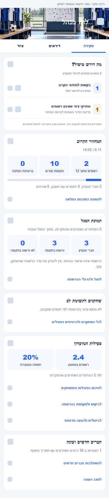

[מדידות, בדיקות ומגבלות](../../changes/2026-11-04-detail-performance.md).

## קיצור ההמתנה בלוח המנהל, 4.11.2026

הסקירה והציוד נפתחים בלי להמתין לציוני כל המחזורים בהיסטוריה. הציונים נטענים רק כשפותחים דירוגים או דף שחקן, ורק עבור התקופה הדרושה. חזרה לתקופה שכבר נקראה באותו ביקור משתמשת בתשובות שהתקבלו, ורענון קורא מחדש.

בזמן המתנה מופיעים שלד או חיווי טעינה. אם חלק מהציונים לא נטענו, המידע שהצליח נשאר גלוי ואפשר לנסות שוב רק את החלק החסר. כשל אינו מוצג כאפס או כהיעדר ציונים, והמלצות לשינוי דירוג ממתינות למידע מלא.

מוני ההמלצות מופיעים רק כשהמידע מלא. במידע חלקי מצוינת במפורש רק כמות השחקנים עם ציונים זמינים. אם נתוני העונה השתנו בזמן הקריאה, מוצג הסבר וניסיון חוזר מרענן קודם את נתוני המועדון.

בבדיקת סקירה עם 200 מחזורים נחסכו 200 קריאות לציונים. בתרחיש עיכובים מבוקר התקצרה השלמת נתוני הבסיס מ-5,300 ל-300 אלפיות שנייה; זו אינה מדידת טלפון. עברו 419 בדיקות ממוקדות. האימות החזותי והבדיקות המלאות מתועדים במסירת המשימה הראשית. השינוי מקומי וטרם הופץ.

## הפצה פנימית 1.1.74, 3.11.2026

עדכוני הלקוח הנוגעים לטעינה ולחיווי, במקורות המשותפים המשויכים למסמך הזה, כלולים בגרסת האנדרואיד הפנימית 1.1.74/306. החבילה ומסלול החנות אומתו; האימות החזותי נשאר בצילומי הדפדפן של סבבי המימוש, ואין אימות התקנה במכשיר. [תכולה, בדיקות ומגבלות](../../changes/2026-11-03-internal-1.1.74.md).

## הרחבת טעינת השלד במסכים מרכזיים, 3.11.2026

לוח המנהל מציג מבני טעינה נפרדים לתמונת המועדון, לציונים ולציוד. ברענון אותו חשבון ומועדון המידע שכבר התקבל נשאר מוצג. המימוש מקומי וטרם הופץ. נבדקו אזורי מקור בדפדפן, ללא בדיקת מכשיר חדשה. [הכיסוי, הבדיקות והמגבלות](../../changes/2026-11-03-central-screen-skeletons.md).

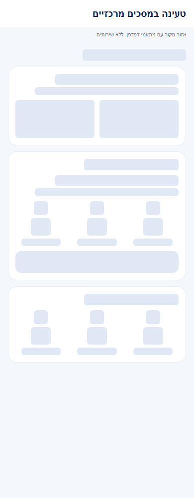

כל 6,831 הבדיקות ובדיקת הטיפוסים עברו. האימות החזותי בסבב הזה נעשה בדפדפן בלבד.

## תיקוני דיווחי הפולס, 3.11.2026

במקור השרת המשותף הועבר זיהוי של הרשמה שכבר נספרה לפני רישום השגיאה. אין שינוי מכוון בפעולות העצמאיות או בנתונים של הפיצר הזה. התיקון מקומי וטרם נפרס.

[פירוט התיקונים, הבדיקות, הצילומים והמגבלות](../../changes/2026-11-03-pulse-sweep.md).

## העברת אורח לרשימת המתנה, 3.11.2026

במקור המשותף תוקנה העברה ידנית של אורח מההרכב להמתנה, כדי שלא יקודם מיד מחדש. אין שינוי מכוון בפעולות העצמאיות של המסך המתואר כאן, ולא נערכה לו בדיקת מסך חדשה. התיקון מקומי וטרם הופץ.

[פרטי השינוי המשותף](../../changes/2026-11-03-guest-waitlist.md).

## ליטוש מקומי והשפעת רכיבים, 3.11.2026

בועת העזרה הצפה מוסתרת בלוח המנהל כדי שלא לחפוף לפעולות העבודה. הכניסה לעזרה מתפריט הבית והטיוטה נשארות. הנתונים, הסגל והחישובים בלוח לא שונו.

[הראיות והמגבלות של המשימה](../../changes/2026-11-03-overnight-mission.md).

## טיפול בפולס, 2.11.2026

שחקנים שחזרו להירשם מופיעים לפני שחקנים שנמצאים בהפסקה, גם בסקירה וגם בתמונת הסגל. הספירות וכללי הזיהוי לא השתנו. התיקון מקומי ונבדק ברכיב המקור עם מתאם דפדפן.

[דוח הטיפול, הבדיקות והמגבלות](../../changes/2026-11-02-pulse-sweep.md).

## בקשות לשיחה אישית, 2.11.2026

נבדקה השפעת תוספת בקשות השיחה במקורות המשותפים. השינוי ממוקד בהרשאת שיחה, בשדות פרטיות ההודעות ובחיבורי הבדיקות; אין מכך אימות חדש של מסך זה במכשיר. המימוש מקומי וטרם הופץ או נפרס. [התנהגות, בדיקות ומגבלות](../chat/message-requests.md).

## הסרת מגבלת החברים במועדון, 1.11.2026

נבדקה השפעת השינוי הממוקד במקורות המשותפים: הוסרה מגבלת החברים במועדון. אין שינוי מכוון בהתנהגות העצמאית של המסך המתואר כאן או במספר המקומות במחזור. התיקון מקומי וטרם הופץ; אין בדיקת מכשיר חדשה לפיצר זה.

[מסלול הנתונים, התנאים, התאימות, הבדיקות ומגבלות ההפצה](../../changes/2026-11-01-unlimited-club-members.md).

## פריסת הגנות הסרת המחזור, 30.10.2026

שבעת תיקוני השרת להגנת הסרת מחזור ולספירת המחזורים המתועדים נפרסו באישור ונבדקו בשרת. המחזור לא נמחק, וכל נתוני המועדון שנבדקו נשמרו. אין כאן הפצת יישום חדשה או בדיקת מכשיר.

[גרסאות פעילות, בדיקות שרת וגבולות האישור](../../changes/2026-10-30-evening-removal-server-deployment.md).

## השלמת הגנת הסרת המחזור, 30.10.2026

ההכנה המקומית מגינה גם על סנכרון מדידות אישי ועל יומן הנתונים ללוח המנהל. עיבוד ישן אינו יכול להחזיר מידע אחרי הסרה או בזמן הקפאה. אין שינוי חזותי, הרשאות חדשות או פעולת מחיקה בממשק; שבעה תיקוני שרת מוכנים לבדיקה ולפריסה באישור נפרד. לא בוצעה הסרה בייצור.

[תוכנית הביצוע, החבילות, הבדיקות וגבולות האישור](../../changes/2026-10-30-evening-removal-readiness.md).

## הגנה בהסרת מחזור היסטורי, 30.10.2026

נבדק השינוי התחום במקורות השרת המשותפים: נוספה הגנה מפני עיבוד מאוחר של מחזור שהוסר, ותוקנה ספירת מחזורים מתועדים בסטטיסטיקה. אין שינוי מכוון בניווט או בחישובים העצמאיים של הפיצר המתואר כאן. התיקונים מקומיים וטרם נפרסו; לא נערכה בדיקת מכשיר חדשה שלו.

[התנהגות, סדר הפעולות, חישובים, בדיקות וגבולות האישור](../../changes/2026-10-30-evening-removal-readiness.md).

## הסרת כרטיס העמדות, 28.10.2026

הוסר כרטיס העמדות המועדפות מפירוט המוכנות למחזור. בחירת עמדה אינה זמינה באפליקציה, ולכן שדה עבר אינו בסיס להצגת מספר שוערים או ספירת עמדות חסרות. כרטיס הציוד והקישור לפרטי המחזור נשארו זמינים. התיקון מקומי וטרם הופץ; גרסה 1.1.68 שכבר הועלתה אינה כוללת אותו.

אומתו צילומי לפני ואחרי באימולטור עם נתוני הדגמה בחבילת תצוגה נפרדת. כל 6321 בדיקות היישום ב-564 חבילות ובדיקת הטיפוסים עברו. [צילום לאחר ההסרה](../screenshots/manager-no-position-after-2026-10-28.png), [צילום לפני](../screenshots/manager-no-position-before-2026-10-28.png).

## הפצה פנימית מאומתת, 28.10.2026

לוח המנהל נכלל בגרסת האנדרואיד הפנימית `1.1.68/301`. שני שירותי היסטוריית המחזורים נפרסו ומקורם אומת. מדדים מלאים יצטברו ממידע חדש, ללא השלמת עבר. לא בוצעו שינוי כללים או בדיקת התקנה מהחנות. [הפצה, בדיקות ומגבלות](../../changes/2026-10-28-internal-1.1.68.md).

## לוח מנהל מורחב - 28.10.2026

לוח המנהל מרכז תחילה נושאים שדורשים טיפול, את מוכנות המחזור הקרוב ואת תמונת הסגל. מתוך הסקירה אפשר לפתוח מידע ניהולי על שחקן, השתלבות חדשים, כרטיסים פעילים, פעילות המועדון, מצב העונה וביקוש למקומות. בלשונית הציוד מוצגים קודם המחזיקים הנוכחיים ומצב הרשמתם למחזור הבא; הציונים מוצגים בטווח אחיד של אפס עד עשר.

המדדים מבדילים בין הרשמה, הגעה מדווחת ונתון חסר. מידע שאינו מתועד אינו הופך לאפס, והפסקה בהרשמה אינה מוצגת כעזיבה או כחוסר מחויבות. שלוש הלשוניות הקיימות נשמרו; מסכי הפירוט נמצאים בתוך לוח המנהל עם חזרה למסך הקודם.

השינוי מקומי וטרם הופץ. מדדי מילוי והיסטוריית ביטולים מלאה דורשים פריסה נפרדת של שירותי השרת החדשים וצבירת מידע חדש, ללא השלמה מדומה של העבר. הצילומים הם מאימולטור אנדרואיד בחבילת תצוגה נפרדת עם נתוני הדגמה, ולא ממסד הייצור. [פירוט, חישובים ובדיקות](manager-dashboard.md#לוח-מנהל-מורחב---28102026).

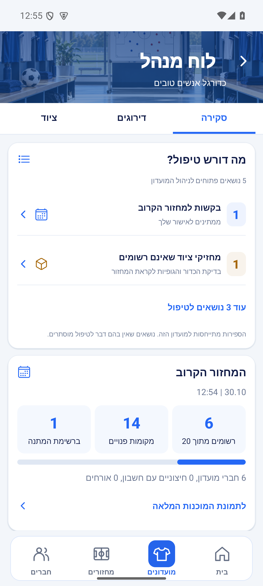

## הרחבת אבחון דיווחים, 27.10.2026

הדיווחים יוכלו לכלול מה ניסו לבצע, מה היה מצב האפליקציה ומה החזיר השרת. פרטים חסרים מוצגים כלא ידועים, ומספר מוגבל של מופעים נשמר בלי למחוק את המופע הראשון. השינוי מקומי וטרם הופץ, ואינו משלים פרטים לדיווחים ישנים. [היקף, ראיות ומגבלות](../../changes/2026-10-27-diagnostic-context.md).

בדיקות הקוד הושלמו, אך השינוי עדיין מקומי ולא הופץ. פרטים שלא נאספו בדיווחים ישנים אינם משוחזרים בדיעבד.

## תיעוד כשלים — 20.10.2026

נוסף תיעוד אוטומטי לנקודות כשל במסלול הזה, עם מקור התקלה. הפעולה המקורית שומרת על ערכי החזרה והודעות השגיאה שלה. השינוי מקומי, טרם הופץ, ואין אימות מסירה חיה לפולס.

[דוח דיווח השגיאות והראיות](../../changes/2026-10-20-error-reporting-audit.md).

כאשר כל הקבועים רשומים, הכרטיס ״הקבועים שעדיין חסרים״ נעלם לגמרי. [כך זה נראה בדמו](../screenshots/pulse-manager-no-missing-2026-10-13.jpg). אם יש קבועים חסרים, הרשימה נשארת.

עדכון הפצה: השינויים המתועדים כאן נכללים בגרסה הפנימית 1.1.42 / 276, שאומתה בגוגל ב־9.10.2026. קביעות קודמות של ״טרם פורסם״ מתארות את מועד הפיתוח. [תיעוד ההפצה והבדיקות](../../changes/2026-10-09-internal-1.1.42.md).

לוח פרטי למנהלי המועדון, שנפתח מתפריט המועדון ומחולק לארבע לשוניות:

- **סקירה:** הרשמה למחזור הקרוב, קבועים שעדיין חסרים, רצף מחזורים ללא הרשמה וביטולים. קבוע הוא מי שנרשם לפחות ל־7 מתוך 10 המחזורים האחרונים. ליד השחקן כתוב מתוך כמה מחזורים חושב הנתון. הרשמה אינה אישור הגעה.
- **תמונת מועדון:** סיכום עשרת המחזורים האחרונים וניתוח פערי התוצאות במשחקים. כרטיסי ״חזרו לעניינים״ ו״השתלבות חברים חדשים״ מופיעים רק כשיש שחקנים רלוונטיים.
- **דירוגים:** ציונים וגרף לכל שחקן שיש לו נתונים, גם בלי המלצה לשינוי דירוג וגם עם פחות מחמישה ציונים. המלצות נבחנות מחמישה ציונים ובנפרד מהצגת הנתונים. אפשר לפתוח את המחזורים ולערוך דירוג מנהל ידנית; אין שינוי אוטומטי.
- **ציוד:** לקיחות כדור וגופיות מתועדות לכל שחקן, שיאנים ושחקנים ללא לקיחות בתקופה. החזרות ורישומים כפולים אינם לקיחה נוספת.

אפשר לבחור חודש, שלושה חודשים או עונה פעילה לציונים, ביטולים וציוד. קביעות תמיד מתייחסת לעשרת המחזורים האחרונים הזכאים.

התזכורות, פתיחת הצ׳אט וכל שורת ההסבר עליהן הוסרו מהלוח לבקשת הבעלים. כשל טעינה מוצג עם ניסיון חוזר; נתון שלא נטען אינו מוצג כאפס.

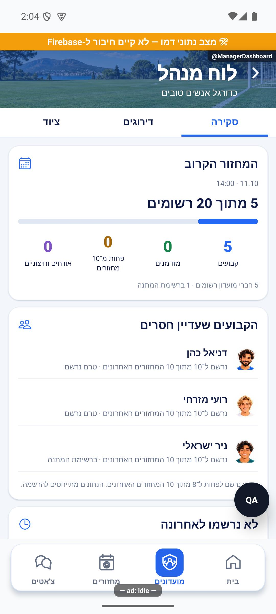
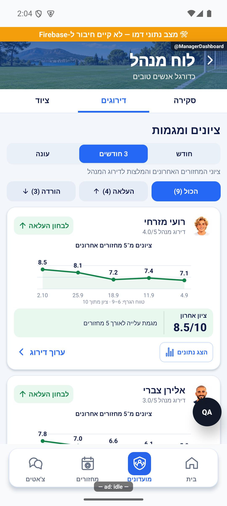
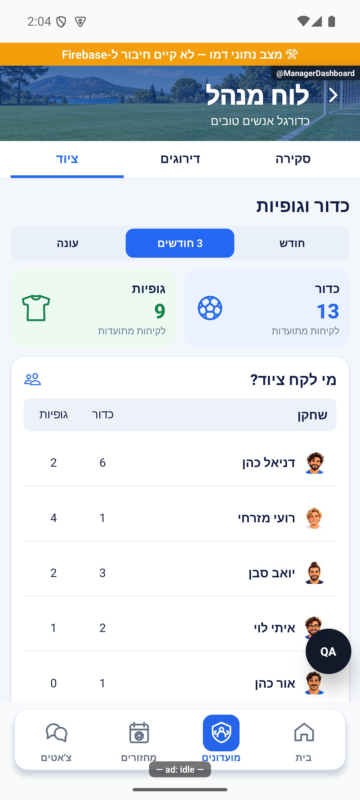

עודכן 9.10.2026. השינוי מקומי וטרם פורסם. שלוש הלשוניות נבדקו באימולטור אנדרואיד עם נתוני הדגמה; אייפון לא נבדק בסבב הזה.

[מאחורי הקלעים](manager-dashboard.md)

## תיקוני דיווחים — 9.10.2026

בלשונית הדירוגים אפשר לחפש שחקן לפי שם יחד עם סינון העלאה או הורדה. שחקן שלא נרשם מופיע לאחר שלושה מחזורים אחרונים ברצף, או שניים אם היה קבוע לפני ההיעדרות. קבוע הוא מי שנרשם לפחות לשבעה מתוך עשרה מחזורים.

מקור: שינויים מקומיים מעל a348b9f; טרם נבנתה גרסה. [ראיות ומגבלות](../../changes/2026-10-09-pulse-round2.md).

בשורת הסיכום מוצגים קבועים ואורחים וחיצוניים בלבד. המדדים מזדמנים ופחות מעשרה מחזורים הוסרו. ההגדרה העדכנית לקבוע היא שבע הרשמות לפחות מתוך עשרת המחזורים האחרונים הזכאים.

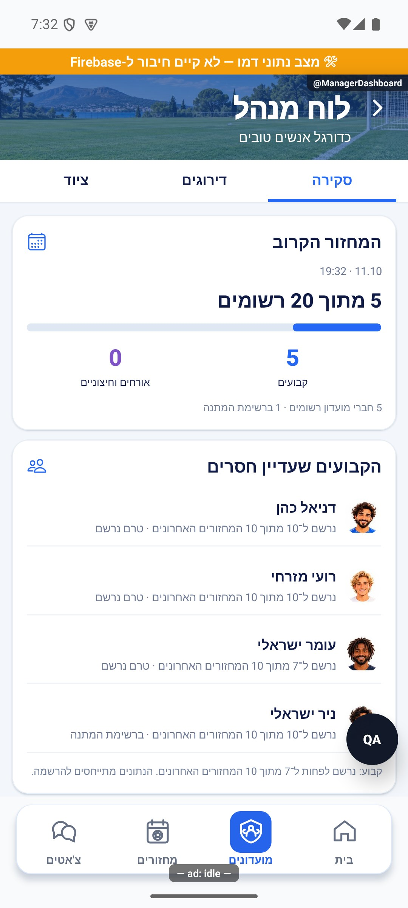

## תמונת מועדון

הלשונית החדשה מרכזת סיכום של עד עשרת המחזורים האחרונים: שחקנים שונים, ממוצע רשומים ומחזורים מלאים. ״לנתונים המלאים״ מציג את המחזורים שמרכיבים את החישוב, עם נתוני כל מחזור וקישור לפרטיו.

באיכות חלוקת הכוחות רואים כמה משחקים הסתיימו בתיקו, בהפרש שער אחד או בפער גדול יותר. הניתוח משתמש רק בתוצאות מתועדות; כשחסר מידע זה מצוין.

״חזרו לעניינים״ מופיע רק כשיש חזרה לאחר לפחות שלושה מחזורים ללא הרשמה. ״השתלבות חברים חדשים״ מופיע רק כשיש מצטרפים עם תאריך הצטרפות מתועד ב־30 הימים האחרונים. שני הכרטיסים מוסתרים כשאין בהם נתונים. אין שינוי בהגדרת קבוע: שבע הרשמות מתוך עשרה.

נבדק באנדרואיד עם נתוני הדגמה, טרם פורסם. אייפון לא נבדק.

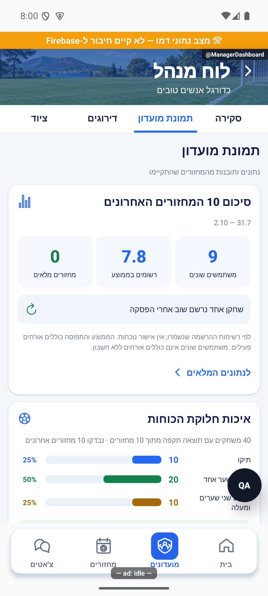

## המחזור במספרים ומה דורש טיפול — 9.10.2026

בלשונית ״תמונת מועדון״ נוספו שני כרטיסים:

- **המחזור במספרים:** מספר המשחקים בעשרת המחזורים האחרונים, ממוצע למחזור, שיא וגרף. אפשר לפתוח את המחזור שבו שוחקו הכי הרבה משחקים. מידע חסר מסומן ואינו מוצג כאפס.
- **מה דורש טיפול:** בקשות הצטרפות ממתינות, מחזורים שצריך לאמת אם התקיימו ושחקנים ללא דירוג מנהל כאשר הדירוג הפנימי מופעל. כל שורה פותחת את הפעולה המתאימה. נושא בלי פריטים מוסתר; כשאין נושאים פתוחים מוצג ״הכול מטופל כרגע״.

תור האישורים מרכז את כל המועדונים שבניהולך; הספירה בכרטיס מתייחסת למועדון הנוכחי. האימות מתייחס ל־90 הימים האחרונים. אין שליחת תזכורות או שינוי אוטומטי של דירוג.

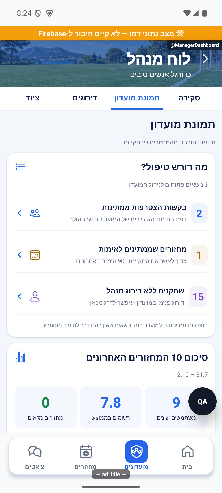
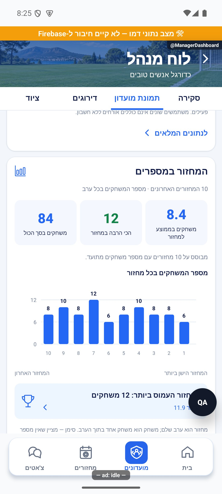

נבדק באימולטור אנדרואיד עם נתוני הדגמה; לא נשמר דירוג ולא בוצע אימות מחזור. אייפון ופעולות שמירה בייצור לא נבדקו. השינוי טרם פורסם.

## תיקוני עיצוב ונגישות — 10.10.2026

מקור: `a348b9f235f1e1433497600555303231512a0834` עם שינויים מקומיים. אין בסעיף זה הוכחת גרסת חנות.

המלל המשני והסברי הגרפים גדולים יותר. פעולות, מסננים ולשוניות מקבלים שטח לחיצה מרווח יותר.

## תיקוני דיווחים — 10.10.2026, אחרי גרסה 1.1.45

לוח המנהל נפתח בסקירה. בתחילת הסקירה מוצג המחזור הקרוב רק כשההרשמה אליו פתוחה; אין לשונית נפרדת למחזור הקרוב. היעדרויות וביטולים נמצאים בתמונת מועדון, חמישה ראשונים עם אפשרות הרחבה. סיכומי עשרת המחזורים אוחדו ובדירוגים מופיע ממוצע הציונים הזמינים, עד חמישה.

שינוי מקומי מעל bcca0886; לא נבנתה גרסה בסבב הזה. נבדק בקוד ובבדיקות אוטומטיות. צילומי אנדרואיד בנתוני דמו בלבד; אין אימות באייפון או בטלפון המדווח.

## איחוד הסקירה — 10.10.2026

שלוש לשוניות: סקירה, דירוגים וציוד. פרטי המחזור מופיעים בראש הסקירה רק כאשר הרשמת המחזור הקרוב פתוחה, כולל כאשר הוא מלא וניתן להצטרף להמתנה. כרטיס הקבועים שעדיין חסרים מופיע רק כשיש קבועים שאינם רשומים בהרכב. כשכולם רשומים, הכרטיס וההסבר שלו מוסתרים. כאשר הרשמתו סגורה לא מוצג אזור מחזור קרוב כלל. יתר סיכומי המועדון נשארים זמינים. שינוי מקומי, טרם הופץ.

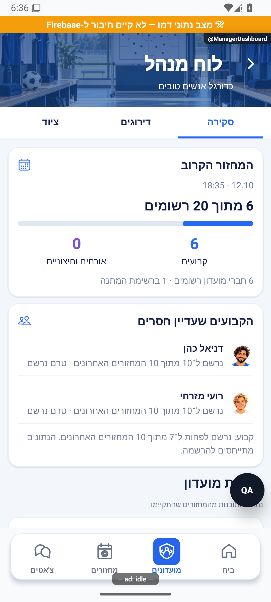

תזמון פתיחה עתידי מסתיר גם הוא את האזור, אף אם נשמר סטטוס פתוח ישן. מצב סגור נבדק בקוד; צילום זה מוכיח תצוגת מחזור פתוח בלבד.

## קיצור מלל בסיכום — 10.10.2026

תקופת עשרת המחזורים מופיעה פעם אחת בכותרת הסיכום. הוסרו שורת התקופה החוזרת מעל מדדי המשחקים ושורת בסיס החישוב כאשר התיעוד מלא. כשחסר תיעוד, עדיין מוצגים מספר המחזורים עם תיעוד והמכנה, כדי שהממוצע לא יטעה. ההתנהגות מוגבלת ל־ManagerRoundNumbers במצב embedded; תצוגה עצמאית שומרת את הסבר התקופה. אין שינוי בחישובים.

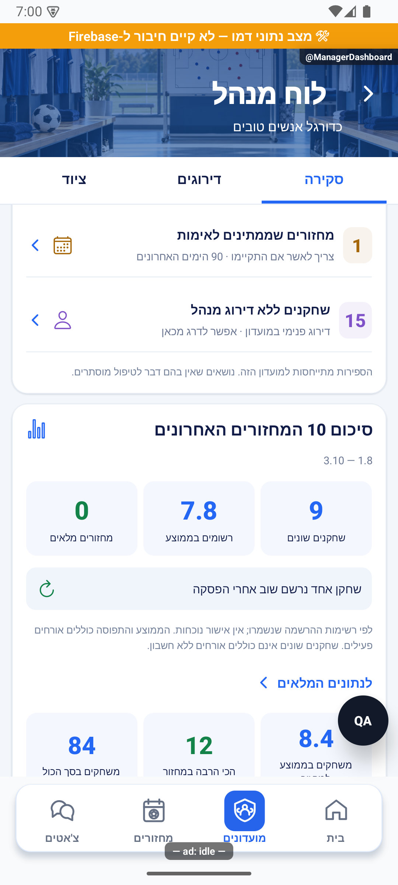

בדיקת טיפוסים וכל 3314 הבדיקות עברו. שינוי מקומי, טרם הופץ.

עדכון 11.10.2026: כפתורי הטעינה החוזרת בתוך סיכום המחזורים ואיכות חלוקת הכוחות הוסרו. לרענון מושכים את המסך כלפי מטה. הודעות על מידע חסר נשארות.

## עדכון — 21.10.2026

אחוזי חלוקת הכוחות מסתכמים כעת ב־100%; ספירת המשחקים לא השתנתה. הקישור לנתונים המלאים נמצא בתחתית הסיכום של עשרת המחזורים, אחרי הגרף. השינוי מקומי וטרם הופץ.

## התאוששות מיקום וטעינת מחזורים לאימות — 23.10.2026

אם חיישן המיקום לא עונה בזמן, נשמרת האפשרות לבחור נקודה במפה או לנסות שוב. טעינת מחזורים שממתינים לאימות יכולה לנסות פעם נוספת בכשל זמני, בלי לשנות את החלטת המנהל ובלי להציג כשל כאילו אין מחזורים. התיקונים מקומיים וטרם הופצו. [בדיקות ומגבלות](../../changes/2026-10-23-pulse-resweep.md).
## קיצור טעינת הנתונים - 25.10.2026

ציוני המחזורים ותוצאות המשחקים בלוח המנהל נטענים עד ארבע קריאות במקביל. קריאה מהירה מפנה מקום לבאה בלי להמתין לקריאה איטית אחרת. מידע שנכשל נשאר מסומן כחסר, והחלפת חשבון עוצרת קריאות שטרם התחילו. נבדק בקוד; התיקון מקומי וטרם הופץ, ללא מדידת זמן במכשיר. [בדיקות ומגבלות](../../changes/2026-10-24-loading-performance.md).

רישום יומן השינויים אומת בקריאה חוזרת: `appConfig/releaseLog`, פריט `manager-workspace-2026-10-28`, צילום `releaseShots/ca3b0e1d83af4e958ee2f7abe123c5a2`. הרישום מציין מימוש מקומי וטרם הפצה.

דירוג שחקן מוצג גם כאשר עדיין אין לו ציוני ביצועים. המקרה ללא ציוני ביצועים אומת בבדיקת לוגיקה; לא צולם מקרה נפרד שלו באימולטור.

## שלמות החלוקה המתוזמנת, 29.10.2026

במקורות המשותפים תוקנה שמירת חלוקה מתוזמנת לשש ולשבע קבוצות וסוננו אורחים שממתינים. דרך חישוב האיזון נשמרה. אין שינוי מכוון בפעולות העצמאיות המתוארות בעמוד זה ואין אימות מסך חדש שלהן; השינוי מקומי וטרם הופץ.

[היקף, בדיקות, פערים פתוחים ומגבלות](../../changes/2026-10-29-scheduled-balance-integrity.md).

## נתונים עדכניים בעסקת החלוקה, 29.10.2026

במקורות המשותפים תוקנו פערי עדכון נתונים בזמן החלוקה המתוזמנת, ללא שינוי בנוסחת האיזון. אין שינוי מכוון בפעולות העצמאיות של המסלול המתואר כאן ואין אימות מסך חדש שלו. התיקון מקומי וטרם נפרס.

[מימוש, בדיקות ומגבלות](../../changes/2026-10-29-scheduled-balance-races.md).

## איזון ופיזור רמות לפני גיוון, 30.10.2026

עודכן החישוב המשותף של חלוקת כוחות לפי הדירוג הכללי: איזון הממוצעים קודם לפיזור הרמות, והגיוון מכריע אחרי שניהם. אין שינוי מכוון במבנה המסך או בפעולות העצמאיות המתוארות כאן, ואין אימות מכשיר חדש שלהן. השינוי מקומי וטרם הופץ או נפרס.

[מימוש, נוסחאות, בדיקות ומגבלות](../../changes/2026-10-30-rating-balance-priority.md).

## עדכון מקור משותף לבקשות השלמה, 4.11.2026

שינוי הסינון והטיפול בבקשות השלמה תועד בפיצר המחזורים. אין שינוי מכוון במסלול העצמאי המתועד כאן ולא נערך לו אימות מכשיר חדש. [הראיות והמגבלות](../../changes/2026-11-04-filler-requests.md).

## תיקו בשתיים או בשלוש קבוצות, 6.11.2026

נבדק שינוי תחום במקורות המשותפים `functions/src/index.ts`: נוסף מסלול סיום משחק בתיקו בשתיים או בשלוש קבוצות, עם בחירה ידנית של הקבוצה שנשארת ושמירה במוני התיקו הקיימים. אין שינוי מכוון בפעולות העצמאיות של הפיצר המתועד כאן. בדיקות המסלול מפעילות שירות לקוח, ממירים וגוף שרת במאגר זיכרון; אין בכך הרצה חדשה של מסך זה. המימוש מקומי, ללא הפצה או פריסת שירות השמירה החדש. [התנהגות, נתונים, בדיקות ומגבלות](../../changes/2026-11-06-manual-draw.md).

## תלות משותפת בציון המחזור החדש, 6.11.2026

נוספה תמיכה מקומית בגרסת ציון למחזורי העתיד ובקריאת הרף הקפוא, תוך שמירת המודל של מחזורים קודמים. השינוי כאן תחום לתלות במקורות המשותפים, ואינו אימות חדש של כל המסלול העצמאי. אין פריסה, הסבת נתונים או שינוי ציוני עבר. [התנהגות, בדיקות ומגבלות](../../changes/2026-11-06-shared-evening-score.md).
