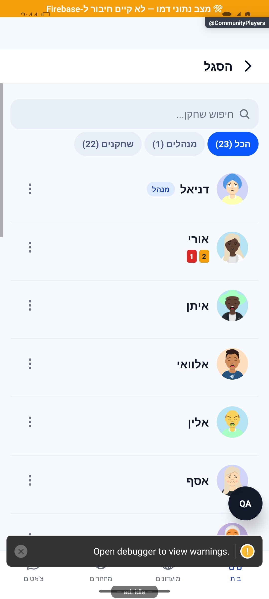
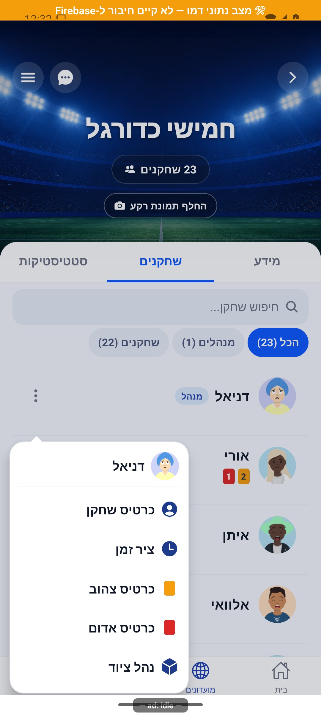
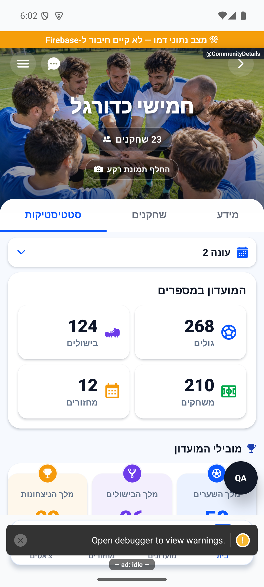

# סגל, תפקידים והרשאות ניהול

## בדיקת קצה ואימות מקורי, 2.11.2026

`src/hooks/useCommunityRoster.ts` מסמן כשל בפרטים נלווים בנפרד מהצלחת קריאת החברים. סטטיסטיקה וכרטיסים שאושרו קודם נשמרים באותו הקשר כשקריאת ההמשך נכשלת. בקריאה ראשונה נתון פעילות לא ידוע נשאר `null`, ולא מוחלף במפה ריקה כאילו התקבלה תשובה. מצב `failed` מאפשר ניסיון חוזר, וחברים זמינים נשארים מוצגים. כשמנהל איבד סמכות או שהכרטיסים כובו, מידע הכרטיסים נוקה במסלול המפורש כקודם. `CommunityPlayersScreen` מסביר שחלק מהנתונים לא נטענו. `useRememberedScroll` מבחין בין גאומטריית השלד לתוכן המוכן. מעבר או הקשר חדש ממתינים לשני פריימים כדי לא להחליף מיקום במדידה קודמת, בלי לעכב את הצגת התוכן. ברשימה וירטואלית מועבר גם מספר הפריטים, ומצביע `onViewableItemsChanged` מאשר שהפריט האחרון באמת נראה לפני חיתוך מיקום שאינו נכנס. תוצאה ריקה מאושרת יכולה לאפס מיקום. יעד שטרם נכנס נשמר לאורך מדידות הביניים, ומורחב חלון התאים באמצעות בקשת גלילה. לא מנחשים סיום לפי השהיה. אירוע גלילה מקורי מאשר את המיקום בטווח של נקודת תצוגה אחת; נשמר גם היסט שנצפה קודם, כי בקשת אותו מיקום אינה מייצרת אירוע נוסף. גרירה יזומה קודמת לשחזור. אירוע מדידה של רכיב מצב ריק נזרק לפי תג הרכיב המקורי, כדי שגובהו לא ייחשב לגובה המסך. רווחים בין תאי רשימה הועברו מ-`gap` של המכל ל-`ItemSeparatorComponent`, כדי שייכללו במדידת התא ובאומדני הגלילה. המרווחים נשמרו: 16 בסגל, 9 בתיבת השיחות ו-8 בציר השיחה. רווחי כותרת ותחתית נשמרים במפורש במקומות שבהם היו. בדיקות מבודדות שימרו מספר מחזורים 3 וכרטיס צהוב אחד בכשל רענון, ואישרו שהכשל נעלם בניסיון מוצלח.

הבדיקות ב-`tests/logic/experiencePolish.test.ts` וב-`tests/logic/communityRosterLoading.test.ts` כוללות תזמון מדידות, תוצאות קצרות וריקות, ביטול שחזור בגרירה, שימור נתון מאושר בכשל והפרדת הקשרים. צילום מקורי אינו אימות שרת או גרסת חנות. מקומי וטרם הופץ. [שחזור, תיקונים, בדיקות ומגבלות](../../changes/2026-11-02-experience-review.md).

## המשכיות ומשוב בשימוש, 2.11.2026

`useRememberedValue`, `useRememberedScroll` ו-`listMemory` שומרים מצב תצוגה בזיכרון התהליך בלבד, לפי חשבון והקשר. החלפת בעלים מנקה, ונשמרים עד 40 הקשרים. ההיסט משוחזר פעם אחת אחרי נתונים ומידות זמינים, נחתך לגבולות התוכן, וגרירה יזומה קודמת לשחזור. חיפוש ומצב תצוגה נשמרים בלי לשמור רשומות משתמשים או להוסיף קריאות מסד. אין הוכחת שחזור ברכיב גלילה מקורי בסבב זה. ההקשר כולל חשבון, מועדון, חיפוש ומסנן. `useListUpdates` ו-`listUpdates` משתמשים בתשובה הראשונה כבסיס ללא הדגשה. בזמן קריאה רחוק מההתחלה, מזהים חדשים ושינוי סדר ממתינים לפעולת הצג. נתוני רשומה קיימת מגיעים תמיד מהתשובה העדכנית, ומחיקה מוסרת מיד. ההודעה צפה ואינה מוסיפה שורה לזרימה. `UpdateHighlight` מדגיש עד חמישה מזהים שנוספו או השתנו בכל עדכון במשך 750 אלפיות שנייה, ללא שינוי מידות, ומכבד צמצום תנועה. מעבר הקשר מאפס את הבסיס. נעשה שימוש בנתוני `useCommunityRoster` הקיימים. גרסת רשומה כוללת שם, מספר מחזורים, תפקיד, דירוג, ציוד וכרטיסים. `maintainVisibleContentPosition` מופעל רק רחוק מההתחלה, כשהסדר מוחזק יציב. `ContentReveal` מציג תוכן זמין מיד, ומבצע מעבר אטימות מ-0.78 ל-1 במשך 180 אלפיות שנייה רק אחרי ההמתנה הראשונה באותו הקשר. צמצום תנועה מכבה את המעבר. אין השהיה, חסימת מגע או הזזה, ורענון עם תוכן קיים אינו מפעיל אותו מחדש. אין שינוי בהרשאות עריכה, בדירוג או בכתיבות ניהול.

בדיקות התנהגות חדשות: `tests/logic/experiencePolish.test.ts`. האימות החזותי כולל אזורי מקור עם נתוני הדגמה ומתאמי דפדפן בלבד, ללא אימות מכשיר או מסד. מימוש מקומי שטרם הופץ. [התנהגות, בדיקות, צילומים ומגבלות](../../changes/2026-11-02-experience-polish.md).

## שלדי טעינה בשלושה אזורים, 2.11.2026

`src/screens/communities/CommunityPlayersScreen.tsx` משתמש ב-`PlayersSkeleton` רק ב-`initialLoading`. ה-`FlatList` והכותרת נשארים באותה מעטפת בכל המצבים. רשימה קיימת נשארת בזמן `loading`, עם `LoadingNotice` קטן. כשל ראשון מציג ניסיון חוזר; כשל רענון שומר רשימה ומציג הסבר. רשימה מסוננת ללא התאמות אינה מוצגת כמועדון ללא שחקנים.

`src/hooks/useCommunityRoster.ts` מרכז את מסלול הטעינה הקיים: `groupService.get`, איחוד מזהי מנהלים ושחקנים, `hydrateUsers`, נתוני השתתפות וכרטיסים. קריאות הכרטיסים נשארות למנהל בלבד ובמועדון שהפעיל כרטיסים; כשל בהעשרת נתוני השתתפות או כרטיסים שומר על החלופה הקיימת. מסמך המועדון וחברי הסגל מתפרסמים יחד כתשובה אחת אחרי השלמת הקריאות.

בעלות התשובה היא צירוף מזהה מועדון, מזהה צופה ומצב אורח. החלפת בעלות מסתירה מיד תשובה ישנה, לפני האפקט. מספר דור בודק גם את תוצאת הקריאה וגם את סיומה: קריאה מיושנת, ניקוי מיקוד או עזיבה אינם מעדכנים את הרשימה או מסיימים את הטעינה החדשה. בתחילת `reload` נבדקים גם המיקוד והבעלות כדי לחסום קריאה שנשמרה בפעולה שהסתיימה אחרי מעבר או עזיבה. רק מסמך מועדון שחזר כחסר מפורסם כתשובה ריקה תקינה; כשל קריאה אינו מחליף את הסגל במערך ריק. עדכון ציוד מקומי דרך `setGroup` נשאר מוצמד לאותה בעלות. אין כתיבת נתונים חדשה או שינוי הרשאות, מיון או חישוב. השינוי מקומי וטרם הופץ. [מימוש, בדיקות, צילומים ומגבלות](../../changes/2026-11-02-loading-skeletons.md).

בדיקות ההתנהגות הממוקדות נמצאות ב-`tests/logic/communityRosterLoading.test.ts`, כולל קריאה שמורה מפעולה שהסתיימה אחרי מעבר מועדון או עזיבה. הצילומים מבוססים על אזורי טעינה מתוך המקור עם מתאמי דפדפן; אינם הוכחת אנדרואיד, אייפון, חיבור חי או הרצת האנימציה במכשיר.

## אימות פרסום קבוצות בפולס, 2.11.2026

נבדק ההפרש התחום בשירות המשותף של המחזורים: נוספה בדיקת אישור לפרסום קבוצות כאשר תשובת הפעולה אובדת. אין שינוי בחישוב, במכנים או בפעולות העצמאיות של הפיצר המתואר כאן. התיקון מקומי וטרם הופץ; אין בדיקת מכשיר חדשה לפיצר זה.

השינוי ב-`src/services/gameService.ts` מוגבל ל-`publishDraftTeams` ולתלות בסיווג כשלים זמניים. נבדקו גבולות קבלת השרת, התאמת החשבון והחלוקה, ושימור השגיאה כאשר האימות נכשל. `tests/logic/publishTeamsReceipt.test.ts` מפעיל את פונקציית השירות מול תחליפי קריאה וכתיבה; אין בכך הרצת כל המסלולים של המסמך הזה.

[דוח הטיפול, הבדיקות והמגבלות](../../changes/2026-11-02-pulse-sweep.md).

## בקשות לשיחה אישית, 2.11.2026

נבדקה השפעת תוספת בקשות השיחה במקורות המשותפים. השינוי ממוקד בהרשאת שיחה, בשדות פרטיות ההודעות ובחיבורי הבדיקות; אין מכך אימות חדש של מסך זה במכשיר. המימוש מקומי וטרם הופץ או נפרס. [התנהגות, בדיקות ומגבלות](../chat/message-requests.md).

מקורות משותפים שנבדקו בהיקף השינוי הזה: `functions/src/index.ts`, `functions/src/socialPlayers.ts`, `src/firebase/firestore.ts`, `src/types/index.ts`. אין בסעיף זה טענה להרצת כל המסלולים ההיסטוריים של הפיצר. [מסירת המימוש](../../changes/2026-11-02-message-requests.md).

## הסרת מגבלת החברים במועדון, 1.11.2026

נבדקה השפעת השינוי הממוקד במקורות המשותפים: הוסרה מגבלת החברים במועדון. אין שינוי מכוון בהתנהגות העצמאית של המסך המתואר כאן או במספר המקומות במחזור. התיקון מקומי וטרם הופץ; אין בדיקת מכשיר חדשה לפיצר זה.

מקורות ששונו בהיקף המשימה: `functions/src/index.ts`, `functions/src/socialPlayers.ts`, `src/services/groupService.ts`. מספרי החברים אינם משמשים עוד כתנאי תפוסה במועדון. שדות התאימות הישנים אינם נאכפים.

[מסלול הנתונים, התנאים, התאימות, הבדיקות ומגבלות ההפצה](../../changes/2026-11-01-unlimited-club-members.md).

## פריסת הגנות הסרת המחזור, 30.10.2026

נפרסו שבע חבילות מבודדות, ועדכון המקור בלבד אומת מול כל הקבצים הפעילים. הגדרות השירותים והאירועים ו-111 השירותים האחרים נשמרו. אומתו מוכנות ותעבורה לגרסאות החדשות, קריאה עצמית עם חשבון בדיקות קיים ושימור גרסאות כל 496 המסמכים שבגיבוי. שש דחיות בקשות דפדפן לא תקינות סווגו לפי מזהי בקשה; לא זוהה כשל ריצה עסקי בלתי צפוי. לא הופעלו מחיקה, חסימת מחזור או בקשת שמירה תקינה על נתוני המועדון. זו ראיית הפריסה התחומה ולא הרצה מחודשת של כל מסך.

[גרסאות פעילות, בדיקות שרת וגבולות האישור](../../changes/2026-10-30-evening-removal-server-deployment.md).

## השלמת הגנת הסרת המחזור, 30.10.2026

הורחבה ההגנה ב-`functions/src/personalActivity.ts` וב-`functions/src/managerRoundHistory.ts`: קריאת `gameRemovalBlocksWrite` וקיום המחזור בתוך עסקת יצירת הנתונים. בקשת סנכרון לאחר הסרה מחזירה כשל מפורש במקום ניסיון חוזר ללא סוף. ב-`functions/src/index.ts` גם חבילת סטטיסטיקה מלקוח ישן מעדכנת את המחזור עם תנאי גרסה, ומכסת הפעולות כוללת תמיד כתיבת הגנה זו. אין שינוי בחישובי התוצאות, הפרטיות או הניווט מעבר להגדרת המחזור המתועד שפורטה קודם. נבדקו ארבעה עשר תרחישים ראשיים, שמונה תרחישי חסימה ושחזור, שמונה בדיקות חבילות ושבע בדיקות פעילות ונתוני מנהל במסד מקומי. ההיקף הוא בדיקת השינוי התחום במקורות משותפים, ולא הרצה מחודשת של כל מסך או של תשתית מסירת האירועים. התיקונים טרם נפרסו.

[תוכנית הביצוע, החבילות, הבדיקות וגבולות האישור](../../changes/2026-10-30-evening-removal-readiness.md).

## הגנה בהסרת מחזור היסטורי, 30.10.2026

השינוי התחום ב-`functions/src/index.ts` עוטף את עיבוד אירועי הסגל בזכות עיבוד כדי לסנכרן הסרה ניהולית עתידית; הוא מוסיף קריאת קיום מחזור בעסקאות של השלמת היסטוריה ושמירת פעילות. השינוי ב-`functions/src/socialPlayers.ts` משווה את הגדרת המחזור המתועד לחישוב העצמי. אין שינוי מכוון בפעולות העצמאיות האחרות המתועדות כאן, בהרשאות או בניווט. זו בדיקת השפעה תחומה של המקורות המשותפים, ולא הרצה של כל מצבי הפיצר. אין פריסה או אימות מכשיר חדש.

[התנהגות, סדר הפעולות, חישובים, בדיקות וגבולות האישור](../../changes/2026-10-30-evening-removal-readiness.md).

## החלפת הקבוצה הבועטת בפנדלים, 30.10.2026

נבדק ההבדל התחום במשימה במקורות המשותפים `src/services/gameService.ts`, `src/types/index.ts` ו-`src/firebase/firestore.ts`: הוא מוסיף ומשמר תור מפורש לפנדלי ההכרעה ומעדכן אותו ברישום ובביטול בעיטה. אין שינוי בשדות, בחישובים או במסלול הנתונים העצמאי של הפיצר המתואר כאן. בדיקת הקורא והעסקאות מפורטת בדוח; אין בכך הרצה מחדש של המסך הזה. [התנהגות, בדיקות ומגבלות](../../changes/2026-10-30-shootout-turn.md).

## תלות בסינון הצעות השלמה - 28.10.2026

השינוי הנוכחי ב-`functions/src/index.ts` מוגבל לבחירת הצעות השלמה: סף תפוסה של 70 אחוז ובדיקת הרשמה מתנגשת לפני יצירת התראה. אין שינוי מכוון בתהליך העצמאי המתואר כאן ואין אימות חדש שלו. רענון המקור המשותף אינו מאמת שינויים קודמים שהיו בו מאז קליטת התיעוד. [היקף, בדיקות ומגבלות](../../changes/2026-10-28-filler-eligibility.md). מקומי וטרם נפרס.

## הרחבת אבחון דיווחים, 27.10.2026

נוספה מעטפת אבחון מקומית עם מצב בזמן הכשל, שלבים בעלי מזהה ותזמון, מצב רשת ובנייה ומופעים נפרדים לשגיאה. נקודת הכניסה לתעבורת השרת עוברת כעת דרך העטיפה המשותפת; תשובות, חריגות, אפשרויות קריאה ומדיניות הפיצר נשמרות. אין כאן שינוי בהרשאות או בחישובי המוצר. הבדיקות המלאות ומגבלות האימות מתועדות בדוח המקושר; אין טענה לאימות מכשיר או להפצה. [היקף, ראיות ומגבלות](../../changes/2026-10-27-diagnostic-context.md).

באימות הסופי עברו כל 6,231 הבדיקות ב-555 חבילות, ובדיקות הטיפוסים של הלקוח, השרת והפולס נקיות. צילום הדפדפן והידור מקורות האנדרואיד הם בדיקות מקומיות; אין הוכחת מכשיר, הידור אייפון או מסירה חיה של הבנייה החדשה. רישום יומן השחרור נחשב מאומת רק לפי קבלת הקריאה החוזרת בדוח השינוי.

## טיפול מלא בפריטי הפולס הפתוחים, 27.10.2026

נבדק השינוי הממוקד במקור המשותף: התנגשות גרסת מועדון בעת זקיפת השתתפות נשלחת כעת לניסיון חוזר מקומי מוגבל שבונה מחדש את אותה כתיבה ואת הגנת העונה. סמן מניעת הכפילות נשמר. אין שינוי בהרשאות, בניווט או במדיניות הפיצר הזה. אין אימות מכשיר חדש או פריסה. [ממצאים, בדיקות ומסירה](../../changes/2026-10-27-pulse-completion.md).

## טיפול בתקלות הפולס, 26.10.2026

השינוי במקור המשותף מוגבל לסיווג תוצאה צפויה לפני רישום שגיאה: תיעוד מחיקת מחזור שכבר קיים אינו כשל חדש, והתנגשות גרסה בעדכון עונה אינה מבטלת את הגנת הגרסה. אין שינוי בחוזה הפיצר, במכנים, בניווט או בהרשאות; לא נערכה הרצה חדשה לכל מצבי הפיצר. כשל לא צפוי בתיעוד מחיקה נזרק שוב כדי לאפשר ניסיון שרת חוזר.

השינוי מקומי וטרם הופץ. [בדיקות, מסירה ומגבלות](../../changes/2026-10-26-pulse-fixes.md).

מקורות שנבדקו בסבב: `functions/src/index.ts`.

## ביטול פעילות אחרי מחיקת מועדון - 26.10.2026

נבדקה השפעת השינוי התחום ב-`src/services/groupService.ts`, ב-`src/services/seriesService.ts` וב-`functions/src/index.ts`: עצירת סדרות לפני מחיקת מסמך ההרשאה, הפעלת ביטול פעילות באירוע מחיקת המועדון, ועסקאות יצירה שמאמתות את קיום המועדון והסדרה גם במנגנון ההעתקה הישן. `functions/src/clubDeletion.ts` שומרת מחזורים שהסתיימו ונתוני עבר, מבטלת מצבים פעילים, דוחה בקשות חברות ממתינות, מסירה רק את המועדון שנמחק מהרשמות להתראות ומסירה את ההעתק הציבורי. המימוש והבדיקות ב-`tests/logic/clubDeletion.test.ts` וב-`tests/logic/clubDeletionClient.test.ts` מפורטים ב[דוח התיקון](../../changes/2026-10-26-deleted-club-recurring.md). אין שינוי מסכים, ניווט, נוסחאות או הרשאות במסגרת תיקון זה. זו בדיקת השפעה ממוקדת ואינה אימות מחודש של שינויים קודמים במקורות המשותפים. תיקון השרת נפרס ואומת באישור הבעלים, עם השוואת המקור הפרוס והקוד המהודר ושימור יתר הפונקציות. הסדרה, הרשמת ההתראות והכרטיס הציבורי של המקרה הידוע טופלו ונקראו חזרה; המחזור כבר היה חסר בבדיקה העדכנית. שינוי הלקוח טרם נכלל בבינארי. סעיף הפריסה בדוח כולל את מגבלות בדיקת החבילה המבודדת, ללא טענה למחיקת מועדון בדיקה בייצור.

## שעון מדויק וכיתוב פנדל - 25.10.2026

במקורות המשותפים נוסף שימור השעון המדויק של פנדל במהלך משחק, וכיתוב ההבקעה ביומן קוצר. אין שינוי במונים או בתהליך העצמאי המתואר כאן; לא נערכה לו בדיקת ממשק חדשה במסגרת העדכון. השינוי מקומי וטרם הופץ. [פרטים וראיות](../../changes/2026-10-25-in-play-penalties.md#שעון-מדויק-וכיתוב-אירוע).

## פנדל במהלך משחק חי - 25.10.2026

נבדק השינוי הממוקד במקורות המשותפים: נוספו חוזי אירועי פנדל במהלך משחק, קוראים ומוני סטטיסטיקה, והגנות בעסקאות סיום ואיפוס משחק. מסלול הפיצר המתואר כאן אינו נקודת הכניסה להזנה החדשה. בדיקות המאגר עברו, אך אינן הוכחת הרצה חדשה של כל מצבי התהליך או של פריסה.

השינוי מקומי. נדרשת פריסת שרת לפני הפצת לקוח שמשתמש באפשרות; לא בוצעו פריסה או שינוי הרשאות. [חוזה הנתונים, התהליך, הבדיקות ומגבלות ההפצה](../../changes/2026-10-25-in-play-penalties.md).

## תיעוד כשלים — 20.10.2026

נוספו תצפיות דיווח בנקודות הכשל של המקורות המשויכים לפיצ׳ר, במסגרת הרחבה רוחבית. נשמרו ערכי החזרה, הזריקות ותנאי הפעולה הקיימים; נוסף מקור קוד והקשר לדיווח. כיסוי תחבירי אינו הוכחת הרצה של כל מצב. השינוי מקומי וטרם הופץ; בדיקות המסירה, מגבלות מניעת הכפילויות והמסלולים שטרם חוברו מתועדים בדוח המשותף.

[דוח דיווח השגיאות והראיות](../../changes/2026-10-20-error-reporting-audit.md).

עדכון מקומי מ־9.10.2026: עורך הדירוג המשותף `AdminRatingSheet` משתמש בשורת פעולות `row` תחת `forceRTL`, ללא `row-reverse`. נבדק מלוח המנהל באימולטור דמו, ללא שמירה או בדיקה חוזרת של כל מסכי הסגל; ראיה במניפסט: `manager-rtl-rating-editor-2026-10-09.jpg`.

[להסבר הקצר והפשוט](members-and-administration.simple.md)

עודכן: 07.10.2026; מקור: `8e8fde5`. מסך: `src/screens/communities/CommunityPlayersScreen.tsx`; מסלול `CommunityPlayers` עם `groupId`, וכן לשונית הסגל ב־`CommunityDetails`.

## מבנה

כותרת, חיפוש ושבבים: כולם, מנהלים ושחקנים. הרשימה היא `FlatList` גם בזמן טעינה וריקנות, כדי לשמר את סביבת הרשימה. מנהלים קודם; שאר הסדר מבוסס כמות משחקים ואז שם עברי. הערה היסטורית בקוד המתארת מנהלים ואז סדר אלפביתי אינה תיאור מלא של ההשוואה הנוכחית.

שורת שחקן: תמונה או אווטאר, שם, תפקיד, סמלי ציוד, דירוג מנהל כשהיכולת מופעלת וסמלי כרטיסים למנהלים כשהיכולת מופעלת. תמונות האווטאר הישנות בצילומי הדמה מגיעות מכתובות `mockPlayers.avatarUrl`, שעוקפות את נכס האווטאר הנבחר; אין להסיק מהן שמיפוי האווטארים החדשים נכשל.

| פעולה | תפקיד ותנאי | מקור |
|---|---|---|
| כרטיס שחקן | חבר; זהות חשבון אמיתית | `PlayerCard` |
| השוואה אליי | שחקן אחר בעל חשבון | `PlayerCompare` |
| ציר אירועים | מנהל | `PlayerTimeline` |
| דירוג פנימי | מנהל, היכולת מופעלת | `AdminRatingSheet` |
| כרטיס צהוב/אדום | מנהל, היכולת מופעלת | `IssueCardSheet` |
| ציוד | מנהל | `ManageEquipmentSheet` |
| מינוי/הסרת מנהל | יוצר ביחס לאחרים | `promoteToCoach`, `demoteCoach` |
| הוצאת חבר | מנהל; לא היוצר ולא עצמו | `removeMember` |

צילום התפריט נצפה ונלקח ממשימה קודמת, ללא קומיט מקור; מוצגים כרטיס שחקן, ציר זמן, כרטיסים וציוד. הוא אינו מכסה את כל פעולות השחקן האחר או את חלונות הכתיבה עצמם.

## כללי זהות

`creatorId` הוא היוצר; נתונים ישנים משתמשים לעיתים במנהל הראשון כגיבוי. היוצר אינו שם נרדף לכל מנהל. הוצאה של עצמך נעשית דרך עזיבה, לא הוצאת חבר. עזיבת היוצר מחייבת העברת בעלות אטומית למנהל שנשאר; מנהל אחרון אינו יכול להשאיר מועדון בלי מנהל. הסרת חבר מוחקת אותו מרשימות חברים, מנהלים וממתינים, לפי הפעולה המותרת.

## תלות ובדיקות

`src/services/groupService.ts`, `src/services/communityEventsService.ts`, `src/firebase/firestore.ts`, `src/components/UserAvatar.tsx`, `src/components/AdminRatingSheet.tsx`, חלונות הניהול; כללי המועדונים והדירוגים ב־`firestore.rules` נקראו ללא שינוי. [כרטיס שחקן](../profile/player-card.md) ו[השוואה](../statistics/player-compare.md).

## מצבים והוכחות

הצילום מציג 23 חברים, מנהל אחד, שבבי תפקיד וסמלי כרטיסים בנתוני דמה. לא בוצעו קידום, הוצאה, עזיבה או מחיקה. ריק, חיפוש ללא תוצאה, חבר שאינו מנהל, יוצר חסר בנתונים ישנים, מנהל שאינו מופיע גם ב־`playerIds`, ודירוג כבוי דורשים צילומי מצב משלימים. בדיקת העברה ומגבלות תפקידים דורשת סביבת בדיקה מאושרת.

## הצעות בלבד

להפריד פעולות הרסניות בתפריט; להציג הקשר ״דירוג מנהל״ כדי שלא ייתפס דירוג ציבורי; לאפשר הסבר קצר למשמעות כרטיס פעיל. לאחר מינוי מאושר אפשר להנפיש את סמל התפקיד, בלי להזיז את השורה במהלך אישור.

## פירוט טכני נוסף — זרימה, חישוב ונקודות שינוי

`hydrateUsers` ו־`hydratePublicUsers` מפרידים בין זהות פרטית וציבורית; תפקיד נגזר ממזהה המשתמש במועדון ולא מתווית או תמונה. `promoteToCoach` ו־`demoteCoach` מיועדים ליוצר, ולא לכל מנהל; המסלול צריך להישאר בטוח גם בהפעלה חוזרת.

`removeMember`, `leaveGroup` ו־`deleteGroup` הם מסלולים נפרדים: הוצאה מסגל אינה מחיקת חשבון, ועזיבה אינה מחיקת מועדון. לפני שינוי יש לעבור על ניקוי חברות, בקשות וציוד בכל מסלול, ועל הגנת מנהל אחרון. שינוי בצבע שבב אינו הוכחת הרשאה; אימות השרת דורש בדיקות כללים וחשבונות בדיקה מאושרים.

הפירוט מתאר את הקוד שנקרא, ולא בדיקת כתיבה או הרשאות בסביבת הייצור. יש לקרוא את הקוד הממוקד וההפרש מאז מקור המיפוי לפני תיקון; בדיקות המוזכרות כאן לא הורצו מחדש לצורך עריכת התיעוד.

## אימות חסימת לחיצות אחרי גלילה — 10.10.2026

מקור: שינויים מקומיים מעל `a348b9f235f1e1433497600555303231512a0834`; מעטפת פיתוח מקומית `1.1.33/1`, Android/Fabric, RN0.79.6, Screens4.11.1, Metro8083 עם דמו ונתיבי בדיקה. אין הוכחת גרסת חנות/מכשיר פיזי/אייפון.

`ScrollSurface` שומרת את ההגנה הקיימת של250ms בלי שינוי הסף. RN בודקת את זמן begin מול end ואת זמן פריים הגלילה האחרון בזמן בירור responder; רק begin שלא נסגר ויותר250ms ללא פריים משחרר את הנעילה. תנופה עם פריימים טריים נשארת מוגנת, והמקלדת ממשיכה לפעול לפי `keyboardShouldPersistTaps`.

בקרה רגילה: גלילה עמוקה במחזור ואז לחיצה יחידה על סטטיסטיקות הצליחה. בניסוי זמני בדמו בלבד הושמט end: בלי ההגנה שתי לחיצות במחזור ולחיצות לשונית/תפריט במועדון נשארו חסומות; עם ההגנה הלחיצה הראשונה החליפה לשונית. הוכחות כוללות פקודות מגע אמיתיות, XML עם selected, צילום ולוג begin/drop_end/recovered. זה אינו שחזור טבעי או הוכחת סיבת השורש של דיווחי הבעלים. אין לסגור דיווח רק על סמך ניסוי מוזרק.

פער נוסף: `CommunityPlayersScreen` השתמשה ב־FlatList עם ScrollView רגילה ולכן לא קיבלה את ההגנה. `renderRosterScroll` יציבה מחזירה `ScrollSurface` כ־`renderScrollComponent`, עם `keyboardShouldPersistTaps="handled"`. אין ScrollView חיצונית או קינון: VirtualizedList עדיין מנהלת cells, חלון, מדידות ו־ref באמצעות cloneElement. כל props ואירועי הגלילה עוברים דרך המשטח המשותף; השורות, המיון, השאילתות, ההרשאות והפעולות לא השתנו.

`tests/scrollStaleMomentum.test.ts` מפעילה את תנאי RN ואת capture handler המותקנים עצמם. נוספו מקרי גבול250/251ms, פריים חדש, begin חדש, end תקין, opt-in אפס/שלילי, לחיצת ילד ראשונה ושמירת התנהגות המקלדת. [ראיות מלאות, תוצאות ומגבלות](../../../artifacts/pre-release-2026-10-10/scroll-press/README.md).

## הקשחת אבטחה מקומית — 11.10.2026

setClubAdminRating מאמת מנהל וחברות השחקן ושומר ב־groups/{id}/private/adminRatings. ממיר המועדון אינו קורא או כותב את הדירוג במסמך הראשי; הידרציה מפורשת טוענת רק לצופה מורשה. חלוקת הכוחות בשרת קוראת מאותו מסמך פרטי. יש להעביר דירוגים קיימים לפני פריסת הלקוחות: scripts/security-migrate-club-ratings.cjs מוגבל במכוון לאמולטור demo ונבדק פעמיים לאימות פעולה חוזרת. לא בוצעה הסבה בייצור; מסמכים ישנים בייצור עדיין חשופים עד ההסבה.

## הפצה מדורגת 1.1.47 — אישור הבעלים

בהפצה הפנימית נשמרת תאימות לגרסאות הישנות. הקריאה החדשה לדירוג נעשית דרך `getClubAdminRatings` והעדכון דרך `setClubAdminRating`. דגל השרת `TEAMDER_LEGACY_CLUB_RATINGS_COMPAT=true` משאיר את `groups.adminRatings` כמקור הנתונים המשותף, בלי יצירת עותק פרטי ובלי הסבת נתוני ייצור. מנהל רשאי לקרוא ולעדכן; חבר קורא רק כשהדירוג גלוי; משתמש חיצוני אינו רשאי לקרוא. כללי ההרשאות המחמירים והסבת הדירוגים נדחים להפצה נפרדת, ולכן אין לראות בשלב זה סגירה מלאה של פרצות ההרשאות. אכיפת אימות מקור האפליקציה נשארת כבויה. כניסת פולס החדשה וביטול מפתחותיה אינם חלק מההפצה הזו.

## תלות בעדכון העונות — 19.10.2026

נבדק ההפרש בקבצים המשותפים הרשומים כאן: `src/firebase/firestore.ts`. השינוי ממוקד במדיניות העונות, קריאת מצבן, שיוך מחזור ופקודות ניהולן; אין שינוי מכוון בחוזה העצמאי המתואר במסמך זה. אין להסיק מכך שהמסך הזה הורץ מחדש.

[מצב המימוש, הבדיקות ומגבלות האימות של העונות](../clubs/seasons.md). מקומי בלבד; לא בוצעה פריסה במסגרת המשימה.

## תלות במידע על סגירת עונה — 23.10.2026

בדיקת ההבדל ב־`src/firebase/firestore.ts` וב־`src/types/index.ts` מראה שהשינוי מוגבל לקריאת `seasons.closureStatus` בחוזה `GroupSeasons`. יתר ממירי הנתונים והמסלולים המתועדים כאן לא שונו במשימה זו. אימות הריצה החדש מתייחס להתאוששות ולכרטיס העונה, ולא להרצה חדשה של כל מצבי המסך הזה. [המסלול, הבדיקות והמגבלות](../../changes/2026-10-23-season-automatic-recovery.md).

## בידוד מונה בקשות והתאוששות מרקע — 23.10.2026

`groupService.listForUser(userId, { includeAdminRatings: false })` מחזיר את נתוני החברות ללא קריאות `getClubAdminRatings` וללא שדה דירוגים. ברירת המחדל של מסכי המועדון שומרת את טעינת הדירוגים ואת התנהגות הכשל הקיימת. `requestsService.myAdminGroupsWithPending` משתמש במסלול המצומצם: מספר בקשות חברות + סכום הממתינים במועדונים שמנוהלים בידי המשתמש + סכום הממתינים במחזורים שיצר. אין שינוי במכנה או בהרשאות. אפקט המיקוד של מונה הבית מאזין גם ל־`AppState`: מעבר מצב מבטל דור קודם, חזרה ל־`active` מבצעת קריאה חדשה; ניקוי מסיר מאזין ומונע תוצאה מאוחרת. `inboxRatingsIsolation` מריץ את מתודות המקור ומוכיח ספירה של 4 גם כששרת הדירוגים נכשל ושימור כשל מקור אמיתי; `homeInboxResume` מריץ את אפקט המקור ומאמת תוצאה חדשה מול ישנה, ניקוי ואורח. אין כאן הוכחת פתרון לכל חריגת זמן, חיבור רשת או כניסת אפל. אין אימות מכשיר חדש של תרחיש רשת זה. [הסבר, יומני שרת ומגבלות](../../changes/2026-10-23-inbox-resume.md).

## עדכון תלות משותפת בקריאות מידע — 23.10.2026

בקובצי השירות המשותפים נוספה אפשרות מפורשת לניסיון חוזר אחד בקריאה זמנית שנכשלה, תוך עצירה אם החשבון מתחלף. החיבור מוגבל ל־14 נקודות קריאה המפורטות בדוח; אין כאן טענה שכל פעולה בפיצ׳ר קיבלה ניסיון חוזר או שנבדק מסך חדש. בדיקות המאגר המלאות עברו (5,261 בדיקות ב־472 חבילות), אך אינן הוכחת הרצה במכשיר. הקוד מקומי וטרם הופץ. [מסלול, ראיות ומגבלות](../../changes/2026-10-23-four-open-errors.md).

## עדכון תלות מסבב הפולס — 23.10.2026

בתלות המשותפת נוספו התאוששות מוגבלת להעשרת מועדונים ובדיקות לביטול קריאה של חשבון או דור ישן. אין שינוי מכוון בכללי המוצר של המסך הזה ואין אימות מסך חדש עבורו. הקוד מקומי וטרם הופץ. [תחום השינוי והבדיקות](../../changes/2026-10-23-pulse-resweep.md).

## תלות בשמירת צבעי המחזור — 24.10.2026

במסגרת בחירת צבעים לפני שיבוץ עודכנו מקורות משותפים הרשומים לפיצ׳ר: `src/firebase/firestore.ts`, `src/types/index.ts`. השינוי מוסיף מפת צבעים למחזור, קריאה וכתיבה שלה ושימורה במסלולי הכוחות וההכנה. אין כאן פעולת ממשק חדשה במסך זה. זו בדיקת השפעת התוספת הממוקדת, ולא חקירה או אימות חזותי מחודש של הפיצ׳ר. כל 480 חבילות הבדיקה ו־5,343 הבדיקות עברו; טיפוסי הלקוח והשרת נקיים. השינוי מקומי וטרם הופץ. [מסלול הנתונים, ראיות ומגבלות](../rounds/draft-setup.md#צבעים-לפני-שיבוץ-ובכל-שיטת-חלוקה--24102026).

## מניעת טעינה אחרי עדכון פרופיל בלבד - 25.10.2026

באפקט הטעינה של `src/screens/communities/CommunityPlayersScreen.tsx` התלות בחשבון הוגבלה למזהה ולמצב אורח. שינוי בשם, תמונה או מונים של אותו חשבון אינו מפעיל שוב את טעינת המחזור או המועדון. החלפת חשבון ושינוי מצב אורח כן מרעננים. במסכי הלייב ובהוספת חברים נשמרה גם התלות ברשימת המועדונים, כך ששינוי חברות או ניהול ממשיך להפעיל בדיקת גישה. אין שינוי בשערי הרשאות, במנויים, באישור כתיבות או במטמון. `tests/logic/profileIdentityLoading.test.ts` מפעיל את רישומי האפקטים ופונקציות הטעינה מהמקור עם קריאות ממתינות. ארבע בדיקות מאמתות קריאה אחת גם אחרי שינוי שם, תמונה ומונים, ורענון אחרי שינוי חשבון, מצב אורח, מועדון או מחזור רלוונטיים. זו בדיקת קוד, ללא מדידת זמן במכשיר או שינוי עיצוב. [בדיקות ומגבלות](../../changes/2026-10-24-loading-performance.md).

## תאימות לשמירת פקודת רכיב הבית - 25.10.2026

השינוי התחום במקורות המשותפים `src/types/index.ts` ו-`src/firebase/firestore.ts` מוסיף ומשמר את `liveMatch.lastWidgetCommandId`, מזהה אטום למניעת ביצוע חוזר של פקודת רכיב הבית. הוא אופציונלי במסמכים ישנים ואינו משנה מונים, הכרעות, ניווט או הרשאות של הפיצר המתואר כאן. בדיקה מפעילה את ממיר הקריאה המקורי ומאמתת שימור ערך והיעדרו. אין בכך בדיקת מכשיר חדשה לכל מצבי הפיצר. [מקור הבדיקה והמגבלות](../../changes/2026-10-25-widget-completion.md).

## תלות בהיסטוריית הרשמה בלוח המנהל - 28.10.2026

בקובץ `functions/src/index.ts` נוספו רק ייצואים עצמאיים של איסוף היסטוריית הרשמה וקריאתה למנהלי מועדון. אין שינוי מכוון במסלול הפיצר המתואר כאן, בחישוביו או בהרשאותיו, ולא נערכה לו בדיקת מסך חדשה. השירותים החדשים מקומיים וטרם נפרסו. [היקף, חישובים וראיות בלוח המנהל](manager-dashboard.md).

## שלמות החלוקה המתוזמנת, 29.10.2026

נבדק השינוי הממוקד במקורות המשותפים: נוספו אזורי קבוצה שש ושבע למתאמי החלוקה ולקורא ההשמות, וסוננו אורחים ממתינים בשני מסלולי היצירה בשרת. אין שינוי בליבת האיזון או בחישובים העצמאיים של המסלול המתואר כאן. 15 בדיקות ממוקדות של החלוקה וקורא הנתונים עברו, וכן בדיקות הטיפוסים של הלקוח והשרת. אין אימות מכשיר חדש, שינוי חזותי מתוכנן או פריסה.

[היקף, בדיקות, פערים פתוחים ומגבלות](../../changes/2026-10-29-scheduled-balance-integrity.md).

## נתונים עדכניים בעסקת החלוקה, 29.10.2026

נבדק השינוי התחום במקורות המשותפים של החלוקה: בדיקת מצב ותזמון בתוך העסקה, הגדרות וסגל עדכניים, קריאת דירוגים בתוך העסקה והשמטת כל הדירוגים בהגרלה אקראית. אין שינוי בחישוב האיזון או בהתנהגות העצמאית של המסלול המתואר כאן. 41 בדיקות ממוקדות עברו; אין בכך אימות מכשיר או מסירה חיה. השינוי מקומי וטרם נפרס.

[מימוש, בדיקות ומגבלות](../../changes/2026-10-29-scheduled-balance-races.md).

## איזון ופיזור רמות לפני גיוון, 30.10.2026

נבדק שינוי תחום במקורות המשותפים של חלוקת הכוחות ומדדי השמירה. החישוב נותן עדיפות לפער ממוצעים, אחריו לפיזור הקצוות ולפרופיל הרמות, ולבסוף לציוותים חוזרים. התג rating_priority_v3 נוסף בלי להסיר קריאת דורות ישנים. אין שינוי מכוון בחישובים העצמאיים או בניווט המתוארים כאן. 112 בדיקות ממוקדות ובדיקות הטיפוסים של הלקוח והשרת עברו; אין בכך הרצה של המסך במכשיר או הפצה.

[מימוש, נוסחאות, בדיקות ומגבלות](../../changes/2026-10-30-rating-balance-priority.md).

## אימות כשלים בקבלת פרסום, 2.11.2026

בבדיקת אישור פרסום הקבוצות, כשל שלא ניתן לאמת כהצלחה נשאר כשל גלוי ונשמר באבחון. הבדיקה אינה שולחת הודעות שוב ואינה משנה הרשאות. השינוי תחום לשירות המשותף, מקומי וטרם הופץ.

נוסף תיעוד תצפית בנקודות הכשל של אימות קבלת הפרסום ב-`src/services/gameService.ts`. בדיקת `tests/logic/authTransientReads.test.ts` סופרת כעת גם את קריאת הקבלה, עם הרשאת ניסיון חוזר לקריאה בלבד; כתיבת תחילת העונה נשארת ללא ניסיון חוזר זמני. אין שינוי בזרימות העצמאיות האחרות המתוארות במסמך זה.

[דוח הטיפול והראיות](../../changes/2026-11-02-pulse-sweep.md).
