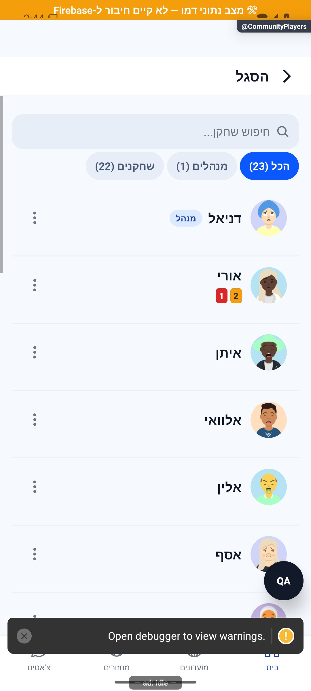
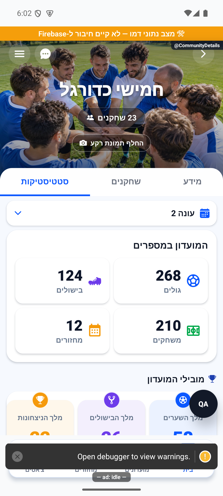

# השחקנים והמנהלים

## אימות פרסום קבוצות בפולס, 2.11.2026

נבדק ההפרש התחום בשירות המשותף של המחזורים: נוספה בדיקת אישור לפרסום קבוצות כאשר תשובת הפעולה אובדת. אין שינוי בחישוב, במכנים או בפעולות העצמאיות של הפיצר המתואר כאן. התיקון מקומי וטרם הופץ; אין בדיקת מכשיר חדשה לפיצר זה.

[דוח הטיפול, הבדיקות והמגבלות](../../changes/2026-11-02-pulse-sweep.md).

## בקשות לשיחה אישית, 2.11.2026

נבדקה השפעת תוספת בקשות השיחה במקורות המשותפים. השינוי ממוקד בהרשאת שיחה, בשדות פרטיות ההודעות ובחיבורי הבדיקות; אין מכך אימות חדש של מסך זה במכשיר. המימוש מקומי וטרם הופץ או נפרס. [התנהגות, בדיקות ומגבלות](../chat/message-requests.md).

## הסרת מגבלת החברים במועדון, 1.11.2026

נבדקה השפעת השינוי הממוקד במקורות המשותפים: הוסרה מגבלת החברים במועדון. אין שינוי מכוון בהתנהגות העצמאית של המסך המתואר כאן או במספר המקומות במחזור. התיקון מקומי וטרם הופץ; אין בדיקת מכשיר חדשה לפיצר זה.

[מסלול הנתונים, התנאים, התאימות, הבדיקות ומגבלות ההפצה](../../changes/2026-11-01-unlimited-club-members.md).

## פריסת הגנות הסרת המחזור, 30.10.2026

שבעת תיקוני השרת להגנת הסרת מחזור ולספירת המחזורים המתועדים נפרסו באישור ונבדקו בשרת. המחזור לא נמחק, וכל נתוני המועדון שנבדקו נשמרו. אין כאן הפצת יישום חדשה או בדיקת מכשיר.

[גרסאות פעילות, בדיקות שרת וגבולות האישור](../../changes/2026-10-30-evening-removal-server-deployment.md).

## השלמת הגנת הסרת המחזור, 30.10.2026

ההכנה המקומית מגינה גם על סנכרון מדידות אישי ועל יומן הנתונים ללוח המנהל. עיבוד ישן אינו יכול להחזיר מידע אחרי הסרה או בזמן הקפאה. אין שינוי חזותי, הרשאות חדשות או פעולת מחיקה בממשק; שבעה תיקוני שרת מוכנים לבדיקה ולפריסה באישור נפרד. לא בוצעה הסרה בייצור.

[תוכנית הביצוע, החבילות, הבדיקות וגבולות האישור](../../changes/2026-10-30-evening-removal-readiness.md).

## הגנה בהסרת מחזור היסטורי, 30.10.2026

נבדק השינוי התחום במקורות השרת המשותפים: נוספה הגנה מפני עיבוד מאוחר של מחזור שהוסר, ותוקנה ספירת מחזורים מתועדים בסטטיסטיקה. אין שינוי מכוון בניווט או בחישובים העצמאיים של הפיצר המתואר כאן. התיקונים מקומיים וטרם נפרסו; לא נערכה בדיקת מכשיר חדשה שלו.

[התנהגות, סדר הפעולות, חישובים, בדיקות וגבולות האישור](../../changes/2026-10-30-evening-removal-readiness.md).

## החלפת הקבוצה הבועטת בפנדלים, 30.10.2026

בפנדלי ההכרעה נוספה אפשרות לבחור את הקבוצה שבועטת כעת, בלי למחוק את הבעיטות הקודמות. זהו עדכון תחום במקורות משותפים; אין שינוי מתוכנן במסך המתואר כאן ואין אימות מכשיר חדש שלו. [התנהגות, בדיקות ומגבלות](../../changes/2026-10-30-shootout-turn.md).

## תלות בסינון הצעות השלמה - 28.10.2026

השינוי הנוכחי ב-`functions/src/index.ts` מוגבל לבחירת הצעות השלמה: סף תפוסה של 70 אחוז ובדיקת הרשמה מתנגשת לפני יצירת התראה. אין שינוי מכוון בתהליך העצמאי המתואר כאן ואין אימות חדש שלו. רענון המקור המשותף אינו מאמת שינויים קודמים שהיו בו מאז קליטת התיעוד. [היקף, בדיקות ומגבלות](../../changes/2026-10-28-filler-eligibility.md). מקומי וטרם נפרס.

## הרחבת אבחון דיווחים, 27.10.2026

הדיווחים יוכלו לכלול מה ניסו לבצע, מה היה מצב האפליקציה ומה החזיר השרת. פרטים חסרים מוצגים כלא ידועים, ומספר מוגבל של מופעים נשמר בלי למחוק את המופע הראשון. השינוי מקומי וטרם הופץ, ואינו משלים פרטים לדיווחים ישנים. [היקף, ראיות ומגבלות](../../changes/2026-10-27-diagnostic-context.md).

בדיקות הקוד הושלמו, אך השינוי עדיין מקומי ולא הופץ. פרטים שלא נאספו בדיווחים ישנים אינם משוחזרים בדיעבד.

## טיפול מלא בפריטי הפולס הפתוחים, 27.10.2026

הושלם סבב טיפול בפריטי הפולס עם תיקונים ותוצאות מחקר מוכנות לביקורת. פריטים שלא תוקנו נשארים פתוחים עם הסבר וצעד הבא. לא בוצעה הפצה או בדיקת מכשיר חדשה. [ממצאים, בדיקות ומסירה](../../changes/2026-10-27-pulse-completion.md).

## טיפול בתקלות הפולס, 26.10.2026

נבדק שינוי ממוקד במקור משותף במהלך טיפול בתקלות הפולס. אין שינוי נוסף בפעולות הפיצר המתואר כאן.

השינוי מקומי וטרם הופץ. [בדיקות, מסירה ומגבלות](../../changes/2026-10-26-pulse-fixes.md).

## ביטול פעילות אחרי מחיקת מועדון - 26.10.2026

מחיקת מועדון עוצרת כעת את המחזורים השבועיים שלו, ובשרת נוספה הגנה שמונעת פתיחת מחזור למועדון שכבר נמחק. הטיפול מבטל מחזורים שטרם הסתיימו, דוחה בקשות חברות ממתינות, מסיר הרשמה להתראות ואת כרטיס המועדון הציבורי. נתוני עבר והישגים אישיים נשמרים. תיקון השרת נפרס ואומת באישור הבעלים. הסדרה שנותרה כובתה, ההרשמה להתראות והכרטיס הציבורי הוסרו; המחזור עצמו כבר לא היה קיים בבדיקה העדכנית. עצירת הסדרה המוקדמת בצד הלקוח תיכלל בבינארי עתידי. נשמרה ההיסטוריה. [המימוש, בדיקת השאריות ומגבלות האישור](../../changes/2026-10-26-deleted-club-recurring.md).

## שעון מדויק וכיתוב פנדל - 25.10.2026

במקורות המשותפים נוסף שימור השעון המדויק של פנדל במהלך משחק, וכיתוב ההבקעה ביומן קוצר. אין שינוי במונים או בתהליך העצמאי המתואר כאן; לא נערכה לו בדיקת ממשק חדשה במסגרת העדכון. השינוי מקומי וטרם הופץ. [פרטים וראיות](../../changes/2026-10-25-in-play-penalties.md#שעון-מדויק-וכיתוב-אירוע).

## פנדל במהלך משחק חי - 25.10.2026

עודכנו מקורות משותפים לצורך פנדלים במהלך משחק. אין שינוי מכוון בתהליך העצמאי המתואר במסמך הזה, ולא נערכה לו בדיקת ממשק חדשה במסגרת המשימה.

השינוי מקומי. נדרשת פריסת שרת לפני הפצת לקוח שמשתמש באפשרות; לא בוצעו פריסה או שינוי הרשאות. [חוזה הנתונים, התהליך, הבדיקות ומגבלות ההפצה](../../changes/2026-10-25-in-play-penalties.md).

## תיעוד כשלים — 20.10.2026

נוסף תיעוד אוטומטי לנקודות כשל במסלול הזה, עם מקור התקלה. הפעולה המקורית שומרת על ערכי החזרה והודעות השגיאה שלה. השינוי מקומי, טרם הופץ, ואין אימות מסירה חיה לפולס.

[דוח דיווח השגיאות והראיות](../../changes/2026-10-20-error-reporting-audit.md).

פריסת כפתורי עורך הדירוג הפנימי הותאמה לכיווניות העברית.

כאן רואים מי חבר במועדון ומחפשים שחקן ברשימה. מנהלים יכולים לפתוח את כלי ניהול השחקנים, והיוצר יכול לשנות את תפקידי הניהול.

[לפירוט המעמיק](members-and-administration.md)

## בדיקת לחיצות אחרי גלילה — 10.10.2026

בדקנו לחיצות לאחר עצירת גלילה בפרטי מחזור ובפרטי מועדון. בניסוי דמו שדימה אירוע סיום גלילה חסר, הגנת הגלילה הקיימת אפשרה כבר את הלחיצה הראשונה. נוספה אותה הגנה גם לרשימת השחקנים במועדון. הנתונים, סדר השחקנים והחישובים לא השתנו.

התקלה לא שוחזרה באופן טבעי באמולטור. הניסוי מוכיח מסלול כשל מסוים, ואינו מוכיח שזו הסיבה בטלפון המדווח; שני הדיווחים נשארים פתוחים לאימות. [ראיות ומגבלות](../../../artifacts/pre-release-2026-10-10/scroll-press/README.md).

## הקשחת אבטחה מקומית — 11.10.2026

הדירוג הפנימי נשמר בנפרד. כשהמנהל מסתיר אותו, שאר החברים אינם יכולים לקרוא אותו ממסמך המועדון.

## הפצה מדורגת 1.1.47 — אישור הבעלים

בהפצה הפנימית נשמרת תאימות לגרסאות הישנות. הקריאה החדשה לדירוג נעשית דרך `getClubAdminRatings` והעדכון דרך `setClubAdminRating`. דגל השרת `TEAMDER_LEGACY_CLUB_RATINGS_COMPAT=true` משאיר את `groups.adminRatings` כמקור הנתונים המשותף, בלי יצירת עותק פרטי ובלי הסבת נתוני ייצור. מנהל רשאי לקרוא ולעדכן; חבר קורא רק כשהדירוג גלוי; משתמש חיצוני אינו רשאי לקרוא. כללי ההרשאות המחמירים והסבת הדירוגים נדחים להפצה נפרדת, ולכן אין לראות בשלב זה סגירה מלאה של פרצות ההרשאות. אכיפת אימות מקור האפליקציה נשארת כבויה. כניסת פולס החדשה וביטול מפתחותיה אינם חלק מההפצה הזו.

## תלות בעדכון העונות — 19.10.2026

קובץ תשתית משותף עודכן במסגרת העונות. שינוי זה אינו מוסיף פעולה חדשה למסך המתואר כאן; פרטי העונות והבדיקות מופיעים במסמך העונות.

[מצב המימוש, הבדיקות ומגבלות האימות של העונות](../clubs/seasons.md). מקומי בלבד; לא בוצעה פריסה במסגרת המשימה.

## תלות במידע על סגירת עונה — 23.10.2026

נוסף מידע משותף שמאפשר להסביר מדוע עונה מתעכבת בסגירה. אין שינוי נוסף בפעולות המתוארות כאן; השינוי מקומי וטרם הופץ. [המסלול, הבדיקות והמגבלות](../../changes/2026-10-23-season-automatic-recovery.md).

## בידוד מונה בקשות והתאוששות מרקע — 23.10.2026

ספירת בקשות הצטרפות אינה ממתינה יותר לדירוגי השחקנים במועדונים. מסך הבית טוען את המונה מחדש בחזרה מרקע ומתעלם מתוצאה ישנה שמגיעה אחריה. כשל אמיתי בקריאת הבקשות נשאר כשל ושומר את הספירה האחרונה; אין שינוי בעיצוב. נבדק בבדיקות קוד, מקומי וטרם הופץ. [הסבר, יומני שרת ומגבלות](../../changes/2026-10-23-inbox-resume.md).

## עדכון תלות משותפת בקריאות מידע — 23.10.2026

בקובצי השירות המשותפים נוספה אפשרות מפורשת לניסיון חוזר אחד בקריאה זמנית שנכשלה, תוך עצירה אם החשבון מתחלף. החיבור מוגבל ל־14 נקודות קריאה המפורטות בדוח; אין כאן טענה שכל פעולה בפיצ׳ר קיבלה ניסיון חוזר או שנבדק מסך חדש. בדיקות המאגר המלאות עברו (5,261 בדיקות ב־472 חבילות), אך אינן הוכחת הרצה במכשיר. הקוד מקומי וטרם הופץ. [מסלול, ראיות ומגבלות](../../changes/2026-10-23-four-open-errors.md).

## עדכון תלות מסבב הפולס — 23.10.2026

בתלות המשותפת נוספו התאוששות מוגבלת להעשרת מועדונים ובדיקות לביטול קריאה של חשבון או דור ישן. אין שינוי מכוון בכללי המוצר של המסך הזה ואין אימות מסך חדש עבורו. הקוד מקומי וטרם הופץ. [תחום השינוי והבדיקות](../../changes/2026-10-23-pulse-resweep.md).

## תלות בשמירת צבעי המחזור — 24.10.2026

שמירת המידע המשותפת עודכנה כדי להעביר את צבעי הקבוצות ממסכי הכוחות להכנה וללייב. אין תוספת פעולה במסך הזה, והוא לא נבדק מחדש במכשיר במסגרת התוספת. השינוי מקומי וטרם הופץ. [פרטי התוספת ומגבלות הבדיקה](../rounds/draft-setup.md#צבעים-לפני-שיבוץ-ובכל-שיטת-חלוקה--24102026).

## מניעת טעינה אחרי עדכון פרופיל בלבד - 25.10.2026

עדכון שם, תמונה או נתונים אישיים באותו חשבון אינו טוען שוב את המסך ללא צורך. החלפת חשבון ושינוי גישה עדיין מרעננים את המידע. התיקון מקומי ונבדק בקוד, ללא מדידת זמן במכשיר. [בדיקות ומגבלות](../../changes/2026-10-24-loading-performance.md).

## תאימות לשמירת פקודת רכיב הבית - 25.10.2026

נוספה הגנה פנימית מפני ביצוע חוזר של פעולת רכיב הבית. התהליך המתואר בעמוד זה לא השתנה במכוון, ונתונים ישנים נשארים נתמכים. התיקון מקומי וטרם הופץ. [מקור הבדיקה והמגבלות](../../changes/2026-10-25-widget-completion.md).

## תלות בהיסטוריית הרשמה בלוח המנהל - 28.10.2026

בקובץ `functions/src/index.ts` נוספו רק ייצואים עצמאיים של איסוף היסטוריית הרשמה וקריאתה למנהלי מועדון. אין שינוי מכוון במסלול הפיצר המתואר כאן, בחישוביו או בהרשאותיו, ולא נערכה לו בדיקת מסך חדשה. השירותים החדשים מקומיים וטרם נפרסו. [היקף, חישובים וראיות בלוח המנהל](manager-dashboard.md).

## שלמות החלוקה המתוזמנת, 29.10.2026

במקורות המשותפים תוקנה שמירת חלוקה מתוזמנת לשש ולשבע קבוצות וסוננו אורחים שממתינים. דרך חישוב האיזון נשמרה. אין שינוי מכוון בפעולות העצמאיות המתוארות בעמוד זה ואין אימות מסך חדש שלהן; השינוי מקומי וטרם הופץ.

[היקף, בדיקות, פערים פתוחים ומגבלות](../../changes/2026-10-29-scheduled-balance-integrity.md).

## נתונים עדכניים בעסקת החלוקה, 29.10.2026

במקורות המשותפים תוקנו פערי עדכון נתונים בזמן החלוקה המתוזמנת, ללא שינוי בנוסחת האיזון. אין שינוי מכוון בפעולות העצמאיות של המסלול המתואר כאן ואין אימות מסך חדש שלו. התיקון מקומי וטרם נפרס.

[מימוש, בדיקות ומגבלות](../../changes/2026-10-29-scheduled-balance-races.md).

## איזון ופיזור רמות לפני גיוון, 30.10.2026

עודכן החישוב המשותף של חלוקת כוחות לפי הדירוג הכללי: איזון הממוצעים קודם לפיזור הרמות, והגיוון מכריע אחרי שניהם. אין שינוי מכוון במבנה המסך או בפעולות העצמאיות המתוארות כאן, ואין אימות מכשיר חדש שלהן. השינוי מקומי וטרם הופץ או נפרס.

[מימוש, נוסחאות, בדיקות ומגבלות](../../changes/2026-10-30-rating-balance-priority.md).

## אימות כשלים בקבלת פרסום, 2.11.2026

בבדיקת אישור פרסום הקבוצות, כשל שלא ניתן לאמת כהצלחה נשאר כשל גלוי ונשמר באבחון. הבדיקה אינה שולחת הודעות שוב ואינה משנה הרשאות. השינוי תחום לשירות המשותף, מקומי וטרם הופץ.

[דוח הטיפול והראיות](../../changes/2026-11-02-pulse-sweep.md).
