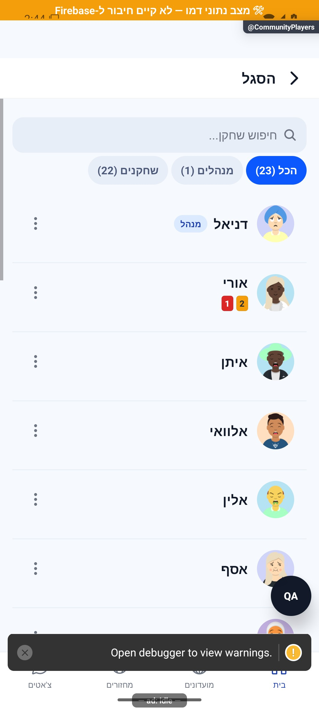
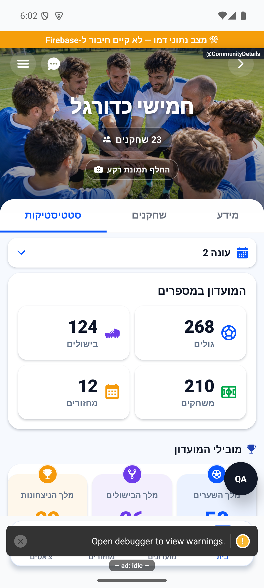

# השחקנים והמנהלים

פריסת כפתורי עורך הדירוג הפנימי הותאמה לכיווניות העברית.

כאן רואים מי חבר במועדון ומחפשים שחקן ברשימה. מנהלים יכולים לפתוח את כלי ניהול השחקנים, והיוצר יכול לשנות את תפקידי הניהול.

[לפירוט המעמיק](members-and-administration.md)

## בדיקת לחיצות אחרי גלילה — 10.10.2026

בדקנו לחיצות לאחר עצירת גלילה בפרטי מחזור ובפרטי מועדון. בניסוי דמו שדימה אירוע סיום גלילה חסר, הגנת הגלילה הקיימת אפשרה כבר את הלחיצה הראשונה. נוספה אותה הגנה גם לרשימת השחקנים במועדון. הנתונים, סדר השחקנים והחישובים לא השתנו.

התקלה לא שוחזרה באופן טבעי באמולטור. הניסוי מוכיח מסלול כשל מסוים, ואינו מוכיח שזו הסיבה בטלפון המדווח; שני הדיווחים נשארים פתוחים לאימות. [ראיות ומגבלות](../../../artifacts/pre-release-2026-10-10/scroll-press/README.md).

## הקשחת אבטחה מקומית — 11.10.2026

הדירוג הפנימי נשמר בנפרד. כשהמנהל מסתיר אותו, שאר החברים אינם יכולים לקרוא אותו ממסמך המועדון.

## הפצה מדורגת 1.1.47 — אישור הבעלים

בהפצה הפנימית נשמרת תאימות לגרסאות הישנות. הקריאה החדשה לדירוג נעשית דרך `getClubAdminRatings` והעדכון דרך `setClubAdminRating`. דגל השרת `TEAMDER_LEGACY_CLUB_RATINGS_COMPAT=true` משאיר את `groups.adminRatings` כמקור הנתונים המשותף, בלי יצירת עותק פרטי ובלי הסבת נתוני ייצור. מנהל רשאי לקרוא ולעדכן; חבר קורא רק כשהדירוג גלוי; משתמש חיצוני אינו רשאי לקרוא. כללי ההרשאות המחמירים והסבת הדירוגים נדחים להפצה נפרדת, ולכן אין לראות בשלב זה סגירה מלאה של פרצות ההרשאות. אכיפת אימות מקור האפליקציה נשארת כבויה. כניסת פולס החדשה וביטול מפתחותיה אינם חלק מההפצה הזו.
