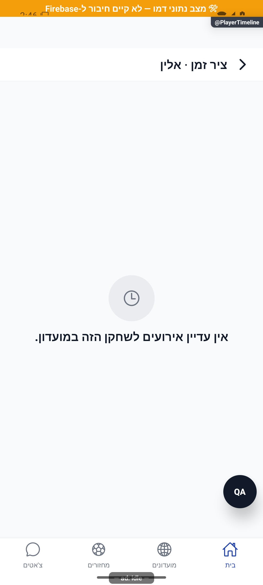
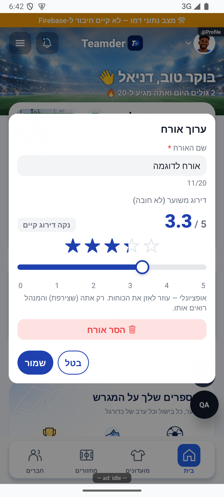
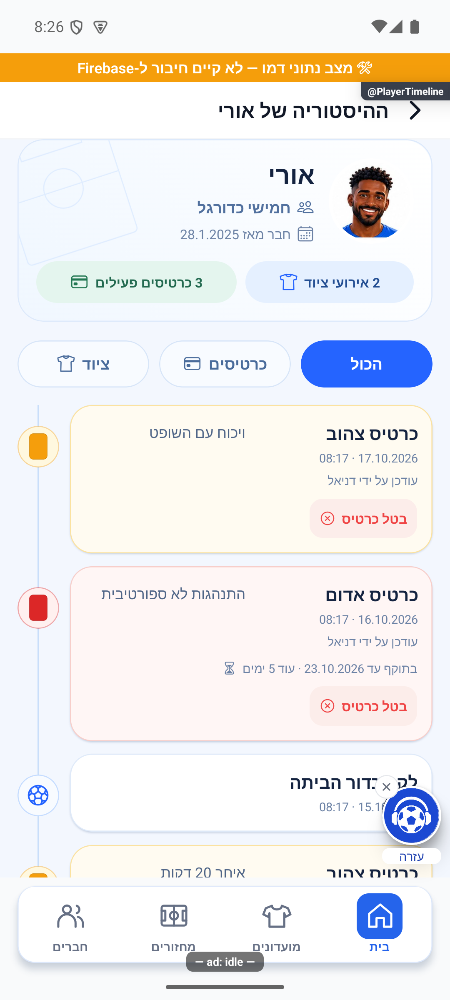
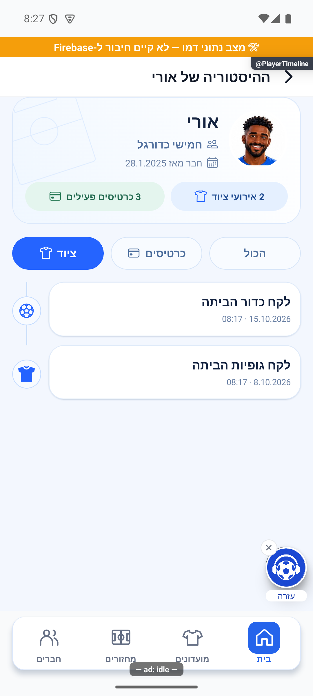
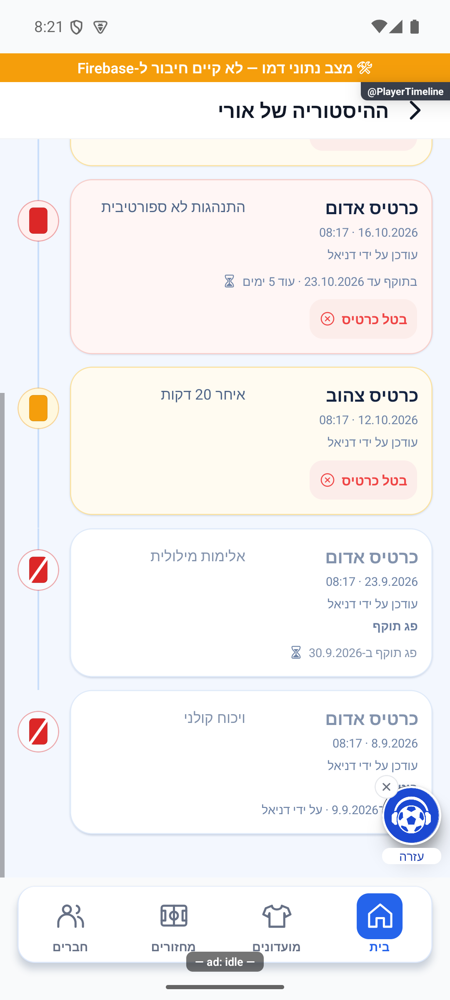

# כרטיסים, ציוד, דירוג וציר אירועים

## תיעוד כשלים — 20.10.2026

נוספו תצפיות דיווח בנקודות הכשל של המקורות המשויכים לפיצ׳ר, במסגרת הרחבה רוחבית. נשמרו ערכי החזרה, הזריקות ותנאי הפעולה הקיימים; נוסף מקור קוד והקשר לדיווח. כיסוי תחבירי אינו הוכחת הרצה של כל מצב. השינוי מקומי וטרם הופץ; בדיקות המסירה, מגבלות מניעת הכפילויות והמסלולים שטרם חוברו מתועדים בדוח המשותף.

[דוח דיווח השגיאות והראיות](../../changes/2026-10-20-error-reporting-audit.md).

## עדכון מקומי — 10.10.2026

`CommunityPlayersScreen.saveEquipment` קורא `groupService.setPlayerEquipment(groupId, userId, {ball, jerseys})`. העסקה קוראת את מערכי המחזיקים העדכניים ומשנה רק את המזהה המבוקש; היא מחזירה את שני המערכים ואת `ballChanged`/`jerseysChanged`. החנות מקבלת את התוצאה העדכנית, ואירועי הציוד תלויים בדגלי השינוי בפועל. נוסחה לכל פריט: מסומן ⇒ איחוד המערך הנוכחי עם מזהה השחקן; לא מסומן ⇒ סינון אותו מזהה בלבד. זהות שחקן אחר אינה מוסרת. כשל עסקה מגיע לחלון השמירה ולא מייצר הצלחה.

`setEquipmentHolders` נשאר לפעולת מסירה מפורשת של כל רשימת המחזיקים בסיום מחזור, המתועדת ב־[ציוד](../rounds/equipment.md); אין להחליף את פעולת השחקן בשמירת מערך מחלון שנפתח לפני עדכון מקביל. נבדק תרחיש שני עדכונים עוקבים הקוראים מצב עדכני; לא נכתבו נתוני ציוד אמיתיים.

**מצב האימות:** תיקון מקומי, 10.10.2026. ראיות השירותים ופונקציות המקור ב־`tests/logic/clientAuditRecovery.test.ts`; הריצה הממוקדת המתועדת עברה 417 בדיקות ב־8 חבילות; השלמת שחזור מאוחר תועדה בדוח התיקון. [דוח התיקון והגבולות](../../../artifacts/pre-release-2026-10-10/client-fixes.md). לא הורצו כאן פעולות מול מסד אמיתי ולא צולמו מצבי כשל רשת חדשים; התמונות ההיסטוריות אינן הוכחה לתיקון זה.

עדכון מקומי מ־9.10.2026: שורת הפעולות ב־`AdminRatingSheet` המשותף הותאמה ל־`forceRTL` עם `flexDirection: row`, ללא היפוך כפול. נבדקה פתיחת העורך מלוח המנהל באימולטור, ללא שמירה; ראיה: `manager-rtl-rating-editor-2026-10-09.jpg` במניפסט הצילומים. יתר חלונות הניהול לא השתנו במשימה זו.

[להסבר הקצר והפשוט](player-management.simple.md)

עודכן: 07.10.2026; מקור: `8e8fde5`. חלונות: `src/components/community/IssueCardSheet.tsx`, `ManageEquipmentSheet.tsx`, `src/components/AdminRatingSheet.tsx`. מסך: `src/screens/players/PlayerTimelineScreen.tsx`, מסלול `PlayerTimeline` עם `groupId`, `userId` ושם.

## משמעות ומצבים

כרטיס אדום פעיל חוסם הרשמה למחזור במועדון; כרטיס צהוב הוא מידע חזותי. תוקף כרטיס נשמר ב־`expiresAt` בעת יצירתו ולא מחושב מחדש אחרי שינוי הגדרות. ערך `null` מפורש הוא ללא פקיעה; היעדר שדה היסטורי משתמש במסלול תאימות. ביטול כרטיס משמר את האירוע עם מי ומתי ביטל; לא מוחק היסטוריה.

ציוד כולל כדור וגופיות; כמה שחקנים יכולים להחזיק אותו סוג ציוד. אין בעלים יחיד קשיח. שינויים יוצרים עקבות בציר האירועים. הדירוג הוא פנימי למועדון, נכתב בידי מנהל ומשמש במקום שבו הוגדר; הוא אינו הישג אישי גלובלי.

| פעולה | נתונים ותנאי | תוצאה |
|---|---|---|
| הנפקת כרטיס | מנהל; צבע, פירוט עד 200 תווים, תוקף לפי הגדרה | רשומת `communityPlayerEvents`; אדום דורש אישור נוסף |
| ביטול כרטיס | מנהל; אירוע קיים | `revoked`, `revokedBy`, `revokedAt`; אין מחיקה |
| שיוך ציוד | מנהל; סוג ציוד ומחזיקים | עדכון מועדון ורישום אירועים |
| שינוי דירוג | מנהל; היכולת מופעלת | דירוג מועדון; מצב עסוק/שגיאה |
| צפייה בציר | כניסה מהסגל למנהל | עד 200 אירועי שירות, עם מינוי למנהל נגזר; הצטרפות רק בכרטיס העליון |

## ציר האירועים

מציג כרטיסים, ביטולים, ציוד וקבלת ניהול. תאריך ההצטרפות מוצג רק בכרטיס העליון; קריאת זהות המאשר של בקשת ההצטרפות הוסרה ממסך זה. כשהכרטיסים כבויים אין להפוך כרטיס היסטורי ל״מעולם לא היה״; החלק המתאים מוסתר לפי הגדרת התצוגה. `PlayerTimeline` מאפשר ביטול רק למנהל, אבל אין בו שער ריק מוקדם של הרשאה לכל קריאת המסך; הניווט והכללים הם שכבות נפרדות.

הפער ההיסטורי של החזרת ציר ריק בכשל קריאה תוקן ב־18.10.2026: `getPlayerTimeline` זורק את הכשל לאחר רישום; המסך שומר מידע קודם ומציג ניסיון חוזר. נתיב חסר מועדון או שחקן זורק `InvalidTimelineScopeError`. תגובת שאילתה תקינה ללא אירועים ממשיכה להיות רשימה ריקה אמיתית.

## מקור אמת וראיות

`src/services/communityEventsService.ts`, `src/services/groupService.ts`, `src/utils/cardState.ts`, קוראי האירועים והגדרות המועדון. כללי `communityPlayerEvents`: מנהל רואה מועדון; שחקן יכול לקרוא אירועים שלו; יצירה למנהל, עדכון ביטול בלבד וללא מחיקה. אלה הכללים המקומיים, לא בדיקת פריסה.

הצילום הוא ציר ריק בנתוני דמה בלבד. חלונות כרטיס/ציוד/דירוג לא אומתו בצילום במסגרת מסמך זה. בקוד החלונות נמצאו שימושי `row-reverse`; יש לבדוק צילום תחת `forceRTL` לפני קביעה שיש ליקוי. `SpringSheet` מספק פתיחה וסגירה מונפשות אך אינו כולל גרירת סגירה; אין להשליך עליו את יכולת תפריטי הפעולות החדשים.

## הצעות בלבד

להפריד שגיאה, ריקנות וטעינה בציר; לתאר התראה אדומה בלי להסתמך על צבע בלבד; להנפיש שיוך ציוד בסמל קטן ובקבלת אישור שרת. לתמוך בגרירה בחלונות שבהם מציגים ידית, לאחר בדיקת התנגשויות עם סליידר הדירוג.

## פירוט טכני נוסף — זרימה, חישוב ונקודות שינוי

`setAdminRating` מקבל ערך בטווח `(0,5]`; `0` או `null` מוחקים את המפתח באמצעות `deleteField`. לדוגמה 0.5 הוא דירוג תקף ולא חוסר דירוג, בעוד 5.2 נדחה. הכתיבה היא `groups.adminRatings.{playerId}`, אינה משנה דירוג גלובלי ואינה מכניסה תוצאה אישית.

`setPlayerEquipment` מעדכן ציוד לשחקן בעסקה; `setEquipmentHolders` מחליף רשימת מחזיקים מלאה רק במסירה מפורשת. שירות האירועים מתעד החלפות, ו־`logCardEvent` יוצר אירוע כרטיס. `revokeCard` משמר רשומה ומוסיף פרטי ביטול. `hasActiveRedCard` ו־`cardState` הם נקודות הבדיקה לחסימת הרשמה; שינוי ימי תוקף לא משנה `expiresAt` שכבר נכתב. טעינת `getPlayerTimeline` מוגבלת ל־200 אירועים; כשל נזרק ומוצג בנפרד מריקנות אמיתית. התנהגות הכשל אומתה בבדיקה המזריקה דחיית שאילתה.

הפירוט מתאר את הקוד שנקרא, ולא בדיקת כתיבה או הרשאות בסביבת הייצור. יש לקרוא את הקוד הממוקד וההפרש מאז מקור המיפוי לפני תיקון; בדיקות המוזכרות כאן לא הורצו מחדש לצורך עריכת התיעוד.

## תיקוני עיצוב ונגישות — 10.10.2026

מקור: `a348b9f235f1e1433497600555303231512a0834` עם שינויים מקומיים. אין בסעיף זה הוכחת גרסת חנות.

`AdminRatingSheet` מעבירה שם נגיש הכולל את השחקן ו־`readonly` בזמן שמירה. `RatingSlider` מכריז על תפקיד `adjustable`, גבולות 0–5 ודירוג עדכני; אפס מוכרז כלא דורג. פעולות נגישות משנות ב־0.1 ונחתכות לגבולות. איפוס נשאר כפתור עצמאי. מצב קריאה בלבד אינו מציג פעולות שינוי. המחוות קוראות callback ו־readonly עדכניים דרך הפניה. אין שינוי בדירוג הפנימי הנשמר או באלגוריתם האיזון. בדיקות נגישות מפעילות שינוי, גבולות וקריאה בלבד; לא בוצעה שמירת דירוג חי.

## תיקון קריסת דירוג עשרוני — 12.10.2026

באנדרואיד נרשמה קריסה ב־`RatingSlider` עם `Loss of precision during arithmetic conversion: (long) 4.5`. שדות הנגישות המספריים של הרכיב המקורי נשמרים כמספרים שלמים. לכן `accessibilityValue` מעביר כעת 0–50 ואת הדירוג בעשיריות שלמות: 4.5 מועבר כ־45. הטקסט המוקרא ממשיך להיות 4.5 מתוך 5. הדירוג העסקי, התצוגה, צעדי 0.1, איפוס ושמירה אינם משתנים. אפס הוא לא דורג. ההגנה משותפת לאורחים ולדירוג מנהל, גם בקריאה בלבד.

בדיקת רגרסיה מכסה 51 ערכים בשני מצבים, ובדיקות הפעולות מכסות גבולות ושינוי. כל 3,524 הבדיקות ובדיקת הטיפוסים עברו. באמולטור אנדרואיד בדמו מנותק נפתח חלון אורח עם 4.5 ונגרר ל־3.3 ללא קריסה. לא בוצעה שמירה, בדיקת אייפון או שינוי בנתוני ייצור. הוכן מקומית אחרי 1.1.47/280, ולא הופץ.

## חלונית כרטיס ומקלדת — 13.10.2026

בצילום קודם המקלדת כיסתה את שמור ובטל ב־IssueCardSheet. SafeKeyboardAvoidingView הועבר לעטיפה מלאה מחוץ ל־SpringSheet; באנדרואיד behavior=height ובאפל padding. הפאנל מעוגן לתחתית השטח הפנוי. הוסרה היפוך שורה כפול: סמלו של הכרטיס מימין לכותרת, ביטול ראשון במקור ולכן מימין, שמור משמאל. callbacks וכתיבת כרטיס לא שונו.

[מצב רגיל](../screenshots/overlays-final-issue-card-2026-10-13.png) · [מקלדת פתוחה](../screenshots/overlays-final-issue-card-keyboard-2026-10-13.png). שניהם נצפו באנדרואיד בדמו המנותק, ללא שמירה. צילום ראשון נעשה לפני התייצבות המקלדת; אינו הוכחת תיקון. ברענונים החמים ואחת הפתיחות הקרות היו מצב עיגון ישן וחוסר תגובת אימולטור; נשמר night-final-issue-anr.png. צילום ההוכחה הסופי נעשה אחרי פתיחה קרה, טעינה מלאה, מיקוד והתייצבות. אין ראיה לסיבת חוסר התגובה ואין טענה לתיקונו.

## מימוש סקיצה 10 והנחיות הבעלים — 18.10.2026

מקור: `5148f63c2a8e9c454b68132fdb0d683a98a4adc9` עם שינויים מקומיים; לא הופץ. הסעיף מחליף את תיאור התצוגה והפערים ההיסטוריים של ציר הזמן לעיל, בלי לשנות את חלוניות הכרטיס, הציוד או הדירוג.

### המסך והניווט

אותו מסלול `PlayerTimeline` ואותם פרמטרים `groupId`, `userId`, `name?`. `ScreenHeader` מציג את שם השחקן; אין מסך חדש או מסלול שהוסר. קיצור הפיתוח הקיים תוקן להעברת המועדון ושחקן הדמו `p5`, כדי לפתוח את המסלול עם תחום מלא. הניווט במוצר נותר ללא שינוי.

למעלה כרטיס בהיר עם איור מגרש עדין, `UserAvatar`, שם עדכני, שם מועדון ו־`group.joinedAt[userId]` רק אם זה מספר חיובי. אין השלמת תאריך חסר מתאריך יצירת המשתמש. תאריך ההצטרפות אינו מוכנס לרשימת האירועים.

מסננים: `all`, `cards`, `equipment`, ובממשק „הכול”, „כרטיסים”, „ציוד”. אין סינון חברות. כאשר `cardsEnabled` כבוי, מסנן הכרטיסים והסיכום שלו מוסתרים; בחירת כרטיסים קודמת מתאפסת להכול ברענון. מינוי למנהל מ־`adminSince[userId]` נשאר רק בהכול.

### חישובים ומקור נתונים

`playerTimelineView(events, group, userId, filter, now)` מסנן תחילה לפי שני המזהים, גם אם הקלט כבר הגיע משאילתה תחומה. אירועי ציוד הם `ball` או `jerseys`; כל אירוע נספר, כולל החזרה. זה אינו מספר פריטים שבידי השחקן. אירועי כרטיס הם `red` או `yellow`, רק כשהתכונה פעילה.

מספר הכרטיסים הפעילים הוא סכום אירועי הכרטיס שמחזירים `active` מ־`cardState`, עם תוקף לפי סוג. צילום המצב `expiresAt` מקבל קדימות על הגדרות עדכניות; `null` הוא ללא פקיעה, והיעדר שדה מפעיל תאימות דרך הגדרת המועדון. ביטולים וכרטיסים שפג תוקפם נשמרים בציר ובמסנן הכרטיסים אך אינם נספרים כפעילים. הסיכומים אינם משתנים בהחלפת מסנן. בדמו המצולם: שני אירועי ציוד ושלושה כרטיסים פעילים מתוך שבעה אירועים בסך הכול.

הרשימה כוללת אירועים לפי המסנן, ובתצוגת הכול גם מועד מינוי למנהל אם ידוע; מיון יורד לפי `at`, ובהשוואת זמנים זהים לפי מפתח יציב. אין קיבוץ יומי נפרד: התאריך והשעה נמצאים בכל כרטיס. עד 200 אירועי שירות נטענים; כשהתקבלה כמות זו מוצגת הבהרה שהסיכום מתייחס לאירועים המוצגים. מינוי למנהל אינו נמנה בסיכומי הציוד/הכרטיסים.

`reload` קורא במקביל את המועדון ואת האירועים, ואחריהם זהויות בלבד באצווה דרך `groupService.hydrateUsers`: השחקן, מנהלים שעדכנו ומבטלי כרטיסים. כשל בזהות אינו מוחק אירועים. שמות מבצע/מבטל מוצגים רק כאשר נפתרו. אין הצגת תאריך יצירת חשבון כתאריך בקשה או חברות, אין שאילתת פרופיל פרטי חדשה, ואין שינוי בממיר הנתונים או בהרשאות.

### תצוגה וכיווניות

הכרטיס קודם למסילת הסמלים בשורת האירוע, ולכן המסילה והסמל משמאל לטקסט במצב הכיווניות של היישום. גם במסננים, בשורת התוקף, בכפתור הביטול ובהודעת הניסיון החוזר המלל קודם לסמל. בשני סיכומי הכמות נשמר סדר מלל ואז סמל, כלומר הסמלים משמאל לפי עדכון הבעלים. רק בפרטי השחקן והמועדון בכרטיס העליון נשמר סדר סמל ואז מלל, כלומר הסמלים מימין. אין היפוך שורה כפול.

פרטי האירוע ותיאורו מופיעים בשתי עמודות; מתחת לרוחב 360 או מעל קנה מידה גופן 1.2 הם מסתדרים בעמודה אחת. אין קיטום של תיאור הכרטיס. צבע רקע עדין מבדיל צהוב ואדום פעילים; אירוע לא פעיל כולל סימון מילולי וקו על סמל הכרטיס. אירוע ציוד מבדיל קבלה מהחזרה באמצעות `returned`.

### מצבים, פעולות וכשלים

| מצב | התנהגות וכתיבה |
|---|---|
| טעינה ראשונה | טעינת כדור; אין הודעת ריקנות מוקדמת |
| אין מועדון | הודעת מועדון לא זמין; אין פעולת ביטול |
| רשימה ריקה אמיתית | מצב ריק לפי המסנן; הכרטיס העליון נשאר |
| כשל טעינה/רענון | הודעת ניסיון חוזר; נתונים קודמים נשמרים ואינם מוחלפים ברשימה ריקה |
| חזרה למסך | טעינה מחדש ועדכון `now`, כך שתוקף שחלף משתקף |
| טעינות חופפות/עזיבה | `requestVersion` מונע דריסה מתשובת טעינה ישנה או פתרון זהויות מאוחר |
| משתמש ללא סמכות ניהול | אין כפתור ביטול ואין פעולת לחיצה ארוכה לביטול |
| ביטול כרטיס פעיל | כפתור מפורש, חלון האישור הקיים, נעילת `actionLock`, ורק אז `revokeCard` |
| ביטול כרטיס שפג תוקפו | קיצור הלחיצה הארוכה הקיים נשמר למנהל; אין מחיקה |
| כשל ביטול | הודעת כשל; אין הצלחה מדומה; האירוע נשמר |

כתיבת הביטול נשארה בשירות המקורי: `revoked`, `revokedBy`, `revokedAt`. אין מחיקת אירוע. אין שינוי בחסימת הרשמה על ידי כרטיס אדום או בהגדרות תוקף.

### בדיקות וראיות

`tests/logic/playerTimelineView.test.ts`: סדר כרונולוגי, היעדר אירוע הצטרפות, שמירת מינוי למנהל בהכול, בידוד מועדון ושחקן, סיכומים בלתי תלויים במסנן, החזרת ציוד, תכונת כרטיסים כבויה ותאריכים חסרים.

`tests/logic/playerTimelineReadFailure.test.ts`: כשל קריאה מגיע למשתמש ככשל ולא כריקנות; שאילתה ריקה תקינה; נתיב חסר נכשל בשגיאה מזוהה לפני שאילתה. בסך הכול עשר בדיקות ממוקדות.

הצילומים מהמסך המקורי בדמו מנותק, עם המקור והמגבלות במניפסט. לא בוצעו ביטולי כרטיסים, הנפקה או שינוי ציוד בייצור. מצב כשל קריאה נבדק מבודד, ולא מול שרת חי. לא נבדקו חזותית אייפון, גופן מוגדל או קורא מסך.

אימות סופי במשימה: בדיקת הטיפוסים נקייה; כל 420 חבילות הבדיקות עברו, 4,976 בדיקות. בדיקת התיעוד עברה ללא כשלים.

## בידוד מונה בקשות והתאוששות מרקע — 23.10.2026

`groupService.listForUser(userId, { includeAdminRatings: false })` מחזיר את נתוני החברות ללא קריאות `getClubAdminRatings` וללא שדה דירוגים. ברירת המחדל של מסכי המועדון שומרת את טעינת הדירוגים ואת התנהגות הכשל הקיימת. `requestsService.myAdminGroupsWithPending` משתמש במסלול המצומצם: מספר בקשות חברות + סכום הממתינים במועדונים שמנוהלים בידי המשתמש + סכום הממתינים במחזורים שיצר. אין שינוי במכנה או בהרשאות. אפקט המיקוד של מונה הבית מאזין גם ל־`AppState`: מעבר מצב מבטל דור קודם, חזרה ל־`active` מבצעת קריאה חדשה; ניקוי מסיר מאזין ומונע תוצאה מאוחרת. `inboxRatingsIsolation` מריץ את מתודות המקור ומוכיח ספירה של 4 גם כששרת הדירוגים נכשל ושימור כשל מקור אמיתי; `homeInboxResume` מריץ את אפקט המקור ומאמת תוצאה חדשה מול ישנה, ניקוי ואורח. אין כאן הוכחת פתרון לכל חריגת זמן, חיבור רשת או כניסת אפל. אין אימות מכשיר חדש של תרחיש רשת זה. [הסבר, יומני שרת ומגבלות](../../changes/2026-10-23-inbox-resume.md).

## עדכון תלות משותפת בקריאות מידע — 23.10.2026

בקובצי השירות המשותפים נוספה אפשרות מפורשת לניסיון חוזר אחד בקריאה זמנית שנכשלה, תוך עצירה אם החשבון מתחלף. החיבור מוגבל ל־14 נקודות קריאה המפורטות בדוח; אין כאן טענה שכל פעולה בפיצ׳ר קיבלה ניסיון חוזר או שנבדק מסך חדש. בדיקות המאגר המלאות עברו (5,261 בדיקות ב־472 חבילות), אך אינן הוכחת הרצה במכשיר. הקוד מקומי וטרם הופץ. [מסלול, ראיות ומגבלות](../../changes/2026-10-23-four-open-errors.md).

## עדכון תלות מסבב הפולס — 23.10.2026

בתלות המשותפת נוספו התאוששות מוגבלת להעשרת מועדונים ובדיקות לביטול קריאה של חשבון או דור ישן. אין שינוי מכוון בכללי המוצר של המסך הזה ואין אימות מסך חדש עבורו. הקוד מקומי וטרם הופץ. [תחום השינוי והבדיקות](../../changes/2026-10-23-pulse-resweep.md).
