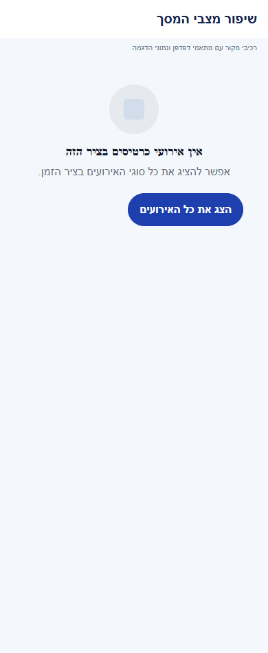
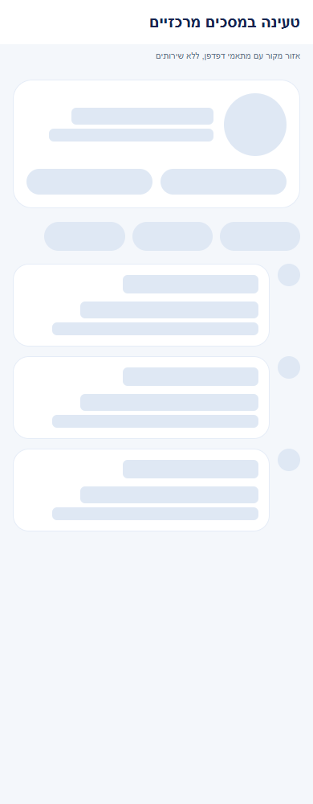
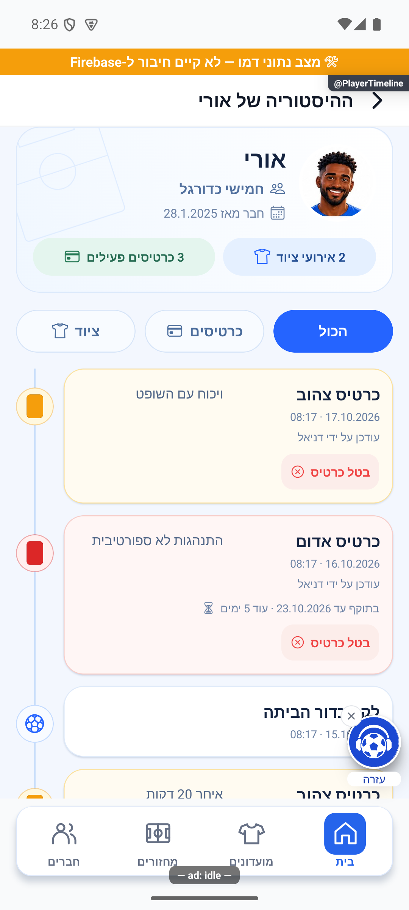

# כלי ניהול שחקנים

## עצירת מחזור קבוע ללא פעילות, 6.11.2026

נוספה במנגנון השרת עצירה של מחזור קבוע לאחר שלושה מחזורים רצופים ללא פעילות. ההשפעה כאן תחומה לתלות המשותפת בפתיחת מחזורים וניקוי מחזורים ריקים; אין אימות חדש של כל פעולות המסך. מנגנון השרת נפרס והופעל באישור הבעלים; אין צורך בגרסת טלפון חדשה להפעלתו. [ההתנהגות, מסלול הנתונים, הבדיקות ומגבלות ההפעלה](../../changes/2026-11-06-inactive-recurring-rounds.md).

## דירוג בסיס לשחקן ללא דירוג, 6.11.2026

נבדק שינוי תחום במקורות המשותפים של הכוחות האוטומטיים: שחקן ללא דירוג מחושב כ-2.5 מתוך 5, וההסברים תואמים. דירוג מפורש נשמר. אין כאן אימות חדש של כל מצבי הפיצר העצמאי; השינוי מקומי וטרם הופץ. [ההתנהגות, הבדיקות ומגבלות האימות](../rounds/draft-setup.md#דירוג-בסיס-לשחקן-ללא-דירוג-6112026).

## מדידת פעולות ואמינות נתונים, 5.11.2026

נוספה הכנה למדידת הפעולות ברכיבים המתועדים כאן. בפולס אפשר לראות ביצועים וחשבונות ייחודיים לפי פעולה ותקופה, כאשר קיים כיסוי מדידה. איסוף החשבונות החדש עדיין כבוי והמימוש מקומי. [פירוט והיקף הבדיקות](../../audits/2026-11-04-system-night/product-measurement.md).

## חיפוש שחקנים וזמני טעינה, 4.11.2026

שופרה טעינת חיפוש השחקנים, כרטיס שחקן אחר ואיתור פנויים למחזור ברכיבים המשותפים למסך זה. מימוש מקומי שטרם הופץ. [השינוי, המדידות והבדיקות](../../changes/2026-11-04-player-discovery-speed.md).

## ציר פעילות פרטי בפולס, 4.11.2026

בציר הפעילות, תשובת שרת על מצב הרשמה קיים אינה נספרת כהרשמה חדשה. קבלה ללא סימון יצירה מפורש מוצגת עם מגבלת אמינות.

נוסף תיעוד פרטי של ביקורים ופעילות במערכת הניהול. התוספת מקומית והאיסוף החדש כבוי כברירת מחדל; אין בדיקת מכשיר חדשה של מסך זה. מקומי וטרם הופץ או נפרס. [היקף, מקורות, בדיקות ומגבלות](../shared/usage-activity.md).

## שיפורי טעינה משותפים, 4.11.2026

עודכנו מנגנוני הטעינה המשותפים כדי לצמצם עבודה וקריאות חוזרות. דרך השימוש בפיצר נשמרת. השינוי מקומי וטרם הופץ, ואין אימות מכשיר חדש של המסך הזה. [היקף, מדידות ומגבלות](../../changes/2026-11-04-screen-performance.md).

## הפצה פנימית 1.1.74, 3.11.2026

עדכוני הלקוח הנוגעים לטעינה ולחיווי, במקורות המשותפים המשויכים למסמך הזה, כלולים בגרסת האנדרואיד הפנימית 1.1.74/306. החבילה ומסלול החנות אומתו; האימות החזותי נשאר בצילומי הדפדפן של סבבי המימוש, ואין אימות התקנה במכשיר. [תכולה, בדיקות ומגבלות](../../changes/2026-11-03-internal-1.1.74.md).

## מצבים ריקים והמשכיות פעולה, 3.11.2026

כשסינון ציר הזמן אינו מציג אירועים אפשר לחזור בלחיצה לכל סוגי האירועים. המימוש מקומי וטרם הופץ. האימות החזותי נעשה באזורים מהמקור בדפדפן בלבד. [התנהגות, בדיקות ומגבלות](../../changes/2026-11-03-experience-followup.md).

תוצאות האימות בסבב זה: כל 6864 הבדיקות ב-614 חבילות ובדיקת הטיפוסים עברו. בדיקות המצבים הממוקדות עברו ב-83 מקרים. נבדקו 72 פריסות של אזורי מקור בדפדפן, ונבדקה כיווניות בצילומים. אין אימות מכשיר או שירות חי חדש.

## הרחבת טעינת השלד במסכים מרכזיים, 3.11.2026

ציר הזמן מציג בהמתנה מבנה של זהות השחקן, מסננים וכרטיסי אירועים. מצבי הכשל והניסיון החוזר נשמרו. המימוש מקומי וטרם הופץ. נבדקו אזורי מקור בדפדפן, ללא בדיקת מכשיר חדשה. [הכיסוי, הבדיקות והמגבלות](../../changes/2026-11-03-central-screen-skeletons.md).

כל 6,831 הבדיקות ובדיקת הטיפוסים עברו. האימות החזותי בסבב הזה נעשה בדפדפן בלבד.

## תיקוני דיווחי הפולס, 3.11.2026

במקור השרת המשותף הועבר זיהוי של הרשמה שכבר נספרה לפני רישום השגיאה. אין שינוי מכוון בפעולות העצמאיות או בנתונים של הפיצר הזה. התיקון מקומי וטרם נפרס.

[פירוט התיקונים, הבדיקות, הצילומים והמגבלות](../../changes/2026-11-03-pulse-sweep.md).

## העברת אורח לרשימת המתנה, 3.11.2026

במקור המשותף תוקנה העברה ידנית של אורח מההרכב להמתנה, כדי שלא יקודם מיד מחדש. אין שינוי מכוון בפעולות העצמאיות של המסך המתואר כאן, ולא נערכה לו בדיקת מסך חדשה. התיקון מקומי וטרם הופץ.

[פרטי השינוי המשותף](../../changes/2026-11-03-guest-waitlist.md).

## ליטוש מקומי והשפעת רכיבים, 3.11.2026

השיפור ברכיבים המשותפים המשמשים את כרטיסים, ציוד, דירוג וציר אירועים כולל מלל כהה יותר בכפתור אזהרה. אין שינוי בנתוני המועדון או בהרשאות הניהול. הבדיקה הממוקדת של רכיבי המקור אינה בדיקה חדשה של המסך המלא במכשיר.

[הראיות והמגבלות של המשימה](../../changes/2026-11-03-overnight-mission.md).

## בקשות לשיחה אישית, 2.11.2026

נבדקה השפעת תוספת בקשות השיחה במקורות המשותפים. השינוי ממוקד בהרשאת שיחה, בשדות פרטיות ההודעות ובחיבורי הבדיקות; אין מכך אימות חדש של מסך זה במכשיר. המימוש מקומי וטרם הופץ או נפרס. [התנהגות, בדיקות ומגבלות](../chat/message-requests.md).

## הסרת מגבלת החברים במועדון, 1.11.2026

נבדקה השפעת השינוי הממוקד במקורות המשותפים: הוסרה מגבלת החברים במועדון. אין שינוי מכוון בהתנהגות העצמאית של המסך המתואר כאן או במספר המקומות במחזור. התיקון מקומי וטרם הופץ; אין בדיקת מכשיר חדשה לפיצר זה.

[מסלול הנתונים, התנאים, התאימות, הבדיקות ומגבלות ההפצה](../../changes/2026-11-01-unlimited-club-members.md).

## פריסת הגנות הסרת המחזור, 30.10.2026

שבעת תיקוני השרת להגנת הסרת מחזור ולספירת המחזורים המתועדים נפרסו באישור ונבדקו בשרת. המחזור לא נמחק, וכל נתוני המועדון שנבדקו נשמרו. אין כאן הפצת יישום חדשה או בדיקת מכשיר.

[גרסאות פעילות, בדיקות שרת וגבולות האישור](../../changes/2026-10-30-evening-removal-server-deployment.md).

## השלמת הגנת הסרת המחזור, 30.10.2026

ההכנה המקומית מגינה גם על סנכרון מדידות אישי ועל יומן הנתונים ללוח המנהל. עיבוד ישן אינו יכול להחזיר מידע אחרי הסרה או בזמן הקפאה. אין שינוי חזותי, הרשאות חדשות או פעולת מחיקה בממשק; שבעה תיקוני שרת מוכנים לבדיקה ולפריסה באישור נפרד. לא בוצעה הסרה בייצור.

[תוכנית הביצוע, החבילות, הבדיקות וגבולות האישור](../../changes/2026-10-30-evening-removal-readiness.md).

## הגנה בהסרת מחזור היסטורי, 30.10.2026

נבדק השינוי התחום במקורות השרת המשותפים: נוספה הגנה מפני עיבוד מאוחר של מחזור שהוסר, ותוקנה ספירת מחזורים מתועדים בסטטיסטיקה. אין שינוי מכוון בניווט או בחישובים העצמאיים של הפיצר המתואר כאן. התיקונים מקומיים וטרם נפרסו; לא נערכה בדיקת מכשיר חדשה שלו.

[התנהגות, סדר הפעולות, חישובים, בדיקות וגבולות האישור](../../changes/2026-10-30-evening-removal-readiness.md).

## התאוששות משגיאות בפולס, 28.10.2026

עודכנה תשתית הבדיקות המשותפת בעקבות תיקוני טעינה. לא בוצע שינוי מכוון בפעולות המתוארות בעמוד זה ולא בוצע אימות מכשיר חדש.

השינוי מקומי וטרם הופץ. [ממצאים, בדיקות ומגבלות](../../changes/2026-10-28-pulse-errors.md).

## תלות בסינון הצעות השלמה - 28.10.2026

השינוי הנוכחי ב-`functions/src/index.ts` מוגבל לבחירת הצעות השלמה: סף תפוסה של 70 אחוז ובדיקת הרשמה מתנגשת לפני יצירת התראה. אין שינוי מכוון בתהליך העצמאי המתואר כאן ואין אימות חדש שלו. רענון המקור המשותף אינו מאמת שינויים קודמים שהיו בו מאז קליטת התיעוד. [היקף, בדיקות ומגבלות](../../changes/2026-10-28-filler-eligibility.md). מקומי וטרם נפרס.

## הרחבת אבחון דיווחים, 27.10.2026

הדיווחים יוכלו לכלול מה ניסו לבצע, מה היה מצב האפליקציה ומה החזיר השרת. פרטים חסרים מוצגים כלא ידועים, ומספר מוגבל של מופעים נשמר בלי למחוק את המופע הראשון. השינוי מקומי וטרם הופץ, ואינו משלים פרטים לדיווחים ישנים. [היקף, ראיות ומגבלות](../../changes/2026-10-27-diagnostic-context.md).

בדיקות הקוד הושלמו, אך השינוי עדיין מקומי ולא הופץ. פרטים שלא נאספו בדיווחים ישנים אינם משוחזרים בדיעבד.

## טיפול מלא בפריטי הפולס הפתוחים, 27.10.2026

הושלם סבב טיפול בפריטי הפולס עם תיקונים ותוצאות מחקר מוכנות לביקורת. פריטים שלא תוקנו נשארים פתוחים עם הסבר וצעד הבא. לא בוצעה הפצה או בדיקת מכשיר חדשה. [ממצאים, בדיקות ומסירה](../../changes/2026-10-27-pulse-completion.md).

## טיפול בתקלות הפולס, 26.10.2026

נבדק שינוי ממוקד במקור משותף במהלך טיפול בתקלות הפולס. אין שינוי נוסף בפעולות הפיצר המתואר כאן.

השינוי מקומי וטרם הופץ. [בדיקות, מסירה ומגבלות](../../changes/2026-10-26-pulse-fixes.md).

## ביטול פעילות אחרי מחיקת מועדון - 26.10.2026

מחיקת מועדון עוצרת כעת את המחזורים השבועיים שלו, ובשרת נוספה הגנה שמונעת פתיחת מחזור למועדון שכבר נמחק. הטיפול מבטל מחזורים שטרם הסתיימו, דוחה בקשות חברות ממתינות, מסיר הרשמה להתראות ואת כרטיס המועדון הציבורי. נתוני עבר והישגים אישיים נשמרים. תיקון השרת נפרס ואומת באישור הבעלים. הסדרה שנותרה כובתה, ההרשמה להתראות והכרטיס הציבורי הוסרו; המחזור עצמו כבר לא היה קיים בבדיקה העדכנית. עצירת הסדרה המוקדמת בצד הלקוח תיכלל בבינארי עתידי. נשמרה ההיסטוריה. [המימוש, בדיקת השאריות ומגבלות האישור](../../changes/2026-10-26-deleted-club-recurring.md).

## תיעוד כשלים — 20.10.2026

נוסף תיעוד אוטומטי לנקודות כשל במסלול הזה, עם מקור התקלה. הפעולה המקורית שומרת על ערכי החזרה והודעות השגיאה שלה. השינוי מקומי, טרם הופץ, ואין אימות מסירה חיה לפולס.

[דוח דיווח השגיאות והראיות](../../changes/2026-10-20-error-reporting-audit.md).

## עדכון מקומי — 10.10.2026

שינוי סימון כדור או גופיות של שחקן נשמר בלי למחוק שינוי שמנהל אחר ביצע בינתיים אצל שחקן אחר. אירוע ציוד נרשם רק לסימון שהשתנה בפועל.

התנהגות הכשל נבדקה בקוד מבודד; לא הורצה במכשיר מול הנתונים האמיתיים.

כפתורי עורך הדירוג הפנימי מותאמים לפריסה העברית של האפליקציה.

מנהלים יכולים לתת כרטיס, לשייך ציוד ולעדכן דירוג פנימי לשחקן. ציר האירועים מציג את הפעולות שנעשו ואת הכרטיסים שבוטלו.

[לפירוט המעמיק](player-management.md)

## תיקוני עיצוב ונגישות — 10.10.2026

מקור: `a348b9f235f1e1433497600555303231512a0834` עם שינויים מקומיים. אין בסעיף זה הוכחת גרסת חנות.

מחוון דירוג המנהל מקריא את שם השחקן ואת הדירוג וניתן לשינוי גם ללא גרירה. בזמן שמירה אין שינוי נוסף במחוון.

## תיקון דירוג אורח ושחקן — 12.10.2026

תוקנה קריסה באנדרואיד בעת הצגת דירוג עשרוני, למשל 4.5. הדירוג ממשיך לעבוד בעשיריות כפי שהיה. נבדקו פתיחה וגרירה באמולטור בדמו בלבד, בלי לשמור נתונים. התיקון עדיין לא הופץ.

### תיקון 13.10.2026

בחלונית מתן כרטיס, שמור ובטל נשארים מעל המקלדת. סמל הכרטיס מופיע מימין לכותרת. נבדק בדמו אנדרואיד בלי לתת כרטיס לשחקן.

## ציר הזמן בעיצוב החדש — 18.10.2026

למעלה מוצגים השחקן, המועדון ותאריך ההצטרפות, כאשר הוא ידוע, ולצדם סיכום אירועי הציוד והכרטיסים הפעילים בציר. אפשר לבחור הכול, כרטיסים או ציוד. אין מסנן חברות ואין אירוע נפרד של הצטרפות בציר; מינוי למנהל נשאר בתצוגת הכול.

אייקוני האירועים והמסננים נמצאים משמאל לטקסט. בסיכומי אירועי הציוד והכרטיסים הפעילים הסמלים גם משמאל לטקסט. רק סמלי פרטי השחקן והמועדון בכרטיס העליון נמצאים מימין. כרטיסים שפג תוקפם או שבוטלו נשמרים בהיסטוריה. רק מנהל יכול לבטל כרטיס, לאחר אישור נוסף.

בכשל טעינה מופיעה אפשרות לנסות שוב, במקום הודעה שאין אירועים. הצילום נבדק בדמו בלבד, ללא שינוי נתוני שחקן אמיתיים. השינוי מקומי וטרם הופץ.

## בידוד מונה בקשות והתאוששות מרקע — 23.10.2026

ספירת בקשות הצטרפות אינה ממתינה יותר לדירוגי השחקנים במועדונים. מסך הבית טוען את המונה מחדש בחזרה מרקע ומתעלם מתוצאה ישנה שמגיעה אחריה. כשל אמיתי בקריאת הבקשות נשאר כשל ושומר את הספירה האחרונה; אין שינוי בעיצוב. נבדק בבדיקות קוד, מקומי וטרם הופץ. [הסבר, יומני שרת ומגבלות](../../changes/2026-10-23-inbox-resume.md).

## עדכון תלות משותפת בקריאות מידע — 23.10.2026

בקובצי השירות המשותפים נוספה אפשרות מפורשת לניסיון חוזר אחד בקריאה זמנית שנכשלה, תוך עצירה אם החשבון מתחלף. החיבור מוגבל ל־14 נקודות קריאה המפורטות בדוח; אין כאן טענה שכל פעולה בפיצ׳ר קיבלה ניסיון חוזר או שנבדק מסך חדש. בדיקות המאגר המלאות עברו (5,261 בדיקות ב־472 חבילות), אך אינן הוכחת הרצה במכשיר. הקוד מקומי וטרם הופץ. [מסלול, ראיות ומגבלות](../../changes/2026-10-23-four-open-errors.md).

## עדכון תלות מסבב הפולס — 23.10.2026

בתלות המשותפת נוספו התאוששות מוגבלת להעשרת מועדונים ובדיקות לביטול קריאה של חשבון או דור ישן. אין שינוי מכוון בכללי המוצר של המסך הזה ואין אימות מסך חדש עבורו. הקוד מקומי וטרם הופץ. [תחום השינוי והבדיקות](../../changes/2026-10-23-pulse-resweep.md).

## התאמת בדיקת המקור המשותפת בלילה של 25.10.2026

עודכן אופן הפעלת בדיקת מקור משותפת בעקבות קיצור טעינת הסטטיסטיקה. אין שינוי נוסף בפעולות המתוארות כאן, והן לא נבדקו מחדש במכשיר בסבב הזה. [בדיקות ומגבלות](../../changes/2026-10-24-loading-performance.md).

## המשך קיצור טעינות בלילה של 25.10.2026

עודכנו קריאות מידע משותפות או מתאם הבדיקה שלהן כדי לצמצם טעינות מיותרות. אין שינוי נוסף בפעולות העצמאיות המתוארות כאן, ואין אימות מכשיר חדש שלהן בסבב הזה. [בדיקות, ראיות ומגבלות](../../changes/2026-10-24-loading-performance.md).

## תלות בהיסטוריית הרשמה בלוח המנהל - 28.10.2026

בקובץ `functions/src/index.ts` נוספו רק ייצואים עצמאיים של איסוף היסטוריית הרשמה וקריאתה למנהלי מועדון. אין שינוי מכוון במסלול הפיצר המתואר כאן, בחישוביו או בהרשאותיו, ולא נערכה לו בדיקת מסך חדשה. השירותים החדשים מקומיים וטרם נפרסו. [היקף, חישובים וראיות בלוח המנהל](manager-dashboard.md).

## שלמות החלוקה המתוזמנת, 29.10.2026

במקורות המשותפים תוקנה שמירת חלוקה מתוזמנת לשש ולשבע קבוצות וסוננו אורחים שממתינים. דרך חישוב האיזון נשמרה. אין שינוי מכוון בפעולות העצמאיות המתוארות בעמוד זה ואין אימות מסך חדש שלהן; השינוי מקומי וטרם הופץ.

[היקף, בדיקות, פערים פתוחים ומגבלות](../../changes/2026-10-29-scheduled-balance-integrity.md).

## נתונים עדכניים בעסקת החלוקה, 29.10.2026

במקורות המשותפים תוקנו פערי עדכון נתונים בזמן החלוקה המתוזמנת, ללא שינוי בנוסחת האיזון. אין שינוי מכוון בפעולות העצמאיות של המסלול המתואר כאן ואין אימות מסך חדש שלו. התיקון מקומי וטרם נפרס.

[מימוש, בדיקות ומגבלות](../../changes/2026-10-29-scheduled-balance-races.md).

## איזון ופיזור רמות לפני גיוון, 30.10.2026

עודכן החישוב המשותף של חלוקת כוחות לפי הדירוג הכללי: איזון הממוצעים קודם לפיזור הרמות, והגיוון מכריע אחרי שניהם. אין שינוי מכוון במבנה המסך או בפעולות העצמאיות המתוארות כאן, ואין אימות מכשיר חדש שלהן. השינוי מקומי וטרם הופץ או נפרס.

[מימוש, נוסחאות, בדיקות ומגבלות](../../changes/2026-10-30-rating-balance-priority.md).

## עדכון מקור משותף לבקשות השלמה, 4.11.2026

שינוי הסינון והטיפול בבקשות השלמה תועד בפיצר המחזורים. אין שינוי מכוון במסלול העצמאי המתועד כאן ולא נערך לו אימות מכשיר חדש. [הראיות והמגבלות](../../changes/2026-11-04-filler-requests.md).

## תיקו בשתיים או בשלוש קבוצות, 6.11.2026

נבדק שינוי תחום במקורות המשותפים `functions/src/index.ts`: נוסף מסלול סיום משחק בתיקו בשתיים או בשלוש קבוצות, עם בחירה ידנית של הקבוצה שנשארת ושמירה במוני התיקו הקיימים. אין שינוי מכוון בפעולות העצמאיות של הפיצר המתועד כאן. בדיקות המסלול מפעילות שירות לקוח, ממירים וגוף שרת במאגר זיכרון; אין בכך הרצה חדשה של מסך זה. המימוש מקומי, ללא הפצה או פריסת שירות השמירה החדש. [התנהגות, נתונים, בדיקות ומגבלות](../../changes/2026-11-06-manual-draw.md).

## תלות משותפת בציון המחזור החדש, 6.11.2026

נוספה תמיכה מקומית בגרסת ציון למחזורי העתיד ובקריאת הרף הקפוא, תוך שמירת המודל של מחזורים קודמים. השינוי כאן תחום לתלות במקורות המשותפים, ואינו אימות חדש של כל המסלול העצמאי. אין פריסה, הסבת נתונים או שינוי ציוני עבר. [התנהגות, בדיקות ומגבלות](../../changes/2026-11-06-shared-evening-score.md).
